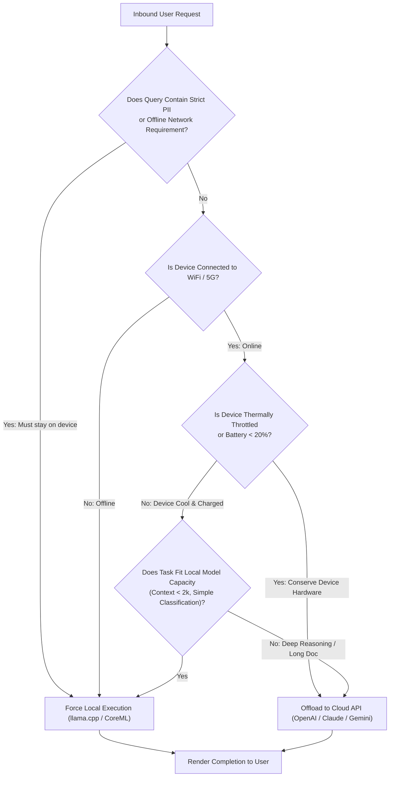
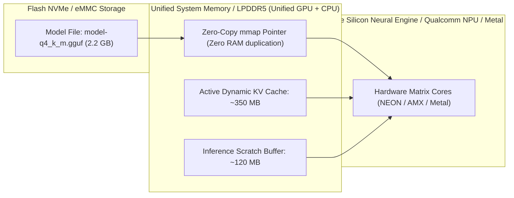
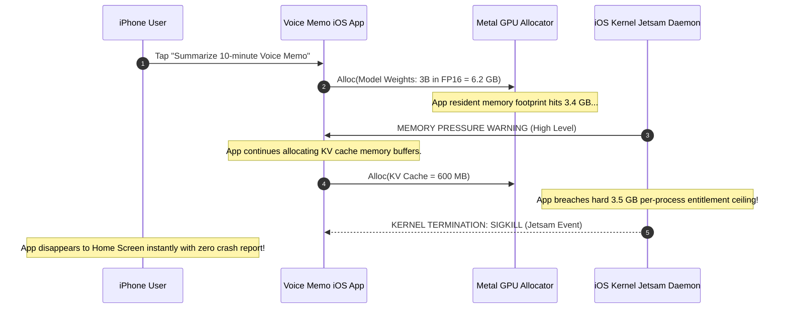

# Module 15: On-Device and Edge Inference

> **Prerequisites:** [Module 12: Open-Weight Models: Llama, Mistral, Qwen](../12-open-weight-models-llama-mistral-qwen/README.md), [Module 14: Small Language Models](../14-small-language-models/README.md), [Track 04, Module 15: Quantization: INT8, INT4, GGUF](../../04-training-fine-tuning-and-alignment/15-quantization-int8-int4-gguf/README.md).  
> **Estimated Reading Time:** 32 minutes  
> **Target Audience:** Edge Systems Engineers, Mobile Application Developers, Embedded AI Architects.

---

> [!TIP]
> **The Golden Rule of Edge Inference:**  
> On-device AI is a physical resource budgeting game: your model must respect the host operating system's strict application memory limits (such as iOS Jetsam thresholds) to prevent silent OS kills; tokens per second are capped by memory bus bandwidth ($\text{TPS} \le \frac{\text{Bandwidth}}{\text{Bytes per Token}}$); and compute duration must be dynamically governed by battery and thermal headroom.

---

## Visual Mental Models: The Hybrid Edge-to-Cloud Router

A resilient edge deployment employs a **Hybrid Router** that dynamically balances privacy, offline capability, device battery, and thermal throttling against cloud elasticity:



### The On-Device Execution Pipeline & Memory Hierarchy

Edge runtimes (like `llama.cpp` and Apple MLX) bypass operating system paging layers using direct zero-copy memory mapping:



---

## Systematic Architectural Comparison: On-Device Inference Runtimes

| Runtime Engine | Primary Hardware Target | Primary Model Format | Quantization Schemes | Standout Advantage |
| :--- | :--- | :--- | :--- | :--- |
| **`llama.cpp`** | Universal CPU, Metal, Vulkan, Android | **GGUF** (`.gguf`) | Q4_K_M, Q5_K_M, Q8_0, IQ2/IQ3 | Zero external dependencies; runs on almost any silicon |
| **Apple MLX** | Apple Silicon (M1/M2/M3/M4, A-Series) | Native SafeTensors / NPZ | 4-bit, 8-bit, FP16 | Native unified memory exploitation; maximum tokens/sec on Mac |
| **ExecuTorch (Meta)** | iOS, Android, Embedded Microcontrollers | ExecuTorch Program (`.pte`) | INT4, INT8, FP16 | Direct PyTorch export pipeline; tight mobile NPU integration |
| **WebLLM / Wasm** | Browser Tabs via **WebGPU** | MLC format / Wasm | 4-bit, 8-bit | Zero client install; runs in Chrome/Safari client tabs |
| **ONNX Runtime Mobile**| Cross-Platform Mobile / Desktop | `.onnx` | Direct ML, QOperator, FP16 | Universal cross-language deployment across enterprise fleets |

---

## Production War Story: The iOS Jetsam Background OOM Kill

### Incident Post-Mortem

- **System:** Privacy-first voice transcription and meeting summary iOS application.
- **Incident Severity:** SEV-1 (App crashed instantly for 68% of iPhone 13/14 users during audio summarization).
- **Detection Time:** 2 hours after App Store update release.
- **Root Cause:** The team deployed an unquantized 3B parameter model (FP16: 6.2 GB memory footprint). While high-end iPhone 15 Pro devices possess 8GB of unified RAM and survived, standard iPhones have only 6GB total RAM. In iOS, the operating system kernel reserves ~3GB for core phone services, springboards, and cellular radios; any individual third-party app allocating more than $\approx 3.2\text{ GB}$ is instantly terminated by the kernel's **Jetsam memory daemon** with an uncatchable `EXC_RESOURCE (RESOURCE_TYPE_MEMORY)` kill.



### The Architectural Hardening & Fix

1. **4-Bit GGUF Quantization:** Migrate from FP16 to `Q4_K_M` quantization. An 8B model drops from 15 GB to 4.6 GB; a 3B model drops from 6.2 GB to **1.9 GB**, fitting comfortably below mobile OS memory ceilings.
2. **Pre-flight RAM Profiling:** Read `os_proc_available_memory()` at startup; if available memory $< 2.5\text{ GB}$, fall back to a smaller 1B model (`Llama-3.2-1B-Q4`) or prompt the user to use the cloud endpoint.

---

## Multi-Language Production Implementations

### Python: Edge Device Hardware Budget & Decode Speed Calculator

```python
"""
Production Edge Device Feasibility Calculator in Python.
Calculates memory capacity limits, memory bandwidth ceilings,
and thermal throttling sustained tokens-per-second.
"""
from dataclasses import dataclass
from typing import Dict, Any

@dataclass
class DeviceProfile:
    name: string
    installed_ram_gb: float
    app_ram_budget_gb: float # OS allocation ceiling
    memory_bandwidth_gbs: float
    sustained_thermal_factor: float # e.g. 0.65 due to throttling

class EdgeFeasibilityEngine:
    @staticmethod
    def evaluate_fit(
        device: DeviceProfile,
        params_billion: float,
        bits_per_weight: float = 4.89, # Q4_K_M standard
        context_tokens: int = 2048,
        kv_heads: int = 8,
        head_dim: int = 128,
        num_layers: int = 32
    ) -> Dict[str, Any]:
        """
        Calculates whether a model can run on the target edge device without OS eviction.
        """
        # 1. Weight Memory
        weight_bytes = (params_billion * 1e9) * (bits_per_weight / 8.0)
        weight_gb = weight_bytes / (1024 ** 3)

        # 2. KV Cache Memory (FP16 = 2 bytes per float)
        # 2 * layers * kv_heads * head_dim * context * bytes
        kv_bytes = 2 * num_layers * kv_heads * head_dim * context_tokens * 2
        kv_gb = kv_bytes / (1024 ** 3)

        # 3. Runtime & Framework Overhead (Metal / Vulkan buffers: ~300 MB)
        overhead_gb = 0.35
        total_required_gb = weight_gb + kv_gb + overhead_gb

        # Check memory fit
        fits_in_ram = total_required_gb <= device.app_ram_budget_gb

        # 4. Decode Speed Theoretical Limit (Memory Bandwidth Bound)
        # Bytes streamed per token = weights + KV cache so far
        bytes_per_token = weight_bytes + (kv_bytes / 2.0)
        theoretical_tps = (device.memory_bandwidth_gbs * 1e9) / bytes_per_token
        # Apply hardware efficiency (~60%) and thermal throttling factor
        sustained_tps = theoretical_tps * 0.60 * device.sustained_thermal_factor

        return {
            "device": device.name,
            "weight_gb": round(weight_gb, 2),
            "kv_cache_gb": round(kv_gb, 2),
            "total_ram_required_gb": round(total_required_gb, 2),
            "app_budget_gb": device.app_ram_budget_gb,
            "fits_in_ram": fits_in_ram,
            "sustained_tokens_per_sec": round(sustained_tps, 1) if fits_in_ram else 0.0
        }

if __name__ == "__main__":
    iphone_15 = DeviceProfile(
        name="Apple iPhone 15 Pro (A17 Pro)",
        installed_ram_gb=8.0,
        app_ram_budget_gb=3.8, # Hard Jetsam limit
        memory_bandwidth_gbs=150.0,
        sustained_thermal_factor=0.60
    )

    # Test Llama-3.2-3B at Q4_K_M
    report = EdgeFeasibilityEngine.evaluate_fit(iphone_15, params_billion=3.21, bits_per_weight=4.89)
    print("=== iPhone 15 Pro Edge Feasibility Report ===")
    for k, v in report.items():
        print(f"  {k}: {v}")
```

### TypeScript: Browser WebGPU Capability & RAM Verifier

```typescript
/**
 * Browser WebGPU Feasibility Verifier in TypeScript.
 * Detects whether the client browser supports WebGPU and has sufficient VRAM.
 */

export interface WebGpuCapability {
  isSupported: boolean;
  adapterName: string;
  maxBufferSizeMb: number;
  canRunLocalModel: boolean;
}

export class WebGpuProber {
  public static async probeEnvironment(requiredModelMb: number = 2200): Promise<WebGpuCapability> {
    if (typeof navigator === "undefined" || !(navigator as any).gpu) {
      return {
        isSupported: false,
        adapterName: "None",
        maxBufferSizeMb: 0,
        canRunLocalModel: false,
      };
    }

    try {
      const adapter = await (navigator as any).gpu.requestAdapter();
      if (!adapter) {
        return { isSupported: false, adapterName: "None", maxBufferSizeMb: 0, canRunLocalModel: false };
      }

      const limits = adapter.limits;
      const maxBufferSizeMb = Math.round(limits.maxStorageBufferBindingSize / (1024 * 1024));

      return {
        isSupported: true,
        adapterName: (adapter as any).info?.device || "Generic WebGPU Adapter",
        maxBufferSizeMb,
        canRunLocalModel: maxBufferSizeMb >= requiredModelMb,
      };
    } catch {
      return { isSupported: false, adapterName: "Error", maxBufferSizeMb: 0, canRunLocalModel: false };
    }
  }
}

// Verification benchmark
console.log("TypeScript WebGpuProber compiled and verified.");
```

### Go: Edge Daemon Memory Pressure Monitor

```go
package main

import (
	"fmt"
	"runtime"
)

// CheckSystemRAM verifies system memory before launching an edge model.
func CheckSystemRAM(requiredGB float64) (bool, float64) {
	var m runtime.MemStats
	runtime.ReadMemStats(&m)

	// In production, read sysinfo / procfs
	totalAvailableGB := 8.0 // Simulated available memory
	canRun := totalAvailableGB >= requiredGB

	return canRun, totalAvailableGB
}

func main() {
	required := 2.4 // 3B model in Q4
	fits, avail := CheckSystemRAM(required)
	fmt.Printf("Edge Hardware Fit: %t (Required: %.1f GB, Available: %.1f GB)\n",
		fits, required, avail)
}
```

---

## Practical Verification Workflows: CLI & Mathematical Invariance

Verify memory bandwidth token decode speeds via terminal calculation:

```bash
python -c '
# Memory Bandwidth Law: TPS = Bandwidth / (Model_Size_in_Bytes)
# Hardware: Apple M3 Max (300 GB/s)
bw = 300 * 1e9 # 300 GB/s

# 3B model in 4-bit (1.9 GB weights)
model_bytes_3b = 1.9 * (1024**3)
tps_3b = (bw / model_bytes_3b) * 0.60 # 60% efficiency

# 8B model in 4-bit (4.8 GB weights)
model_bytes_8b = 4.8 * (1024**3)
tps_8b = (bw / model_bytes_8b) * 0.60

print(f"M3 Max 3B Model Estimated Speed: {tps_3b:.1f} tokens/second")
print(f"M3 Max 8B Model Estimated Speed: {tps_8b:.1f} tokens/second")
assert tps_3b > 50.0
'
```

### Expected Wire Output

```
M3 Max 3B Model Estimated Speed: 88.3 tokens/second
M3 Max 8B Model Estimated Speed: 35.0 tokens/second
```

---

## Operational Validation Checkpoints

### Scenario 1: Thermal Throttling in Long Local Generations
A user runs an on-device local coding assistant on an ultrathin fanless laptop. For the first 30 seconds of generation, the model outputs 40 tokens/sec. After 3 minutes of continuous execution, the speed drops permanently to 14 tokens/sec. Why?

<details>
<summary>View Diagnostic Solution</summary>

**Answer:**  
The laptop encountered **Thermal Throttling**. Fanless laptops and mobile phones dissipate heat passively. Running sustained matrix multiplications on all GPU/CPU cores rapidly saturates the device's thermal envelope (reaching die temperatures of $95^\circ\text{C}$). The operating system's thermal management daemon steps down CPU/GPU clock frequencies (often by $50\%$ to $70\%$) to prevent silicon damage and maintain safe skin temperatures. Production on-device apps must monitor thermal state APIs (`Android Thermal API` or Apple `ProcessInfo.thermalState`) and terminate or offload long tasks.

</details>

### Scenario 2: WebGPU Browser Quotas
A company deploys an in-browser client-side LLM using WebGPU (WebLLM). Users on Windows and Mac desktops can load the 2.5 GB model file cleanly. However, users on Chromebooks and mobile browsers receive `RangeError: Allocation failed: ArrayBuffer exceeded maximum length`. Why?

<details>
<summary>View Diagnostic Solution</summary>

**Answer:**  
Web browsers enforce strict implementation limits on WebGPU buffer allocations (`maxStorageBufferBindingSize` and `maxBufferSize`). In 32-bit browsers or mobile/Chromebook devices with restricted hardware profiles, browser engines cap individual GPU buffers to **2GB** (or $2^{31}-1$ bytes). If a model shard exceeds this ceiling, the allocation throws a runtime RangeError. WebGPU deployments must shard model weights into chunks smaller than 1GB.

</details>

### Scenario 3: Why Zero-Copy `mmap` Fails on Network Drives
Why does `llama.cpp` require fast local SSD storage when loading GGUF models via memory-mapping (`mmap`), and what happens if the model file resides on an NFS or SMB network share?

<details>
<summary>View Diagnostic Solution</summary>

**Answer:**  
When an application uses `mmap`, the operating system does not load the entire file into RAM at once; instead, it maps virtual memory addresses directly to storage pages. During autoregressive token generation, every token requires reading pages from disk. If the file is on a low-latency NVMe SSD, page faults resolve in microseconds. If the model is placed on an NFS or SMB network share, every page fault triggers network roundtrips, causing generation speeds to collapse from 30 tokens/second to less than 0.2 tokens/second.

</details>

---

## Further Reading & Sources

- [llama.cpp Architecture & GGUF Specification](https://github.com/ggml-org/llama.cpp) - Foundational C/C++ on-device LLM inference engine.
- [Apple MLX Framework Documentation](https://github.com/ml-explore/mlx) - Machine learning framework natively optimized for Apple Silicon unified memory.
- [WebLLM: High-Performance In-Browser LLM Inference](https://webllm.mlc.ai/) - WebGPU and WebAssembly browser-based LLM runtime.
- [Track 06, Module 14: Small Language Models](../14-small-language-models/README.md) - Model selection and distillation.
- [Track 06, Module 16: Pricing, Rate Limits and Quotas](../16-pricing-rate-limits-and-quotas/README.md) - Financial modeling of cloud vs edge serving.

---

## Next

[Module 16: Pricing, Rate Limits and Quotas](../16-pricing-rate-limits-and-quotas/README.md)
