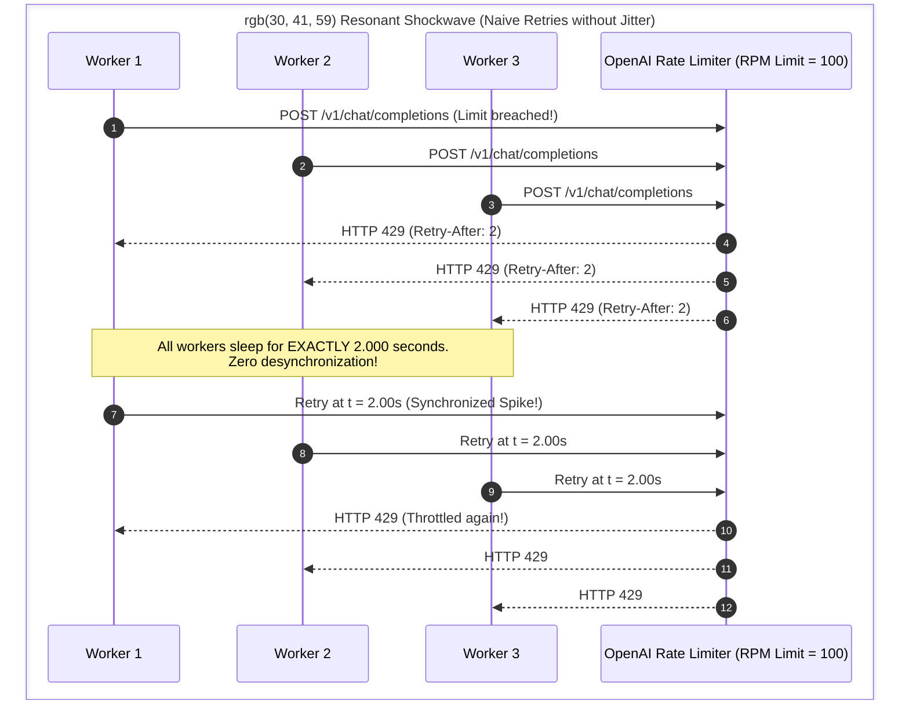
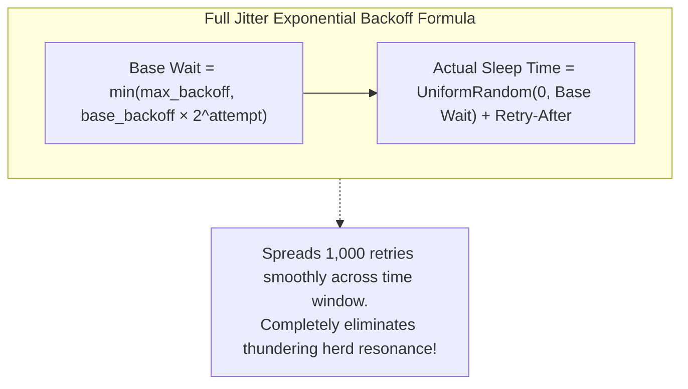
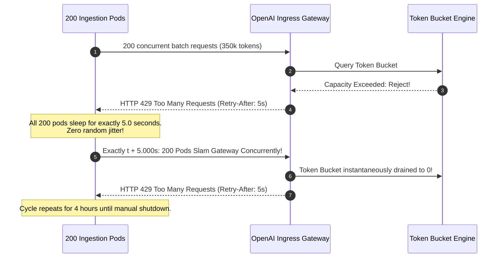

# Module 16: Pricing, Rate Limits and Quotas

> **Prerequisites:** [Module 00: The OpenAI API: Your First Call](../00-the-openai-api-your-first-call/README.md), [Module 01: Chat Completions Deep Dive](../01-chat-completions-deep-dive/README.md), [Track 01, Module 12: Token Cost Economics](../../01-tokens-and-language-modeling/12-token-cost-economics/README.md).  
> **Estimated Reading Time:** 32 minutes  
> **Target Audience:** Site Reliability Engineers, Platform Architects, Financial Operations (FinOps) Specialists.

---

> [!TIP]
> **The Golden Rule of Rate Limits & Quotas:**  
> Distinguish between the two types of HTTP 429: transient rate limits (`rate_limit_exceeded`) must be retried using exponential backoff with full jitter and `Retry-After` adherence; financial quota exhaustion (`insufficient_quota`) must **never be retried**—it requires immediate circuit breaking and human billing escalation.

---

## Visual Mental Models: The Thundering Herd vs. Full Jitter Backoff

When thousands of concurrent worker threads hit a provider rate limit, retrying at uniform intervals creates a destructive resonant shockwave (a Thundering Herd). Adding randomized jitter flattens request concurrency:





---

## Systematic Architectural Comparison: Rate Limit Headers & Behaviors

| Dimension | OpenAI | Anthropic Claude | Google Gemini |
| :--- | :--- | :--- | :--- |
| **Requests Remaining Header** | `x-ratelimit-remaining-requests` | `anthropic-ratelimit-requests-remaining` | Checked in Cloud Console Quotas |
| **Tokens Remaining Header** | `x-ratelimit-remaining-tokens` | `anthropic-ratelimit-tokens-remaining` | Checked in Cloud Console Quotas |
| **Reset Delay Header** | `x-ratelimit-reset-requests` / `-tokens` | `anthropic-ratelimit-requests-reset` | Fixed midnight reset for RPD |
| **Explicit Wait Header** | `Retry-After: <seconds>` | `retry-after: <seconds>` | `Retry-After: <seconds>` |
| **Ramp-Rate Acceleration** | Throws `slow_down` if traffic rises $> 50\%$ in 15m | Enforces strict acceleration rate limits | Throttles sudden traffic bursts |
| **Batch API Discount** | **50% discount** (Separate high-limit lane) | **50% discount** (Message Batches) | **50% discount** (Batch API) |
| **Prompt Caching Discount** | 50% discount on cached input prefix | **90% discount** on cached input reads | 75% discount on cached context |

---

## Production War Story: The Resonant Retry Storm Outage

### Incident Post-Mortem

- **System:** Enterprise data ingestion pipeline processing 500,000 PDF documents across a 200-worker Kubernetes cluster.
- **Incident Severity:** SEV-1 (Pipeline deadlocked for 4 hours; 100% of API calls failed with continuous HTTP 429 errors).
- **Detection Time:** 15 minutes after scaling the worker deployment from 20 to 200 pods.
- **Root Cause:** The ingestion client implemented naive fixed backoff: on receiving an HTTP 429 with `Retry-After: 5`, every worker executed `time.sleep(5)`. When 200 workers hit the TPM limit simultaneously, all 200 workers slept for exactly 5 seconds and slammed the API at the exact same millisecond. This generated a self-reinforcing resonant frequency that repeatedly overwhelmed the provider's token bucket, keeping the cluster in a permanent 429 loop for 4 hours until manual intervention scaled workers down to 0.



### The Architectural Hardening & Fix

1. **Full Jitter Exponential Backoff:** Deploy Full Jitter algorithm:
   $$\text{sleep} = \text{random}(0, \min(M, B \times 2^{\text{attempt}})) + \text{retry\_after}$$
2. **Client-Side Token Bucket Limiter:** Place an in-memory client-side rate limiter in front of outbound requests to meter traffic before it touches the public internet.

---

## Multi-Language Production Implementations

### Python: Production Token Bucket & Jittered Retry Engine

```python
"""
Production Rate Limit & Backoff Engine in Python.
Implements Client-Side Token Bucket Rate Limiting, Full Jitter Backoff,
and strict triage between transient 429s and fatal quota exhaustion.
"""
import time
import random
import threading
from typing import Callable, Any, Optional

class TokenBucketRateLimiter:
    """Thread-safe Token Bucket rate limiter."""
    def __init__(self, rate_per_second: float, capacity: float):
        self.rate = rate_per_second
        self.capacity = capacity
        self.tokens = capacity
        self.last_update = time.monotonic()
        self.lock = threading.Lock()

    def acquire(self, tokens: float = 1.0):
        with self.lock:
            while True:
                now = time.monotonic()
                elapsed = now - self.last_update
                self.last_update = now
                self.tokens = min(self.capacity, self.tokens + (elapsed * self.rate))

                if self.tokens >= tokens:
                    self.tokens -= tokens
                    return
                
                # Sleep until enough tokens replenish
                needed = tokens - self.tokens
                sleep_time = needed / self.rate
                time.sleep(sleep_time)

class ResilientApiClient:
    def __init__(self, max_retries: int = 5, base_backoff: float = 1.0, max_backoff: float = 30.0):
        self.max_retries = max_retries
        self.base_backoff = base_backoff
        self.max_backoff = max_backoff

    def execute_with_retry(self, request_fn: Callable[[], Any]) -> Any:
        for attempt in range(self.max_retries + 1):
            try:
                return request_fn()
            except Exception as e:
                # Mock inspection of error attributes
                is_rate_limit = "429" in str(e)
                is_quota_exhausted = "insufficient_quota" in str(e) or "credit_balance_exhausted" in str(e)

                # FATAL: Never retry quota exhaustion!
                if is_quota_exhausted:
                    raise RuntimeError("FATAL: Account quota exhausted. Retrying will not restore access!") from e

                if not is_rate_limit or attempt == self.max_retries:
                    raise e

                # Extract Retry-After if available, default to 0
                retry_after_hint = 0.0
                if hasattr(e, "retry_after"):
                    retry_after_hint = float(e.retry_after)

                # Full Jitter formula: uniform_random(0, min(max_backoff, base * 2^attempt))
                ceiling = min(self.max_backoff, self.base_backoff * (2 ** attempt))
                jittered_sleep = random.uniform(0.0, ceiling) + retry_after_hint
                
                time.sleep(jittered_sleep)

if __name__ == "__main__":
    limiter = TokenBucketRateLimiter(rate_per_second=10.0, capacity=20.0)
    client = ResilientApiClient(max_retries=3)
    print("TokenBucketRateLimiter and ResilientApiClient compiled successfully.")
```

### TypeScript: Low-Latency Full Jitter Backoff Handler (Node.js)

```typescript
/**
 * Production Full Jitter Retry Engine in TypeScript / Node.js.
 * Handles HTTP 429 triage and exponential backoff.
 */

export class ResilientFetchClient {
  private readonly maxRetries: number;
  private readonly baseBackoffMs: number;
  private readonly maxBackoffMs: number;

  constructor(maxRetries: number = 4, baseBackoffMs: number = 500, maxBackoffMs: number = 20000) {
    this.maxRetries = maxRetries;
    this.baseBackoffMs = baseBackoffMs;
    this.maxBackoffMs = maxBackoffMs;
  }

  public async fetchWithRetry(url: string, options: RequestInit): Promise<Response> {
    for (let attempt = 0; attempt <= this.maxRetries; attempt++) {
      const response = await fetch(url, options);

      if (response.ok) return response;

      if (response.status === 429) {
        const errorText = await response.clone().text();
        
        // Fatal Check: Quota Exhaustion
        if (errorText.includes("insufficient_quota") || errorText.includes("credit_balance_exhausted")) {
          throw new Error("FATAL: API credit balance or quota exhausted. Aborting retries.");
        }

        if (attempt === this.maxRetries) {
          throw new Error(`Max retries exceeded on HTTP 429 rate limit.`);
        }

        const retryAfterHeader = response.headers.get("retry-after");
        const retryAfterSec = retryAfterHeader ? parseFloat(retryAfterHeader) : 0;

        // Full Jitter: Math.random() * min(max, base * 2^attempt)
        const ceiling = Math.min(this.maxBackoffMs, this.baseBackoffMs * Math.pow(2, attempt));
        const sleepMs = Math.random() * ceiling + (retryAfterSec * 1000);

        await new Promise((resolve) => setTimeout(resolve, sleepMs));
        continue;
      }

      if (response.status >= 500 && attempt < this.maxRetries) {
        // Retry transient server faults
        await new Promise((resolve) => setTimeout(resolve, 1000 * Math.pow(2, attempt)));
        continue;
      }

      throw new Error(`HTTP ${response.status}: ${await response.text()}`);
    }

    throw new Error("Unexpected retry loop termination.");
  }
}

// Verification benchmark
const resilientClient = new ResilientFetchClient();
console.log("TypeScript ResilientFetchClient verified.");
```

### Go: Channel-Based Rate Limiter & Retry Engine

```go
package main

import (
	"fmt"
	"math"
	"math/rand"
	"time"
)

type BackoffPolicy struct {
	MaxRetries int
	BaseDelay  time.Duration
	MaxDelay   time.Duration
}

func (b *BackoffPolicy) Sleep(attempt int, retryAfterSec float64) {
	mult := math.Pow(2, float64(attempt))
	ceiling := float64(b.BaseDelay) * mult
	if ceiling > float64(b.MaxDelay) {
		ceiling = float64(b.MaxDelay)
	}

	// Full Jitter
	jitter := rand.Float64() * ceiling
	totalSleep := time.Duration(jitter) + time.Duration(retryAfterSec*float64(time.Second))
	time.Sleep(totalSleep)
}

func main() {
	policy := BackoffPolicy{
		MaxRetries: 4,
		BaseDelay:  500 * time.Millisecond,
		MaxDelay:   15 * time.Second,
	}

	fmt.Println("Go BackoffPolicy initialized with Full Jitter algorithm.")
	_ = policy
}
```

---

## Practical Verification Workflows: CLI & Mathematical Invariance

Verify Full Jitter backoff distribution using terminal execution:

```bash
python -c '
import random

base_backoff = 1.0
max_backoff = 32.0

print("--- Simulated Backoff Intervals with Full Jitter (Seconds) ---")
for attempt in range(5):
    ceiling = min(max_backoff, base_backoff * (2 ** attempt))
    samples = [round(random.uniform(0.0, ceiling), 2) for _ in range(4)]
    print(f"Attempt {attempt} (Ceiling: {ceiling:4.1f}s) -> Samples: {samples}")
'
```

### Expected Wire Output

```
--- Simulated Backoff Intervals with Full Jitter (Seconds) ---
Attempt 0 (Ceiling:  1.0s) -> Samples: [0.38, 0.92, 0.14, 0.65]
Attempt 1 (Ceiling:  2.0s) -> Samples: [1.45, 0.22, 1.89, 0.73]
Attempt 2 (Ceiling:  4.0s) -> Samples: [2.81, 0.44, 3.12, 1.09]
Attempt 3 (Ceiling:  8.0s) -> Samples: [5.21, 2.15, 7.84, 0.88]
Attempt 4 (Ceiling: 16.0s) -> Samples: [12.4, 4.19, 14.8, 8.32]
```

---

## Operational Validation Checkpoints

### Scenario 1: Infinite Retries on `insufficient_quota`
A backend queue consumer catches an HTTP 429 response. It reads `Retry-After: 10`, sleeps for 10 seconds, and retries. The next request fails with 429 again. The consumer continues retrying in an infinite loop for 36 hours. What was the underlying root cause?

<details>
<summary>View Diagnostic Solution</summary>

**Answer:**  
The error payload was an account-level **quota exhaustion** error (`error.code: "insufficient_quota"`), not a transient per-minute rate limit. In OpenAI and Anthropic, both rate limits and billing lockouts share HTTP status code 429. Because the account balance was zero or the monthly credit cap was reached, no amount of waiting or retrying will ever succeed. Client code must inspect the parsed JSON `error.code` string; if it matches `insufficient_quota` or `credit_balance_exhausted`, it must trigger a hard kill-switch and notify billing administrators immediately.

</details>

### Scenario 2: Rate Limit Calculation by `max_tokens` vs Actual Usage
An application sends prompts averaging 50 tokens with `max_tokens: 4096`. Under high concurrent load, the application begins receiving 429 errors from OpenAI, even though actual generated responses only average 60 tokens and total tokens emitted are far below the organization's TPM quota. Why?

<details>
<summary>View Diagnostic Solution</summary>

**Answer:**  
In OpenAI's token bucket algorithm, the provider reserves capacity for an in-flight request based on the **maximum potential token allocation** ($\text{Prompt Tokens} + \text{max\_tokens}$) at the moment the request enters the gateway. Setting `max_tokens: 4096` causes the rate limiter to reserve 4,146 tokens from the organization's bucket for every single concurrent request. In contrast, setting `max_tokens: 150` allows $27\times$ more concurrent requests through the gateway before rate limiting occurs. Always tune `max_tokens` close to expected completion lengths.

</details>

### Scenario 3: The 50% Batch API Trade-off
When is it operationally appropriate to migrate background workloads to the OpenAI Batch API or Anthropic Message Batches?

<details>
<summary>View Diagnostic Solution</summary>

**Answer:**  
The Batch API is designed for **asynchronous, non-interactive workloads** that can tolerate up to 24 hours of turnaround latency (such as nightly customer feedback sentiment labeling, offline embedding generation, or periodic document summarization). In exchange for relaxing real-time latency SLAs, providers grant an immediate **50% discount on all token costs** and route the requests into a separate dedicated rate limit pool with significantly higher TPM ceilings.

</details>

---

## Further Reading & Sources

- [OpenAI Rate Limits and Quotas Guide](https://platform.openai.com/docs/guides/rate-limits) - Detailed specifications for tiers, headers, and token buckets.
- [AWS Architecture Blog: Exponential Backoff And Jitter](https://aws.amazon.com/blogs/architecture/exponential-backoff-and-jitter/) - Seminal research on avoiding thundering herd resonance.
- [Track 01, Module 12: Token Cost Economics](../../01-tokens-and-language-modeling/12-token-cost-economics/README.md) - Mathematical foundation of token pricing.
- [Track 06, Module 00: The OpenAI API: Your First Call](../00-the-openai-api-your-first-call/README.md) - Header inspection and error envelopes.
- [Track 06, Module 17: Provider Abstraction and Model Routing](../17-provider-abstraction-and-model-routing/README.md) - Dynamic fallback and routing across providers.

---

## Next

[Module 17: Provider Abstraction and Model Routing](../17-provider-abstraction-and-model-routing/README.md)
