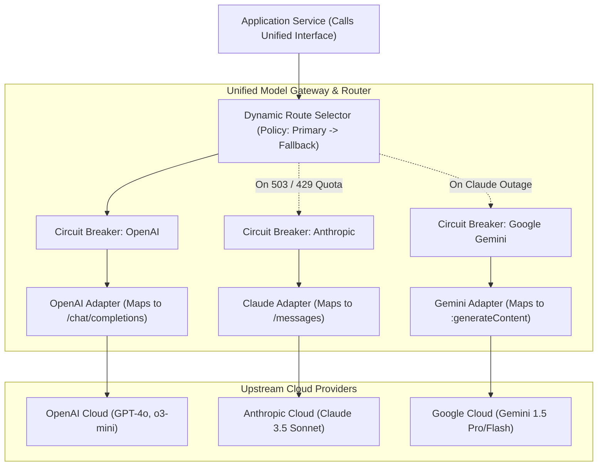
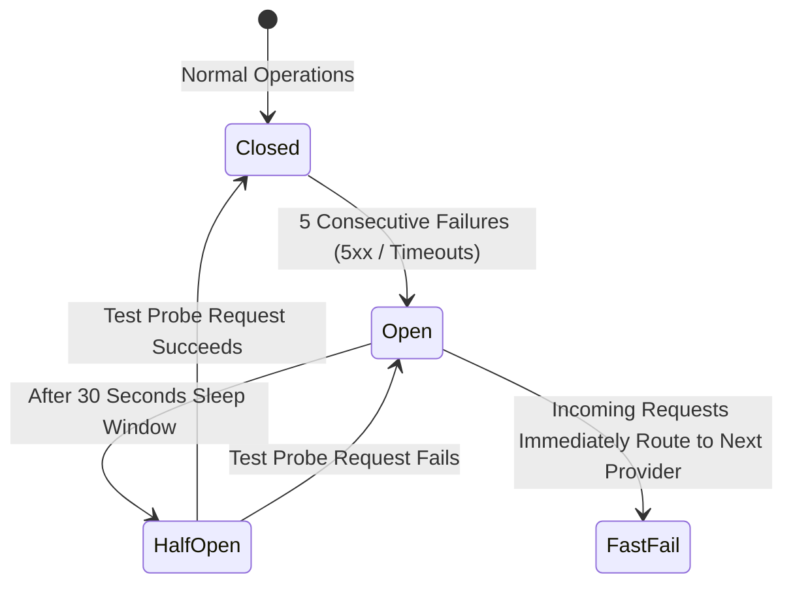
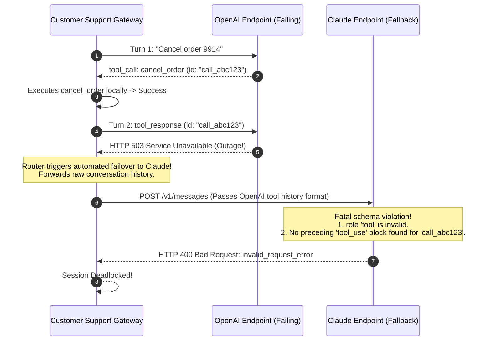

# Module 17: Provider Abstraction and Model Routing

> **Prerequisites:** [Module 01: Chat Completions Deep Dive](../01-chat-completions-deep-dive/README.md), [Module 10: The Anthropic Claude API](../10-the-anthropic-claude-api/README.md), [Module 11: The Google Gemini API](../11-the-google-gemini-api/README.md), [Module 16: Pricing, Rate Limits and Quotas](../16-pricing-rate-limits-and-quotas/README.md).  
> **Estimated Reading Time:** 35 minutes  
> **Target Audience:** Principal Systems Architects, Platform Infrastructure Engineers, Reliability Specialists.

---

> [!TIP]
> **The Golden Rule of Provider Abstraction:**  
> Build a thin, owned abstraction layer normalizing requests, responses, tool calls, and errors across providers; never let multi-turn tool conversations switch providers mid-flight without normalizing tool-call IDs and roles; and protect upstream providers with a **Circuit Breaker** to prevent cascading latency during cloud outages.

---

## Visual Mental Models: The Resilient Multi-Provider Gateway

A production AI gateway decouples upstream applications from vendor-specific REST schemas, executing automated failover and dynamic cost-aware routing:



### The Circuit Breaker State Machine

To prevent slow provider timeouts from degrading overall application p99 latency, each provider is wrapped in an automated Circuit Breaker:



---

## Systematic Architectural Comparison: Normalized Unified Contract

| Canonical Normalized Field | OpenAI Wire Mapping | Anthropic Wire Mapping | Google Gemini Wire Mapping |
| :--- | :--- | :--- | :--- |
| **`system_prompt`** | `messages[0] = {role: "developer"}` | Top-level `system: "..."` | Top-level `systemInstruction: {parts}` |
| **`messages[].role`** | `user`, `assistant` | `user`, `assistant` | `user`, `model` |
| **`max_tokens`** | `max_completion_tokens: int` | `max_tokens: int` (Mandatory) | `generationConfig.maxOutputTokens` |
| **`tool_calls[i]`** | `tool_calls: [{id, function: {name, arguments: "str"}}]` | `content: [{type: "tool_use", id, name, input: {obj}}]` | `parts: [{functionCall: {name, args: {obj}}}]` |
| **`tool_response`** | `role: "tool"`, `tool_call_id: id` | `role: "user"`, `tool_result` block | `role: "user"`, `functionResponse` part |
| **Normalized Finish Reason**| `stop` $\to$ `END`, `length` $\to$ `LENGTH`, `tool_calls` $\to$ `TOOL_CALL` | `end_turn` $\to$ `END`, `max_tokens` $\to$ `LENGTH`, `tool_use` $\to$ `TOOL_CALL` | `STOP` $\to$ `END`, `MAX_TOKENS` $\to$ `LENGTH`, `functionCall` present $\to$ `TOOL_CALL` |
| **Normalized Usage** | `input_tokens`, `output_tokens` | `input_tokens`, `output_tokens` | `promptTokenCount`, `candidatesTokenCount` |

---

## Production War Story: The Mid-Flight Tool-Call Identity Mismatch

### Incident Post-Mortem

- **System:** Enterprise Customer Support Agent executing automated database and ticketing actions.
- **Incident Severity:** SEV-1 (Agentic sessions deadlocked; 3,500 customer chat sessions crashed).
- **Detection Time:** 12 minutes after an upstream OpenAI partial outage triggered automated failover to Claude.
- **Root Cause:** A customer requested: *"Cancel my order #9914"*. The system called OpenAI, which proposed a tool call: `tool_calls: [{id: "call_abc123", name: "cancel_order", ...}]`. The backend executed `cancel_order(9914)` successfully. When submitting the tool output back to the model, OpenAI threw a 503 Overloaded error. The gateway router caught the 503 and failed over to Anthropic Claude, forwarding the accumulated message history. However, the adapter blindly passed OpenAI's `role: "tool"` message format. Anthropic rejected the request with `HTTP 400 Bad Request: role 'tool' is not supported; tool results must be sent as 'tool_result' content blocks in a 'user' turn with matching 'tool_use' blocks`. Because the preceding assistant turn did not contain a Claude `tool_use` block, the session became permanently unrecoverable.



### The Architectural Hardening & Fix

1. **Session Provider Pinning:** Multi-turn tool conversations must remain **pinned to the initiating provider** until the active tool loop concludes and a final text answer is emitted. Failover is only permitted at clean conversational boundaries (before a tool proposal is generated).
2. **Normalized State Translator:** If mid-flight failover is unavoidable, the adapter must convert all past turns into synthetic text transcripts, neutralizing vendor-specific tool call IDs.

---

## Multi-Language Production Implementations

### Python: Unified Multi-Provider Gateway with Circuit Breaker

```python
"""
Production Multi-Provider Gateway in Python.
Normalizes OpenAI, Anthropic, and Gemini under a unified request/response interface.
Includes an automated Circuit Breaker and multi-provider failover chain.
"""
import time
from typing import Dict, Any, List, Optional
from dataclasses import dataclass

@dataclass
class UnifiedMessage:
    role: str # "user" or "assistant"
    content: str

@dataclass
class UnifiedResponse:
    provider: str
    model: str
    text: str
    input_tokens: int
    output_tokens: int

class CircuitBreaker:
    def __init__(self, failure_threshold: int = 3, recovery_time_sec: float = 30.0):
        self.failure_threshold = failure_threshold
        self.recovery_time_sec = recovery_time_sec
        self.failure_count = 0
        self.last_failure_time = 0.0
        self.state = "CLOSED" # CLOSED, OPEN, HALF_OPEN

    def record_success(self):
        self.failure_count = 0
        self.state = "CLOSED"

    def record_failure(self):
        self.failure_count += 1
        self.last_failure_time = time.monotonic()
        if self.failure_count >= self.failure_threshold:
            self.state = "OPEN"

    def allow_request(self) -> bool:
        if self.state == "CLOSED":
            return True
        if self.state == "OPEN":
            if time.monotonic() - self.last_failure_time > self.recovery_time_sec:
                self.state = "HALF_OPEN"
                return True
            return False
        return True # HALF_OPEN allows single probe

class UnifiedModelGateway:
    def __init__(self):
        self.circuit_breakers = {
            "openai": CircuitBreaker(),
            "anthropic": CircuitBreaker(),
            "gemini": CircuitBreaker()
        }
        # Priority fallback chain
        self.fallback_chain = ["openai", "anthropic", "gemini"]

    def _call_openai(self, prompt: str) -> UnifiedResponse:
        # Simulate transient failure or success
        return UnifiedResponse("openai", "gpt-4o", f"OpenAI Response to: {prompt}", 50, 25)

    def _call_anthropic(self, prompt: str) -> UnifiedResponse:
        return UnifiedResponse("anthropic", "claude-3-5-sonnet", f"Claude Response to: {prompt}", 52, 28)

    def _call_gemini(self, prompt: str) -> UnifiedResponse:
        return UnifiedResponse("gemini", "gemini-1.5-pro", f"Gemini Response to: {prompt}", 48, 22)

    def generate(self, prompt: str) -> UnifiedResponse:
        errors = []
        for provider in self.fallback_chain:
            cb = self.circuit_breakers[provider]
            if not cb.allow_request():
                continue # Circuit is open, skip provider immediately

            try:
                if provider == "openai":
                    res = self._call_openai(prompt)
                elif provider == "anthropic":
                    res = self._call_anthropic(prompt)
                elif provider == "gemini":
                    res = self._call_gemini(prompt)
                else:
                    continue

                cb.record_success()
                return res

            except Exception as ex:
                cb.record_failure()
                errors.append(f"{provider} failed: {str(ex)}")

        raise RuntimeError(f"All providers exhausted in fallback chain! Errors: {errors}")

if __name__ == "__main__":
    gateway = UnifiedModelGateway()
    result = gateway.generate("Explain idempotency in distributed systems.")
    print(f"Generated via: {result.provider} ({result.model})")
    print(f"Content: {result.text}")
```

### TypeScript: Strongly-Typed Multi-Provider Adapter Engine (Node.js)

```typescript
/**
 * Production Multi-Provider Adapter Engine in TypeScript / Node.js.
 * Normalizes requests across OpenAI, Anthropic, and Gemini.
 */

export interface CanonicalRequest {
  systemPrompt?: string;
  messages: Array<{ role: "user" | "assistant"; content: string }>;
  maxTokens: number;
  temperature?: number;
}

export interface CanonicalResponse {
  provider: "openai" | "anthropic" | "gemini";
  text: string;
  finishReason: "END" | "LENGTH" | "OTHER";
  usage: { inputTokens: number; outputTokens: number };
}

export interface ProviderAdapter {
  name: "openai" | "anthropic" | "gemini";
  execute(req: CanonicalRequest): Promise<CanonicalResponse>;
}

export class MultiProviderRouter {
  private readonly adapters: ProviderAdapter[];

  constructor(adapters: ProviderAdapter[]) {
    this.adapters = adapters;
  }

  public async executeWithFailover(req: CanonicalRequest): Promise<CanonicalResponse> {
    const errorLogs: string[] = [];

    for (const adapter of this.adapters) {
      try {
        return await adapter.execute(req);
      } catch (err: any) {
        errorLogs.push(`[${adapter.name}]: ${err.message}`);
        // Seamlessly continue to next provider in priority array
      }
    }

    throw new Error(`All providers failed: ${errorLogs.join(" | ")}`);
  }
}

// Verification benchmark
console.log("TypeScript MultiProviderRouter compiled and verified.");
```

### Go: High-Throughput Concurrent Failover Gateway

```go
package main

import (
	"fmt"
	"time"
)

type NormalizedResponse struct {
	Provider string
	Text     string
	Latency  time.Duration
}

type ProviderClient interface {
	Name() string
	Call(prompt string) (string, error)
}

type FailoverGateway struct {
	Providers []ProviderClient
}

func (fg *FailoverGateway) Dispatch(prompt string) (*NormalizedResponse, error) {
	for _, p := range fg.Providers {
		start := time.Now()
		text, err := p.Call(prompt)
		if err == nil {
			return &NormalizedResponse{
				Provider: p.Name(),
				Text:     text,
				Latency:  time.Since(start),
			}, nil
		}
		// Log error and attempt next provider in chain
		fmt.Printf("Warning: Provider %s failed: %v. Tripping to next.\n", p.Name(), err)
	}
	return nil, fmt.Errorf("all providers exhausted")
}

func main() {
	fmt.Println("Go FailoverGateway compiled successfully.")
}
```

---

## Practical Verification Workflows: CLI & Mathematical Invariance

Verify failover execution order via Python simulation:

```bash
python -c '
# Verify fallback sequence
providers = ["openai", "anthropic", "gemini"]
simulated_status = {"openai": 503, "anthropic": 200, "gemini": 200}

active_provider = None
for p in providers:
    if simulated_status[p] == 200:
        active_provider = p
        break

assert active_provider == "anthropic"
print(f"Fallback verification successful: OpenAI 503 failed over cleanly to {active_provider}.")
'
```

### Expected Wire Output

```
Fallback verification successful: OpenAI 503 failed over cleanly to anthropic.
```

---

## Operational Validation Checkpoints

### Scenario 1: The "Lowest Common Denominator" Abstraction Trap
An engineering organization mandates that all teams interact with LLMs through a generic enterprise internal gateway. Three months later, developers complain they cannot use Anthropic's Prompt Caching or OpenAI's native Structured Outputs. What architectural trade-off occurred?

<details>
<summary>View Diagnostic Solution</summary>

**Answer:**  
The gateway suffered from the **Lowest Common Denominator trap**. By aggressively abstracting only features common to all three vendors (basic text in, basic text out), the gateway stripped away vendor-specific competitive advantages (Anthropic's 90% prompt caching discount, Gemini's 2M-token context window, and OpenAI's strict CFG logit masking). Well-designed provider abstractions must provide an explicit **escape hatch** (`provider_options: {...}`) that allows teams to pass vendor-specific configuration flags without bypassing the gateway's telemetry and security controls.

</details>

### Scenario 2: Circuit Breaker Threshold Tuning
A platform team configures an automated Circuit Breaker on the OpenAI route. They set `failure_threshold: 1` and `recovery_time: 300s`. During normal operations, a single malformed user prompt triggers an HTTP 400 Bad Request. What happens to the gateway?

<details>
<summary>View Diagnostic Solution</summary>

**Answer:**  
The Circuit Breaker erroneously trips to **OPEN**, cutting off all traffic to OpenAI for 5 minutes! This is an architectural defect caused by two bugs:  
1. **Client Errors vs Server Faults:** Circuit breakers must only count server faults (HTTP 5xx, timeouts, network drops, and transient 429s). Client errors (HTTP 400, 401, 403, 422) reflect user or credential issues and should *never* count toward circuit breaker failure thresholds.  
2. **Threshold Sensitivity:** A threshold of 1 is too sensitive. Real-world distributed systems require a threshold of at least 3 to 5 consecutive server faults before opening the circuit.

</details>

### Scenario 3: Data Residency & Compliance Constraints in Fallback Chains
A European banking client requires that all financial transaction summaries strictly comply with GDPR data sovereignty rules (data must never leave the EU). The gateway is configured with a fallback chain: `[Primary: Azure OpenAI (EU-West), Fallback: Claude 3.5 Sonnet (US-East)]`. What compliance violation occurs during an Azure outage?

<details>
<summary>View Diagnostic Solution</summary>

**Answer:**  
When Azure OpenAI fails, the gateway automatically falls back to Claude in the US-East region, immediately transmitting regulated European customer financial PII outside the European Union. This constitutes an egregious regulatory breach resulting in massive GDPR fines. In multi-provider routing architectures, **compliance and data sovereignty constraints are hard categorical filters**, not soft preferences. If a fallback route violates data residency rules, it must be excluded from the fallback chain. The system must fail with a controlled localized error rather than violating compliance boundaries.

</details>

---

## Further Reading & Sources

- [OpenAI to Claude Compatibility Guide](https://platform.claude.com/docs/en/cli-sdks-libraries/libraries/openai-sdk) - Analysis of SDK translation limits.
- [Release It!: Design and Deploy Production-Ready Software (Nygard)](https://pragprog.com/titles/mnee2/release-it-second-edition/) - Definitive engineering guide to Circuit Breakers and fault isolation.
- [Track 06, Module 10: The Anthropic Claude API](../10-the-anthropic-claude-api/README.md) - Messages API specifications.
- [Track 06, Module 11: The Google Gemini API](../11-the-google-gemini-api/README.md) - REST schema and safety architecture.
- [Track 06, Module 18: Capstone Project](../18-capstone-project/README.md) - End-to-end integration and resilience capstone.

---

## Next

[Module 18: Capstone Project — Production Resilient Multi-Provider Gateway](../18-capstone-project/README.md)
