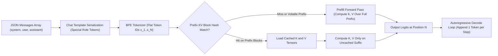
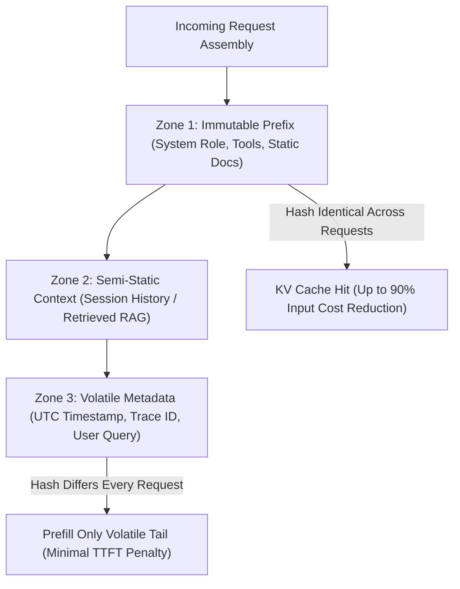
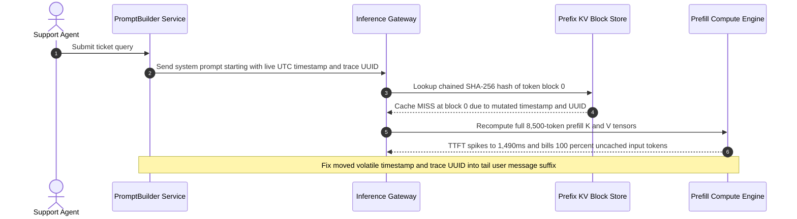

# Module 00: How Prompts Actually Work

> **Prerequisites:** [Track 06, Module 01: Chat Completions Deep Dive](../../06-openai-and-the-model-landscape/01-chat-completions-deep-dive/README.md), [Track 03, Module 08: GPT-3 and In-Context Learning](../../03-landmark-models-bert-gpt-and-moe/08-gpt-3-and-in-context-learning/README.md), and [Track 01, Module 10: Chat Templates and Message Formatting](../../01-tokens-and-language-modeling/10-chat-templates-and-message-formatting/README.md).  
> **Estimated Reading Time:** 28 minutes  
> **Target Audience:** AI Backend Engineers, Inference Platform Engineers, LLM FinOps Architects

> [!TIP]
> **The Golden Rule of Prompt Conditioning:**  
> Prompts do not "command" an imperative software interpreter—they serialize into a flat token prefix $x_{1:N}$ that shifts a frozen autoregressive probability distribution $P_{\theta}(x_t \mid x_{<t})$ through causal attention activations and cached Key-Value (KV) tensors. Placing a single volatile byte (such as a live timestamp or request UUID) at the front of a prompt destroys **100%** of prefix KV cache reuse and spikes both Time-to-First-Token (TTFT) and input token billing.

---

## Why This Matters

Most backend engineers initially treat an LLM API like a deterministic RPC endpoint wrapped around a human-like rule engine: write English instructions, expect exact rule execution, and ignore byte layout. In production, that mental model breaks immediately in three expensive ways:

1. **Silent KV Cache Destruction:** Modern inference engines (vLLM Automatic Prefix Caching, OpenAI Prompt Caching, Anthropic `cache_control`) hash sequential token blocks starting from token index `0`. Putting dynamic metadata (`Current Time`, `trace_id`, `user_id`) at the top of a system prompt forces full quadratic prefill recomputation on every single request.
2. **Instruction Dilution & Prior Collisions:** A prompt is never parsed into an Abstract Syntax Tree (AST). Every word in the prompt biases the next-token logits simultaneously—meaning weak phrasing, ambiguous delimiters, or rare terminology competes directly against billions of pretraining and alignment priors.
3. **Non-Determinism Across Models & Versions:** Even with `temperature=0`, floating-point reduction differences, mixture-of-experts (MoE) batch routing, and updated SFT/RLHF weights shift the conditional distribution $P_{\theta}(x_{N+1} \mid x_{1:N})$.

Understanding what happens mechanically from JSON message array to KV tensor cache turns prompting from guesswork into predictable systems engineering.

---

## 1. Architectural Mental Models: Prefix Conditioning & KV Cache Reuse

### From Structured Chat Messages to Flat Causal Token Streams

When your backend sends a `messages` array (`system`/`developer`, `user`, `assistant`) to an LLM API, the inference gateway does **not** keep those roles in separate memory slots. Before entering the transformer, a Jinja-style **chat template** serializes the entire conversation into one contiguous 1D token sequence wrapped in special control tokens (such as `<|im_start|>`, `<|im_end|>`, or `<|start_header_id|>`).



Once serialized into $x_{1:N}$, the model computes a single **prefill** forward pass across all $L$ transformer blocks, storing Key and Value matrices $K^{(l)}, V^{(l)} \in \mathbb{R}^{N \times n_{\text{kv}} \cdot d_{\text{head}}}$ for every layer $l \in \{1, \dots, L\}$. During the **decode** phase, generating each response token $x_{N+t}$ conditions sequentially on the entire preceding prefix:

$$P(x_{N+1:N+M} \mid x_{1:N}) = \prod_{t=1}^{M} P_{\theta}\!\left(x_{N+t} \mid x_{1:N}, x_{N+1:N+t-1}\right)$$

Notice three critical engineering consequences of this equation:

1. **Zero Weight Mutation:** Model weights $\theta$ remain completely frozen (`torch.no_grad()`). The prompt shapes behavior strictly via intermediate attention activations ($QK^\top / \sqrt{d_k}$) and residual stream shifts.
2. **Causal Asymmetry:** Because causal masking prevents token $i$ from attending to future tokens $j > i$, earlier tokens construct the semantic frame (`K, V`) that later tokens query, while the *final tokens* immediately preceding generation exert disproportionate recency influence on $x_{N+1}$.
3. **Distribution Shift, Not Logic Compilation:** Prompts never disable pretraining priors—they merely re-weight probability mass across the vocabulary $\mathcal{V}$.

### Base Models vs. Instruction-Tuned Models vs. Reasoning Models

Why does `"Summarize the outage below."` produce a clean summary on `gpt-4o` or `claude-sonnet`, whereas a raw base model like `gpt2` or `llama-3-base` might continue writing `"Summarize the outage below.\n2. Identify the root cause.\n3. Schedule a post-mortem..."`?

- **Base Models (Phase 1 CLM):** Trained purely to predict the next document token on web text. Asking a question often yields *more questions* (matching an FAQ page or homework sheet) unless formatted as a document completion (`"Summary:"`).
- **Instruction-Tuned / Aligned Models (SFT + RLHF/DPO):** Fine-tuned on multi-turn chat templates where `<|im_start|>assistant\n` is heavily paired with direct, helpful execution rather than continuing the user's text.
- **Test-Time Reasoning Models:** Trained via reinforcement learning to emit hidden internal reasoning traces before visible tokens, treating the prompt as a problem specification rather than a surface completion cue.

### KV Prefix Caching Mechanics & Quantitative Cost Math

Serving engines split the tokenized prompt into fixed-size KV blocks (for example, $B = 16$ tokens in vLLM PagedAttention or $128$/$256$-token hash blocks in cloud gateways). Each block is indexed by a chained cryptographic hash of **all preceding blocks plus the current block's token IDs**.



Because block hashes are strictly chained from token `0`, **a 1-token mutation at position `3` invalidates every block from position `3` to `N`**.

We can quantify both the hardware footprint and the dollar impact of prefix stability directly:

1. **KV Cache Memory per Prompt Token (FP16 / BF16, $b_{\text{bytes}} = 2$):**

$$\text{KV}_{\text{bytes/tok}} = 2 \cdot L \cdot n_{\text{kv}} \cdot d_{\text{head}} \cdot b_{\text{bytes}}$$

For a 70B-class GQA model with $L = 80$ layers, $n_{\text{kv}} = 8$ KV heads, and $d_{\text{head}} = 128$ in BF16 ($2$ bytes):

$$\text{KV}_{\text{bytes/tok}} = 2 \cdot 80 \cdot 8 \cdot 128 \cdot 2 = 327,680 \text{ bytes} \approx 320 \text{ KiB/token}$$

2. **Effective Blended Input Cost with Prefix Caching:**

Let $N_{\text{prefix}}$ be the static prefix token count, $N_{\text{suffix}}$ be the volatile tail token count, $h \in [0, 1]$ be the prefix cache hit rate, $\alpha$ be the cached-token price multiplier (e.g., $\alpha = 0.10$ for 90% discount or $\alpha = 0.50$ for 50% discount), and $p_{\text{in}}$ be the uncached input price per token:

$$C_{\text{eff}} = N_{\text{prefix}} \cdot p_{\text{in}} \cdot \big((1 - h) + h \cdot \alpha\big) + N_{\text{suffix}} \cdot p_{\text{in}}$$

Suppose $N_{\text{prefix}} = 4,000$ tokens, $N_{\text{suffix}} = 200$ tokens, $p_{\text{in}} = \$2.50 / 10^6$, and $\alpha = 0.10$:
- With **static-first** layout ($h = 0.95$): $C_{\text{eff}} = 4000(2.5\times10^{-6})(0.05 + 0.095) + 200(2.5\times10^{-6}) = \$0.00195$/req.
- With **volatile-first** layout ($h = 0.00$): $C_{\text{eff}} = 4200(2.5\times10^{-6}) = \$0.01050$/req (**5.38x more expensive** for identical model output!).

---

## 2. Systematic Reference & Comparison Matrix

### Adaptation & Conditioning Mechanisms

| Dimension | Prompt Prefix Conditioning | RAG Context Injection | Supervised Fine-Tuning (SFT / LoRA) |
| :--- | :--- | :--- | :--- |
| **Where State Lives** | Ephemeral KV activations ($K, V$) | Retrieved external documents in prompt | Persistent weight deltas ($\Delta W$) |
| **Weight Mutation** | Zero (frozen $\theta$) | Zero (frozen $\theta$) | Permanent checkpoint update |
| **Per-Request Token Cost** | Proportional to static + few-shot tokens | High (retrieved chunks billed per call) | Lowest (short task prompt only) |
| **Iteration Velocity** | Seconds (config/template deploy) | Minutes (index refresh) | Hours to days (curate, train, eval) |
| **KV Prefix Cache Reuse** | Very high if static-first layout enforced | Low on dynamic retrieved middle chunks | Maximum (minimal static prompt) |
| **Best Engineering Fit** | Task framing, policies, output schemas | Volatile facts, proprietary knowledge bases | Domain style, compact latency, hard formats |

### How Model Training Regimes Interpret Identical Prefixes

| Model Class | Primary Conditioning Mechanism | Sensitivity to Delimiters & Role Tokens | Typical Failure on Naive Prompts |
| :--- | :--- | :--- | :--- |
| **Base Pretrained Model** | Document-continuation likelihood | Low (`system`/`user` unsupported natively) | Continues writing extra questions or list items |
| **Instruction-Tuned Chat Model** | SFT turn boundaries + RLHF helpfulness prior | High (relies on `<\|im_start\|>` / role boundaries) | Follows subtle conflicting cues; verbose preamble |
| **Reasoning Model** | Internal RL search conditioned on spec | Very high (treats constraints as search axioms) | Wastes reasoning budget on vague open constraints |

---

## 3. Production War Story Post-Mortem: The Timestamp That Destroyed Prompt Caching

| Field | Incident Details |
| :--- | :--- |
| **Severity** | **SEV-1** (4.8x P99 Latency Spike & Unplanned Token Spend) |
| **Detection / Resolution Time** | Detected 6 days post-release via FinOps billing alert / Mitigated in 35 minutes |
| **Impact** | P99 TTFT degraded from `310ms` to `1,490ms`, GPU prefill queues saturated at peak traffic, and `\$14,200` in unnecessary input token spend accrued |

### What Happened

An enterprise customer-support copilot embedded an `8,500`-token static policy handbook and 18 tool definitions into its `system` prompt. To make the assistant time-aware for SLA refund windows, an engineer added a 2-line telemetry header at the very top of the system message template:

```text
Current UTC Timestamp: 2026-04-12T08:14:22Z
Trace ID: 9f4c2a8b-71d4-4e11-902b-0e12a34f5512
[8,500 tokens of static policy handbook & tool schemas follow...]
```

Because `Trace ID` and `Current UTC Timestamp` mutated on every single API call at token offsets `0..18`, the inference cluster's prefix KV block hash diverged at block `0`. Every single turn suffered a **0% KV prefix cache hit rate**, forcing full `8,500`-token quadratic prefill recomputation on every request.



### Root Cause Analysis

1. **Inverted Volatility Ordering:** Placing high-entropy per-request metadata (`timestamp`, `UUID`) before low-entropy static policy text violated the prefix stability invariant required by chained block hashing.
2. **Missing Cache-Hit Telemetry Gate:** Neither CI integration tests nor production dashboards asserted `cached_tokens / prompt_tokens >= 0.70`, allowing the `0%` hit rate to go undetected until the weekly FinOps invoice spike.

### Architectural Hardening & Verified Fix

- **Enforced Static-Before-Dynamic Prompt Layout:** Separated prompts into `static_prefix` (immutable role, tool definitions, policy handbook) and `volatile_suffix` (minute-bucketed timestamp, `trace_id`, retrieved ticket context, live user message).
- **CI Prefix Stability Assertion:** Added a pre-merge unit check hashing the first `1,024` tokens across two simulated requests with different timestamps and user IDs, failing the build if `prefix_hash_req1 != prefix_hash_req2`.
- **Production Observability Alert:** Triggered a SEV-2 alert whenever rolling 15-minute `prompt_cache_hit_ratio` drops below `60%`. Result: P99 TTFT dropped back to `295ms` and daily input spend fell by `78%`.

---

## 4. Multi-Language Production Implementation: Cache-Stable Prompt Compiler & Prefix Validator

The implementations below enforce **static-first prompt compilation**, reject volatile values (ISO timestamps, UUIDs) accidentally injected into the cached prefix, compute chained KV block hashes, and calculate exact blended token costs.

````carousel

```go
package prompteng

import (
	"crypto/sha256"
	"encoding/hex"
	"errors"
	"fmt"
	"regexp"
	"strings"
)

var (
	uuidPattern      = regexp.MustCompile(`(?i)[0-9a-f]{8}-[0-9a-f]{4}-[0-9a-f]{4}-[0-9a-f]{4}-[0-9a-f]{12}`)
	timestampPattern = regexp.MustCompile(`\d{4}-\d{2}-\d{2}[T ]\d{2}:\d{2}:\d{2}`)
)

type PromptPayload struct {
	StaticPrefix  string
	VolatileTail  string
	PrefixHashHex string
	PrefixTokens  int
	TailTokens    int
}

// CompileCacheSafePrompt enforces static-before-dynamic layout and blocks volatile leaks in the prefix.
func CompileCacheSafePrompt(staticSystem string, dynamicMetadata map[string]string, userQuery string) (PromptPayload, error) {
	trimmedStatic := strings.TrimSpace(staticSystem)
	if trimmedStatic == "" {
		return PromptPayload{}, errors.New("static prefix cannot be empty")
	}
	if uuidPattern.MatchString(trimmedStatic) || timestampPattern.MatchString(trimmedStatic) {
		return PromptPayload{}, errors.New("volatile timestamp or UUID detected inside static prefix; move to volatile tail")
	}

	var tailBuilder strings.Builder
	for k, v := range dynamicMetadata {
		fmt.Fprintf(&tailBuilder, "<meta key=%q>%s</meta>\n", k, v)
	}
	tailBuilder.WriteString("<user_query>")
	tailBuilder.WriteString(strings.TrimSpace(userQuery))
	tailBuilder.WriteString("</user_query>")

	sum := sha256.Sum256([]byte(trimmedStatic))
	return PromptPayload{
		StaticPrefix:  trimmedStatic,
		VolatileTail:  tailBuilder.String(),
		PrefixHashHex: hex.EncodeToString(sum[:8]),
		PrefixTokens:  len(strings.Fields(trimmedStatic)),
		TailTokens:    len(strings.Fields(tailBuilder.String())),
	}, nil
}

// EstimateBlendedCostUSD computes expected input token spend factoring KV cache hit rate and discount.
func EstimateBlendedCostUSD(prefixTok, tailTok int, hitRate, cacheMultiplier, pricePerMillionUSD float64) float64 {
	blendedPrefixFactor := (1.0 - hitRate) + (hitRate * cacheMultiplier)
	effectiveTokens := float64(prefixTok)*blendedPrefixFactor + float64(tailTok)
	return (effectiveTokens / 1_000_000.0) * pricePerMillionUSD
}
```

<!-- slide -->

```typescript
import { createHash } from "node:crypto";

export interface CompiledPrompt {
  readonly staticPrefix: string;
  readonly volatileTail: string;
  readonly prefixHash: string;
  readonly estPrefixTokens: number;
  readonly estTailTokens: number;
}

const UUID_REGEX = /[0-9a-f]{8}-[0-9a-f]{4}-[0-9a-f]{4}-[0-9a-f]{4}-[0-9a-f]{12}/i;
const ISO_TS_REGEX = /\d{4}-\d{2}-\d{2}[T ]\d{2}:\d{2}:\d{2}/;

/**
 * Compiles a cache-safe prompt by isolating immutable policy/schema instructions
 * in the prefix and pushing all volatile per-request state to the tail.
 */
export function compileCacheSafePrompt(
  staticPrefix: string,
  metadata: Record<string, string>,
  userQuery: string
): CompiledPrompt {
  const cleanStatic = staticPrefix.trim();
  if (!cleanStatic) {
    throw new Error("Static prefix must be non-empty.");
  }
  if (UUID_REGEX.test(cleanStatic) || ISO_TS_REGEX.test(cleanStatic)) {
    throw new Error(
      "Prefix stability violation: detected UUID or timestamp in staticPrefix."
    );
  }

  const metaLines = Object.entries(metadata)
    .sort(([a], [b]) => a.localeCompare(b))
    .map(([k, v]) => `<meta key="${k}">${v}</meta>`);
  const volatileTail = [...metaLines, `<user_query>${userQuery.trim()}</user_query>`].join("\n");

  const prefixHash = createHash("sha256").update(cleanStatic).digest("hex").slice(0, 16);
  return {
    staticPrefix: cleanStatic,
    volatileTail,
    prefixHash,
    estPrefixTokens: cleanStatic.split(/\s+/).length,
    estTailTokens: volatileTail.split(/\s+/).length,
  };
}

export function estimateEffectiveInputCostUSD(
  prefixTokens: number,
  tailTokens: number,
  cacheHitRate: number,
  cachedDiscountMultiplier = 0.1,
  uncachedPricePerMillionUSD = 2.5
): number {
  const prefixFactor = 1 - cacheHitRate + cacheHitRate * cachedDiscountMultiplier;
  const effectiveTokens = prefixTokens * prefixFactor + tailTokens;
  return (effectiveTokens / 1_000_000) * uncachedPricePerMillionUSD;
}
```

<!-- slide -->

```python
"""Cache-safe prompt compiler and KV prefix stability validator."""

from dataclasses import dataclass
import hashlib
import re

UUID_RE = re.compile(r"[0-9a-f]{8}-[0-9a-f]{4}-[0-9a-f]{4}-[0-9a-f]{4}-[0-9a-f]{12}", re.I)
ISO_TS_RE = re.compile(r"\d{4}-\d{2}-\d{2}[T ]\d{2}:\d{2}:\d{2}")


@dataclass(frozen=True)
class CompiledPrompt:
    static_prefix: str
    volatile_tail: str
    prefix_hash: str
    approx_prefix_tokens: int
    approx_tail_tokens: int


def compile_cache_safe_prompt(
    static_prefix: str,
    request_metadata: dict[str, str],
    user_query: str,
) -> CompiledPrompt:
    clean_prefix = static_prefix.strip()
    if not clean_prefix:
        raise ValueError("static_prefix must not be empty")
    if UUID_RE.search(clean_prefix) or ISO_TS_RE.search(clean_prefix):
        raise ValueError(
            "Prefix cache hazard: volatile UUID or timestamp found in static_prefix; "
            "move volatile metadata into request_metadata."
        )

    meta_block = "\n".join(
        f"<meta key=\"{k}\">{v}</meta>" for k, v in sorted(request_metadata.items())
    )
    tail = f"{meta_block}\n<user_query>{user_query.strip()}</user_query>".strip()
    prefix_hash = hashlib.sha256(clean_prefix.encode("utf-8")).hexdigest()[:16]

    return CompiledPrompt(
        static_prefix=clean_prefix,
        volatile_tail=tail,
        prefix_hash=prefix_hash,
        approx_prefix_tokens=len(clean_prefix.split()),
        approx_tail_tokens=len(tail.split()),
    )


def estimate_blended_input_cost(
    prefix_tokens: int,
    tail_tokens: int,
    cache_hit_rate: float,
    cached_multiplier: float = 0.10,
    price_per_million: float = 2.50,
) -> float:
    blended_factor = (1.0 - cache_hit_rate) + (cache_hit_rate * cached_multiplier)
    effective_tokens = (prefix_tokens * blended_factor) + tail_tokens
    return (effective_tokens / 1_000_000.0) * price_per_million
```

<!-- slide -->

```csharp
using System;
using System.Collections.Generic;
using System.Linq;
using System.Security.Cryptography;
using System.Text;
using System.Text.RegularExpressions;

namespace GenAI.PromptEngineering;

public sealed record CompiledPrompt(
    string StaticPrefix,
    string VolatileTail,
    string PrefixHash,
    int ApproxPrefixTokens,
    int ApproxTailTokens);

public static class CacheSafePromptCompiler
{
    private static readonly Regex UuidRegex = new(
        "[0-9a-f]{8}-[0-9a-f]{4}-[0-9a-f]{4}-[0-9a-f]{4}-[0-9a-f]{12}",
        RegexOptions.IgnoreCase | RegexOptions.Compiled);

    private static readonly Regex IsoTimestampRegex = new(
        @"\d{4}-\d{2}-\d{2}[T ]\d{2}:\d{2}:\d{2}",
        RegexOptions.Compiled);

    public static CompiledPrompt Compile(
        string staticPrefix,
        IReadOnlyDictionary<string, string> requestMetadata,
        string userQuery)
    {
        string cleanStatic = (staticPrefix ?? string.Empty).Trim();
        if (cleanStatic.Length == 0)
            throw new ArgumentException("Static prefix cannot be empty.", nameof(staticPrefix));

        if (UuidRegex.IsMatch(cleanStatic) || IsoTimestampRegex.IsMatch(cleanStatic))
            throw new InvalidOperationException(
                "Volatile timestamp or UUID detected in static prefix; move dynamic values to tail.");

        var tailBuilder = new StringBuilder();
        foreach (var kv in requestMetadata.OrderBy(k => k.Key, StringComparer.Ordinal))
        {
            tailBuilder.AppendLine($"<meta key=\"{kv.Key}\">{kv.Value}</meta>");
        }
        tailBuilder.Append($"<user_query>{userQuery.Trim()}</user_query>");
        string tail = tailBuilder.ToString();

        byte[] hashBytes = SHA256.HashData(Encoding.UTF8.GetBytes(cleanStatic));
        string prefixHash = Convert.ToHexString(hashBytes[..8]).ToLowerInvariant();

        return new CompiledPrompt(
            cleanStatic,
            tail,
            prefixHash,
            cleanStatic.Split((char[]?)null, StringSplitOptions.RemoveEmptyEntries).Length,
            tail.Split((char[]?)null, StringSplitOptions.RemoveEmptyEntries).Length);
    }
}
```

````

---

## 5. Practical Hands-On CLI Verification Workflows

### Workflow 1 (Offline Python 3.13): KV Prefix Block Cache Hit Simulator

Simulate chained `16`-token prefix hashing across 4 sequential requests comparing `volatile_first` (timestamp at token `0`) against `static_first` (immutable policy prefix before timestamp and query):

```bash
python -c '
import hashlib

BLOCK_SIZE = 16
def block_hashes(tokens):
    hashes, prefix = [], ""
    for i in range(0, len(tokens) // BLOCK_SIZE * BLOCK_SIZE, BLOCK_SIZE):
        block = " ".join(tokens[i : i + BLOCK_SIZE])
        prefix = hashlib.sha256((prefix + "|" + block).encode()).hexdigest()[:12]
        hashes.append(prefix)
    return hashes

static_policy = " ".join([f"policy_rule_{i}" for i in range(48)])
requests = [
    ("2026-04-12T08:00:01Z", "refund duplicate charge order 101"),
    ("2026-04-12T08:00:05Z", "cancel annual subscription order 102"),
    ("2026-04-12T08:00:09Z", "update billing address order 103"),
    ("2026-04-12T08:00:14Z", "request invoice copy order 104"),
]
for layout in ("volatile_first", "static_first"):
    seen_blocks, total_tokens, cached_tokens = set(), 0, 0
    for ts, query in requests:
        prompt = f"ts={ts} {static_policy} query={query}" if layout == "volatile_first" else f"{static_policy} ts={ts} query={query}"
        toks = prompt.split()
        b_hashes = block_hashes(toks)
        hit_blocks = 0
        for h in b_hashes:
            if h in seen_blocks:
                hit_blocks += 1
            else:
                break
        for h in b_hashes:
            seen_blocks.add(h)
        total_tokens += len(toks)
        cached_tokens += hit_blocks * BLOCK_SIZE
    uncached = total_tokens - cached_tokens
    hit_rate = (cached_tokens / total_tokens) * 100
    cost = (cached_tokens * 0.1 + uncached * 1.0) * (2.50 / 1_000_000)
    print(f"{layout:<15} | total_tok={total_tokens} | cached_tok={cached_tokens:<3} | hit_rate={hit_rate:5.1f}% | cost_4_req=${cost:.6f}")
'
```

**Expected Output:**

```text
volatile_first  | total_tok=216 | cached_tok=0   | hit_rate=  0.0% | cost_4_req=$0.000540
static_first    | total_tok=216 | cached_tok=144 | hit_rate= 66.7% | cost_4_req=$0.000216
```

### Workflow 2 (Offline Python 3.13): Prefix Conditioning & Temperature Softmax Shift

Verify mathematically how adding a conditioning prefix vector shifts next-token probabilities across candidates (`Refund`, `Escalate`, `Approve`, `Ignore`) without modifying base model logits, and how lowering temperature sharpens the shifted distribution:

```bash
python -c '
import math

candidates = ["Refund", "Escalate", "Approve", "Ignore"]
base_logits = {"Refund": 1.2, "Escalate": 0.9, "Approve": 1.4, "Ignore": 0.5}
prefix_deltas = {
    "no_prefix": {"Refund": 0.0, "Escalate": 0.0, "Approve": 0.0, "Ignore": 0.0},
    "billing_policy_prefix": {"Refund": 2.8, "Escalate": 1.1, "Approve": -0.6, "Ignore": -2.0},
}
def softmax(logits, temp):
    scaled = {k: v / temp for k, v in logits.items()}
    m = max(scaled.values())
    exps = {k: math.exp(v - m) for k, v in scaled.items()}
    s = sum(exps.values())
    return {k: v / s for k, v in exps.items()}

for mode, delta in prefix_deltas.items():
    combined = {c: base_logits[c] + delta[c] for c in candidates}
    for temp in (1.0, 0.2):
        probs = softmax(combined, temp)
        top = max(probs, key=probs.get)
        dist = ", ".join(f"{k}:{probs[k]:.3f}" for k in candidates)
        print(f"{mode:<22} | T={temp} | top={top:<8} | {dist}")
'
```

**Expected Output:**

```text
no_prefix              | T=1.0 | top=Approve  | Refund:0.289, Escalate:0.214, Approve:0.353, Ignore:0.144
no_prefix              | T=0.2 | top=Approve  | Refund:0.252, Escalate:0.056, Approve:0.684, Ignore:0.008
billing_policy_prefix  | T=1.0 | top=Refund   | Refund:0.847, Escalate:0.115, Approve:0.035, Ignore:0.003
billing_policy_prefix  | T=0.2 | top=Refund   | Refund:1.000, Escalate:0.000, Approve:0.000, Ignore:0.000
```

### Workflow 3 (Optional Live API Verification): Inspecting Real `cached_tokens` Telemetry

> [!NOTE]
> **Optional Cloud API Check:** The snippet below requires an active `OPENAI_API_KEY` environment variable, `openai>=1.50.0`, and a static prefix of at least `1,024` tokens (provider minimum threshold for automatic prefix caching). Do not run it in offline environments.

```python
import os
from openai import OpenAI

client = OpenAI(api_key=os.environ["OPENAI_API_KEY"])
static_handbook = " ".join([f"Policy section {i}: verify invoice before refund." for i in range(180)])

for turn in range(2):
    resp = client.chat.completions.create(
        model="gpt-4o-mini",
        messages=[
            {"role": "system", "content": static_handbook},
            {"role": "user", "content": f"Request turn {turn}: customer reports duplicate charge."},
        ],
        temperature=0.0,
    )
    details = resp.usage.prompt_tokens_details
    print(f"Turn {turn}: prompt={resp.usage.prompt_tokens}, cached={getattr(details, 'cached_tokens', 0)}")
```

---

## 6. Hands-On Exercises & Independent Challenge

### Hands-On Exercises

1. **Prefix Mutation Sensitivity Test:** Modify Workflow 1 above so that `ts` appears at token offset `32` (inside block `2`) instead of offset `0`. Predict how many of the `48` static policy tokens remain cached before running the script, then verify experimentally.
2. **KV Footprint Capacity Sizing:** Using the KV memory formula $\text{KV}_{\text{bytes/tok}} = 2 \cdot L \cdot n_{\text{kv}} \cdot d_{\text{head}} \cdot 2$, calculate how many concurrent `8,192`-token static prefixes fit inside `24 GiB` of spare GPU KV VRAM on a self-hosted `Llama-3-8B` instance ($L = 32$, $n_{\text{kv}} = 8$, $d_{\text{head}} = 128$).
3. **Logit Conditioning Breakdown:** In Workflow 2, test what happens when a noisy user query adds `+2.5` logit mass to `Ignore` while `billing_policy_prefix` is active. Observe why `temperature=0.2` amplifies whichever prior wins the prefix-versus-query tug-of-war.

### Independent Challenge

Your platform team wants to inject per-tenant feature flags (`plan_tier`, `max_refund_usd`, `region`) and a dynamic `session_id` into an existing `3,200`-token system prompt serving `500,000` daily calls. Propose an architectural layout that preserves **90%+ KV cache reuse** across all tenants while ensuring tenant-specific policy rules still strongly govern model output.

<details><summary>Architectural Discussion</summary>

1. **Partition Immutable Global Policy from Tenant State:** Keep the shared role mandate, output JSON schema, tool schemas, and general compliance rules in **Zone 1** (`system` message, identical across all tenants) so the `3,200`-token prefix stays cached globally across the entire fleet.
2. **Place Tenant Flags & Session Metadata in the Tail (`Zone 3`):** Inject `plan_tier`, `max_refund_usd`, `region`, and `session_id` at the start of the `user` message (or an appended tail developer block) immediately before `<user_query>`. Because recency tokens exert high attention salience during decoding, placing tenant limits near the tail maintains strict adherence without invalidating Zone 1's `3,200`-token KV prefix blocks.
3. **Bucket Tenant Tiers if Large:** If each tenant tier itself has a `1,500`-token specialized handbook and you have only `3` tiers (`free`, `pro`, `enterprise`), place the tier handbook directly after Zone 1 (`Zone 1 -> Tier Handbook -> Tail Metadata -> User Query`) so requests within each tier share a secondary cached prefix tree.

</details>

---

## 7. Common Mistakes & Troubleshooting

- **Putting dynamic dates, UUIDs, or `user_id` at line 1 of the system prompt:** Even a single changed token at index `0` breaks chained block hashes and drops prefix KV cache hit rates to `0%`. Always place volatile state after static instructions.
- **Formatting JSON tool keys in non-deterministic iteration order:** Serializing a Python `dict` or Go `map` with randomized key ordering (`map[string]string` in Go!) changes token positions on every invocation and silently busts prefix caches. Always sort keys deterministically before serialization.
- **Assuming `temperature=0` guarantees cross-model or cross-provider determinism:** `temperature=0` only picks `argmax` over computed logits; prompt phrasing, chat template updates, batch floating-point rounding, and sparse MoE routing can still alter the argmax boundary.
- **Expecting base completion prompts to translate verbatim to chat/reasoning models:** Chat templates wrap messages in control tokens (`<|im_start|>assistant`) trained to obey explicit specifications rather than continue prose patterns.

---

## 8. Operational Validation Checkpoints & Checkpoint Quiz

### Operational Validation Checkpoints

<details><summary><strong>Checkpoint 1: Diagnosing a Sudden 4x TTFT Regression with Zero Model Changes</strong></summary>

Your support copilot's prompt quality remained unchanged after yesterday's deployment, yet P99 Time-to-First-Token jumped from `320ms` to `1,380ms` and `cached_tokens` in API usage logs fell to `0`. What is the very first diff to inspect?

**Validation:** Inspect the **first 128–1,024 tokens** of the rendered prompt payload (including serialized tool definitions and system prompt headers). A newly added dynamic value—such as a per-request timestamp, UUID, unsanitized user name, or non-deterministically sorted dictionary/tool list—mutated the prefix before the cache breakpoint, forcing full prefill recomputation on every request.

</details>

<details><summary><strong>Checkpoint 2: Calculating KV Cache Savings Before Approving a Prompt Refactor</strong></summary>

A team proposes expanding a static system prompt from `1,500` tokens to `4,500` tokens by inlining canonical documentation, projecting an `85%` prefix cache hit rate (`alpha = 0.10`) over `200`-token user queries. How does effective billed input token count compare against the old `1,500`-token prompt if the old prompt had `0%` caching due to a volatile header?

**Validation:** Old uncached input bill: `1,500 + 200 = 1,700` effective tokens per request. New cached input bill: $4500 \times ((1 - 0.85) + 0.85 \times 0.10) + 200 = 4500 \times 0.235 + 200 = 1,057.5 + 200 = 1,257.5$ effective tokens per request. Expanding the static docs while fixing prefix caching actually **reduces** billed input tokens by `26%` while giving the model `3x` more reference grounding.

</details>

<details><summary><strong>Checkpoint 3: Handling Volatile Tenant Rules Without Busting Global Cache</strong></summary>

You serve `50,000` enterprise customers, each with a `40`-token custom escalation rule, sitting behind a shared `3,000`-token system prompt. Where must those `40` tokens live in the message sequence?

**Validation:** Place the `3,000`-token shared system prompt first (`Zone 1`), and inject the `40`-token per-customer rule in the volatile tail immediately preceding `<user_query>` (`Zone 3`). All `50,000` customers hit the `3,000`-token global KV cache prefix, paying full prefill cost only for the `40`-token tail rule plus query.

</details>

### Checkpoint Quiz

1. Mechanically, what happens to the `system`, `user`, and `assistant` objects before entering the transformer's embedding layer?
2. Why does moving a `10`-token request UUID from the bottom of a `4,000`-token prompt to token position `0` cut KV prefix cache hit rate from `>90%` to `0%`?
3. During a prompt-conditioned forward pass, which weights in the transformer are updated?
4. Why might a `70B` base model continue writing extra instructions when given `"Summarize the outage below."`, whereas its instruction-tuned sibling executes the summary immediately?
5. In the blended cost formula $C_{\text{eff}} = N_{\text{prefix}} p_{\text{in}}((1-h) + h\alpha) + N_{\text{suffix}} p_{\text{in}}$, what happens to effective cost if you sort tool schema JSON keys randomly on each request?

<details><summary>Answers</summary>

1. A model-specific **chat template** serializes the structured message array into a single flat 1D token sequence (`x_1..x_N`) separated by special control tokens (`<|im_start|>`, `<|im_end|>`, etc.).
2. Prefix KV caches chain cryptographic hashes sequentially from block `0` onward. Mutating token `0` alters block `0`'s hash, invalidating every downstream block hash from `0` through `N`.
3. **Zero weights** are updated (`torch.no_grad()`). Prompts steer behavior strictly through ephemeral attention activations and KV cache representations during that forward pass.
4. Base models are trained solely on raw document continuation, so an imperative sentence matches lists of instructions in web corpora; instruction-tuned models undergo SFT + RLHF/DPO alignment on `<|im_start|>assistant` boundaries, shifting probability mass toward task execution.
5. Randomizing JSON key order changes token IDs inside the prefix on every request, driving the prefix cache hit rate $h \to 0$ and making every token inside $N_{\text{prefix}}$ pay the full $1.0\times$ uncached input rate.

</details>

---

## Further Reading & Sources

- [OpenAI Documentation: Prompt Engineering Guide](https://platform.openai.com/docs/guides/prompt-engineering) - Official strategies for structuring prompts and reducing ambiguity in production APIs.
- [OpenAI Documentation: Prompt Caching Guide](https://platform.openai.com/docs/guides/prompt-caching) - Specifications for automatic prefix KV caching, minimum token thresholds, and `cached_tokens` usage telemetry.
- [Anthropic Documentation: Prompt Caching](https://docs.anthropic.com/en/docs/build-with-claude/prompt-caching) - Exact prefix breakpoint architecture (`cache_control`), static-first ordering rules, and 90% cached-read economics.
- [Language Models are Few-Shot Learners (Brown et al., 2020)](https://arxiv.org/abs/2005.14165) - Establishes frozen-weight in-context conditioning across GPT-3 model scales.
- [Track 01, Module 10: Chat Templates and Message Formatting](../../01-tokens-and-language-modeling/10-chat-templates-and-message-formatting/README.md) - Deep dive into special role tokens and template serialization mechanics.

## Next

[Module 01: Anatomy of a Good Prompt](../01-anatomy-of-a-good-prompt/README.md)
