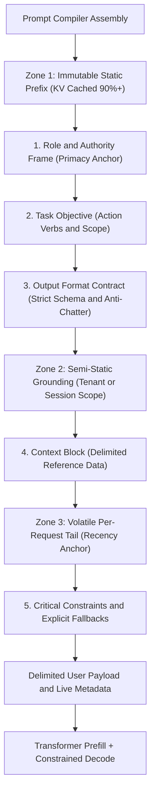
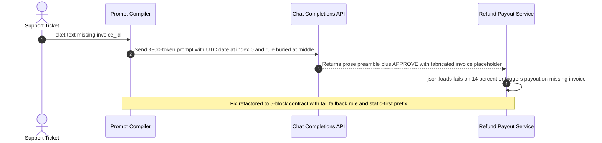

# Module 01: Anatomy of a Good Prompt

> **Prerequisites:** [Module 00: How Prompts Actually Work](../00-how-prompts-actually-work/README.md), [Track 01, Module 10: Chat Templates and Message Formatting](../../01-tokens-and-language-modeling/10-chat-templates-and-message-formatting/README.md), and [Track 01, Module 12: Token Cost Economics](../../01-tokens-and-language-modeling/12-token-cost-economics/README.md)  
> **Estimated Reading Time:** 28 minutes  
> **Target Audience:** AI Backend Engineers, LLM Application Architects, Platform Reliability Engineers

> [!TIP]
> **The Golden Rule of Prompt Anatomy:**
> A production prompt is an explicit **inference-time API contract**, not conversational prose: decompose it into five orthogonal components—**Role, Task, Context, Constraints (with explicit positive fallbacks), and Output Format**—ordered strictly from **lowest volatility to highest volatility**, with critical invariants anchored at the **primacy and recency edges** where transformer attention is strongest.

---

## Why This Matters

Unstructured prose prompts fail silently in production because they conflate two incompatible goals: sounding polite to a human reviewer and shifting next-token logits reliably across edge cases. When teams write a 900-word wall of instructions mixing persona wishes, business rules, dynamic timestamps, and loose formatting requests (`"Please try not to hallucinate and give me a nice summary"`), three measurable failures hit production:

1. **Attention Dilution & U-Shaped Middle Loss:** As established in *Lost in the Middle* (Liu et al., 2023), transformer recall follows a sharp U-shaped curve across long prefixes—high at token start (primacy) and token end (recency), and degraded in the middle. Burying a critical edge-case rule at offset `48%` inside dense prose causes `20%–40%` silent rule drops under load.
2. **Negative-Constraint Backfire Without Fallback Paths:** Writing `"Do NOT invent missing invoice IDs"` suppresses valid behavior poorly unless paired with an explicit **positive target state** (`"If invoice_id is absent, set status='NEEDS_INFO' and refund_usd=0"`). Autoregressive models need concrete high-probability continuation tokens for the fallback branch.
3. **Output Chatter & Prefix Cache Busting:** Omitting a strict output contract triggers conversational preambles (`"Sure! Here is the analysis..."`) that break downstream JSON parsers and multiply **output token spend**—where output tokens typically cost $3\times$ to $5\times$ more per token than input tokens.

---

## 1. Architectural Mental Model: The Five-Component Contract & Zone Ordering

Every production prompt decomposes cleanly into **five distinct functional components**, mapped across **three volatility zones** to preserve KV prefix caching ([Module 00](../00-how-prompts-actually-work/README.md)) and maximize primacy/recency attention salience.



### Decomposing the Five Components

1. **Role / Authority Frame (`<role>`):** Sets the domain vocabulary distribution, calibration posture, and epistemic boundary (`"Senior Financial Compliance Auditor"` primes conservative precision priors over creative prose priors). Keep it under `30–60` tokens—long theatrical backstories dilute signal.
2. **Task / Objective (`<task>`):** States the exact transformation using unambiguous imperative verbs (`Classify`, `Extract`, `Normalize`, `Verify`) rather than open-ended requests (`"Help me look at"`).
3. **Context / Grounding (`<context>`):** Supplies reference policy documents, retrieved snippets, or domain definitions inside explicit structural delimiters (`<context>...</context>`), strictly separating **reference data** from **executable instructions**.
4. **Constraints & Positive Fallbacks (`<constraints>`):** Specifies hard operational boundaries, tie-breaking rules, and **explicit error-handling branches**. Never leave an ambiguous edge case unanchored: pair every negative prohibition (`"Never fabricate dates"`) with its positive fallback action (`"Emit null when date is omitted"`).
5. **Output Format / Schema (`<output_format>`):** Constrains syntax, field names, enums, and verbosity ceiling (`"Return ONLY valid JSON matching schema X; omit markdown fences and preamble"`).

### Quantitative Economics: Signal-to-Noise, Attention Weight, and Output Leverage

Let $N_{\text{in}}$ be prompt input tokens, $N_{\text{out}}$ be generated output tokens, $h \in [0, 1]$ be prefix KV cache hit rate with cached read multiplier $\alpha$ (e.g., $\alpha = 0.10$), and $p_{\text{out}} = k \cdot p_{\text{in}}$ where output price ratio $k \in [3, 5]$. Total request cost is:

$$C_{\text{req}} = N_{\text{in}} \cdot p_{\text{in}} \cdot \big((1 - h) + h \cdot \alpha\big) + N_{\text{out}} \cdot (k \cdot p_{\text{in}})$$

Because $k \approx 4$ on frontier chat models, **eliminating `100` tokens of conversational output chatter saves as much money as cutting `400` uncached input tokens—or `4,000` cached prefix tokens at `h = 1.0, alpha = 0.10`!**

Furthermore, modeling empirical primacy-recency salience across normalized prompt position $u \in [0, 1]$ shows why boundary placement matters:

$$w(u) = A \cdot e^{-\lambda u} + A \cdot e^{-\lambda (1 - u)} + b$$

Tokens positioned near $u \to 0$ (Role / Top Policy) and $u \to 1$ (Recency Constraint Reminder right before User Input) receive disproportionately stronger residual-stream salience than clauses buried at $u \approx 0.50$ inside long context blocks.

---

## 2. Systematic Reference & Comparison Matrix

### Five Anatomical Components: Engineering Specification

| Component | Primary Conditioning Effect | Ideal KV Cache Zone | Attention Placement Strategy | Common Failure Pattern | Production Hardening Rule |
| :--- | :--- | :--- | :--- | :--- | :--- |
| **Role** | Shifts domain vocabulary & tone priors | Zone 1 (Immutable Prefix) | Top (`u ~ 0.00–0.05`) | Bloated persona bio (`250+` tokens of fluff) | Cap at `<= 50` tokens; specify domain + risk posture only |
| **Task** | Selects execution vs continuation mode | Zone 1 (Immutable Prefix) | Top (`u ~ 0.05–0.15`) | Vague verbs (`"handle"`, `"review"`, `"help with"`) | State single atomic objective + decision boundary |
| **Context** | Supplies facts & tenant grounding | Zone 2 (Semi-Static / Retrieved) | Middle (`u ~ 0.25–0.75`) | Undelimited dump mixed with instructions | Wrap in explicit XML tags (`<context>`) and trim irrelevant spans |
| **Constraints** | Prunes illegal outputs & defines edge cases | Zone 1 (global) + Zone 3 tail echo | Top policy + Tail recency anchor (`u ~ 0.90`) | Negative-only bans (`"Do NOT guess"`) without fallback | Always pair `"Never X"` with `"If condition missing, emit Y"` |
| **Output Format** | Shapes terminal token syntax & stop point | Zone 1 (static schema) | Zone 1 + JSON Schema API enforcement | Prose wrapper breaks `json.loads()` | Specify exact enum/types + disable conversational preamble |

### Prompt Architecture Comparison

| Architecture Pattern | Token Efficiency | KV Cache Reuse | Middle-Context Resistance | Parser Reliability | Best Production Fit |
| :--- | :--- | :--- | :--- | :--- | :--- |
| **Ad-Hoc Prose Paragraph** | Low (polite filler + verbose output) | `0%` if dynamic vars appear early | Poor (rules buried in prose) | Low (`~70%–85%` raw JSON parse) | Never in production APIs |
| **Static Modular Prefix** | High (`30%–50%` leaner prompt) | `85%–95%` across fleet | High (delimited blocks) | High (`95%+` with schema block) | Standard structured extraction & routing |
| **Cache-Partitioned Contract + Tail Anchor** | Optimal (minimal output + cached prefix) | `90%+` even with per-request metadata | Highest (recency fallback echo) | `99.9%+` when paired with strict schema | High-QPS enterprise pipelines & SLA-critical services |

---

## 3. Production War Story Post-Mortem: The Buried Fallback That Approved Missing-Invoice Refunds

| Field | Incident Details |
| :--- | :--- |
| **Severity** | **SEV-1** (Unauthorized Automated Payouts & Schema Parser Outage) |
| **Detection / Resolution Time** | Detected 4 hours after launch via payment reconciliation alert / Mitigated in 25 minutes |
| **Impact** | `312` refund tickets without valid `invoice_id` were auto-approved (`\$48,600` exposure), and `14%` of responses crashed the JSON parser due to conversational preambles |

### What Happened

A payments automation team migrated their customer refund classifier to an LLM endpoint using a `3,800`-token system prompt exported directly from an internal Notion policy doc. Two subtle structural flaws existed inside the prompt:

1. **Middle-Buried Negative Rule Without Fallback:** At token offset `1,950` (`u = 0.51`), a bullet read: `"Do NOT approve refunds if the customer forgot to include an invoice ID."` No rule defined what `status` value to emit when `invoice_id` was absent, and the output example only demonstrated `APPROVE` and `DENY`.
2. **Weak Output Format Clause + Top-of-Prompt Timestamp:** The prompt started with `Date: {{utc_now}}` and ended with `"Please provide the decision in JSON."`

Under peak customer support load, tickets missing `invoice_id` frequently triggered `"Sure! Here is your JSON response:"` prose preambles (crashing `json.loads()`) or silently defaulted to `"APPROVE"` because `APPROVE` dominated the prompt's examples while the negative rule sat in the low-salience middle zone.



### Root Cause Analysis

1. **U-Shaped Attention Neglect + Missing Positive Fallback:** Placing a negative prohibition (`"Do NOT approve"`) at offset `51%` without a concrete fallback state (`NEEDS_INFO`) left the model with low probability mass for refusal and high prior probability for `APPROVE`.
2. **Unconstrained Output Contract:** `"Please provide the decision in JSON"` invites conversational preambles (`"Sure!..."`) and markdown code fences unless explicitly prohibited or enforced via structured output schema.
3. **Dynamic Header in Zone 1:** Placing `Date: {{utc_now}}` at line 1 invalidated KV prefix caching on `3,800` policy tokens.

### Architectural Hardening & Verified Fix

- **Refactored into Explicit 5-Component XML Contract:** Moved immutable `Role`, `Task`, `Policy Context`, and strict `Output Schema` (`APPROVE | NEEDS_INFO | DENY`) into Zone 1 (`static_prefix`), stripping `420` tokens of Notion conversational filler.
- **Anchored Positive Fallback at Recency Tail:** Placed an explicit `<constraints>` tail block immediately before `<user_ticket>`: `"If invoice_id is missing or malformed, you MUST emit status='NEEDS_INFO' and refund_usd=0.0."`
- **Enforced Anti-Chatter Output Contract + Schema Validation:** Automated payouts without `invoice_id` dropped to `0` (`0/10,000` eval tickets), JSON parse failures fell from `14%` to `0.0%`, and input token billing dropped `76%` via prefix cache hits.

---

## 4. Multi-Language Production Implementation: Modular Prompt Contract Compiler & Linter

The implementations below enforce **five-component prompt decomposition**, validate **positive fallback clauses**, forbid **volatile timestamps/UUIDs inside Zone 1**, enforce **token budgets**, and serialize unambiguous XML-delimited contracts.

````carousel

```go
package prompteng

import (
	"errors"
	"fmt"
	"regexp"
	"strings"
)

var volatilePrefixRe = regexp.MustCompile(`(?i)([0-9a-f]{8}-[0-9a-f]{4}-[0-9a-f]{4}-[0-9a-f]{4}-[0-9a-f]{12}|\d{4}-\d{2}-\d{2}[T ]\d{2}:\d{2}:\d{2})`)

type PromptContract struct {
	Role           string
	Task           string
	StaticContext  string
	Constraints    []string
	OutputSchema   string
	FallbackClause string
	MaxPrefixWords int
}

type CompiledContract struct {
	StaticPrefix string
	VolatileTail string
}

// CompilePromptContract builds a cache-safe, five-component XML-delimited prompt.
func CompilePromptContract(c PromptContract, dynamicInput string, metadata map[string]string) (CompiledContract, error) {
	if strings.TrimSpace(c.Role) == "" || strings.TrimSpace(c.Task) == "" || strings.TrimSpace(c.OutputSchema) == "" {
		return CompiledContract{}, errors.New("role, task, and output_schema are mandatory contract components")
	}
	if strings.TrimSpace(c.FallbackClause) == "" {
		return CompiledContract{}, errors.New("explicit positive fallback_clause is required to prevent hallucination on missing inputs")
	}

	var prefix strings.Builder
	fmt.Fprintf(&prefix, "<role>%s</role>\n", strings.TrimSpace(c.Role))
	fmt.Fprintf(&prefix, "<task>%s</task>\n", strings.TrimSpace(c.Task))
	if strings.TrimSpace(c.StaticContext) != "" {
		fmt.Fprintf(&prefix, "<context>\n%s\n</context>\n", strings.TrimSpace(c.StaticContext))
	}
	fmt.Fprintf(&prefix, "<output_format>%s</output_format>", strings.TrimSpace(c.OutputSchema))

	staticStr := prefix.String()
	if volatilePrefixRe.MatchString(staticStr) {
		return CompiledContract{}, errors.New("volatile timestamp or UUID detected in static Zone 1 prefix")
	}
	if c.MaxPrefixWords > 0 && len(strings.Fields(staticStr)) > c.MaxPrefixWords {
		return CompiledContract{}, fmt.Errorf("prefix exceeds budget of %d words", c.MaxPrefixWords)
	}

	var tail strings.Builder
	tail.WriteString("<constraints>\n")
	for _, rule := range c.Constraints {
		fmt.Fprintf(&tail, "- %s\n", strings.TrimSpace(rule))
	}
	fmt.Fprintf(&tail, "- FALLBACK: %s\n", strings.TrimSpace(c.FallbackClause))
	tail.WriteString("</constraints>\n")
	for k, v := range metadata {
		fmt.Fprintf(&tail, "<meta key=%q>%s</meta>\n", k, strings.TrimSpace(v))
	}
	fmt.Fprintf(&tail, "<input>\n%s\n</input>", strings.TrimSpace(dynamicInput))

	return CompiledContract{
		StaticPrefix: staticStr,
		VolatileTail: tail.String(),
	}, nil
}
```

<!-- slide -->

```typescript
export interface PromptContractSpec {
  readonly role: string;
  readonly task: string;
  readonly staticContext?: string;
  readonly constraints: readonly string[];
  readonly fallbackClause: string;
  readonly outputSchema: string;
  readonly maxPrefixWords?: number;
}

export interface RenderedContract {
  readonly staticPrefix: string;
  readonly volatileTail: string;
  readonly estPrefixTokens: number;
}

const VOLATILE_RE = /([0-9a-f]{8}-[0-9a-f]{4}-[0-9a-f]{4}-[0-9a-f]{4}-[0-9a-f]{12}|\d{4}-\d{2}-\d{2}[T ]\d{2}:\d{2}:\d{2})/i;

export function compilePromptContract(
  spec: PromptContractSpec,
  dynamicInput: string,
  metadata: Record<string, string> = {}
): RenderedContract {
  if (!spec.role.trim() || !spec.task.trim() || !spec.outputSchema.trim()) {
    throw new Error("Contract violation: role, task, and outputSchema must be non-empty.");
  }
  if (!spec.fallbackClause.trim()) {
    throw new Error("Contract violation: explicit fallbackClause is mandatory for missing/ambiguous input.");
  }

  const staticSections = [
    `<role>${spec.role.trim()}</role>`,
    `<task>${spec.task.trim()}</task>`,
    spec.staticContext?.trim() ? `<context>\n${spec.staticContext.trim()}\n</context>` : "",
    `<output_format>${spec.outputSchema.trim()}</output_format>`,
  ].filter(Boolean);

  const staticPrefix = staticSections.join("\n");
  if (VOLATILE_RE.test(staticPrefix)) {
    throw new Error("Cache violation: dynamic UUID or timestamp detected inside static Zone 1 prefix.");
  }

  const wordCount = staticPrefix.split(/\s+/).length;
  if (spec.maxPrefixWords && wordCount > spec.maxPrefixWords) {
    throw new Error(`Token budget exceeded: prefix has ${wordCount} words (max ${spec.maxPrefixWords}).`);
  }

  const constraintLines = spec.constraints.map((c) => `- ${c.trim()}`);
  constraintLines.push(`- FALLBACK: ${spec.fallbackClause.trim()}`);

  const metaLines = Object.entries(metadata)
    .sort(([a], [b]) => a.localeCompare(b))
    .map(([k, v]) => `<meta key="${k}">${v.trim()}</meta>`);

  const volatileTail = [
    `<constraints>\n${constraintLines.join("\n")}\n</constraints>`,
    ...metaLines,
    `<input>\n${dynamicInput.trim()}\n</input>`,
  ].join("\n");

  return {
    staticPrefix,
    volatileTail,
    estPrefixTokens: Math.ceil(wordCount * 1.35),
  };
}
```

<!-- slide -->

```python
"""Modular 5-component prompt contract compiler with budget and cache linting."""

from __future__ import annotations

from dataclasses import dataclass
import re

_VOLATILE_RE = re.compile(
    r"([0-9a-f]{8}-[0-9a-f]{4}-[0-9a-f]{4}-[0-9a-f]{4}-[0-9a-f]{12}|\d{4}-\d{2}-\d{2}[T ]\d{2}:\d{2}:\d{2})",
    re.IGNORECASE,
)


@dataclass(frozen=True)
class PromptContract:
    role: str
    task: str
    constraints: tuple[str, ...]
    fallback_clause: str
    output_schema: str
    static_context: str = ""
    max_prefix_words: int = 2000


@dataclass(frozen=True)
class CompiledPrompt:
    static_prefix: str
    volatile_tail: str
    est_prefix_tokens: int


def compile_prompt_contract(
    contract: PromptContract,
    dynamic_input: str,
    metadata: dict[str, str] | None = None,
) -> CompiledPrompt:
    if not all(x.strip() for x in (contract.role, contract.task, contract.output_schema)):
        raise ValueError("role, task, and output_schema are required contract fields")
    if not contract.fallback_clause.strip():
        raise ValueError("fallback_clause is mandatory to avoid guessing on missing data")

    parts = [
        f"<role>{contract.role.strip()}</role>",
        f"<task>{contract.task.strip()}</task>",
    ]
    if contract.static_context.strip():
        parts.append(f"<context>\n{contract.static_context.strip()}\n</context>")
    parts.append(f"<output_format>{contract.output_schema.strip()}</output_format>")

    static_prefix = "\n".join(parts)
    if _VOLATILE_RE.search(static_prefix):
        raise ValueError("Volatile UUID or timestamp detected inside Zone 1 static_prefix")

    words = len(static_prefix.split())
    if words > contract.max_prefix_words:
        raise ValueError(f"Prefix word budget exceeded: {words} > {contract.max_prefix_words}")

    rules = [f"- {r.strip()}" for r in contract.constraints]
    rules.append(f"- FALLBACK: {contract.fallback_clause.strip()}")

    meta_lines = [
        f'<meta key="{k}">{v.strip()}</meta>'
        for k, v in sorted((metadata or {}).items())
    ]
    tail_parts = [
        "<constraints>\n" + "\n".join(rules) + "\n</constraints>",
        *meta_lines,
        f"<input>\n{dynamic_input.strip()}\n</input>",
    ]
    return CompiledPrompt(
        static_prefix=static_prefix,
        volatile_tail="\n".join(tail_parts),
        est_prefix_tokens=int(round(words * 1.35)),
    )
```

<!-- slide -->

```csharp
using System;
using System.Collections.Generic;
using System.Linq;
using System.Text;
using System.Text.RegularExpressions;

namespace GenAI.PromptEngineering;

public sealed record PromptContract(
    string Role,
    string Task,
    IReadOnlyList<string> Constraints,
    string FallbackClause,
    string OutputSchema,
    string StaticContext = "",
    int MaxPrefixWords = 2000);

public sealed record CompiledContract(string StaticPrefix, string VolatileTail, int EstPrefixTokens);

public static partial class PromptContractCompiler
{
    [GeneratedRegex(@"([0-9a-f]{8}-[0-9a-f]{4}-[0-9a-f]{4}-[0-9a-f]{4}-[0-9a-f]{12}|\d{4}-\d{2}-\d{2}[T ]\d{2}:\d{2}:\d{2})", RegexOptions.IgnoreCase)]
    private static partial Regex VolatilePattern();

    public static CompiledContract Compile(
        PromptContract contract,
        string dynamicInput,
        IReadOnlyDictionary<string, string>? metadata = null)
    {
        if (string.IsNullOrWhiteSpace(contract.Role) ||
            string.IsNullOrWhiteSpace(contract.Task) ||
            string.IsNullOrWhiteSpace(contract.OutputSchema))
        {
            throw new ArgumentException("Role, Task, and OutputSchema must all be provided.");
        }
        if (string.IsNullOrWhiteSpace(contract.FallbackClause))
        {
            throw new ArgumentException("FallbackClause is mandatory for deterministic handling of missing inputs.");
        }

        var prefix = new StringBuilder();
        prefix.AppendLine($"<role>{contract.Role.Trim()}</role>");
        prefix.AppendLine($"<task>{contract.Task.Trim()}</task>");
        if (!string.IsNullOrWhiteSpace(contract.StaticContext))
        {
            prefix.AppendLine($"<context>\n{contract.StaticContext.Trim()}\n</context>");
        }
        prefix.Append($"<output_format>{contract.OutputSchema.Trim()}</output_format>");

        string staticPrefix = prefix.ToString();
        if (VolatilePattern().IsMatch(staticPrefix))
        {
            throw new InvalidOperationException("Volatile timestamp or UUID detected in static prefix Zone 1.");
        }

        int wordCount = staticPrefix.Split((char[]?)null, StringSplitOptions.RemoveEmptyEntries).Length;
        if (wordCount > contract.MaxPrefixWords)
        {
            throw new InvalidOperationException($"Prefix word budget exceeded: {wordCount} > {contract.MaxPrefixWords}.");
        }

        var tail = new StringBuilder();
        tail.AppendLine("<constraints>");
        foreach (string rule in contract.Constraints)
        {
            tail.AppendLine($"- {rule.Trim()}");
        }
        tail.AppendLine($"- FALLBACK: {contract.FallbackClause.Trim()}");
        tail.AppendLine("</constraints>");
        if (metadata is not null)
        {
            foreach (var kv in metadata.OrderBy(x => x.Key, StringComparer.Ordinal))
            {
                tail.AppendLine($"<meta key=\"{kv.Key}\">{kv.Value.Trim()}</meta>");
            }
        }
        tail.Append($"<input>\n{dynamicInput.Trim()}\n</input>");

        return new CompiledContract(staticPrefix, tail.ToString(), (int)Math.Ceiling(wordCount * 1.35));
    }
}
```

````

---

## 5. Practical Hands-On CLI Verification Workflows

### Workflow 1 (Offline Python 3.13): Modular Prompt Linter & Token Cost Comparison

Audit a bloated conversational prompt (`bloated_unstructured`) versus a clean five-component contract (`modular_contract`) and compare daily API spend at `50,000` requests/day (`\$2.50/1M` input, `\$10.00/1M` output, `92%` prefix cache hit with `0.10` cached rate):

```bash
python - << 'EOF'
import math, re

print("=== M01 WORKFLOW 1: Modular Prompt Linter & Token Economics ===")
bloated_prompt = (
    "Hello! Please kindly try your very best to be an awesome helpful assistant today. "
    "Current timestamp: 2026-04-12T09:15:00Z. "
    "Do NOT ever make up data or hallucinate anything. Also please never fail to be polite! "
    "Read the ticket and tell me what to do in nice paragraphs. Ticket: Duplicate charge on INV-991."
)
modular_prompt = (
    "<role>Billing Triage Specialist</role>\n"
    "<task>Classify refund eligibility from ticket fields.</task>\n"
    "<constraints>\n"
    "- Verify invoice_id exists before approving; if missing, set status='NEEDS_INFO' and refund_usd=0.\n"
    "- Never invent missing amounts.\n"
    "</constraints>\n"
    "<output_format>Emit ONLY valid JSON: {\"status\": \"APPROVE|NEEDS_INFO|DENY\", \"refund_usd\": number}</output_format>\n"
    "<volatile_input ts=\"2026-04-12T09:15:00Z\">Duplicate charge on INV-991.</volatile_input>"
)

def audit_prompt(name: str, text: str, prefix_end_marker: str | None, avg_out_tokens: int, cache_hit: float) -> None:
    static_part = text.split(prefix_end_marker)[0] if prefix_end_marker and prefix_end_marker in text else text
    has_ts_in_prefix = bool(re.search(r"\d{4}-\d{2}-\d{2}T\d{2}:\d{2}:\d{2}Z", static_part))
    has_schema = "<output_format>" in text or "JSON" in text
    has_fallback = "if missing" in text.lower()
    in_tok = round(len(text.split()) * 1.35)
    daily_reqs = 50_000
    eff_in = in_tok * ((1 - cache_hit) + cache_hit * 0.10)
    daily_cost = daily_reqs * ((eff_in * 2.50 + avg_out_tokens * 10.00) / 1_000_000)
    print(
        f"{name:<20} | prefix_ts={str(has_ts_in_prefix):<5} | schema={str(has_schema):<5} | "
        f"fallback={str(has_fallback):<5} | in_tok~{in_tok:<3} | out_tok={avg_out_tokens:<3} | daily_cost=${daily_cost:6.2f}"
    )

audit_prompt("bloated_unstructured", bloated_prompt, None, 140, 0.00)
audit_prompt("modular_contract", modular_prompt, "<volatile_input", 22, 0.92)
EOF
```

**Expected Output:**

```text
=== M01 WORKFLOW 1: Modular Prompt Linter & Token Economics ===
bloated_unstructured | prefix_ts=True  | schema=False | fallback=False | in_tok~68  | out_tok=140 | daily_cost=$ 78.50
modular_contract     | prefix_ts=False | schema=True  | fallback=True  | in_tok~55  | out_tok=22  | daily_cost=$ 12.18
```

### Workflow 2 (Offline Python 3.13): U-Shaped Attention Weight & Constraint Placement Test

Quantify how moving a critical constraint from the middle (`pos=0.50`) of a long context block to the primacy (`pos=0.05`) or recency tail (`pos=0.95`) alters effective attention salience and compliance probability:

```bash
python - << 'EOF'
import math

print("=== M01 WORKFLOW 2: U-Shaped Attention & Constraint Placement ===")
def attention_weight(pos: float) -> float:
    return 0.45 * math.exp(-3.5 * pos) + 0.45 * math.exp(-3.5 * (1.0 - pos)) + 0.10

for label, pos in [("Top Role/Policy (pos=0.05)", 0.05), ("Middle Context (pos=0.50)", 0.50), ("Tail Constraints (pos=0.95)", 0.95)]:
    w = attention_weight(pos)
    compliance_prob = 1.0 / (1.0 + math.exp(-(4.2 * w - 1.4)))
    print(f"{label:<28} | attn_weight={w:.3f} | constraint_compliance={compliance_prob:.3f}")
EOF
```

**Expected Output:**

```text
=== M01 WORKFLOW 2: U-Shaped Attention & Constraint Placement ===
Top Role/Policy (pos=0.05)   | attn_weight=0.494 | constraint_compliance=0.663
Middle Context (pos=0.50)    | attn_weight=0.256 | constraint_compliance=0.420
Tail Constraints (pos=0.95)  | attn_weight=0.494 | constraint_compliance=0.663
```

### Workflow 3 (Optional Live API Verification): Comparing Unstructured Prose vs Modular Contract

> [!NOTE]
> **Optional Cloud API Check:** Requires an active `OPENAI_API_KEY` environment variable and `openai>=1.50.0`. Do not run in offline CI pipelines.

```python
import json, os
from openai import OpenAI

client = OpenAI(api_key=os.environ["OPENAI_API_KEY"])
ticket = "Customer says duplicate charge occurred yesterday, no invoice number attached."

resp = client.chat.completions.create(
    model="gpt-4o-mini",
    temperature=0.0,
    messages=[
        {
            "role": "system",
            "content": (
                "<role>Billing Triage Specialist</role>\n"
                "<task>Return refund decision JSON.</task>\n"
                "<output_format>Emit ONLY valid JSON: {\"status\": \"APPROVE|NEEDS_INFO|DENY\", \"refund_usd\": number}</output_format>"
            ),
        },
        {
            "role": "user",
            "content": (
                "<constraints>- FALLBACK: If invoice_id is absent, set status='NEEDS_INFO' and refund_usd=0.</constraints>\n"
                f"<input>{ticket}</input>"
            ),
        },
    ],
)
print(json.loads(resp.choices[0].message.content))
```

---

## 6. Hands-On Exercises & Independent Challenge

### Hands-On Exercises

1. **Contract Refactoring Drill:** Rewrite a messy 180-word support prompt containing `"Please try not to hallucinate"`, an inline `request_id` at word 4, and `"write a clear summary"` into a 5-component XML contract with explicit positive fallback and strict JSON schema. Measure total input+output word reduction.
2. **Output Token Leverage Sensitivity:** Extend Workflow 1 so `modular_contract` emits `85` tokens of markdown explanation (`"Here is why..."`) before JSON, while keeping `in_tok=55`. Observe how output chatter dwarfs input token optimizations on daily spend.
3. **CI Linter Extension:** Add a negative-constraint detector to the Python `compile_prompt_contract` snippet that emits a warning whenever a rule contains `"do not"` or `"never"` without a corresponding `"if ... missing"` or `"FALLBACK"` clause.

### Independent Challenge

Your team owns a legal contract clause extractor receiving `6,000`-token vendor agreements (`Zone 2`), a `900`-token static extraction policy (`Zone 1`), and per-request jurisdiction rules (`Zone 3`). Currently, the critical rule `"If governing_law is omitted, emit governing_law=null rather than inferring from vendor HQ"` sits inside the `900`-token policy, and engineers report `18%` hallucinated governing law values on long `6,000`-token PDFs. Redesign the prompt anatomy to fix hallucinations without invalidating Zone 1 KV caching.

<details><summary>Architectural Discussion</summary>

1. **Diagnose the Attention Bottleneck:** Even though the `900`-token static policy sits at the front (Zone 1), placing `6,000` tokens of dense legal text *between* the policy rule and generation forces the model to rely heavily on primacy recall while vendor HQ addresses inside the PDF create strong local completion priors.
2. **Apply Dual-Anchor Placement Without Busting Zone 1 Cache:** Keep the canonical `900`-token policy and JSON output schema strictly static in Zone 1 (`system` message), place the `6,000`-token `<context>` agreement in the middle, and echo a compact `25`-token **recency constraint anchor** immediately after `<context>` at the very end of the `user` message (`<constraints>FALLBACK: If governing_law is not explicitly stated in text, output null; never infer from address.</constraints>`).
3. **Validate Economically:** Because Zone 1 stays byte-identical across agreements and the tail anchor adds only `~25` uncached tokens (`u ~ 0.99`), KV prefix cache reuse stays intact while recency attention dramatically suppresses HQ inference hallucinations.

</details>

---

## 7. Common Mistakes & Troubleshooting

- **Polite Padding & Conversational Pleonasms:** Adding `"Please kindly make sure to always do your absolute best"` adds zero instructional entropy and wastes prefill tokens on every single call. Use crisp imperative specs instead.
- **Negative-Only Rules Without Fallback Branches:** Telling a model `"Never guess missing fields"` without specifying `"Emit null if missing"` often forces the model into arbitrary defaults just to satisfy the JSON schema's required key!
- **Mixing Instructions and Untrusted Data Without Delimiters:** Dropping raw user text directly after instructions invites structural confusion and prompt injection ([Module 12](../12-prompt-injection-attacks/README.md)). Always isolate `<input>...</input>` or `<context>...</context>`.
- **Duplicating Dynamic Values Inside Zone 1:** Putting `tenant_name`, `current_date`, or `request_id` inside `<role>` or `<task>` destroys downstream KV prefix cache reuse ([Module 00](../00-how-prompts-actually-work/README.md)).

---

## 8. Operational Validation Checkpoints & Checkpoint Quiz

### Operational Validation Checkpoints

<details><summary><strong>Checkpoint 1: Auditing a Prompt for Output Chatter Economics</strong></summary>

A classification endpoint averages `450` cached input tokens (`90%` cache hit, `alpha = 0.10`, `\$2.50/1M` uncached input) and `110` output tokens (`\$10.00/1M`) because the prompt says `"Explain briefly and provide JSON."` Removing prose explanation cuts `N_out` from `110` to `18` tokens. What percentage of total per-request inference cost is saved?

**Validation:** Old effective input cost per 1M reqs: $450 \times (0.10 + 0.90 \times 0.10) \times 2.50 = 450 \times 0.19 \times 2.50 = \$213.75$; old output cost: $110 \times 10.00 = \$1,100.00$; total `\$1,313.75` per 1M reqs. New output cost: $18 \times 10.00 = \$180.00$; new total `\$393.75` per 1M reqs—a **`70.0%` total spend reduction** purely by enforcing a tight `<output_format>` contract.

</details>

<details><summary><strong>Checkpoint 2: Fixing Middle-Lost Compliance Failures Safely</strong></summary>

An extraction prompt embeds a `4,200`-token static policy manual in Zone 1 followed by `3,000` tokens of dynamic customer chat history. A critical compliance rule at line 45 of the policy manual is ignored `15%` of the time. Should you move the dynamic chat history above the policy manual?

**Validation:** **No.** Moving dynamic chat history above the `4,200`-token policy manual puts volatile tokens at index `0`, destroying `100%` of Zone 1 KV prefix caching. Instead, keep Zone 1 immutable at the top and **mirror the single critical compliance rule** as a short `20`–`30` token `<constraints>` reminder at the recency tail immediately after the chat history.

</details>

<details><summary><strong>Checkpoint 3: Eliminating Ambiguity Hallucinations on Missing Input Fields</strong></summary>

Your `<output_format>` specifies `{"account_tier": "FREE|PRO|ENTERPRISE"}` and `<constraints>` says `"Do not guess the tier."` Why does the model still guess `"FREE"` when the user's ticket mentions no tier?

**Validation:** Because `"FREE|PRO|ENTERPRISE"` forces a closed enum without a missing-data state (`"UNKNOWN"` or `null`), while `"Do not guess"` gives no target token sequence. Fix both components together: expand the schema enum to `"FREE|PRO|ENTERPRISE|UNKNOWN"` and add an explicit positive fallback `"If tier is omitted, emit account_tier='UNKNOWN'."`

</details>

### Checkpoint Quiz

1. What are the five core structural components of a production prompt contract?
2. Why does cutting `50` unnecessary output tokens save far more budget than cutting `50` cached input tokens?
3. According to *Lost in the Middle* (Liu et al., 2023), where in a `8,000`-token prompt is a constraint most likely to be ignored, and how do you fix it without breaking KV caching?
4. Why should every negative constraint (`"Never fabricate X"`) be paired with an explicit positive fallback rule?
5. Why should `<context>` and `<input>` always be wrapped in explicit delimiters rather than concatenated as plain text?

<details><summary>Answers</summary>

1. **Role** (authority/tone frame), **Task** (atomic action objective), **Context** (delimited grounding data), **Constraints** (hard rules + explicit positive fallbacks), and **Output Format** (strict syntax/schema specification).
2. Output tokens typically cost $3\times$–$5\times$ uncached input tokens, while cached Zone 1 input tokens are discounted by up to $90\%$ ($\alpha = 0.10$), creating a $30\times$–$50\times$ per-token cost ratio between uncached output tokens and cached prefix tokens.
3. In the **middle** (`u ~ 0.35–0.65`) of a long prompt. Fix it by keeping immutable rules in Zone 1 at the top (primacy) and repeating critical edge-case constraints in a concise recency tail block after dynamic context (recency) without altering Zone 1.
4. Models require a concrete, high-probability continuation branch when data is missing; negative-only rules conflict with schema completion pressure and lead to silent guessing.
5. Delimiters establish structural boundaries separating trusted system instructions from untrusted user payloads or reference documents, reducing parsing ambiguity and instruction hijacking.

</details>

---

## Further Reading & Sources

- [OpenAI Documentation: Prompt Engineering Guide](https://platform.openai.com/docs/guides/prompt-engineering) - Official patterns for clear instructions, delimiters, and output format control.
- [Anthropic Documentation: Prompt Engineering Overview](https://docs.anthropic.com/en/docs/build-with-claude/prompt-engineering/overview) - Canonical guidance on XML tag separation, explicit task contracts, and role framing.
- [Lost in the Middle: How Language Models Use Long Contexts (Liu et al., 2023)](https://arxiv.org/abs/2307.03172) - Empirical demonstration of U-shaped primacy/recency attention decay across context positions.
- [Module 00: How Prompts Actually Work](../00-how-prompts-actually-work/README.md) - Prefix KV caching mechanics and Zone 1–3 volatility partitioning.

## Next

[Module 02: Zero-Shot Prompting](../02-zero-shot-prompting/README.md)
