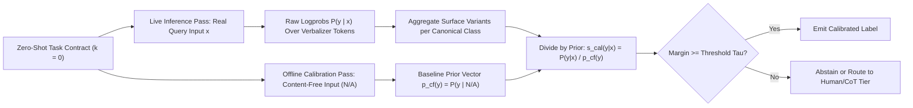
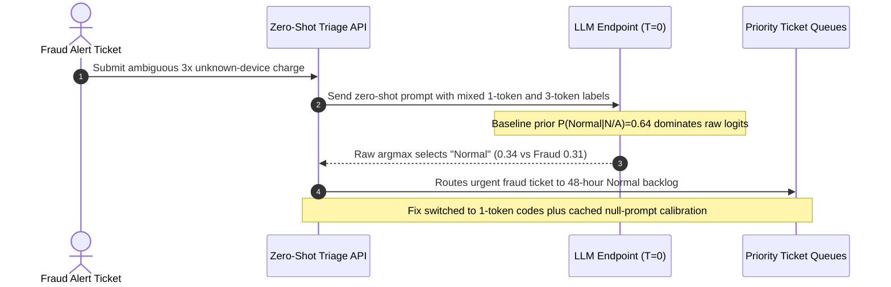

# Module 02: Zero-Shot Prompting

> **Prerequisites:** [Module 01: Anatomy of a Good Prompt](../01-anatomy-of-a-good-prompt/README.md), [Track 01, Module 15: Next-Token Prediction](../../01-tokens-and-language-modeling/15-next-token-prediction-from-logits-to-probabilities/README.md), and [Track 01, Module 16: Sampling Strategies](../../01-tokens-and-language-modeling/16-sampling-strategies-greedy-temperature-top-k-top-p/README.md)  
> **Estimated Reading Time:** 28 minutes  
> **Target Audience:** AI Backend Engineers, ML Platform Engineers, Applied NLP Architects

> [!TIP]
> **The Golden Rule of Zero-Shot Prompting:**
> Zero-shot prompting ($k = 0$ demonstrations) minimizes input token cost and maximizes prefix KV cache generality by relying directly on instruction-tuned priors—yet raw next-token argmax is systematically distorted by **common-token bias, majority-label priors, and multi-token verbalizer decay** (Zhao et al., 2021). Always anchor zero-shot classifiers with **single-token canonical verbalizers** and **content-free contextual calibration** before trusting raw model confidence.

---

## Why This Matters

Every production AI team reaches for **zero-shot prompting** first: describe the task, specify labels, send the input with zero demonstration examples ($k = 0$), and ship. Modern alignment (`SFT + RLHF/DPO`) makes zero-shot remarkably capable on general summarization, triage, and schema extraction—while saving hundreds of input demonstration tokens per call.

Yet in production routing and classification pipelines, naive zero-shot prompting exhibits three silent failure modes that masquerade as "model stupidity":

1. **Common-Token & Prior Label Bias:** In pretraining and SFT corpora, generic words like `"Normal"`, `"Yes"`, `"Positive"`, or `"Other"` have vastly higher baseline unigram probability than domain-specific terms like `"Fraud"` or `"Outage"`. Without calibration, borderline inputs default silently to high-frequency labels.
2. **Verbalizer Probability Splitting:** If a model assigns `0.26` to `"Refund"`, `0.18` to `"refund"`, and `0.07` to `"REFUND"` (`0.51` total semantic mass), greedy decoding (`argmax`) may still pick `"Escalate"` (`0.34`) because `"Escalate"` holds the single highest surface token probability!
3. **Multi-Token Label Collapse:** Autoregressive likelihood multiplies token probabilities sequentially ($P(w_1, w_2, w_3) = \prod_{i=1}^{3} P(w_i \mid w_{<i})$). A concise 1-token label (`"DENY"`) naturally carries higher unnormalized sequence probability than a 3-token label (`"Needs Manual Review"`), creating structural length bias.

---

## 1. Architectural Mental Model: Zero-Shot Priors & Contextual Calibration

### How Instruction-Tuned Priors Shape Zero-Shot Inference

When $k = 0$, the model receives no local demonstration pairs to anchor label boundaries. Instead, generation depends on the joint shift between the **task specification prior** and the **raw unigram language model prior** at position $N + 1$.



### Mathematical Formulation of Contextual Calibration (Zhao et al., 2021)

In *Calibrate Before Use* (Zhao et al., 2021, `arXiv:2102.09690`), the authors demonstrate that both zero-shot and few-shot language models suffer from three systematic biases independent of the test input: **Majority Label Bias**, **Recency Bias**, and **Common Token Bias** (preferring tokens that occur frequently in pretraining text).

To measure this baseline skew without touching model weights, pass a **content-free input** $x_{\text{null}}$ (such as `"N/A"`, `""`, or `"[MASK]"`) through the exact same zero-shot prompt template to obtain the content-free prior distribution $\mathbf{p}_{\text{cf}} = \mathbf{p}(y \mid x_{\text{null}})$ over the $C$ candidate labels.

Then define a diagonal affine calibration matrix $W = \text{diag}(\mathbf{p}_{\text{cf}})^{-1}$ with bias $\mathbf{b} = \mathbf{0}$ so that the calibrated probability on a neutral input becomes uniform ($\frac{1}{C}$ across all classes):

$$\hat{\mathbf{q}}(y \mid x) = \text{normalize}\!\left(W \cdot \mathbf{p}(y \mid x)\right) = \frac{p(y \mid x) / p(y \mid x_{\text{null}})}{\sum_{y' \in \mathcal{Y}} p(y' \mid x) / p(y' \mid x_{\text{null}})}$$

Equivalently, in log-probability space (Pointwise Mutual Information style calibration), you subtract the cached null-input log-probability from the live log-probability for each label $y$:

$$s_{\text{cal}}(y \mid x) = \log P_{\theta}(y \mid x) - \log P_{\theta}(y \mid x_{\text{null}})$$

This removes any constant prior skew toward `"Normal"` or `"Positive"` in **$O(1)$ per request**, because $\log P_{\theta}(y \mid x_{\text{null}})$ is computed **once offline per prompt version** and cached in memory!

### Verbalizer Engineering & Multi-Token Bias

Because next-token probability distributions operate over BPE subwords rather than semantic concepts:

1. **Sum Surface Equivalence Classes:** Map all case/whitespace surface tokens belonging to class $c$ (`V_c = {"Refund", " refund", "REFUND"}`) into a unified class probability before calibrating:
   $$P(c \mid x) = \sum_{v \in V_c} P_{\theta}(v \mid x)$$
2. **Choose Single-Token Disjoint Verbalizers:** Keep labels to single tokens with orthogonal prefixes (`APPROVE`, `DENY`, `ESCALATE`, or numeric IDs `1`, `2`, `3`) whenever extracting probabilities via `logprobs=true`. Never mix 1-token labels with 4-token labels in unconstrained completion classifiers.

---

## 2. Systematic Reference & Comparison Matrix

### Zero-Shot Variants & Decision Boundaries

| Method | Additional Input Cost | Extra Inference Latency | Calibration Resilience | Best Production Use Case | Key Failure Mode |
| :--- | :--- | :--- | :--- | :--- | :--- |
| **Raw Unconstrained Zero-Shot** | Minimum (`0` shots) | Lowest (`1` forward call) | Poor (vulnerable to common-token skew) | Open-ended summarization, drafting, clear tasks | Silent majority/common-token bias + prose drift |
| **Structured Enum Zero-Shot** | Minimal (JSON Schema) | Low (constrained decode mask) | Moderate (eliminates syntax/surface split) | Entity extraction, typed routing enums | Underlying logit prior still skews borderline classes |
| **Calibrated Zero-Shot (`logprobs`)** | `0` runtime overhead (`x_null` cached offline) | `0ms` extra runtime call | High (cancels common-token prior mathematically) | High-volume multi-class triage, sentiment, SLA routing | Requires API `logprobs` / top-$k$ token visibility |
| **Zero-Shot + Abstention Gate** | `0` extra tokens | Low (`1` pass; escalates low margin) | Very High (routes low-margin edge cases) | Financial fraud, medical/legal triage | Over-abstains if threshold $\tau$ is miscalibrated |

### Verbalizer Design Matrix

| Verbalizer Style | Example Labels | Token Count | Surface Split Risk | Probability Calibration Cleanliness | Recommendation |
| :--- | :--- | :--- | :--- | :--- | :--- |
| **Single-Token Uppercase Codes** | `APPROVE`, `DENY`, `HOLD` | `1` token each | Low (unique prefixes) | Excellent (exact top-$k$ logprob lookup) | **Recommended** for production classification |
| **Single-Digit / Letter IDs** | `A`, `B`, `C`, `D` | `1` token each | Very Low | High (watch out for option-position prior `A > D`) | Strong for dynamic label sets; apply null calibration |
| **Multi-Word Phrases** | `Needs Manual Review`, `Likely Fraud` | `3–5` tokens | High | Poor (multiplicative token length penalty) | Avoid for raw logprob scoring; map via short IDs |
| **Mixed-Case Free Words** | `Yes`, `yes`, `Positive` | `1` token | High (`Yes` vs `yes` splits mass) | Moderate (requires summing `V_c`) | Normalize or force strict schema enum |

---

## 3. Production War Story Post-Mortem: Uncalibrated Common-Token Bias Dropped Fraud Recall to 31%

| Field | Incident Details |
| :--- | :--- |
| **Severity** | **SEV-1** (Silent Fraud Triage Misrouting & SLA Breach) |
| **Detection / Resolution Time** | Detected 48 hours post-deploy via chargeback anomaly spike / Mitigated in 40 minutes |
| **Impact** | `69%` of borderline `Fraud` and `Outage` support tickets were misclassified as `Normal`, causing `\$38,400` in delayed chargeback freezes |

### What Happened

A fintech support platform replaced an expensive fine-tuned BERT classifier with a zero-shot LLM router categorizing incoming tickets into four buckets: `Normal`, `Billing`, `Fraud`, and `Needs Immediate Escalation`. The prompt defined the categories clearly, requested `temperature=0.0`, and accepted the raw model output string.

During live production traffic, borderline fraud alerts (`"My card was charged 3 times from an unfamiliar device in another country—please check"`) repeatedly came back labeled `Normal`. Offline log inspection revealed two interacting flaws:
1. On a blank `"N/A"` input, the model's uncalibrated baseline probability heavily favored `Normal` (`0.64`) over `Fraud` (`0.10`) and `Needs Immediate Escalation` (`0.03`).
2. `Needs Immediate Escalation` tokenized into 3 subwords (`["Needs", " Immediate", " Escalation"]`), depressing its sequence probability relative to 1-token `Normal`.



### Root Cause Analysis

1. **Uncalibrated Common-Token Bias:** Even when `Fraud` carried strong semantic lift relative to baseline ($0.31 / 0.10 = 3.1\times$ lift!), raw argmax picked `Normal` ($0.34 > 0.31$) purely because `Normal` started with a `6.4x` higher uncalibrated baseline prior.
2. **Asymmetric Label Token Lengths:** Mixing 1-token `"Normal"` against 3-token `"Needs Immediate Escalation"` imposed an automatic multiplicative probability penalty on escalation.

### Architectural Hardening & Verified Fix

- **Standardized Single-Token Verbalizers:** Renamed labels in the prompt to orthogonal 1-token uppercase codes (`NORMAL`, `BILLING`, `FRAUD`, `ESCALATE`) mapped back to human-readable descriptions in application code.
- **Added Cached Content-Free Calibration (`x_null = "N/A"`):** Computed $\log P_{\theta}(y \mid \text{"N/A"})$ once at prompt deployment (`{"NORMAL": -0.45, "BILLING": -1.71, "FRAUD": -2.30, "ESCALATE": -2.53}`) and scored live requests via `logprob(y|x) - logprob(y|x_null)` with `top_logprobs=20`.
- **Added Margin Abstention Gate:** Whenever top-1 vs top-2 calibrated log-odds margin fell below `0.40`, tickets routed to a secondary escalation queue. Fraud recall jumped from `31%` to `93%` without spending a single extra demonstration token.

---

## 4. Multi-Language Production Implementation: Zero-Shot Calibrated Classifier & Verbalizer Normalizer

The implementations below perform **surface-variant aggregation** across top-$k$ token logprobs, subtract **cached content-free null priors** ($\log P(y \mid x_{\text{null}})$), renormalize calibrated posteriors, and apply a **margin-based abstention gate** before returning a routing label.

````carousel

```go
package zeroshot

import (
	"errors"
	"math"
	"sort"
	"strings"
)

type TokenLogProb struct {
	Token   string
	LogProb float64
}

type CalibratedPrediction struct {
	Label      string
	Confidence float64
	Margin     float64
	Abstain    bool
}

type CalibratedClassifier struct {
	CanonicalMap  map[string]string  // lowercase surface token -> canonical label
	NullLogPriors map[string]float64 // cached log P(label | "N/A")
	MinMargin     float64
}

// AggregateClassProbs sums probability mass across casing/whitespace variants of each label.
func (c *CalibratedClassifier) AggregateClassProbs(topTokens []TokenLogProb) map[string]float64 {
	mass := make(map[string]float64)
	for _, tp := range topTokens {
		norm := strings.ToLower(strings.TrimSpace(tp.Token))
		if canon, ok := c.CanonicalMap[norm]; ok {
			mass[canon] += math.Exp(tp.LogProb)
		}
	}
	return mass
}

// Predict applies Zhao et al. contextual calibration: P_cal(y|x) proportional to P(y|x) / P(y|"N/A").
func (c *CalibratedClassifier) Predict(topTokens []TokenLogProb) (CalibratedPrediction, error) {
	rawMass := c.AggregateClassProbs(topTokens)
	if len(rawMass) == 0 {
		return CalibratedPrediction{}, errors.New("no verbalizer tokens found in model top_logprobs")
	}

	type scored struct {
		label string
		prob  float64
	}
	scores := make([]scored, 0, len(c.NullLogPriors))
	sumCal := 0.0

	for label, nullLogP := range c.NullLogPriors {
		rawP := math.Max(rawMass[label], 1e-9)
		nullP := math.Max(math.Exp(nullLogP), 1e-9)
		ratio := rawP / nullP
		scores = append(scores, scored{label: label, prob: ratio})
		sumCal += ratio
	}

	for i := range scores {
		scores[i].prob /= sumCal
	}
	sort.Slice(scores, func(i, j int) bool { return scores[i].prob > scores[j].prob })

	top := scores[0]
	runnerUp := 0.0
	if len(scores) > 1 {
		runnerUp = scores[1].prob
	}
	margin := top.prob - runnerUp
	return CalibratedPrediction{
		Label:      top.label,
		Confidence: top.prob,
		Margin:     margin,
		Abstain:    margin < c.MinMargin,
	}, nil
}
```

<!-- slide -->

```typescript
export interface TokenLogProb {
  readonly token: string;
  readonly logprob: number;
}

export interface CalibratedDecision {
  readonly label: string;
  readonly probability: number;
  readonly margin: number;
  readonly abstain: boolean;
}

export class ZeroShotCalibratedRouter {
  constructor(
    private readonly surfaceToCanonical: ReadonlyMap<string, string>,
    private readonly nullPriors: ReadonlyMap<string, number>, // cached P(label | "N/A")
    private readonly minConfidenceMargin = 0.12
  ) {}

  public classify(topLogProbs: readonly TokenLogProb[]): CalibratedDecision {
    const classMass = new Map<string, number>();

    for (const { token, logprob } of topLogProbs) {
      const canonical = this.surfaceToCanonical.get(token.trim().toLowerCase());
      if (!canonical) continue;
      classMass.set(canonical, (classMass.get(canonical) ?? 0) + Math.exp(logprob));
    }

    if (classMass.size === 0) {
      throw new Error("Verbalizer miss: none of topLogProbs matched canonical label tokens.");
    }

    const unnormalized: Array<[string, number]> = [];
    let total = 0;

    for (const [label, priorProb] of this.nullPriors.entries()) {
      const rawP = Math.max(classMass.get(label) ?? 1e-9, 1e-9);
      const safePrior = Math.max(priorProb, 1e-9);
      const ratio = rawP / safePrior;
      unnormalized.push([label, ratio]);
      total += ratio;
    }

    const ranked = unnormalized
      .map(([label, score]) => ({ label, probability: score / total }))
      .sort((a, b) => b.probability - a.probability);

    const best = ranked[0];
    const second = ranked[1]?.probability ?? 0;
    const margin = best.probability - second;

    return {
      label: best.label,
      probability: best.probability,
      margin,
      abstain: margin < this.minConfidenceMargin,
    };
  }
}
```

<!-- slide -->

```python
"""Zero-shot contextual calibration & verbalizer aggregation classifier."""

from __future__ import annotations

from dataclasses import dataclass
import math


@dataclass(frozen=True)
class CalibratedPrediction:
    label: str
    calibrated_prob: float
    margin: float
    abstain: bool


class ZeroShotCalibratedClassifier:
    """Applies Zhao et al. (2021) null-input calibration over aggregated verbalizers."""

    def __init__(
        self,
        surface_map: dict[str, str],
        null_priors: dict[str, float],
        min_margin: float = 0.12,
    ) -> None:
        if not null_priors:
            raise ValueError("null_priors must contain baseline probabilities from content-free input")
        self.surface_map = {k.strip().lower(): v for k, v in surface_map.items()}
        self.null_priors = null_priors
        self.min_margin = min_margin

    def predict(self, top_token_logprobs: dict[str, float]) -> CalibratedPrediction:
        aggregated: dict[str, float] = {}
        for tok, logp in top_token_logprobs.items():
            canon = self.surface_map.get(tok.strip().lower())
            if canon is not None:
                aggregated[canon] = aggregated.get(canon, 0.0) + math.exp(logp)

        if not aggregated:
            raise ValueError("No candidate verbalizer tokens present in top_token_logprobs")

        ratios = {
            label: max(aggregated.get(label, 1e-9), 1e-9) / max(prior, 1e-9)
            for label, prior in self.null_priors.items()
        }
        denom = sum(ratios.values())
        probs = sorted(
            ((label, val / denom) for label, val in ratios.items()),
            key=lambda kv: kv[1],
            reverse=True,
        )

        best_label, best_prob = probs[0]
        second_prob = probs[1][1] if len(probs) > 1 else 0.0
        margin = best_prob - second_prob
        return CalibratedPrediction(
            label=best_label,
            calibrated_prob=best_prob,
            margin=margin,
            abstain=margin < self.min_margin,
        )
```

<!-- slide -->

```csharp
using System;
using System.Collections.Generic;
using System.Linq;

namespace GenAI.PromptEngineering;

public sealed record TokenLogProb(string Token, double LogProb);

public sealed record CalibratedPrediction(string Label, double Probability, double Margin, bool Abstain);

public sealed class ZeroShotCalibratedClassifier
{
    private readonly IReadOnlyDictionary<string, string> _surfaceMap;
    private readonly IReadOnlyDictionary<string, double> _nullPriors;
    private readonly double _minMargin;

    public ZeroShotCalibratedClassifier(
        IReadOnlyDictionary<string, string> surfaceMap,
        IReadOnlyDictionary<string, double> nullPriors,
        double minMargin = 0.12)
    {
        if (nullPriors.Count == 0)
            throw new ArgumentException("Null priors cannot be empty.", nameof(nullPriors));

        _surfaceMap = surfaceMap.ToDictionary(
            kv => kv.Key.Trim().ToLowerInvariant(),
            kv => kv.Value,
            StringComparer.Ordinal);
        _nullPriors = nullPriors;
        _minMargin = minMargin;
    }

    public CalibratedPrediction Classify(IEnumerable<TokenLogProb> topTokenLogProbs)
    {
        var aggregated = new Dictionary<string, double>(StringComparer.Ordinal);
        foreach (TokenLogProb item in topTokenLogProbs)
        {
            string norm = item.Token.Trim().ToLowerInvariant();
            if (_surfaceMap.TryGetValue(norm, out string? canon))
            {
                aggregated[canon] = aggregated.GetValueOrDefault(canon) + Math.Exp(item.LogProb);
            }
        }

        if (aggregated.Count == 0)
            throw new InvalidOperationException("No matching verbalizer tokens found in topTokenLogProbs.");

        var ratios = new Dictionary<string, double>(StringComparer.Ordinal);
        double total = 0.0;
        foreach (var (label, prior) in _nullPriors)
        {
            double raw = Math.Max(aggregated.GetValueOrDefault(label, 1e-9), 1e-9);
            double safePrior = Math.Max(prior, 1e-9);
            double ratio = raw / safePrior;
            ratios[label] = ratio;
            total += ratio;
        }

        var ranked = ratios
            .Select(kv => (Label: kv.Key, Prob: kv.Value / total))
            .OrderByDescending(x => x.Prob)
            .ToList();

        double margin = ranked[0].Prob - (ranked.Count > 1 ? ranked[1].Prob : 0.0);
        return new CalibratedPrediction(ranked[0].Label, ranked[0].Prob, margin, margin < _minMargin);
    }
}
```

````

---

## 5. Practical Hands-On CLI Verification Workflows

### Workflow 1 (Offline Python 3.13): Common-Token Bias & Contextual Calibration

Reproduce Zhao et al. (2021) contextual calibration on a 4-class ticket router where `Normal` carries a `0.64` baseline bias on `"N/A"`. Verify how raw argmax misroutes borderline `Fraud` and `Billing` queries while dividing by $\mathbf{p}_{\text{cf}}$ restores `100%` classification accuracy:

```bash
python - << 'EOF'
import math

print("=== M02 WORKFLOW 1: Common-Token Bias & Contextual Calibration ===")
classes = ["Normal", "Billing", "Fraud", "Outage"]
p_null = {"Normal": 0.64, "Billing": 0.18, "Fraud": 0.10, "Outage": 0.08}

queries = [
    ("Card charged 3x from unknown IP", {"Normal": 0.34, "Billing": 0.25, "Fraud": 0.31, "Outage": 0.10}, "Fraud"),
    ("HTTP 503 across EU checkout nodes", {"Normal": 0.33, "Billing": 0.07, "Fraud": 0.05, "Outage": 0.55}, "Outage"),
    ("Need duplicate charge credit note", {"Normal": 0.44, "Billing": 0.41, "Fraud": 0.07, "Outage": 0.08}, "Billing"),
    ("How do I change dark mode theme", {"Normal": 0.78, "Billing": 0.10, "Fraud": 0.06, "Outage": 0.06}, "Normal"),
]

raw_ok = cal_ok = 0
for text, p_raw, gold in queries:
    raw_pred = max(classes, key=lambda c: p_raw[c])
    cal_scores = {c: p_raw[c] / p_null[c] for c in classes}
    cal_sum = sum(cal_scores.values())
    p_cal = {c: cal_scores[c] / cal_sum for c in classes}
    cal_pred = max(classes, key=lambda c: p_cal[c])
    raw_ok += int(raw_pred == gold)
    cal_ok += int(cal_pred == gold)
    print(f"Query: {text[:30]:<30} | gold={gold:<7} | raw={raw_pred:<7} ({p_raw[raw_pred]:.2f}) | cal={cal_pred:<7} ({p_cal[cal_pred]:.2f})")
print(f"Accuracy -> Uncalibrated: {raw_ok}/{len(queries)} ({100*raw_ok/len(queries):.0f}%) | Calibrated: {cal_ok}/{len(queries)} ({100*cal_ok/len(queries):.0f}%)")
EOF
```

**Expected Output:**

```text
=== M02 WORKFLOW 1: Common-Token Bias & Contextual Calibration ===
Query: Card charged 3x from unknown I | gold=Fraud   | raw=Normal  (0.34) | cal=Fraud   (0.49)
Query: HTTP 503 across EU checkout no | gold=Outage  | raw=Outage  (0.55) | cal=Outage  (0.83)
Query: Need duplicate charge credit n | gold=Billing | raw=Normal  (0.44) | cal=Billing (0.49)
Query: How do I change dark mode them | gold=Normal  | raw=Normal  (0.78) | cal=Normal  (0.39)
Accuracy -> Uncalibrated: 2/4 (50%) | Calibrated: 4/4 (100%)
```

### Workflow 2 (Offline Python 3.13): Verbalizer Probability Splitting & Multi-Token Collapse

Demonstrate how splitting probability mass across surface variants (`Refund`, `refund`, `REFUND`) causes raw argmax to select the wrong class (`Escalate`), and quantify the multiplicative probability decay of a 3-token label (`"Needs Manual Review"`):

```bash
python - << 'EOF'
import math

print("=== M02 WORKFLOW 2: Verbalizer Splitting & Multi-Token Collapse ===")
raw_top_tokens = {
    "Refund": 0.26,
    "refund": 0.18,
    "REFUND": 0.07,
    "Escalate": 0.34,
    "Deny": 0.15,
}
canonical_map = {"refund": "REFUND", "escalate": "ESCALATE", "deny": "DENY"}
merged = {}
for tok, prob in raw_top_tokens.items():
    key = canonical_map[tok.lower()]
    merged[key] = merged.get(key, 0.0) + prob

print(f"Raw top-1 token winner     : {max(raw_top_tokens, key=raw_top_tokens.get)} (prob={max(raw_top_tokens.values()):.2f}) <- SPLIT MASS ERROR")
print(f"Canonicalized label scores : " + ", ".join(f"{k}:{v:.2f}" for k, v in merged.items()))
print(f"Canonicalized winner       : {max(merged, key=merged.get)} (prob={max(merged.values()):.2f})")

single_tok_p = 0.82
three_tok_probs = [0.82, 0.71, 0.68]
multi_tok_joint = math.prod(three_tok_probs)
print(f"Single-token ('REFUND')    : P={single_tok_p:.3f}")
print(f"3-token ('Needs Manual Rev'): P={multi_tok_joint:.3f} (decay={100*(1-multi_tok_joint/single_tok_p):.1f}%)")
EOF
```

**Expected Output:**

```text
=== M02 WORKFLOW 2: Verbalizer Splitting & Multi-Token Collapse ===
Raw top-1 token winner     : Escalate (prob=0.34) <- SPLIT MASS ERROR
Canonicalized label scores : REFUND:0.51, ESCALATE:0.34, DENY:0.15
Canonicalized winner       : REFUND (prob=0.51)
Single-token ('REFUND')    : P=0.820
3-token ('Needs Manual Rev'): P=0.396 (decay=51.7%)
```

### Workflow 3 (Optional Live API Verification): Extracting `top_logprobs` & Null Prior Calibration

> [!NOTE]
> **Optional Cloud API Check:** Requires `OPENAI_API_KEY` and `openai>=1.50.0`. Compute the `null` baseline once at build time and cache it alongside your prompt version.

```python
import math, os
from openai import OpenAI

client = OpenAI(api_key=os.environ["OPENAI_API_KEY"])
SYSTEM_PROMPT = "Classify the ticket into exactly one token: NORMAL, BILLING, FRAUD, or OUTAGE."

def fetch_label_probs(ticket_text: str) -> dict[str, float]:
    resp = client.chat.completions.create(
        model="gpt-4o-mini",
        temperature=0.0,
        max_tokens=1,
        logprobs=True,
        top_logprobs=20,
        messages=[
            {"role": "system", "content": SYSTEM_PROMPT},
            {"role": "user", "content": f"Ticket: {ticket_text}"},
        ],
    )
    top = resp.choices[0].logprobs.content[0].top_logprobs
    out = {}
    for item in top:
        tok = item.token.strip().upper()
        if tok in {"NORMAL", "BILLING", "FRAUD", "OUTAGE"}:
            out[tok] = out.get(tok, 0.0) + math.exp(item.logprob)
    return out

null_prior = fetch_label_probs("N/A")
live_probs = fetch_label_probs("Card charged 3 times from unknown overseas IP.")
calibrated = {k: live_probs.get(k, 1e-6) / max(null_prior.get(k, 1e-6), 1e-6) for k in ("NORMAL", "BILLING", "FRAUD", "OUTAGE")}
print("Calibrated winner:", max(calibrated, key=calibrated.get), calibrated)
```

---

## 6. Hands-On Exercises & Independent Challenge

### Hands-On Exercises

1. **Null-Prompt Sensitivity Check:** Modify Workflow 1 to test two different content-free inputs (`"N/A"` vs `""`) and check whether a slight shift in $\mathbf{p}_{\text{cf}}$ (`Normal: 0.58` vs `0.64`) changes any ranking order on borderline queries.
2. **Abstention Gate Thresholding:** Add a `min_margin = 0.15` abstention check to Workflow 1 (`p_top1 - p_top2 < 0.15`) and observe which tickets trigger manual/LLM-escalation fallback.
3. **Logit-Space Numerical Stability:** Rewrite `cal_scores = p_raw[c] / p_null[c]` in log-space (`log(p_raw[c]) - log(p_null[c])`) using the log-sum-exp trick so extremely small probabilities (`1e-12`) never underflow floating-point precision.

### Independent Challenge

A healthcare triage team uses a zero-shot classifier without `logprobs` access (using a provider API that only returns sampled text JSON enums `{"priority": "ROUTINE|URGENT|CRITICAL"}`). Evaluation reveals that `ROUTINE` is over-predicted by `22%` on ambiguous nurse notes because of common-token bias. Without switching providers or adding few-shot exemplars, how can you diagnose and mitigate majority-label skew using prompt engineering and confidence estimation?

<details><summary>Architectural Discussion</summary>

1. **Verbalizer Re-Mapping to Neutral Enum Codes:** Replace natural language frequency-skewed labels (`ROUTINE`, `URGENT`, `CRITICAL`) with balanced neutral single-letter or numeric codes (`P1`, `P2`, `P3` or `A`, `B`, `C`) mapped inside the JSON schema description (`"A=Immediate Life/Safety Risk, B=Same-Day Urgent, C=Routine"`), reducing pretraining unigram frequency asymmetry. (Also randomize or balance option descriptions if position bias toward `A` emerges.)
2. **Threshold & Cost-Sensitive Framing:** Embed explicit asymmetric tie-breaking inside `<constraints>` (`"If symptoms sit on the boundary between ROUTINE and URGENT, always classify as URGENT"`), shifting decision logits explicitly toward high-recall safety classes.
3. **Sampled Empirical Calibration via Low-Temperature Consistency:** Even without `logprobs`, you can query `x_null = "N/A"` `10` times at `temperature=0.7` to detect whether the prompt leans heavily toward `ROUTINE`, and run lightweight `w=3` voting ([Module 05](../05-self-consistency-and-voting/README.md)) on borderline cases to quantify uncertainty.

</details>

---

## 7. Common Mistakes & Troubleshooting

- **Assuming Zero-Shot Always Means Uncalibrated:** Even modern instruction-tuned models exhibit prior skew across uneven semantic labels (`Normal` vs `Fraud`). Always inspect predictions on `"N/A"` or empty inputs during evaluation!
- **Using Multi-Word Labels in Logprob Classifiers:** Multi-token labels suffer cumulative likelihood decay and cannot be read cleanly from `choices[0].logprobs.content[0].top_logprobs`. Always map classes to 1-token IDs (`A`, `B`, `C` or `DENY`, `ALLOW`, `HOLD`).
- **Forgetting to Sum Casing & Whitespace Variants:** Tokenizers treat `"Refund"`, `" Refund"`, `"refund"`, and `"REFUND"` as distinct token IDs! Always canonicalize and sum probabilities over the equivalence class before picking argmax.
- **Forcing Zero-Shot on Highly Idiosyncratic Enterprise Taxonomies:** When label boundaries reflect internal company policy (`Tier-2 Escalation` vs `Billing Ops`) that never existed in web corpora, zero-shot hits an accuracy ceiling—switch to **Few-Shot Prompting** ([Module 03](../03-few-shot-prompting/README.md)).

---

## 8. Operational Validation Checkpoints & Checkpoint Quiz

### Operational Validation Checkpoints

<details><summary><strong>Checkpoint 1: Diagnosing a 64% Prior Bias in Zero-Shot Routing</strong></summary>

A zero-shot router outputs `Normal` (`0.38`), `Fraud` (`0.35`), and `Outage` (`0.27`) on an input ticket. When you pass `"N/A"` through the exact same prompt template, the model outputs `Normal` (`0.60`), `Fraud` (`0.10`), and `Outage` (`0.30`). Which class wins after Zhao et al. contextual calibration, and why?

**Validation:** Compute raw-to-prior lift $p(y \mid x) / p(y \mid \text{"N/A"})$: `Normal`: $0.38 / 0.60 = 0.63$; `Fraud`: $0.35 / 0.10 = 3.50$; `Outage`: $0.27 / 0.30 = 0.90$. Normalizing gives **`Fraud` (`69.6%`)** as the clear winner! The ticket strongly activated `Fraud` ($3.5\times$ lift over baseline), which raw argmax hid beneath `Normal`'s massive `0.60` baseline prior.

</details>

<details><summary><strong>Checkpoint 2: Fixing Surface Probability Splitting Without Fine-Tuning</strong></summary>

Inspecting `top_logprobs` on a zero-shot binary classifier shows: `"Yes": 0.28`, `" yes": 0.22`, `"YES": 0.09`, `"No": 0.35`, `" no": 0.06`. Greedy decoding returns `"No"`. Is `"No"` actually the model's highest-probability semantic class?

**Validation:** **No.** Summing surface equivalence classes yields `YES` $= 0.28 + 0.22 + 0.09 = 0.59$ versus `NO` $= 0.35 + 0.06 = 0.41$. Greedy decoding picked `"No"` only because `"Yes"` fragmented its `0.59` probability mass across three capitalization/whitespace tokens. Enforce strict uppercase/JSON constraints or aggregate token probabilities over canonical verbalizer sets.

</details>

<details><summary><strong>Checkpoint 3: Computing Runtime Cost of Offline Null Calibration</strong></summary>

Your zero-shot prompt serves `2,000,000` API calls per day. Your team worries that running `x_null = "N/A"` calibration will double API billing (`4,000,000` calls/day). Is that concern valid?

**Validation:** **No.** Contextual calibration's null prior $\mathbf{p}_{\text{cf}} = P(y \mid x_{\text{null}})$ depends **only on the static prompt template and model version**, never on the incoming user query $x$. You compute $\mathbf{p}_{\text{cf}}$ **once during CI/deploy**, cache the $C$ floats in service config, and incur **`0` extra API calls** and **`<1` microsecond** of division overhead per live request.

</details>

### Checkpoint Quiz

1. What are the three systematic biases identified by Zhao et al. (2021) in zero-shot and few-shot prompting?
2. Write the exact mathematical formula for content-free contextual calibration in log-probability space.
3. Why does a 3-token label (`"Needs Manual Review"`) lose systematically against a 1-token label (`"Normal"`) under uncalibrated sequence likelihood?
4. When does zero-shot prompting reach its architectural ceiling even after verbalizer normalization and calibration?
5. Why does aggregating `choices[0].logprobs.content[0].top_logprobs` across case variants prevent spurious class flips?

<details><summary>Answers</summary>

1. **Majority Label Bias**, **Recency Bias**, and **Common Token Bias** (favoring tokens with high baseline pretraining frequency).
2. $s_{\text{cal}}(y \mid x) = \log P_{\theta}(y \mid x) - \log P_{\theta}(y \mid x_{\text{null}})$ (equivalently dividing raw class probability by $P_{\theta}(y \mid x_{\text{null}})$ and renormalizing).
3. Sequence probability multiplies subword probabilities ($P(t_1, t_2, t_3) = P(t_1)P(t_2|t_1)P(t_3|t_1,t_2)$), causing multi-token labels to suffer compounding probability decay unless single-token IDs are used.
4. When tasks rely on **idiosyncratic enterprise decision boundaries, rare output dialects, or domain conventions** absent from general instruction-tuning corpora—where demonstration examples are needed to anchor the distribution.
5. BPE tokenizers assign separate token IDs to `"Refund"`, `" refund"`, and `"REFUND"`; summing probabilities within each canonical label's surface equivalence set recovers the true total semantic mass before argmax.

</details>

---

## Further Reading & Sources

- [Calibrate Before Use: Improving Few-Shot Performance of Language Models (Zhao et al., 2021)](https://arxiv.org/abs/2102.09690) - Foundational analysis of common-token, majority-label, and recency biases plus contextual calibration.
- [OpenAI Documentation: Prompt Engineering Guide](https://platform.openai.com/docs/guides/prompt-engineering) - Official patterns for zero-shot task specification and structured classification.
- [Anthropic Documentation: Prompt Engineering Overview](https://docs.anthropic.com/en/docs/build-with-claude/prompt-engineering/overview) - Best practices for clear zero-shot instructions and deterministic formatting.
- [Module 01: Anatomy of a Good Prompt](../01-anatomy-of-a-good-prompt/README.md) - Modular five-component prompt decomposition and Zone 1–3 KV caching.

## Next

[Module 03: Few-Shot Prompting](../03-few-shot-prompting/README.md)
