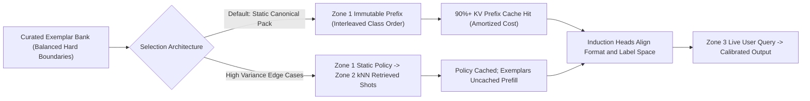
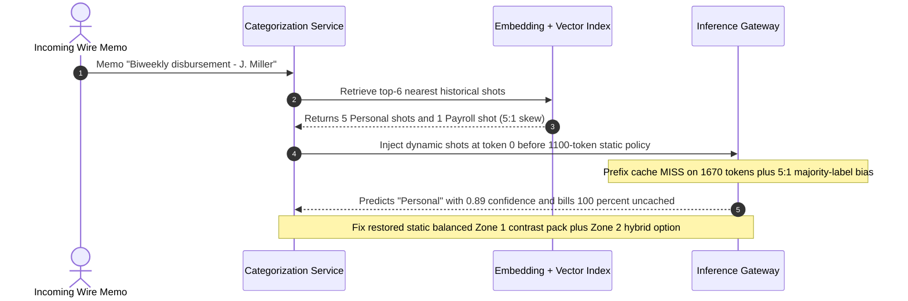

# Module 03: Few-Shot Prompting

> **Prerequisites:** [Module 02: Zero-Shot Prompting](../02-zero-shot-prompting/README.md), [Track 03, Module 08: GPT-3 and In-Context Learning](../../03-landmark-models-bert-gpt-and-moe/08-gpt-3-and-in-context-learning/README.md), and [Track 06, Module 08: The Embeddings API](../../06-openai-and-the-model-landscape/08-the-embeddings-api/README.md)  
> **Estimated Reading Time:** 30 minutes  
> **Target Audience:** AI Backend Engineers, Search & Retrieval Engineers, LLM FinOps Architects

> [!TIP]
> **The Golden Rule of Few-Shot Prompting:**
> Few-shot demonstrations ($k \in [2, 8]$) steer frozen transformer activations via **induction-head pattern matching** primarily to lock down **format, label space, and decision boundaries** (Min et al., 2022)—not to cram new world facts into weights. Because **exemplar class imbalance and tail ordering** can flip accuracy by `10%–30%` (Lu et al., 2022) and per-request dynamic retrieval invalidates prefix KV caching, default to a **balanced, interleaved, static Zone 1 exemplar pack** before paying for dynamic kNN-ICL.

---

## Why This Matters

When zero-shot prompting ([Module 02](../02-zero-shot-prompting/README.md)) hits an accuracy plateau on proprietary business taxonomies, rare JSON dialects, or nuanced edge cases, **few-shot prompting** ($k$ `(input, output)` demonstrations prepended before the live query) is the fastest weight-free lever available.

In production, however, engineers routinely burn budget and break reliability by treating few-shot examples like a passive training dataset:

1. **Majority-Label & Recency Skew:** Putting `5` positive examples and `1` negative example—or grouping all `Negative` examples last right before the test query—strongly biases causal attention toward predicting `Negative` purely from proximity (Zhao et al., 2021; Lu et al., 2022).
2. **Dynamic kNN Cache Destruction:** Replacing a static 4-shot prompt with per-request semantic kNN retrieval (`KATE`, Liu et al., 2022) changes tokens inside the prefix on every API call. If placed in Zone 1, it drops KV prefix cache reuse to `0%`, multiplying input bills by `3x–5x` and adding embedding + vector DB latency.
3. **Diminishing Returns & Context Noise:** Stuffing `20+` redundant easy examples rarely beats `4–6` **hard contrastive boundary pairs** while bloating prefill latency and risking attention dilution.

---

## 1. Architectural Mental Model: Induction Heads, Format Priors, and Ordering Geometry

### How Transformers Execute In-Context Learning Without Gradient Updates

Inside pretrained decoder-only transformers, mechanistic interpretability research (Olsson et al., 2022, `arXiv:2209.11895`) revealed specialized two-layer attention circuits called **induction heads**. Working together with a previous-token head, an induction head scans the KV cache for earlier occurrences of a similar pattern prefix `[A][B]` and copies or adapts `[B]` when `[A]` reappears near the end of the prompt.

Meanwhile, Min et al. (2022, `arXiv:2202.12837`) proved that replacing ground-truth labels in demonstrations with *random* labels preserves a surprising fraction of gains on many standard NLP tasks—demonstrating that few-shot exemplars act primarily by specifying:
1. **The Exact Output Space & Syntax:** Valid enum tokens, JSON field nesting, and stop structure.
2. **The Input Text Distribution:** Domain register (e.g., wire-transfer memos vs casual support chats).
3. **Boundary Calibration (via Hard Contrast Pairs):** Where subtle enterprise rules divide class `A` from class `B`.



### Exemplar Ordering Sensitivity & Recency Decay

Why does `[Fraud, Fraud, Normal, Normal]` behave differently from `[Normal, Fraud, Normal, Fraud]`? Under causal self-attention and RoPE positional decay, demonstrations positioned closer to token $N$ (small distance $d_{\text{tail}} = (k - 1) - i$) exert exponentially stronger recency pull on the next-token distribution at $N + 1$:

$$\Delta \ell_y \propto \sum_{i=0}^{k-1} \mathbb{I}(y_i = y) \cdot e^{-\lambda (k - 1 - i)}$$

When classes are **clustered** (`[Fraud, Fraud, Normal, Normal]`), the final block of `Normal` demonstrations creates a steep uncalibrated recency bias toward `Normal`. Balancing class counts and **strictly interleaving** labels (`[Normal, Fraud, Normal, Fraud]`)—combined with **hard-negative contrast pairs** and optional null calibration—eliminates order-induced flips.

### Quantitative Economics: Static Cached Shots vs. Dynamic kNN-ICL

Let $B_{\text{sys}}$ be base policy tokens, $k$ be exemplar count of average length $L_{\text{ex}}$, $h_{\text{stat}} \in [0, 1]$ be static KV cache hit rate with cached read factor $\alpha = 0.10$, and $C_{\text{vec}}$ be per-query embedding + vector search cost. Over $M$ monthly requests at input price $p_{\text{in}}$ and output price $p_{\text{out}}$:

$$\text{Spend}_{\text{static}}(k) = M \cdot \Big[(B_{\text{sys}} + k \cdot L_{\text{ex}}) \cdot p_{\text{in}} \cdot \big((1 - h_{\text{stat}}) + h_{\text{stat}}\alpha\big) + N_{\text{out}} p_{\text{out}}\Big]$$

$$\text{Spend}_{\text{dyn-uncached}}(k) = M \cdot \Big[(B_{\text{sys}} + k \cdot L_{\text{ex}}) \cdot p_{\text{in}} + N_{\text{out}} p_{\text{out}} + C_{\text{vec}}\Big]$$

At `100,000` reqs/day (`M = 3,000,000`), adding $k = 4$ static cached shots (`380` tokens) adds only **\$245/month** over $k = 2$, whereas placing uncached dynamic kNN shots at the front of the prompt balloons monthly input + retrieval spend by **nearly `4x` (\$12,510 vs \$3,259)**! Even in a hybrid layout (`Static Zone 1 Policy -> Dynamic Zone 2 Shots`), dynamic shots only justify their uncached prefill and retrieval latency if offline evals prove a concrete accuracy gain $\Delta \text{Acc}$ that clears the ROI threshold.

---

## 2. Systematic Reference & Comparison Matrix

### Few-Shot Architectural Strategies

| Strategy | Exemplar Count ($k$) | KV Prefix Cache Reuse | Order / Label Skew Risk | Extra Latency | Best Production Use Case |
| :--- | :--- | :--- | :--- | :--- | :--- |
| **Zero-Shot ($k=0$)** | `0` | Maximum (`95%+`) | Common-token bias only | `0ms` overhead | Standard summarization, clean enums |
| **Static Balanced Interleaved** | `2–6` | High (`85%–95%` in Zone 1) | Low (interleaved + equal counts) | `0ms` (cached prefill) | High-QPS formatting, domain classification, extraction |
| **Hard-Contrast Static Pack** | `4–8` (2 per boundary) | High (`85%–95%` in Zone 1) | Very Low (explicit counterexamples) | `0ms` (cached prefill) | Subtle policy edge cases (`Refund` vs `Chargeback`) |
| **Dynamic kNN-ICL (Hybrid Zone 2)** | `3–5` retrieved | Policy cached; shots `0%` cached | High if retrieved pool imbalanced! | `+15–60ms` (embed + ANN search) | Diverse multi-tenant code/SQL/template synthesis |
| **Supervised Fine-Tuning (LoRA/SFT)** | `0` at inference | Maximum (tiny prompt) | Baked into weights | Lowest (minimal input tokens) | Ultra-high QPS (`>1M/day`) or rigid low-latency SLMs |

### Multi-Turn Chat Format vs. Single-Block XML Demonstrations

| Serialization Format | Structural Clarity | Chat-Model Alignment | Cache Stability | When to Use |
| :--- | :--- | :--- | :--- | :--- |
| **Multi-Turn `user`/`assistant` Pairs** | High (native `<\|im_start\|>` turn boundaries) | Highest (matches SFT training distribution) | High if immutable turns precede live query | OpenAI / Anthropic / Llama chat APIs for classification & formatting |
| **XML `<examples>` Block inside `system`** | High (compact, single system message) | High on modern instruction models | Highest (keeps all Zone 1 in one block) | When SDKs/gateways restrict multi-turn system injection |
| **Raw Unstructured `Q: / A:` Text** | Moderate | Lower (resembles base-model pretraining) | High | Legacy completion endpoints or raw base models only |

---

## 3. Production War Story Post-Mortem: Dynamic kNN Exemplars Busted KV Cache and Skewed Payroll Wires

| Field | Incident Details |
| :--- | :--- |
| **Severity** | **SEV-1** (`3.8x` Spend Surge, `2.2x` P99 TTFT Degradation, and `11%` Misclassification Spike) |
| **Detection / Resolution Time** | Detected 3 days post-deploy via billing & customer complaint spike / Mitigated in 50 minutes |
| **Impact** | Monthly run-rate jumped by `\$9,250`/month equivalent, P99 TTFT spiked from `280ms` to `620ms`, and legitimate `Payroll` ACH transfers were wrongly flagged as `Personal` |

### What Happened

To improve wire-transfer categorization (`Payroll`, `Vendor`, `Personal`, `Tax`), an engineering team replaced a static 4-shot prompt (`1` example per class) with a dynamic semantic vector retriever pulling the `k = 6` nearest historical transactions for each incoming memo—and serialized those retrieved examples directly inside the `system` prompt **above** the `1,100`-token static compliance policy.

Two bugs struck simultaneously:
1. **Zone 1 Cache Annihilation:** Because the retrieved `6` examples changed on every incoming wire memo at token position `0`, `100%` of the `1,100`-token compliance handbook and `570` exemplar tokens missed the KV prefix cache on every call.
2. **Unbounded Majority-Label Skew in Top-$k$:** For ambiguous memos containing `"Biweekly disbursement - J. Miller"`, semantic similarity returned `5` `"Personal"` wires (`J. Miller` person-name embeddings matched personal Venmo transfers!) and only `1` `"Payroll"` wire, overwhelming the model's posterior toward `"Personal"`.



### Root Cause Analysis

1. **Dynamic Context Placed Ahead of Static Policy:** Inserting variable kNN results before static instructions broke chained KV prefix hashing across all `1,670` input tokens.
2. **Unconstrained Similarity Retrieval Without Class Stratification:** Pure cosine top-$k$ retrieval reflects database frequency and superficial entity overlap (`person name -> Personal`), injecting `5:1` majority-label bias into the prompt context.

### Architectural Hardening & Verified Fix

- **Reverted High-QPS Path to Static Hard-Contrast Pack:** Curated `8` static, class-balanced (`2` per class), strictly interleaved examples targeting ambiguous boundary memos (`"Biweekly disbursement"` vs `"Birthday gift"`), locked into **Zone 1** after the `1,100`-token policy. KV prefix cache hit rate jumped back to `93%`.
- **Added Class-Stratified Cap for Any Future Dynamic Path:** Required any kNN-ICL mode to live strictly **after** Zone 1 policy (Zone 2) and enforce **minimum 1 exemplar per class (`stratified_k`)** plus alternating class order before the query.

---

## 4. Multi-Language Production Implementation: Cache-Safe Balanced Few-Shot Registry

The implementations below construct a **class-balanced, deterministically interleaved few-shot pack** placed cleanly in Zone 1, verify minimum per-class representation, enforce token budgets, and expose a deterministic SHA-256 prefix hash for CI KV-cache regression tests.

````carousel

```go
package fewshot

import (
	"crypto/sha256"
	"encoding/hex"
	"errors"
	"fmt"
	"strings"
)

type Exemplar struct {
	ID     string
	Input  string
	Output string
	Label  string
}

type CompiledFewShotPrefix struct {
	SystemAndShots string
	PrefixHashHex  string
	ShotCount      int
	EstTokens      int
}

// BuildBalancedStaticPrefix enforces equal class representation, interleaved order, and budget caps.
func BuildBalancedStaticPrefix(
	staticPolicy string,
	byLabel map[string][]Exemplar,
	shotsPerLabel int,
	maxTotalWords int,
) (CompiledFewShotPrefix, error) {
	if strings.TrimSpace(staticPolicy) == "" || shotsPerLabel < 1 || len(byLabel) < 2 {
		return CompiledFewShotPrefix{}, errors.New("policy, >=2 labels, and shotsPerLabel>=1 are required")
	}

	labels := make([]string, 0, len(byLabel))
	for lbl, items := range byLabel {
		if len(items) < shotsPerLabel {
			return CompiledFewShotPrefix{}, fmt.Errorf("class %q has %d shots, needs %d for strict balance", lbl, len(items), shotsPerLabel)
		}
		labels = append(labels, lbl)
	}
	// Sort label keys deterministically so prefix hash never drifts across runs.
	for i := 0; i < len(labels); i++ {
		for j := i + 1; j < len(labels); j++ {
			if labels[j] < labels[i] {
				labels[i], labels[j] = labels[j], labels[i]
			}
		}
	}

	var b strings.Builder
	b.WriteString(strings.TrimSpace(staticPolicy))
	b.WriteString("\n<examples>\n")

	totalShots := 0
	for round := 0; round < shotsPerLabel; round++ {
		for _, lbl := range labels {
			ex := byLabel[lbl][round]
			fmt.Fprintf(&b, "<example id=%q>\n<input>%s</input>\n<output>%s</output>\n</example>\n",
				ex.ID, strings.TrimSpace(ex.Input), strings.TrimSpace(ex.Output))
			totalShots++
		}
	}
	b.WriteString("</examples>")

	rendered := b.String()
	words := len(strings.Fields(rendered))
	if maxTotalWords > 0 && words > maxTotalWords {
		return CompiledFewShotPrefix{}, fmt.Errorf("few-shot prefix %d words exceeds budget %d", words, maxTotalWords)
	}

	sum := sha256.Sum256([]byte(rendered))
	return CompiledFewShotPrefix{
		SystemAndShots: rendered,
		PrefixHashHex:  hex.EncodeToString(sum[:8]),
		ShotCount:      totalShots,
		EstTokens:      int(float64(words) * 1.35),
	}, nil
}
```

<!-- slide -->

```typescript
import { createHash } from "node:crypto";

export interface FewShotExemplar {
  readonly id: string;
  readonly label: string;
  readonly input: string;
  readonly output: string;
}

export interface CompiledFewShotPrefix {
  readonly staticPrefix: string;
  readonly prefixHash: string;
  readonly shotCount: number;
  readonly estTokens: number;
}

/**
 * Compiles a cache-safe, class-balanced, interleaved few-shot prefix (Zone 1).
 * Interleaving prevents trailing-class recency bias across consecutive shots.
 */
export function buildBalancedFewShotPrefix(
  staticPolicy: string,
  exemplarsByLabel: ReadonlyMap<string, readonly FewShotExemplar[]>,
  shotsPerClass: number,
  maxPrefixWords = 2500
): CompiledFewShotPrefix {
  if (!staticPolicy.trim() || shotsPerClass < 1 || exemplarsByLabel.size < 2) {
    throw new Error("Require non-empty policy, at least 2 classes, and shotsPerClass >= 1.");
  }

  const sortedLabels = [...exemplarsByLabel.keys()].sort((a, b) => a.localeCompare(b));
  for (const label of sortedLabels) {
    const bucket = exemplarsByLabel.get(label) ?? [];
    if (bucket.length < shotsPerClass) {
      throw new Error(`Imbalanced pool: class '${label}' has ${bucket.length} exemplars, expected >= ${shotsPerClass}.`);
    }
  }

  const lines: string[] = [staticPolicy.trim(), "<examples>"];
  let shotCount = 0;

  for (let round = 0; round < shotsPerClass; round++) {
    for (const label of sortedLabels) {
      const ex = exemplarsByLabel.get(label)![round];
      lines.push(
        `<example id="${ex.id}">\n<input>${ex.input.trim()}</input>\n<output>${ex.output.trim()}</output>\n</example>`
      );
      shotCount++;
    }
  }
  lines.push("</examples>");

  const staticPrefix = lines.join("\n");
  const words = staticPrefix.split(/\s+/).length;
  if (words > maxPrefixWords) {
    throw new Error(`Few-shot prefix budget exceeded: ${words} words > ${maxPrefixWords}.`);
  }

  const prefixHash = createHash("sha256").update(staticPrefix).digest("hex").slice(0, 16);
  return {
    staticPrefix,
    prefixHash,
    shotCount,
    estTokens: Math.ceil(words * 1.35),
  };
}
```

<!-- slide -->

```python
"""Class-balanced, interleaved, KV-cache-stable few-shot prefix compiler."""

from __future__ import annotations

from dataclasses import dataclass
import hashlib


@dataclass(frozen=True)
class Exemplar:
    id: str
    label: str
    input_text: str
    output_text: str


@dataclass(frozen=True)
class FewShotPrefix:
    static_prefix: str
    prefix_hash: str
    shot_count: int
    est_tokens: int


def build_balanced_few_shot_prefix(
    static_policy: str,
    exemplars: list[Exemplar],
    shots_per_class: int,
    max_words: int = 2500,
) -> FewShotPrefix:
    if not static_policy.strip() or shots_per_class < 1:
        raise ValueError("static_policy must be non-empty and shots_per_class >= 1")

    buckets: dict[str, list[Exemplar]] = {}
    for ex in exemplars:
        buckets.setdefault(ex.label, []).append(ex)

    if len(buckets) < 2:
        raise ValueError("At least 2 distinct label classes are required for balanced few-shot packing")

    labels = sorted(buckets.keys())
    for lbl in labels:
        if len(buckets[lbl]) < shots_per_class:
            raise ValueError(f"Class '{lbl}' has only {len(buckets[lbl])} examples (< {shots_per_class})")

    # Strictly interleave rounds across sorted labels to avoid trailing-class recency bias.
    blocks = [static_policy.strip(), "<examples>"]
    shot_count = 0
    for round_idx in range(shots_per_class):
        for lbl in labels:
            ex = buckets[lbl][round_idx]
            blocks.append(
                f'<example id="{ex.id}">\n'
                f"<input>{ex.input_text.strip()}</input>\n"
                f"<output>{ex.output_text.strip()}</output>\n"
                f"</example>"
            )
            shot_count += 1
    blocks.append("</examples>")

    prefix = "\n".join(blocks)
    words = len(prefix.split())
    if words > max_words:
        raise ValueError(f"Few-shot prefix word budget exceeded: {words} > {max_words}")

    return FewShotPrefix(
        static_prefix=prefix,
        prefix_hash=hashlib.sha256(prefix.encode("utf-8")).hexdigest()[:16],
        shot_count=shot_count,
        est_tokens=int(round(words * 1.35)),
    )
```

<!-- slide -->

```csharp
using System;
using System.Collections.Generic;
using System.Linq;
using System.Security.Cryptography;
using System.Text;

namespace GenAI.PromptEngineering;

public sealed record FewShotExemplar(string Id, string Label, string InputText, string OutputText);

public sealed record CompiledFewShotPrefix(string StaticPrefix, string PrefixHash, int ShotCount, int EstTokens);

public static class BalancedFewShotCompiler
{
    public static CompiledFewShotPrefix Compile(
        string staticPolicy,
        IEnumerable<FewShotExemplar> exemplars,
        int shotsPerClass,
        int maxWords = 2500)
    {
        if (string.IsNullOrWhiteSpace(staticPolicy) || shotsPerClass < 1)
            throw new ArgumentException("StaticPolicy must be non-empty and shotsPerClass >= 1.");

        var buckets = exemplars
            .GroupBy(e => e.Label, StringComparer.Ordinal)
            .OrderBy(g => g.Key, StringComparer.Ordinal)
            .ToList();

        if (buckets.Count < 2)
            throw new ArgumentException("At least two classes are required.");

        foreach (var g in buckets)
        {
            if (g.Count() < shotsPerClass)
                throw new InvalidOperationException($"Class '{g.Key}' has fewer than {shotsPerClass} exemplars.");
        }

        var sb = new StringBuilder();
        sb.AppendLine(staticPolicy.Trim());
        sb.AppendLine("<examples>");

        int shotCount = 0;
        var lists = buckets.Select(g => g.ToList()).ToList();
        for (int round = 0; round < shotsPerClass; round++)
        {
            foreach (var list in lists)
            {
                FewShotExemplar ex = list[round];
                sb.AppendLine($"<example id=\"{ex.Id}\">");
                sb.AppendLine($"<input>{ex.InputText.Trim()}</input>");
                sb.AppendLine($"<output>{ex.OutputText.Trim()}</output>");
                sb.AppendLine("</example>");
                shotCount++;
            }
        }
        sb.Append("</examples>");

        string prefix = sb.ToString();
        int words = prefix.Split((char[]?)null, StringSplitOptions.RemoveEmptyEntries).Length;
        if (words > maxWords)
            throw new InvalidOperationException($"Prefix word budget exceeded: {words} > {maxWords}.");

        byte[] hash = SHA256.HashData(Encoding.UTF8.GetBytes(prefix));
        return new CompiledFewShotPrefix(
            prefix,
            Convert.ToHexString(hash[..8]).ToLowerInvariant(),
            shotCount,
            (int)Math.Ceiling(words * 1.35));
    }
}
```

````

---

## 5. Practical Hands-On CLI Verification Workflows

### Workflow 1 (Offline Python 3.13): Recency Bias & Permutation Sensitivity Simulator

Simulate the exact same 4 demonstrations (`2 Fraud`, `2 Normal`) ordered in three permutations (`[F,F,N,N]`, `[N,N,F,F]`, and interleaved `[N,F,N,F]`) on an ambiguous wire-transfer query whose base semantic evidence slightly favors `Fraud` (`+0.15` logit). Verify how recency bias flips raw argmax under `[F,F,N,N]` while null calibration stabilizes every permutation identically:

```bash
python - << 'EOF'
import math

print("=== M03 WORKFLOW 1: Few-Shot Ordering & Recency Bias Sensitivity ===")
def eval_order(order: list[str], decay: float = 0.55) -> tuple[dict[str, float], dict[str, float]]:
    base = {"Normal": 0.0, "Fraud": 0.15}
    n = len(order)
    logits = dict(base)
    null_logits = {"Normal": 0.0, "Fraud": 0.0}
    for idx, label in enumerate(order):
        dist_from_tail = (n - 1) - idx
        recency_boost = 0.85 * math.exp(-decay * dist_from_tail)
        logits[label] += recency_boost
        null_logits[label] += recency_boost
    def softmax(d):
        m = max(d.values())
        e = {k: math.exp(v - m) for k, v in d.items()}
        s = sum(e.values())
        return {k: v / s for k, v in e.items()}
    p_raw = softmax(logits)
    p_null = softmax(null_logits)
    cal = {k: p_raw[k] / p_null[k] for k in p_raw}
    s_cal = sum(cal.values())
    return p_raw, {k: v / s_cal for k, v in cal.items()}

orders = [
    ("Fraud-first [F,F,N,N]", ["Fraud", "Fraud", "Normal", "Normal"]),
    ("Normal-first [N,N,F,F]", ["Normal", "Normal", "Fraud", "Fraud"]),
    ("Interleaved [N,F,N,F]", ["Normal", "Fraud", "Normal", "Fraud"]),
]
for name, seq in orders:
    p_raw, p_cal = eval_order(seq)
    raw_win = max(p_raw, key=p_raw.get)
    cal_win = max(p_cal, key=p_cal.get)
    print(f"{name:<24} | raw={raw_win:<6} (P_F={p_raw['Fraud']:.3f}) | calibrated={cal_win:<6} (P_F={p_cal['Fraud']:.3f})")
EOF
```

**Expected Output:**

```text
=== M03 WORKFLOW 1: Few-Shot Ordering & Recency Bias Sensitivity ===
Fraud-first [F,F,N,N]    | raw=Normal (P_F=0.322) | calibrated=Fraud  (P_F=0.537)
Normal-first [N,N,F,F]   | raw=Fraud  (P_F=0.740) | calibrated=Fraud  (P_F=0.537)
Interleaved [N,F,N,F]    | raw=Fraud  (P_F=0.652) | calibrated=Fraud  (P_F=0.537)
```

### Workflow 2 (Offline Python 3.13): Static Cached Shots vs. Dynamic Uncached kNN-ICL Economics

Compare 30-day billing across `100,000` daily requests (`base_in=1100`, `ex_tok=95` per shot, `out_tok=45`, `\$2.50/1M` in, `\$10.00/1M` out) comparing static Zone 1 cached exemplars (`92%` cache hit at `0.10` read multiplier) against uncached dynamic kNN injection (`\$0.00002` per vector query + `0%` prefix caching):

```bash
python - << 'EOF'
print("=== M03 WORKFLOW 2: Static Cached Shots vs Dynamic kNN-ICL Economics ===")
daily_reqs = 100_000
base_in, ex_tok, out_tok = 1100, 95, 45
c_in, c_out = 2.50, 10.00
for k in (0, 2, 4, 8):
    total_in = base_in + k * ex_tok
    static_hit = 0.92
    eff_static = total_in * ((1 - static_hit) + static_hit * 0.10)
    static_monthly = 30 * daily_reqs * ((eff_static * c_in + out_tok * c_out) / 1e6)
    dyn_monthly = 30 * daily_reqs * (((total_in * c_in + out_tok * c_out) / 1e6) + 0.00002)
    print(f"k={k} | total_in={total_in:<4} | static_cache_hit={static_hit*100:4.0f}% | static_30d=${static_monthly:8.2f} | dynamic_kNN_30d=${dyn_monthly:8.2f}")
EOF
```

**Expected Output:**

```text
=== M03 WORKFLOW 2: Static Cached Shots vs Dynamic kNN-ICL Economics ===
k=0 | total_in=1100 | static_cache_hit=  92% | static_30d=$ 2769.00 | dynamic_kNN_30d=$ 9660.00
k=2 | total_in=1290 | static_cache_hit=  92% | static_30d=$ 3014.10 | dynamic_kNN_30d=$11085.00
k=4 | total_in=1480 | static_cache_hit=  92% | static_30d=$ 3259.20 | dynamic_kNN_30d=$12510.00
k=8 | total_in=1860 | static_cache_hit=  92% | static_30d=$ 3749.40 | dynamic_kNN_30d=$15360.00
```

### Workflow 3 (Optional Live API Verification): Multi-Turn Chat Few-Shot Invocation

> [!NOTE]
> **Optional Cloud API Check:** Requires `OPENAI_API_KEY` and `openai>=1.50.0`. Notice how keeping all `user`/`assistant` exemplar turns immutable in the leading array preserves prefix KV caching across live queries.

```python
import os
from openai import OpenAI

client = OpenAI(api_key=os.environ["OPENAI_API_KEY"])

STATIC_FEW_SHOT_PREFIX = [
    {"role": "system", "content": "Classify wire memos into exactly one label: PAYROLL, VENDOR, TAX, or PERSONAL."},
    {"role": "user", "content": "Memo: Biweekly salary run - J. Miller"},
    {"role": "assistant", "content": "PAYROLL"},
    {"role": "user", "content": "Memo: Dinner split with J. Miller"},
    {"role": "assistant", "content": "PERSONAL"},
    {"role": "user", "content": "Memo: Q3 IRS estimated tax payment"},
    {"role": "assistant", "content": "TAX"},
    {"role": "user", "content": "Memo: AWS Cloud infrastructure invoice 441"},
    {"role": "assistant", "content": "VENDOR"},
]

resp = client.chat.completions.create(
    model="gpt-4o-mini",
    temperature=0.0,
    max_tokens=5,
    messages=[*STATIC_FEW_SHOT_PREFIX, {"role": "user", "content": "Memo: Semi-monthly contractor payroll - M. Chen"}],
)
print(resp.choices[0].message.content)
```

---

## 6. Hands-On Exercises & Independent Challenge

### Hands-On Exercises

1. **Majority-Label Bias Stress Test:** Modify Workflow 1 to pass an imbalanced `3:1` list `["Normal", "Normal", "Normal", "Fraud"]` vs `["Fraud", "Fraud", "Fraud", "Normal"]` and observe how uncalibrated `P_raw['Fraud']` swings dramatically across the two prompts.
2. **Hybrid Zone 1 + Zone 2 Cost Calculation:** Extend Workflow 2 by modeling a hybrid architecture where the `1,100`-token static policy stays cached (`h=0.92`) in Zone 1 and only the `k * 95` dynamic kNN exemplars sit uncached in Zone 2. Calculate the exact monthly savings compared to placing kNN shots at position `0`.
3. **Hard-Contrast Curation:** Take a binary classifier separating `"Duplicate Billing Charge"` from `"Subscription Renewal Charge"` and author two high-contrast boundary pairs that share almost identical vocabulary (`"charged again"`, `"monthly"`, `"card"`) while differing solely on the causal rule (`within 5 minutes of identical invoice` vs `30 days post-cycle`).

### Independent Challenge

Your SQL-generation microservice serves `120` enterprise schemas (`tenants`). Zero-shot prompting gets `61%` execution accuracy because column naming conventions differ wildly across tenants (`usr_id` vs `account_uuid`), while a `6`-shot static prompt hits `72%` (many schemas don't match the 6 generic tables). Your team wants dynamic kNN-ICL retrieving the 4 closest verified SQL queries per incoming question—but cannot tolerate losing KV caching on the `2,400`-token system prompt and tenant schema DDL. Design the exact message layout, retrieval filtering rule, and caching order.

<details><summary>Architectural Discussion</summary>

1. **Strict Zone Ordering (`Static Policy -> Tenant DDL -> Dynamic kNN Shots -> Query`):** Place the `2,400`-token global SQL rules and tool definitions first (`Zone 1`, cached across all `120` tenants), followed immediately by the active tenant's static table DDL (`Zone 2a`, cached per tenant!), followed by the `4` retrieved kNN SQL exemplars (`Zone 2b`, uncached dynamic tail), and finally the live user question (`Zone 3`).
2. **Filter kNN Retrieval Strictly by `tenant_id` (or Schema Cluster):** Never retrieve `Tenant B`'s SQL shots into `Tenant A`'s prompt—that injects wrong column names (`account_uuid` vs `usr_id`) and triggers false induction-head copying! Filter the vector index by `metadata.tenant_id == current_tenant`, falling back to a validated tenant-agnostic structural pack when a new tenant has `< 4` verified SQL logs.
3. **Deduplicate & Diversify Retrieved Shots:** Use Maximal Marginal Relevance (MMR) or SQL-template deduplication so 4 retrieved examples cover distinct query shapes (`JOIN`, `GROUP BY`, `WINDOW`, `DATE FILTER`) rather than 4 near-identical copies that induce template overfitting.

</details>

---

## 7. Common Mistakes & Troubleshooting

- **Clustered Label Ordering (`[A, A, A, B, B, B]`):** Putting all examples of one class together at the end creates severe recency bias favoring the trailing class. Always interleave classes evenly (`[A, B, A, B, A, B]`).
- **Imbalanced Exemplar Counts (`4` Positives, `1` Negative):** Models mirror the empirical class frequency of the prompt (`80%` prior toward Positive). Keep counts balanced per class unless deliberately compensating for an asymmetric loss function.
- **Unfiltered kNN-ICL Injection in Zone 1:** Placing dynamic retrieved examples before static system rules busts `100%` of downstream KV prefix cache blocks. Always isolate dynamic shots after immutable policy blocks.
- **Using Trivial "Happy Path" Shots Instead of Contrastive Boundaries:** Showing 6 effortless textbook inputs wastes context tokens; curate pairs that explicitly teach the hardest borderline distinctions and edge-case `null`/fallback outputs.

---

## 8. Operational Validation Checkpoints & Checkpoint Quiz

### Operational Validation Checkpoints

<details><summary><strong>Checkpoint 1: Diagnosing a 22% Accuracy Regression After Re-Ordering Shots</strong></summary>

An engineer alphabetized an existing 6-shot moderation prompt (`[SAFE, SAFE, SAFE, UNSAFE, UNSAFE, UNSAFE]`) for readability, and false-positive `UNSAFE` flags jumped by `22%` overnight with no model or text change. Why did alphabetization break production accuracy?

**Validation:** Alphabetization clustered all three `UNSAFE` examples directly at the end of the prompt (`positions 3, 4, 5`) immediately preceding the live user input. Because causal attention exhibits strong recency decay, placing three `UNSAFE` outputs in the final slots sharply biased logits toward `UNSAFE` (Lu et al., 2022; Zhao et al., 2021). Interleaving `[SAFE, UNSAFE, SAFE, UNSAFE, SAFE, UNSAFE]` removes the trailing cluster skew.

</details>

<details><summary><strong>Checkpoint 2: Evaluating ROI of Dynamic kNN-ICL vs. Static Few-Shot</strong></summary>

At `100,000` requests/day, switching from a cached `4`-shot static prompt (`\$3,259/mo`) to an uncached dynamic kNN `4`-shot setup (`\$12,510/mo`) adds `\$9,251/mo` in API + vector DB spend. Under what engineering condition is dynamic kNN-ICL justified?

**Validation:** Only when (1) the task input space spans **diverse schemas, dialects, or templates** too broad to cover in `4–8` static shots (e.g., per-tenant SQL generation or multi-API tool mapping), **AND** (2) offline evaluation proves a measurable accuracy lift $\Delta \text{Acc}$ whose business value exceeds `\$9,251/mo`—while still placing Zone 1 static instructions *before* Zone 2 dynamic shots to preserve partial prefix caching.

</details>

<details><summary><strong>Checkpoint 3: Preventing Random Label Overwriting Myths (Min et al., 2022)</strong></summary>

A teammate reads Min et al. (2022) and concludes: *"Since random labels didn't crash accuracy in that paper, we don't need to verify that our few-shot labels are accurate."* Why is that dangerous in enterprise production?

**Validation:** Min et al. showed that demonstrations strongly condition **label space, domain distribution, and format** even with noisy labels on common pretrained tasks (sentiment, NLI) where the model already knows the semantic boundary. For **idiosyncratic enterprise rules** (`Chargeback` vs `Billing Adjustment`, custom tax thresholds, or exact schema mapping), wrong labels teach conflicting boundary induction cues and cause systematic production errors on ambiguous inputs.

</details>

### Checkpoint Quiz

1. Mechanistically, what are **induction heads** (Olsson et al., 2022) and what algorithmic pattern do they execute across few-shot prompts?
2. According to Min et al. (2022), which three components of a task do few-shot demonstrations specify most strongly?
3. Why does clustering all examples of Class B at the end of a prompt (`[A, A, B, B]`) distort borderline predictions?
4. What happens to KV prefix caching if you inject dynamic kNN-retrieved shots inside the `system` prompt before a `2,000`-token static instruction handbook?
5. Why do `4–6` **hard contrastive boundary pairs** outperform `20` easy prototypical examples?

<details><summary>Answers</summary>

1. Two-layer attention circuits (a previous-token head paired with an induction attention head) that implement prefix matching and copying (`[A][B] ... [A] -> [B]`) over the active KV context without weight updates.
2. The **label space** (valid output tokens), the **input text distribution** (domain register), and the **output formatting contract**.
3. Causal attention and positional decay give disproportionate weight to tokens immediately preceding generation (recency bias), artificially inflating Class B logits regardless of the live query.
4. Mutating tokens near offset `0` breaks chained block hashes across the entire `2,000`-token handbook, dropping prefix cache hit rate to `0%` and forcing full prefill recomputation on every request.
5. Contrast pairs explicitly carve out the ambiguous decision hyperplane separating classes (`Chargeback` vs `Duplicate`), delivering maximum boundary information per prefill token without padding context length.

</details>

---

## Further Reading & Sources

- [Language Models are Few-Shot Learners (Brown et al., 2020)](https://arxiv.org/abs/2005.14165) - Landmark GPT-3 study defining weight-free few-shot in-context learning.
- [In-context Learning and Induction Heads (Olsson et al., 2022)](https://arxiv.org/abs/2209.11895) - Mechanistic transformer circuits driving pattern matching in few-shot prompts.
- [Rethinking the Role of Demonstrations: What Makes In-Context Learning Work? (Min et al., 2022)](https://arxiv.org/abs/2202.12837) - Empirical dissection of label space, format, and input distribution conditioning.
- [Fantastically Ordered Prompts and Where to Find Them (Lu et al., 2022)](https://arxiv.org/abs/2104.08786) - Analysis of prompt permutation order sensitivity and mitigation methods.
- [What Makes Good In-Context Examples for GPT-3? (Liu et al., 2022)](https://arxiv.org/abs/2101.06804) - Retrieval-based dynamic few-shot example selection (KATE).
- [Module 02: Zero-Shot Prompting](../02-zero-shot-prompting/README.md) - Contextual calibration math (`Zhao et al., 2021`) used to remove exemplar recency skew.

## Next

[Module 04: Chain-of-Thought](../04-chain-of-thought/README.md)
