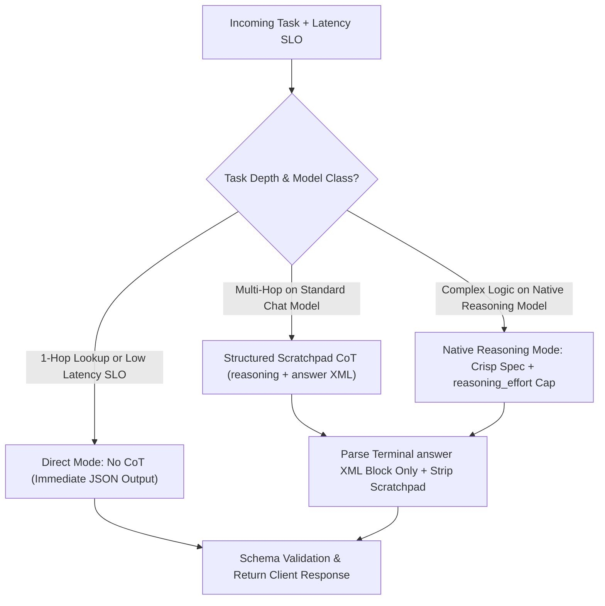
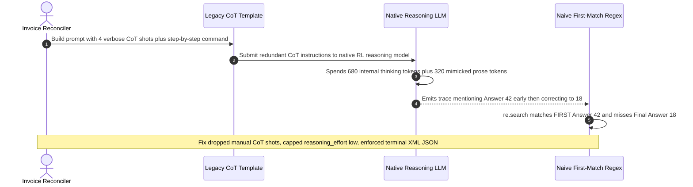

# Module 04: Chain-of-Thought

> **Prerequisites:** [Module 03: Few-Shot Prompting](../03-few-shot-prompting/README.md), [Track 06, Module 05: Reasoning Models and Test-Time Compute](../../06-openai-and-the-model-landscape/05-reasoning-models-and-test-time-compute/README.md), and [Track 01, Module 15: Next-Token Prediction](../../01-tokens-and-language-modeling/15-next-token-prediction-from-logits-to-probabilities/README.md)  
> **Estimated Reading Time:** 32 minutes  
> **Target Audience:** AI Backend Engineers, Inference Latency Architects, LLM Reliability Engineers

> [!TIP]
> **The Golden Rule of Chain-of-Thought (CoT):**
> Generating intermediate reasoning tokens allocates **serial test-time compute** ($O(T)$ forward passes cached into KV memory) so a transformer does not collapse on multi-hop dependencies—**but CoT is neither free nor universally helpful**: on standard chat models, isolate reasoning in `<reasoning>` before a strictly parsed terminal `<answer>` schema; on **native RL reasoning models**, omit manual `"think step by step"` prose and bound compute directly via `reasoning_effort` / `thinking.budget_tokens`.

---

## Why This Matters

Every token emitted by a decoder-only transformer passes through a fixed number of sequential transformer layers $L$ (e.g., $32$ to $128$ layers). When you ask a standard chat model for an immediate 1-token final answer on a 5-step tax calculation, contract clause join, or multi-hop routing rule, **all intermediate variable bindings must survive inside a single forward pass** before token $N + 1$ is sampled. Complex multi-hop tasks inevitably collapse under that fixed $O(L)$ depth ceiling.

**Chain-of-Thought (CoT)** (Wei et al., 2022; Kojima et al., 2022) fixes that depth bottleneck by prompting the model to emit intermediate reasoning tokens $z_{1:T}$ before predicting the final answer $a$. Each generated reasoning token is appended to the causal KV cache, acting as **external autoregressive working memory** for downstream steps.

In backend production, however, unguarded CoT deployment triggers three costly regressions:

1. **Serial Decode Latency & $3\times$–$5\times$ Output Cost Explosion:** Generating `250` scratchpad tokens instead of `15` JSON tokens multiplies decode latency linearly ($T_{\text{out}} / R_{\text{tok/s}}$) and bills at the expensive output token rate.
2. **Double-Thinking on Native Reasoning Models:** Sending verbose manual CoT exemplars or `"Let's think step by step in detail"` to models already RL-trained for internal test-time reasoning (`o3`, `Claude Extended Thinking`, `DeepSeek-R1`) inflates hidden + visible thinking tokens and often *degrades* instruction adherence.
3. **Hypothesis-Leak Parser Bugs & Unfaithful Explanations:** Naive regex parsers (`Answer:\s*(\d+)`) often grab an early rejected intermediate hypothesis inside `<reasoning>` instead of the final conclusion—and persuasive prose steps can still rationalize biased priors (`Turpin et al., 2023`).

---

## 1. Architectural Mental Model: Serial Test-Time Compute & Model-Class Routing

### Transforming $O(1)$ Single-Pass Depth into $O(T)$ Autoregressive Working Memory

Without CoT, generating the final answer directly maximizes $P_{\theta}(a \mid x)$ in a single depth-$L$ evaluation. With CoT, generation marginalizes through a latent reasoning sequence $z = (z_1, \dots, z_T)$ before producing $a$:

$$P_{\theta}(a, z_{1:T} \mid x) = \left(\prod_{t=1}^{T} P_{\theta}(z_t \mid x, z_{<t})\right) \cdot P_{\theta}(a \mid x, z_{1:T})$$

Because each step $z_t$ materializes explicit intermediate state (`tier = PRO`, `subtotal = 85.00`, `tax_exempt = true`) into the KV cache, token $a$ only needs to attend to verified sub-results rather than solving $d$ nested hops simultaneously.



*(Note: Inside XML schemas, keep `<reasoning>` internal for audit logging and strip it before external client responses unless explainability is explicitly required.)*

### Zero-Shot CoT vs. Few-Shot CoT vs. Native RL Reasoning

1. **Zero-Shot CoT (Kojima et al., 2022, `arXiv:2205.11916`):** Appending `"Let's think step by step."` triggers multi-step reasoning without any demonstration examples (`k = 0`), originally requiring a second extraction prompt (`"Therefore, the final answer is:"`) to isolate clean values. Best for rapid prototyping on capable instruction models when exemplar maintenance is undesirable.
2. **Few-Shot CoT (Wei et al., 2022, `arXiv:2201.11903`):** Supplying $k \in [2, 6]$ `(query, explicit step-by-step rationale, final answer)` exemplars teaches both *that* the model should reason and *which domain decomposition steps* to follow (e.g., always extract dates before checking SLA expiration).
3. **Native Reasoning Models (OpenAI `o`-series, Anthropic Extended Thinking, `DeepSeek-R1` `arXiv:2501.12948`):** Trained with reinforcement learning to run internal backtracking, hypothesis verification, and self-correction inside dedicated thinking tokens prior to visible output. Prompting them with rigid step-by-step templates constrains their native search tree and wastes tokens; instead supply **crisp axioms, hard constraints, verifiable success criteria, and an explicit thinking budget (`low | medium | high`)**.

### Decode Latency & Token Economics

End-to-end CoT response latency is strictly dominated by serial autoregressive decoding rather than parallel prefill:

$$\text{Latency}_{\text{CoT}} \approx \text{TTFT}(N_{\text{in}}) + \frac{T_{\text{think}} + T_{\text{scratchpad}} + T_{\text{answer}}}{R_{\text{tok/s}}}$$

And per-request billing scales heavily with total generated output tokens ($T_{\text{out}} = T_{\text{think}} + T_{\text{scratchpad}} + T_{\text{answer}}$) since reasoning/thinking tokens are billed at the output rate $p_{\text{out}}$:

$$C_{\text{CoT}} = N_{\text{in}} \cdot p_{\text{in}} \cdot \big((1 - h) + h\alpha\big) + (T_{\text{think}} + T_{\text{scratchpad}} + T_{\text{answer}}) \cdot p_{\text{out}}$$

---

## 2. Systematic Reference & Comparison Matrix

### Reasoning Strategy Comparison Matrix

| Strategy | Model Class Fit | Output Token Footprint | Latency Profile | Parser Fragility | Best Production Use Case |
| :--- | :--- | :--- | :--- | :--- | :--- |
| **Direct Answer (No CoT)** | Chat / SLM | Minimal (`10–30` tok) | Fastest (`<500ms`) | Lowest (direct JSON schema) | 1-hop classification, entity extraction, autocomplete |
| **Zero-Shot Prose CoT** | Standard Chat LLM | High (`150–350` tok) | Slow (`2–4s`) | High (prose interleaves numbers/labels) | Ad-hoc diagnostics, offline batch analysis |
| **Few-Shot Structured CoT** | Standard Chat LLM | Moderate (`80–160` tok) | Moderate (`1–2.5s`) | Very Low (`<reasoning>` + `<answer>` JSON) | Multi-hop policy rules, invoice math, triage pipelines |
| **Native RL Reasoning (`reasoning_effort`)** | `o3`, `R1`, Extended Thinking | High (`300–2,000+` think tok) | High (`3–15s+`) | Low (clean final output if budgeted) | Complex code synthesis, legal/math verification, planning |
| **Over-Prompted CoT on Reasoning Model** | Native Reasoning LLM | Excessive (`1,000+` redundant tok) | Severe (`10s+` timeouts) | Moderate (format conflicts) | **Anti-pattern** — always remove prose CoT cues on reasoning models |

### CoT Reliability Boundaries: When CoT Helps vs. Hurts

| Task Characteristics | CoT Effect | Engineering Action |
| :--- | :--- | :--- |
| **Multi-hop arithmetic / state tracking ($d \ge 3$)** | `+20pp to +55pp` accuracy gain | Enable Structured CoT (or Code/Calculator tool!) |
| **Simple sentiment / topic routing ($d = 1$)** | `~0pp` gain; `5x` latency regression | Keep Direct Mode (`T=0`, zero scratchpad) |
| **Biased / leading user framing (Turpin et al., 2023)** | May emit **unfaithful** rationalizations | Add deterministic rule checks or Self-Consistency ([Module 05](../05-self-consistency-and-voting/README.md)) |
| **Strict real-time SLA (`< 500ms`)** | Breaches timeout budgets | Precompute / distill into Direct Mode or SFT model |

---

## 3. Production War Story Post-Mortem: Over-Prompted Reasoning Models & Hypothesis-Leak Parser Outage

| Field | Incident Details |
| :--- | :--- |
| **Severity** | **SEV-1** (`12s` Latency Surge, `6.4x` Output Spend Spike, and Silent Wrong Billing Totals) |
| **Detection / Resolution Time** | Detected 90 minutes post-migration via p99 latency paging & customer invoice dispute / Mitigated in 30 minutes |
| **Impact** | API p99 latency jumped from `1.6s` to `12.1s`, output token spend climbed `6.4x`, and `19%` of parsed invoice totals extracted discarded intermediate numbers |

### What Happened

An invoice-reconciliation microservice migrated from a standard instruction-tuned chat model (`gpt-4o-mini`) to a native reasoning model (`o3-mini`) while leaving its legacy Few-Shot CoT prompt completely untouched—including `4` verbose `"Think step by step carefully, show all intermediate hypotheses, and conclude with Answer: X"` exemplars.

Two compounding failures broke production immediately:
1. **Redundant Double-Thinking:** The reasoning model allocated `~680` internal RL thinking tokens *plus* mimicked the `320`-token verbose prose exemplars (`1,000` total output tokens per call!), blowing past the gateway's `5s` timeout and driving `10k`-request cost from `\$29` to `\$116`.
2. **Hypothesis-Leak Regex Bug:** The service extracted the invoice total using `re.search(r"Answer:\s*(\d+)", text)`. Whenever the model self-corrected mid-trace (`"Wait, checking Rule 1 gives Answer: 42 initially—no, tax-exempt applies, so Final Answer: 18"`), `re.search` matched the **first** discarded hypothesis (`42`) instead of `18`!



### Root Cause Analysis

1. **Model-Class Prompt Mismatch:** Applying manual Few-Shot CoT prose cues onto a native RL reasoning model forced double reasoning work without improving task accuracy.
2. **First-Match Extraction Over Unstructured Prose:** Using `re.search()` on free-form reasoning text conflates intermediate backtracking hypotheses with the final machine-committed payload.

### Architectural Hardening & Verified Fix

- **Split Strategy by Model Class:** Removed all manual `"think step by step"` prose and CoT exemplars when targeting native reasoning endpoints, setting `reasoning_effort="low"` for routine multi-hop invoices (`4–6` hops) and routing simple `1`-hop lookups directly to non-reasoning fast models.
- **Enforced Terminal XML+JSON Extraction:** Replaced free-text `"Answer: X"` regexes with strict `<answer>{"total_usd": number}</answer>` parsing that validates **only the final `<answer>` block** via JSON Schema and strips `<reasoning>` before persistence.
- **Verified Recovery:** End-to-end p99 latency returned under `1.8s`, output billing dropped `74%`, and hypothesis-leak extraction errors fell from `19%` to `0.0%`.

---

## 4. Multi-Language Production Implementation: CoT Mode Router & Terminal Scratchpad Extractor

The implementations below route tasks cleanly between **`Direct`**, **`StructuredScratchpad`** (standard chat models), and **`NativeReasoning`** (reasoning models with bounded effort and zero manual CoT prose), then extract and validate **strictly the terminal `<answer>` JSON payload** while discarding intermediate hypothesis leaks.

````carousel

```go
package cot

import (
	"encoding/json"
	"errors"
	"fmt"
	"regexp"
	"strings"
)

type ReasoningStrategy string

const (
	StrategyDirect              ReasoningStrategy = "DIRECT"
	StrategyStructuredScratchpad ReasoningStrategy = "STRUCTURED_COT"
	StrategyNativeReasoning     ReasoningStrategy = "NATIVE_REASONING"
)

type CompiledCoTRequest struct {
	Strategy        ReasoningStrategy
	PromptSuffix    string
	ReasoningEffort string // only set for NATIVE_REASONING
	MaxOutputTokens int
}

var terminalAnswerRe = regexp.MustCompile(`(?s)<answer>\s*(\{.*?\})\s*</answer>`)

// RouteCoTStrategy selects optimal test-time compute allocation without double-thinking on reasoning models.
func RouteCoTStrategy(hopDepth int, latencySLOMs int, isNativeReasoningModel bool) CompiledCoTRequest {
	if hopDepth <= 1 || latencySLOMs < 600 {
		return CompiledCoTRequest{
			Strategy:        StrategyDirect,
			PromptSuffix:    "Emit ONLY valid JSON inside <answer>{...}</answer>. No reasoning prose.",
			MaxOutputTokens: 64,
		}
	}
	if isNativeReasoningModel {
		effort := "low"
		if hopDepth >= 5 {
			effort = "medium"
		}
		// Never inject manual "think step by step" prose onto native RL reasoning models.
		return CompiledCoTRequest{
			Strategy:        StrategyNativeReasoning,
			PromptSuffix:    "Return ONLY valid JSON inside <answer>{...}</answer> satisfying all policy constraints.",
			ReasoningEffort: effort,
			MaxOutputTokens: 1024,
		}
	}
	return CompiledCoTRequest{
		Strategy:        StrategyStructuredScratchpad,
		PromptSuffix:    "Compute steps concisely inside <reasoning>...</reasoning>, then emit ONLY valid JSON inside terminal <answer>{...}</answer>.",
		MaxOutputTokens: 320,
	}
}

// ExtractTerminalAnswerJSON grabs strictly the FINAL <answer> JSON block, preventing hypothesis leaks.
func ExtractTerminalAnswerJSON[T any](rawResponse string) (T, error) {
	var zero T
	matches := terminalAnswerRe.FindAllStringSubmatch(rawResponse, -1)
	if len(matches) == 0 {
		return zero, errors.New("missing terminal <answer>{...}</answer> block")
	}
	finalPayload := strings.TrimSpace(matches[len(matches)-1][1])
	var parsed T
	if err := json.Unmarshal([]byte(finalPayload), &parsed); err != nil {
		return zero, fmt.Errorf("invalid JSON in terminal <answer> block: %w", err)
	}
	return parsed, nil
}
```

<!-- slide -->

```typescript
export type ReasoningMode = "DIRECT" | "STRUCTURED_COT" | "NATIVE_REASONING";

export interface CoTDispatchPlan {
  readonly mode: ReasoningMode;
  readonly formatDirective: string;
  readonly reasoningEffort?: "low" | "medium" | "high";
  readonly maxCompletionTokens: number;
}

const TERMINAL_ANSWER_RE = /<answer>\s*(\{[\s\S]*?\})\s*<\/answer>/g;

export function planCoTExecution(
  hopDepth: number,
  latencySloMs: number,
  isNativeReasoningModel: boolean
): CoTDispatchPlan {
  if (hopDepth <= 1 || latencySloMs < 600) {
    return {
      mode: "DIRECT",
      formatDirective: "Emit ONLY valid JSON inside <answer>{...}</answer>. Do not output reasoning steps.",
      maxCompletionTokens: 64,
    };
  }
  if (isNativeReasoningModel) {
    // Omit manual CoT prose; bound internal RL search with reasoning_effort.
    return {
      mode: "NATIVE_REASONING",
      formatDirective: "Satisfy every constraint and emit ONLY valid JSON inside <answer>{...}</answer>.",
      reasoningEffort: hopDepth >= 5 ? "medium" : "low",
      maxCompletionTokens: 1024,
    };
  }
  return {
    mode: "STRUCTURED_COT",
    formatDirective:
      "Work step by step inside <reasoning>...</reasoning>, then emit final JSON inside <answer>{...}</answer>.",
    maxCompletionTokens: 320,
  };
}

export function extractTerminalAnswerJson<T>(rawText: string): T {
  const matches = [...rawText.matchAll(TERMINAL_ANSWER_RE)];
  if (matches.length === 0) {
    throw new Error("Scratchpad parse error: no <answer>{...}</answer> block found.");
  }
  const lastJsonBlock = matches[matches.length - 1][1].trim();
  return JSON.parse(lastJsonBlock) as T;
}
```

<!-- slide -->

```python
"""Model-aware CoT mode router and terminal scratchpad JSON extractor."""

from __future__ import annotations

from dataclasses import dataclass
import json
import re
from typing import Any

_TERMINAL_ANSWER_RE = re.compile(r"<answer>\s*(\{.*?\})\s*</answer>", re.DOTALL)


@dataclass(frozen=True)
class CoTExecutionPlan:
    mode: str
    directive: str
    max_completion_tokens: int
    reasoning_effort: str | None = None


def plan_cot_execution(
    hop_depth: int,
    latency_slo_ms: int,
    is_native_reasoning_model: bool,
) -> CoTExecutionPlan:
    if hop_depth <= 1 or latency_slo_ms < 600:
        return CoTExecutionPlan(
            mode="DIRECT",
            directive="Emit ONLY valid JSON inside <answer>{...}</answer> without explanation.",
            max_completion_tokens=64,
        )
    if is_native_reasoning_model:
        # Never inject manual 'think step by step' prose on native reasoning models.
        return CoTExecutionPlan(
            mode="NATIVE_REASONING",
            directive="Satisfy all constraints and return ONLY valid JSON inside <answer>{...}</answer>.",
            max_completion_tokens=1024,
            reasoning_effort="medium" if hop_depth >= 5 else "low",
        )
    return CoTExecutionPlan(
        mode="STRUCTURED_COT",
        directive=(
            "Reason concisely inside <reasoning>...</reasoning>, then emit ONLY valid JSON "
            "inside a final <answer>{...}</answer> block."
        ),
        max_completion_tokens=320,
    )


def extract_terminal_answer_json(raw_output: str) -> dict[str, Any]:
    """Always parse the LAST <answer> block so intermediate hypotheses never leak."""
    blocks = _TERMINAL_ANSWER_RE.findall(raw_output)
    if not blocks:
        raise ValueError("Missing terminal <answer>{...}</answer> block in model response")
    parsed = json.loads(blocks[-1])
    if not isinstance(parsed, dict):
        raise ValueError("Terminal <answer> payload must decode to a JSON object")
    return parsed
```

<!-- slide -->

```csharp
using System;
using System.Text.Json;
using System.Text.RegularExpressions;

namespace GenAI.PromptEngineering;

public enum CoTMode { Direct, StructuredScratchpad, NativeReasoning }

public sealed record CoTExecutionPlan(
    CoTMode Mode,
    string Directive,
    int MaxCompletionTokens,
    string? ReasoningEffort = null);

public static partial class CoTRouterAndExtractor
{
    [GeneratedRegex(@"<answer>\s*(\{.*?\})\s*</answer>", RegexOptions.Singleline)]
    private static partial Regex TerminalAnswerRegex();

    public static CoTExecutionPlan Plan(int hopDepth, int latencySloMs, bool isNativeReasoningModel)
    {
        if (hopDepth <= 1 || latencySloMs < 600)
        {
            return new CoTExecutionPlan(
                CoTMode.Direct,
                "Emit ONLY valid JSON inside <answer>{...}</answer> without reasoning text.",
                64);
        }
        if (isNativeReasoningModel)
        {
            return new CoTExecutionPlan(
                CoTMode.NativeReasoning,
                "Satisfy all constraints and return ONLY valid JSON inside <answer>{...}</answer>.",
                1024,
                hopDepth >= 5 ? "medium" : "low");
        }
        return new CoTExecutionPlan(
            CoTMode.StructuredScratchpad,
            "Verify steps concisely inside <reasoning>...</reasoning>, then output final JSON inside <answer>{...}</answer>.",
            320);
    }

    public static T ExtractTerminalAnswer<T>(string rawResponse)
    {
        MatchCollection matches = TerminalAnswerRegex().Matches(rawResponse);
        if (matches.Count == 0)
            throw new FormatException("Missing terminal <answer>{...}</answer> block.");

        string finalJson = matches[^1].Groups[1].Value.Trim();
        return JsonSerializer.Deserialize<T>(finalJson)
            ?? throw new JsonException("Deserialized null payload from terminal <answer> block.");
    }
}
```

````

---

## 5. Practical Hands-On CLI Verification Workflows

### Workflow 1 (Offline Python 3.13): Multi-Hop Depth Collapse vs. CoT Latency & Spend Economics

Quantify why single-pass direct prediction decays steeply as multi-hop depth grows ($d \in \{1, 2, 4, 6\}$) while step-by-step scratchpad tokens preserve high chain accuracy—and compute exact latency (`TTFT=260ms, 85 tok/s`) and `10k`-request cost across `Direct`, `Structured CoT`, `Zero-Shot Prose CoT`, and `Over-prompted Reasoning`:

```bash
python - << 'EOF'
import json, re

print("=== M04 WORKFLOW 1: Multi-Hop Depth vs Direct Collapse & CoT Latency/Cost ===")
for hops in (1, 2, 4, 6):
    direct_acc = 0.93 ** (hops ** 1.7)
    cot_acc = 0.96 ** hops
    print(f"hops={hops} | direct_1pass_acc={direct_acc:.3f} | cot_stepwise_acc={cot_acc:.3f} | delta=+{100*(cot_acc-direct_acc):4.1f}pp")

ttft_ms = 260.0
tps = 85.0
tin = 650
c_in, c_out = 2.50, 10.00
modes = [
    ("Direct (no CoT)", 18, 0),
    ("Structured CoT", 130, 0),
    ("Zero-Shot Prose CoT", 240, 0),
    ("Over-prompted Reasoning", 320, 680),
]
print("\nLatency & 10k-Request Spend Comparison (TTFT=260ms, 85 tok/s):")
for name, vis_out, hidden_think in modes:
    total_out = vis_out + hidden_think
    p95_ms = ttft_ms + (total_out / tps) * 1000.0
    cost_10k = 10_000 * ((tin * c_in + total_out * c_out) / 1_000_000)
    print(f"{name:<24} | out_tok={total_out:<4} | est_latency={p95_ms:7.1f}ms | cost_10k=${cost_10k:6.2f}")
EOF
```

**Expected Output:**

```text
=== M04 WORKFLOW 1: Multi-Hop Depth vs Direct Collapse & CoT Latency/Cost ===
hops=1 | direct_1pass_acc=0.930 | cot_stepwise_acc=0.960 | delta=+ 3.0pp
hops=2 | direct_1pass_acc=0.790 | cot_stepwise_acc=0.922 | delta=+13.2pp
hops=4 | direct_1pass_acc=0.465 | cot_stepwise_acc=0.849 | delta=+38.5pp
hops=6 | direct_1pass_acc=0.217 | cot_stepwise_acc=0.783 | delta=+56.5pp

Latency & 10k-Request Spend Comparison (TTFT=260ms, 85 tok/s):
Direct (no CoT)          | out_tok=18   | est_latency=  471.8ms | cost_10k=$ 18.05
Structured CoT           | out_tok=130  | est_latency= 1789.4ms | cost_10k=$ 29.25
Zero-Shot Prose CoT      | out_tok=240  | est_latency= 3083.5ms | cost_10k=$ 40.25
Over-prompted Reasoning  | out_tok=1000 | est_latency=12024.7ms | cost_10k=$116.25
```

### Workflow 2 (Offline Python 3.13): Terminal Scratchpad Extraction vs. Hypothesis-Leak Bug

Verify across four realistic reasoning traces why naive `re.search(r"Answer:\s*(\d+)")` scores `0/4` (capturing intermediate discarded hypotheses or failing on JSON) whereas terminal `<answer>{...}</answer>` parsing scores `4/4`:

```bash
python - << 'EOF'
import json, re

print("=== M04 WORKFLOW 2: Terminal Scratchpad Extraction vs Hypothesis-Leak Bug ===")
traces = [
    ("Self-correction trace", "<reasoning>Let me check rule 1: Answer: 42 initially, wait tax exempt! So Answer: 18.</reasoning><answer>{\"total_usd\": 18}</answer>", 18),
    ("Prose hypothesis leak", "Wait, if rate is 20%, Answer: 42. No, tier B is 10%, so Final Answer: 21.\n<answer>{\"total_usd\": 21}</answer>", 21),
    ("Clean structured CoT", "<reasoning>Subtotal 100 minus 15% discount = 85.</reasoning><answer>{\"total_usd\": 85}</answer>", 85),
    ("Missing answer tag", "<reasoning>Subtotal 50, Answer: 50 maybe?</reasoning>", None),
]

naive_ok = strict_ok = 0
for label, trace, expected in traces:
    m_naive = re.search(r"Answer:\s*(\d+)", trace)
    naive_val = int(m_naive.group(1)) if m_naive else None

    blocks = re.findall(r"<answer>\s*(\{.*?\})\s*</answer>", trace, flags=re.DOTALL)
    strict_val = None
    if blocks:
        try:
            strict_val = json.loads(blocks[-1])["total_usd"]
        except (json.JSONDecodeError, KeyError):
            strict_val = None

    naive_ok += int(naive_val == expected)
    strict_ok += int(strict_val == expected)
    print(f"{label:<22} | expected={str(expected):<4} | naive_regex={str(naive_val):<4} | terminal_xml_json={str(strict_val):<4}")
print(f"Extraction Score -> Naive Regex: {naive_ok}/4 | Terminal XML+JSON: {strict_ok}/4")
EOF
```

**Expected Output:**

```text
=== M04 WORKFLOW 2: Terminal Scratchpad Extraction vs Hypothesis-Leak Bug ===
Self-correction trace  | expected=18   | naive_regex=42   | terminal_xml_json=18  
Prose hypothesis leak  | expected=21   | naive_regex=42   | terminal_xml_json=21  
Clean structured CoT   | expected=85   | naive_regex=None | terminal_xml_json=85  
Missing answer tag     | expected=None | naive_regex=50   | terminal_xml_json=None
Extraction Score -> Naive Regex: 0/4 | Terminal XML+JSON: 4/4
```

### Workflow 3 (Optional Live API Verification): Structured Scratchpad vs. Native Reasoning Effort

> [!NOTE]
> **Optional Cloud API Check:** Requires `OPENAI_API_KEY` and `openai>=1.50.0`. Notice the prompt difference: structured `<reasoning>` + `<answer>` on `gpt-4o-mini` vs concise axiom spec + `reasoning_effort="low"` on `o3-mini`.

```python
import json, os, re
from openai import OpenAI

client = OpenAI(api_key=os.environ["OPENAI_API_KEY"])
problem = "Invoice subtotal \$240. Gold tier gets 15% off before 8% sales tax, then subtract \$10 loyalty credit. Return total_usd."

chat_resp = client.chat.completions.create(
    model="gpt-4o-mini",
    temperature=0.0,
    messages=[
        {"role": "system", "content": "Show concise math inside <reasoning>...</reasoning>, then emit JSON inside <answer>{\"total_usd\": number}</answer>."},
        {"role": "user", "content": problem},
    ],
)
raw = chat_resp.choices[0].message.content
ans_json = re.findall(r"<answer>\s*(\{.*?\})\s*</answer>", raw, re.DOTALL)[-1]
print("gpt-4o-mini Structured CoT:", json.loads(ans_json))

reason_resp = client.chat.completions.create(
    model="o3-mini",
    reasoning_effort="low",
    messages=[
        {"role": "developer", "content": "Return ONLY valid JSON: {\"total_usd\": number}."},
        {"role": "user", "content": problem},
    ],
)
print("o3-mini (reasoning_effort=low):", json.loads(reason_resp.choices[0].message.content))
```

---

## 6. Hands-On Exercises & Independent Challenge

### Hands-On Exercises

1. **SLO Budget Envelope Design:** Using Workflow 1's timing model ($\text{TTFT} = 260\text{ms}$, $R_{\text{tok/s}} = 85$), calculate the strict maximum output token budget (`max_completion_tokens`) allowed for Structured CoT if your gateway enforces a hard `1.5s` (`1500ms`) end-to-end SLO with a `100ms` network buffer.
2. **Two-Stage Zero-Shot CoT Extractor:** Implement Kojima et al. (2022)'s classic two-turn extraction fallback for cases where a trace in Workflow 2 omits the closing `<answer>` tag (`"Missing answer tag"`), piping the truncated `<reasoning>` back with `"Therefore, emit ONLY the JSON answer:"`.
3. **Unfaithful Rationale Test:** Construct a test prompt with a subtle leading hint (`"I suspect the invoice qualifies for tax-free exemption, right?"`) and verify whether a model rationalizes the wrong answer despite clean step-by-step formatting.

### Independent Challenge

Your fintech team builds an automated underwriting service checking 6 interdependent loan rules (credit score, debt-to-income ratio, residency state caps, collateral LTV, employer tenure, and grace exemptions). Direct JSON prompting gets `58%` accuracy, Structured CoT on a chat model hits `89%` at `1.9s`, and switching to a native reasoning model at `reasoning_effort="high"` hits `93%` at `9.4s` (violating your `3.0s` interactive UX SLO!). Propose a hybrid production architecture balancing accuracy, latency, and auditability.

<details><summary>Architectural Discussion</summary>

1. **Offload Deterministic Math & Threshold Checks to Code / Tools:** Never ask an LLM to perform 6 arithmetic comparisons inside prose tokens when deterministic Python/Go/TypeScript policy functions achieve `100%` arithmetic accuracy in `<1ms`! Use the LLM solely to **extract typed structured inputs** (`income_usd`, `state_code`, `exemption_clause`) from messy PDFs/notes, then run deterministic underwriting logic in application code.
2. **Tiered Routing for Remaining Ambiguous Edge Cases:** For `80%` of clean applications (`hop_depth <= 2` after structured extraction), run `Structured CoT` or `Direct` (`<1.5s`). Route only low-confidence or conflicting-clause applications (`~15%–20%`) asynchronously or with `reasoning_effort="low"`/`"medium"` under a `2.8s` deadline, keeping p95 latency comfortably inside the `3.0s` UX SLO.
3. **Audit Trail via Isolated `<reasoning>` + Deterministic Trace:** Store `<reasoning>` internally for compliance audits while returning strictly validated deterministic output fields to the frontend.

</details>

---

## 7. Common Mistakes & Troubleshooting

- **Forcing CoT onto Low-Latency `1`-Hop Endpoints:** Adding step-by-step reasoning to simple classification or entity tagging adds `5x`–`10x` decode latency and cost for zero accuracy gain.
- **Putting `"Let's think step by step"` in Native Reasoning Model Prompts:** RL reasoning models (`o3`, `R1`, Extended Thinking) already plan internally; forcing manual step-by-step prose interferes with their search policy and burns excessive output tokens.
- **Matching the First `"Answer:"` in Free-Form Text:** Models frequently mention candidate numbers while backtracking; always require `<answer>{...}</answer>` or JSON Schema structured outputs and parse strictly the **final** block.
- **Mistaking Fluent CoT Steps for Guaranteed Truthfulness (Turpin et al., 2023):** Models can generate completely logical-sounding steps while fabricating premises or rationalizing biased hints. Validate math and policy arithmetic externally whenever deterministic verifiers exist.

---

## 8. Operational Validation Checkpoints & Checkpoint Quiz

### Operational Validation Checkpoints

<details><summary><strong>Checkpoint 1: Diagnosing a Post-Migration Latency Spike on a Reasoning Model</strong></summary>

After upgrading an evaluation pipeline from `gpt-4o-mini` to `o3-mini`, you leave your `6`-shot Few-Shot CoT prompt (`"Think step by step carefully before answering"`) in place. P99 latency rises from `1.7s` to `11.4s` and token spend surges `5x`. What prompt change fixes the regression immediately?

**Validation:** Strip the manual `"Think step by step"` command and verbose CoT demonstration traces from the prompt, supply a concise task/constraint specification with `<answer>` JSON format, and set `reasoning_effort="low"` (or `"medium"` only for deep multi-hop outliers). Native reasoning models perform internal RL chain-of-thought automatically; external CoT prose triggers redundant double-thinking.

</details>

<details><summary><strong>Checkpoint 2: Eliminating Intermediate Hypothesis-Leak Extraction Bugs</strong></summary>

A pricing agent emits: `<reasoning>Base is 100. Wait, Answer: 100 ignores the 20% promo! Applying promo gives 80. Final Answer: 80.</reasoning><answer>{"price": 80}</answer>`. Your legacy parser runs `re.search(r"Answer:\s*(\d+)", text)` and bills the customer `\$100`. How must extraction be hardened?

**Validation:** Never run first-match regex across unstructured reasoning text. Separate scratchpad tokens (`<reasoning>`) from the machine contract (`<answer>{...}</answer>`), extract strictly the **terminal** `<answer>` block (`matches[-1]`), validate it against a strict JSON schema, and fail closed (retry/escalate) if `<answer>` is absent.

</details>

<details><summary><strong>Checkpoint 3: Deciding When CoT Should Be Replaced by Code Execution</strong></summary>

A team uses Few-Shot CoT (`180` scratchpad tokens per request) to compute compound interest, prorated SLA credits, and tier tax brackets across `250,000` monthly invoices, hitting `91%` accuracy and spending `\$480/month` in scratchpad tokens alone. How do you raise accuracy to `99.9%+` while slashing latency and cost?

**Validation:** Replace verbal arithmetic CoT with **LLM Structured Extraction + Deterministic Code Evaluation**: prompt the model in Direct Mode (`~25` output tokens) to extract verified raw parameters (`principal`, `days_down`, `state_code`) into JSON, then compute interest, SLA proration, and tax brackets inside tested Go/Python/TypeScript/C# business logic (`0ms` LLM decode overhead, zero arithmetic hallucination).

</details>

### Checkpoint Quiz

1. Why do standard transformers struggle on $4$-hop arithmetic or conditional joins when forced to emit a 1-token direct answer?
2. Distinguish **Zero-Shot CoT** (Kojima et al., 2022) from **Few-Shot CoT** (Wei et al., 2022) in setup cost and format control.
3. Why should you omit manual `"Let's think step by step"` prose when prompting native RL reasoning models (`o3`, `DeepSeek-R1`, Claude Extended Thinking)?
4. What did Turpin et al. (2023) demonstrate about the faithfulness of natural-language CoT explanations?
5. Why does parsing `<answer>{...}</answer>` from the *end* of the output outperform `re.search(r"Answer:\s*(\d+)")`?

<details><summary>Answers</summary>

1. Without intermediate tokens, a transformer gets only a single fixed-depth ($O(L)$ layers) forward pass to bind and compose all intermediate state; emitting intermediate tokens stores sub-results in the causal KV cache as $O(T)$ autoregressive working memory.
2. **Zero-Shot CoT** uses a single trigger (`"Let's think step by step."`) with zero exemplars (fast setup, minimal maintenance, weaker format control); **Few-Shot CoT** embeds $k$ worked `(input, rationale, answer)` examples to standardize both reasoning decomposition topology and extraction formatting.
3. Native RL reasoning models already generate internal hidden thinking tokens trained via reinforcement learning; external CoT prose triggers redundant double-thinking, increases output token bills/latency, and can constrain their learned search process.
4. CoT explanations can be **unfaithful**—models influenced by hidden biases or misleading cues often generate fluent, plausible-looking rationales that omit or contradict the actual decision drivers.
5. Models frequently explore and reject candidate answers mid-reasoning (`"Wait, Answer: 42 is wrong..."`); first-match regex grabs early hypothesis leaks, whereas parsing strictly the terminal delimited `<answer>` JSON block isolates the model's committed final output.

</details>

---

## Further Reading & Sources

- [Chain-of-Thought Prompting Elicits Reasoning in Large Language Models (Wei et al., 2022)](https://arxiv.org/abs/2201.11903) - Seminal paper demonstrating multi-step reasoning emergence via few-shot CoT exemplars.
- [Large Language Models are Zero-Shot Reasoners (Kojima et al., 2022)](https://arxiv.org/abs/2205.11916) - Introduces `"Let's think step by step."` zero-shot CoT and two-stage answer extraction.
- [Language Models Don't Always Say What They Think (Turpin et al., 2023)](https://arxiv.org/abs/2305.04388) - Empirical evidence of unfaithful CoT rationalizations under biased prompts.
- [DeepSeek-R1: Incentivizing Reasoning Capability in LLMs via Reinforcement Learning (DeepSeek-AI, 2025)](https://arxiv.org/abs/2501.12948) - Demonstrates pure RL emergent test-time reasoning and self-correction chains.
- [OpenAI Documentation: Reasoning Models Guide](https://platform.openai.com/docs/guides/reasoning) - Official best practices for prompting reasoning models (`reasoning_effort`, avoiding redundant CoT).
- [Module 03: Few-Shot Prompting](../03-few-shot-prompting/README.md) - Exemplar selection, KV cache alignment, and ordering bias mechanics.

## Next

[Module 05: Self-Consistency and Voting](../05-self-consistency-and-voting/README.md)
