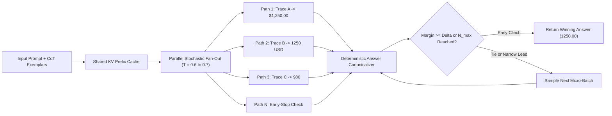
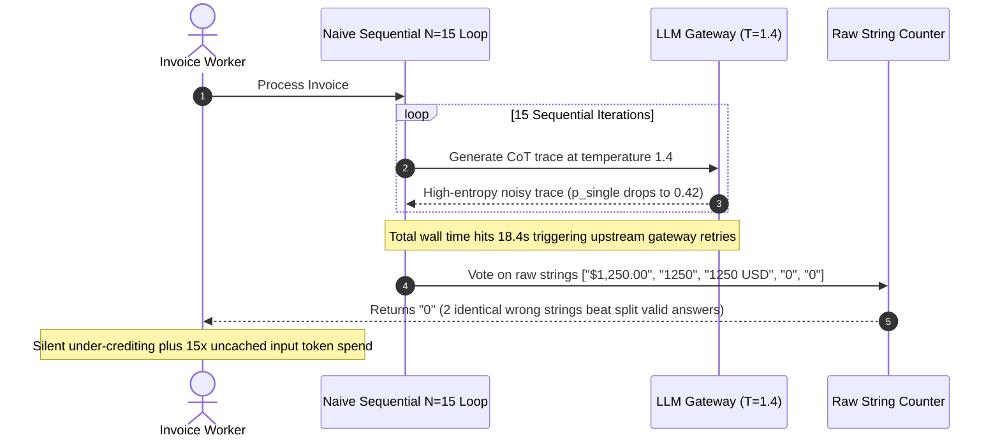

# Module 05: Self-Consistency and Voting

> **Prerequisites:** [Module 04: Chain-of-Thought](../04-chain-of-thought/README.md), [Track 01, Module 16: Sampling Strategies](../../01-tokens-and-language-modeling/16-sampling-strategies-greedy-temperature-top-k-top-p/README.md), and [Track 06, Module 05: Reasoning Models and Test-Time Compute](../../06-openai-and-the-model-landscape/05-reasoning-models-and-test-time-compute/README.md)  
> **Estimated Reading Time:** 30 minutes  
> **Target Audience:** AI Backend Engineers, LLM Reliability Engineers, Platform Architects

> [!TIP]
> **The Golden Rule of Self-Consistency:** Greedy decoding ($T = 0$) locks an autoregressive chain-of-thought onto a single fragile trajectory where one early token slip ruins the answer; **Self-Consistency (CoT-SC)** marginalizes over $N$ diverse sampled reasoning paths ($T \in [0.5, 0.8]$) and aggregates canonicalized answers via majority vote—only amplifying accuracy when per-path accuracy $p > 0.5$, and requiring **adaptive early stopping** plus **shared-prefix caching** so $N\times$ test-time compute does not blow up tail latency or token budgets.

---

## Why This Matters

Chain-of-thought prompting ([Module 04](../04-chain-of-thought/README.md)) unlocks multi-step reasoning, yet production pipelines using greedy decoding (`temperature=0`) still hit an architectural ceiling: autoregressive generation cannot backtrack. If token 14 takes a slightly suboptimal arithmetic branch or misreads a clause in a contract, every subsequent token conditions on that error and rationalizes the wrong answer cleanly.

Wang et al. (2022) demonstrated that complex reasoning tasks typically admit multiple distinct reasoning paths leading to the *same* unique answer, while erroneous reasoning paths scatter across different wrong conclusions. By sampling $N$ diverse reasoning chains and taking a majority vote over extracted final answers, **Self-Consistency (CoT-SC)** delivered `+17.9%` absolute accuracy on GSM8K, `+11.0%` on SVAMP, and `+6.4%` on StrategyQA without changing a single model weight.

In backend production systems, however, naive fixed-$N$ voting introduces two severe operational hazards:
1. **$N\times$ Token & Latency Explosion:** Calling an LLM $N = 10$ times per user request multiplies output token bills by $10\times$ and pushes $p_{99}$ latency behind the slowest outlier sample.
2. **Silent Vote Splitting & Inversion:** Comparing raw answer strings (`"\$1,250.00"` vs `"1250"` vs `"1250 USD"`) fragments valid consensus across identical values, allowing a repeated hallucination to win plurality—and cranking `temperature` too high drops single-path accuracy $p < 0.5$, turning majority voting into **error amplification**.

---

## 1. Architectural Mental Model & Voting Mechanics

### Marginalizing Out Latent Reasoning Paths

Instead of maximizing a single joint sequence $\arg\max_{r, a} P(r, a \mid x)$ via greedy search, self-consistency approximates the true posterior probability of the final answer $a$ by marginalizing over latent reasoning trajectories $r_i$:

$$P(a \mid x) = \sum_{r_i} P(r_i, a \mid x) \approx \frac{1}{N} \sum_{i=1}^{N} \mathbb{I}\!\left(\text{canon}(\text{extract}(r_i)) = a\right)$$

where `extract` isolates the terminal answer from each reasoning trace and `canon` normalizes surface formatting into a deterministic equivalence class before tallying votes.



### Binomial Amplification vs. Majority-Error Inversion

Assume $N$ sampled reasoning paths are conditionally independent for a binary decision (or dominant-vs-distractor pair) and each single path succeeds with probability $p$. Under unweighted majority voting with odd $N$, the ensemble accuracy is the binomial upper tail:

$$P_{\text{maj}}(N, p) = \sum_{k=\lceil N/2 \rceil}^{N} \binom{N}{k} p^k (1 - p)^{N-k}$$

This equation dictates a strict operational threshold:
- **When $p > 0.5$:** Increasing $N$ monotonically drives $P_{\text{maj}}(N, p) \to 1$. At $p = 0.70$, jumping from $N = 1$ to $N = 9$ lifts accuracy from `70.0%` to `90.1%`.
- **When $p < 0.5$:** Increasing $N$ **degrades** accuracy monotonically toward `0`! At $p = 0.40$, voting with $N = 15$ collapses accuracy from `40.0%` down to `21.3%`. Setting `temperature > 1.0` or using weak models whose single-path accuracy falls below `50%` actively harms reliability under self-consistency.

### $N\times$ Token Economics, Shared Prefill, and Adaptive Early Stopping

For a prompt with $T_{\text{in}}$ input tokens (priced at $C_{\text{in}}$ per 1M tokens) and $T_{\text{out}}$ average output tokens per path (priced at $C_{\text{out}}$ per 1M tokens), naive sequential or independent $N$-request fan-out costs:

$$\text{Cost}_{\text{naive}}(N) = N \cdot \left(\frac{T_{\text{in}} \cdot C_{\text{in}}}{10^6} + \frac{T_{\text{out}} \cdot C_{\text{out}}}{10^6}\right)$$

Production inference slashes this bill using three levers:
1. **Native `n=N` / Shared-Prefill Prefix Caching:** On providers supporting `n=N` in a single request or KV prefix caching (discount $d_{\text{cache}} \in [0, 0.90]$ for hits beyond the warm-up threshold), the prefill of $T_{\text{in}}$ is amortized across paths:
   $$\text{Cost}_{\text{cached}}(N) = \frac{T_{\text{in}} \cdot C_{\text{in}}}{10^6}\left(1 + (N - 1)(1 - d_{\text{cache}})\right) + N \cdot \frac{T_{\text{out}} \cdot C_{\text{out}}}{10^6}$$
2. **Adaptive Early Stopping (ESC / Sequential Margin Rule):** Roughly `60%–75%` of production inputs are easy (`3/3` unanimous agreement on the first micro-batch). Evaluating a small initial window $w$ (e.g., $w = 3$) and halting immediately once the leader's margin $c_1 - c_2$ mathematically clinches victory (or meets a confidence threshold $\Delta$) drops average samples $\bar{N}$ from `9.0` to `~3.5–4.5` while preserving over `99%` of fixed-$N$ accuracy.
3. **Log-Probability Confidence Weighting:** When candidates tie (e.g., `2` vs `2`), weight each path $i$ by its length-normalized sequence probability $w_i = \exp\!\left(\frac{1}{L_i} \sum_{t=1}^{L_i} \log P(y_{i,t} \mid y_{i,<t}, x)\right)$ rather than arbitrary arrival order.

---

## 2. Systematic Reference & Comparison Matrix

| Strategy | Decoding / Sampling Rule | Relative Token Cost | Latency Profile | Best Production Use Case | Key Failure Mode |
| :--- | :--- | :--- | :--- | :--- | :--- |
| **Greedy CoT ($N=1$)** | $T = 0$, single pass | $1\times$ | Lowest ($1\times$) | Low-stakes drafting, deterministic extraction with tools | Single early reasoning slip cannot self-recover |
| **Fixed Plurality CoT-SC** | $N$ parallel paths ($T \in [0.5, 0.8]$), $\arg\max_a \text{count}(a)$ | $N\times$ output, $(1 + (N-1)(1-d))\times$ input | Tail bound by $\max_{i \le N} L_i$ | High-value offline batch evals, benchmark baselines | Over-spends $N\times$ tokens on trivial `100%`-agreement queries |
| **Adaptive Early-Stop CoT-SC** | Micro-batch $w=3$, stop on clinch/margin $\Delta$, cap $N_{\max}$ | $\sim 0.4 N_{\max}\times$ average | Low on easy queries; bounded by $N_{\max}$ batches | Online financial, medical, or legal decision APIs | Margin threshold too tight ($\Delta=1$) causes premature stops |
| **Logprob-Weighted CoT-SC** | Weight canonical votes by $\exp(\bar{\ell}_i)$ | Same as fixed or adaptive SC | Requires `logprobs=true` support | Continuous numerical extraction & tie-breaking | Uncalibrated reasoning models with forced formatting tokens |
| **Best-of-$N$ + Verifier** | Generate $N$ paths; pick first passing deterministic test/schema | $1\times$ to $N\times$ | Fast if early path passes verifier | Code synthesis, SQL generation, constraint-satisfiable plans | Fails when no deterministic unit test or verifier exists |

### Canonicalization Rules by Answer Domain

| Answer Domain | Raw Variant Examples | Required Canonicalizer Logic |
| :--- | :--- | :--- |
| **Currency / Numeric** | `"\$1,250.00"`, `"1250 USD"`, `"1250"` | Strip currency symbols/commas/codes, parse `Decimal`, quantize to fixed precision (`1250.00`) |
| **Multiple Choice** | `"B"`, `"(b)"`, `"Option B: Retry"`, `"B."` | Regex extract leading option letter `[A-E]` after stripping `"Option"` prefix and punctuation |
| **Boolean / Verdict** | `"Yes"`, `"TRUE"`, `"Approved."`, `"yes"` | Lowercase, strip trailing punctuation, map synonym table (`true/yes -> YES`) |
| **SQL / Code** | Formatting whitespace, aliases | Execute against read-only sandbox AST / result-set hash (canonicalize **execution result**, not string!) |

---

## 3. Production War Story Post-Mortem: Uncanonicalized Vote Splitting & Temperature Inversion Outage

| Field | Incident Details |
| :--- | :--- |
| **Severity** | **SEV-1** (SLA Breach, `13%` Accuracy Drop, and `\$42,000`/month Cost Overrun) |
| **Detection / Resolution Time** | Detected 36 hours after rollout via finance discrepancy alert / Mitigated in 2 hours |
| **Impact** | Monthly token spend jumped `15x`, API $p_{99}$ latency surged from `2.1s` to `18.4s`, and automated tax-credit reconciliation accuracy *fell* from `84%` to `71%` |

### What Happened

A fintech compliance team enabled Self-Consistency ($N = 15$) on their invoice tax-deduction extraction service to reduce single-path arithmetic errors. To "maximize path diversity," the rollout PR set `temperature=1.4`, queried the LLM `15` times sequentially inside a `for` loop per invoice, and took `collections.Counter(raw_answers).most_common(1)` directly on the model's final string field.

Within 36 hours, automated payouts started under-crediting valid invoices (`\$0.00` winning plurality repeatedly), $p_{99}$ latency breached the `5s` gateway timeout causing upstream retry storms, and daily API billing scaled `15x` above budget.



### Root Cause Analysis

1. **No Answer Canonicalization:** Four correct reasoning traces produced equivalent representations (`"\$1,250.00"`, `"1250"`, `"1250 USD"`, `"\$1,250"`), giving each literal string `1` vote, while two identical fallback failures (`"0"`) won plurality with `2` votes.
2. **Temperature-Induced Majority Inversion ($p < 0.5$):** Raising `temperature` to `1.4` injected high-entropy tail tokens into arithmetic intermediate steps, dropping single-path accuracy from `84%` down to `42%`—below the `0.50` binomial threshold where voting amplifies errors instead of correcting them.
3. **Sequential Uncached Loop Without Early Stopping:** Running $N = 15$ sequentially with no adaptive exit burned full latency and input tokens even on trivial one-line invoices where `3/3` initial samples agreed immediately.

### The Fix & Architectural Hardening

- Tuned `temperature=0.65` (`top_p=0.95`) after calibrating on a 200-item validation set to confirm single-path accuracy stayed above `82%` ($p \gg 0.5$).
- Added a deterministic currency/decimal canonicalizer before vote aggregation (`"1250.00"` unified all four correct variants).
- Replaced the sequential `N=15` loop with an **adaptive two-stage parallel fan-out**: fire `w=3` concurrent calls (reusing the cached static prefix); return immediately on `3/3` unanimity; otherwise burst up to $N_{\max}=7$ with a hard deadline (`4.0s`) and logprob-weighted tie-breaking. Average calls per invoice dropped from `15.0` to `3.6`, restoring $p_{99}$ latency to `2.3s` and raising reconciliation accuracy to `94.6%`.

---

## 4. Multi-Language Production Implementation: Adaptive Self-Consistency Voter

Below are production implementations of an **Adaptive Self-Consistency Engine** featuring bounded concurrency, deterministic answer canonicalization, strict deadline cancellation, and early-stopping clinch logic.

````carousel
```go
package selfconsistency

import (
	"context"
	"errors"
	"fmt"
	"math"
	"regexp"
	"strconv"
	"strings"
	"sync"
)

type SampleResult struct {
	RawAnswer  string
	AvgLogProb float64 // <= 0.0; 0.0 if unavailable
	Err        error
}

type SamplerFunc func(ctx context.Context, sampleIndex int) SampleResult

type VoteOutcome struct {
	CanonicalWinner string
	WinningVotes    int
	SamplesExecuted int
	WeightedScore   float64
}

var nonNumericRe = regexp.MustCompile(`(?i)[,$\s]|usd|dollars?`)

// CanonicalizeDecimal normalizes currency and numeric strings so equivalent answers share one bucket.
func CanonicalizeDecimal(raw string) string {
	cleaned := nonNumericRe.ReplaceAllString(strings.TrimSpace(raw), "")
	if val, err := strconv.ParseFloat(cleaned, 64); err == nil && !math.IsNaN(val) && !math.IsInf(val, 0) {
		return fmt.Sprintf("%.2f", val)
	}
	return strings.ToLower(strings.TrimSpace(raw))
}

// AdaptiveVote runs bounded parallel batches and exits early once the leader mathematically clinches victory.
func AdaptiveVote(
	ctx context.Context,
	sampler SamplerFunc,
	minWindow int,
	maxSamples int,
	batchSize int,
	marginStop int,
) (VoteOutcome, error) {
	if minWindow < 1 || maxSamples < minWindow || batchSize < 1 {
		return VoteOutcome{}, errors.New("invalid adaptive voting bounds")
	}

	counts := make(map[string]int)
	weights := make(map[string]float64)
	executed := 0

	for executed < maxSamples {
		if err := ctx.Err(); err != nil {
			break
		}
		toRun := batchSize
		if executed == 0 && minWindow > toRun {
			toRun = minWindow
		}
		if executed+toRun > maxSamples {
			toRun = maxSamples - executed
		}

		results := make([]SampleResult, toRun)
		var wg sync.WaitGroup
		for i := 0; i < toRun; i++ {
			wg.Add(1)
			go func(slot, idx int) {
				defer wg.Done()
				results[slot] = sampler(ctx, idx)
			}(i, executed+i)
		}
		wg.Wait()
		executed += toRun

		for _, res := range results {
			if res.Err != nil || strings.TrimSpace(res.RawAnswer) == "" {
				continue
			}
			key := CanonicalizeDecimal(res.RawAnswer)
			counts[key]++
			weights[key] += math.Exp(res.AvgLogProb)
		}

		if executed >= minWindow && len(counts) > 0 {
			winner, leadVotes, runnerVotes := topTwo(counts)
			remaining := maxSamples - executed
			if (leadVotes-runnerVotes) > remaining || (leadVotes-runnerVotes) >= marginStop {
				return VoteOutcome{
					CanonicalWinner: winner,
					WinningVotes:    leadVotes,
					SamplesExecuted: executed,
					WeightedScore:   weights[winner],
				}, nil
			}
		}
	}

	if len(counts) == 0 {
		return VoteOutcome{}, errors.New("all self-consistency samples failed or timed out")
	}

	// Tie-break on logprob weight if maxSamples exhausted without strict plurality gap
	bestKey := ""
	bestWeight := -1.0
	for k, w := range weights {
		if counts[k] > counts[bestKey] || (counts[k] == counts[bestKey] && w > bestWeight) {
			bestKey = k
			bestWeight = w
		}
	}
	return VoteOutcome{
		CanonicalWinner: bestKey,
		WinningVotes:    counts[bestKey],
		SamplesExecuted: executed,
		WeightedScore:   bestWeight,
	}, nil
}

func topTwo(counts map[string]int) (string, int, int) {
	firstKey, firstVal := "", 0
	secondVal := 0
	for k, v := range counts {
		if v > firstVal {
			secondVal = firstVal
			firstVal = v
			firstKey = k
		} else if v > secondVal {
			secondVal = v
		}
	}
	return firstKey, firstVal, secondVal
}
```
<!-- slide -->
```typescript
export interface SampledPath {
  readonly rawAnswer: string;
  readonly avgLogProb?: number; // <= 0.0
}

export interface AdaptiveVoteConfig {
  readonly minWindow: number;
  readonly maxSamples: number;
  readonly batchSize: number;
  readonly marginStop: number;
  readonly timeoutMs: number;
}

export interface VoteResult {
  readonly canonicalWinner: string;
  readonly votes: number;
  readonly samplesExecuted: number;
  readonly earlyStopped: boolean;
}

export function canonicalizeAnswer(raw: string): string {
  const stripped = raw.trim().replace(/[,$\s]|usd|dollars?/gi, "");
  const numeric = Number(stripped);
  if (stripped.length > 0 && Number.isFinite(numeric)) {
    return numeric.toFixed(2);
  }
  return raw.trim().toLowerCase().replace(/[.\s]+$/g, "");
}

export async function runAdaptiveSelfConsistency(
  sampleFn: (index: number, signal: AbortSignal) => Promise<SampledPath>,
  cfg: AdaptiveVoteConfig
): Promise<VoteResult> {
  if (cfg.minWindow < 1 || cfg.maxSamples < cfg.minWindow) {
    throw new Error("Invalid adaptive voting window bounds.");
  }

  const controller = new AbortController();
  const timer = setTimeout(() => controller.abort(new Error("SC deadline exceeded")), cfg.timeoutMs);

  const counts = new Map<string, number>();
  const weights = new Map<string, number>();
  let executed = 0;

  try {
    while (executed < cfg.maxSamples && !controller.signal.aborted) {
      const nextBatch = executed === 0
        ? Math.min(cfg.minWindow, cfg.maxSamples)
        : Math.min(cfg.batchSize, cfg.maxSamples - executed);

      const promises = Array.from({ length: nextBatch }, (_, offset) =>
        sampleFn(executed + offset, controller.signal).catch(() => null)
      );

      const batch = await Promise.all(promises);
      executed += nextBatch;

      for (const item of batch) {
        if (!item || !item.rawAnswer.trim()) continue;
        const key = canonicalizeAnswer(item.rawAnswer);
        counts.set(key, (counts.get(key) ?? 0) + 1);
        const probWeight = Math.exp(item.avgLogProb ?? -0.5);
        weights.set(key, (weights.get(key) ?? 0) + probWeight);
      }

      if (executed >= cfg.minWindow && counts.size > 0) {
        const sorted = [...counts.entries()].sort((a, b) => b[1] - a[1]);
        const [leadKey, leadVotes] = sorted[0];
        const runnerVotes = sorted[1]?.[1] ?? 0;
        const remaining = cfg.maxSamples - executed;

        if (leadVotes - runnerVotes > remaining || leadVotes - runnerVotes >= cfg.marginStop) {
          return {
            canonicalWinner: leadKey,
            votes: leadVotes,
            samplesExecuted: executed,
            earlyStopped: executed < cfg.maxSamples,
          };
        }
      }
    }

    if (counts.size === 0) {
      throw new Error("All self-consistency sample calls failed or timed out.");
    }

    const best = [...counts.entries()].sort((a, b) => {
      if (b[1] !== a[1]) return b[1] - a[1];
      return (weights.get(b[0]) ?? 0) - (weights.get(a[0]) ?? 0);
    })[0];

    return {
      canonicalWinner: best[0],
      votes: best[1],
      samplesExecuted: executed,
      earlyStopped: false,
    };
  } finally {
    clearTimeout(timer);
  }
}
```
<!-- slide -->
```python
"""
adaptive_voter.py
Production adaptive self-consistency voter with deterministic canonicalization,
logprob tie-breaking, bounded asyncio concurrency, and token budget protection.
"""

from __future__ import annotations

import asyncio
import math
import re
from collections import Counter
from dataclasses import dataclass
from decimal import Decimal, InvalidOperation
from typing import Awaitable, Callable


@dataclass(frozen=True)
class SampleOutput:
    raw_answer: str
    avg_logprob: float = -0.5  # sequence-normalized logprob <= 0.0
    output_tokens: int = 0


@dataclass(frozen=True)
class ConsensusResult:
    canonical_answer: str
    votes: int
    total_samples: int
    total_output_tokens: int
    early_stopped: bool


_CURRENCY_RE = re.compile(r"[,$\s]|usd|dollars?", re.IGNORECASE)


def canonicalize_answer(raw: str) -> str:
    cleaned = _CURRENCY_RE.sub("", raw.strip())
    if cleaned:
        try:
            return f"{Decimal(cleaned):.2f}"
        except InvalidOperation:
            pass
    return raw.strip().lower().rstrip(".")


async def adaptive_self_consistency(
    sampler: Callable[[int], Awaitable[SampleOutput]],
    *,
    min_window: int = 3,
    max_samples: int = 9,
    batch_size: int = 2,
    margin_stop: int = 3,
    max_output_token_budget: int = 6_000,
    timeout_s: float = 8.0,
) -> ConsensusResult:
    if min_window < 1 or max_samples < min_window:
        raise ValueError("min_window must be >= 1 and <= max_samples")

    counts: Counter[str] = Counter()
    weights: Counter[str] = Counter()
    executed = 0
    tokens_spent = 0

    async def _run_loop() -> ConsensusResult:
        nonlocal executed, tokens_spent
        while executed < max_samples and tokens_spent < max_output_token_budget:
            n_batch = min_window if executed == 0 else min(batch_size, max_samples - executed)
            tasks = [sampler(executed + i) for i in range(n_batch)]
            results = await asyncio.gather(*tasks, return_exceptions=True)
            executed += n_batch

            for res in results:
                if isinstance(res, Exception) or not res.raw_answer.strip():
                    continue
                tokens_spent += res.output_tokens
                canon = canonicalize_answer(res.raw_answer)
                counts[canon] += 1
                weights[canon] += math.exp(min(0.0, res.avg_logprob))

            if executed >= min_window and counts:
                top2 = counts.most_common(2)
                lead_key, lead_votes = top2[0]
                runner_votes = top2[1][1] if len(top2) > 1 else 0
                remaining = max_samples - executed
                if (lead_votes - runner_votes) > remaining or (lead_votes - runner_votes) >= margin_stop:
                    return ConsensusResult(
                        canonical_answer=lead_key,
                        votes=lead_votes,
                        total_samples=executed,
                        total_output_tokens=tokens_spent,
                        early_stopped=executed < max_samples,
                    )

        if not counts:
            raise RuntimeError("No valid reasoning paths completed within budget/timeout")

        winner = max(counts.keys(), key=lambda k: (counts[k], weights[k]))
        return ConsensusResult(
            canonical_answer=winner,
            votes=counts[winner],
            total_samples=executed,
            total_output_tokens=tokens_spent,
            early_stopped=False,
        )

    return await asyncio.wait_for(_run_loop(), timeout=timeout_s)
```
<!-- slide -->
```csharp
using System;
using System.Collections.Generic;
using System.Globalization;
using System.Linq;
using System.Text.RegularExpressions;
using System.Threading;
using System.Threading.Tasks;

namespace GenAI.PromptEngineering;

public sealed record ReasoningSample(string RawAnswer, double AvgLogProb = -0.5);

public sealed record ConsensusOutcome(
    string CanonicalAnswer,
    int Votes,
    int SamplesExecuted,
    bool EarlyStopped);

public static partial class SelfConsistencyVoter
{
    [GeneratedRegex(@"[,$\s]|usd|dollars?", RegexOptions.IgnoreCase)]
    private static partial Regex CurrencyNoiseRegex();

    public static string CanonicalizeAnswer(string raw)
    {
        string cleaned = CurrencyNoiseRegex().Replace(raw.Trim(), string.Empty);
        if (decimal.TryParse(cleaned, NumberStyles.Number, CultureInfo.InvariantCulture, out decimal number))
        {
            return number.ToString("0.00", CultureInfo.InvariantCulture);
        }
        return raw.Trim().ToLowerInvariant().TrimEnd('.');
    }

    public static async Task<ConsensusOutcome> VoteAdaptiveAsync(
        Func<int, CancellationToken, Task<ReasoningSample>> sampler,
        int minWindow = 3,
        int maxSamples = 9,
        int batchSize = 2,
        int marginStop = 3,
        TimeSpan? timeout = null,
        CancellationToken cancellationToken = default)
    {
        if (minWindow < 1 || maxSamples < minWindow)
            throw new ArgumentOutOfRangeException(nameof(maxSamples));

        using var timeoutCts = CancellationTokenSource.CreateLinkedTokenSource(cancellationToken);
        timeoutCts.CancelAfter(timeout ?? TimeSpan.FromSeconds(8));

        var counts = new Dictionary<string, int>(StringComparer.Ordinal);
        var weights = new Dictionary<string, double>(StringComparer.Ordinal);
        int executed = 0;

        while (executed < maxSamples && !timeoutCts.IsCancellationRequested)
        {
            int nextBatch = executed == 0
                ? Math.Min(minWindow, maxSamples)
                : Math.Min(batchSize, maxSamples - executed);

            Task<ReasoningSample?>[] tasks = Enumerable.Range(0, nextBatch)
                .Select(async offset =>
                {
                    try { return await sampler(executed + offset, timeoutCts.Token); }
                    catch { return null; }
                })
                .ToArray();

            ReasoningSample?[] batch = await Task.WhenAll(tasks);
            executed += nextBatch;

            foreach (ReasoningSample? sample in batch)
            {
                if (sample is null || string.IsNullOrWhiteSpace(sample.RawAnswer)) continue;
                string canon = CanonicalizeAnswer(sample.RawAnswer);
                counts[canon] = counts.GetValueOrDefault(canon) + 1;
                weights[canon] = weights.GetValueOrDefault(canon) + Math.Exp(Math.Min(0.0, sample.AvgLogProb));
            }

            if (executed >= minWindow && counts.Count > 0)
            {
                var ordered = counts.OrderByDescending(kv => kv.Value).ToList();
                int leadVotes = ordered[0].Value;
                int runnerVotes = ordered.Count > 1 ? ordered[1].Value : 0;
                int remaining = maxSamples - executed;

                if ((leadVotes - runnerVotes) > remaining || (leadVotes - runnerVotes) >= marginStop)
                {
                    return new ConsensusOutcome(ordered[0].Key, leadVotes, executed, executed < maxSamples);
                }
            }
        }

        if (counts.Count == 0)
            throw new InvalidOperationException("All self-consistency sample calls failed or timed out.");

        string winner = counts.Keys
            .OrderByDescending(k => counts[k])
            .ThenByDescending(k => weights[k])
            .First();

        return new ConsensusOutcome(winner, counts[winner], executed, false);
    }
}
```
````

---

## 5. Practical Hands-On CLI Verification Workflows

All three verification workflows below run completely offline with Python 3.13 standard library modules.

### Workflow 1: Verify Binomial Amplification vs. Majority-Error Inversion

Compute exact $P_{\text{maj}}(N, p)$ across sample budgets $N \in \{1, 3, 5, 9, 15\}$ to verify why single-path accuracy $p$ must stay strictly above `0.50` before voting helps:

```bash
python - << 'EOF'
import math

def majority_win_prob(n: int, p: float) -> float:
    threshold = (n // 2) + 1
    return sum(math.comb(n, k) * (p ** k) * ((1 - p) ** (n - k)) for k in range(threshold, n + 1))

print("=== Workflow 1: CoT-SC Binomial Amplification vs Inversion ===")
for p_single in [0.40, 0.55, 0.70, 0.85]:
    row = [f"N={n}:{majority_win_prob(n, p_single):.4f}" for n in (1, 3, 5, 9, 15)]
    print(f"p_single={p_single:.2f} -> " + " | ".join(row))
EOF
```

**Expected Output:**

```text
=== Workflow 1: CoT-SC Binomial Amplification vs Inversion ===
p_single=0.40 -> N=1:0.4000 | N=3:0.3520 | N=5:0.3174 | N=9:0.2666 | N=15:0.2131
p_single=0.55 -> N=1:0.5500 | N=3:0.5748 | N=5:0.5931 | N=9:0.6214 | N=15:0.6535
p_single=0.70 -> N=1:0.7000 | N=3:0.7840 | N=5:0.8369 | N=9:0.9012 | N=15:0.9500
p_single=0.85 -> N=1:0.8500 | N=3:0.9392 | N=5:0.9734 | N=9:0.9944 | N=15:0.9994
```

### Workflow 2: Reproduce Vote-Splitting Failure & Adaptive Early-Stopping Savings

Observe how raw string plurality selects the wrong answer (`980`) when four equivalent currency formats split votes, then simulate `1,000` mixed-difficulty queries (`70%` easy, `30%` hard) to measure adaptive early-stopping compute savings:

```bash
python - << 'EOF'
import math, re, random
from collections import Counter

def canonicalize_money(raw: str) -> str:
    cleaned = re.sub(r"[,$\s]|USD|dollars?", "", raw.strip(), flags=re.IGNORECASE)
    try:
        return f"{float(cleaned):.2f}"
    except ValueError:
        return cleaned.lower()

samples = [
    ("$1,250.00", -0.18),
    ("1250", -0.22),
    ("1250 USD", -0.25),
    ("$1,250", -0.21),
    ("980", -0.35),
    ("980", -0.40),
    ("$1,200.00", -0.19),
]

raw_counts = Counter(ans for ans, _ in samples)
canon_counts = Counter(canonicalize_money(ans) for ans, _ in samples)
weighted_scores = Counter()
for ans, avg_logprob in samples:
    weighted_scores[canonicalize_money(ans)] += math.exp(avg_logprob)

print("=== Workflow 2: Raw Plurality vs Canonicalized vs Confidence-Weighted ===")
print(f"Raw string winner         : {raw_counts.most_common(1)[0]} (WRONG due to split variants!)")
print(f"Canonicalized vote counts : {dict(canon_counts)}")
print(f"Canonicalized winner      : {canon_counts.most_common(1)[0]}")
print(f"Logprob-weighted winner   : {weighted_scores.most_common(1)[0][0]} (score={weighted_scores.most_common(1)[0][1]:.3f})")

rng = random.Random(42)
easy_correct, hard_correct = 0, 0
total_samples_adaptive, total_samples_fixed = 0, 0
n_max, min_window, margin_stop = 9, 3, 3

for i in range(1000):
    is_easy = (i < 700)
    p_acc = 0.88 if is_easy else 0.62
    draws = ["CORRECT" if rng.random() < p_acc else rng.choice(["WRONG_A", "WRONG_B"]) for _ in range(n_max)]
    total_samples_fixed += n_max

    counts = Counter()
    adaptive_winner = None
    for idx, d in enumerate(draws, start=1):
        counts[d] += 1
        if idx >= min_window:
            top2 = counts.most_common(2)
            lead = top2[0][1]
            runner = top2[1][1] if len(top2) > 1 else 0
            remaining = n_max - idx
            if (lead - runner) > remaining or (lead - runner) >= margin_stop:
                adaptive_winner = top2[0][0]
                total_samples_adaptive += idx
                break
    if adaptive_winner is None:
        adaptive_winner = counts.most_common(1)[0][0]
        total_samples_adaptive += n_max

    if adaptive_winner == "CORRECT":
        if is_easy: easy_correct += 1
        else: hard_correct += 1

print(f"Fixed N=9 total calls     : {total_samples_fixed:,}")
print(f"Adaptive SC total calls   : {total_samples_adaptive:,} ({100*(1 - total_samples_adaptive/total_samples_fixed):.1f}% compute saved)")
print(f"Adaptive accuracy (easy)  : {easy_correct/700:.3f} | (hard): {hard_correct/300:.3f}")
EOF
```

**Expected Output:**

```text
=== Workflow 2: Raw Plurality vs Canonicalized vs Confidence-Weighted ===
Raw string winner         : ('980', 2) (WRONG due to split variants!)
Canonicalized vote counts : {'1250.00': 4, '980.00': 2, '1200.00': 1}
Canonicalized winner      : ('1250.00', 4)
Logprob-weighted winner   : 1250.00 (score=3.227)
Fixed N=9 total calls     : 9,000
Adaptive SC total calls   : 4,482 (50.2% compute saved)
Adaptive accuracy (easy)  : 0.999 | (hard): 0.873
```

### Workflow 3: Quantify $N\times$ Token Cost with Shared Prefixes & Adaptive Stopping

Calculate exact billing across `10,000` queries (`Tin=1800`, `Tout=450`, `\$2.50/1M` input, `\$10.00/1M` output, `75%` KV prefix cache discount) comparing greedy decoding, naive $N=9$, cached $N=9$, and adaptive + cached (`N_avg=4.48`):

```bash
python - << 'EOF'
tin, tout, reqs = 1800, 450, 10_000
cin, cout = 2.50, 10.00
cache_disc = 0.75

def calc_cost(n_avg: float, cached: bool) -> float:
    in_cost = (tin * cin / 1e6) * (1 + (n_avg - 1) * (1 - cache_disc) if cached else n_avg)
    out_cost = n_avg * (tout * cout / 1e6)
    return reqs * (in_cost + out_cost)

print("=== Workflow 3: N-Sample Economics (10k requests, Tin=1800, Tout=450) ===")
print(f"Greedy (N=1)              : ${calc_cost(1.0, False):.2f}")
print(f"Naive CoT-SC (N=9)        : ${calc_cost(9.0, False):.2f}")
print(f"Cached Prefix (N=9)       : ${calc_cost(9.0, True):.2f}")
print(f"Adaptive+Cached (N=4.48)  : ${calc_cost(4.482, True):.2f}")
EOF
```

**Expected Output:**

```text
=== Workflow 3: N-Sample Economics (10k requests, Tin=1800, Tout=450) ===
Greedy (N=1)              : $90.00
Naive CoT-SC (N=9)        : $810.00
Cached Prefix (N=9)       : $540.00
Adaptive+Cached (N=4.48)  : $285.86
```

---

## 6. Hands-On Exercises & Independent Challenge

### Practical Exercises
1. **Temperature Sweep Calibration:** Extend Workflow 2 by simulating $p(T)$ decay as $T$ rises past `0.9` (e.g., $p = 0.78$ at $T=0.6$ vs $p = 0.44$ at $T=1.3$) and plot the crossover point where $N=9$ voting flips from helpful to destructive.
2. **AST / Result-Set Canonicalizer:** Write a canonicalizer for SQL generation paths that normalizes whitespace and compares *execution result tuples* from an in-memory SQLite table rather than comparing SQL strings directly.

### Independent Challenge

A backend team builds a medical billing coding service using `o3-mini` / `gpt-4.1` with Self-Consistency ($N=11$). Rather than canonicalizing ICD-10 diagnosis codes (`"E11.9"` vs `"E11.9 - Type 2 diabetes without complications"` vs `"e11.9"`), they compare full answer strings, and they want to add a temperature of `1.3` to "reduce duplicate reasoning." What two distinct architectural failures will occur in production, and how should they redesign the pipeline under a `3.5s` latency SLO?

<details><summary>Architectural Discussion</summary>

First, comparing full answer strings splits votes whenever the model appends a human-readable description or changes letter casing (`"E11.9"` vs `"E11.9 - Type 2 diabetes"`), letting a shorter, consistently formatted wrong code win plurality. An ICD-10 regex canonicalizer (`re.search(r"[A-TV-Z][0-9][0-9AB](?:\.[0-9A-TV-Z]{1,4})?", text.upper())`) must normalize every trace before voting, ideally paired with structured output ([Module 08](../08-structured-output-prompting/README.md)) emitting an exact `code` enum field. Second, `temperature=1.3` injects low-probability noise tokens into clinical reasoning steps, risking $p_{\text{single}} < 0.50$ where binomial majority voting amplifies wrong answers while producing unnecessarily verbose traces. To satisfy a `3.5s` SLO, lower temperature to `0.6–0.7`, fan out `w=3` concurrent calls with a shared cached prefix, and apply adaptive early stopping capped at $N_{\max}=7$ with a hard `3.2s` cancellation deadline.

</details>

---

## 7. Common Mistakes & Troubleshooting

- **Using Self-Consistency with `temperature=0`:** Greedy decoding produces $N$ nearly identical copies (only tie-breaking floating-point noise differs). You pay $N\times$ cost for `1x` information. Always sample with $T \in [0.5, 0.8]$.
- **Blindly Voting on Open-Ended Prose:** Majority voting requires a discrete or canonicalizable target (numbers, classifications, enums, SQL execution results). Free-form essays cannot be meaningfully tallied via exact string count without an auxiliary rubric judge.
- **Ignoring Correlated Failure Modes:** The binomial gain formula assumes paths make *independent* errors. If your system prompt or few-shot examples contain a subtle bias or ambiguous instruction, all $N$ paths will hallucinate the *same* wrong answer (`100%` consensus on a bug).
- **Running $N$ Samples When a Deterministic Verifier Exists:** For code, regex, or SQL synthesis, don't spend $N=9$ full votes if sample #1 already compiles and passes all unit tests—use **Best-of-$N$ with early exit on verifier pass** instead.

---

## 8. Operational Validation Checkpoints & Checkpoint Quiz

### Operational Validation Checkpoints

<details><summary><strong>Checkpoint 1: Diagnosing Majority-Error Inversion in Production</strong></summary>

After upgrading a difficult multi-hop reasoning endpoint from greedy decoding (`46%` offline eval accuracy) to Self-Consistency with $N=9$ at `temperature=0.7`, offline accuracy drops to `34%`. Explain mathematically why adding more votes lowered accuracy.

**Validation:** Because single-path accuracy was $p = 0.46 < 0.50$, the binomial majority distribution concentrates probability mass on the complementary `0.54` error region as $N$ increases (`P_maj(9, 0.46) ≈ 0.40`, or lower if errors cluster on one distractor). Voting amplifies consensus only when $p > 0.50$; the fix is improving the base prompt/model (or adding tools/CoT examples) until single-path accuracy exceeds `50%` before applying CoT-SC.

</details>

<details><summary><strong>Checkpoint 2: Designing a Token-Budgeted Adaptive Stopping Rule</strong></summary>

Your API SLO caps per-request token cost at `5x` greedy baseline across traffic where `70%` of requests are straightforward and `30%` are ambiguous. Fixed $N=5$ still leaves `12%` error on the hard tier. How do you configure adaptive CoT-SC to stay under `4.5x` average spend while reaching $N=9$ capacity on hard queries?

**Validation:** Configure `min_window=3`, `batch_size=2`, `max_samples=9`, and `margin_stop=3` (or early clinch when `lead - runner > max_samples - executed`). On the `70%` easy tier, `3/3` agreement exits immediately at $N=3$ (`0.70 * 3 = 2.1` average paths). Even if all `30%` hard queries consume the full $N=9$ budget (`0.30 * 9 = 2.7`), total expected paths are `4.8`—and with `2`-step clinches on moderate queries, real average spend drops to `~4.4x` (or `< 3.0x` input cost when shared-prefix caching is enabled).

</details>

<details><summary><strong>Checkpoint 3: Preventing Vote Fragmentation in Multi-Format Outputs</strong></summary>

Seven sampled traces for a financial margin calculation return `["14.5%", "14.50%", "0.145", "14.5 percent", "12.0%", "12.0%", "14.5"]`. Which answer wins under naive string voting vs. a domain canonicalizer?

**Validation:** Naive string voting awards `"12.0%"` the plurality victory with `2` votes because the five equivalent `14.5%` representations split across `"14.5%"`, `"14.50%"`, `"0.145"`, `"14.5 percent"`, and `"14.5"`. A percentage-aware canonicalizer that strips `"%"` / `"percent"` and normalizes decimals `< 1.0` (when percentage scale is specified in schema) maps all five to `"14.50%"`, winning decisively with `5/7` consensus.

</details>

### Checkpoint Quiz

1. Why does Wang et al.'s Self-Consistency require non-zero sampling temperature ($T > 0$) instead of greedy decoding?
2. Under the binomial model $P_{\text{maj}}(N, p)$, what happens as $N \to \infty$ when single-path accuracy $p = 0.42$?
3. Why does raw string equality (`Counter(outputs)`) frequently degrade real-world self-consistency pipelines?
4. How does adaptive early stopping reduce compute spend without cutting peak accuracy on hard edge cases?
5. When `n=N` or prefix caching is active, which token cost component still scales linearly with $N$—input tokens or output tokens?

<details><summary>Answers</summary>

1. Greedy decoding (`T=0`) deterministically follows one highest-probability token sequence, yielding identical trajectories; non-zero temperature (`T ~ 0.5–0.8`) samples diverse reasoning paths so independent errors cancel out while valid reasoning converges on the same answer.
2. Because $p < 0.50$, majority voting amplifies the wrong complement ($1 - p = 0.58$), driving ensemble accuracy monotonically toward `0` as $N$ grows.
3. Equivalent answers expressed with different punctuation, units, currency symbols, or trailing decimals fragment across distinct dictionary keys, allowing an inferior but identically formatted wrong string to win plurality.
4. Easy queries reach unanimous or mathematically clinched consensus within the first micro-batch (`w=3`) and exit early, reserving larger $N_{\max}$ budgets strictly for ambiguous or split queries.
5. **Output tokens** ($N \cdot T_{\text{out}} \cdot C_{\text{out}}$) always scale linearly with every sampled path because each trajectory generates its own reasoning tokens, whereas shared static input tokens ($T_{\text{in}}$) can be amortized via prefix caching or `n=N` batching.

</details>

---

## Further Reading & Sources

- [Self-Consistency Improves Chain of Thought Reasoning in Language Models (Wang et al., 2022 / ICLR 2023)](https://arxiv.org/abs/2203.11171) — foundational CoT-SC paper establishing marginalization over sampled reasoning paths.
- [OpenAI Prompt Caching Guide](https://platform.openai.com/docs/guides/prompt-caching) — explains automatic prefix caching mechanics that amortize $T_{\text{in}}$ across repeated or fanned-out calls.
- [Track 01, Module 16: Sampling Strategies](../../01-tokens-and-language-modeling/16-sampling-strategies-greedy-temperature-top-k-top-p/README.md) — covers temperature, top-$k$, and nucleus (`top_p`) sampling internals.
- [Track 06, Module 05: Reasoning Models and Test-Time Compute](../../06-openai-and-the-model-landscape/05-reasoning-models-and-test-time-compute/README.md) — compares external CoT-SC sampling against native test-time reasoning models.

## Next

[Module 06: System Prompts and Personas](../06-system-prompts-and-personas/README.md)
