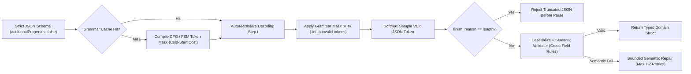
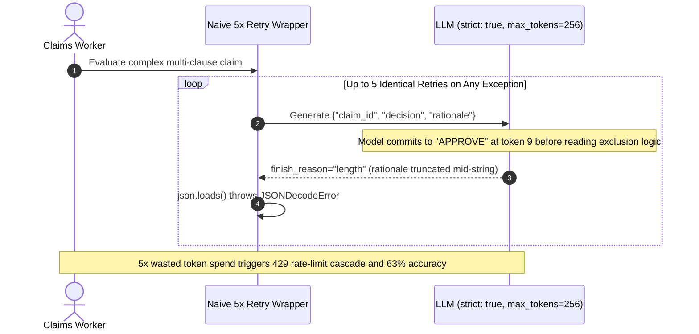

# Module 08: Structured Output Prompting

> **Prerequisites:** [Module 07: Prompt Templates and Variables](../07-prompt-templates-and-variables/README.md), [Track 06, Module 07: Structured Outputs and JSON Schema](../../06-openai-and-the-model-landscape/07-structured-outputs-and-json-schema/README.md), and [Track 15, Module 11: Guardrails: Output Validation](../../15-evaluation-observability-and-safety/11-guardrails-output-validation/README.md)  
> **Estimated Reading Time:** 32 minutes  
> **Target Audience:** AI Backend Engineers, API Architects, Inference Platform Engineers

> [!TIP]
> **The Golden Rule of Structured Output Prompting:** Never rely on polite prompt instructions (*"Output raw JSON only, no markdown"*) for machine-parsed contracts—enforce **Constrained Decoding (`json_schema` with `strict: true`)** at the token-logit layer for `100%` syntactic and schema compliance, always check `finish_reason == "stop"` before parsing, put **`reasoning_steps` *before* final decision/verdict fields** in schema key order to prevent reasoning collapse, and pair grammar decoding with application-layer **semantic validation** (cross-field invariants and bounded repair).

---

## Why This Matters

Downstream backend services—database writers, payment webhooks, SQL executors, UI component renderers—cannot consume conversational prose like *"Sure! Here is the extracted JSON: ```json ... ```"*. Historically, teams bridged LLMs to typed software using regex extractors (`re.search(r"\{.*\}", text)`) plus `3`-attempt retry-repair loops.

In production systems, prompt-only JSON extraction creates three serious operational failures:
1. **Tail Parse Failures & Retry Storms:** Even a `3%` markdown-fence or trailing-comma failure rate forces thousands of extra API calls per day; when upstream traffic spikes, retries amplify gateway load into rate-limit cascades.
2. **JSON Mode Illusion (`type: "json_object"`):** Basic JSON mode only guarantees syntactically valid JSON—it does *not* enforce field names, enums, types, or required keys. A model can emit `{"result": null}` instead of `{"amount": 42.5, "currency": "USD"}` and still satisfy basic JSON mode.
3. **Structured Output Reasoning Collapse:** Tam et al. (2024, `arXiv:2408.02442`) demonstrated that forcing strict JSON output directly on complex reasoning tasks degrades accuracy measurably when the schema forces the model to emit a classification or numeric answer *before* generating intermediate reasoning tokens.

---

## 1. Architectural Mental Model & Constrained Decoding

### Logit Masking via Finite-State Machines & Context-Free Grammars

Modern inference engines (OpenAI `strict: true`, Anthropic Structured Outputs / strict tool schemas, Google Gemini `response_schema`, and vLLM with `xgrammar` / `outlines`) do **not** ask the model nicely to write valid JSON—they compile your JSON Schema into a **Finite-State Machine (FSM)** or **Context-Free Grammar (CFG)** pushdown automaton.

At every autoregressive decoding step $t$, the engine inspects the current grammar state $s_t$ and computes a binary vocabulary mask $m_{t,v}$ across every token $v \in V$ before applying `softmax`:

$$P(y_t = v \mid y_{<t}, x) = \frac{\exp\!\left((z_{t,v} + m_{t,v}) / T\right)}{\sum_{u \in V} \exp\!\left((z_{t,u} + m_{t,u}) / T\right)}, \qquad m_{t,v} = \begin{cases} 0 & \text{if token } v \text{ is valid from grammar state } s_t \\ -\infty & \text{otherwise} \end{cases}$$

Tokens that would emit conversational preambles (`"Sure"`), markdown fences (`` "```json" ``), unknown keys, or unescaped quotes receive $m_{t,v} = -\infty \implies P(y_t = v) = 0$.



### Retry-Repair Cost Amplification vs. Grammar Enforcement

Suppose an unconstrained or JSON-mode endpoint has a per-call syntax/schema violation rate $q_{\text{err}} \in (0, 1)$, and the client runs up to $R_{\max}$ repair retries. Assuming independent retry outcomes, the expected API call multiplier per successful item and residual unrecovered failure rate are:

$$\mathbb{E}[N_{\text{calls}}] = \sum_{k=0}^{R_{\max}} q_{\text{err}}^k = \frac{1 - q_{\text{err}}^{R_{\max}+1}}{1 - q_{\text{err}}}, \qquad P_{\text{drop}} = q_{\text{err}}^{R_{\max}+1}$$

When $q_{\text{err}} = 0.22$ (`22%` prompt-only breakage on nested objects), every `100,000` user requests turns into `127,900` LLM calls (plus error-trace input tokens on each repair attempt), and `~234` requests still crash after `3` retries. Under `strict: true` constrained decoding, $q_{\text{syntax}} = 0$, reducing retries solely to rare domain-level semantic violations.

### Preventing Reasoning Collapse via Field Ordering

Because decoder-only transformers generate JSON **strictly left-to-right**, key order in your schema directly determines causal conditioning!
- **Broken Key Order (`decision` first):** `{"decision": "DENY", "rationale": "..."}` forces the model to choose `"APPROVE"` or `"DENY"` at token `4` *before* writing any analysis—and subsequent rationale tokens merely rationalize that premature choice.
- **Reasoning-First Key Order (`analysis` first):** Placing `"reasoning_steps": ["...", "..."]` (or `"evidence_quotes"`) *first* in `properties` lets the grammar emit unconstrained natural-language reasoning inside a JSON string array before the FSM reaches `"decision"`. (Alternatively, run free-form CoT in Stage 1 and extract into strict JSON in Stage 2.)

### Strict-Subset Rules & The Truncation / Refusal Traps

Constrained decoding imposes strict schema subset rules on most providers:
1. **`additionalProperties: false`** must be set explicitly on every `object` node.
2. **All properties in `required`:** Optional fields cannot simply be omitted from `required`; represent optionality via union nullability (`"type": ["string", "null"]`).
3. **Bounded Schema Complexity:** Deeply recursive `$ref` graphs or massive multi-thousand-choice enums spike first-request grammar compilation latency ($T_{\text{compile}}$) or hit provider state-limit errors (`400 Bad Request`).
4. **Truncation (`finish_reason == "length"`):** Grammar masking guarantees every token emitted *so far* is a valid JSON prefix, **not** that the output reached `}` before hitting `max_tokens`! Always check `finish_reason` and explicit refusal fields (`message.refusal`) *before* `json.loads()`.

---

## 2. Systematic Reference & Comparison Matrix

| Enforcement Strategy | Syntax Guarantee | Schema & Enum Adherence | Impact on Complex Reasoning | Cold-Start / Token Overhead | Semantic Invariant Support | Key Production Pitfall |
| :--- | :--- | :--- | :--- | :--- | :--- | :--- |
| **Prompt-Only Prose** (`"Output JSON"`) | None (`~75%–95%`) | Unreliable (`~60%–90%`) | High reasoning freedom if CoT precedes JSON | Zero compile overhead; extra fence/prose tokens | None | Markdown fences, trailing commas, conversational preambles break parsers |
| **Basic JSON Mode** (`json_object`) | `100%` valid JSON (unless truncated) | **None** (wrong keys/types still occur) | Moderate (free key order inside JSON) | Minimal | None | Model invents keys (`"answer"` vs `"verdict"`) or returns `{}` |
| **Constrained JSON Schema** (`strict: true`) | `100%` (unless `max_tokens` hits) | `100%` keys, types, enums, `required` | Safe **only** if `reasoning_steps` precede final verdict keys | Cold-start CFG compile on first unique schema hash | Structural only (no `end_date > start_date` cross-field logic) | Reasoning collapse if verdict key is first; `length` truncation breaks JSON |
| **Strict Tool / Function Calling** | `100%` arguments JSON | `100%` parameter schema | Good when tool call follows brief assistant thought | Similar to `strict: true` schema caching | Structural only | Models may skip calling tool or hallucinate multiple parallel tool calls |
| **Two-Pass: Free CoT -> Strict Extractor** | `100%` on Pass 2 | `100%` on Pass 2 | **Highest** (unconstrained Pass-1 reasoning) | `2x` round-trips + extra Pass-2 extraction tokens | Strong when Pass-1 error checks run mid-way | Higher latency (`TTFT x 2`) and higher total token bill |
| **Retry-Repair Loop (`Instructor` / Custom)** | High (`> 99.9%` after retries) | High after validation feedback | Preserves reasoning if paired with schema validator | Amplifies cost & latency by $\mathbb{E}[N]$ on errors | **Full** (Pydantic / Zod cross-field & DB checks) | Unbounded or noisy retries create rate-limit storms on systemic prompt bugs |

### Application Validation Layers (Defense in Depth)

| Layer | What It Enforces | Tooling Examples |
| :--- | :--- | :--- |
| **1. Decoding Layer (FSM/CFG)** | Valid JSON grammar, exact property names, enum membership, `additionalProperties: false` | OpenAI `strict: true`, Anthropic structured outputs, Gemini `response_schema`, vLLM `xgrammar` |
| **2. Transport Guard Layer** | Non-empty payload, `finish_reason == "stop"`, absence of safety `refusal` | Explicit SDK response status checks prior to JSON parsing |
| **3. Domain Semantic Layer** | Arithmetic totals match line items, `end_date >= start_date`, referenced IDs exist in DB | Pydantic `@model_validator`, Zod `.superRefine()`, Go custom `Validate()`, C# `IValidatableObject` |

---

## 3. Production War Story Post-Mortem: Schema Key-Order Collapse & Truncation Retry Storm

| Field | Incident Details |
| :--- | :--- |
| **Severity** | **SEV-1** (`26%` Triage Accuracy Drop & Gateway Rate-Limit Throttling) |
| **Detection / Resolution Time** | Flagged by human audit queue after 18 hours / Fixed in 2.5 hours |
| **Impact** | Automated insurance claim accuracy fell from `89%` to `63%`; `max_tokens=256` truncations triggered a `4.6x` retry storm that exhausted `TPM` quotas |

### What Happened

An insurance claims platform migrated from free-form Chain-of-Thought prompts (`89%` accuracy) to `strict: true` JSON Schema structured outputs to eliminate regex parsing errors. The engineering PR defined the schema properties in exact UI display order:

```json
{"claim_id": "string", "decision": "APPROVE | DENY", "rationale": "string"}
```

They also kept `max_tokens=256` from the old config and placed `json.loads()` inside a `5`-attempt retry loop (`except Exception: retry`) without inspecting `finish_reason`.

Within 18 hours, senior adjusters spotted massive false approvals on multi-clause exclusions (`63%` accuracy vs `89%` baseline), and gateway logs showed `HTTP 429` throttling spikes whenever complex claims produced rationales longer than `256` tokens.



### Root Cause Analysis

1. **Autoregressive Reasoning Collapse:** Putting `"decision"` *before* `"rationale"` forced the FSM to pick `"APPROVE"` or `"DENY"` before emitting a single reasoning token, erasing the `26%` accuracy advantage of step-by-step analysis.
2. **Missing `finish_reason` Guard:** Even though constrained decoding guaranteed valid token prefixes, `max_tokens=256` cut off the closing `"}` on verbose claims. Catching `JSONDecodeError` blindly retried the exact same `256`-token limit `5` times in a tight loop!
3. **Absent Semantic Validator:** Claims with `"decision": "DENY"` occasionally cited `"0"` policy exclusions—a semantic contradiction that syntax-only `strict: true` cannot catch.

### The Fix & Architectural Hardening

- Reordered schema keys so `"policy_checks"` and `"reasoning_steps"` appear **before** `"decision"`, restoring claim evaluation accuracy from `63%` to `91.4%`.
- Raised `max_tokens` to `1,024` (with `reasoning_steps` capped concisely via prompt instructions to `<= 4` bullets) and added an explicit pre-parse check rejecting `finish_reason == "length"` or `refusal != None` immediately rather than wasting blind retries.
- Added a deterministic Pydantic/domain semantic validator verifying that `"DENY"` verdicts cite at least one valid policy clause ID, feeding specific error messages into at most `1` targeted semantic repair call.

---

## 4. Multi-Language Production Implementation: Strict Schema Guard & Bounded Semantic Repair

Below are production implementations of a **Structured Output Pipeline** enforcing `finish_reason` and refusal guards before deserialization, reasoning-first schema validation, cross-field semantic checks, and bounded (`max 1–2`) error-feedback repair.

````carousel

```go
package structuredoutput

import (
	"context"
	"encoding/json"
	"errors"
	"fmt"
	"strings"
)

type Decision string

const (
	DecisionApprove Decision = "APPROVE"
	DecisionDeny    Decision = "DENY"
)

// ClaimEvaluation puts ReasoningSteps BEFORE Decision so autoregressive decoding reasons before committing.
type ClaimEvaluation struct {
	ClaimID        string   `json:"claim_id"`
	ReasoningSteps []string `json:"reasoning_steps"`
	CitedClauses   []string `json:"cited_clauses"`
	Decision       Decision `json:"decision"`
}

type RawCompletion struct {
	Content      string
	FinishReason string // "stop", "length", "content_filter"
	Refusal      string
}

type LLMCaller func(ctx context.Context, repairFeedback string) (RawCompletion, error)

func ValidateSemantic(ev ClaimEvaluation) error {
	if strings.TrimSpace(ev.ClaimID) == "" {
		return errors.New("claim_id must be non-empty")
	}
	if len(ev.ReasoningSteps) == 0 {
		return errors.New("reasoning_steps must contain at least 1 analytical step")
	}
	if ev.Decision != DecisionApprove && ev.Decision != DecisionDeny {
		return fmt.Errorf("invalid decision enum: %q", ev.Decision)
	}
	if ev.Decision == DecisionDeny && len(ev.CitedClauses) == 0 {
		return errors.New("semantic violation: DENY decision requires at least one cited_clause")
	}
	return nil
}

func EvaluateWithBoundedRepair(ctx context.Context, call LLMCaller, maxSemanticRetries int) (ClaimEvaluation, error) {
	feedback := ""
	for attempt := 0; attempt <= maxSemanticRetries; attempt++ {
		if err := ctx.Err(); err != nil {
			return ClaimEvaluation{}, err
		}
		resp, err := call(ctx, feedback)
		if err != nil {
			return ClaimEvaluation{}, err
		}
		if resp.Refusal != "" {
			return ClaimEvaluation{}, fmt.Errorf("model refusal: %s", resp.Refusal)
		}
		if resp.FinishReason == "length" {
			return ClaimEvaluation{}, errors.New("output truncated at max_tokens (finish_reason=length); increase token cap")
		}

		var parsed ClaimEvaluation
		if err := json.Unmarshal([]byte(resp.Content), &parsed); err != nil {
			feedback = fmt.Sprintf("JSON syntax error: %v. Emit valid strict JSON matching schema.", err)
			continue
		}
		if err := ValidateSemantic(parsed); err != nil {
			feedback = fmt.Sprintf("Domain validation error: %v. Fix only the invalid fields.", err)
			continue
		}
		return parsed, nil
	}
	return ClaimEvaluation{}, fmt.Errorf("structured output failed validation after %d repair attempts: %s", maxSemanticRetries, feedback)
}
```

<!-- slide -->

```typescript
export interface RawCompletionResponse {
  readonly content: string | null;
  readonly finishReason: "stop" | "length" | "content_filter";
  readonly refusal?: string | null;
}

// Reasoning-first field order in both TypeScript type and JSON Schema definition
export interface ClaimEvaluation {
  readonly claim_id: string;
  readonly reasoning_steps: readonly string[];
  readonly cited_clauses: readonly string[];
  readonly decision: "APPROVE" | "DENY";
}

export const STRICT_CLAIM_JSON_SCHEMA = {
  type: "object",
  additionalProperties: false,
  properties: {
    claim_id: { type: "string" },
    reasoning_steps: { type: "array", items: { type: "string" } },
    cited_clauses: { type: "array", items: { type: "string" } },
    decision: { type: "string", enum: ["APPROVE", "DENY"] },
  },
  required: ["claim_id", "reasoning_steps", "cited_clauses", "decision"],
} as const;

function assertSemanticInvariants(data: unknown): asserts data is ClaimEvaluation {
  if (typeof data !== "object" || data === null) {
    throw new Error("Payload is not a JSON object.");
  }
  const obj = data as Record<string, unknown>;
  if (typeof obj.claim_id !== "string" || !obj.claim_id.trim()) {
    throw new Error("claim_id must be a non-empty string.");
  }
  if (!Array.isArray(obj.reasoning_steps) || obj.reasoning_steps.length === 0) {
    throw new Error("reasoning_steps must contain at least one step.");
  }
  if (!Array.isArray(obj.cited_clauses)) {
    throw new Error("cited_clauses must be an array.");
  }
  if (obj.decision !== "APPROVE" && obj.decision !== "DENY") {
    throw new Error("decision must be APPROVE or DENY.");
  }
  if (obj.decision === "DENY" && obj.cited_clauses.length === 0) {
    throw new Error("DENY decision requires at least one cited policy clause.");
  }
}

export async function parseWithSemanticRepair(
  invokeLlm: (repairPrompt: string | null) => Promise<RawCompletionResponse>,
  maxRepairs = 1
): Promise<ClaimEvaluation> {
  let repairHint: string | null = null;

  for (let attempt = 0; attempt <= maxRepairs; attempt++) {
    const res = await invokeLlm(repairHint);
    if (res.refusal) {
      throw new Error(`Structured refusal from model: ${res.refusal}`);
    }
    if (res.finishReason === "length") {
      throw new Error("Completion hit max_tokens (finishReason=length); cannot parse truncated JSON.");
    }
    if (!res.content) {
      throw new Error("Empty completion payload.");
    }

    try {
      const parsed: unknown = JSON.parse(res.content);
      assertSemanticInvariants(parsed);
      return parsed;
    } catch (err) {
      const msg = err instanceof Error ? err.message : String(err);
      repairHint = `Previous JSON failed domain validation: ${msg}. Repair and adhere strictly to schema.`;
    }
  }
  throw new Error(`Exceeded maxRepairs=${maxRepairs}. Last failure: ${repairHint}`);
}
```

<!-- slide -->

```python
"""
structured_guard.py
Production structured output validator: checks finish_reason & refusals before
deserialization, enforces reasoning-first schema order, and runs semantic repair.
"""

from __future__ import annotations

import json
from dataclasses import dataclass
from typing import Callable, Literal


@dataclass(frozen=True)
class LLMResponse:
    content: str | None
    finish_reason: Literal["stop", "length", "content_filter"]
    refusal: str | None = None


@dataclass(frozen=True)
class ClaimEvaluation:
    claim_id: str
    reasoning_steps: list[str]
    cited_clauses: list[str]
    decision: Literal["APPROVE", "DENY"]

    @classmethod
    def from_validated_dict(cls, raw: dict) -> ClaimEvaluation:
        expected_keys = {"claim_id", "reasoning_steps", "cited_clauses", "decision"}
        if set(raw.keys()) != expected_keys:
            raise ValueError(f"Schema key mismatch: got {sorted(raw.keys())}")
        if not isinstance(raw["claim_id"], str) or not raw["claim_id"].strip():
            raise ValueError("claim_id must be a non-empty string")
        steps = raw["reasoning_steps"]
        clauses = raw["cited_clauses"]
        decision = raw["decision"]
        if not isinstance(steps, list) or not steps or not all(isinstance(s, str) for s in steps):
            raise ValueError("reasoning_steps must be a non-empty list of strings")
        if not isinstance(clauses, list) or not all(isinstance(c, str) for c in clauses):
            raise ValueError("cited_clauses must be a list of strings")
        if decision not in ("APPROVE", "DENY"):
            raise ValueError(f"Invalid decision enum: {decision}")
        if decision == "DENY" and len(clauses) == 0:
            raise ValueError("Semantic invariant failed: DENY requires >= 1 cited_clauses entry")
        return cls(
            claim_id=raw["claim_id"],
            reasoning_steps=steps,
            cited_clauses=clauses,
            decision=decision,
        )


def parse_structured_with_repair(
    invoke_fn: Callable[[str | None], LLMResponse],
    *,
    max_semantic_repairs: int = 1,
) -> ClaimEvaluation:
    feedback: str | None = None
    for _ in range(max_semantic_repairs + 1):
        resp = invoke_fn(feedback)
        if resp.refusal:
            raise PermissionError(f"Model safety refusal: {resp.refusal}")
        if resp.finish_reason == "length":
            raise ValueError("Truncated output (finish_reason='length'); raise max_tokens")
        if not resp.content:
            raise ValueError("Empty model response content")
        try:
            obj = json.loads(resp.content)
            if not isinstance(obj, dict):
                raise ValueError("Root JSON value must be an object")
            return ClaimEvaluation.from_validated_dict(obj)
        except (json.JSONDecodeError, ValueError) as exc:
            feedback = f"Validation error: {exc}. Correct the output to match schema and invariants."
    raise RuntimeError(f"Structured validation exhausted retries: {feedback}")
```

<!-- slide -->

```csharp
using System;
using System.Collections.Generic;
using System.Text.Json;
using System.Text.Json.Serialization;
using System.Threading;
using System.Threading.Tasks;

namespace GenAI.PromptEngineering;

public sealed record RawModelOutput(string? Content, string FinishReason, string? Refusal = null);

// Property declaration order keeps ReasoningSteps prior to Decision in generated schemas
public sealed record ClaimEvaluation(
    [property: JsonPropertyName("claim_id")] string ClaimId,
    [property: JsonPropertyName("reasoning_steps")] IReadOnlyList<string> ReasoningSteps,
    [property: JsonPropertyName("cited_clauses")] IReadOnlyList<string> CitedClauses,
    [property: JsonPropertyName("decision")] string Decision);

public static class StructuredOutputGuard
{
    private static readonly JsonSerializerOptions StrictJsonOptions = new()
    {
        UnmappedMemberHandling = JsonUnmappedMemberHandling.Disallow,
        PropertyNameCaseInsensitive = false,
    };

    private static void ValidateDomainRules(ClaimEvaluation eval)
    {
        if (string.IsNullOrWhiteSpace(eval.ClaimId))
            throw new InvalidOperationException("claim_id must be non-empty.");
        if (eval.ReasoningSteps is null || eval.ReasoningSteps.Count == 0)
            throw new InvalidOperationException("reasoning_steps must include at least one entry.");
        if (eval.Decision is not ("APPROVE" or "DENY"))
            throw new InvalidOperationException($"Unsupported decision '{eval.Decision}'.");
        if (eval.Decision == "DENY" && (eval.CitedClauses is null || eval.CitedClauses.Count == 0))
            throw new InvalidOperationException("DENY decision requires at least one cited clause.");
    }

    public static async Task<ClaimEvaluation> ExecuteWithRepairAsync(
        Func<string?, CancellationToken, Task<RawModelOutput>> invokeModel,
        int maxSemanticRepairs = 1,
        CancellationToken ct = default)
    {
        string? repairFeedback = null;
        for (int attempt = 0; attempt <= maxSemanticRepairs; attempt++)
        {
            RawModelOutput raw = await invokeModel(repairFeedback, ct);
            if (!string.IsNullOrEmpty(raw.Refusal))
                throw new InvalidOperationException($"Model refused structured request: {raw.Refusal}");
            if (raw.FinishReason == "length")
                throw new InvalidOperationException("Truncated JSON (finish_reason=length); increase max_tokens.");
            if (string.IsNullOrWhiteSpace(raw.Content))
                throw new InvalidOperationException("Empty model response.");

            try
            {
                ClaimEvaluation parsed = JsonSerializer.Deserialize<ClaimEvaluation>(raw.Content, StrictJsonOptions)
                    ?? throw new JsonException("Deserialized null object.");
                ValidateDomainRules(parsed);
                return parsed;
            }
            catch (Exception ex) when (ex is JsonException or InvalidOperationException)
            {
                repairFeedback = $"Validation failed: {ex.Message}. Fix and return valid JSON.";
            }
        }
        throw new InvalidOperationException($"Structured output failed after {maxSemanticRepairs} repairs: {repairFeedback}");
    }
}
```

````

---

## 5. Practical Hands-On CLI Verification Workflows

All three workflows below execute offline using Python 3.13 standard library modules. (In production SDKs, pass Pydantic models via OpenAI `responses.parse()` / `chat.completions.parse()` or `response_format={"type": "json_schema", "json_schema": {"strict": True, ...}}`.)

### Workflow 1: Simulate FSM Logit Masking vs. Unconstrained Decoding

Simulate `500` autoregressive token draws comparing unconstrained softmax sampling (where `"Sure, "` or `` "```json" `` occasionally beats `"{"`) against finite-state grammar masking ($m_{t,v} = -\infty$ for disallowed grammar tokens):

```bash
python - << 'EOF'
import json, math, random

print("=== Module 08 Workflow 1: FSM Token Masking vs Unconstrained Decoding ===")
vocab = ["{", '"decision"', ":", '"APPROVE"', '"DENY"', "}", "```json", "Sure, "]
fsm_valid = {
    0: ["{"],
    1: ['"decision"'],
    2: [":"],
    3: ['"APPROVE"', '"DENY"'],
    4: ["}"],
}
step_logits = {
    0: {"{": 2.4, "```json": 2.1, "Sure, ": 1.8, '"decision"': -3.0, ":": -4.0, '"APPROVE"': -4.0, '"DENY"': -4.0, "}": -5.0},
    1: {'"decision"': 3.5, "Sure, ": 0.5, "{": -3.0, ":": -2.0, '"APPROVE"': -2.0, '"DENY"': -2.0, "}": -4.0, "```json": -4.0},
    2: {":": 4.0, "{": -3.0, '"decision"': -2.0, '"APPROVE"': -2.0, '"DENY"': -2.0, "}": -3.0, "```json": -4.0, "Sure, ": -4.0},
    3: {'"APPROVE"': 2.8, '"DENY"': 2.2, "Sure, ": 0.9, "{": -4.0, '"decision"': -4.0, ":": -4.0, "}": -3.0, "```json": -4.0},
    4: {"}": 3.2, "```json": 1.7, "Sure, ": 0.8, "{": -4.0, '"decision"': -4.0, ":": -4.0, '"APPROVE"': -4.0, '"DENY"': -4.0},
}

def sample_step(logits: dict[str, float], allowed: list[str] | None, rng: random.Random) -> str:
    scores = {}
    for tok, z in logits.items():
        if allowed is not None and tok not in allowed:
            continue
        scores[tok] = math.exp(z / 0.8)
    total = sum(scores.values())
    r = rng.random() * total
    cum = 0.0
    for tok, w in scores.items():
        cum += w
        if r <= cum:
            return tok
    return list(scores.keys())[-1]

rng = random.Random(101)
trials = 500
unconstrained_valid, constrained_valid = 0, 0
for _ in range(trials):
    raw_u = "".join(sample_step(step_logits[s], None, rng) for s in range(5))
    try:
        obj = json.loads(raw_u)
        if set(obj.keys()) == {"decision"} and obj["decision"] in ("APPROVE", "DENY"):
            unconstrained_valid += 1
    except json.JSONDecodeError:
        pass

    raw_c = "".join(sample_step(step_logits[s], fsm_valid[s], rng) for s in range(5))
    obj_c = json.loads(raw_c)
    if set(obj_c.keys()) == {"decision"} and obj_c["decision"] in ("APPROVE", "DENY"):
        constrained_valid += 1

print(f"Unconstrained valid schema rate : {unconstrained_valid}/{trials} ({100*unconstrained_valid/trials:.1f}%)")
print(f"CFG/FSM masked valid rate       : {constrained_valid}/{trials} ({100*constrained_valid/trials:.1f}%)")
EOF
```

**Expected Output:**

```text
=== Module 08 Workflow 1: FSM Token Masking vs Unconstrained Decoding ===
Unconstrained valid schema rate : 170/500 (34.0%)
CFG/FSM masked valid rate       : 500/500 (100.0%)
```

### Workflow 2: Quantify Retry-Repair Call Amplification Across Enforcement Tiers

Compute exact expected calls $\mathbb{E}[N]$, unrecovered failure rate, and billing across `50,000` requests (`\$0.0045` per call) comparing Prompt-Only Prose, JSON Mode, and `strict: true` JSON Schema:

```bash
python - << 'EOF'
print("=== Module 08 Workflow 2: Retry-Repair Amplification vs Constrained Output (50k reqs) ===")
requests = 50_000
unit_cost = 0.0045  # $0.0045 per call

scenarios = [
    ("Prompt-Only Prose (q_err=0.22, R=3)", 0.22, 3),
    ("JSON Mode Only   (q_err=0.08, R=3)", 0.08, 3),
    ("Strict JSON Schema (q_sem=0.002, R=2)", 0.002, 2),
]

for label, q, r_max in scenarios:
    expected_calls = sum(q ** k for k in range(r_max + 1))
    permanent_fail_rate = q ** (r_max + 1)
    total_cost = requests * expected_calls * unit_cost
    print(f"{label} -> E[calls]={expected_calls:.4f} | unrecovered={100*permanent_fail_rate:.4f}% | cost=${total_cost:.2f}")
EOF
```

**Expected Output:**

```text
=== Module 08 Workflow 2: Retry-Repair Amplification vs Constrained Output (50k reqs) ===
Prompt-Only Prose (q_err=0.22, R=3) -> E[calls]=1.2790 | unrecovered=0.2343% | cost=$287.79
JSON Mode Only   (q_err=0.08, R=3) -> E[calls]=1.0869 | unrecovered=0.0041% | cost=$244.56
Strict JSON Schema (q_sem=0.002, R=2) -> E[calls]=1.0020 | unrecovered=0.0000% | cost=$225.45
```

### Workflow 3: Run a CI Strict-Schema Linter & `finish_reason` Pre-Parse Guard

Lint JSON Schemas for OpenAI/Anthropic `strict: true` readiness (`additionalProperties: false`, all fields in `required`, reasoning-first key ordering) and test `finish_reason == "length"` truncation refusal:

```bash
python - << 'EOF'
import json

print("=== Module 08 Workflow 3: Strict JSON Schema Linter & Truncation Guard ===")

def lint_strict_schema(schema: dict, path: str = "$") -> list[str]:
    issues: list[str] = []
    if schema.get("type") == "object":
        if schema.get("additionalProperties") is not False:
            issues.append(f"{path}: missing 'additionalProperties: false'")
        props = schema.get("properties", {})
        req = set(schema.get("required", []))
        missing_req = [k for k in props if k not in req]
        if missing_req:
            issues.append(f"{path}: properties {missing_req} must appear in 'required' (use nullable types instead)")
        prop_keys = list(props.keys())
        verdict_keys = [k for k in prop_keys if k in ("decision", "verdict", "label", "approved")]
        cot_keys = [k for k in prop_keys if k in ("reasoning_steps", "analysis", "rationale")]
        if verdict_keys and cot_keys and prop_keys.index(verdict_keys[0]) < prop_keys.index(cot_keys[0]):
            issues.append(f"{path}: reasoning-collapse risk -> '{verdict_keys[0]}' appears before '{cot_keys[0]}'")
        for k, sub in props.items():
            if isinstance(sub, dict):
                issues.extend(lint_strict_schema(sub, f"{path}.{k}"))
    return issues

bad_schema = {
    "type": "object",
    "properties": {
        "decision": {"type": "string", "enum": ["APPROVE", "DENY"]},
        "rationale": {"type": "string"},
        "notes": {"type": "string"},
    },
    "required": ["decision", "rationale"],
}
good_schema = {
    "type": "object",
    "additionalProperties": False,
    "properties": {
        "reasoning_steps": {"type": "array", "items": {"type": "string"}},
        "decision": {"type": "string", "enum": ["APPROVE", "DENY"]},
        "notes": {"type": ["string", "null"]},
    },
    "required": ["reasoning_steps", "decision", "notes"],
}

print("Bad schema lint findings :", lint_strict_schema(bad_schema))
print("Good schema lint findings:", lint_strict_schema(good_schema))

def safe_parse_completion(content: str, finish_reason: str) -> dict:
    if finish_reason == "length":
        raise ValueError("Truncated completion (finish_reason='length'); refusing partial JSON parse")
    if finish_reason == "content_filter":
        raise ValueError("Safety refusal triggered (finish_reason='content_filter')")
    return json.loads(content)

try:
    safe_parse_completion('{"reasoning_steps":["step 1"', finish_reason="length")
except ValueError as exc:
    print("Truncation guard triggered:", exc)
EOF
```

**Expected Output:**

```text
=== Module 08 Workflow 3: Strict JSON Schema Linter & Truncation Guard ===
Bad schema lint findings : ["$: missing 'additionalProperties: false'", "$: properties ['notes'] must appear in 'required' (use nullable types instead)", "$: reasoning-collapse risk -> 'decision' appears before 'rationale'"]
Good schema lint findings: []
Truncation guard triggered: Truncated completion (finish_reason='length'); refusing partial JSON parse
```

---

## 6. Hands-On Exercises & Independent Challenge

### Practical Exercises
1. **Extend the Strict Schema Linter for Nested Arrays & `$defs`:** Update `lint_strict_schema()` from Workflow 3 so it recursively checks objects nested inside `"items"` of `"array"` types and `"$defs"` references, plus flags unsupported `minLength`/`pattern` constraints when targeting strict CFG engines.
2. **Two-Pass vs. Single-Pass Reasoning Benchmark:** On `25` multi-step math or policy-conflict examples, compare accuracy and latency between (a) strict JSON with `"answer"` first, (b) strict JSON with `"reasoning_steps"` before `"answer"`, and (c) two-pass free CoT -> strict JSON extractor.

### Independent Challenge

A fintech API asks an LLM to return invoice reconciliation items in `strict: true` JSON with fields `{"line_items": [{"qty": number, "unit_price": number, "line_total": number}], "grand_total": number, "currency": "USD" | "EUR"}`. Occasionally, even with `strict: true`, the model outputs `line_items` whose sum does not match `grand_total` (`100.00 + 25.50 != 126.00`), AND on `50`-page invoices the response stops mid-array. Why does `strict: true` fail to catch both issues, and how should the backend architect handle them?

<details><summary>Architectural Discussion</summary>

1. **CFG/FSM Cannot Enforce Arithmetic Cross-Field Invariants:** A Context-Free Grammar operates on syntax and types (`"number"`), not semantic arithmetic equality (`sum(qty * unit_price) == grand_total`). Worse, asking the LLM to compute `grand_total` directly risks arithmetic hallucinations. Fix: make the schema extract *only* raw `qty` and `unit_price` (or add a `reasoning_steps` scratchpad), **compute `line_total` and `grand_total` deterministically in backend code**, and enforce a Pydantic/domain cross-field validator (`abs(sum(lines) - reported_total) <= 0.01`) when cross-checking against printed invoice totals.
2. **Mid-Array Truncation on Large Invoices:** `strict: true` cannot prevent `finish_reason == "length"` when `50` pages exceed `max_tokens`. Check `finish_reason` explicitly before parsing; for huge invoices, chunk by page range ([Module 10](../10-prompt-chaining/README.md)) and merge extracted `line_items` deterministically in application code rather than trying to emit thousands of JSON objects in a single completion.

</details>

---

## 7. Common Mistakes & Troubleshooting

- **Confusing `json_object` Mode with `json_schema` `strict: true`:** Passing `response_format={"type": "json_object"}` without a strict schema still allows omitted keys, renamed fields, and invalid enums. Always check whether the provider is executing true CFG/FSM schema enforcement.
- **Putting Optional Keys Out of `required`:** Many strict schema compilers reject schemas where `properties` contains keys absent from `required`. Declare optional properties inside `required` using nullable unions (`"type": ["string", "null"]`).
- **Allowing `max_tokens` Truncation Inside Repair Loops:** Retrying `JSONDecodeError` when `finish_reason == "length"` with the *exact same* `max_tokens` burns retries for `0%` gain. Detect `finish_reason == "length"` and fail fast, raise `max_tokens`, or split the input payload.
- **Huge Enum Explosion on First Request:** Embedding a `5,000`-value product SKU list inside a strict JSON `enum` spikes first-request grammar compilation latency or triggers provider schema rejection. Put top-level category/intent enums in the schema and validate exact SKU IDs against an indexed database or RAG lookup post-generation.

---

## 8. Operational Validation Checkpoints & Checkpoint Quiz

### Operational Validation Checkpoints

<details><summary><strong>Checkpoint 1: Fixing Accuracy Regression After Adopting `strict: true`</strong></summary>

After replacing a free-form Chain-of-Thought classifier (`88%` F1) with a `strict: true` schema `{"category": enum, "confidence": float, "explanation": string}`, parse errors drop to `0%`—but F1 accuracy plunges to `71%`. What caused the drop and how do you fix it without dropping `strict: true`?

**Validation:** Because `"category"` is the *first* key in JSON emission, the model commits to its classification token before generating any `"explanation"` reasoning tokens (`arXiv:2408.02442` reasoning collapse). Move `"reasoning_steps"` / `"explanation"` to the first property position in the schema (or extract via a two-pass free CoT -> strict schema pipeline) so intermediate tokens condition `"category"`.

</details>

<details><summary><strong>Checkpoint 2: Handling Safety Refusals & Token Truncation Safely</strong></summary>

A service receives HTTP `200 OK` from the LLM API with `strict: true` enabled, yet `json.loads(content)` throws `JSONDecodeError` (`Expecting ',' delimiter`) or `TypeError` (`NoneType`). Name the two non-exception API conditions that must be checked before `json.loads()`.

**Validation:** Check (1) `finish_reason == "length"` (the response hit `max_tokens` mid-object, leaving valid JSON *prefix* that fails closing-brace parsing) and (2) `message.refusal` / `finish_reason == "content_filter"` (where `content` may be `None` or a safety refusal object). Inspect both fields prior to calling `json.loads()`.

</details>

<details><summary><strong>Checkpoint 3: Enforcing Cross-Field Business Logic Beyond CFG Schemas</strong></summary>

A booking extractor passes `strict: true` JSON Schema validation (`{"check_in": string, "check_out": string, "guests": integer}`), yet downstream SQL inserts fail because the model sometimes swaps dates (`check_out < check_in`) or emits `guests: -1`. How do you stop invalid domain states cleanly?

**Validation:** Pair `strict: true` decoding with a deterministic application validator (Pydantic `@model_validator` / Zod `.superRefine()`) asserting `check_out > check_in`, ISO-8601 date parsing, and `guests >= 1`. When that semantic check fails, trigger at most `1–2` targeted repair calls passing the exact constraint failure back to the model—or route to a fallback error handler.

</details>

### Checkpoint Quiz

1. How does Constrained Decoding (`strict: true`) guarantee `100%` JSON schema adherence at token generation time?
2. Why does `{"verdict": "PASS", "reasoning": "..."}` harm accuracy on multi-step tasks compared to `{"reasoning": "...", "verdict": "PASS"}`?
3. What is the difference between `response_format: {"type": "json_object"}` and `response_format: {"type": "json_schema", "json_schema": {"strict": true, ...}}`?
4. When `strict: true` is active, why can `json.loads()` still raise `JSONDecodeError` in production?
5. Why must optional fields in strict JSON Schemas usually be declared inside `required` as nullable types (e.g., `["string", "null"]`)?

<details><summary>Answers</summary>

1. It compiles the JSON Schema into a Finite-State Machine / Context-Free Grammar and sets logits of every invalid token in the current grammar state to $-\infty$ prior to softmax sampling, forcing probability `0` on ungrammatical tokens.
2. Autoregressive models generate left-to-right; placing `"verdict"` first forces commitment before intermediate reasoning tokens are generated, whereas placing `"reasoning"` first lets the model compute intermediate steps before sampling `"verdict"`.
3. `json_object` (JSON mode) guarantees only syntactically valid JSON with no schema enforcement (keys/types/enums may be wrong), while `json_schema` with `strict: true` enforces exact property names, types, enums, and `required` constraints.
4. If the generation hits `max_tokens` (`finish_reason == "length"`) or encounters a network cut/safety refusal (`refusal != None`), the partial prefix or empty content cannot deserialize as complete JSON.
5. Constrained CFG/FSM engines require a deterministic transition structure where every declared property has an explicit presence contract; union nullability preserves predictable schema states while letting the model emit `null` when data is absent.

</details>

---

## Further Reading & Sources

- [OpenAI Structured Outputs Guide](https://platform.openai.com/docs/guides/structured-outputs) — details `strict: true` schema constraints, `additionalProperties: false`, nullable optional fields, and `refusal` handling.
- [Let Me Speak Freely? A Study on the Impact of Format Restrictions on Performance of Large Language Models (Tam et al., 2024)](https://arxiv.org/abs/2408.02442) — empirical study demonstrating reasoning degradation under rigid JSON formatting constraints.
- [Efficient Guided Generation for Large Language Models (Willard & Louf, 2023)](https://arxiv.org/abs/2307.09702) — introduces FSM-based logit masking (`Outlines`) for zero-overhead structured generation.
- [vLLM Structured Outputs Documentation](https://docs.vllm.ai/en/latest/features/structured_outputs.html) — explains `xgrammar` / `outlines` guided decoding on self-hosted inference servers.
- [Google Gemini API: Structured Output Docs](https://ai.google.dev/gemini-api/docs/structured-output) — documents `response_schema` constrained decoding in Gemini.

## Next

[Module 09: Delimiters and Context Organization](../09-delimiters-and-context-organization/README.md)
