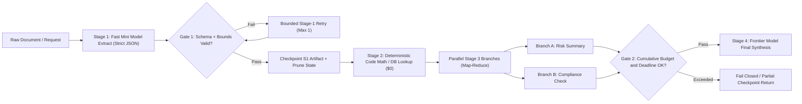
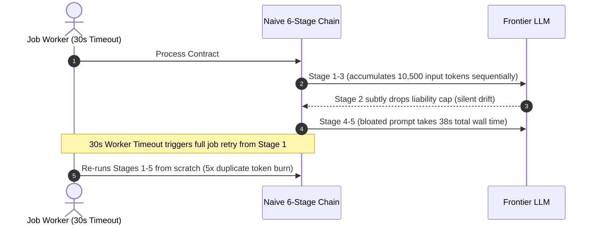

# Module 10: Prompt Chaining

> **Prerequisites:** [Module 08: Structured Output Prompting](../08-structured-output-prompting/README.md), [Module 09: Delimiters and Context Organization](../09-delimiters-and-context-organization/README.md), and [Track 06, Module 17: Provider Abstraction and Model Routing](../../06-openai-and-the-model-landscape/17-provider-abstraction-and-model-routing/README.md)  
> **Estimated Reading Time:** 32 minutes  
> **Target Audience:** AI Backend Engineers, Workflow Orchestration Architects, Platform Reliability Engineers

> [!TIP]
> **The Golden Rule of Prompt Chaining:** Never cram incompatible cognitive tasks into a single mega-prompt—and never wire blind text-to-text LLM hops where errors compound as $p^k$. Decompose workflows into **minimal, typed stages** separated by **deterministic validation gates** (strict JSON Schema, regex, AST/SQL checks, or pure code), **prune state to compact typed artifacts** between hops to prevent $O(k^2)$ token bloat, **checkpoint every completed stage** for idempotent replay, and enforce a **cumulative pipeline deadline and token ceiling**.

---

## Why This Matters

When an application must ingest a 40-page contract, extract risk clauses, cross-check tax liabilities, verify figures against an internal database, and draft a structured customer summary, engineers face two tempting antipatterns:

1. **The Monolithic Mega-Prompt:** Cramming `18` competing constraints, `4` distinct tasks, and output formatting into one giant prompt dilutes model attention across tasks, makes failures opaque to debug, and forces every trivial sub-step onto your most expensive frontier model.
2. **Naive Text-to-Text Prompt Chaining:** Splitting the job into `6` raw-text LLM calls (`resp1 = llm(p1); resp2 = llm(resp1)...`) without intermediate schema gates or deterministic code steps creates silent **$p^k$ reliability collapse**, quadratic **$O(k^2)$ token amplification**, and catastrophic latency spikes where a timeout in Stage 5 forces the entire chain to restart from Stage 1.

Prompt chaining sits cleanly between single-turn prompting and fully autonomous agents ([Track 10](../../10-ai-agents/README.md)): **application code owns the control flow DAG deterministically**, while each node invokes either fast traditional code or a tightly scoped LLM contract.

---

## 1. Architectural Mental Model & Pipeline Economics

### The $p^k$ Error-Compounding Law & Deterministic Gate Recovery

Consider a naive unvalidated sequential chain of $k$ LLM stages, where each stage succeeds independently with probability $p_i$. The probability that the final output is completely error-free decays exponentially with chain depth $k$:

$$P_{\text{chain}} = \prod_{i=1}^{k} p_i \stackrel{p_i = p}{=} p^k$$

At a seemingly healthy $p = 0.90$ single-stage accuracy, a `4`-stage naive chain drops to $0.90^4 = 65.6\%$ end-to-end reliability, and a `6`-stage chain collapses to $0.90^6 = 53.1\%$ (nearly a coin flip!).

Deterministic **Validation Gates** between stages break this decay in two ways:
1. **Replace LLM Hops with Code:** Deterministic arithmetic, date comparisons, currency conversion, and SQL formatting belong in Python/Go/TS (`p = 1.00`, `\$0` token cost), shrinking $k_{\text{LLM}}$ from `6` down to `2–3`.
2. **Gate + Bounded Stage Retry:** If a schema/semantic gate detects failure with probability $d_i$ and performs up to $1$ targeted local retry at stage $i$ (without re-running stages $1 \dots i-1$), effective per-stage reliability rises to $p_i' = p_i + (1 - p_i) d_i p_i$ (e.g., lifting $0.90 \to 0.9765$ at $d_i = 0.85$), keeping a `3`-stage gated chain above `93.1%`.



### Preventing $O(k^2)$ Context Amplification & Latency Stacking

If Stage $i$ blindly appends all prior outputs ($T_{\text{out}}$ tokens per hop) onto the original document ($T_{\text{doc}}$) and passes the full transcript forward, total input tokens across $k$ sequential stages grow quadratically in $k$:

$$T_{\text{in, bloated}} = \sum_{i=0}^{k-1} \left(T_{\text{doc}} + i \cdot T_{\text{out}}\right) = k \cdot T_{\text{doc}} + \frac{k(k-1)}{2} T_{\text{out}}$$

By contrast, passing **pruned typed artifacts** ($T_{\text{state}} \ll T_{\text{doc}}$) and applying **heterogeneous model routing** (cheap mini models for extraction/classification, deterministic code for arithmetic, frontier models solely for final synthesis) slashes both input tokens and unit price by `> 80%`.

Meanwhile, end-to-end wall-clock latency equals the **critical path** across sequential hops plus parallel map-reduce barriers:

$$L_{\text{pipeline}} = \sum_{s \in \text{critical\_path}} \left(\text{TTFT}_s + \frac{T_{\text{out}, s}}{\text{TPS}_s} + L_{\text{gate}, s}\right)$$

Running independent branches concurrently (`asyncio.gather` / `errgroup` / `Promise.all`) reduces `N` parallel extractions from $\sum L_j$ down to $\max_{j} L_j$.

---

## 2. Systematic Reference & Comparison Matrix

| Architecture Pattern | Reliability ($p^k$ Risk) | Latency Profile | Token Cost Scaling | Debuggability & Replay | Best Production Use Case | Key Failure Mode |
| :--- | :--- | :--- | :--- | :--- | :--- | :--- |
| **Single Monolithic Prompt** | No $p^k$ decay, but suffers multi-task instruction dilution | **Lowest** (`1` round-trip TTFT) | `1x` input, single pass | Opaque (hard to isolate which sub-rule broke) | Simple summarization, single-intent extraction | Attention drop when >5–7 unrelated rules compete |
| **Naive Text-to-Text Chain** | **Severe** ($p^k$ silent error compounding) | High ($\sum$ sequential round-trips) | **Quadratic** $O(k^2)$ if transcripts accumulate | Poor (bad Stage-1 prose poisons Stage 4 silently) | Never deploy in production without gates | Cascading silent hallucinations & `50%` end-to-end failure |
| **Schema-Gated Chain + Checkpoints** | **High** (local stage retries + code gates) | Moderate (reduced via stage pruning) | **Linear** (compact typed artifacts per stage) | **Excellent** (inspect & replay per stage hash) | Multi-step ETL, contract analysis, report pipelines | Retry storms if cumulative pipeline token/time budget is missing |
| **Parallel Map-Reduce Chain** | High when reduce gate validates shard counts | **Low** on map phase ($\max_j L_j$) | Linear in total shards | High (per-shard failure isolation) | Long-document chunk summarization, batch classification | Slowest straggler shard sets tail latency (`p99`) |
| **Model-Routing Escalation Cascade** | **Highest** (frontier fallback on low score/fail) | Fast on `70%–85%` easy path | **Lowest** (`60%–85%` cheaper than all-frontier) | High (clear escalation triggers logged) | High-volume classification, coding/SQL synthesis with tests | Weak verifier passes subtle semantic bugs on mini tier |
| **Autonomous Agent Loop (ReAct)** | Variable (loop divergence risk) | Unbounded without `max_steps` | High (full conversation history per turn) | Complex trace replay needed | Open-ended research, dynamic tool exploration | Loops endlessly or burns budget on ambiguous tasks |

### Chaining Topology Decision Rules

| Workflow Symptom | Optimal Pattern |
| :--- | :--- |
| Task mixes extraction, math, and nuanced prose | **Gated Chain + Code Stage** (`Mini Extract -> Python Math -> Frontier Draft`) |
| Input spans `50+` independent pages or items | **Map-Reduce Fan-Out** (parallel bounded workers + deterministic aggregator) |
| Latency SLO `< 1.5s` and single discrete output | **Single Structured Prompt** (avoid multi-hop TTFT penalties) |
| Dynamic unknown tool sequence based on user state | **Autonomous Agent** ([Track 10](../../10-ai-agents/README.md)) instead of static prompt chain |

---

## 3. Production War Story Post-Mortem: The Unbounded 6-Stage Bloat & Replay Storm

| Field | Incident Details |
| :--- | :--- |
| **Severity** | **SEV-1** (`43%` Defect Escape Rate, `38s` $p_{95}$ Gateway Timeouts & `5x` Duplicate Spend) |
| **Detection / Resolution Time** | Flagged after 48 hours via customer report inaccuracies & AWS NAT/API billing alert / Fixed in 4 hours |
| **Impact** | Nearly half of B2B contract briefs contained drifted risk numbers, jobs timed out at `30s`, and worker restarts re-executed Stage 1 from scratch |

### What Happened

A legal-operations team deployed a `6`-stage sequential prompt chain (`OCR Cleanup -> Clause Extraction -> Risk Scoring -> Tax Penalty Math -> Executive Summary -> Client Email`) where every stage called a frontier reasoning model (`\$3/\$15` per 1M tokens) and passed the entire accumulated markdown transcript forward (`O(k^2)` context growth). There were zero JSON Schema gates between hops, no stage checkpoints, and no cumulative pipeline deadline.

Under real contract volume:
1. **$0.91^6 = 56.8\%$ Reliability:** Minor formatting slips in Stage 2 silently distorted Stage 3 risk tags and Stage 4 arithmetic, sending corrupted executive emails without throwing any runtime exception.
2. **Timeout + Restart Amplification:** Sequential round-trips plus bloated transcripts hit `38s` at $p_{95}$, tripping the API gateway's `30s` timeout. The queue worker caught the timeout and restarted the *entire `6`-stage job from Stage 1*, multiplying API bills `5x` while still failing at Stage 5.



### Root Cause Analysis

1. **Unnecessary LLM Hops for Deterministic Logic:** Stage 1 regex normalization and Stage 4 tax-penalty arithmetic belonged in pure application code, adding `2` needless failure points ($p^k$) and `11s` of latency.
2. **$O(k^2)$ State Passing Without Schema Pruning:** Re-sending the raw OCR text and full intermediate markdown on Stages 3–6 inflated input tokens `4.4x` and degraded attention on late instructions.
3. **Missing Per-Stage Checkpointing & Cumulative Deadlines:** Without an idempotent `(job_id, stage_id)` artifact cache or shared `context.WithTimeout` deadline, retries always re-paid for already-completed early stages.

### The Fix & Architectural Hardening

- Collapsed `6` raw LLM hops into **`3` schema-gated LLM stages + deterministic Python math** (`OCR/Regex -> Mini Extract [Strict JSON] -> Python Tax Math [\$0] -> Parallel Risk & Compliance -> Frontier Synthesis`).
- Replaced full-transcript append with **compact typed Pydantic artifacts** (`~220` tokens passed between stages) and routed extraction stages to a `20x` cheaper mini model.
- Added an **idempotent checkpoint store** (keyed by `sha256(input + stage_version)`) plus a cumulative `22s` pipeline deadline and `12,000`-token circuit breaker. End-to-end accuracy jumped from `56.8%` to `95.4%`, $p_{95}$ latency fell from `38s` to `6.8s`, and total chain cost dropped by `89%`.

---

## 4. Multi-Language Production Implementation: Checkpointable Gated Prompt Chain

Below are production implementations of a **Checkpointable, Schema-Gated Prompt Chain Engine** featuring deterministic validation gates between stages, idempotent artifact caching (so retrying Stage 2 never re-executes Stage 1), cumulative deadline propagation, and hard pipeline token budgets.

````carousel

```go
package promptchain

import (
	"context"
	"encoding/json"
	"errors"
	"fmt"
	"sync"
	"time"
)

type Stage1Artifact struct {
	ClauseCount     int     `json:"clause_count"`
	LiabilityCapUSD float64 `json:"liability_cap_usd"`
}

type Stage2Artifact struct {
	RiskLevel string `json:"risk_level"` // LOW, MEDIUM, HIGH
	CapOK     bool   `json:"cap_ok"`
}

type ChainResult struct {
	DraftSummary string
	TokensSpent  int
	CacheHits    int
}

type CheckpointStore struct {
	mu   sync.Mutex
	data map[string][]byte
}

func NewCheckpointStore() *CheckpointStore {
	return &CheckpointStore{data: make(map[string][]byte)}
}

func (s *CheckpointStore) Get(key string) ([]byte, bool) {
	s.mu.Lock()
	defer s.mu.Unlock()
	v, ok := s.data[key]
	return v, ok
}

func (s *CheckpointStore) Set(key string, val []byte) {
	s.mu.Lock()
	defer s.mu.Unlock()
	s.data[key] = val
}

type StageInvoker func(ctx context.Context, stage string, input []byte) (output []byte, tokens int, err error)

// ExecuteContractChain runs a 3-stage gated pipeline with checkpoint replay, deadline, and token ceiling.
func ExecuteContractChain(
	parentCtx context.Context,
	jobID string,
	rawDoc []byte,
	store *CheckpointStore,
	invoker StageInvoker,
	deadline time.Duration,
	maxTotalTokens int,
) (ChainResult, error) {
	ctx, cancel := context.WithTimeout(parentCtx, deadline)
	defer cancel()

	tokensSpent := 0
	cacheHits := 0

	// Stage 1: Extract (with deterministic schema gate + checkpoint)
	var s1 Stage1Artifact
	k1 := jobID + ":stage1"
	if cached, ok := store.Get(k1); ok {
		cacheHits++
		if err := json.Unmarshal(cached, &s1); err != nil {
			return ChainResult{}, err
		}
	} else {
		out, tok, err := invoker(ctx, "extract", rawDoc)
		tokensSpent += tok
		if err != nil {
			return ChainResult{}, err
		}
		if tokensSpent > maxTotalTokens {
			return ChainResult{}, errors.New("cumulative pipeline token budget exceeded at stage 1")
		}
		if err := json.Unmarshal(out, &s1); err != nil || s1.ClauseCount <= 0 || s1.LiabilityCapUSD < 0 {
			return ChainResult{}, fmt.Errorf("stage 1 validation gate failed: %v", err)
		}
		store.Set(k1, out)
	}

	// Stage 2: Deterministic Cap Check + Risk Classification Gate
	var s2 Stage2Artifact
	k2 := jobID + ":stage2"
	if cached, ok := store.Get(k2); ok {
		cacheHits++
		if err := json.Unmarshal(cached, &s2); err != nil {
			return ChainResult{}, err
		}
	} else {
		s1Bytes, _ := json.Marshal(s1) // Pruned typed artifact only
		out, tok, err := invoker(ctx, "risk", s1Bytes)
		tokensSpent += tok
		if err != nil {
			return ChainResult{}, err
		}
		if tokensSpent > maxTotalTokens {
			return ChainResult{}, errors.New("cumulative pipeline token budget exceeded at stage 2")
		}
		if err := json.Unmarshal(out, &s2); err != nil {
			return ChainResult{}, fmt.Errorf("stage 2 JSON gate failed: %w", err)
		}
		if s2.RiskLevel != "LOW" && s2.RiskLevel != "MEDIUM" && s2.RiskLevel != "HIGH" {
			return ChainResult{}, fmt.Errorf("stage 2 enum gate failed: %q", s2.RiskLevel)
		}
		store.Set(k2, out)
	}

	// Stage 3: Final Frontier Synthesis
	s2Bytes, _ := json.Marshal(s2)
	out3, tok3, err := invoker(ctx, "draft", s2Bytes)
	tokensSpent += tok3
	if err != nil {
		return ChainResult{}, err
	}
	if tokensSpent > maxTotalTokens {
		return ChainResult{}, errors.New("cumulative pipeline token budget exceeded at stage 3")
	}

	return ChainResult{
		DraftSummary: string(out3),
		TokensSpent:  tokensSpent,
		CacheHits:    cacheHits,
	}, nil
}
```

<!-- slide -->

```typescript
export interface ExtractedTerms {
  readonly clauseCount: number;
  readonly liabilityCapUsd: number;
}

export interface RiskAssessment {
  readonly riskLevel: "LOW" | "MEDIUM" | "HIGH";
  readonly capOk: boolean;
}

export interface ChainOutput {
  readonly summary: string;
  readonly tokensSpent: number;
  readonly checkpointHits: number;
}

export class BudgetExceededError extends Error {}
export class StageGateError extends Error {}

export class GatedPromptChain {
  private readonly checkpoints = new Map<string, string>();

  public async run(
    jobId: string,
    rawDocument: string,
    callStage: (stage: "extract" | "risk" | "draft", payload: string, signal: AbortSignal) => Promise<{ text: string; tokens: number }>,
    options: { timeoutMs: number; maxTotalTokens: number }
  ): Promise<ChainOutput> {
    const controller = new AbortController();
    const timer = setTimeout(() => controller.abort(new Error("Pipeline deadline exceeded")), options.timeoutMs);

    let tokensSpent = 0;
    let checkpointHits = 0;

    const accountTokens = (n: number) => {
      tokensSpent += n;
      if (tokensSpent > options.maxTotalTokens) {
        throw new BudgetExceededError(`Spent ${tokensSpent} tokens > ceiling ${options.maxTotalTokens}`);
      }
    };

    try {
      // Stage 1: Extraction + Schema Gate + Checkpoint
      const s1Key = `${jobId}:stage1`;
      let s1: ExtractedTerms;
      if (this.checkpoints.has(s1Key)) {
        checkpointHits++;
        s1 = JSON.parse(this.checkpoints.get(s1Key)!) as ExtractedTerms;
      } else {
        const res1 = await callStage("extract", rawDocument, controller.signal);
        accountTokens(res1.tokens);
        const parsed = JSON.parse(res1.text) as Partial<ExtractedTerms>;
        if (typeof parsed.clauseCount !== "number" || parsed.clauseCount <= 0 || typeof parsed.liabilityCapUsd !== "number") {
          throw new StageGateError("Stage 1 gate failed: invalid extracted terms.");
        }
        s1 = { clauseCount: parsed.clauseCount, liabilityCapUsd: parsed.liabilityCapUsd };
        this.checkpoints.set(s1Key, JSON.stringify(s1));
      }

      // Deterministic code computation instead of paying an LLM hop for math
      const capOk = s1.liabilityCapUsd <= 100_000;

      // Stage 2: Risk Classification + Gate + Checkpoint (receives pruned artifact only)
      const s2Key = `${jobId}:stage2`;
      let s2: RiskAssessment;
      if (this.checkpoints.has(s2Key)) {
        checkpointHits++;
        s2 = JSON.parse(this.checkpoints.get(s2Key)!) as RiskAssessment;
      } else {
        const prunedInput = JSON.stringify({ ...s1, capOk });
        const res2 = await callStage("risk", prunedInput, controller.signal);
        accountTokens(res2.tokens);
        const parsed = JSON.parse(res2.text) as Partial<RiskAssessment>;
        if (parsed.riskLevel !== "LOW" && parsed.riskLevel !== "MEDIUM" && parsed.riskLevel !== "HIGH") {
          throw new StageGateError(`Stage 2 gate failed: invalid riskLevel=${String(parsed.riskLevel)}`);
        }
        s2 = { riskLevel: parsed.riskLevel, capOk };
        this.checkpoints.set(s2Key, JSON.stringify(s2));
      }

      // Stage 3: Final Frontier Synthesis
      const res3 = await callStage("draft", JSON.stringify(s2), controller.signal);
      accountTokens(res3.tokens);

      return { summary: res3.text, tokensSpent, checkpointHits };
    } finally {
      clearTimeout(timer);
    }
  }
}
```

<!-- slide -->

```python
"""
gated_chain.py
Production schema-gated prompt chain with idempotent per-stage checkpointing,
pruned artifact passing, deterministic code stages, and cumulative token/time limits.
"""

from __future__ import annotations

import json
import time
from dataclasses import asdict, dataclass
from typing import Callable


class StageGateError(ValueError):
    pass


class BudgetExceededError(RuntimeError):
    pass


@dataclass(frozen=True)
class ExtractedTerms:
    clause_count: int
    liability_cap_usd: float


@dataclass(frozen=True)
class RiskAssessment:
    risk_level: str
    cap_ok: bool


@dataclass(frozen=True)
class ChainOutcome:
    summary: str
    tokens_spent: int
    checkpoint_hits: int


class GatedPromptChain:
    def __init__(self, *, max_total_tokens: int = 8000, timeout_s: float = 15.0) -> None:
        self.max_total_tokens = max_total_tokens
        self.timeout_s = timeout_s
        self.checkpoints: dict[str, str] = {}

    def run(
        self,
        job_id: str,
        raw_document: str,
        invoke_stage: Callable[[str, str], tuple[str, int]],
    ) -> ChainOutcome:
        deadline = time.monotonic() + self.timeout_s
        tokens_spent = 0
        hits = 0

        def _guard_budget(tokens: int) -> None:
            nonlocal tokens_spent
            tokens_spent += tokens
            if tokens_spent > self.max_total_tokens:
                raise BudgetExceededError(f"Cumulative token budget {self.max_total_tokens} exceeded ({tokens_spent})")
            if time.monotonic() > deadline:
                raise TimeoutError("Cumulative prompt chain deadline exceeded")

        # Stage 1: Mini-model extraction + deterministic gate + checkpoint
        k1 = f"{job_id}:stage1"
        if k1 in self.checkpoints:
            hits += 1
            s1 = ExtractedTerms(**json.loads(self.checkpoints[k1]))
        else:
            raw1, tok1 = invoke_stage("extract", raw_document)
            _guard_budget(tok1)
            try:
                d1 = json.loads(raw1)
                s1 = ExtractedTerms(clause_count=int(d1["clause_count"]), liability_cap_usd=float(d1["liability_cap_usd"]))
            except (json.JSONDecodeError, KeyError, TypeError, ValueError) as exc:
                raise StageGateError(f"Stage 1 gate failed: {exc}") from exc
            if s1.clause_count <= 0 or s1.liability_cap_usd < 0:
                raise StageGateError("Stage 1 gate failed: invalid clause_count or negative cap")
            self.checkpoints[k1] = json.dumps(asdict(s1))

        # Deterministic code stage (zero LLM cost, 100% accuracy)
        cap_ok = s1.liability_cap_usd <= 100_000.0

        # Stage 2: Risk classification (pruned typed artifact only, NOT raw_document)
        k2 = f"{job_id}:stage2"
        if k2 in self.checkpoints:
            hits += 1
            s2 = RiskAssessment(**json.loads(self.checkpoints[k2]))
        else:
            pruned_payload = json.dumps({"clause_count": s1.clause_count, "liability_cap_usd": s1.liability_cap_usd, "cap_ok": cap_ok})
            raw2, tok2 = invoke_stage("risk", pruned_payload)
            _guard_budget(tok2)
            try:
                d2 = json.loads(raw2)
                risk = d2["risk_level"]
            except (json.JSONDecodeError, KeyError) as exc:
                raise StageGateError(f"Stage 2 gate failed: {exc}") from exc
            if risk not in ("LOW", "MEDIUM", "HIGH"):
                raise StageGateError(f"Stage 2 gate failed: unexpected risk_level={risk}")
            s2 = RiskAssessment(risk_level=risk, cap_ok=cap_ok)
            self.checkpoints[k2] = json.dumps(asdict(s2))

        # Stage 3: Frontier synthesis
        raw3, tok3 = invoke_stage("draft", json.dumps(asdict(s2)))
        _guard_budget(tok3)
        return ChainOutcome(summary=raw3, tokens_spent=tokens_spent, checkpoint_hits=hits)
```

<!-- slide -->

```csharp
using System;
using System.Collections.Concurrent;
using System.Text.Json;
using System.Threading;
using System.Threading.Tasks;

namespace GenAI.PromptEngineering;

public sealed record ExtractedTerms(int ClauseCount, decimal LiabilityCapUsd);
public sealed record RiskAssessment(string RiskLevel, bool CapOk);
public sealed record StageOutput(string Content, int TokensUsed);
public sealed record ChainOutcome(string Summary, int TokensSpent, int CheckpointHits);

public sealed class GatedPromptChain
{
    private readonly ConcurrentDictionary<string, string> _checkpoints = new(StringComparer.Ordinal);

    public async Task<ChainOutcome> ExecuteAsync(
        string jobId,
        string rawDocument,
        Func<string, string, CancellationToken, Task<StageOutput>> invokeStage,
        int maxTotalTokens = 8000,
        TimeSpan? timeout = null,
        CancellationToken ct = default)
    {
        using var cts = CancellationTokenSource.CreateLinkedTokenSource(ct);
        cts.CancelAfter(timeout ?? TimeSpan.FromSeconds(15));

        int tokensSpent = 0;
        int hits = 0;

        void AccountTokens(int used)
        {
            tokensSpent += used;
            if (tokensSpent > maxTotalTokens)
                throw new InvalidOperationException($"Cumulative token budget exceeded: {tokensSpent}/{maxTotalTokens}.");
        }

        // Stage 1: Extract + Schema Gate + Checkpoint
        ExtractedTerms s1;
        string k1 = $"{jobId}:stage1";
        if (_checkpoints.TryGetValue(k1, out string? cached1))
        {
            hits++;
            s1 = JsonSerializer.Deserialize<ExtractedTerms>(cached1)!;
        }
        else
        {
            StageOutput res1 = await invokeStage("extract", rawDocument, cts.Token);
            AccountTokens(res1.TokensUsed);
            s1 = JsonSerializer.Deserialize<ExtractedTerms>(res1.Content)
                ?? throw new InvalidOperationException("Stage 1 gate failed: null JSON.");
            if (s1.ClauseCount <= 0 || s1.LiabilityCapUsd < 0)
                throw new InvalidOperationException("Stage 1 gate failed: invalid domain bounds.");
            _checkpoints[k1] = JsonSerializer.Serialize(s1);
        }

        // Deterministic logic stage ($0 LLM cost)
        bool capOk = s1.LiabilityCapUsd <= 100_000m;

        // Stage 2: Risk Classification (pruned typed artifact only)
        RiskAssessment s2;
        string k2 = $"{jobId}:stage2";
        if (_checkpoints.TryGetValue(k2, out string? cached2))
        {
            hits++;
            s2 = JsonSerializer.Deserialize<RiskAssessment>(cached2)!;
        }
        else
        {
            string pruned = JsonSerializer.Serialize(new { s1.ClauseCount, s1.LiabilityCapUsd, CapOk = capOk });
            StageOutput res2 = await invokeStage("risk", pruned, cts.Token);
            AccountTokens(res2.TokensUsed);
            s2 = JsonSerializer.Deserialize<RiskAssessment>(res2.Content)
                ?? throw new InvalidOperationException("Stage 2 gate failed: null JSON.");
            if (s2.RiskLevel is not ("LOW" or "MEDIUM" or "HIGH"))
                throw new InvalidOperationException($"Stage 2 gate failed: invalid risk level '{s2.RiskLevel}'.");
            _checkpoints[k2] = JsonSerializer.Serialize(s2);
        }

        // Stage 3: Final Frontier Synthesis
        StageOutput res3 = await invokeStage("draft", JsonSerializer.Serialize(s2), cts.Token);
        AccountTokens(res3.TokensUsed);

        return new ChainOutcome(res3.Content, tokensSpent, hits);
    }
}
```

````

---

## 5. Practical Hands-On CLI Verification Workflows

All three verification workflows below execute completely offline using Python 3.13 standard library modules.

### Workflow 1: Measure $p^k$ Compounding Decay vs. Validation-Gated Stage Retries

Compute end-to-end reliability across $k \in \{1, 2, 3, 4, 6, 8\}$ sequential stages at per-stage $p = 0.90$, showing how naive chains decay to `53.1%` at $k=6$ while refactoring deterministic steps into code and adding local gated retries recovers `93.1%`:

```bash
python - << 'EOF'
print("=== Module 10 Workflow 1: p^k Compounding vs Validation-Gated Retry ===")
p_stage = 0.90
detect_rate = 0.85

for k in [1, 2, 3, 4, 6, 8]:
    naive_prob = p_stage ** k
    p_gated_1_retry = p_stage + (1.0 - p_stage) * detect_rate * p_stage
    gated_prob = p_gated_1_retry ** k
    print(f"k={k} stages -> Naive p^k: {100*naive_prob:5.1f}% | Gated (1 retry, p'={p_gated_1_retry:.4f}): {100*gated_prob:5.1f}%")

print(f"Refactored 6->3 LLM stages (gated, 1 retry): {100*( (p_stage + (1-p_stage)*detect_rate*p_stage)**3 ):5.1f}%")
EOF
```

**Expected Output:**

```text
=== Module 10 Workflow 1: p^k Compounding vs Validation-Gated Retry ===
k=1 stages -> Naive p^k:  90.0% | Gated (1 retry, p'=0.9765):  97.7%
k=2 stages -> Naive p^k:  81.0% | Gated (1 retry, p'=0.9765):  95.4%
k=3 stages -> Naive p^k:  72.9% | Gated (1 retry, p'=0.9765):  93.1%
k=4 stages -> Naive p^k:  65.6% | Gated (1 retry, p'=0.9765):  90.9%
k=6 stages -> Naive p^k:  53.1% | Gated (1 retry, p'=0.9765):  86.7%
k=8 stages -> Naive p^k:  43.0% | Gated (1 retry, p'=0.9765):  82.7%
Refactored 6->3 LLM stages (gated, 1 retry):  93.1%
```

### Workflow 2: Quantify $O(k^2)$ Transcript Bloat vs. State Pruning & Heterogeneous Routing

Calculate input/output token spend across `10,000` `5`-stage contract chains (`T_doc=1,500`, `T_out=300/stage`) comparing full-transcript append on a frontier model (`\$3.00/\$15.00` per 1M), typed artifact pruning, and heterogeneous model routing (`\$0.15/\$0.60` mini model + deterministic code + frontier final stage):

```bash
python - << 'EOF'
print("=== Module 10 Workflow 2: O(k^2) Transcript Bloat vs Pruned Routing (10k chains) ===")
chains = 10_000
stages = 5
t_doc, t_stage_out = 1500, 300
t_pruned_state = 220

f_in, f_out = 3.00, 15.00
m_in, m_out = 0.15, 0.60

in_tok_a = sum(t_doc + i * t_stage_out for i in range(stages))
out_tok_a = stages * t_stage_out
cost_a = chains * (in_tok_a * f_in + out_tok_a * f_out) / 1e6

in_tok_b = t_doc + (stages - 1) * t_pruned_state
out_tok_b = stages * t_stage_out
cost_b = chains * (in_tok_b * f_in + out_tok_b * f_out) / 1e6

in_mini = t_doc + 2 * t_pruned_state
out_mini = 3 * t_stage_out
in_front = t_pruned_state
out_front = t_stage_out
cost_c = chains * ((in_mini * m_in + out_mini * m_out) + (in_front * f_in + out_front * f_out)) / 1e6

print(f"Mode A (O(k^2) Bloat, Frontier)    : {in_tok_a:5d} in / {out_tok_a:4d} out -> ${cost_a:,.2f}")
print(f"Mode B (Pruned Artifacts, Frontier): {in_tok_b:5d} in / {out_tok_b:4d} out -> ${cost_b:,.2f}")
print(f"Mode C (Pruned + Routed + Code)    : {in_mini+in_front:5d} in / {out_mini+out_front:4d} out -> ${cost_c:,.2f}")
EOF
```

**Expected Output:**

```text
=== Module 10 Workflow 2: O(k^2) Transcript Bloat vs Pruned Routing (10k chains) ===
Mode A (O(k^2) Bloat, Frontier)    : 10500 in / 1500 out -> $540.00
Mode B (Pruned Artifacts, Frontier):  2380 in / 1500 out -> $296.40
Mode C (Pruned + Routed + Code)    :  2160 in / 1200 out -> $59.91
```

### Workflow 3: Execute a Checkpointed Gated Chain with Stage-2 Failure & Idempotent Replay

Simulate a Stage 2 JSON gate rejection on attempt #1, verify that retrying the job resumes at Stage 2 without re-calling Stage 1 (`stage1_extract == 1`), and verify cumulative token tracking:

```bash
python - << 'EOF'
import json

print("=== Module 10 Workflow 3: Gated Checkpoint Chain & Token Budget Guard ===")
call_counts = {"stage1_extract": 0, "stage2_risk": 0, "stage3_draft": 0}
checkpoints: dict[str, dict] = {}
tokens_used = 0
max_token_budget = 2000

def stage1_extract(doc_id: str) -> tuple[dict, int]:
    call_counts["stage1_extract"] += 1
    return {"clause_count": 4, "liability_cap_usd": 50000}, 450

def stage2_risk(extracted: dict, attempt: int) -> tuple[str, int]:
    call_counts["stage2_risk"] += 1
    if attempt == 1:
        return '{"risk": "HIGH"', 320
    return json.dumps({"risk": "HIGH", "cap_ok": extracted["liability_cap_usd"] <= 100000}), 340

def stage3_draft(risk_obj: dict) -> tuple[str, int]:
    call_counts["stage3_draft"] += 1
    return f"Summary: Risk={risk_obj['risk']}, CapOK={risk_obj['cap_ok']}", 380

def run_pipeline(job_id: str, stage2_attempt: int) -> dict:
    global tokens_used
    if f"{job_id}:s1" not in checkpoints:
        s1_data, tok = stage1_extract(job_id)
        tokens_used += tok
        assert "liability_cap_usd" in s1_data, "Stage 1 gate failed"
        checkpoints[f"{job_id}:s1"] = s1_data
    s1_data = checkpoints[f"{job_id}:s1"]

    if f"{job_id}:s2" not in checkpoints:
        raw_s2, tok = stage2_risk(s1_data, stage2_attempt)
        tokens_used += tok
        if tokens_used > max_token_budget:
            raise RuntimeError("Token budget exceeded")
        s2_data = json.loads(raw_s2)
        assert s2_data.get("risk") in ("LOW", "MEDIUM", "HIGH")
        checkpoints[f"{job_id}:s2"] = s2_data
    s2_data = checkpoints[f"{job_id}:s2"]

    draft, tok = stage3_draft(s2_data)
    tokens_used += tok
    return {"draft": draft, "tokens_used": tokens_used}

try:
    run_pipeline("job_99", stage2_attempt=1)
except json.JSONDecodeError as err:
    print(f"Attempt 1 blocked at Stage 2 Gate: {err}")

res = run_pipeline("job_99", stage2_attempt=2)
print(f"Attempt 2 succeeded: {res}")
print(f"Call counts (Stage 1 cached, NOT re-run!): {call_counts}")
EOF
```

**Expected Output:**

```text
=== Module 10 Workflow 3: Gated Checkpoint Chain & Token Budget Guard ===
Attempt 1 blocked at Stage 2 Gate: Expecting ',' delimiter: line 1 column 16 (char 15)
Attempt 2 succeeded: {'draft': 'Summary: Risk=HIGH, CapOK=True', 'tokens_used': 1490}
Call counts (Stage 1 cached, NOT re-run!): {'stage1_extract': 1, 'stage2_risk': 2, 'stage3_draft': 1}
```

---

## 6. Hands-On Exercises & Independent Challenge

### Practical Exercises
1. **Parallel Map-Reduce Shard Chain:** Extend the Python `GatedPromptChain` with `asyncio.gather` and `asyncio.Semaphore(5)` to extract structured summaries from `12` document pages concurrently, run a deterministic count-check gate verifying `len(extracted_pages) == 12`, and merge only compact page summaries into Stage 2.
2. **Escalation Cascade Router:** Implement a two-tier chain where Stage 1 runs on a fast mini model with a deterministic verifier (`jsonschema` + domain check); only inputs failing the gate or returning `confidence < 0.75` escalate to the frontier model, and measure cost savings across `1,000` simulated requests (`80%` solved by tier 1).

### Independent Challenge

A compliance engineering team builds a `5`-stage prompt chain to audit tax filings: `(1) Parse PDF text via LLM -> (2) Extract 12 numeric fields -> (3) Compute tax brackets via LLM -> (4) Cross-check deductions via LLM -> (5) Draft audit letter`. Every stage shares no schema validation, passes the full output of all previous stages forward, and runs sequentially under a `12s` API gateway timeout. Identify **four architectural flaws** and propose a refactored production DAG.

<details><summary>Architectural Discussion</summary>

1. **Deterministic Tasks Misassigned to LLMs:** Stage 1 (PDF parsing via `pdfplumber`/OCR) and Stage 3 (tax bracket math) are 100% deterministic operations—moving them to pure code eliminates `2` LLM failure hops ($p^5 \to p^3$) and removes arithmetic hallucinations.
2. **Missing Validation Gates & Silent $p^k$ Drift:** Without `strict: true` JSON Schema extraction ([Module 08](../08-structured-output-prompting/README.md)) and numeric range gates at Stage 2, malformed fields silently corrupt downstream bracket math and audit letters.
3. **$O(k^2)$ State Bloat:** Passing the entire raw PDF + all prior stage prose forward inflates input tokens and breaches the `12s` timeout. Pass only the compact extracted `12`-field JSON struct forward.
4. **Sequential Execution Under Tight `12s` SLO:** Merge independent analytical checks (bracket verification + deduction rule matching) into deterministic code or parallel `asyncio.gather` branches, checkpoint completed stages for idempotent retry, and route Stage 2 extraction to a fast mini model so total critical-path latency stays under `5s`.

</details>

---

## 7. Common Mistakes & Troubleshooting

- **Chaining Tasks That Should Be One Structured Call:** Splitting `Extract Sentiment` and `Extract Topic` into `2` sequential LLM calls doubles TTFT latency and costs extra input tokens when a single `strict: true` JSON schema handles both cleanly. Split stages *only* when tasks conflict cognitively, exceed attention capacity, need deterministic code/DB lookups in between, or target different model tiers.
- **Passing Full Raw Context Into Every Downstream Stage:** Unless Stage 3 genuinely needs verbatim quotes from the raw source, pass only the validated compact JSON artifact emitted by Stage 2.
- **No Idempotent Checkpoint Keys on Multi-Minute Jobs:** Re-running a `4`-stage chain from Stage 1 whenever Stage 4 hits a `429` or `503` transient fault creates `4x` cost spikes. Key checkpoints deterministically by `(stage_name, sha256(input + prompt_version))`.
- **Ignoring Cumulative Pipeline Deadlines:** Setting a `10s` per-call HTTP timeout on a `5`-stage chain allows a single stalled workflow to hang for `50s`, far past upstream API gateway limits. Always pass a single parent `ctx` / `Deadline` across all hops.

---

## 8. Operational Validation Checkpoints & Checkpoint Quiz

### Operational Validation Checkpoints

<details><summary><strong>Checkpoint 1: Diagnosing $p^k$ End-to-End Accuracy Collapse</strong></summary>

Each individual stage of a new `7`-stage raw-text prompt chain scores `92%` in isolated unit evaluations, yet full end-to-end QA only achieves `55%` accuracy. Why is end-to-end accuracy `37` points lower than every unit test, and how do you recover `> 90%`?

**Validation:** Independent errors compound multiplicatively across sequential hops: $0.92^7 \approx 0.5578$ (`55.8%`). Recover `> 90%` by (1) replacing deterministic formatting/calculation hops with pure code to collapse $k$ from `7` down to `2–3` LLM hops, (2) enforcing `strict: true` JSON Schemas + deterministic semantic gates between hops, and (3) adding bounded `1`-retry repair at any stage gate failure.

</details>

<details><summary><strong>Checkpoint 2: Eliminating Quadratic Token Growth in Multi-Stage Pipelines</strong></summary>

A `5`-stage workflow passes `[raw_doc, stage1_out, stage2_out, ...]` into each subsequent stage (`2,000` token raw doc + `400` tokens/stage). Why does Stage 5 cost far more than Stage 1, and how should inter-stage state be refactored?

**Validation:** Accumulating raw transcripts causes input tokens to scale quadratically ($2000 + 2400 + 2800 + 3200 + 3600 = 14,000$ input tokens per run vs `2,000 + 4 * 250 = 3,000` with compact typed artifacts). Prune every gate's output to a strict typed schema carrying *only* the exact fields required by downstream stages.

</details>

<details><summary><strong>Checkpoint 3: Designing Idempotent Recovery for Transient Late-Stage Failures</strong></summary>

Stage 4 of an async document pipeline encounters transient `503 Service Unavailable` errors on `3%` of runs, and the message queue simply re-enqueues the job, causing Stages 1–3 to re-run every time. How do you stop redundant spend?

**Validation:** Persist each stage's validated output in a fast KV/DB checkpoint store keyed by `sha256(job_input + stage_id + prompt_version)` with an appropriate TTL. Before invoking Stage $i$, check for a valid checkpoint hit so retries resume cleanly at Stage 4 without re-executing Stages 1–3.

</details>

### Checkpoint Quiz

1. What happens to end-to-end reliability in an unvalidated `5`-stage prompt chain if every stage succeeds `90%` of the time?
2. What is the architectural difference between a **Prompt Chain (Workflow)** and an **Autonomous Agent**?
3. Why should deterministic tasks (arithmetic sums, date diffing, SQL syntax checks) always sit in application code *between* LLM stages rather than as extra LLM prompts?
4. How does **state pruning** fix $O(k^2)$ token cost explosion across a multi-hop pipeline?
5. Name two critical safeguards required on the *orchestrator* wrapping a multi-stage LLM chain in production.

<details><summary>Answers</summary>

1. Errors compound as $p^k = 0.90^5 = 0.5905$, leaving only `59.0%` end-to-end workflow reliability.
2. In Prompt Chaining, deterministic application code defines the static DAG transitions, gates, and retries; in an Autonomous Agent, the LLM dynamically decides which tools to invoke and how many iterations to run.
3. Application code executes at `100%` deterministic accuracy, sub-millisecond latency, and `\$0` token cost—removing both arithmetic hallucinations and unnecessary $p^k$ failure hops.
4. Instead of appending raw documents and full conversational history forward at every hop, each stage outputs a compact typed schema containing only the exact fields needed by the next stage.
5. (1) Per-stage deterministic schema/semantic validation gates + idempotent artifact checkpoints, and (2) a cumulative pipeline deadline (`context.WithTimeout`) plus cumulative `max_total_tokens` budget breaker across all stages.

</details>

---

## Further Reading & Sources

- [Anthropic Engineering: Building Effective Agents](https://www.anthropic.com/engineering/building-effective-agents) — canonical architectural distinction between deterministic workflows (prompt chaining, routing, parallelization) and autonomous agents.
- [Anthropic Docs: Chain Complex Prompts](https://docs.anthropic.com/en/docs/build-with-claude/prompt-engineering/chain-prompts) — practical patterns for breaking complex tasks into sequential XML/schema-gated subtasks.
- [OpenAI Prompt Engineering Guide](https://platform.openai.com/docs/guides/prompt-engineering) — covers splitting complex tasks into simpler subtasks and validating intermediate outputs.
- [Track 06, Module 17: Provider Abstraction and Model Routing](../../06-openai-and-the-model-landscape/17-provider-abstraction-and-model-routing/README.md) — details heterogeneous model routing across mini and frontier tiers.

## Next

[Module 11: Reflection and Self-Critique](../11-reflection-and-self-critique/README.md)
