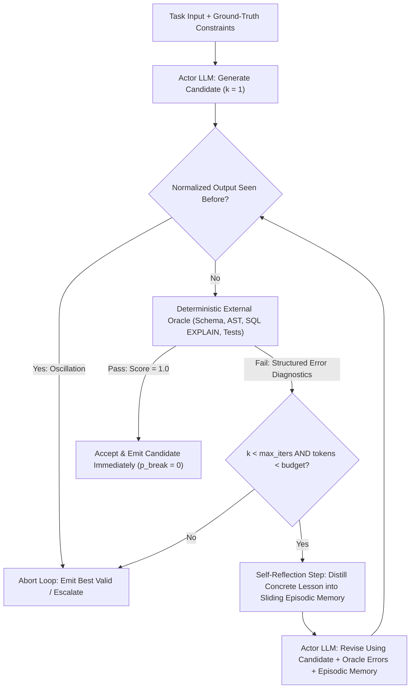
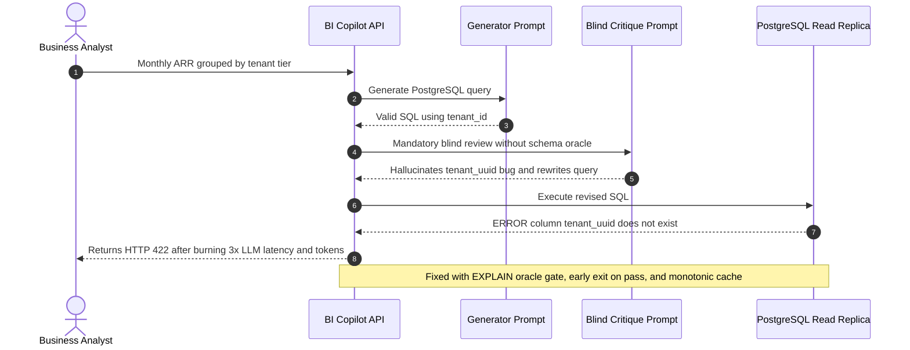

# Module 11: Reflection and Self-Critique

> **Prerequisites:** [Module 04: Chain-of-Thought](../04-chain-of-thought/README.md), [Module 08: Structured Output Prompting](../08-structured-output-prompting/README.md), and [Module 10: Prompt Chaining](../10-prompt-chaining/README.md)  
> **Estimated Reading Time:** 30 minutes  
> **Target Audience:** AI Backend Engineers, Agent Systems Architects, Applied ML Engineers

> [!TIP]
> **The Golden Rule of Reflection & Self-Critique**  
> Never deploy **intrinsic (ungrounded) self-critique** on reasoning, factual QA, or code generation—as Huang et al. (2024) demonstrated, forcing a model to blindly *"double-check your answer"* without external feedback frequently flips correct first-pass answers into wrong ones while multiplying latency and token spend by $2\times$–$4\times$. Production reflection works reliably **only when anchored to an external deterministic oracle** (JSON Schema validator, compiler, unit tests, SQL `EXPLAIN`, citation check) with bounded retries, episodic memory, cycle detection, and monotonic best-candidate selection.

---

## Why This Matters

A common instinct when an LLM drops accuracy on complex SQL generation, multi-step planning, or structured extraction is to append a second prompt step: *"Review your response carefully, spot any mistakes, and rewrite a corrected final answer."* In prototypes, that extra pass feels responsible. In production, ungrounded self-critique silently damages systems in two ways simultaneously:

1. **Sycophantic Flip Regressions (`Correct -> Wrong`):** Without new ground-truth evidence from a tool or verifier, asking a model *"Are you sure? Fix any errors"* biases it to abandon confident, accurate first answers in favor of plausible-sounding hallucinations.
2. **Multiplicative Cost and Tail Latency:** Every reflection turn re-ingests the original prompt, the draft candidate, and the critique prompt, pushing token bills up $2\times$–$5\times$ and elevating p95 latency across interactive endpoints.

Knowing **when self-critique helps** (style/format conformance, tool-grounded debugging, unit-test-driven Reflexion) versus **when it regresses** separates resilient agent engineering from expensive placebo loops.

---

## 1. Visual Mental Models & Self-Critique Mechanics

### Intrinsic Self-Critique vs. Tool/Oracle-Grounded Reflection

Research across three landmark papers established clear empirical boundaries for LLM reflection:

- **Intrinsic Self-Correction Fails Reasoning (Huang et al., 2024 — arXiv:2310.01798):** Across GSM8K, StrategyQA, and CommonSenseQA, LLMs prompted to critique and revise their own reasoning **without external oracle signals** systematically underperformed single-pass Chain-of-Thought—unless ground-truth labels leaked into the prompt or stopping criteria. When an LLM has no new factual signal, second-guessing acts like high-variance noise that breaks correct solutions more often than it rescues wrong ones.
- **Self-Refine Works on Subjective / Format Constraints (Madaan et al., 2023 — arXiv:2303.17651):** Iterative self-feedback *does* yield consistent gains on **self-contained qualitative criteria** visible directly in the context—such as tone alignment, readability, sentiment adherence, dialogue helpfulness, or structured checklist compliance—where evaluating the artifact is strictly easier than generating it from scratch.
- **CRITIC & Reflexion Succeed via External Oracles (Gou et al., 2024; Shinn et al., 2023):** **CRITIC** feeds objective tool diagnostics (code interpreters, calculators, search lookups) back into revision prompts. **Reflexion** adds an **Actor -> Evaluator -> Self-Reflection** cycle backed by a bounded **episodic verbal memory buffer**, turning raw binary test failures or compiler stack traces into natural-language lessons stored across retries without updating model weights.

### Quantitative Accuracy Flip Matrix & Cost-Utility Math

Let $A_0 \in [0, 1]$ denote single-pass accuracy before critique. Over one critique-and-revise cycle, define two conditional transition probabilities:

- $p_{\text{fix}} = P(\text{Correct}_{t+1} \mid \text{Wrong}_t)$ — the repair rate on initial errors.
- $p_{\text{break}} = P(\text{Wrong}_{t+1} \mid \text{Correct}_t)$ — the regression rate where a valid answer gets broken.

The net accuracy shift $\Delta A = A_1 - A_0$ is governed by:

$$\Delta A = (1 - A_0)\,p_{\text{fix}} - A_0\,p_{\text{break}}$$

Notice the asymmetry when baseline accuracy $A_0$ is already high! If $A_0 = 0.85$, blind self-critique achieves $p_{\text{fix}} = 0.15$, and second-guessing induces $p_{\text{break}} = 0.08$:

$$\Delta A = (0.15)(0.15) - (0.85)(0.08) = 0.0225 - 0.0680 = -0.0455 \text{ (-4.55 percentage points)}$$

To guarantee $\Delta A > 0$, blind critique requires $p_{\text{fix}} > \frac{A_0}{1 - A_0} p_{\text{break}}$ (at $A_0 = 0.85$, you must repair errors at **5.67x** the rate at which you break valid outputs). By contrast, an **oracle-monotonic loop** tests the draft deterministically first and exits immediately on pass, enforcing $p_{\text{break}} = 0$ so $\Delta A = (1 - A_0)\,p_{\text{fix}} \ge 0$.

Meanwhile, under early-exit pass probability $q_k$ at iteration $k$ and budget cap $K_{\max}$, expected normalized token cost is:

$$\mathbb{E}[C] = C_{\text{gen}} + C_{\text{oracle},0} + \sum_{k=1}^{K_{\max}-1} \left(\prod_{j=0}^{k-1}(1 - q_j)\right)\big(C_{\text{reflect},k} + C_{\text{oracle},k}\big)$$

Early exit ensures easy inputs (`~75%–85%` of traffic) pay only `1.0x` inference cost, confining multi-step reflection spend strictly to genuine oracle failures.

### Bounded Oracle-Grounded Reflexion Architecture



---

## 2. Systematic Reference & Comparison Matrix

| Reflection Pattern | Feedback Grounding | Regression Risk ($p_{\text{break}}$) | Token & Latency Overhead | Best Production Fit | Mandatory Architectural Safeguard |
| :--- | :--- | :--- | :--- | :--- | :--- |
| **Blind Intrinsic Critique** (*"Double-check your work"*) | None (internal logits only) | **High** (sycophancy / second-guessing) | Fixed $2\times$–$3\times$ cost & latency | Almost never in production | Avoid on reasoning/QA; replace with voting or an oracle |
| **Self-Refine (Rubric Polish)** | Self-evaluated style/formatting rubric | Low-moderate (subjective drift possible) | $2\times$–$4\times$ unless early-exit flag triggers | Copywriting, tone rewrites, checklist adherence | Explicit rubric checklist + `no_changes_needed` early stop |
| **Constitutional / Policy Critique** | Enumerated safety/compliance rules | Low (when rules are concrete) | $+1\times$ critique + optional $+1\times$ rewrite | PII masking, brand tone compliance, refusal audits | Deterministic regex/policy pre-check before invoking LLM critic |
| **CRITIC (Tool-Interactive)** | External tool output (REPL, calculator, search) | **Near zero** (if gated monotonically) | $1.1\times$–$1.8\times$ average with early exit | Math verification, fact-checking claims against live DB/API | Run tool verification on every claim before trusting revision |
| **Reflexion (Episodic Memory)** | Unit tests, compiler, SQL `EXPLAIN`, schema errors | **Zero** (best-so-far invariant) | Bounded by `max_iters` & token cap | Code synthesis, SQL repair, multi-step workflow recovery | Sliding memory window (`<= 3` lessons), cycle hash breaker, monotonic best cache |

---

## 3. Production War Story Post-Mortem: Blind SQL Self-Critique Causes 11.2% Accuracy Drop and Triples Inference Spend

| Field | Incident Details |
| :--- | :--- |
| **Severity** | **SEV-2** (11.2% Valid-Query Accuracy Regression & Runaway LLM Spend) |
| **Detection / Resolution Time** | Detected after 14 days via FinOps invoice spike + support tickets / Resolved in 4 hours |
| **Impact** | \$18,400 wasted monthly token spend; 1,940 broken analytics dashboard queries returned HTTP 422 errors |

### What Happened

An internal BI Analytics Copilot translated natural-language revenue questions into PostgreSQL queries. Seeking higher first-try accuracy, an engineer chained a mandatory two-round reflection prompt behind every SQL generation call: *"Inspect your SQL carefully for subtle join bugs, timezone bugs, or schema mismatches, critique it, and output an improved final query."* No database execution or schema checker ran between generation and critique.

On `82%` of normal queries, the initial pass already generated valid executable SQL. However, during the ungrounded critique phase, the critic felt compelled to "find" issues to obey the prompt—frequently inventing plausible column aliases (`tenant_uuid` instead of `tenant_id`) or rewriting valid `LEFT JOIN` clauses into invalid subqueries. Worse, every request paid for 3 full LLM round-trips (Draft -> Critique -> Revision) regardless of whether the draft was already valid. Over two weeks, valid SQL execution rate fell from `82.4%` to `71.2%` while monthly API billing jumped `3.1x`.



### Root Cause Analysis

1. **Ungrounded Critique Without Schema Oracle:** Asking a model to critique SQL without giving it `EXPLAIN` output or real column metadata forced pure hallucinated revisions (`p_break = 14%`).
2. **Unconditional Multi-Turn Execution:** Running critique on `100%` of requests—even queries that would pass PostgreSQL syntax and schema validation immediately—wasted tokens and introduced unnecessary regression risk.
3. **No Monotonic Best-Candidate Retention:** Discarding the initial draft unconditionally meant a broken revision permanently overwrote a working first-pass query.

### The Fix & Architectural Hardening

- Inserted a **deterministic PostgreSQL `EXPLAIN (FORMAT JSON)` + AST table/column allow-list oracle** immediately after Draft generation. Valid drafts return in **1 LLM call** (`~78%` of requests), ensuring `p_break = 0`.
- Enabled **Reflexion-style repair** (`max_iters = 2`) *only* when the oracle fails, passing the exact Postgres error line (`column "tenant_uuid" does not exist`) plus schema DDL into an episodic memory buffer.
- Added **oscillation hash detection** and token-budget cutoffs so repeated identical errors immediately fail fast with an actionable clarification prompt instead of looping.

---

## 4. Multi-Language Production Implementation: Bounded Oracle-Grounded Reflexion Engine

Each production component below implements an **Oracle-Grounded Reflexion Engine** featuring: (1) early exit when the deterministic oracle passes, (2) a sliding **episodic verbal memory buffer** capturing concrete diagnostic lessons, (3) **SHA-256 cycle detection** to terminate oscillating loops immediately, and (4) **strict token/iteration budgets** with highest-scoring candidate fallback.

````carousel

```go
package reflection

import (
	"context"
	"crypto/sha256"
	"encoding/hex"
	"errors"
	"fmt"
	"strings"
)

type OracleResult struct {
	Passed      bool
	Score       float64
	Diagnostics string
}

type Lesson struct {
	Iteration int
	Summary   string
}

type ReflectionConfig struct {
	MaxIters        int
	MaxTokenBudget  int
	MaxMemoryWindow int
}

type CandidateStep struct {
	Output     string
	TokensUsed int
}

type GeneratorFunc func(ctx context.Context, priorOutput string, diag string, memory []Lesson) (CandidateStep, error)
type OracleFunc func(ctx context.Context, candidate string) OracleResult

// RunGroundedReflexion executes bounded oracle-driven repair with monotonic best-candidate selection.
func RunGroundedReflexion(
	ctx context.Context,
	cfg ReflectionConfig,
	gen GeneratorFunc,
	oracle OracleFunc,
) (string, []Lesson, int, error) {
	if cfg.MaxIters < 1 {
		return "", nil, 0, errors.New("MaxIters must be >= 1")
	}

	seen := make(map[string]bool)
	var memory []Lesson
	totalTokens := 0
	bestScore := -1.0
	bestCandidate := ""
	prevOutput, prevDiag := "", ""

	for iter := 1; iter <= cfg.MaxIters; iter++ {
		if totalTokens >= cfg.MaxTokenBudget {
			break
		}
		step, err := gen(ctx, prevOutput, prevDiag, memory)
		if err != nil {
			return bestCandidate, memory, totalTokens, fmt.Errorf("iter %d generator error: %w", iter, err)
		}
		totalTokens += step.TokensUsed

		norm := strings.Join(strings.Fields(strings.ToLower(step.Output)), " ")
		sum := sha256.Sum256([]byte(norm))
		fingerprint := hex.EncodeToString(sum[:8])
		if seen[fingerprint] {
			break // Halt immediately on cyclic / oscillating output
		}
		seen[fingerprint] = true

		res := oracle(ctx, step.Output)
		if res.Score > bestScore {
			bestScore = res.Score
			bestCandidate = step.Output
		}
		if res.Passed {
			return step.Output, memory, totalTokens, nil
		}

		lesson := Lesson{
			Iteration: iter,
			Summary:   fmt.Sprintf("Iter %d failed (%s); avoid repeating this fault.", iter, res.Diagnostics),
		}
		memory = append(memory, lesson)
		if cfg.MaxMemoryWindow > 0 && len(memory) > cfg.MaxMemoryWindow {
			memory = memory[len(memory)-cfg.MaxMemoryWindow:]
		}
		prevOutput, prevDiag = step.Output, res.Diagnostics
	}

	if bestCandidate == "" {
		return "", memory, totalTokens, errors.New("reflexion exhausted budget without valid candidate")
	}
	return bestCandidate, memory, totalTokens, fmt.Errorf("oracle not satisfied; returning best candidate (score=%.2f)", bestScore)
}
```

<!-- slide -->

```typescript
import { createHash } from "node:crypto";

export interface OracleResult {
  readonly passed: boolean;
  readonly score: number;
  readonly diagnostics: string;
}

export interface ReflectionLesson {
  readonly iteration: number;
  readonly summary: string;
}

export interface ReflexionConfig {
  readonly maxIters: number;
  readonly maxTokenBudget: number;
  readonly maxMemoryWindow: number;
}

export interface ReflexionOutcome {
  readonly output: string;
  readonly passedOracle: boolean;
  readonly totalTokens: number;
  readonly terminationReason: "oracle_passed" | "cycle_detected" | "budget_exhausted" | "max_iters";
  readonly memory: readonly ReflectionLesson[];
}

export type CandidateGenerator = (
  priorOutput: string,
  diagnostics: string,
  memory: readonly ReflectionLesson[]
) => Promise<{ output: string; tokensUsed: number }>;

export type DeterministicOracle = (candidate: string) => OracleResult;

function fingerprintCandidate(raw: string): string {
  const normalized = raw.trim().toLowerCase().replace(/\s+/g, " ");
  return createHash("sha256").update(normalized).digest("hex").slice(0, 16);
}

export async function runGroundedReflexion(
  config: ReflexionConfig,
  generate: CandidateGenerator,
  verify: DeterministicOracle
): Promise<ReflexionOutcome> {
  const seenHashes = new Set<string>();
  const memory: ReflectionLesson[] = [];
  let totalTokens = 0;
  let bestScore = -1;
  let bestOutput = "";
  let prevOutput = "";
  let prevDiag = "";

  for (let iter = 1; iter <= config.maxIters; iter++) {
    if (totalTokens >= config.maxTokenBudget) {
      return { output: bestOutput, passedOracle: false, totalTokens, terminationReason: "budget_exhausted", memory };
    }

    const step = await generate(prevOutput, prevDiag, memory);
    totalTokens += step.tokensUsed;

    const fp = fingerprintCandidate(step.output);
    if (seenHashes.has(fp)) {
      return { output: bestOutput, passedOracle: false, totalTokens, terminationReason: "cycle_detected", memory };
    }
    seenHashes.add(fp);

    const check = verify(step.output);
    if (check.score > bestScore) {
      bestScore = check.score;
      bestOutput = step.output;
    }
    if (check.passed) {
      return { output: step.output, passedOracle: true, totalTokens, terminationReason: "oracle_passed", memory };
    }

    memory.push({ iteration: iter, summary: `Iter ${iter}: ${check.diagnostics}` });
    if (memory.length > config.maxMemoryWindow) {
      memory.shift();
    }
    prevOutput = step.output;
    prevDiag = check.diagnostics;
  }

  return { output: bestOutput, passedOracle: false, totalTokens, terminationReason: "max_iters", memory };
}
```

<!-- slide -->

```python
"""Bounded oracle-grounded Reflexion loop with episodic memory and cycle detection."""

import hashlib
import re
from collections import deque
from dataclasses import dataclass, field
from typing import Callable


@dataclass(frozen=True)
class OracleResult:
    passed: bool
    score: float
    diagnostics: str


@dataclass(frozen=True)
class ReflexionOutcome:
    output: str
    passed_oracle: bool
    total_tokens: int
    reason: str
    lessons: list[str] = field(default_factory=list)


def _candidate_hash(text: str) -> str:
    normalized = re.sub(r"\s+", " ", text.strip().lower())
    return hashlib.sha256(normalized.encode("utf-8")).hexdigest()[:16]


def run_grounded_reflexion(
    generate_fn: Callable[[str, str, list[str]], tuple[str, int]],
    oracle_fn: Callable[[str], OracleResult],
    max_iters: int = 3,
    max_token_budget: int = 8000,
    memory_window: int = 3,
) -> ReflexionOutcome:
    """Iteratively repair candidates strictly using deterministic oracle feedback."""
    seen: set[str] = set()
    memory: deque[str] = deque(maxlen=memory_window)
    total_tokens = 0
    best_score = -1.0
    best_output = ""
    prior_output, prior_diag = "", ""

    for iteration in range(1, max_iters + 1):
        if total_tokens >= max_token_budget:
            return ReflexionOutcome(best_output, False, total_tokens, "budget_exhausted", list(memory))

        candidate, tokens = generate_fn(prior_output, prior_diag, list(memory))
        total_tokens += tokens

        fp = _candidate_hash(candidate)
        if fp in seen:
            return ReflexionOutcome(best_output, False, total_tokens, "cycle_detected", list(memory))
        seen.add(fp)

        verdict = oracle_fn(candidate)
        if verdict.score > best_score:
            best_score = verdict.score
            best_output = candidate
        if verdict.passed:
            return ReflexionOutcome(candidate, True, total_tokens, "oracle_passed", list(memory))

        memory.append(f"Attempt {iteration} rejected: {verdict.diagnostics}")
        prior_output, prior_diag = candidate, verdict.diagnostics

    return ReflexionOutcome(best_output, False, total_tokens, "max_iters", list(memory))
```

<!-- slide -->

```csharp
using System;
using System.Collections.Generic;
using System.Security.Cryptography;
using System.Text;
using System.Text.RegularExpressions;

namespace GenAI.Reflection;

public sealed record OracleResult(bool Passed, double Score, string Diagnostics);
public sealed record CandidateStep(string Output, int TokensUsed);
public sealed record ReflexionOutcome(
    string Output,
    bool PassedOracle,
    int TotalTokens,
    string TerminationReason,
    IReadOnlyList<string> EpisodicLessons);

public static partial class GroundedReflexionEngine
{
    [GeneratedRegex(@"\s+")]
    private static partial Regex MultiSpaceRegex();

    private static string Fingerprint(string raw)
    {
        string normalized = MultiSpaceRegex().Replace(raw.Trim().ToLowerInvariant(), " ");
        byte[] hash = SHA256.HashData(Encoding.UTF8.GetBytes(normalized));
        return Convert.ToHexString(hash)[..16].ToLowerInvariant();
    }

    public static ReflexionOutcome Run(
        Func<string, string, IReadOnlyList<string>, CandidateStep> generate,
        Func<string, OracleResult> oracle,
        int maxIters = 3,
        int maxTokenBudget = 8000,
        int memoryWindow = 3)
    {
        var seen = new HashSet<string>(StringComparer.Ordinal);
        var memory = new Queue<string>(memoryWindow);
        int totalTokens = 0;
        double bestScore = -1.0;
        string bestOutput = string.Empty;
        string priorOutput = string.Empty;
        string priorDiag = string.Empty;

        for (int iter = 1; iter <= maxIters; iter++)
        {
            if (totalTokens >= maxTokenBudget)
                return new ReflexionOutcome(bestOutput, false, totalTokens, "budget_exhausted", memory.ToArray());

            CandidateStep step = generate(priorOutput, priorDiag, memory.ToArray());
            totalTokens += step.TokensUsed;

            string fp = Fingerprint(step.Output);
            if (!seen.Add(fp))
                return new ReflexionOutcome(bestOutput, false, totalTokens, "cycle_detected", memory.ToArray());

            OracleResult verdict = oracle(step.Output);
            if (verdict.Score > bestScore)
            {
                bestScore = verdict.Score;
                bestOutput = step.Output;
            }
            if (verdict.Passed)
                return new ReflexionOutcome(step.Output, true, totalTokens, "oracle_passed", memory.ToArray());

            if (memory.Count == memoryWindow)
                memory.Dequeue();
            memory.Enqueue($"Attempt {iter} failed: {verdict.Diagnostics}");
            priorOutput = step.Output;
            priorDiag = verdict.Diagnostics;
        }

        return new ReflexionOutcome(bestOutput, false, totalTokens, "max_iters", memory.ToArray());
    }
}
```

````

---

## 5. Practical Hands-On CLI Verification Workflows

All three workflows below execute completely offline in standard Python 3.13 with zero external packages or API keys. (To connect a live model, swap the simulated `candidates` list for your LLM completion call carrying `episodic_memory` in the revision prompt.)

### Workflow 1: Quantifying Huang et al. (2024) Flip-Matrix Regressions vs. Oracle-Monotonic Reflection

Compute exact net accuracy shifts $\Delta A = (1 - A_0)\,p_{\text{fix}} - A_0\,p_{\text{break}}$ across three reflection designs:

```bash
python -c "
def expected_delta(a0, p_fix, p_break):
    return (1.0 - a0) * p_fix - a0 * p_break

scenarios = [
    ('Blind Intrinsic Critique (Huang et al. risk)', 0.85, 0.15, 0.08),
    ('Weak Rubric Polish (moderate drift)',          0.75, 0.20, 0.05),
    ('Oracle-Monotonic Guard (p_break == 0)',        0.85, 0.40, 0.00),
]
for name, a0, pf, pb in scenarios:
    da = expected_delta(a0, pf, pb)
    print(f'{name:44s} | A0={a0:.2%} -> A1={a0+da:.2%} (delta={da:+.2%})')
"
```

**Expected Output:**

```text
Blind Intrinsic Critique (Huang et al. risk) | A0=85.00% -> A1=80.45% (delta=-4.55%)
Weak Rubric Polish (moderate drift)          | A0=75.00% -> A1=76.25% (delta=+1.25%)
Oracle-Monotonic Guard (p_break == 0)        | A0=85.00% -> A1=91.00% (delta=+6.00%)
```

### Workflow 2: Deterministic Oracle-Grounded Reflexion Loop with Cycle Detection

Verify how a bounded Reflexion loop repairs schema and policy faults across iterative SQL candidates while logging compact lessons into episodic memory:

```bash
python -c "
import hashlib

def sql_oracle(sql_text):
    if not sql_text.strip().upper().startswith('SELECT '):
        return False, 'SYNTAX_ERR: Must begin with SELECT'
    if 'tenant_uuid' in sql_text:
        return False, 'SCHEMA_ERR: Unknown column tenant_uuid (valid: tenant_id)'
    if 'LIMIT' not in sql_text.upper():
        return False, 'POLICY_ERR: Missing mandatory LIMIT clause'
    return True, 'OK'

candidates = [
    'SELECT id, amount_cents FROM invoices WHERE tenant_uuid = 42',
    'SELECT id, amount_cents FROM invoices WHERE tenant_id = 42',
    'SELECT id, amount_cents FROM invoices WHERE tenant_id = 42 LIMIT 100',
]

episodic_memory = []
seen_hashes = set()
best_valid = None
max_iters = 3

for step, cand in enumerate(candidates[:max_iters], start=1):
    h = hashlib.sha256(cand.encode()).hexdigest()[:12]
    if h in seen_hashes:
        print(f'Iter {step}: CYCLE_DETECTED ({h}) -> halting early')
        break
    seen_hashes.add(h)
    ok, diag = sql_oracle(cand)
    print(f'Iter {step}: hash={h} | oracle_ok={ok} | diag={diag}')
    if ok:
        best_valid = cand
        break
    episodic_memory.append(f'Attempt {step} failed: {diag}')

print(f'Final selected SQL: {best_valid}')
print(f'Episodic lessons  : {len(episodic_memory)} -> {episodic_memory}')
"
```

**Expected Output:**

```text
Iter 1: hash=ffa2fbca5cf1 | oracle_ok=False | diag=SCHEMA_ERR: Unknown column tenant_uuid (valid: tenant_id)
Iter 2: hash=701026e896f4 | oracle_ok=False | diag=POLICY_ERR: Missing mandatory LIMIT clause
Iter 3: hash=244bbe4b8496 | oracle_ok=True | diag=OK
Final selected SQL: SELECT id, amount_cents FROM invoices WHERE tenant_id = 42 LIMIT 100
Episodic lessons  : 2 -> ['Attempt 1 failed: SCHEMA_ERR: Unknown column tenant_uuid (valid: tenant_id)', 'Attempt 2 failed: POLICY_ERR: Missing mandatory LIMIT clause']
```

### Workflow 3: Early-Exit Oracle Cost & Round-Trip Savings Simulator

Measure expected token multiplier and round-trips comparing unconditional 3-round Self-Refine against an oracle early-exit architecture:

```bash
python -c "
c_gen = 1.0
c_oracle = 0.02
c_reflect = 1.15
pass_rates = [0.78, 0.65, 0.40]
max_rounds = 3

p_still_failing = 1.0
expected_cost = c_gen + c_oracle
expected_llm_calls = 1.0
for k in range(1, max_rounds):
    p_fail_prev = 1.0 - pass_rates[k - 1]
    p_still_failing *= p_fail_prev
    expected_cost += p_still_failing * (c_reflect + c_oracle)
    expected_llm_calls += p_still_failing

naive_fixed_cost = c_gen + (max_rounds - 1) * c_reflect
print(f'Naive fixed {max_rounds}-round Self-Refine cost : {naive_fixed_cost:.3f}x base')
print(f'Early-exit oracle expected cost      : {expected_cost:.3f}x base')
print(f'Expected LLM round-trips             : {expected_llm_calls:.3f} calls')
print(f'Token savings vs fixed loop          : {(1 - expected_cost / naive_fixed_cost):.1%}')
"
```

**Expected Output:**

```text
Naive fixed 3-round Self-Refine cost : 3.300x base
Early-exit oracle expected cost      : 1.367x base
Expected LLM round-trips             : 1.297 calls
Token savings vs fixed loop          : 58.6%
```

---

## 6. Hands-On Exercises & Independent Challenge

### Practical Exercises

1. **Trigger & Verify Oscillation Cycle Termination:** Modify Workflow 2 so `candidates[1]` repeats `candidates[0]` with extra whitespace (`"SELECT   id, amount_cents  FROM invoices WHERE tenant_uuid = 42"`). Verify that whitespace normalization causes `_candidate_hash` to match and halt execution before wasting Iteration 3's token budget.
2. **Add Partial Scoring for Monotonic Best-Fallback:** Extend `sql_oracle` to return a `0.0–1.0` partial quality score (`+0.4` valid `SELECT`, `+0.3` valid columns, `+0.3` `LIMIT` present). Confirm that if a final revision introduces a regression (`score` drops from `0.7` to `0.4`), `run_grounded_reflexion` returns the higher-scoring `0.7` draft instead of the degraded final attempt.
3. **Compare Self-Consistency Voting vs. Intrinsic Self-Critique:** Review [Module 05: Self-Consistency and Voting](../05-self-consistency-and-voting/README.md). Compute the cost trade-off of `k=3` parallel majority voting (`3x` cost, zero sequential latency increase) versus a sequential 3-step reflection loop (`3x` cost AND `3x` wall-clock p95 latency) on reasoning tasks lacking a deterministic oracle.

### Independent Challenge

Your platform team builds an automated **Kubernetes YAML & Terraform Fixer Agent** that reads failing CI logs and suggests infrastructure patches. An engineer proposes running a **4-round blind LLM self-critique** before presenting any patch to developers because *"four rounds of self-review makes the model smarter."* Meanwhile, CI takes 8 seconds to run `terraform validate` and `kubeconform` locally.

Design the optimal reflection architecture for this agent and defend why blind multi-round critique should be rejected.

<details><summary>Architectural Discussion</summary>

1. **Why 4-round blind critique fails:** Without running `terraform validate` or `kubeconform`, the model has zero external signal about provider schema updates, deprecated resource versions, or HCL syntax constraints. Per Huang et al. (2024), forcing 4 blind self-reviews increases `p_break` (hallucinating nonexistent fields on valid patches) while paying roughly $4\times$ sequential latency and token inflation.
2. **CRITIC / Reflexion with Deterministic Infrastructure Oracles:** Execute `terraform fmt -check`, `terraform validate -json`, and `kubeconform -strict` as the external **deterministic oracle** right after Turn 1. If validation passes, return immediately in 1 LLM turn (`p_break = 0`).
3. **Bounded Episodic Repair (`max_iters = 2`):** Only on oracle failure, feed the exact JSON validation error diagnostics into an episodic memory buffer and allow up to 2 targeted repair turns with cycle hashing (`SHA-256`) and monotonic score tracking (retaining the candidate with fewest schema errors if budget expires).

</details>

---

## 7. Common Mistakes & Troubleshooting

- **Running reflection on every request unconditionally:** Always evaluate the deterministic oracle or pass-gate first; only invoke critique/revision on failures so `70%–85%` of traffic pays `1x` latency and tokens.
- **Unbounded `while not valid:` retry loops:** Without `max_iters`, `max_token_budget`, and normalized output-hash cycle detection, an LLM stuck between two invalid syntaxes can burn an entire hourly quota in minutes.
- **Growing episodic memory indefinitely across long sessions:** Appending full stack traces and multi-kilobyte prior drafts on every retry overflows the context window and degrades attention. Keep a fixed sliding window (`<= 3` distilled 1–2 sentence lessons) plus only the most recent candidate and error diff.
- **Treating an LLM-as-Critic prompt as an infallible oracle on math or logic:** Remember Huang et al. (2024)—an LLM grading its own arithmetic or multi-hop reasoning shares the same parametric blind spots as the generator. Use Python code execution, symbolic solvers, or majority-vote self-consistency instead.

---

## 8. Operational Validation Checkpoints & Checkpoint Quiz

### Operational Validation Checkpoints

<details><summary><strong>Checkpoint 1: Diagnosing negative net accuracy from intrinsic self-critique</strong></summary>

Your extraction pipeline currently achieves $A_0 = 88\%$ baseline accuracy on financial table parsing. You add an ungrounded *"Double-check your reasoning and revise if unsure"* prompt step, and internal logs later show $p_{\text{fix}} = 0.25$ on errors alongside $p_{\text{break}} = 0.06$ on previously correct answers. Did reflection help or hurt?

**Validation:** Plugging values into $\Delta A = (1 - A_0)\,p_{\text{fix}} - A_0\,p_{\text{break}}$ gives $(0.12)(0.25) - (0.88)(0.06) = 0.0300 - 0.0528 = -0.0228$. Accuracy **dropped by 2.28 percentage points** ($88.00\% \to 85.72\%$) while doubling inference cost. You must remove the blind critique pass or gate revisions strictly behind an external balance-reconciliation arithmetic oracle (`sum(line_items) == subtotal`).

</details>

<details><summary><strong>Checkpoint 2: Designing a cycle-safe, budget-capped Reflexion loop</strong></summary>

During load testing of a JSON-repair agent, one malformed input caused the agent to alternate endlessly between missing `"currency"` and invalid `"amount": "N/A"` until a 60-second HTTP gateway timeout fired. Which three safeguards prevent this failure?

**Validation:** Enforce: (1) a strict iteration ceiling (`max_iters = 2` or `3`) and cumulative token budget (`max_token_budget`); (2) **normalized SHA-256 cycle detection** over previously attempted outputs so repeating an earlier candidate halts immediately; and (3) a sliding **episodic memory buffer** summarizing *both* past failures (`Attempt 1 failed missing currency; Attempt 2 failed non-numeric amount — satisfy BOTH constraints simultaneously`) so the revision resolves conflicting fixes cleanly.

</details>

<details><summary><strong>Checkpoint 3: Choosing between Reflexion, Self-Refine, and Self-Consistency</strong></summary>

Match three production tasks to the right inference-time pattern: (a) fixing failing Python unit tests in a sandbox, (b) rewriting a verbose customer email to match a 120-word empathy rubric, and (c) answering complex multi-hop legal deduction questions with no executable verifier.

**Validation:** (a) **Reflexion / CRITIC**, because `pytest` provides an exact deterministic external oracle and stack-trace diagnostics (`p_break = 0`); (b) **Self-Refine** with an explicit length check + empathy rubric and early-exit stop flag, since evaluating length and tone against visible text is reliable; (c) **Self-Consistency (majority voting)** from Module 05 rather than sequential self-critique, avoiding Huang et al.'s sycophancy regressions when no external oracle exists.

</details>

### Checkpoint Quiz

1. What core experimental conclusion did Huang et al. (2024, arXiv:2310.01798) prove regarding intrinsic self-correction on reasoning benchmarks?
2. Write the exact formula for net accuracy shift $\Delta A$ given initial accuracy $A_0$, repair rate $p_{\text{fix}}$, and regression rate $p_{\text{break}}$.
3. How does **Reflexion** (Shinn et al., 2023) improve across retries without updating neural network weights?
4. Why must an oracle-grounded loop hash *normalized* candidate outputs rather than raw strings for cycle detection?
5. When is **Self-Refine** still an effective engineering choice without an external compiler or database?

<details><summary>Answers</summary>

1. Without external feedback or ground-truth oracle signals, LLMs cannot reliably self-correct reasoning errors and frequently **degrade** accuracy compared to single-pass generation due to flipping previously correct answers into incorrect ones.
2. $\Delta A = (1 - A_0)\,p_{\text{fix}} - A_0\,p_{\text{break}}$.
3. Through **verbal reinforcement learning**: an Evaluator produces objective feedback/scores, a Self-Reflection step summarizes failure causes into natural-language lessons stored in a bounded episodic memory buffer, and the Actor conditions its next trial on that episodic buffer.
4. Models often emit functionally identical retries differing only in trailing spaces, indentation, or line breaks; normalizing whitespace/casing before SHA-256 hashing catches semantic oscillation immediately and saves wasted inference turns.
5. On tasks whose evaluation criteria are directly verifiable within the text itself—such as stylistic tone adjustments, formatting polish, rubric checklist adherence, or structural readability edits.

</details>

---

## Further Reading & Sources

- [Large Language Models Cannot Self-Correct Reasoning Yet (Huang et al., 2024)](https://arxiv.org/abs/2310.01798) - rigorous empirical evidence demonstrating intrinsic self-correction failures without external oracle feedback.
- [Reflexion: Language Agents with Verbal Reinforcement Learning (Shinn et al., 2023)](https://arxiv.org/abs/2303.11366) - foundational Actor/Evaluator/Self-Reflection architecture with episodic verbal memory achieving 91% pass@1 on HumanEval.
- [Self-Refine: Iterative Refinement with Self-Feedback (Madaan et al., 2023)](https://arxiv.org/abs/2303.17651) - iterative generate-feedback-refine loop across dialogue, summarization, and rubric-guided synthesis.
- [CRITIC: Large Language Models Can Self-Correct with Tool-Interactive Critiquing (Gou et al., 2024)](https://arxiv.org/abs/2305.11738) - grounding LLM self-critique via code interpreters, search engines, and external verification tools.
- [Anthropic Docs: Prompting Best Practices](https://docs.anthropic.com/en/docs/build-with-claude/prompt-engineering/claude-prompting-best-practices) - practical engineering guidance on prompt chaining, structured verification, and evaluation criteria.

## Next

[Module 12: Prompt Injection Attacks](../12-prompt-injection-attacks/README.md)
