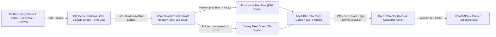
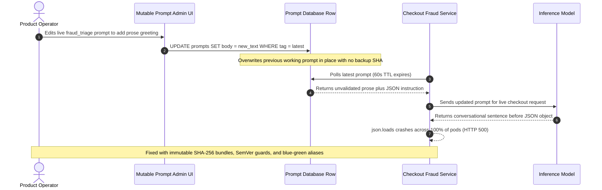

# Module 14: Prompt Versioning and Management

> **Prerequisites:** [Module 07: Prompt Templates and Variables](../07-prompt-templates-and-variables/README.md), [Module 08: Structured Output Prompting](../08-structured-output-prompting/README.md), and [Module 13: Defending Against Injection](../13-defending-against-injection/README.md)  
> **Estimated Reading Time:** 28 minutes  
> **Target Audience:** AI Backend Engineers, Platform Infrastructure Engineers, Release & DevOps Leads

> [!TIP]
> **The Golden Rule of Prompt Lifecycle Management**  
> A production prompt is **never just a text string**—it is a composite behavioral artifact binding template text, pinned model snapshot, decoding hyperparameters, tool definitions, and input/output JSON schemas. Always publish prompts as **immutable, content-addressed bundles (SHA-256)** paired with SemVer schema contracts, deploy changes via canary/blue-green alias pointers, and log the exact immutable digest on every inference span so rollback takes seconds rather than hours.

---

## Why This Matters

Early GenAI prototypes store prompts as inline string constants or editable rows in an admin dashboard database labeled `"latest"`. That pattern collapses immediately in production for three reasons:

1. **Silent Behavioral Drift:** Changing `temperature` from `0.0` to `0.3`, upgrading an unpinned model alias (`gpt-4o` rolling onto a newer snapshot), or altering a tool JSON schema shifts output distributions just as sharply as rewriting system prompt instructions. Hashing or versioning *only* the template string misses half of what determines model behavior.
2. **Schema Skew Between Prompts and Code:** If a decoupled dashboard prompt starts expecting a `{{customer_tier}}` variable or emits a new JSON field before backend application pods deploy the corresponding parser, 100% of live traffic crashes.
3. **Zero-Trace Outages:** When an engineer or PM overwrites a live `"latest"` prompt in place, production metrics degrade without a clean git commit, SHA-256 digest, or snapshot to restore.

Treating prompts with the same rigor as compiled binaries or database migrations—**immutable content-addressed artifacts + compatibility contracts + atomic traffic pointers**—eliminates unattributable regressions.

---

## 1. Visual Mental Models & Prompt Artifact Mechanics

### The Composite Prompt Bundle & Content Addressing

A production prompt artifact must hash **every behavioral parameter together** inside a deterministic canonical JSON manifest:

$$H_{\text{bundle}} = \text{SHA256}\Big(\text{CanonicalJSON}\big(\text{template},\, \text{model\_pin},\, \text{hyperparams},\, \text{var\_schema},\, \text{output\_schema},\, \text{tool\_schemas}\big)\Big)$$

Two bundles with identical wording but different `temperature`, `seed`, `model_pin`, or `output_schema` produce completely distinct SHA-256 digests. Because digests are **immutable**, `sha256:6abc16a4...` means the exact same prompt specification today, six months from now, and across dev, staging, and production clusters.

### GitOps + Immutable Registry + Blue/Green Traffic Architecture



### GitOps vs. Decoupled Runtime Prompt Registries

Engineering teams commonly debate two operational models—and production platforms typically converge on a **hybrid** of both:

1. **Pure GitOps (Code-Coupled Prompts):** Prompts live beside Pydantic/TypeScript/Go schemas in the application repository. Merging a PR triggers unit tests, evaluation gates ([Module 15](../15-prompt-evaluation-and-iteration/README.md)), and a standard container/binary deploy.
   - *Strengths:* Atomic coupling with output parsers and tool code; full PR auditability; zero runtime network dependency on an external prompt server.
   - *Trade-off:* Minor copy tweaks wait on full CI/CD build and pod rollout (`5–20` minutes).
2. **Decoupled Runtime Registry (CMS / Prompt Platform):** Prompts live in a central service (such as Langfuse or an internal S3/Postgres registry) fetched dynamically by the application via SDK with an alias tag (`production`, `staging`).
   - *Strengths:* Instant non-code copy iteration (`<10 s`), multi-service prompt reuse, and dynamic A/B routing without redeploying containers.
   - *Trade-off:* Creates **schema skew risk** when template variables or output JSON fields evolve independently of application code, plus runtime availability risk if the registry suffers an outage.
3. **Hybrid Contract-Coupled Registry (Recommended):** Author prompts in Git with **SemVer (`MAJOR.MINOR.PATCH`)** tied to the application's schema contract. CI validates and pushes immutable SHA-256 bundles to an artifact store. Runtime alias updates (`prod-blue`, `prod-green`) allow rapid traffic shifting **strictly across bundles whose `MAJOR` schema version matches the running application pods**, while SDKs cache bundles locally in memory and on disk so registry downtime never halts inference.

### Canary Routing, Blast Radius & Rollback MTTR

When promoting a candidate prompt (`v2.2.0`), route traffic deterministically using a **consistent hash of tenant/session ID**:

$$\text{bucket}(k) = \text{uint32}\big(\text{SHA256}(k)_{0..4}\big) \bmod 100$$

Routing `bucket < canary_pct` to `prod-green` guarantees **session stickiness** (the same user never flickers randomly between two prompt personas across back-to-back turns) while bounding blast radius to $5\%$ of traffic. If automated monitors detect JSON parse failures $> 0.5\%$ or guardrail spike alerts, flipping the immutable alias pointer back to `prod-blue` restores stability in $\text{MTTR} < 10\text{ s}$ with zero container rebuilds.

---

## 2. Systematic Reference & Comparison Matrix

| Management Pattern | Coupling With App Schemas | Iteration & Rollback Speed | Audit & Reproducibility | Blast-Radius / Outage Risk | Best Production Fit |
| :--- | :--- | :--- | :--- | :--- | :--- |
| **Hardcoded String Literals** | Tight (compile-time) | Slow (full code deploy) | Low (buried in diffs; hyperparameters scattered) | High if `model_pin` or schemas scatter across files | Throwaway scripts only |
| **Mutable Admin DB `"latest"` Row** | Unchecked (high skew risk) | Instant edit; **broken rollback** | Zero immutability; overwrites destroy history | **Critical** (one typo crashes 100% of prod immediately) | Never use in production |
| **Pure GitOps Versioned Templates** | **Strict** (atomic PR with code) | Moderate (`5–20 min` CI/CD deploy) | High (Git SHA + PR approval) | Low (validated before deploy) | High-compliance fintech/healthcare services with rare copy edits |
| **Decoupled Runtime Registry (Tag-Based)** | Loose (requires external checks) | Fast (`<10 s` pointer switch) | Moderate-High (if versions immutable) | High if registry lacks L1 cache or allows breaking schema edits | Fast-iterating marketing/UX summarization apps |
| **Hybrid SHA-256 Registry + SemVer Contracts** | **Strict on Major Version** | Fast (`<10 s` within compatible minor/patch) | **Maximum** (immutable SHA-256 logged per trace) | **Minimal** (canary % + L1 disk cache + schema guard) | Production multi-service GenAI backends |

---

## 3. Production War Story Post-Mortem: Mutable `"latest"` Prompt Edit Crashes Checkout Parsing

| Field | Incident Details |
| :--- | :--- |
| **Severity** | **SEV-1** (100% Checkout Fraud-Triage Parser Failure for 38 Minutes) |
| **Detection / Resolution Time** | Detected in 90 seconds via HTTP 500 surge / Mitigated in 38 minutes |
| **Impact** | `14,200` checkout evaluations fell back to manual review queue; \$41,500 in delayed order fulfillment and SLA penalties |

### What Happened

An e-commerce fraud-triage microservice fetched its prompt dynamically at runtime from an internal database endpoint `/prompts/fraud_triage/latest`. The service expected strict raw JSON matching `{"risk_score": int, "reason": str}` and parsed model responses via `json.loads()` without markdown stripping.

During a late-afternoon quality review, an operator opened the admin UI and edited the live `"latest"` prompt to sound friendlier for internal reviewers: *"First write a one-sentence friendly summary, then output the JSON."* Because the database updated the `template` column in place without creating an immutable snapshot, version ID, or running a schema smoke test, the next inference call immediately prepended conversational prose ahead of `{...}`. `json.loads()` threw `JSONDecodeError` across 100% of checkout pods. Worse, nobody had saved a copy of the exact prior wording or `temperature` setting, forcing engineers to reconstruct the old prompt from Slack screenshots while manually reverting database state.



### Root Cause Analysis

1. **In-Place Mutable Storage:** Treating `"latest"` as an editable row instead of an append-only immutable version destroyed the rollback target.
2. **Missing Schema Contract & CI Smoke Gate:** No automated check verified that the edited prompt produced valid JSON conforming to the live service's `v2` parser before promoting it to 100% traffic.
3. **No Canary Traffic Split:** The unvalidated edit went straight to `100%` of checkout pods instead of a `5%` consistent-hash canary.

### The Fix & Architectural Hardening

- Migrated prompts into Git and an **append-only SHA-256 artifact registry**; updates are never allowed in place (`UPDATE` blocked at DB permission level).
- Added a **CI Schema & Eval Smoke Gate** running 50 golden fixtures against the compiled bundle before publishing an immutable digest.
- Enforced **SemVer `schema_major` compatibility checks** in the app SDK and rolled out changes via `5% -> 25% -> 100%` blue/green pointer shifts with instant rollback (`<5 s`).

---

## 4. Multi-Language Production Implementation: Canonical SHA-256 Prompt Registry, Contract Validator & Canary Resolver

Each implementation below demonstrates deterministic canonical JSON hashing (catching silent `temperature`/`model_pin` drift), SemVer `schema_major` + variable-contract validation, and sticky consistent-hash canary resolution.

````carousel
```go
package promptreg

import (
	"crypto/sha256"
	"encoding/binary"
	"encoding/hex"
	"encoding/json"
	"fmt"
	"strings"
)

type Hyperparams struct {
	Temperature float64 `json:"temperature"`
	MaxTokens   int     `json:"max_tokens"`
	Seed        int     `json:"seed"`
}

type PromptBundle struct {
	PromptID       string      `json:"prompt_id"`
	SemVer         string      `json:"semver"`
	SchemaMajor    int         `json:"schema_major"`
	ModelPin       string      `json:"model_pin"`
	Hyperparams    Hyperparams `json:"hyperparams"`
	Variables      []string    `json:"variables"`
	Template       string      `json:"template"`
	OutputSchemaID string      `json:"output_schema_id"`
}

// ComputeBundleDigest produces a deterministic SHA-256 over the full behavioral manifest.
func ComputeBundleDigest(b PromptBundle) (string, error) {
	// Go encoding/json serializes struct fields in deterministic order.
	raw, err := json.Marshal(b)
	if err != nil {
		return "", err
	}
	sum := sha256.Sum256(raw)
	return hex.EncodeToString(sum[:])[:16], nil
}

// ValidateAndRender enforces schema_major parity and required template variables before inference.
func ValidateAndRender(b PromptBundle, serviceSchemaMajor int, vars map[string]string) (string, error) {
	if b.SchemaMajor != serviceSchemaMajor {
		return "", fmt.Errorf("schema skew: bundle major v%d != service v%d", b.SchemaMajor, serviceSchemaMajor)
	}
	rendered := b.Template
	for _, req := range b.Variables {
		val, ok := vars[req]
		if !ok {
			return "", fmt.Errorf("missing required prompt variable: %q", req)
		}
		rendered = strings.ReplaceAll(rendered, "{{"+req+"}}", val)
	}
	return rendered, nil
}

// ResolveCanarySlot deterministically assigns a tenant to blue or green without cross-request flicker.
func ResolveCanarySlot(tenantID string, canaryPercent uint32) string {
	sum := sha256.Sum256([]byte(tenantID))
	bucket := binary.BigEndian.Uint32(sum[:4]) % 100
	if bucket < canaryPercent {
		return "green"
	}
	return "blue"
}
```
<!-- slide -->
```typescript
import { createHash } from "node:crypto";

export interface PromptBundle {
  readonly promptId: string;
  readonly semver: string;
  readonly schemaMajor: number;
  readonly modelPin: string;
  readonly hyperparams: {
    readonly temperature: number;
    readonly maxTokens: number;
    readonly seed: number;
  };
  readonly variables: readonly string[];
  readonly template: string;
  readonly outputSchemaId: string;
}

function canonicalize(value: unknown): string {
  if (Array.isArray(value)) {
    return `[${value.map(canonicalize).join(",")}]`;
  }
  if (value !== null && typeof value === "object") {
    const entries = Object.entries(value as Record<string, unknown>).sort(([a], [b]) =>
      a.localeCompare(b)
    );
    return `{${entries.map(([k, v]) => `${JSON.stringify(k)}:${canonicalize(v)}`).join(",")}}`;
  }
  return JSON.stringify(value);
}

/** Content-addresses the entire prompt bundle (wording, model pin, hyperparams, schemas). */
export function computeBundleDigest(bundle: PromptBundle): string {
  return createHash("sha256").update(canonicalize(bundle)).digest("hex").slice(0, 16);
}

/** Blocks runtime schema skew and missing placeholder variables before invoking the LLM. */
export function validateAndRender(
  bundle: PromptBundle,
  serviceSchemaMajor: number,
  suppliedVars: Record<string, string>
): string {
  if (bundle.schemaMajor !== serviceSchemaMajor) {
    throw new Error(
      `Schema contract violation: bundle v${bundle.schemaMajor} != service v${serviceSchemaMajor}`
    );
  }
  let output = bundle.template;
  for (const name of bundle.variables) {
    if (!(name in suppliedVars)) {
      throw new Error(`Missing required template variable: ${name}`);
    }
    output = output.split(`{{${name}}}`).join(suppliedVars[name]);
  }
  return output;
}

/** Consistent-hash canary allocation pinned per tenant ID. */
export function resolveCanarySlot(tenantId: string, canaryPercent: number): "green" | "blue" {
  const digest = createHash("sha256").update(tenantId).digest();
  const bucket = digest.readUInt32BE(0) % 100;
  return bucket < canaryPercent ? "green" : "blue";
}
```
<!-- slide -->
```python
"""Immutable content-addressed prompt registry, SemVer contract guard, and canary router."""

import hashlib
import json
from dataclasses import asdict, dataclass


@dataclass(frozen=True)
class PromptBundle:
    prompt_id: str
    semver: str
    schema_major: int
    model_pin: str
    hyperparams: dict[str, float | int]
    variables: tuple[str, ...]
    template: str
    output_schema_id: str

    def sha256_digest(self) -> str:
        canonical = json.dumps(asdict(self), sort_keys=True, separators=(",", ":"), ensure_ascii=False)
        return hashlib.sha256(canonical.encode("utf-8")).hexdigest()[:16]


def validate_contract_and_render(
    bundle: PromptBundle, service_schema_major: int, supplied_vars: dict[str, str]
) -> tuple[bool, str]:
    if bundle.schema_major != service_schema_major:
        return False, f"SCHEMA_MISMATCH: bundle major v{bundle.schema_major} != service v{service_schema_major}"
    missing = sorted(set(bundle.variables) - set(supplied_vars.keys()))
    if missing:
        return False, f"MISSING_VARS: {missing}"
    rendered = bundle.template
    for key, val in supplied_vars.items():
        rendered = rendered.replace("{{" + key + "}}", str(val))
    return True, rendered


def resolve_canary_slot(tenant_id: str, canary_percent: int) -> str:
    digest = hashlib.sha256(tenant_id.encode("utf-8")).digest()
    bucket = int.from_bytes(digest[:4], "big") % 100
    return "green" if bucket < canary_percent else "blue"
```
<!-- slide -->
```csharp
using System;
using System.Buffers.Binary;
using System.Collections.Generic;
using System.Security.Cryptography;
using System.Text;
using System.Text.Json;

namespace GenAI.PromptRegistry;

public sealed record Hyperparams(double Temperature, int MaxTokens, int Seed);

public sealed record PromptBundle(
    string PromptId,
    string SemVer,
    int SchemaMajor,
    string ModelPin,
    Hyperparams Hyperparams,
    IReadOnlyList<string> Variables,
    string Template,
    string OutputSchemaId);

public static class PromptBundleManager
{
    public static string ComputeDigest(PromptBundle bundle)
    {
        string json = JsonSerializer.Serialize(bundle);
        byte[] hash = SHA256.HashData(Encoding.UTF8.GetBytes(json));
        return Convert.ToHexString(hash)[..16].ToLowerInvariant();
    }

    public static string ValidateAndRender(
        PromptBundle bundle,
        int serviceSchemaMajor,
        IReadOnlyDictionary<string, string> suppliedVars)
    {
        if (bundle.SchemaMajor != serviceSchemaMajor)
            throw new InvalidOperationException(
                $"Schema mismatch: bundle v{bundle.SchemaMajor} != service v{serviceSchemaMajor}.");

        string rendered = bundle.Template;
        foreach (string requiredVar in bundle.Variables)
        {
            if (!suppliedVars.TryGetValue(requiredVar, out string? value))
                throw new ArgumentException($"Missing required prompt variable: '{requiredVar}'.");
            rendered = rendered.Replace($"{{{{{requiredVar}}}}}", value, StringComparison.Ordinal);
        }
        return rendered;
    }

    public static string ResolveCanarySlot(string tenantId, uint canaryPercent)
    {
        byte[] hash = SHA256.HashData(Encoding.UTF8.GetBytes(tenantId));
        uint bucket = BinaryPrimitives.ReadUInt32BigEndian(hash.AsSpan(0, 4)) % 100;
        return bucket < canaryPercent ? "green" : "blue";
    }
}
```
````

---

## 5. Practical Hands-On CLI Verification Workflows

All workflows below execute deterministically offline using Python 3.13 standard library.

### Workflow 1: Catching Silent Hyperparameter Drift via Canonical SHA-256 Bundle Hashing

Verify why hashing only the template string misses a `temperature` drift (`0.0` vs. `0.3`), whereas canonical bundle hashing detects every behavioral change immediately:

```bash
python -c "
import hashlib, json

def canonical_bundle_digest(manifest):
    canonical = json.dumps(manifest, sort_keys=True, separators=(',', ':'), ensure_ascii=False)
    return hashlib.sha256(canonical.encode('utf-8')).hexdigest()

base_manifest = {
    'prompt_id': 'ticket_triage',
    'semver': '2.1.0',
    'schema_major': 2,
    'model_pin': 'gpt-4o-2024-08-06',
    'hyperparams': {'temperature': 0.0, 'max_tokens': 350, 'seed': 42},
    'variables': ['ticket_text', 'account_tier'],
    'template': 'Classify {{ticket_text}} for tier {{account_tier}} as JSON.',
    'output_schema_id': 'TriageResultV2',
}

drifted_manifest = json.loads(json.dumps(base_manifest))
drifted_manifest['hyperparams']['temperature'] = 0.3

text_only_hash_a = hashlib.sha256(base_manifest['template'].encode()).hexdigest()[:16]
text_only_hash_b = hashlib.sha256(drifted_manifest['template'].encode()).hexdigest()[:16]

bundle_hash_a = canonical_bundle_digest(base_manifest)[:16]
bundle_hash_b = canonical_bundle_digest(drifted_manifest)[:16]

print(f'Text-only SHA-256 (A vs B): {text_only_hash_a} vs {text_only_hash_b} (equal={text_only_hash_a == text_only_hash_b})')
print(f'Full Bundle SHA-256 (A)   : {bundle_hash_a}')
print(f'Full Bundle SHA-256 (B)   : {bundle_hash_b}')
print(f'Silent drift caught?      : {bundle_hash_a != bundle_hash_b}')
"
```

**Expected Output:**

```text
Text-only SHA-256 (A vs B): ceac3adf67c1ef74 vs ceac3adf67c1ef74 (equal=True)
Full Bundle SHA-256 (A)   : 6abc16a4f26a152d
Full Bundle SHA-256 (B)   : fa7ba3d3150246e0
Silent drift caught?      : True
```

### Workflow 2: SemVer Schema-Contract Guard & Consistent-Hash Canary Traffic Split

Verify that missing variables or breaking `schema_major` bumps fail fast before hitting an LLM, and confirm consistent-hash canary routing delivers sticky `~5%` allocation across `10,000` tenants:

```bash
python -c "
import hashlib

def validate_contract_and_render(bundle, service_schema_major, supplied_vars):
    if bundle['schema_major'] != service_schema_major:
        return False, f'SCHEMA_MISMATCH: bundle major v{bundle[\"schema_major\"]} != service v{service_schema_major}'
    expected = set(bundle['variables'])
    provided = set(supplied_vars.keys())
    missing = sorted(expected - provided)
    if missing:
        return False, f'MISSING_VARS: {missing}'
    rendered = bundle['template']
    for k, v in supplied_vars.items():
        rendered = rendered.replace('{{' + k + '}}', str(v))
    return True, rendered

def resolve_canary_slot(tenant_id, canary_percent):
    bucket = int(hashlib.sha256(tenant_id.encode('utf-8')).hexdigest()[:8], 16) % 100
    return 'green' if bucket < canary_percent else 'blue'

v2_bundle = {
    'semver': '2.1.0',
    'schema_major': 2,
    'variables': ['ticket_text', 'account_tier'],
    'template': 'Tier={{account_tier}} | Body={{ticket_text}}',
}
v3_breaking = {**v2_bundle, 'semver': '3.0.0', 'schema_major': 3}

print('Check v2 valid   :', validate_contract_and_render(v2_bundle, 2, {'ticket_text': 'Refund?', 'account_tier': 'enterprise'}))
print('Check missing var:', validate_contract_and_render(v2_bundle, 2, {'ticket_text': 'Refund?'}))
print('Check v3 skew    :', validate_contract_and_render(v3_breaking, 2, {'ticket_text': 'Refund?', 'account_tier': 'enterprise'}))

green_hits = sum(resolve_canary_slot(f'tenant_{i}', canary_percent=5) == 'green' for i in range(10000))
print(f'Canary 5% split across 10,000 tenants: green={green_hits} ({green_hits/100:.2f}%), blue={10000 - green_hits}')
print('Sticky tenant_42 check:', [resolve_canary_slot('tenant_42', 5) for _ in range(3)])
"
```

**Expected Output:**

```text
Check v2 valid   : (True, 'Tier=enterprise | Body=Refund?')
Check missing var: (False, "MISSING_VARS: ['account_tier']")
Check v3 skew    : (False, 'SCHEMA_MISMATCH: bundle major v3 != service v2')
Canary 5% split across 10,000 tenants: green=497 (4.97%), blue=9503
Sticky tenant_42 check: ['green', 'green', 'green']
```

---

## 6. Hands-On Exercises & Independent Challenge

### Practical Exercises

1. **Detect Undeclared Placeholders at CI Lint Time:** Extend `validate_contract_and_render` with a regex parser (`re.findall(r"\{\{(\w+)\}\}", template)`) so CI rejects any bundle whose template contains placeholders missing from the `variables` manifest list.
2. **Implement an L1 Stale-While-Revalidate Local Fallback Cache:** Wrap a mock registry fetcher with an in-memory cache (`ttl=60s`) plus a local disk snapshot (`bundle.json`). Simulate a registry HTTP `503` outage and confirm the service continues serving the last verified SHA-256 digest with zero dropped requests.
3. **Add OpenTelemetry Span Attribution:** Instrument your inference wrapper to emit `prompt.id`, `prompt.semver`, `prompt.sha256`, `prompt.slot` (`blue`/`green`), and `model.pin` attributes on every request log so cost or latency spikes can be grouped by exact bundle digest.

### Independent Challenge

Your checkout triage service currently runs `v1.4.0` (`schema_major=1`), which expects flat JSON `{"decision": "approve" | "review"}`. Your ML team wants to deploy `v2.0.0` (`schema_major=2`), adding a required `"confidence": float` field and a new input variable `{{device_fingerprint}}`. Your Kubernetes deployment rolls out pods gradually over 15 minutes (`v1` pods and `v2` pods coexist temporarily).

Design a zero-downtime migration plan using immutable SHA-256 bundles and environment aliases so neither old pods nor new pods throw parse or missing-variable errors.

<details><summary>Architectural Discussion</summary>

Never flip a single shared `prod` alias from `v1.4.0` to `v2.0.0` while mixed pods are live. Instead:
1. **Namespace Environment Aliases by Contract Major Version:** Old `v1` pods fetch `prod-v1` (pinned to `v1.4.0`), while new `v2` pods fetch `prod-v2` (pinned to `v2.0.0`) and pass `service_schema_major=2`.
2. **Pre-Publish `v2.0.0` Before Pod Rollout:** CI builds, evaluates, and publishes the immutable `v2.0.0` SHA-256 bundle and binds `prod-v2` *before* the Kubernetes rolling update starts.
3. **Rolling Deployment & Dual Attribution:** As `v2` pods scale up (`10% -> 50% -> 100%`), both `v1` and `v2` pods log their exact `prompt_sha256` on every trace. If `v2` shows degraded metrics, Kubernetes rolls back pods cleanly while `v1` pods continue reading `prod-v1` untouched.

</details>

---

## 7. Common Mistakes & Troubleshooting

- **Using unpinned rolling model names inside versioned prompts:** Recording `"model": "gpt-4o"` instead of `"model": "gpt-4o-2024-08-06"` allows vendor model updates to silently shift behavior without changing your prompt hash. Pin dated snapshots everywhere in production.
- **Letting non-canonical JSON key order break SHA-256 reproducibility:** Computing hashes on raw Python dicts or unsorted YAML produces different digests across machines. Always serialize using canonical sorted keys, UTF-8 encoding, and deterministic separators (`(",", ":")`).
- **Fetching remote prompts synchronously on every inference call without local fallback:** Making a blocking network hop to a prompt registry per user request adds tail latency and creates a single point of failure. Keep an in-memory TTL cache backed by a local baked fallback bundle inside the container image.
- **Using `random.random() < 0.05` for canary routing:** Per-request coin flips bounce a single multi-turn user between old and new prompts mid-conversation, corrupting UX and confusing A/B telemetry. Always use consistent hashing keyed on `tenant_id` or `conversation_id`.

---

## 8. Operational Validation Checkpoints & Checkpoint Quiz

### Operational Validation Checkpoints

<details><summary><strong>Checkpoint 1: Auditing what belongs inside a Prompt Bundle hash</strong></summary>

A team computes SHA-256 strictly over their Jinja prompt template file (`system.j2`), storing `temperature=0.0` and `model=gpt-4o-2024-08-06` separately in an unversioned environment variable. Last night `temperature` was bumped to `0.5` for debugging and left there, causing JSON syntax glitches. Why did their versioning scheme fail to flag it?

**Validation:** Because a prompt's behavior is defined jointly by template wording, model snapshot, decoding hyperparameters, and schemas. By excluding `temperature` and `model_pin` from the content-addressed manifest, the bundle SHA-256 stayed identical even though output entropy shifted dramatically. All inference parameters must live inside the canonical hashed bundle.

</details>

<details><summary><strong>Checkpoint 2: Preventing schema skew in a decoupled runtime registry</strong></summary>

Product managers want the ability to tweak prompt phrasing instantly via a UI without waiting for backend deploys, while engineers fear breaking production JSON parsers. How do you satisfy both requirements safely?

**Validation:** Enforce **SemVer Major Contract Coupling** plus an automated **CI/Registry Smoke Gate**. Allow runtime UI/pointer swaps *only* within the active `schema_major` version (`v2.1.0 -> v2.1.1`) after an automated runner verifies all required `{{variables}}` remain intact and 100% of canary fixture outputs parse cleanly against the `V2` JSON schema. Changes adding variables or altering output keys require bumping `schema_major` (`v3.0.0`), decoupled onto a separate `prod-v3` alias until matching code ships.

</details>

<details><summary><strong>Checkpoint 3: Designing an instant-rollback canary rollout</strong></summary>

You deploy `v2.3.0` (`sha256:fa7ba3d3...`) to `5%` canary traffic. Ten minutes later, OpenTelemetry shows JSON validation failures jumping from `0.02%` to `3.4%` exclusively on `sha256:fa7ba3d3...`. What happens next?

**Validation:** Because traffic is split via an atomic alias pointer (`prod-green -> sha256:fa7ba3d3...` vs. `prod-blue -> sha256:6abc16a4...`) and every span tags `prompt_sha256`, the automated rollback controller (or on-call engineer) sets `canary_percent=0` or repoints `prod-green` back to `sha256:6abc16a4...`. Existing L1 caches refresh within their short TTL (or immediate pub/sub invalidation), restoring `100%` blue traffic in seconds while preserving the broken digest offline for root-cause post-mortem.

</details>

### Checkpoint Quiz

1. Name at least four fields besides template prose that must be included inside an immutable Prompt Bundle's SHA-256 manifest.
2. What failure mode does **schema skew** describe in decoupled runtime prompt registries?
3. Why does consistent-hash canary routing (`SHA256(tenant_id) % 100`) outperform `random.random()` for multi-turn GenAI APIs?
4. What happens if an application SDK fetches prompts over HTTP on every request without an L1 cache or baked container fallback?
5. When is **Pure GitOps** preferable to a **Decoupled Runtime Prompt Registry**?

<details><summary>Answers</summary>

1. Pinned model snapshot ID, decoding hyperparameters (`temperature`, `top_p`, `max_tokens`, `seed`), declared input `variables` schema, and output/tool JSON schemas (plus `semver` / `schema_major`).
2. Schema skew occurs when a dynamically updated prompt begins expecting new input placeholders or emitting altered output keys before running application pods have deployed matching code/parsers, crashing requests at runtime.
3. Consistent hashing pins each tenant or session deterministically to `blue` or `green`, preventing jarring persona shifts mid-conversation and keeping A/B user cohorts clean for evaluation.
4. Every LLM call incurs added registry network latency, and any temporary outage or rate limit on the prompt registry immediately takes down the production GenAI application.
5. In regulated fintech, healthcare, or high-security backends where prompts are tightly coupled to tool code/schemas, every wording tweak requires strict code review and audit trails, and minimizing external runtime dependencies outweighs instant PM copy edits.

</details>

---

## Further Reading & Sources

- [OpenAI Platform Docs: Prompt Engineering Guide](https://platform.openai.com/docs/guides/prompt-engineering) - guidance on managing prompts as versioned application code paired with typed schemas and evaluations.
- [Anthropic Docs: Prompting Best Practices](https://docs.anthropic.com/en/docs/build-with-claude/prompt-engineering/claude-prompting-best-practices) - structured prompt architecture and separation of concerns across system, context, and output templates.
- [Langfuse Docs: Prompt Management](https://langfuse.com/docs/prompts/overview) - practical decoupled prompt registry pattern with immutable version numbers, environment labels, and SDK local caching.
- [Promptfoo Docs: External Prompt Management Integrations](https://www.promptfoo.dev/docs/configuration/prompts/#external-prompt-management-systems) - connecting Git/CI evaluation pipelines directly to versioned prompt registries.

## Next

[Module 15: Prompt Evaluation and Iteration](../15-prompt-evaluation-and-iteration/README.md)
