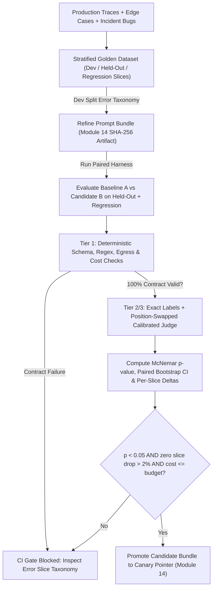
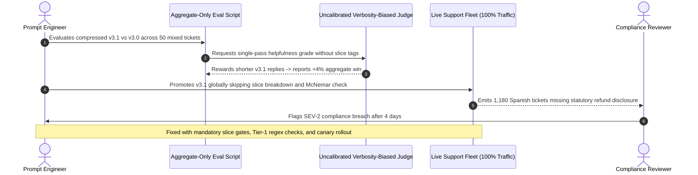

# Module 15: Prompt Evaluation and Iteration

> **Prerequisites:** [Module 05: Self-Consistency and Voting](../05-self-consistency-and-voting/README.md), [Module 08: Structured Output Prompting](../08-structured-output-prompting/README.md), and [Module 14: Prompt Versioning and Management](../14-prompt-versioning-and-management/README.md)  
> **Estimated Reading Time:** 32 minutes  
> **Target Audience:** AI Backend Engineers, MLOps / LLMOps Engineers, Release & QA Leads

> [!TIP]
> **The Golden Rule of Prompt Evaluation & Iteration**  
> Never promote a prompt edit based on **"eyeball vibes"** across five cherry-picked samples or a single unsegmented average accuracy number. Disciplined prompt iteration treats every change like a **controlled software release**: stratify a versioned golden dataset, isolate a **frozen held-out gate** from your dev-iteration split to prevent prompt overfitting, layer cheap deterministic code graders ahead of calibrated LLM-as-a-Judge rubrics, and block CI promotion unless **paired statistical significance** (McNemar's test / paired bootstrap) and **per-slice regression ceilings** pass simultaneously.

---

## Why This Matters

Most teams begin prompt iteration with ad-hoc trial-and-error: an engineer notices a production bug, edits the system prompt in a playground, tests three examples manually, sees them pass, and ships the update. Within days, customer complaints surface on an unrelated cohort—perhaps Spanish compliance tickets lost mandatory disclaimers, or multi-currency invoices started failing integer rounding.

Why does ad-hoc tuning fail reliably? Three reasons:

1. **Prompt Overfitting & Whack-a-Mole Drift:** Tweaking prose to fix 4 visible bugs routinely breaks 10 unseen edge cases elsewhere in the input distribution.
2. **Sampling Variance Masquerading as Progress:** On a small 25-item test suite, a `+8%` jump (`18/25 -> 20/25`) sits well inside random sampling noise—not a statistically trustworthy gain.
3. **Simpson's Paradox in Aggregate Averages:** A `+5%` improvement on a dominant `80%` slice easily masks a catastrophic `-30%` collapse on a critical `10%` minority slice (compliance, adversarial inputs, or non-English locales).

---

## 1. Visual Mental Models & Evaluation Mechanics

### Dataset Partitioning & Anti-Overfitting Discipline

Just as supervised ML separates training, validation, and test splits, production prompt engineering requires three disjoint collections:

1. **Dev / Error-Analysis Split (`dev`):** The working bench where you inspect failures, cluster root causes into an error taxonomy (`missing_field`, `hallucinated_enum`, `refusal_false_positive`), and refine prompt instructions or select few-shot exemplars.
2. **Frozen Held-Out Gate (`held_out`):** Never read raw failures here to craft one-off heuristics. Evaluated strictly at release time to measure genuine out-of-sample generalization.
3. **Production Regression & Adversarial Canary Suite (`regression`):** Real anonymized incident tickets, boundary inputs, and injection payloads added permanently whenever a bug hits production so fixed regressions can never reappear.

### The Three-Tier Evaluation Funnel

Always evaluate cheaply and deterministically before paying for stochastic model grading:

- **Tier 1: Deterministic Code & Contract Assertions (`<1 ms`, \$0):** JSON Schema validation, enum membership, arithmetic invariants (`sum(items) == total`), regex patterns, forbidden-host egress checks, latency/token ceilings. If Tier 1 fails, mark the case failed immediately without calling an LLM judge.
- **Tier 2: Reference & Grounding Metrics:** Exact-match labels, Macro-F1, normalized edit distance, SQL AST equivalence, or deterministic citation-substring verification against retrieved source chunks.
- **Tier 3: Calibrated LLM-as-a-Judge:** Reserved strictly for open-ended qualities (tone, completeness, semantic equivalence) where deterministic code cannot judge correctness. Because LLM judges suffer from **position bias** (favoring whichever candidate appears first in pairwise comparison), **verbosity bias** (rewarding longer prose), and **self-enhancement bias**, production judges must pass two calibration gates before gating CI:
  1. **Inter-Rater Agreement vs. Human SME Golden Labels (Cohen's $\kappa$):**
     $$\kappa = \frac{p_o - p_e}{1 - p_e}$$
     where $p_o$ is observed agreement and $p_e$ is chance agreement. Target $\kappa \ge 0.75$ before trusting automated judge verdicts.
  2. **Position-Swap Consistency:** Evaluate every pairwise comparison twice—once as `(A, B)` and once as `(B, A)`—and count ties or flag inconsistent flips rather than trusting single-order wins.

### Statistical Rigor: Paired Evaluation & Sample Sizing

Why do naive accuracy comparisons deceive engineers? Under binomial sampling of $n$ test cases, the standard error of pass rate $\hat{p}$ is $\text{SE} \approx \sqrt{\hat{p}(1-\hat{p})/n}$. At $n = 20$ and $\hat{p} = 0.80$, $\text{SE} \approx 8.9\%$, meaning a $95\%$ confidence interval spans roughly $\pm 17.5\%$!

Because Baseline Prompt A and Candidate Prompt B execute on the **exact same $n$ test cases**, evaluate them as **paired outcomes** rather than independent averages:

1. **McNemar's Paired Test (Binary Pass/Fail):** Build the $2 \times 2$ discordant table:
   - $n_{01}$: cases where **Baseline A failed** and **Candidate B passed** (net wins).
   - $n_{10}$: cases where **Baseline A passed** and **Candidate B failed** (regressions).
   With continuity correction, the McNemar test statistic is:
   $$\chi^2 = \frac{(|n_{01} - n_{10}| - 1)^2}{n_{01} + n_{10}}$$
   At $\alpha = 0.05$ ($df = 1$), $\chi^2 > 3.841$ signals significance; when discordant count $n_{01} + n_{10} < 25$, compute the exact two-sided binomial $p$-value directly:
   $$p_{\text{exact}} = 2 \sum_{i=0}^{\min(n_{01}, n_{10})} \binom{n_{01} + n_{10}}{i} (0.5)^{n_{01} + n_{10}}$$
2. **Paired Bootstrap Confidence Interval (Any Continuous Metric):** Resample $B = 2{,}000+$ paired index vectors with replacement, compute $\Delta_b = \frac{1}{n}\sum_i (M_{B,i} - M_{A,i})$, and require the $95\%$ interval $[\Delta_{2.5\%}, \Delta_{97.5\%}]$ to clear zero (or your minimum operational threshold $\delta_{\min}$).

### End-to-End Prompt Iteration & CI Regression Gate Architecture



---

## 2. Systematic Reference & Comparison Matrix

| Evaluation Method | Speed & Cost | Reproducibility | Primary Blind Spots / Biases | Minimum Useful Sample Size | Recommended Production Role |
| :--- | :--- | :--- | :--- | :--- | :--- |
| **Ad-Hoc Eyeball Check** (*3–5 prompts*) | Instant; \$0 | **Zero** (subjective, non-versioned) | Confirmation bias, catastrophic hidden regressions | Not statistically valid | Initial scratchpad exploration only; never ship on it |
| **Tier-1 Deterministic Code Assertions** | `<1 ms`; \$0 | **100%** deterministic | Cannot grade open-ended prose nuance or style | $n \ge 30$ per slice | Non-negotiable CI gate on JSON, types, egress, latency, cost |
| **Pointwise Rubric LLM-as-a-Judge** | `50–300 ms`/item; low judge cost | Moderate (`temp=0`, pinned model) | Verbosity bias, leniency drift across model updates | $n \ge 50$ + $\ge 30$ human audit | Scalable quality tracking after calibrating Cohen's $\kappa \ge 0.75$ |
| **Pairwise Position-Swapped Judge** | $2\times$ judge cost per comparison | High when A/B swapped | Position bias if unswapped; tie-breaking ambiguity | $n \ge 50$ pairs | Head-to-head A/B prompt ranking on nuanced prose outputs |
| **Paired McNemar + Slice Gate** | Computed locally in `<5 ms` | **100%** mathematical | Requires disjoint held-out cases & meaningful slices | $n \ge 50$–$100+$ paired items | Final CI release gate preventing Simpson's paradox & noise ships |

---

## 3. Production War Story Post-Mortem: "+4% Aggregate Improvement" Silences Spanish Compliance Disclosures

| Field | Incident Details |
| :--- | :--- |
| **Severity** | **SEV-2** (Missing Regulatory Disclosures on Non-English Support Replies) |
| **Detection / Resolution Time** | Detected 4 days post-deploy via quarterly compliance sampling / Resolved in 35 minutes |
| **Impact** | `1,180` Spanish-language billing responses shipped without mandatory statutory notices; \$27,800 SLA & audit remediation cost |

### What Happened

To reduce token costs by 35%, an engineer condensed a verbose customer-support system prompt (`v3.0`) into a crisp prompt (`v3.1`). An internal eval script ran `v3.0` vs `v3.1` across a `50`-ticket test set using an uncalibrated single-pass LLM judge grading *"helpfulness and conciseness."* The aggregate pass rate ticked upward from `84%` to `88%` (`+4%`), and token spend fell by `36%`. Celebrated as an easy win, `v3.1` rolled out to `100%` of production traffic.

Four days later, a compliance audit discovered that Spanish refund replies had stopped including the mandatory statutory cancellation notice. Post-incident slicing revealed what the aggregate average hid: `40` of the `50` eval tickets were English billing inquiries (`85% -> 95%`, $+10\%$ gain), while the `10` Spanish compliance tickets collapsed from `80%` to `50%` (`-30%` drop, with `3` critical regressions) because the shortened prompt dropped explicit multilingual footer instructions. Worse, the uncalibrated LLM judge penalized the longer `v3.0` statutory footer as "verbose."



### Root Cause Analysis

1. **Aggregate Averaging Without Error Slicing (Simpson's Paradox):** An `80%`-weight English majority masked a `-30%` compliance collapse on the `20%` Spanish cohort.
2. **Missing Tier-1 Deterministic Compliance Assertion:** Checking for a mandatory statutory footer is deterministic (`substring` / `regex`), not something an LLM judge should evaluate probabilistically.
3. **Uncalibrated Verbosity-Biased Judge:** Rewarding shorter text caused the judge to actively penalize compliant baseline answers.

### The Fix & Architectural Hardening

- Added mandatory **stratified slice reporting** (`en_billing`, `es_compliance`, `adversarial`) blocking CI whenever *any* compliance slice drops more than `0%` (or general slices `> 2%`).
- Moved mandatory regulatory footers into **Tier-1 deterministic regex assertions** ahead of any semantic LLM judge.
- Enforced **Cohen's $\kappa \ge 0.75$ calibration** against human compliance reviewers and paired McNemar testing before promoting bundles via [Module 14's](../14-prompt-versioning-and-management/README.md) canary pointer.

---

## 4. Multi-Language Production Implementation: Paired McNemar, Bootstrap & Slice Regression CI Gate

The four modules below implement a deterministic **CI Prompt Release Gate** supporting paired McNemar significance testing (continuity-corrected $\chi^2$ and exact two-sided binomial $p$-value), slice-level regression ceilings (preventing Simpson's paradox), and Tier-1 contract compliance assertions.

````carousel

```go
package prompteval

import (
	"fmt"
	"math"
)

type EvalRecord struct {
	Slice        string
	BaselinePass bool
	CandidatePass bool
	SchemaValid  bool
	TokensUsed   int
}

type GateReport struct {
	Approved          bool
	BaselineAcc       float64
	CandidateAcc      float64
	N01Wins           int
	N10Regressions    int
	ExactPValue       float64
	FailedSlices      []string
	Reason            string
}

func binomialCoeff(n, k int) float64 {
	if k < 0 || k > n {
		return 0
	}
	if k > n-k {
		k = n - k
	}
	res := 1.0
	for i := 0; i < k; i++ {
		res = res * float64(n-i) / float64(i+1)
	}
	return res
}

// EvaluateReleaseGate runs paired exact McNemar + per-slice regression checks for CI promotion.
func EvaluateReleaseGate(records []EvalRecord, maxSliceDrop float64, maxMeanTokens float64) GateReport {
	if len(records) == 0 {
		return GateReport{Approved: false, Reason: "empty evaluation dataset"}
	}
	n := len(records)
	basePass, candPass, n01, n10, totalTokens := 0, 0, 0, 0, 0
	sliceStats := make(map[string][3]int) // [count, basePass, candPass]

	for _, r := range records {
		totalTokens += r.TokensUsed
		if !r.SchemaValid {
			return GateReport{Approved: false, Reason: fmt.Sprintf("schema contract failed in slice %q", r.Slice)}
		}
		st := sliceStats[r.Slice]
		st[0]++
		if r.BaselinePass {
			basePass++
			st[1]++
		}
		if r.CandidatePass {
			candPass++
			st[2]++
		}
		sliceStats[r.Slice] = st

		if !r.BaselinePass && r.CandidatePass {
			n01++
		} else if r.BaselinePass && !r.CandidatePass {
			n10++
		}
	}

	var failedSlices []string
	for sl, st := range sliceStats {
		bRate := float64(st[1]) / float64(st[0])
		cRate := float64(st[2]) / float64(st[0])
		if cRate-bRate < -maxSliceDrop {
			failedSlices = append(failedSlices, fmt.Sprintf("%s(%.1f%%->%.1f%%)", sl, bRate*100, cRate*100))
		}
	}

	disc := n01 + n10
	pExact := 1.0
	if disc > 0 {
		k := n01
		if n10 < k {
			k = n10
		}
		sum := 0.0
		pow := math.Pow(0.5, float64(disc))
		for i := 0; i <= k; i++ {
			sum += binomialCoeff(disc, i) * pow
		}
		pExact = math.Min(1.0, 2.0*sum)
	}

	meanTokens := float64(totalTokens) / float64(n)
	bAcc := float64(basePass) / float64(n)
	cAcc := float64(candPass) / float64(n)
	approved := len(failedSlices) == 0 && meanTokens <= maxMeanTokens && cAcc > bAcc && pExact < 0.05

	reason := "APPROVED"
	if !approved {
		reason = fmt.Sprintf("BLOCKED: failedSlices=%v pExact=%.4f meanTokens=%.1f", failedSlices, pExact, meanTokens)
	}
	return GateReport{
		Approved: approved, BaselineAcc: bAcc, CandidateAcc: cAcc,
		N01Wins: n01, N10Regressions: n10, ExactPValue: pExact,
		FailedSlices: failedSlices, Reason: reason,
	}
}
```

<!-- slide -->

```typescript
export interface EvalRecord {
  readonly slice: string;
  readonly baselinePass: boolean;
  readonly candidatePass: boolean;
  readonly schemaValid: boolean;
  readonly tokensUsed: number;
}

export interface GateReport {
  readonly approved: boolean;
  readonly baselineAcc: number;
  readonly candidateAcc: number;
  readonly n01Wins: number;
  readonly n10Regressions: number;
  readonly exactPValue: number;
  readonly failedSlices: readonly string[];
  readonly reason: string;
}

function nChooseK(n: number, k: number): number {
  if (k < 0 || k > n) return 0;
  let res = 1;
  for (let i = 0; i < Math.min(k, n - k); i++) {
    res = (res * (n - i)) / (i + 1);
  }
  return res;
}

export function evaluateReleaseGate(
  records: readonly EvalRecord[],
  maxSliceDrop = 0.02,
  maxMeanTokens = 1200
): GateReport {
  if (records.length === 0) {
    return { approved: false, baselineAcc: 0, candidateAcc: 0, n01Wins: 0, n10Regressions: 0, exactPValue: 1, failedSlices: [], reason: "empty dataset" };
  }

  let basePass = 0, candPass = 0, n01 = 0, n10 = 0, totalTokens = 0;
  const sliceMap = new Map<string, { n: number; base: number; cand: number }>();

  for (const r of records) {
    if (!r.schemaValid) {
      return { approved: false, baselineAcc: 0, candidateAcc: 0, n01Wins: 0, n10Regressions: 0, exactPValue: 1, failedSlices: [r.slice], reason: `schema contract failed in slice '${r.slice}'` };
    }
    totalTokens += r.tokensUsed;
    if (r.baselinePass) basePass++;
    if (r.candidatePass) candPass++;
    if (!r.baselinePass && r.candidatePass) n01++;
    if (r.baselinePass && !r.candidatePass) n10++;

    const st = sliceMap.get(r.slice) ?? { n: 0, base: 0, cand: 0 };
    st.n++;
    if (r.baselinePass) st.base++;
    if (r.candidatePass) st.cand++;
    sliceMap.set(r.slice, st);
  }

  const failedSlices: string[] = [];
  for (const [slice, st] of sliceMap) {
    const delta = st.cand / st.n - st.base / st.n;
    if (delta < -maxSliceDrop) {
      failedSlices.push(`${slice}(${(delta * 100).toFixed(1)}%)`);
    }
  }

  const disc = n01 + n10;
  let exactPValue = 1.0;
  if (disc > 0) {
    const k = Math.min(n01, n10);
    let tail = 0;
    for (let i = 0; i <= k; i++) {
      tail += nChooseK(disc, i) * Math.pow(0.5, disc);
    }
    exactPValue = Math.min(1.0, 2.0 * tail);
  }

  const baselineAcc = basePass / records.length;
  const candidateAcc = candPass / records.length;
  const meanTokens = totalTokens / records.length;
  const approved =
    failedSlices.length === 0 &&
    meanTokens <= maxMeanTokens &&
    candidateAcc > baselineAcc &&
    exactPValue < 0.05;

  return {
    approved,
    baselineAcc,
    candidateAcc,
    n01Wins: n01,
    n10Regressions: n10,
    exactPValue,
    failedSlices,
    reason: approved ? "APPROVED" : `BLOCKED (p=${exactPValue.toFixed(4)}, failedSlices=[${failedSlices.join(", ")}])`,
  };
}
```

<!-- slide -->

```python
"""CI Prompt Release Gate: Tier-1 contracts, slice guards, and exact McNemar statistics."""

import math
from collections import defaultdict
from dataclasses import dataclass


@dataclass(frozen=True)
class EvalRecord:
    slice_name: str
    baseline_pass: bool
    candidate_pass: bool
    schema_valid: bool
    tokens_used: int


@dataclass(frozen=True)
class GateReport:
    approved: bool
    baseline_acc: float
    candidate_acc: float
    n01_wins: int
    n10_regressions: int
    exact_p_value: float
    failed_slices: list[str]
    reason: str


def evaluate_release_gate(
    records: list[EvalRecord],
    max_slice_drop: float = 0.02,
    max_mean_tokens: float = 1200.0,
) -> GateReport:
    if not records:
        return GateReport(False, 0.0, 0.0, 0, 0, 1.0, [], "empty dataset")

    for rec in records:
        if not rec.schema_valid:
            return GateReport(
                False, 0.0, 0.0, 0, 0, 1.0, [rec.slice_name],
                f"BLOCKED: Tier-1 schema contract failure in slice '{rec.slice_name}'",
            )

    by_slice: dict[str, list[EvalRecord]] = defaultdict(list)
    for rec in records:
        by_slice[rec.slice_name].append(rec)

    failed_slices = []
    for sl, items in sorted(by_slice.items()):
        b_rate = sum(r.baseline_pass for r in items) / len(items)
        c_rate = sum(r.candidate_pass for r in items) / len(items)
        if (c_rate - b_rate) < -max_slice_drop:
            failed_slices.append(f"{sl}({(c_rate - b_rate):+.1%})")

    n01 = sum(not r.baseline_pass and r.candidate_pass for r in records)
    n10 = sum(r.baseline_pass and not r.candidate_pass for r in records)
    disc = n01 + n10
    p_exact = 1.0
    if disc > 0:
        k = min(n01, n10)
        p_exact = min(1.0, 2.0 * sum(math.comb(disc, i) * (0.5 ** disc) for i in range(k + 1)))

    b_acc = sum(r.baseline_pass for r in records) / len(records)
    c_acc = sum(r.candidate_pass for r in records) / len(records)
    mean_tokens = sum(r.tokens_used for r in records) / len(records)

    approved = (
        not failed_slices
        and mean_tokens <= max_mean_tokens
        and c_acc > b_acc
        and p_exact < 0.05
    )
    reason = "APPROVED" if approved else f"BLOCKED: p={p_exact:.4f}, failed_slices={failed_slices}, mean_tok={mean_tokens:.1f}"
    return GateReport(approved, b_acc, c_acc, n01, n10, p_exact, failed_slices, reason)
```

<!-- slide -->

```csharp
using System;
using System.Collections.Generic;
using System.Linq;

namespace GenAI.Evaluation;

public sealed record EvalRecord(
    string SliceName,
    bool BaselinePass,
    bool CandidatePass,
    bool SchemaValid,
    int TokensUsed);

public sealed record GateReport(
    bool Approved,
    double BaselineAcc,
    double CandidateAcc,
    int N01Wins,
    int N10Regressions,
    double ExactPValue,
    IReadOnlyList<string> FailedSlices,
    string Reason);

public static class PromptReleaseGate
{
    private static double BinomialCoeff(int n, int k)
    {
        if (k < 0 || k > n) return 0.0;
        k = Math.Min(k, n - k);
        double res = 1.0;
        for (int i = 0; i < k; i++)
            res = res * (n - i) / (i + 1);
        return res;
    }

    public static GateReport Evaluate(
        IReadOnlyList<EvalRecord> records,
        double maxSliceDrop = 0.02,
        double maxMeanTokens = 1200.0)
    {
        if (records.Count == 0)
            return new GateReport(false, 0, 0, 0, 0, 1.0, Array.Empty<string>(), "empty dataset");

        var invalid = records.FirstOrDefault(r => !r.SchemaValid);
        if (invalid is not null)
            return new GateReport(false, 0, 0, 0, 0, 1.0, new[] { invalid.SliceName }, $"schema failed in '{invalid.SliceName}'");

        var failedSlices = new List<string>();
        foreach (var group in records.GroupBy(r => r.SliceName))
        {
            double bRate = group.Average(r => r.BaselinePass ? 1.0 : 0.0);
            double cRate = group.Average(r => r.CandidatePass ? 1.0 : 0.0);
            if (cRate - bRate < -maxSliceDrop)
                failedSlices.Add($"{group.Key}({(cRate - bRate) * 100:+0.0;-0.0}%)");
        }

        int n01 = records.Count(r => !r.BaselinePass && r.CandidatePass);
        int n10 = records.Count(r => r.BaselinePass && !r.CandidatePass);
        int disc = n01 + n10;
        double pExact = 1.0;
        if (disc > 0)
        {
            int k = Math.Min(n01, n10);
            double tail = 0.0;
            double pow = Math.Pow(0.5, disc);
            for (int i = 0; i <= k; i++)
                tail += BinomialCoeff(disc, i) * pow;
            pExact = Math.Min(1.0, 2.0 * tail);
        }

        double bAcc = records.Average(r => r.BaselinePass ? 1.0 : 0.0);
        double cAcc = records.Average(r => r.CandidatePass ? 1.0 : 0.0);
        double meanTok = records.Average(r => (double)r.TokensUsed);

        bool approved = failedSlices.Count == 0 && meanTok <= maxMeanTokens && cAcc > bAcc && pExact < 0.05;
        string reason = approved ? "APPROVED" : $"BLOCKED: p={pExact:F4}, failedSlices=[{string.Join(", ", failedSlices)}]";
        return new GateReport(approved, bAcc, cAcc, n01, n10, pExact, failedSlices, reason);
    }
}
```

````

---

## 5. Practical Hands-On CLI Verification Workflows

All three workflows below execute completely offline in standard Python 3.13 with zero API keys required.

### Workflow 1: Paired McNemar's Test & Bootstrap Confidence Intervals (`n=30` Noise vs. `n=100` Significance)

Observe why a `+6.7%` jump across `n=30` cases remains inconclusive ($p = 0.6250$, bootstrap CI spanning zero), whereas a properly powered `n=100` paired suite cleanly proves statistical significance:

```bash
python -c "
import math, random

def mcnemar_test(baseline, candidate):
    n01 = sum(not b and c for b, c in zip(baseline, candidate))
    n10 = sum(b and not c for b, c in zip(baseline, candidate))
    n_disc = n01 + n10
    chi2 = ((abs(n01 - n10) - 1) ** 2) / n_disc if n_disc > 0 else 0.0
    k = min(n01, n10)
    p_exact = sum(math.comb(n_disc, i) * (0.5 ** n_disc) for i in range(k + 1)) * 2.0
    p_exact = min(1.0, p_exact)
    return n01, n10, chi2, p_exact

def paired_bootstrap_ci(baseline, candidate, n_boot=2000, seed=42):
    rng = random.Random(seed)
    n = len(baseline)
    diffs = []
    for _ in range(n_boot):
        idx = [rng.randrange(n) for _ in range(n)]
        diff = sum(int(candidate[i]) - int(baseline[i]) for i in idx) / n
        diffs.append(diff)
    diffs.sort()
    return diffs[int(0.025 * n_boot)], diffs[int(0.975 * n_boot)]

a_small = [True]*24 + [False]*6
b_small = [True]*23 + [False]*1 + [True]*3 + [False]*3
n01, n10, chi2, p = mcnemar_test(a_small, b_small)
lo, hi = paired_bootstrap_ci(a_small, b_small)
print(f'Small n=30  | acc: {sum(a_small)/30:.1%} -> {sum(b_small)/30:.1%} | n01={n01}, n10={n10} | p_exact={p:.4f} | 95% CI=[{lo:+.1%}, {hi:+.1%}]')

a_lg = [True]*72 + [False]*28
b_lg = [True]*70 + [False]*2 + [True]*14 + [False]*14
n01, n10, chi2, p = mcnemar_test(a_lg, b_lg)
lo, hi = paired_bootstrap_ci(a_lg, b_lg)
print(f'Large n=100 | acc: {sum(a_lg)/100:.1%} -> {sum(b_lg)/100:.1%} | n01={n01}, n10={n10} | chi2={chi2:.2f}, p_exact={p:.4f} | 95% CI=[{lo:+.1%}, {hi:+.1%}]')
"
```

**Expected Output:**

```text
Small n=30  | acc: 80.0% -> 86.7% | n01=3, n10=1 | p_exact=0.6250 | 95% CI=[-6.7%, +20.0%]
Large n=100 | acc: 72.0% -> 84.0% | n01=14, n10=2 | chi2=7.56, p_exact=0.0042 | 95% CI=[+5.0%, +20.0%]
```

### Workflow 2: Catching Simpson's Paradox via Per-Slice Regression CI Gates

Reproduce the war story above: watch a `+2.0%` aggregate improvement hide a `-30.0%` minority-slice regression—and verify that the slice-aware CI gate blocks release cleanly:

```bash
python -c "
from collections import defaultdict

records = (
    [('en_billing', True, True)] * 34 +
    [('en_billing', False, True)] * 4 +
    [('en_billing', False, False)] * 2 +
    [('es_compliance', True, True)] * 5 +
    [('es_compliance', True, False)] * 3 +
    [('es_compliance', False, False)] * 2
)

by_slice = defaultdict(list)
for sl, base_ok, cand_ok in records:
    by_slice[sl].append((base_ok, cand_ok))

agg_base = sum(b for _, b, _ in records) / len(records)
agg_cand = sum(c for _, _, c in records) / len(records)
print(f'Aggregate Pass Rate: {agg_base:.1%} -> {agg_cand:.1%} (delta={agg_cand - agg_base:+.1%})')

gate_failed = False
for sl, pairs in sorted(by_slice.items()):
    b_rate = sum(b for b, _ in pairs) / len(pairs)
    c_rate = sum(c for _, c in pairs) / len(pairs)
    delta = c_rate - b_rate
    status = 'FAIL_REGRESSION' if delta < -0.02 else 'PASS'
    if status != 'PASS':
        gate_failed = True
    print(f'  Slice {sl:14s} (n={len(pairs):2d}): {b_rate:.1%} -> {c_rate:.1%} ({delta:+.1%}) [{status}]')

decision = 'BLOCKED' if gate_failed else 'APPROVED'
print(f'CI Release Gate Decision: {decision}')
"
```

**Expected Output:**

```text
Aggregate Pass Rate: 84.0% -> 86.0% (delta=+2.0%)
  Slice en_billing     (n=40): 85.0% -> 95.0% (+10.0%) [PASS]
  Slice es_compliance  (n=10): 80.0% -> 50.0% (-30.0%) [FAIL_REGRESSION]
CI Release Gate Decision: BLOCKED
```

### Workflow 3: Auditing LLM-as-a-Judge Calibration (Cohen's $\kappa$) & Position-Swap Bias

Measure judge agreement against 20 human SME labels and check how often swapping `(A, B)` to `(B, A)` flips a pairwise winner:

```bash
python -c "
human_gold = [1, 1, 1, 1, 1, 0, 0, 0, 0, 0, 1, 0, 1, 0, 1, 0, 1, 1, 0, 0]
llm_judge  = [1, 1, 1, 0, 1, 0, 0, 1, 0, 0, 1, 0, 1, 0, 1, 0, 1, 1, 0, 0]

n = len(human_gold)
po = sum(h == j for h, j in zip(human_gold, llm_judge)) / n
p_h1 = sum(human_gold) / n
p_j1 = sum(llm_judge) / n
pe = (p_h1 * p_j1) + ((1 - p_h1) * (1 - p_j1))
kappa = (po - pe) / (1.0 - pe)

fwd_winner     = ['A', 'A', 'B', 'A', 'B', 'A', 'A', 'B', 'A', 'B']
swapped_winner = ['A', 'B', 'B', 'A', 'A', 'A', 'B', 'B', 'A', 'B']
consistent = sum(f == s for f, s in zip(fwd_winner, swapped_winner)) / len(fwd_winner)

print(f'Judge vs Human Agreement (po) : {po:.2%} | Chance (pe) : {pe:.2%}')
print(f'Cohens Kappa                  : {kappa:.3f} (meets >=0.75 threshold: {kappa >= 0.75})')
print(f'Position-Swap Consistency     : {consistent:.1%} ({len(fwd_winner) - int(consistent*len(fwd_winner))} position flips)')
"
```

**Expected Output:**

```text
Judge vs Human Agreement (po) : 90.00% | Chance (pe) : 50.00%
Cohens Kappa                  : 0.800 (meets >=0.75 threshold: True)
Position-Swap Consistency     : 70.0% (3 position flips)
```

---

## 6. Hands-On Exercises & Independent Challenge

### Practical Exercises

1. **Detecting Overfitting via Dev vs. Held-Out Divergence:** Write a Python script simulating `dev_acc` climbing from `78% -> 94%` over 6 prompt revisions while `held_out_acc` peaks at `86%` on Revision 3 and falls back to `81%` on Revision 6 after adding narrow regex-like prompt rules. Plot or print the generalization gap (`dev - held_out`).
2. **Enforce Zero-Regression Tolerance on Critical Slices:** Modify `evaluate_release_gate` so high-risk slices (`"es_compliance"`, `"security_injection"`) enforce `max_slice_drop = 0.0` while general slices tolerate `0.02`. Test with `1` regression in `"security_injection"` to verify immediate blocking.
3. **Add Cost-Adjusted Utility to Paired Bootstrap:** Extend `paired_bootstrap_ci` in Workflow 1 to score each item as `pass_flag - 0.0001 * tokens_used`, demonstrating how a prompt scoring `+2%` accuracy at `3x` token cost can actually lose on net production utility.

### Independent Challenge

Your team maintains an enterprise **Legal Contract Clause Extractor** extracting 12 structured fields from vendor MSAs. Currently, you have 35 labeled sample contracts, a `v1.0` prompt scoring `77%` exact-match field accuracy, and a `v2.0` prompt scoring `83%` (`2` extra fields passed) using a single LLM judge that agrees with lawyers `68%` of the time ($\kappa = 0.42$). Your manager asks to ship `v2.0` to production this afternoon.

Explain why `v2.0` is **not** ready to ship and design a rigorous 4-step evaluation plan before release.

<details><summary>Architectural Discussion</summary>

1. **Underpowered Sample & Unreliable Judge:** On $n = 35$, `77% -> 83%` represents only 2 extra passes ($p \gg 0.05$ under McNemar). Worse, a judge with $\kappa = 0.42$ exhibits only weak/moderate agreement with attorneys, meaning `2%–6%` swings can easily be judge noise rather than true extraction accuracy.
2. **Tier-1 Deterministic Checks First:** Move JSON Schema validity, date ISO-8601 parsing, governing-law enum checks, and exact substring grounding (asserting extracted monetary caps appear verbatim in the MSA text) out of the LLM judge into deterministic code assertions.
3. **Dataset Expansion & Disjoint Split:** Label at least `80–120` stratified contracts partitioned into `dev` (for error taxonomy) and a frozen `held_out` split stratified across clause types (`indemnification`, `limitation_of_liability`, `auto_renewal`).
4. **Statistical Gate:** Calibrate any remaining semantic judge to $\kappa \ge 0.75$ on an SME audit sample, then require $p < 0.05$ via McNemar's test (or positive 95% paired bootstrap CI) plus zero severe clause-slice regressions before promoting `v2.0` as a canary.

</details>

---

## 7. Common Mistakes & Troubleshooting

- **Iterating directly on your final test set:** Inspecting failures on your evaluation set and adding explicit counter-examples for those exact strings into the prompt turns your eval into a training set—inflating scores while failing unseen production queries. Keep `held_out` strictly frozen and opaque during iteration.
- **Ignoring sampling variance at `temperature > 0`:** Running a single trial at `temperature = 0.7` conflates prompt quality with decoding luck. Pin `temperature = 0.0` (and `seed`) for deterministic extraction evals, or average `pass@k` / multiple trials for creative tasks.
- **Using an LLM-as-a-Judge for tasks Python can check deterministically:** Never ask an LLM *"Is this valid JSON?"* or *"Does this mention the required disclaimer?"*. Deterministic code assertions run in `<1 ms` with zero drift and \$0 token cost.
- **Comparing aggregate means without paired discordant counts:** Two prompts scoring `80%` and `86%` on `30` examples look impressive until McNemar reveals `n01 = 3, n10 = 1` ($p = 0.625$). Always track paired wins vs. regressions (`n01` vs. `n10`).

---

## 8. Operational Validation Checkpoints & Checkpoint Quiz

### Operational Validation Checkpoints

<details><summary><strong>Checkpoint 1: Avoiding statistical illusions on small eval sets</strong></summary>

On `25` test inputs, Prompt A passes `19` (`76%`) and Prompt B passes `21` (`84%`), with $n_{01} = 3$ wins and $n_{10} = 1$ regression. Should CI automatically declare Prompt B statistically superior?

**Validation:** No. With $n_{01} + n_{10} = 4$ discordant pairs, the two-sided exact binomial McNemar $p$-value is $2 \cdot ( \binom{4}{0} + \binom{4}{1} ) / 2^4 = 10/16 = 0.625$. The observed `+8%` shift is statistically indistinguishable from chance; you need a larger stratified dataset (or more discordant wins with near-zero regressions) before promoting with statistical confidence.

</details>

<details><summary><strong>Checkpoint 2: Stopping Simpson's paradox across production slices</strong></summary>

A candidate prompt boosts overall accuracy from `84%` to `86%` across `50` cases, yet breaks `3` out of `10` cases in a critical compliance slice. Why did an aggregate-only CI gate miss it, and how do you fix the pipeline?

**Validation:** Because aggregate averaging weights slices by sample count (`40` majority cases vs. `10` minority cases), a `+10%` gain on the majority slice easily swamps a `-30%` collapse on the minority slice. Enforcing mandatory per-slice regression thresholds (e.g., `delta >= -2%` on general slices, `0%` tolerance on compliance/security slices) stops Simpson's paradox before deployment.

</details>

<details><summary><strong>Checkpoint 3: Calibrating LLM-as-a-Judge reliability</strong></summary>

Your pairwise LLM judge chooses Candidate B over Candidate A `65%` of the time when formatted as `(A, B)`, but flips its preference on `30%` of pairs when swapped to `(B, A)`, and scores Cohen's $\kappa = 0.48$ against human reviewers. What must change before putting this judge in CI?

**Validation:** Do not trust an uncalibrated judge with $\kappa < 0.75$ and `30%` position inconsistency. First tighten the rubric with explicit pass/fail behavioral criteria and few-shot anchor examples until $\kappa \ge 0.75$ on a held-out SME sample; second, offload deterministic formatting/presence checks to Tier-1 code assertions; and third, mandate symmetric `(A, B)` + `(B, A)` position swapping treating inconsistent flips as ties.

</details>

### Checkpoint Quiz

1. Why must teams keep a **frozen held-out evaluation split** separate from the **dev error-analysis split**?
2. What do $n_{01}$ and $n_{10}$ measure in **McNemar's paired test**, and why is a paired test superior to comparing two independent proportions?
3. What three biases commonly distort an uncalibrated **LLM-as-a-Judge**, and what two checks quantify/mitigate them?
4. When should a prompt evaluation use **Tier-1 deterministic code assertions** instead of an LLM judge?
5. What is **Simpson's paradox** in prompt evaluation, and what CI check prevents it?

<details><summary>Answers</summary>

1. Continuously inspecting held-out failures and tailoring prompt wording around those exact examples leaks test knowledge into the prompt (**prompt overfitting**), inflating eval metrics while hiding fragility on unseen live inputs.
2. $n_{01}$ counts items where Baseline A failed and Candidate B passed (wins), while $n_{10}$ counts items where Baseline A passed and Candidate B failed (regressions). Because both prompts evaluate identical inputs, pairing cancels item-difficulty variance and isolates true directional improvements vs. regressions.
3. **Position bias**, **verbosity bias**, and **self-enhancement bias**. Quantify alignment against human SME labels via **Cohen's $\kappa \ge 0.75$** and run symmetric `(A, B)` / `(B, A)` **position-swap consistency audits**.
4. Whenever an invariant is programmatically checkable—such as JSON Schema compliance, enum typing, numeric totals, mandatory legal substrings, regex patterns, tool argument allow-lists, or latency/token budgets.
5. An aggregate average appearing positive while a smaller sub-cohort suffers severe degradation; prevented by computing **stratified per-slice deltas** and gating CI on minimum slice-level tolerances.

</details>

---

## Further Reading & Sources

- [OpenAI Platform Docs: Evaluation Best Practices](https://platform.openai.com/docs/guides/evaluation-best-practices) - structured methodology for defining metrics, building golden evals, and iterating prompts systematically.
- [OpenAI Platform Docs: Working with Evals](https://platform.openai.com/docs/guides/working-with-evals) - programmatic eval runner patterns combining deterministic assertions and model graders.
- [Promptfoo Docs: Assertions & Expected Outputs](https://www.promptfoo.dev/docs/configuration/expected-outputs/) - declarative CI assertion taxonomy spanning JSON validation, regex, semantic similarity, and LLM rubrics.
- [Anthropic Docs: Prompting Best Practices](https://docs.anthropic.com/en/docs/build-with-claude/prompt-engineering/claude-prompting-best-practices) - practical test-driven prompt refinement and structured rubric construction.
- [Module 14: Prompt Versioning and Management](../14-prompt-versioning-and-management/README.md) - publishing CI-approved prompt bundles as immutable SHA-256 artifacts with canary traffic pointers.

## Next

[Module 16: Capstone Project](../16-capstone-project/README.md)
