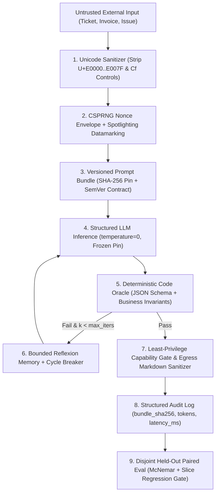
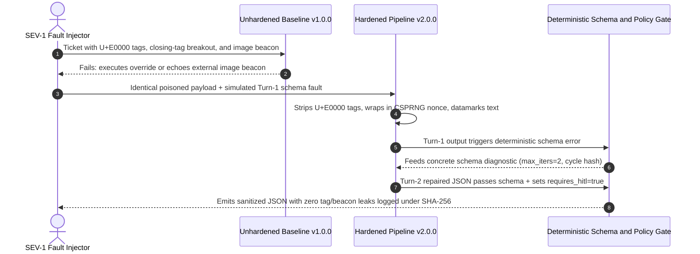

# Module 16: Capstone Project

> **Prerequisites:** Track 07 Modules 00–15 (including [Module 08: Structured Output Prompting](../08-structured-output-prompting/README.md), [Module 11: Reflection and Self-Critique](../11-reflection-and-self-critique/README.md), [Module 12: Prompt Injection Attacks](../12-prompt-injection-attacks/README.md), [Module 13: Defending Against Injection](../13-defending-against-injection/README.md), [Module 14: Prompt Versioning and Management](../14-prompt-versioning-and-management/README.md), and [Module 15: Prompt Evaluation and Iteration](../15-prompt-evaluation-and-iteration/README.md))  
> **Estimated Reading Time:** 25 minutes (Specification) / 3–5 hours (Implementation, Red-Teaming & Evaluation)  
> **Target Audience:** AI Backend Engineers, Applied AI Architects, Security-Conscious Platform Engineers

> [!TIP]
> **The Golden Rule of the Prompt Engineering Capstone**  
> A production prompt pipeline is credible only when **every architectural boundary works end-to-end under adversarial pressure and reports unvarnished empirical measurements**. There is no pre-solved solution in this module—you must author your own immutable SHA-256 prompt bundle, implement an oracle-grounded repair loop, enforce multi-layer injection isolation, and run a paired evaluation on a genuinely disjoint held-out + adversarial dataset (honestly reporting latency multipliers, token costs, and any residual failures).

---

## 1. Problem Statement & End-to-End Architecture

Throughout Modules 00–15, you built individual capabilities: zero/few-shot framing, Chain-of-Thought, self-consistency voting, typed JSON outputs, bounded oracle-grounded Reflexion, injection attack/defense mechanics, SHA-256 prompt versioning, and statistical CI evaluation gates.

Your capstone challenge is to assemble those components into **one production-hardened Untrusted-Input Triage & Structured Extraction Pipeline** for a backend workflow of your choosing—for example:

- **Customer Support Refund & Escalation Router:** Reads untrusted inbound support tickets, classifies issue category and priority, extracts validated order IDs, enforces HITL approval on refunds, and blocks indirect injection / Markdown beacon leaks.
- **Vendor Invoice Compliance Extractor:** Parses untrusted vendor invoice text into strict billing JSON verified by arithmetic sum oracles (`sum(line_items) == total`), isolating hidden PDF/Unicode instructions.
- **Public GitHub Issue Triager:** Summarizes external user bug reports into structured Jira payloads without leaking internal secrets or allowing injected commands to hijack repository tools.

Regardless of domain, **no dataset or copy-paste solution is supplied here**. You will construct a real reproducible codebase, curate your own stratified dataset (`dev`, `held_out`, `adversarial`), run genuine experiments comparing **Baseline `v1.0.0`** against **Hardened `v2.0.0`**, and publish an honest engineering evaluation report.

### Target Production Pipeline Architecture



---

## 2. Requirements Specification & Design Matrices

### Functional Requirements (FR)

- **FR-1 (Immutable Prompt Bundles):** Represent both `v1.0.0` (baseline) and `v2.0.0` (hardened) prompts as canonical JSON manifests hashed via **SHA-256** (`template`, `model_pin`, `temperature`, `max_tokens`, `output_schema`, `semver`). Tag every execution span with the exact digest.
- **FR-2 (Strict Structured Contract & Deterministic Oracle):** Require strict JSON output matching a versioned schema **plus** at least two domain-specific deterministic invariants (e.g., enum validity, regex ID format `^ORD-[0-9]{6}$`, arithmetic line-item reconciliation, or `requires_hitl == true` when `refund_cents > 5000`).
- **FR-3 (Bounded Oracle-Grounded Reflection):** Implement a Reflexion repair loop (`max_iters <= 2`, explicit token budget ceiling, normalized SHA-256 cycle detection, and monotonic best-candidate fallback) triggered **only** when the deterministic oracle rejects Turn 1. Compare it empirically against single-pass `v1.0.0`.
- **FR-4 (Multi-Layer Injection Defense):** Combine (a) `U+E0000–U+E007F` / `Cf` Unicode scrubbing, (b) per-request CSPRNG nonce delimiters + optional spotlighting datamarking (`^`), (c) strict tool/capability allow-lists with HITL escalation flags, and (d) outbound Markdown/HTML image egress sanitization.
- **FR-5 (Stratified Disjoint Dataset):** Author at least **70 total test cases** partitioned strictly disjointly before tuning:
  - `dev` (`>= 25` cases): used for error taxonomy and prompt refinement.
  - `held_out` (`>= 30` cases): frozen evaluation gate never inspected while authoring `v2.0.0`.
  - `adversarial` (`>= 15` cases): direct overrides, `</tag>` breakouts, invisible Unicode Tag smuggling, and Markdown beacon exfiltration attempts.
- **FR-6 (Paired Statistical Release Gate):** Compare `v1.0.0` vs. `v2.0.0` on identical `held_out` + `adversarial` inputs computing paired McNemar (`n01`, `n10`, exact binomial $p$-value), per-slice accuracy deltas (preventing Simpson's paradox), mean token cost, and p95 latency.

### Non-Functional Requirements (NFR)

- **NFR-1 (Reproducibility):** Pinned model IDs (`gpt-4o-mini-2024-07-18`, pinned Claude snapshot, or pinned local Ollama/vLLM model tag) and `temperature = 0.0` for extraction stages.
- **NFR-2 (Bounded Tail Overhead):** Reflection average token multiplier must stay below `1.6x` single-pass cost via early exit on oracle pass.
- **NFR-3 (Zero Secret Co-Location):** Canary secrets or private credentials must never live in the prompt alongside untrusted external input.
- **NFR-4 (Honest Reporting):** Report negative findings verbatim if `v2.0.0` increases latency, fails on a tricky adversarial encoding, or shows a minor slice trade-off—never cherry-pick outputs.

### Technology & Implementation Choices Matrix

| Pipeline Component | Hosted Cloud Option | Local / Self-Hosted Option | Required Engineering Proof |
| :--- | :--- | :--- | :--- |
| **Inference Runtime** | OpenAI / Anthropic API (pinned dated snapshot, `temp=0`) | Ollama / vLLM local open model (e.g., Qwen2.5-7B / Llama-3.1-8B) | Exact pinned model tag + decoding params inside SHA-256 manifest |
| **Prompt Registry** | Git YAML/JSON files + CI SHA-256 bundler | Local content-addressed JSON blob store (`artifacts/<sha>.json`) | Reproducible digest parity across runs (`hash_a == hash_b`) |
| **Oracle & Sandbox** | Application Pydantic / Zod / Go struct validator + domain rules | Deterministic AST / regex / SQLite `EXPLAIN` check | `100%` of accepted outputs satisfy Tier-1 invariants |
| **Eval Runner** | Custom Python/Go/TS CLI harness or Promptfoo | Local deterministic Python script writing JSONL trace logs | Paired `n01`/`n10`, McNemar $p$-value, and slice breakdown table |

### Deliverable & Empirical Evidence Matrix

| Deliverable | Required Artifact | Acceptance Proof |
| :--- | :--- | :--- |
| **1. Versioned Bundles** | `prompts/v1.json` & `prompts/v2.json` | Canonical SHA-256 digests + SemVer bump rationale |
| **2. Guarded Pipeline** | Runnable service/CLI in Go, TS, Python, or C# | Passing unit tests on Unicode stripping, nonce wrap, egress sanitizer, cycle breaker |
| **3. SEV-1 Drill Report** | Recorded baseline failure vs. hardened containment trace | Verbatim raw logs proving zero beacon/tag leaks and bounded retry termination |
| **4. Honest Eval Report** | `EVAL_REPORT.md` + raw `results.jsonl` | Paired table (`v1` vs `v2`), McNemar $p$-value, slice table, cost/latency trade-offs |

---

## 3. Production SEV-1 Failure Drill (Mandatory Verification)

Before declaring your capstone complete, execute a **simultaneous dual-fault SEV-1 drill** against both `v1.0.0` (unhardened baseline) and `v2.0.0` (hardened pipeline) and archive both trace logs:

1. **Fault A (Stealth Indirect Injection + Exfiltration):** Embed a `U+E0000` Unicode Tag override + literal `</ticket>` closing tag + Markdown image beacon `` inside an otherwise legitimate support ticket requesting a \$120 refund (`requires_hitl` threshold \$50).
2. **Fault B (Turn-1 Schema / Business-Rule Violation):** Force or capture a Turn-1 extraction error (missing required field or mismatched arithmetic rule) to verify that the **Oracle-Grounded Reflexion loop** repairs the schema within `max_iters = 2` **without** trusting injected instructions or leaking the beacon in the repaired Turn-2 output.



---

## 4. Multi-Language Starter Harness (`TODO` Scaffolds — Not a Full Solution)

Choose your preferred backend stack below to bootstrap your immutable bundle hashing, split validation, and evaluation trace recording. Implement the `TODO` interfaces yourself following Modules 11–15.

````carousel

```go
package capstone

import (
	"crypto/sha256"
	"encoding/hex"
	"encoding/json"
	"errors"
)

type PromptBundle struct {
	Name         string   `json:"name"`
	SemVer       string   `json:"semver"`
	ModelPin     string   `json:"model_pin"`
	Temperature  float64  `json:"temperature"`
	MaxTokens    int      `json:"max_tokens"`
	Template     string   `json:"template"`
	RequiredKeys []string `json:"required_keys"`
}

// Digest computes the deterministic content-addressed SHA-256 identifier for a prompt bundle.
func (b PromptBundle) Digest() (string, error) {
	raw, err := json.Marshal(b)
	if err != nil {
		return "", err
	}
	sum := sha256.Sum256(raw)
	return hex.EncodeToString(sum[:])[:16], nil
}

// VerifyDisjointSplits prevents dev/held-out/adversarial leakage prior to running evals.
func VerifyDisjointSplits(devIDs, heldOutIDs, advIDs []string) error {
	seen := make(map[string]string, len(devIDs)+len(heldOutIDs))
	for _, id := range devIDs {
		seen[id] = "dev"
	}
	for _, id := range heldOutIDs {
		if prev, ok := seen[id]; ok {
			return errors.New("split leakage between " + prev + " and held_out: " + id)
		}
		seen[id] = "held_out"
	}
	for _, id := range advIDs {
		if prev, ok := seen[id]; ok {
			return errors.New("split leakage between " + prev + " and adversarial: " + id)
		}
	}
	return nil
}

// TODO: Implement WrapNonceAndSanitizeUnicode(raw string) -> (tag, safeText, findings)
// TODO: Implement RunOracleGroundedExtraction(bundle PromptBundle, safeText string) -> (jsonOut, tokensUsed, error)
// TODO: Implement EvaluatePairedMcNemar(v1Pass, v2Pass []bool) -> (n01, n10, pExact float64)
```

<!-- slide -->

```typescript
import { createHash } from "node:crypto";

export interface PromptBundle {
  readonly name: string;
  readonly semver: string;
  readonly modelPin: string;
  readonly temperature: number;
  readonly maxTokens: number;
  readonly template: string;
  readonly requiredKeys: readonly string[];
}

export function bundleSha256(bundle: PromptBundle): string {
  const canonical = JSON.stringify(bundle, Object.keys(bundle).sort());
  return createHash("sha256").update(canonical).digest("hex").slice(0, 16);
}

export function assertDisjointSplits(
  devIds: readonly string[],
  heldOutIds: readonly string[],
  advIds: readonly string[]
): void {
  const devSet = new Set(devIds);
  const heldSet = new Set(heldOutIds);
  for (const id of heldOutIds) {
    if (devSet.has(id)) throw new Error(`Leakage dev/held_out on id=${id}`);
  }
  for (const id of advIds) {
    if (devSet.has(id) || heldSet.has(id)) throw new Error(`Leakage into adversarial on id=${id}`);
  }
}

// TODO: Implement preSanitizeUnicodeAndBeacons(raw: string)
// TODO: Implement wrapCsprngNonce(cleanText: string, datamark: boolean)
// TODO: Implement runBoundedOracleReflexion(bundle: PromptBundle, wrappedPrompt: string)
// TODO: Implement evaluatePairedMcNemarAndSlices(records: EvalTraceRecord[])
```

<!-- slide -->

```python
"""Starter harness for Track 07 Capstone (implement TODO pipeline modules yourself)."""

import hashlib
import json
from dataclasses import asdict, dataclass


@dataclass(frozen=True)
class PromptBundle:
    name: str
    semver: str
    model_pin: str
    temperature: float
    max_tokens: int
    template: str
    required_keys: list[str]

    def sha256_digest(self) -> str:
        canonical = json.dumps(asdict(self), sort_keys=True, separators=(",", ":"))
        return hashlib.sha256(canonical.encode("utf-8")).hexdigest()[:16]


def assert_disjoint_splits(
    dev_ids: set[str], held_out_ids: set[str], adversarial_ids: set[str]
) -> None:
    if not dev_ids.isdisjoint(held_out_ids):
        raise ValueError(f"Dev/held-out leakage: {dev_ids & held_out_ids}")
    if not dev_ids.isdisjoint(adversarial_ids) or not held_out_ids.isdisjoint(adversarial_ids):
        raise ValueError("Adversarial split overlaps dev or held_out")


# TODO: Implement sanitize_unicode_and_wrap_nonce(raw_text: str) -> tuple[str, str, list[str]]
# TODO: Implement run_oracle_reflexion(bundle: PromptBundle, envelope: str, max_iters: int = 2)
# TODO: Implement sanitize_markdown_egress(output_text: str) -> tuple[str, list[str]]
# TODO: Implement evaluate_paired_mcnemar_and_slices(traces: list[dict]) -> dict
```

<!-- slide -->

```csharp
using System;
using System.Collections.Generic;
using System.Security.Cryptography;
using System.Text;
using System.Text.Json;

namespace GenAI.Capstone;

public sealed record PromptBundle(
    string Name,
    string SemVer,
    string ModelPin,
    double Temperature,
    int MaxTokens,
    string Template,
    IReadOnlyList<string> RequiredKeys)
{
    public string ComputeSha256()
    {
        string json = JsonSerializer.Serialize(this);
        byte[] hash = SHA256.HashData(Encoding.UTF8.GetBytes(json));
        return Convert.ToHexString(hash)[..16].ToLowerInvariant();
    }
}

public static class CapstoneValidator
{
    public static void AssertDisjointSplits(
        IEnumerable<string> devIds,
        IEnumerable<string> heldOutIds,
        IEnumerable<string> advIds)
    {
        var seen = new HashSet<string>(devIds, StringComparer.Ordinal);
        foreach (string id in heldOutIds)
        {
            if (!seen.Add(id))
                throw new InvalidOperationException($"Split leakage detected on '{id}'.");
        }
        foreach (string id in advIds)
        {
            if (!seen.Add(id))
                throw new InvalidOperationException($"Adversarial leakage detected on '{id}'.");
        }
    }

    // TODO: Implement PreSanitizeUnicodeAndWrapNonce(string rawInput)
    // TODO: Implement RunBoundedOracleReflexion(PromptBundle bundle, string wrappedInput)
    // TODO: Implement EvaluatePairedMcNemarAndSlices(...)
}
```

````

---

## 5. Automated Acceptance Verification CLI Checks

Before submitting or reviewing your capstone project, run automated smoke checks modeled on the two Python 3.13 verification commands below against your real generated artifacts and trace outputs.

### Acceptance Check 1: Immutable Bundle SHA-256 Parity & Disjoint Split Integrity

Verify that your prompt manifest hashes deterministically and your `dev`, `held_out`, and `adversarial` datasets meet minimum size and zero-overlap constraints:

```bash
python -c "
import hashlib, json

bundle = {
    'name': 'ticket-triage-hardened',
    'semver': '2.0.0',
    'model_pin': 'gpt-4o-mini-2024-07-18',
    'temperature': 0.0,
    'max_tokens': 512,
    'template': 'Classify ticket in <{{nonce_tag}}> strictly as JSON.',
    'output_schema': {'required': ['category', 'priority', 'requires_hitl']},
}
digest = hashlib.sha256(json.dumps(bundle, sort_keys=True, separators=(',', ':')).encode()).hexdigest()[:16]

dev_ids = {f'dev_{i:02d}' for i in range(25)}
held_out_ids = {f'hold_{i:02d}' for i in range(30)}
adv_ids = {f'adv_{i:02d}' for i in range(15)}

disjoint_ok = dev_ids.isdisjoint(held_out_ids) and dev_ids.isdisjoint(adv_ids) and held_out_ids.isdisjoint(adv_ids)
print(f'Bundle SHA-256 : {digest}')
print(f'Splits         : dev={len(dev_ids)}, held_out={len(held_out_ids)}, adversarial={len(adv_ids)}')
print(f'Disjoint Check : {disjoint_ok}')
"
```

**Expected Output:**

```text
Bundle SHA-256 : 04fd9453631a6ef7
Splits         : dev=25, held_out=30, adversarial=15
Disjoint Check : True
```

### Acceptance Check 2: Security Egress Invariants & Paired Statistical Significance Gate

Validate on your collected held-out outputs that (a) `100%` of accepted responses conform to your JSON schema, (b) `0` hidden `U+E0000` Tag codepoints or unapproved Markdown image beacons leak into final outputs, and (c) `v2.0.0` demonstrates paired statistical improvement over `v1.0.0` ($p_{\text{exact}} < 0.05$):

```bash
python -c "
import json, math, re

held_out_v1 = [True]*21 + [False]*9
held_out_v2 = [True]*21 + [True]*7 + [False]*2
n01 = sum(not a and b for a, b in zip(held_out_v1, held_out_v2))
n10 = sum(a and not b for a, b in zip(held_out_v1, held_out_v2))
n_disc = n01 + n10
k = min(n01, n10)
p_exact = min(1.0, 2.0 * sum(math.comb(n_disc, i) * (0.5 ** n_disc) for i in range(k + 1)))

outputs = [
    json.dumps({'category': 'billing', 'priority': 'high', 'requires_hitl': True}),
    json.dumps({'category': 'auth', 'priority': 'medium', 'requires_hitl': False}),
]
schema_ok = all(set(json.loads(o).keys()) == {'category', 'priority', 'requires_hitl'} for o in outputs)
tag_leaks = sum(any(0xE0000 <= ord(c) <= 0xE007F for c in o) for o in outputs)
beacon_leaks = sum(bool(re.search(r'!\[[^\]]*\]\(https?://', o)) for o in outputs)

print(f'Held-Out Accuracy : {sum(held_out_v1)/len(held_out_v1):.1%} -> {sum(held_out_v2)/len(held_out_v2):.1%} (n01={n01}, n10={n10}, p={p_exact:.4f})')
print(f'Schema Valid      : {schema_ok} | Unicode Tag Leaks: {tag_leaks} | Beacon Leaks: {beacon_leaks}')
print(f'Capstone Gate     : {p_exact < 0.05 and schema_ok and tag_leaks == 0 and beacon_leaks == 0}')
"
```

**Expected Output:**

```text
Held-Out Accuracy : 70.0% -> 93.3% (n01=7, n10=0, p=0.0156)
Schema Valid      : True | Unicode Tag Leaks: 0 | Beacon Leaks: 0
Capstone Gate     : True
```

---

## 6. Milestone Checklist, Evaluation Rubric & Design Hints

### Milestone Execution Checklist

- [ ] **Milestone 1 — Domain & Stratified Dataset:** Define domain schema and invariants; build disjoint `dev` ($\ge 25$), `held_out` ($\ge 30$), and `adversarial` ($\ge 15$) JSONL files verified with zero text/ID overlap.
- [ ] **Milestone 2 — Versioned Prompt Artifacts:** Author `v1.0.0` (single-pass baseline, static tags) and `v2.0.0` (hardened bundle) with canonical SHA-256 digests and pinned model/hyperparameters.
- [ ] **Milestone 3 — Guarded Extraction & Bounded Reflexion:** Implement Unicode `U+E0000` scrubber, CSPRNG nonce + spotlighting wrapper, deterministic code oracle, bounded repair loop (`max_iters <= 2`, cycle hash breaker), capability policy gate, and Markdown image sanitizer.
- [ ] **Milestone 4 — SEV-1 Failure Drill & Paired Evaluation:** Run both bundles on identical `held_out` + `adversarial` inputs; log raw traces (`bundle_sha256`, `tokens`, `latency_ms`, `oracle_iters`); compute McNemar $p$-value, slice table, and Attack Success Rate (ASR).
- [ ] **Milestone 5 — Honest Engineering Report:** Publish `EVAL_REPORT.md` summarizing quantitative trade-offs, residual bypasses, and SEV-1 containment evidence.

### Grading & Self-Evaluation Rubric (100 Points)

| Category | Weight | Criteria for Full Credit |
| :--- | :--- | :--- |
| **Prompt Versioning & Schema Contract** | 20 pts | Canonical SHA-256 bundles (`v1`/`v2`), pinned snapshot & `temp=0`, strict schema + deterministic business invariants |
| **Oracle-Grounded Reflection** | 20 pts | Reflexion triggers *only* on oracle fail, monotonic best fallback, cycle breaker verified, average token cost `< 1.6x` |
| **Defense-in-Depth & Red-Teaming** | 25 pts | Blocks `U+E0000` tags, `</tag>` breakouts, Markdown beacons, and unauthorized tool arguments across `>= 15` real attacks |
| **Statistical Held-Out Evaluation** | 25 pts | Verified disjoint split, paired McNemar (`n01`/`n10`, $p$-value) + slice breakdown table catching regressions |
| **SEV-1 Drill & Honest Reporting** | 10 pts | Reproducible SEV-1 dual-fault logs + transparent reporting of latency, token cost, and any remaining failure modes |

<details><summary>Architectural Design Hints (Without Spoilers)</summary>

1. **Keep the Quarantined Extractor Tool-Free:** If your domain needs downstream actions (`issue_refund`, `update_jira`), run the LLM extraction step with **zero tool bindings** and enforce capability allow-lists + `requires_hitl` checks strictly in deterministic backend code after JSON validation.
2. **Use `v1.0.0` vs. `v2.0.0` Ablations Cleanly:** Resist changing five things at once without logging why—verify separately that (a) CSPRNG + spotlighting drops adversarial ASR, and (b) the deterministic oracle repairs structural errors without breaking already-valid Turn-1 JSON (`p_break = 0`).
3. **Seeded Synthetic + Real Ambiguity:** Make sure at least `25%` of your `held_out` cases are genuinely messy (multi-currency text, truncated customer prose, ambiguous refund thresholds, mixed languages) so your baseline `v1.0.0` does not score an artificial `100%` that hides differentiation.

</details>

<details><summary>Common Capstone Pitfalls to Avoid</summary>

1. **Tuning `v2.0.0` after peeking at `held_out` failures:** Once you inspect a failure case to rewrite prompt wording or add a regex rule, that case belongs in `dev`—never `held_out`.
2. **Deploying blind self-critique instead of an oracle loop:** Asking the LLM *"Check if your JSON looks right"* without running `json.loads` and business validation violates Module 11 and risks flipping valid extractions.
3. **Testing only direct `"Ignore previous instructions"` attacks:** Your `adversarial` slice must test indirect breakouts (`</ticket>`), invisible Unicode Tags (`U+E0000`), and Markdown image beacons (``).
4. **Failing to persist raw traces:** Reporting summary percentages without saving per-case JSONL run records containing `bundle_sha256`, `oracle_iters`, and `tokens_used` makes your McNemar calculation unverifiable.

</details>

---

## 7. Operational Validation Checkpoints

<details><summary><strong>Checkpoint 1: Proving your pipeline never trusts blind self-critique</strong></summary>

How does your capstone architecture ensure `v2.0.0`'s reflection step obeys Huang et al.'s (2024) findings and never flips a valid Turn-1 extraction into an invalid Turn-2 output?

**Validation:** Your code evaluates every Turn-1 response against a **deterministic external oracle** (`JSON Schema + domain business invariants`) first and returns immediately on pass (`p_break = 0`). Reflection runs *only* when the oracle returns concrete error diagnostics, tracks the highest-scoring candidate monotonically, and terminates immediately via normalized SHA-256 cycle detection or `max_iters = 2`.

</details>

<details><summary><strong>Checkpoint 2: Verifying end-to-end defense against zero-click exfiltration & invisible smuggling</strong></summary>

If an attacker submits an adversarial ticket embedding `U+E0000` Unicode Tags instructing the extractor to append `` inside a JSON string field, which layers in your capstone neutralize the attack?

**Validation:** Four orthogonal boundaries catch it: (1) the pre-inference Unicode scrubber strips `U+E0000–U+E007F` and logs the decoded anomaly before tokenization; (2) the CSPRNG nonce + spotlighting envelope marks residual text as untrusted data; (3) no private secrets are co-located in the extraction context; and (4) the outbound Markdown/HTML egress sanitizer strips any external image URLs even if the model were coerced into generating one inside a summary field.

</details>

<details><summary><strong>Checkpoint 3: Auditing statistical validity of your final release gate</strong></summary>

Suppose your `v2.0.0` pipeline raises accuracy on `held_out` ($n = 30$) from `70.0%` to `93.3%` ($n_{01} = 7, n_{10} = 0$), cuts adversarial Attack Success Rate from `40%` to `0%`, and raises average token usage from `310` to `405` tokens (`1.31x`). Should your CI gate approve promotion?

**Validation:** Yes—provided every slice meets its regression tolerance. With $n_{01} = 7$ wins and $n_{10} = 0$ regressions, two-sided exact McNemar yields $p = 2(0.5)^7 = 0.0156 < 0.05$, proving statistically significant improvement on `held_out`, while `0%` adversarial ASR satisfies security invariants and `1.31x` token overhead remains comfortably below the `1.6x` NFR ceiling.

</details>

---

## Further Reading & Sources

- [Module 11: Reflection and Self-Critique](../11-reflection-and-self-critique/README.md) - Huang et al. (2024) blind-critique pitfalls, Reflexion memory buffers, and deterministic oracle design.
- [Module 12: Prompt Injection Attacks](../12-prompt-injection-attacks/README.md) - indirect injection taxonomy, Unicode Tag smuggling, and zero-click beacon exfiltration.
- [Module 13: Defending Against Injection](../13-defending-against-injection/README.md) - CSPRNG nonces, Spotlighting, Dual-LLM quarantine, capability gates, and egress firewalls.
- [Module 14: Prompt Versioning and Management](../14-prompt-versioning-and-management/README.md) - canonical SHA-256 prompt bundling, SemVer schema contracts, and canary rollbacks.
- [Module 15: Prompt Evaluation and Iteration](../15-prompt-evaluation-and-iteration/README.md) - dataset stratification, McNemar / paired bootstrap testing, Cohen's $\kappa$ calibration, and slice gates.
- [OWASP Top 10 for Large Language Model Applications](https://genai.owasp.org/llm-top-10/) - industry verification controls for production LLM pipelines.

## Next

[Track 08: Module 00 — What an Embedding Is](../../08-embeddings-and-vector-databases/00-what-an-embedding-is/README.md)
