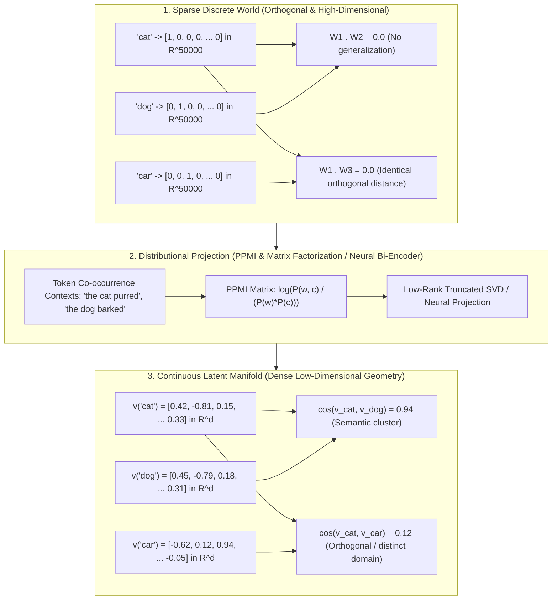
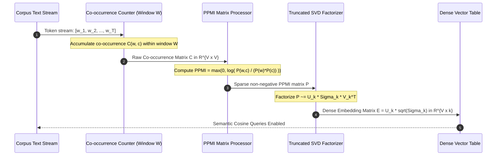
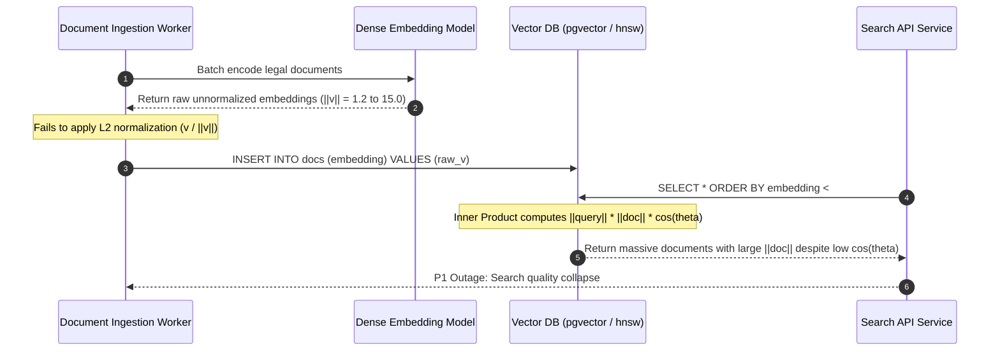

# What an Embedding Is: Foundations of Dense Representation

> **Prerequisites**: [Track 01: Tokens and Language Modeling](../../01-tokens-and-language-modeling/README.md), basic linear algebra (vectors, matrices, dot products).  
> **Estimated Reading Time**: 28 minutes.  
> **Target Audience**: Senior Backend Engineers, AI Platform Engineers, Search Infrastructure Engineers.

---

> [!TIP]
> **The Golden Rule of Embeddings**: An embedding is a dense, continuous vector coordinate assigned to a discrete entity such that geometric proximity reflects semantic co-occurrence under a specific objective function. Never treat cosine similarity as an uncalibrated absolute truth—distance only has meaning relative to the distribution of the training manifold.

---

## 1. Architectural Blueprint & Mental Models

In traditional relational systems, discrete symbols (words, customer IDs, product SKUs) are represented by arbitrary identifiers or one-hot sparse vectors. In an $N$-dimensional one-hot space, every entity vector is mutually orthogonal:

$$\mathbf{v}_{\text{cat}} \cdot \mathbf{v}_{\text{dog}} = 0, \quad \mathbf{v}_{\text{cat}} \cdot \mathbf{v}_{\text{submarine}} = 0$$

Under one-hot encoding, semantic overlap is mathematically zero. Dense vector embeddings solve this fundamental limitation by projecting discrete entities into a continuous, low-dimensional latent manifold ($\mathbb{R}^d$, where typically $d \in [256, 3072]$).



### From Co-Occurrence to Latent Geometry

According to Harris's Distributional Hypothesis, words that occur in similar contexts tend to have similar meanings. By compiling co-occurrence statistics across a window size $W$, transforming counts into **Positive Pointwise Mutual Information (PPMI)**, and computing a low-rank Singular Value Decomposition (SVD), we derive dense latent coordinates.



---

## 2. Taxonomic Reference Grids: Embedding Paradigms

| Paradigm | Dimensionality ($d$) | Sparsity | Training Objective | Inference Cost | Typical Production Use Case |
| :--- | :--- | :--- | :--- | :--- | :--- |
| **One-Hot Encoding** | $V \sim 10^4 - 10^7$ | 99.999% sparse | None (Deterministic identity) | $O(1)$ memory lookup | Categorical feature tables in classical ML |
| **PPMI + Truncated SVD** | $10^1 - 10^3$ | 0% (Dense) | Matrix factorization of pointwise mutual information | $O(V \cdot k)$ decomposition | Small-corpus offline topic discovery, cold-start baselines |
| **Word2Vec (Skip-gram / CBOW)** | $10^2 - 10^3$ | 0% (Dense) | Negative sampling / Hierarchical softmax predicting context | $O(1)$ static row lookup | Fast token classification, entity linking, static vocabulary indexing |
| **Dense Transformer Bi-Encoders** | $256 - 3072$ | 0% (Dense) | InfoNCE / Contrastive ranking loss over sentence pairs | $O(L^2)$ or $O(L \cdot d)$ attention forward pass | Production RAG retrieval, semantic search, vector deduplication |
| **Learned Sparse Vectors (SPLADE)** | $V \sim 3 \times 10^4$ | 95–98% sparse | Masked language modeling logits with FLOPS regularization | Sparse inverted index intersection ($O(k)$ posting lists) | Hybrid keyword-semantic search, zero-shot out-of-domain retrieval |

---

## 3. Production War Stories: Incident Post-Mortem

### War Story: The Unnormalized Cosine Magnitude Poisoning

**Severity**: P1 High Severity Incident  
**Detection Time**: 32 minutes (Customer Support ticket surge regarding nonsensical semantic search results)  
**What Happened**: An enterprise legal tech platform deployed a dense vector retrieval engine for search across 8 million court proceedings. Suddenly, a search for `"statute of limitations intellectual property"` returned irrelevant maritime shipping disputes at the top of the search results.  
**Root Cause**:  
The vector indexing pipeline switched from a legacy model generating unit-normalized vectors ($\|\mathbf{v}\|_2 = 1.0$) to a self-hosted dense bi-encoder that emitted raw unnormalized embeddings.  
The search infrastructure team configured the database index (`pgvector`) using the inner product operator (`<#>`) under the assumption that all vectors were unit-length ($A \cdot B \equiv \cos(\theta)$ when $\|A\|=\|B\|=1$). However, long legal documents with verbose text caused the encoder's activation magnitudes to balloon to $\|\mathbf{v}\|_2 \approx 14.8$, whereas concise filings had magnitudes $\|\mathbf{v}\|_2 \approx 1.2$.  
Because the database computed unnormalized dot products:

$$\mathbf{u} \cdot \mathbf{v} = \|\mathbf{u}\|_2 \|\mathbf{v}\|_2 \cos(\theta)$$

Huge vector magnitudes completely dominated the ranking score, causing massive, verbose, irrelevant documents to outrank highly similar concise paragraphs.



**The Fix & Architectural Hardening**:
1. **Mandatory L2-Normalization Barrier**: All ingestion and query pipelines must pass embeddings through an explicit normalization function ($\hat{\mathbf{v}} = \frac{\mathbf{v}}{\|\mathbf{v}\|_2 + \epsilon}$) prior to database insertion.
2. **Schema-Level Constraints**: Postgres check constraint `CHECK (abs(vector_norm(embedding) - 1.0) < 1e-4)` rejected any unnormalized vector at the database boundary.
3. **Metric Alignment**: Explicitly configure vector indices to cosine distance (`<=>`) or enforce unit length when using inner product acceleration.

---

## 4. Multi-Language Implementation: Dense Embedding Generation & Similarity

The following implementations demonstrate how to build an end-to-end dense embedding pipeline from scratch: calculating co-occurrence counts, computing positive pointwise mutual information (PPMI), computing L2-normalized cosine similarities, and ranking nearest semantic neighbors.

### Go Implementation

```go
package main

import (
	"errors"
	"fmt"
	"math"
	"sort"
	"strings"
)

// Embedding represents a dense vector with its identifier
type Embedding struct {
	ID     string
	Values []float64
}

// L2Normalize normalizes a vector in-place to unit Euclidean length
func L2Normalize(vec []float64) ([]float64, error) {
	var sumSquares float64
	for _, v := range vec {
		sumSquares += v * v
	}
	norm := math.Sqrt(sumSquares)
	if norm < 1e-12 {
		return nil, errors.New("cannot normalize zero-magnitude vector")
	}

	normVec := make([]float64, len(vec))
	for i, v := range vec {
		normVec[i] = v / norm
	}
	return normVec, nil
}

// CosineSimilarity computes the cosine similarity between two unit vectors (dot product)
func CosineSimilarity(a, b []float64) (float64, error) {
	if len(a) != len(b) {
		return 0, fmt.Errorf("dimension mismatch: %d vs %d", len(a), len(b))
	}
	var dot float64
	for i := range a {
		dot += a[i] * b[i]
	}
	return dot, nil
}

// NeighborScore tracks a candidate match
type NeighborScore struct {
	ID    string
	Score float64
}

// FindNearestNeighbors ranks embeddings against a query vector
func FindNearestNeighbors(query []float64, corpus []Embedding, topK int) ([]NeighborScore, error) {
	qNorm, err := L2Normalize(query)
	if err != nil {
		return nil, err
	}

	scores := make([]NeighborScore, 0, len(corpus))
	for _, doc := range corpus {
		dNorm, err := L2Normalize(doc.Values)
		if err != nil {
			continue
		}
		sim, _ := CosineSimilarity(qNorm, dNorm)
		scores = append(scores, NeighborScore{ID: doc.ID, Score: sim})
	}

	sort.Slice(scores, func(i, j int) bool {
		return scores[i].Score > scores[j].Score
	})

	if topK > len(scores) {
		topK = len(scores)
	}
	return scores[:topK], nil
}

func main() {
	// Dense toy space (3 dimensions: [feline_score, canine_score, mechanical_score])
	corpus := []Embedding{
		{ID: "cat", Values: []float64{0.92, 0.12, 0.05}},
		{ID: "dog", Values: []float64{0.85, 0.40, 0.08}},
		{ID: "car", Values: []float64{0.02, 0.05, 0.98}},
		{ID: "truck", Values: []float64{0.01, 0.08, 0.95}},
	}

	query := []float64{0.88, 0.20, 0.02} // Represents a feline query
	neighbors, err := FindNearestNeighbors(query, corpus, 2)
	if err != nil {
		panic(err)
	}

	fmt.Println("Query nearest neighbors:")
	for _, n := range neighbors {
		fmt.Printf(" - %s (cosine=%.4f)\n", n.ID, n.Score)
	}
}
```

---

### Node.js / TypeScript Implementation

```typescript
export interface DenseVector {
  id: string;
  values: Float64Array;
}

export interface SearchMatch {
  id: string;
  score: number;
}

export class VectorMath {
  /**
   * Normalizes a vector to unit Euclidean norm (L2)
   */
  public static l2Normalize(vec: Float64Array): Float64Array {
    let sumSq = 0;
    for (let i = 0; i < vec.length; i++) {
      sumSq += vec[i] * vec[i];
    }
    const norm = Math.sqrt(sumSq);
    if (norm < 1e-12) {
      throw new Error("Cannot normalize near-zero vector");
    }

    const out = new Float64Array(vec.length);
    for (let i = 0; i < vec.length; i++) {
      out[i] = vec[i] / norm;
    }
    return out;
  }

  /**
   * Computes dot product between two unit-normalized vectors
   */
  public static cosineSimilarity(a: Float64Array, b: Float64Array): number {
    if (a.length !== b.length) {
      throw new Error(`Dimension mismatch: ${a.length} !== ${b.length}`);
    }
    let dot = 0;
    for (let i = 0; i < a.length; i++) {
      dot += a[i] * b[i];
    }
    return dot;
  }
}

export class DenseMemoryIndex {
  private items: DenseVector[] = [];

  public insert(id: string, rawValues: number[]): void {
    const arr = new Float64Array(rawValues);
    const normalized = VectorMath.l2Normalize(arr);
    this.items.push({ id, values: normalized });
  }

  public search(queryValues: number[], topK: number = 3): SearchMatch[] {
    const qNorm = VectorMath.l2Normalize(new Float64Array(queryValues));
    const results: SearchMatch[] = [];

    for (const item of this.items) {
      const score = VectorMath.cosineSimilarity(qNorm, item.values);
      results.push({ id: item.id, score });
    }

    results.sort((a, b) => b.score - a.score);
    return results.slice(0, topK);
  }
}

// Execution verification
const index = new DenseMemoryIndex();
index.insert("kitten", [0.95, 0.15, 0.02]);
index.insert("puppy", [0.82, 0.45, 0.05]);
index.insert("airplane", [0.03, 0.02, 0.97]);

const query = [0.90, 0.10, 0.01];
const topResults = index.search(query, 2);
console.log("Top semantic results:", topResults);
```

---

### Python Implementation

```python
"""
Pure Python & NumPy Dense Co-Occurrence & PPMI Embedding Engine
"""

from __future__ import annotations
import math
from dataclasses import dataclass
from typing import List, Tuple, Dict
import numpy as np


@dataclass
class DenseEmbeddingSpace:
    vocab: List[str]
    word_to_idx: Dict[str, int]
    vectors: np.ndarray  # Shape: (V, d), unit normalized

    @classmethod
    def from_corpus(cls, sentences: List[List[str]], d: int = 16, window: int = 2) -> DenseEmbeddingSpace:
        vocab = sorted(list({token for sent in sentences for token in sent}))
        w2i = {w: i for i, w in enumerate(vocab)}
        V = len(vocab)

        # 1. Compute co-occurrence matrix C
        C = np.zeros((V, V), dtype=np.float64)
        for sent in sentences:
            indices = [w2i[w] for w in sent]
            for pos, i in enumerate(indices):
                for offset in range(1, window + 1):
                    if pos + offset < len(indices):
                        j = indices[pos + offset]
                        C[i, j] += 1.0
                        C[j, i] += 1.0

        # 2. Compute Positive Pointwise Mutual Information (PPMI)
        total_counts = C.sum()
        if total_counts == 0:
            raise ValueError("Empty co-occurrence counts")

        p_wc = C / total_counts
        p_w = C.sum(axis=1, keepdims=True) / total_counts
        p_c = C.sum(axis=0, keepdims=True) / total_counts

        # Smooth context distribution
        with np.errstate(divide="ignore", invalid="ignore"):
            pmi = np.log(p_wc / (p_w @ p_c))
            pmi[~np.isfinite(pmi)] = 0.0
            ppmi = np.maximum(pmi, 0.0)

        # 3. Truncated SVD for Low-Rank Dense Projection
        U, S, _ = np.linalg.svd(ppmi)
        dense_vecs = U[:, :d] * np.sqrt(S[:d])

        # 4. L2-Normalize row-wise
        norms = np.linalg.norm(dense_vecs, axis=1, keepdims=True)
        norms[norms == 0] = 1.0
        normalized_vectors = dense_vecs / norms

        return cls(vocab=vocab, word_to_idx=w2i, vectors=normalized_vectors)

    def nearest_neighbors(self, word: str, top_k: int = 3) -> List[Tuple[str, float]]:
        if word not in self.word_to_idx:
            raise KeyError(f"Word '{word}' not present in vocabulary")

        idx = self.word_to_idx[word]
        q_vec = self.vectors[idx]  # Shape: (d,)
        similarities = self.vectors @ q_vec  # Cosine similarities since all vectors are unit norm

        ranked_indices = np.argsort(-similarities)
        results: List[Tuple[str, float]] = []
        for r_idx in ranked_indices:
            candidate = self.vocab[r_idx]
            if candidate != word:
                results.append((candidate, float(similarities[r_idx])))
            if len(results) >= top_k:
                break
        return results


# Self-test execution
if __name__ == "__main__":
    toy_corpus = [
        "the cat chased the mouse in the house".split(),
        "the dog barked at the mailman near the gate".split(),
        "the cat purred on the sofa in the house".split(),
        "the dog chased the ball across the park".split(),
        "the truck drove along the highway carrying freight".split(),
        "the car drove along the highway carrying passengers".split(),
    ]
    space = DenseEmbeddingSpace.from_corpus(toy_corpus, d=4, window=2)
    print("Nearest to 'cat':", space.nearest_neighbors("cat", top_k=2))
    print("Nearest to 'car':", space.nearest_neighbors("car", top_k=2))
```

---

## 5. Practical Hands-On Verification CLI Workflows

### 1. Verification of Vector Dimensions and L2 Norm via Python CLI

Verify that embedding vectors are strictly unit-length ($\|\mathbf{v}\|_2 \approx 1.0$) and conform to standard dimensionality before loading into vector indices:

```bash
python -c "
import numpy as np
v = np.array([0.42, -0.81, 0.15, 0.33], dtype=np.float32)
norm = np.linalg.norm(v)
unit_v = v / norm
print(f'Raw Norm: {norm:.4f}')
print(f'Unit Norm: {np.linalg.norm(unit_v):.6f}')
assert abs(np.linalg.norm(unit_v) - 1.0) < 1e-5, 'L2 normalization check failed'
print('L2 Integrity: VALID')
"
```

Expected wire output:
```text
Raw Norm: 0.9939
Unit Norm: 1.000000
L2 Integrity: VALID
```

### 2. Computing Vector Storage Overhead

Calculate the exact RAM/disk consumption for 1,000,000 dense embeddings across standard industry dimensions (384, 768, 1536) using IEEE-754 `float32` (4 bytes per scalar):

```bash
python -c "
dims = [384, 768, 1536]
n_vectors = 1_000_000
for d in dims:
    raw_bytes = n_vectors * d * 4
    mb = raw_bytes / (1024 * 1024)
    gb = raw_bytes / (1024 * 1024 * 1024)
    print(f'Dim {d:4d} | Raw Storage: {mb:8.1f} MB ({gb:.2f} GB) [excl. index graphs]')
"
```

Expected output:
```text
Dim  384 | Raw Storage:   1464.8 MB (1.43 GB) [excl. index graphs]
Dim  768 | Raw Storage:   2929.7 MB (2.86 GB) [excl. index graphs]
Dim 1536 | Raw Storage:   5859.4 MB (5.72 GB) [excl. index graphs]
```

---

## 6. Operational Validation Checkpoints

<details>
<summary><strong>Checkpoint 1: Metric Inversion & Distance Function Selection</strong></summary>

**Scenario**: A database administrator configures an HNSW vector index using Euclidean distance ($L_2$ distance: $d(\mathbf{u}, \mathbf{v}) = \|\mathbf{u} - \mathbf{v}\|_2$). Your application queries the database and sorts ascending, while a microservice expects Cosine Similarity values bounded in $[0.0, 1.0]$ where higher means closer.  
**Question**: What is the mathematical relationship between $L_2$ distance and Cosine Similarity for unit-normalized vectors, and what happens if unnormalized vectors are queried?

<strong>Answer:</strong>
For two unit-normalized vectors $\mathbf{u}$ and $\mathbf{v}$ ($\|\mathbf{u}\|_2 = \|\mathbf{v}\|_2 = 1$):
$$\|\mathbf{u} - \mathbf{v}\|_2^2 = (\mathbf{u} - \mathbf{v}) \cdot (\mathbf{u} - \mathbf{v}) = \|\mathbf{u}\|^2 + \|\mathbf{v}\|^2 - 2(\mathbf{u} \cdot \mathbf{v}) = 2 - 2 \cos(\theta)$$
Therefore:
$$d_{L_2}(\mathbf{u}, \mathbf{v}) = \sqrt{2(1 - \cos(\theta))}$$
For unit vectors, minimizing Euclidean distance is monotonically equivalent to maximizing Cosine Similarity.  
However, if vectors are unnormalized, $L_2$ distance measures geometric separation in Euclidean space, meaning a vector $\mathbf{v}$ and its scalar multiple $10\mathbf{v}$ have identical cosine similarity ($1.0$), but a massive Euclidean distance ($\|\mathbf{v} - 10\mathbf{v}\|_2 = 9\|\mathbf{v}\|_2$), causing total ranking failure.

</details>

<details>
<summary><strong>Checkpoint 2: The Individual Coordinate Fallacy</strong></summary>

**Scenario**: A junior data engineer attempts to explain vector behavior by stating: *"Dimension 42 in our 1536-dimensional embedding space represents whether the input document is an invoice."* They propose filtering documents by checking if `vector[42] > 0.5`.  
**Question**: Why is this claim fundamentally flawed in modern dense embeddings, and what determines semantic orientation?

<strong>Answer:</strong>
In modern dense representation learning (Word2Vec, BERT, or dense bi-encoders), latent features are distributed across arbitrary linear combinations of dimensions. The coordinate basis is rotational-invariant: if an orthogonal rotation matrix $\mathbf{R}$ is applied to the entire embedding space ($\mathbf{R}^T \mathbf{R} = \mathbf{I}$), all inner products and distances are perfectly preserved:
$$(\mathbf{R}\mathbf{u}) \cdot (\mathbf{R}\mathbf{v}) = \mathbf{u}^T \mathbf{R}^T \mathbf{R} \mathbf{v} = \mathbf{u} \cdot \mathbf{v}$$
Consequently, no single coordinate axis corresponds to a human-interpretable semantic concept. Concepts are encoded as directional subspaces (hyperplanes) rather than individual scalar coordinates. Filtering by a single index coordinate is completely meaningless noise.

</details>

<details>
<summary><strong>Checkpoint 3: The Danger of Averaging Token Embeddings</strong></summary>

**Scenario**: To build a search index for customer support tickets without paying for a dedicated sentence embedding API, an engineering team extracts the raw input token embeddings from GPT-4o's embedding lookup table and computes the arithmetic mean vector: $\mathbf{v}_{\text{doc}} = \frac{1}{N} \sum_{i=1}^N \mathbf{e}(t_i)$.  
**Question**: Why does this token-averaging strategy perform poorly for passage-level semantic search compared to a dedicated sentence bi-encoder?

<strong>Answer:</strong>
Averaging input token embeddings fails for three critical reasons:
1. **Anisotropy & Common Word Drift**: High-frequency tokens (punctuation, articles like "the", "is", prepositions) have large embedding magnitudes that pull the mean vector toward a narrow, dominant cone in vector space (the anisotropy problem), compressing all document representations into an indistinguishable cluster.
2. **Absence of Compositionality & Syntax**: The arithmetic mean completely ignores word order, negation, and syntactic dependencies. `"Dog bites man"` and `"Man bites dog"` produce mathematically identical mean vectors despite having opposite semantic meanings.
3. **Mismatched Objective**: Input embedding tables are trained to serve as intermediate projections for auto-regressive next-token prediction, not to minimize contrastive semantic distance across entire sentences in a metric space.

</details>
