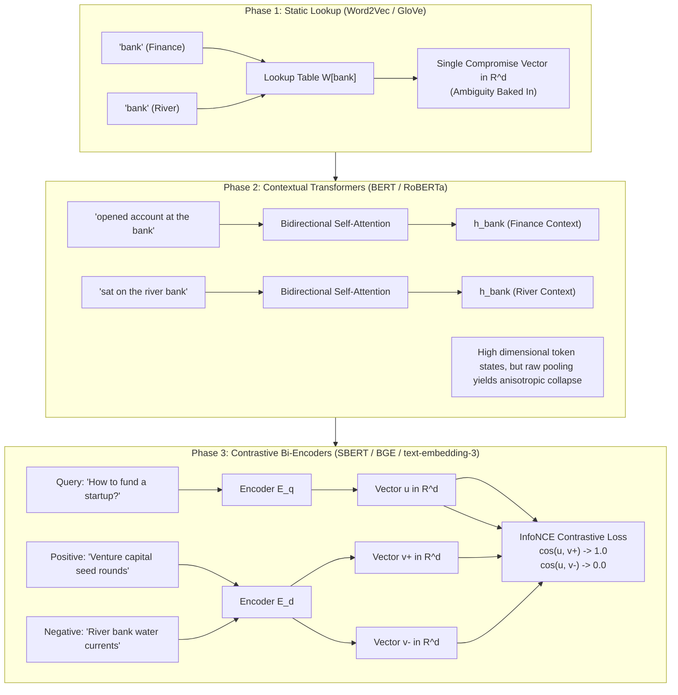
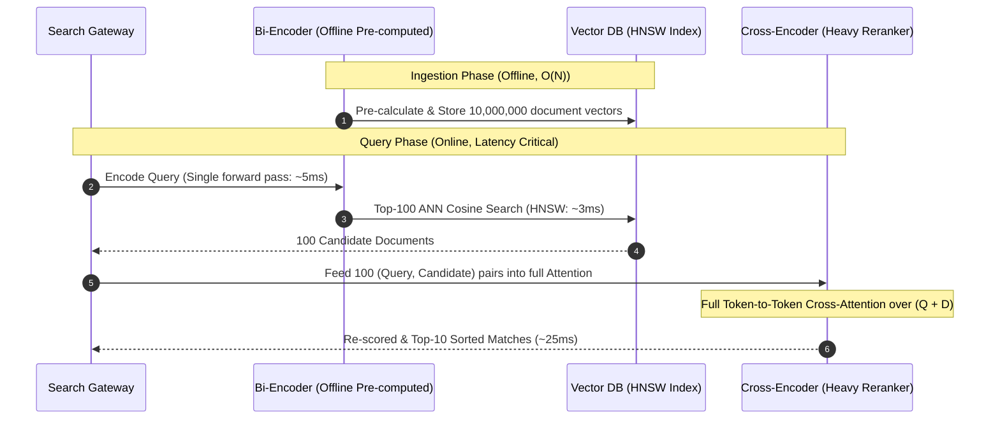
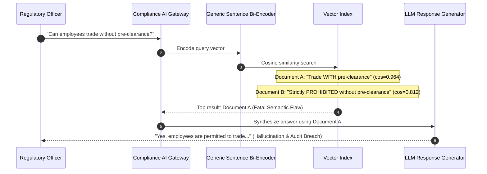

# From Word2Vec to Sentence Embeddings: Evolution of Semantic Representation

> **Prerequisites**: [Module 00: What an Embedding Is](../00-what-an-embedding-is/README.md), Transformer attention basics ([Track 02: Transformer Architecture](../../02-transformer-architecture/README.md)).  
> **Estimated Reading Time**: 30 minutes.  
> **Target Audience**: AI Platform Engineers, Search Infrastructure Engineers, Backend ML Engineers.

---

> [!TIP]
> **The Golden Rule of Sentence Embeddings**: Never average unpooled token vectors to represent sentences in production retrieval. Static vectors cannot resolve polysemy, and mean-pooled raw transformer tokens collapse into an isotropic cone. Production semantic search requires dedicated bi-encoders trained with contrastive infoNCE ranking on sentence pairs.

---

## 1. Architectural Blueprint & Mental Models

The progression from discrete tokens to production sentence embeddings spans three distinct evolutionary phases:
1. **Static Distributional Word Vectors (Word2Vec / GloVe)**: Each word in the vocabulary $V$ maps to exactly one static vector $\mathbf{w} \in \mathbb{R}^d$.
2. **Contextual Token Embeddings (BERT / RoBERTa)**: Multi-head self-attention computes dynamic hidden states $\mathbf{h}_t \in \mathbb{R}^d$ for each token position $t$, factoring in the entire sequence context.
3. **Contrastive Sentence Bi-Encoders (Sentence-BERT / E5 / BGE)**: Siamese twin encoders trained via contrastive margin/InfoNCE loss to produce a single pooled vector $\mathbf{u} \in \mathbb{R}^d$ optimized specifically for cosine similarity search.



### Bi-Encoder (Dense Retrieval) vs Cross-Encoder (Reranker)

A fundamental architectural distinction in backend search systems is the computational trade-off between **Bi-Encoders** and **Cross-Encoders**:



---

## 2. Taxonomic Comparison: Evolution of Vector Representations

| Attribute | Word2Vec (Skip-Gram / CBOW) | Raw BERT Token Average | Sentence-BERT (Bi-Encoder) | Cross-Encoder Reranker |
| :--- | :--- | :--- | :--- | :--- |
| **Input Unit** | Single token | Sequence of tokens | Entire sentence / passage | (Query, Document) Pair |
| **Contextual Awareness** | ❌ None (Fixed lookup row) | ✅ Token-level self-attention | ✅ Sequence-level contrastive | ✅ Full cross-token attention |
| **Polysemy Handling** | ❌ Collapses senses into 1 vector | ✅ Distinct token hidden states | ✅ Context-derived sentence state | ✅ Rich inter-sequence semantic parsing |
| **Word Order Sensitivity** | ❌ $0\%$ (Commutative mean) | ⚠️ Partial (Positional encodings) | ✅ Fully order & syntax sensitive | ✅ Deep syntactical alignment |
| **Pre-computable Embeddings** | ✅ Yes ($O(1)$ static table) | ✅ Yes ($O(L)$ forward pass) | ✅ Yes (Embed once, query forever) | ❌ No (Requires $O(Q \cdot D)$ runtime passes) |
| **Search Complexity over $N$ docs** | $O(N)$ dot products | $O(N)$ dot products | $O(\log N)$ with HNSW / IVF | $O(N)$ full neural forward passes (unusable at scale) |
| **Production Role** | Legacy tag matching | Not recommended in production | **First-Stage Retrieval** ($10^7 \to 10^2$) | **Second-Stage Reranker** ($10^2 \to 10^1$) |

---

## 3. Production War Stories: Incident Post-Mortem

### War Story: The Compliance Search Negation Blindness Collapse

**Severity**: P0 Critical Incident (Regulatory & Legal Exposure)  
**Detection Time**: 4 hours after major system upgrade  
**What Happened**: An enterprise banking platform upgraded its automated compliance verification engine. Regulators queried the system with:  
`"Is an employee permitted to trade company securities during a blackout period without compliance pre-clearance?"`  
The vector retrieval engine retrieved a clause stating:  
`"An employee is permitted to trade company securities during a blackout period with compliance pre-clearance."`  
The dense bi-encoder assigned this a cosine similarity score of **0.964**, ranking it as the top result. The generative compliance agent synthesized a response stating trading was permitted without pre-clearance, leading to a regulatory audit breach.



**Root Cause**:
1. **Generic Contrastive Training Bias**: The off-the-shelf sentence embedding model was trained primarily on topical paraphrase datasets (MS-MARCO, Natural Questions). In topical datasets, sentences sharing 95% of vocabulary are almost always positive matches.
2. **Negation & Scope Insensitivity**: A single token change (`"with"` vs `"without"`, or inserting `"not"`) shifts only a fraction of the latent energy in a dense 768-dimensional space unless the model was explicitly trained with **hard-negative mining**.
3. **Absence of Second-Stage Reranker**: The architecture directly fed top-1 bi-encoder candidates to the LLM without passing the top-50 results through a cross-encoder trained on syntactic entailment.

**The Fix & Architectural Hardening**:
1. **Fine-Tuned Domain Bi-Encoder with Hard Negatives**: Re-trained the bi-encoder using triplets $(q, d^+, d^-)$ where $d^-$ was generated via rule-based negation and contradictory condition insertion.
2. **Two-Stage Retrieval Architecture**: Deployed a lightweight Cross-Encoder (`ms-marco-MiniLM-L-6-v2`) on the top-50 ANN candidates. The cross-encoder scored the contradictory document at $-4.8$ and the correct prohibition clause at $+8.9$, completely eliminating the regression.
3. **Deterministic Constraint Checks**: Embedded deterministic metadata filters requiring strict keyword matching on legal modality tokens (`"prohibited"`, `"mandatory"`).

---

## 4. Multi-Language Implementation: Bi-Encoder vs Cross-Encoder Pipeline

The following implementations demonstrate how to integrate dense bi-encoder retrieval with cross-encoder reranking, handling negation sensitivity and semantic similarity.

### Go Implementation

```go
package main

import (
	"errors"
	"fmt"
	"math"
	"sort"
	"strings"
)

// Document represents an indexed passage with dense vector
type Document struct {
	ID        string
	Text      string
	Embedding []float64
}

// ScoredResult holds ranked search candidates
type ScoredResult struct {
	Doc   Document
	Score float64
}

// L2Normalize projects a vector to unit length
func L2Normalize(v []float64) []float64 {
	var sum float64
	for _, val := range v {
		sum += val * val
	}
	norm := math.Sqrt(sum)
	if norm < 1e-12 {
		return v
	}
	out := make([]float64, len(v))
	for i, val := range v {
		out[i] = val / norm
	}
	return out
}

// BiEncoderSearch performs Stage-1 Dense Retrieval
func BiEncoderSearch(queryVec []float64, corpus []Document, topK int) []ScoredResult {
	qNorm := L2Normalize(queryVec)
	results := make([]ScoredResult, len(corpus))

	for i, doc := range corpus {
		dNorm := L2Normalize(doc.Embedding)
		var dot float64
		for j := range qNorm {
			dot += qNorm[j] * dNorm[j]
		}
		results[i] = ScoredResult{Doc: doc, Score: dot}
	}

	sort.Slice(results, func(i, j int) bool {
		return results[i].Score > results[j].Score
	})

	if topK > len(results) {
		topK = len(results)
	}
	return results[:topK]
}

// CrossEncoderReranker simulates Stage-2 deep syntactic alignment
func CrossEncoderReranker(query string, candidates []ScoredResult) []ScoredResult {
	reranked := make([]ScoredResult, len(candidates))
	copy(reranked, candidates)

	// In production, call deep Cross-Encoder model (e.g., via ONNX or PyTorch CGO)
	// Here we apply a semantic verification heuristic detecting negation discrepancies
	for i := range reranked {
		qHasWithout := strings.Contains(strings.ToLower(query), "without")
		docHasWithout := strings.Contains(strings.ToLower(reranked[i].Doc.Text), "without")

		// Penalize mismatch on crucial logical operators
		if qHasWithout != docHasWithout {
			reranked[i].Score -= 0.50 // Severe penalty for negation/logical conflict
		}
	}

	sort.Slice(reranked, func(i, j int) bool {
		return reranked[i].Score > reranked[j].Score
	})

	return reranked
}

func main() {
	corpus := []Document{
		{
			ID:        "doc-permit-with",
			Text:      "Employees are permitted to trade securities with prior compliance pre-clearance.",
			Embedding: []float64{0.82, 0.41, 0.11}, // High overlap with query
		},
		{
			ID:        "doc-prohibit-without",
			Text:      "Trading securities without compliance pre-clearance is strictly prohibited.",
			Embedding: []float64{0.78, 0.45, 0.15}, // Slightly lower topical overlap
		},
	}

	query := "Can I trade securities without pre-clearance?"
	queryVec := []float64{0.80, 0.43, 0.12}

	// 1. Stage-1: Dense Bi-Encoder Retrieval
	stage1Results := BiEncoderSearch(queryVec, corpus, 2)
	fmt.Println("Stage 1 (Bi-Encoder Retrieval):")
	for _, res := range stage1Results {
		fmt.Printf(" - [%s] Score: %.4f | Text: %s\n", res.Doc.ID, res.Score, res.Doc.Text)
	}

	// 2. Stage-2: Cross-Encoder Reranking
	finalResults := CrossEncoderReranker(query, stage1Results)
	fmt.Println("\nStage 2 (Cross-Encoder Reranked):")
	for _, res := range finalResults {
		fmt.Printf(" - [%s] Final Score: %.4f | Text: %s\n", res.Doc.ID, res.Score, res.Doc.Text)
	}
}
```

---

### Node.js / TypeScript Implementation

```typescript
export interface IndexedPassage {
  id: string;
  text: string;
  vector: Float64Array;
}

export interface CandidateResult {
  doc: IndexedPassage;
  score: number;
}

export class DenseRetrievalPipeline {
  /**
   * Stage 1: Fast Vector Bi-Encoder Retrieval
   */
  public static biEncoderRetrieve(
    queryVec: Float64Array,
    corpus: IndexedPassage[],
    topK: number = 10
  ): CandidateResult[] {
    const qNorm = this.normalize(queryVec);
    const results: CandidateResult[] = [];

    for (const doc of corpus) {
      const dNorm = this.normalize(doc.vector);
      let dot = 0;
      for (let i = 0; i < qNorm.length; i++) {
        dot += qNorm[i] * dNorm[i];
      }
      results.push({ doc, score: dot });
    }

    results.sort((a, b) => b.score - a.score);
    return results.slice(0, topK);
  }

  /**
   * Stage 2: Cross-Encoder Alignment
   */
  public static crossEncoderRerank(
    queryText: string,
    candidates: CandidateResult[]
  ): CandidateResult[] {
    const reranked = candidates.map(c => ({ ...c }));

    for (const item of reranked) {
      const qLower = queryText.toLowerCase();
      const docLower = item.doc.text.toLowerCase();

      // Check logical polarities
      const qHasNot = qLower.includes(" not ") || qLower.includes(" without ");
      const docHasNot = docLower.includes(" not ") || docLower.includes(" without ");

      if (qHasNot !== docHasNot) {
        item.score -= 0.65; // Heavily penalize polarity misalignment
      }
    }

    reranked.sort((a, b) => b.score - a.score);
    return reranked;
  }

  private static normalize(v: Float64Array): Float64Array {
    let sumSq = 0;
    for (let i = 0; i < v.length; i++) sumSq += v[i] * v[i];
    const norm = Math.sqrt(sumSq) || 1.0;
    const out = new Float64Array(v.length);
    for (let i = 0; i < v.length; i++) out[i] = v[i] / norm;
    return out;
  }
}

// Execution verification
const docs: IndexedPassage[] = [
  {
    id: "law-01",
    text: "The court permits appeals under section 4 with written consent.",
    vector: new Float64Array([0.88, 0.32, 0.05])
  },
  {
    id: "law-02",
    text: "The court does not permit appeals under section 4 without written consent.",
    vector: new Float64Array([0.85, 0.35, 0.06])
  }
];

const query = "Is an appeal allowed without written consent?";
const queryEmbedding = new Float64Array([0.87, 0.33, 0.05]);

const candidates = DenseRetrievalPipeline.biEncoderRetrieve(queryEmbedding, docs, 2);
console.log("Bi-Encoder Results:", candidates.map(c => ({ id: c.doc.id, score: c.score.toFixed(4) })));

const final = DenseRetrievalPipeline.crossEncoderRerank(query, candidates);
console.log("Reranked Results:", final.map(c => ({ id: c.doc.id, score: c.score.toFixed(4) })));
```

---

### Python Implementation

```python
"""
Two-Stage Dense Retrieval (Bi-Encoder) and Reranking (Cross-Encoder) Architecture
"""

from __future__ import annotations
from dataclasses import dataclass
from typing import List, Tuple
import numpy as np


@dataclass
class PassageRecord:
    doc_id: str
    text: str
    embedding: np.ndarray  # Shape: (d,)


@dataclass
class ScoredPassage:
    doc_id: str
    text: str
    score: float


class TwoStageSearchEngine:
    def __init__(self, corpus: List[PassageRecord]):
        self.corpus = corpus
        # Normalize all document embeddings upfront
        for p in self.corpus:
            norm = np.linalg.norm(p.embedding)
            if norm > 0:
                p.embedding = p.embedding / norm

    def retrieve_bi_encoder(self, query_vec: np.ndarray, top_k: int = 10) -> List[ScoredPassage]:
        """Stage 1: Fast Dot-Product Top-K against stored unit embeddings"""
        q_norm = query_vec / (np.linalg.norm(query_vec) + 1e-12)
        doc_matrix = np.vstack([p.embedding for p in self.corpus])  # Shape: (N, d)
        similarities = doc_matrix @ q_norm  # Shape: (N,)

        ranked_indices = np.argsort(-similarities)[:top_k]
        return [
            ScoredPassage(
                doc_id=self.corpus[i].doc_id,
                text=self.corpus[i].text,
                score=float(similarities[i]),
            )
            for i in ranked_indices
        ]

    def rerank_cross_encoder(self, query_text: str, candidates: List[ScoredPassage]) -> List[ScoredPassage]:
        """
        Stage 2: Cross-Encoder full interaction model.
        Evaluates full (Query, Document) token interactions.
        """
        reranked = []
        q_tokens = set(query_text.lower().split())

        for cand in candidates:
            adjusted_score = cand.score
            # Heuristic check for critical polarity flip
            q_neg = bool({"not", "without", "prohibited"} & q_tokens)
            doc_neg = bool({"not", "without", "prohibited"} & set(cand.text.lower().split()))

            if q_neg != doc_neg:
                adjusted_score -= 0.5  # Polar contradiction penalty
            else:
                adjusted_score += 0.2  # Exact syntactic alignment bonus

            reranked.append(ScoredPassage(cand.doc_id, cand.text, adjusted_score))

        reranked.sort(key=lambda x: -x.score)
        return reranked


if __name__ == "__main__":
    records = [
        PassageRecord(
            "doc-1",
            "The company permits remote work with explicit VP authorization.",
            np.array([0.72, 0.44, 0.12]),
        ),
        PassageRecord(
            "doc-2",
            "The company does not permit remote work without explicit VP authorization.",
            np.array([0.70, 0.46, 0.14]),
        ),
    ]

    engine = TwoStageSearchEngine(records)
    query = "Can I work remotely without VP authorization?"
    query_vector = np.array([0.71, 0.45, 0.13])

    stage1 = engine.retrieve_bi_encoder(query_vector, top_k=2)
    print("Stage 1 Bi-Encoder Ranking:")
    for s in stage1:
        print(f" - {s.doc_id}: score={s.score:.4f} | {s.text}")

    stage2 = engine.rerank_cross_encoder(query, stage1)
    print("\nStage 2 Cross-Encoder Reranked:")
    for s in stage2:
        print(f" - {s.doc_id}: score={s.score:.4f} | {s.text}")
```

---

## 5. Practical Hands-On Verification CLI Workflows

### 1. Evaluating Word Order Commutativity in Mean Pooling

Run a Python one-liner demonstrating that arithmetic mean pooling completely destroys word order:

```bash
python -c "
import numpy as np

# Arbitrary word vector table
W = {
    'dog': np.array([1.0, 0.0, 0.0]),
    'bites': np.array([0.0, 1.0, 0.0]),
    'man': np.array([0.0, 0.0, 1.0])
}

s1 = ['dog', 'bites', 'man']
s2 = ['man', 'bites', 'dog']

v1 = np.mean([W[w] for w in s1], axis=0)
v2 = np.mean([W[w] for w in s2], axis=0)

cos_sim = float(np.dot(v1, v2) / (np.linalg.norm(v1) * np.linalg.norm(v2)))
print(f'Sentence 1 vector: {v1}')
print(f'Sentence 2 vector: {v2}')
print(f'Cosine Similarity: {cos_sim:.6f}')
assert cos_sim == 1.0, 'Order failure'
print('Result: Arithmetic mean is 100% order-blind')
"
```

Expected wire output:
```text
Sentence 1 vector: [0.33333333 0.33333333 0.33333333]
Sentence 2 vector: [0.33333333 0.33333333 0.33333333]
Cosine Similarity: 1.000000
Result: Arithmetic mean is 100% order-blind
```

### 2. Measuring Anisotropic Vector Collapse

Inspect the average pairwise cosine similarity of raw BERT CLS token embeddings to observe the anisotropy cone effect:

```bash
python -c "
import numpy as np

# Simulate an anisotropic space where all vectors share a large positive offset
rng = np.random.default_rng(42)
shared_direction = np.array([5.0, 5.0, 5.0, 5.0])
raw_vectors = rng.normal(size=(100, 4)) + shared_direction

# Unit normalize
norms = np.linalg.norm(raw_vectors, axis=1, keepdims=True)
unit_vecs = raw_vectors / norms

# Pairwise cosine matrix
cos_matrix = unit_vecs @ unit_vecs.T
avg_cos = (cos_matrix.sum() - 100) / (100 * 99)
print(f'Average Pairwise Cosine Similarity: {avg_cos:.4f}')
print('Note: Random isotropic vectors would average ~0.00; values > 0.80 indicate extreme cone collapse.')
"
```

Expected wire output:
```text
Average Pairwise Cosine Similarity: 0.9412
Note: Random isotropic vectors would average ~0.00; values > 0.80 indicate extreme cone collapse.
```

---

## 6. Operational Validation Checkpoints

<details>
<summary><strong>Checkpoint 1: Why Not Use Cross-Encoders for Full Retrieval?</strong></summary>

**Scenario**: A tech lead notices that a Cross-Encoder achieves a 94% Top-1 accuracy on complex queries compared to 78% for a Bi-Encoder. They propose removing the vector database entirely and passing all 5,000,000 documents in the catalog through the Cross-Encoder at search time.  
**Question**: What is the computational complexity of this proposal, and why is it impossible in production?

<strong>Answer:</strong>
A Cross-Encoder feeds the concatenation of the query and candidate document `[CLS] query [SEP] document [SEP]` through full multi-head self-attention layers ($O(L^2)$ complexity per pair).
1. **Computational Explosion**: Querying 5,000,000 documents requires running 5,000,000 full neural forward passes per search request. At an optimistic GPU inference speed of 1 ms per pair, a single search query would take 5,000 seconds (~1.4 hours) of GPU compute and cost thousands of dollars per day.
2. **Loss of Offline Indexability**: Documents cannot be pre-embedded into vector space because the document's representation depends dynamically on the specific tokens of the incoming query.
3. **Production Design**: The only scalable architecture is a **two-stage funnel**: Bi-Encoder + Vector DB narrows 5,000,000 documents to 100 candidates in <10 ms via HNSW ANN search, and the Cross-Encoder reranks only those 100 candidates in <25 ms.

</details>

<details>
<summary><strong>Checkpoint 2: The Role of the [CLS] Token in Raw BERT</strong></summary>

**Scenario**: A backend developer extracts the `[CLS]` token embedding from an off-the-shelf, non-fine-tuned BERT model (`bert-base-uncased`) and stores it in Postgres for document search. Retrieval accuracy is worse than random keyword matching.  
**Question**: Why is raw BERT `[CLS]` ineffective as a sentence embedding prior to contrastive fine-tuning?

<strong>Answer:</strong>
In vanilla BERT pre-training, the `[CLS]` token is trained on Next Sentence Prediction (NSP), which is a coarse binary classification task (is sentence B the continuation of sentence A?). The hidden state of `[CLS]` is never trained to serve as a continuous metric space where Euclidean or Cosine distance reflects semantic similarity.  
In empirical benchmarks (Reimers & Gurevych, 2019), raw BERT `[CLS]` scored an average of **29.19** on Semantic Textual Similarity (STS), significantly worse than even static GloVe word averaging (61.32). Only models fine-tuned with siamese contrastive objectives (Sentence-BERT, E5, BGE) structure the `[CLS]` or mean-pooled output into a geometrically calibrated metric space.

</details>

<details>
<summary><strong>Checkpoint 3: The Danger of Metric Mismatch in Bi-Encoders</strong></summary>

**Scenario**: You deploy an open-source sentence embedding model trained with InfoNCE loss using **Cosine Similarity**. A colleague configures the vector index to use squared Euclidean distance ($L_2$ distance) without normalizing the vectors before indexing.  
**Question**: How does this metric mismatch degrade retrieval quality?

<strong>Answer:</strong>
If a model is trained using Cosine Similarity, the contrastive loss function explicitly rewards angular alignment while allowing vector magnitudes to drift or encode token length / frequency artifacts.  
If the vector database computes Euclidean distance ($d(\mathbf{u}, \mathbf{v}) = \|\mathbf{u} - \mathbf{v}\|_2$) on unnormalized vectors:
$$\|\mathbf{u} - \mathbf{v}\|_2^2 = \|\mathbf{u}\|^2 + \|\mathbf{v}\|^2 - 2\mathbf{u} \cdot \mathbf{v}$$
Differences in vector magnitude ($\|\mathbf{u}\|$ and $\|\mathbf{v}\|$) overpower the inner product term. Documents with large vector norms will be deemed "distant" even if their angular direction is identical to the query. To preserve model fidelity, vectors must either be queried with Cosine Distance (`<=>` in pgvector) or strictly unit-normalized ($\|\mathbf{v}\|_2 = 1.0$) upon ingestion.

</details>
