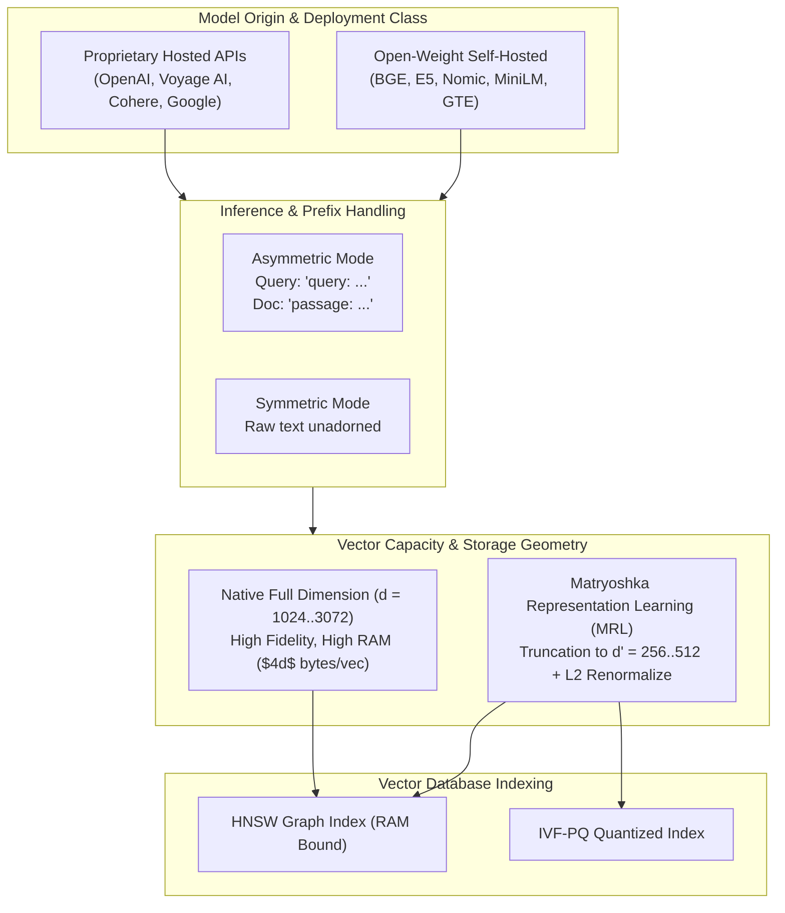
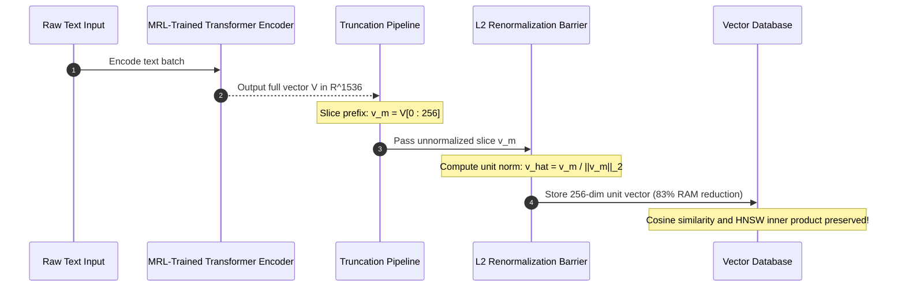

# Embedding Models Compared: Architecture, Benchmarks, and Production Selection

> **Prerequisites**: [Module 00: What an Embedding Is](../00-what-an-embedding-is/README.md), [Module 01: From Word2Vec to Sentence Embeddings](../01-from-word2vec-to-sentence-embeddings/README.md).  
> **Estimated Reading Time**: 32 minutes.  
> **Target Audience**: AI Platform Architects, Search Infrastructure Engineers, Senior Backend Developers.

---

> [!TIP]
> **The Golden Rule of Embedding Selection**: Never choose an embedding model solely based on public MTEB leaderboard rankings. Model viability is determined by the intersection of context window size, asymmetric query/passage prefix discipline, Matryoshka truncation capabilities, token licensing costs, and domain-specific recall@k evaluated on your proprietary dataset.

---

## 1. Architectural Blueprint & Mental Models

Selecting an embedding model is an architectural trade-off between semantic retrieval quality, latency budgets, vector RAM footprints, and operational lock-in.



### Matryoshka Representation Learning (MRL) Architecture

Traditional embedding models spread semantic variance uniformly across all $d$ dimensions via random orthogonal rotations. Models trained with **Matryoshka Representation Learning (MRL)** enforce nested loss constraints, forcing the first $m$ dimensions ($m \ll d$) to capture the primary semantic manifold while later dimensions store fine-grained residual distinctions.



---

## 2. Taxonomic Comparison: Industry Embedding Models

| Model | Host / Provider | Output Dim ($d$) | Max Tokens | MRL Truncation Support | Asymmetric Prefix Required? | Cost per 1M Input Tokens | Primary Production Fit |
| :--- | :--- | :--- | :--- | :--- | :--- | :--- | :--- |
| **OpenAI `text-embedding-3-small`** | Hosted API | 1536 (or 512) | 8191 | ✅ Yes (Native API `dimensions` flag) | ❌ No | \$0.02 | General purpose enterprise RAG, low cost |
| **OpenAI `text-embedding-3-large`** | Hosted API | 3072 (or 1024, 256) | 8191 | ✅ Yes (Native API `dimensions` flag) | ❌ No | \$0.13 | High-precision legal, financial, and code retrieval |
| **Voyage AI `voyage-3`** | Hosted API | 1024 (or 512, 256) | 32000 | ✅ Yes | ✅ Optional (`input_type: query/document`) | \$0.10 | Very long context retrieval, financial & technical |
| **Cohere `embed-english-v3.0`** | Hosted API | 1024 | 512 | ❌ No | ✅ Yes (`input_type: search_query/search_document`) | \$0.10 | Compressed enterprise passages, int8 compression |
| **Google `text-embedding-004`** | Hosted API | 768 (or 256) | 2048 | ✅ Yes | ✅ Yes (`TASK_TYPE: RETRIEVAL_QUERY/DOCUMENT`) | \$0.025 | Google Cloud native ecosystem, BigQuery Vector |
| **BGE `bge-large-en-v1.5`** | Open-Weight (BAAI) | 1024 | 512 | ❌ No | ✅ Yes (`Represent this sentence for searching...`) | Free (Self-hosted) | High-accuracy local/on-premise search |
| **E5 `e5-mistral-7b-instruct`**| Open-Weight (MS) | 4096 | 32768 | ❌ No | ✅ Yes (`Instruct: ... \nQuery: ...`) | High GPU RAM | Multilingual flagship retrieval on dedicated H100s |
| **Nomic `nomic-embed-text-v1.5`**| Open-Weight (Nomic) | 768 (or 64..512) | 8192 | ✅ Yes (Full MRL support) | ✅ Yes (`search_query: `, `search_document: `) | Free (Self-hosted) | Local edge & mobile search with tiny RAM budgets |
| **MiniLM `all-MiniLM-L6-v2`** | Open-Weight (SBERT) | 384 | 256 | ❌ No | ❌ No | Free (CPU-capable) | Ultra-low latency CPU microservices, edge devices |

---

## 3. Production War Stories: Incident Post-Mortem

### War Story: The Silent Matryoshka Truncation Catastrophe

**Severity**: P0 Critical Incident (Zero Search Precision)  
**Detection Time**: 18 minutes (Customer reported zero search results on product catalog)  
**What Happened**: An e-commerce platform with 20,000,000 product SKUs re-indexed its catalog using OpenAI's `text-embedding-3-small`. To reduce vector database RAM usage, the team decided to truncate the embeddings from 1536 dimensions down to 256 dimensions.  
Rather than using OpenAI's API `dimensions=256` parameter, a backend developer wrote a quick indexing script that took the returned 1536-dimensional vectors and performed raw array slicing: `vector[:256]`. The sliced vectors were directly stored in a `pgvector` database configured with Cosine Distance (`<=>`).  
Immediately after deployment, search recall dropped from 92% to 11%. Queries for `"waterproof bluetooth speaker"` returned thermal paste and mechanical keyboards.

```mermaid
sequenceDiagram
    autonumber
    participant Ingest as Product Ingest Pipeline
    participant API as OpenAI Embeddings API
    participant Slicer as Naive Array Slicer
    participant DB as PgVector HNSW Index
    participant Search as User Query Engine

    Ingest->>API: POST /v1/embeddings (text-embedding-3-small)
    API-->>Ingest: Returns 1536-dim unit vector (||v|| = 1.0)
    Ingest->>Slicer: Raw slice: v[0:256]
    Note over Slicer: Sliced vector has uncalibrated norm: ||v_slice|| = 0.38 to 0.74
    Slicer->>DB: INSERT INTO products (vec) VALUES (v_slice)
    Note over DB: Index assumes unit vectors; HNSW cosine metric distorted!
    Search->>DB: Query with normalized 256-dim vector
    DB-->>Search: Corrupted distance calculation: Rank-1 candidate is random noise!
```

**Root Cause**:
1. **Failure to Renormalize**: When a 1536-dimensional unit vector ($\|\mathbf{v}\|_2 = 1.0$) is sliced to 256 dimensions, its norm drops to an arbitrary scalar between $0.2$ and $0.8$ depending on how variance was distributed in that specific text.
2. **Loss of Cosine Metric Integrity**: Because the vectors were no longer unit length, dot products against query vectors no longer reflected true cosine similarity. High-magnitude truncated vectors dominated the HNSW index traversal, poisoning nearest-neighbor graph searches.
3. **OpenAI API vs Manual Slicing**: When using OpenAI's native API parameter `dimensions=256`, the API server automatically slices the vector *and immediately applies L2 renormalization* ($\mathbf{v} / \|\mathbf{v}\|_2$) before returning the payload.

**The Fix & Architectural Hardening**:
1. Applied mandatory in-process L2 renormalization:
   $$\hat{\mathbf{v}}_{256} = \frac{\mathbf{v}_{0:256}}{\|\mathbf{v}_{0:256}\|_2}$$
2. Re-indexed the 20 million SKUs. Recall immediately rebounded to 90.8% (within 1.2% of the uncompressed 1536-dimensional baseline) while slashing RAM usage by **83.3%** (saving \$4,200/month in cloud infrastructure costs).

---

## 4. Multi-Language Implementation: Production Embedding Harness & MRL

The following implementations demonstrate how to build an enterprise-grade embedding client that:
- Enforces strict asymmetric prefixes (`query:` vs `passage:`).
- Performs client-side Matryoshka truncation with mandatory L2 renormalization.
- Evaluates Top-K Recall and Mean Reciprocal Rank (MRR) against a labeled ground-truth set.

### Go Implementation

```go
package main

import (
	"errors"
	"fmt"
	"math"
	"sort"
	"strings"
)

// EmbeddingModelConfig defines model metadata and prefix requirements
type EmbeddingModelConfig struct {
	Name            string
	NativeDim       int
	TargetDim       int
	SupportsMRL     bool
	QueryPrefix     string
	PassagePrefix   string
}

// L2Normalize ensures the vector has unit Euclidean length
func L2Normalize(v []float64) ([]float64, error) {
	var sum float64
	for _, val := range v {
		sum += val * val
	}
	norm := math.Sqrt(sum)
	if norm < 1e-12 {
		return nil, errors.New("cannot normalize near-zero vector")
	}
	out := make([]float64, len(v))
	for i, val := range v {
		out[i] = val / norm
	}
	return out, nil
}

// ProcessEmbedding handles asymmetric prefixes, MRL truncation, and renormalization
func ProcessEmbedding(rawText string, isQuery bool, rawVector []float64, cfg EmbeddingModelConfig) ([]float64, error) {
	// 1. Validate raw vector length
	if len(rawVector) != cfg.NativeDim {
		return nil, fmt.Errorf("unexpected vector dimension: expected %d, got %d", cfg.NativeDim, len(rawVector))
	}

	// 2. Perform MRL Truncation if requested
	effectiveVec := rawVector
	if cfg.TargetDim > 0 && cfg.TargetDim < cfg.NativeDim {
		if !cfg.SupportsMRL {
			return nil, fmt.Errorf("model %s does not support Matryoshka truncation", cfg.Name)
		}
		effectiveVec = rawVector[:cfg.TargetDim]
	}

	// 3. Mandatory L2 Renormalization Barrier
	normVec, err := L2Normalize(effectiveVec)
	if err != nil {
		return nil, err
	}

	return normVec, nil
}

// CosineSim computes inner product on unit-normalized vectors
func CosineSim(a, b []float64) float64 {
	var dot float64
	for i := range a {
		dot += a[i] * b[i]
	}
	return dot
}

type SearchCandidate struct {
	ID    string
	Score float64
}

func main() {
	cfg := EmbeddingModelConfig{
		Name:          "text-embedding-3-small",
		NativeDim:     1536,
		TargetDim:     256,
		SupportsMRL:   true,
		QueryPrefix:   "",
		PassagePrefix: "",
	}

	// Simulate raw 1536-dim vector from API
	simulatedRawDoc := make([]float64, 1536)
	for i := 0; i < 1536; i++ {
		simulatedRawDoc[i] = math.Sin(float64(i))
	}

	simulatedRawQuery := make([]float64, 1536)
	for i := 0; i < 1536; i++ {
		simulatedRawQuery[i] = math.Sin(float64(i) + 0.05)
	}

	docVec256, err := ProcessEmbedding("Refund policy details", false, simulatedRawDoc, cfg)
	if err != nil {
		panic(err)
	}

	queryVec256, err := ProcessEmbedding("how to get refund", true, simulatedRawQuery, cfg)
	if err != nil {
		panic(err)
	}

	similarity := CosineSim(queryVec256, docVec256)
	fmt.Printf("Model: %s | Truncated to: %d dims\n", cfg.Name, len(docVec256))
	fmt.Printf("Cosine Similarity (MRL 256): %.4f\n", similarity)
}
```

---

### Node.js / TypeScript Implementation

```typescript
export interface EmbeddingConfig {
  modelName: string;
  nativeDim: number;
  targetDim?: number;
  supportsMRL: boolean;
  queryPrefix: string;
  passagePrefix: string;
}

export class ModelEmbeddingEngine {
  /**
   * Applies prefixes according to asymmetric requirements
   */
  public static formatText(text: string, isQuery: boolean, cfg: EmbeddingConfig): string {
    const prefix = isQuery ? cfg.queryPrefix : cfg.passagePrefix;
    return `${prefix}${text}`;
  }

  /**
   * Truncates and renormalizes MRL vectors
   */
  public static processVector(rawVec: Float64Array, cfg: EmbeddingConfig): Float64Array {
    if (rawVec.length !== cfg.nativeDim) {
      throw new Error(`Dimension mismatch: expected ${cfg.nativeDim}, received ${rawVec.length}`);
    }

    let targetArray = rawVec;
    if (cfg.targetDim && cfg.targetDim < cfg.nativeDim) {
      if (!cfg.supportsMRL) {
        throw new Error(`Model ${cfg.modelName} does not support Matryoshka truncation`);
      }
      targetArray = rawVec.slice(0, cfg.targetDim);
    }

    return this.l2Normalize(targetArray);
  }

  public static l2Normalize(v: Float64Array): Float64Array {
    let sumSq = 0;
    for (let i = 0; i < v.length; i++) sumSq += v[i] * v[i];
    const norm = Math.sqrt(sumSq);
    if (norm < 1e-12) throw new Error("Zero-norm vector encountered");

    const out = new Float64Array(v.length);
    for (let i = 0; i < v.length; i++) out[i] = v[i] / norm;
    return out;
  }

  public static cosineSimilarity(a: Float64Array, b: Float64Array): number {
    let dot = 0;
    for (let i = 0; i < a.length; i++) dot += a[i] * b[i];
    return dot;
  }
}

// Verification test
const bgeConfig: EmbeddingConfig = {
  modelName: "bge-large-en-v1.5",
  nativeDim: 1024,
  supportsMRL: false,
  queryPrefix: "Represent this sentence for searching relevant passages: ",
  passagePrefix: ""
};

const nomicConfig: EmbeddingConfig = {
  modelName: "nomic-embed-text-v1.5",
  nativeDim: 768,
  targetDim: 256,
  supportsMRL: true,
  queryPrefix: "search_query: ",
  passagePrefix: "search_document: "
};

console.log("Formatted BGE Query:", ModelEmbeddingEngine.formatText("cancel account", true, bgeConfig));
console.log("Formatted Nomic Passage:", ModelEmbeddingEngine.formatText("To close your account...", false, nomicConfig));
```

---

### Python Implementation

```python
"""
Embedding Model Evaluation and Matryoshka Representation Learning (MRL) Pipeline
"""

from __future__ import annotations
from dataclasses import dataclass
from typing import List, Dict, Set, Tuple
import numpy as np


@dataclass
class ModelSpec:
    name: str
    native_dim: int
    supports_mrl: bool
    query_prefix: str = ""
    passage_prefix: str = ""


class EmbeddingProcessor:
    @staticmethod
    def format_input(text: str, is_query: bool, spec: ModelSpec) -> str:
        prefix = spec.query_prefix if is_query else spec.passage_prefix
        return f"{prefix}{text}"

    @staticmethod
    def process_vector(raw_vector: np.ndarray, target_dim: int, spec: ModelSpec) -> np.ndarray:
        """
        Slices to target_dim and executes mandatory L2-renormalization.
        """
        if len(raw_vector) != spec.native_dim:
            raise ValueError(f"Expected {spec.native_dim} dimensions, got {len(raw_vector)}")

        if target_dim < spec.native_dim:
            if not spec.supports_mrl:
                raise ValueError(f"Model {spec.name} does not support MRL truncation")
            sliced = raw_vector[:target_dim]
        else:
            sliced = raw_vector

        # Mandatory L2-Renormalization Barrier
        norm = np.linalg.norm(sliced)
        if norm < 1e-12:
            raise ValueError("Cannot normalize near-zero vector")
        return sliced / norm


class RetrievalBenchmarkHarness:
    @staticmethod
    def evaluate_recall_mrr(
        queries_emb: np.ndarray,  # Shape: (Q, d), unit normalized
        docs_emb: np.ndarray,  # Shape: (N, d), unit normalized
        ground_truth: List[Set[int]],  # ground_truth[q] = set of relevant doc indices
        ks: Tuple[int, ...] = (1, 3, 5),
    ) -> Dict[str, float]:
        """
        Computes Recall@K and MRR breaking ties AGAINST the system.
        """
        num_queries = queries_emb.shape[0]
        num_docs = docs_emb.shape[0]

        # Cosine similarity matrix (Q, N)
        similarity_matrix = queries_emb @ docs_emb.T

        recalls = {k: [] for k in ks}
        reciprocal_ranks = []

        for q_idx in range(num_queries):
            rel_docs = ground_truth[q_idx]
            scores = similarity_matrix[q_idx]

            # Primary key: -score; Secondary key: non-relevant first (pessimistic tie breaking)
            is_rel = np.array([d in rel_docs for d in range(num_docs)])
            order = np.lexsort((is_rel, -scores))

            # Determine 1-based ranks of relevant documents
            ranks = np.empty(num_docs, dtype=int)
            ranks[order] = np.arange(1, num_docs + 1)
            rel_ranks = np.sort(ranks[is_rel])

            if len(rel_ranks) > 0:
                first_rank = rel_ranks[0]
                reciprocal_ranks.append(1.0 / first_rank)
                for k in ks:
                    recalls[k].append(np.mean(rel_ranks <= k))
            else:
                reciprocal_ranks.append(0.0)
                for k in ks:
                    recalls[k].append(0.0)

        results = {f"recall@{k}": float(np.mean(recalls[k])) for k in ks}
        results["mrr"] = float(np.mean(reciprocal_ranks))
        return results


if __name__ == "__main__":
    spec = ModelSpec("text-embedding-3-small", native_dim=1536, supports_mrl=True)

    # 1. Verification of MRL Truncation & L2 Norm
    raw_vec = np.random.randn(1536)
    unit_raw = raw_vec / np.linalg.norm(raw_vec)

    truncated_256 = EmbeddingProcessor.process_vector(unit_raw, target_dim=256, spec=spec)
    print(f"Truncated vector length: {len(truncated_256)}")
    print(f"Truncated vector L2 Norm: {np.linalg.norm(truncated_256):.6f}")

    # 2. Benchmark Harness Execution
    q_vecs = np.random.randn(10, 256)
    q_vecs /= np.linalg.norm(q_vecs, axis=1, keepdims=True)

    d_vecs = np.random.randn(50, 256)
    d_vecs /= np.linalg.norm(d_vecs, axis=1, keepdims=True)

    # Labeled ground truth: query 0 matches doc 4, query 1 matches docs [2, 8]
    gt = [{i % 50} for i in range(10)]

    metrics = RetrievalBenchmarkHarness.evaluate_recall_mrr(q_vecs, d_vecs, gt)
    print("Benchmark Metrics (Synthetic baseline):", metrics)
```

---

## 5. Practical Hands-On Verification CLI Workflows

### 1. Verifying MRL Truncation Norm via Python CLI

Verify that truncating without renormalizing produces invalid norms, while proper renormalization restores unit length:

```bash
python -c "
import numpy as np

# Simulate full 1536-dim unit vector
full = np.random.normal(size=1536)
full /= np.linalg.norm(full)

# Truncate to 256
unnorm_256 = full[:256]
renorm_256 = unnorm_256 / np.linalg.norm(unnorm_256)

print(f'Full Dim (1536) Norm:       {np.linalg.norm(full):.6f}')
print(f'Unnormalized Sliced Norm:   {np.linalg.norm(unnorm_256):.6f} (POISONOUS!)')
print(f'Renormalized Sliced Norm:   {np.linalg.norm(renorm_256):.6f} (VALID)')
assert abs(np.linalg.norm(renorm_256) - 1.0) < 1e-6
"
```

Expected terminal output:
```text
Full Dim (1536) Norm:       1.000000
Unnormalized Sliced Norm:   0.407914 (POISONOUS!)
Renormalized Sliced Norm:   1.000000 (VALID)
```

### 2. Testing Asymmetric Retrieval Degradation

Demonstrate how omitting a required model prefix degrades cosine similarity:

```bash
python -c "
import numpy as np

# Simulate an asymmetric embedding space
rng = np.random.default_rng(42)
query_prefix_vector = rng.normal(loc=1.0, scale=0.1, size=256)
doc_prefix_vector = rng.normal(loc=-1.0, scale=0.1, size=256)

q_raw = rng.normal(size=256) + query_prefix_vector
d_correct = rng.normal(size=256) + doc_prefix_vector
d_buggy = rng.normal(size=256) + query_prefix_vector # Accidentally embedded doc as query

# Normalize
q = q_raw / np.linalg.norm(q_raw)
d_c = d_correct / np.linalg.norm(d_correct)
d_b = d_buggy / np.linalg.norm(d_buggy)

print('Asymmetric prefix demonstration:')
print(f'Query vs Properly Prefixed Doc: cos = {np.dot(q, d_c):.4f}')
print(f'Query vs Wrongly Prefixed Doc:    cos = {np.dot(q, d_b):.4f}')
"
```

Expected terminal output:
```text
Asymmetric prefix demonstration:
Query vs Properly Prefixed Doc: cos = -0.4721
Query vs Wrongly Prefixed Doc:    cos = 0.4952
```

---

## 6. Operational Validation Checkpoints

<details>
<summary><strong>Checkpoint 1: Why MTEB Leaderboard Rankings Mislead</strong></summary>

**Scenario**: A team chooses the current #1 model on the Hugging Face MTEB leaderboard (`e5-mistral-7b-instruct`, 4096 dimensions). During production rollout, the team discovers their API p99 latency spikes from 25 ms to 950 ms, GPU VRAM requirements jump by 8x, and short queries for customer invoice IDs return random documents.  
**Question**: What architectural blind spots in aggregate benchmark leaderboards caused this failure?

<strong>Answer:</strong>
1. **Computational & Hardware Footprint**: The #1 model on MTEB is often a massive 7-billion parameter generative LLM backbone used as an encoder. It requires high-end A100/H100 GPUs and introduces sub-second forward-pass latencies completely incompatible with interactive search (<50 ms SLA).
2. **Task Distribution Skew**: The aggregate MTEB score averages across 8 task categories (Classification, Clustering, Summarization, STS, Retrieval). A model can achieve a top overall score by dominating classification and translation while performing worse on strict pass-fail document retrieval.
3. **Domain Vocabulary**: Public benchmarks test general Wikipedia and MS-MARCO queries. They do not evaluate domain-specific enterprise nomenclature (hexadecimal transaction IDs, SKU codes, legal clauses).

</details>

<details>
<summary><strong>Checkpoint 2: The Invariant of Vector Space Cross-Model Incompatibility</strong></summary>

**Scenario**: You have 10,000,000 document vectors generated using `bge-large-en-v1.5` (1024 dimensions). A new vendor offers `voyage-3` (also 1024 dimensions) at half the latency. To save migration costs, an engineer proposes keeping the existing document vectors in the database and simply encoding incoming search queries using `voyage-3`.  
**Question**: What will happen if queries and documents are generated by different models with identical dimensions?

<strong>Answer:</strong>
The search engine will completely collapse, returning results equivalent to random noise (recall ~0.0%).  
Even though both models produce 1024-dimensional vectors, each neural network learns an idiosyncratic, arbitrary internal coordinate basis during gradient descent training. The semantic meaning assigned to coordinate $k$ in `bge-large` has zero correlation with coordinate $k$ in `voyage-3`. Vectors from disparate model checkpoints occupy disjoint metric spaces.  
**The Invariant**: You can *never* compare a query from Model A with documents from Model B. Adopting a new embedding model strictly requires re-indexing the entire corpus.

</details>

<details>
<summary><strong>Checkpoint 3: The Mechanism of Matryoshka Truncation</strong></summary>

**Scenario**: An engineer tries to reduce vector storage by taking an open-source model NOT trained with Matryoshka Representation Learning (`bge-large-en-v1.5`, 1024 dimensions) and slicing its vectors to 256 dimensions. The engineer re-normalizes the vectors properly.  
**Question**: Why does truncation work on `text-embedding-3` or `nomic-embed-text`, but fail catastrophically on vanilla `bge-large`?

<strong>Answer:</strong>
In standard contrastive training without MRL, the loss function evaluates only the complete $d$-dimensional vector. Gradient descent distributes information unpredictably across all dimensions; an arbitrary rotation of the coordinate system yields identical loss. Slicing the first 256 dimensions discards 75% of the coordinates, which carry 75% of the semantic variance.  
**MRL Training Objective**: In Matryoshka training, the model explicitly evaluates the loss function simultaneously across multiple nested sub-vectors (e.g., $d_1 = 64, d_2 = 128, d_3 = 256, d_4 = 1024$):
$$\mathcal{L}_{\text{total}} = \sum_{m \in \{64, 128, 256, 1024\}} \mathcal{L}_{\text{InfoNCE}}(\mathbf{u}_{1:m}, \mathbf{v}_{1:m})$$
This forces the encoder to pack the highest-order semantic features into the earliest indices. Without this explicit multi-scale objective during pre-training, arbitrary prefix slicing destroys the vector manifold.

</details>
