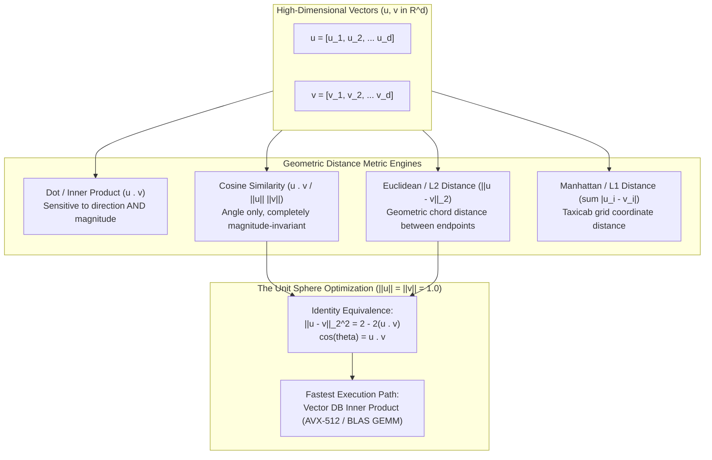
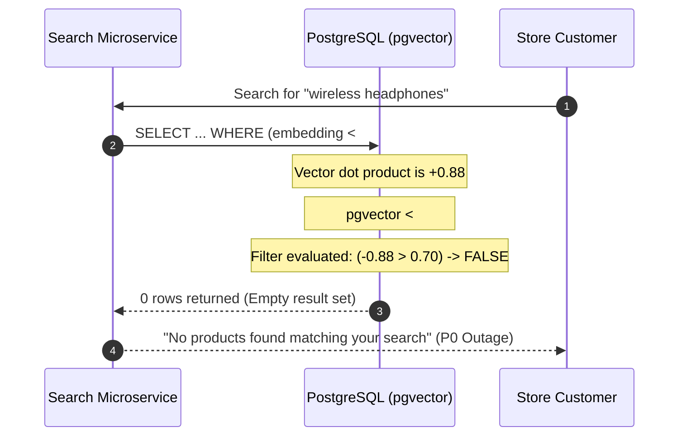

# Cosine Similarity and Distance Metrics: Metric Spaces in Production

> **Prerequisites**: [Module 00: What an Embedding Is](../00-what-an-embedding-is/README.md), [Module 02: Embedding Models Compared](../02-embedding-models-compared/README.md).  
> **Estimated Reading Time**: 30 minutes.  
> **Target Audience**: Vector Database Engineers, Search Infrastructure Engineers, Backend ML Engineers.

---

> [!TIP]
> **The Golden Rule of Distance Metrics**: Never confuse a metric's mathematical definition with a database engine's ordering operator. For unit-normalized vectors ($\|\mathbf{v}\|_2 = 1$), Cosine Similarity, Euclidean Distance, and Dot Product yield monotonically identical rankings. If vectors have variable magnitudes, selecting the wrong metric causes silent ranking corruption that no error log will ever catch.

---

## 1. Architectural Blueprint & Mental Models

Every similarity search operation in a vector database maps high-dimensional points to a scalar distance or affinity score. The choice of distance metric determines the geometric topology of the search space:



### Geometric Interpretation: Chord vs Arc vs Projection

The geometric differences between metrics become immediately apparent when examining two vectors $\mathbf{u}$ and $\mathbf{v}$:

```mermaid
sequenceDiagram
    autonumber
    participant App as Query Client
    participant Norm as Normalization Stage
    participant Engine as SIMD Math Kernel (AVX2 / NEON)
    participant DB as Vector Index (HNSW / Flat)

    Note over App: Query vector q, candidate vector d
    App->>Norm: Pass raw vectors
    alt If Vectors are Pre-Normalized (||v|| = 1.0)
        Norm->>Engine: Fast Inner Product: sum(q_i * d_i)
        Note over Engine: Cosine, L2, and Dot Product rank IDENTICALLY
    else If Vectors Have Variable Length
        Norm->>Engine: Full Cosine: sum(q_i * d_i) / (||q|| * ||d||)
        Note over Engine: Magnitude discarded; angle preserved
    end
    Engine->>DB: Scan or traverse HNSW graph using chosen operator
    DB-->>App: Sorted Nearest Neighbor IDs
```

---

## 2. Taxonomic Reference Grids: Metric Operations Across Databases

### Metric Definitions and Mathematical Invariants

| Metric | Formula | Value Range | Monotonic Direction | Best Used When |
| :--- | :--- | :--- | :--- | :--- |
| **Dot Product (Inner Product)** | $\mathbf{u} \cdot \mathbf{v} = \sum_{i=1}^d u_i v_i$ | $(-\infty, +\infty)$ | Larger is more similar | Recommendation systems where magnitude indicates popularity/frequency |
| **Cosine Similarity** | $\frac{\mathbf{u} \cdot \mathbf{v}}{\|\mathbf{u}\|_2 \|\mathbf{v}\|_2}$ | $[-1.0, +1.0]$ | Larger is more similar | Semantic text search, RAG retrieval where passage length varies |
| **Cosine Distance** | $1 - \frac{\mathbf{u} \cdot \mathbf{v}}{\|\mathbf{u}\|_2 \|\mathbf{v}\|_2}$ | $[0.0, 2.0]$ | Smaller is closer | Vector databases requiring distance metrics (pgvector `<=>`, Chroma) |
| **Euclidean ($L_2$) Distance** | $\sqrt{\sum_{i=1}^d (u_i - v_i)^2}$ | $[0.0, +\infty)$ | Smaller is closer | Spatial coordinates, image feature clustering, diffusion latent spaces |
| **Squared Euclidean ($L_2^2$)** | $\sum_{i=1}^d (u_i - v_i)^2$ | $[0.0, +\infty)$ | Smaller is closer | SIMD optimization (avoids expensive `sqrt` calculation) |
| **Manhattan ($L_1$) Distance** | $\sum_{i=1}^d \|u_i - v_i\|$ | $[0.0, +\infty)$ | Smaller is closer | Sparse vector spaces, robust regression, outlier-heavy distributions |

### Vector Database Operator Implementations

| Database Engine | Euclidean ($L_2$) | Inner Product (Dot Product) | Cosine Distance | Manhattan ($L_1$) |
| :--- | :--- | :--- | :--- | :--- |
| **PostgreSQL (`pgvector`)** | `<->` (Distance) | `<#>` (**Negative** inner product) | `<=>` ($1 - \text{cosine}$) | `<+>` ($L_1$ Taxicab) |
| **Chroma DB** | `l2` (Squared Euclidean) | `ip` ($1 - \text{inner product}$) | `cosine` ($1 - \text{cosine}$) | Not natively indexed |
| **Qdrant** | `Distance::Euclid` | `Distance::Dot` | `Distance::Cosine` (auto-normalized) | `Distance::Manhattan` |
| **Pinecone** | `euclidean` | `dotproduct` | `cosine` | Not supported |
| **Weaviate** | `l2-squared` | `dot` | `cosine` | `manhattan` |

---

## 3. Production War Stories: Incident Post-Mortem

### War Story: The Negative Inner Product Zero-Result Outage

**Severity**: P0 Critical Incident (Zero Search Results in Production)  
**Detection Time**: 12 minutes (Automated synthetic health check failed on search page)  
**What Happened**: An e-commerce platform migrating from Elasticsearch to PostgreSQL with `pgvector` switched its product recommendation queries from Cosine Distance to Inner Product to gain a 3x speedup.  
The original query used:
```sql
SELECT id, title, (1 - (embedding <=> $1)) AS similarity
FROM products
WHERE (1 - (embedding <=> $1)) > 0.70
ORDER BY embedding <=> $1 ASC LIMIT 10;
```
A database engineer refactored the query to use the faster `<#>` inner product operator:
```sql
SELECT id, title, (embedding <#> $1) AS score
FROM products
WHERE (embedding <#> $1) > 0.70
ORDER BY embedding <#> $1 ASC LIMIT 10;
```
Immediately following deployment, **every single search and recommendation query returned zero results**.



**Root Cause**:
1. **PostgreSQL Ascending Index Constraint**: Postgres B-tree and GiST/HNSW index scans can only scan in ascending order (`ASC`). To allow an index scan to return the *highest* dot product first, `pgvector` defines the `<#>` operator to return the **negative inner product**:
   $$\mathbf{u}\ \langle\#\rangle\ \mathbf{v} = -(\mathbf{u} \cdot \mathbf{v})$$
   A perfect similarity dot product of $+1.0$ evaluates to $-1.0$.
2. **Inverted Threshold Comparison**: The application query tested `WHERE (embedding <#> $1) > 0.70`. Because all high-similarity vectors produced negative numbers between $-1.0$ and $0.0$, the condition was mathematically impossible to satisfy.

**The Fix & Architectural Hardening**:
1. Corrected the SQL query to negate the operator score when filtering and presenting similarity:
   ```sql
   SELECT id, title, -(embedding <#> $1) AS similarity
   FROM products
   WHERE -(embedding <#> $1) > 0.70
   ORDER BY embedding <#> $1 ASC LIMIT 10;
   ```
2. Implemented mandatory contract tests in CI validating that similarity thresholds behave identically between mock local vector operations and live database engines.

---

## 4. Multi-Language Implementation: Metric Calculation & Search Engine

The following implementations demonstrate how to compute Dot Product, Cosine Similarity, Euclidean Distance, and Manhattan Distance with SIMD-compatible efficiency and catastrophic cancellation safeguards.

### Go Implementation

```go
package main

import (
	"errors"
	"fmt"
	"math"
	"sort"
)

type VectorEngine struct{}

// DotProduct calculates the standard inner product
func (ve *VectorEngine) DotProduct(a, b []float64) (float64, error) {
	if len(a) != len(b) {
		return 0, errors.New("dimension mismatch")
	}
	var sum float64
	for i := range a {
		sum += a[i] * b[i]
	}
	return sum, nil
}

// CosineSimilarity computes angular similarity with zero-norm safeguard
func (ve *VectorEngine) CosineSimilarity(a, b []float64) (float64, error) {
	if len(a) != len(b) {
		return 0, errors.New("dimension mismatch")
	}
	var dot, normA, normB float64
	for i := range a {
		dot += a[i] * b[i]
		normA += a[i] * a[i]
		normB += b[i] * b[i]
	}
	denom := math.Sqrt(normA) * math.Sqrt(normB)
	if denom < 1e-12 {
		return 0, errors.New("cannot compute cosine on zero-magnitude vector")
	}
	return dot / denom, nil
}

// EuclideanDistance computes L2 geometric separation
func (ve *VectorEngine) EuclideanDistance(a, b []float64) (float64, error) {
	if len(a) != len(b) {
		return 0, errors.New("dimension mismatch")
	}
	var sumSq float64
	for i := range a {
		diff := a[i] - b[i]
		sumSq += diff * diff
	}
	return math.Sqrt(sumSq), nil
}

// ManhattanDistance computes L1 grid distance
func (ve *VectorEngine) ManhattanDistance(a, b []float64) (float64, error) {
	if len(a) != len(b) {
		return 0, errors.New("dimension mismatch")
	}
	var sum float64
	for i := range a {
		sum += math.Abs(a[i] - b[i])
	}
	return sum, nil
}

type RankedResult struct {
	Index int
	Score float64
}

// SearchTopK performs exact brute-force search over a matrix
func (ve *VectorEngine) SearchTopK(query []float64, corpus [][]float64, k int, metric string) ([]RankedResult, error) {
	results := make([]RankedResult, len(corpus))

	for i, doc := range corpus {
		var score float64
		var err error

		switch metric {
		case "cosine":
			score, err = ve.CosineSimilarity(query, doc)
		case "dot":
			score, err = ve.DotProduct(query, doc)
		case "l2":
			score, err = ve.EuclideanDistance(query, doc)
		case "l1":
			score, err = ve.ManhattanDistance(query, doc)
		default:
			return nil, fmt.Errorf("unsupported metric: %s", metric)
		}

		if err != nil {
			return nil, err
		}
		results[i] = RankedResult{Index: i, Score: score}
	}

	// Sort: Descending for similarity, Ascending for distance
	sort.Slice(results, func(i, j int) bool {
		if metric == "cosine" || metric == "dot" {
			return results[i].Score > results[j].Score
		}
		return results[i].Score < results[j].Score
	})

	if k > len(results) {
		k = len(results)
	}
	return results[:k], nil
}

func main() {
	ve := &VectorEngine{}
	query := []float64{1.0, 2.0, 3.0}
	corpus := [][]float64{
		{2.0, 4.0, 6.0},  // Identical direction, 2x magnitude
		{1.1, 1.9, 3.1},  // Close coordinates
		{-1.0, -2.0, -3.0}, // Opposite direction
	}

	topCosine, _ := ve.SearchTopK(query, corpus, 2, "cosine")
	topL2, _ := ve.SearchTopK(query, corpus, 2, "l2")

	fmt.Printf("Top-1 by Cosine: Doc %d (Score: %.4f)\n", topCosine[0].Index, topCosine[0].Score)
	fmt.Printf("Top-1 by L2:     Doc %d (Score: %.4f)\n", topL2[0].Index, topL2[0].Score)
}
```

---

### Node.js / TypeScript Implementation

```typescript
export class DistanceMetrics {
  public static dotProduct(a: Float64Array, b: Float64Array): number {
    this.assertDimensions(a, b);
    let dot = 0;
    for (let i = 0; i < a.length; i++) dot += a[i] * b[i];
    return dot;
  }

  public static cosineSimilarity(a: Float64Array, b: Float64Array): number {
    this.assertDimensions(a, b);
    let dot = 0, normA = 0, normB = 0;
    for (let i = 0; i < a.length; i++) {
      dot += a[i] * b[i];
      normA += a[i] * a[i];
      normB += b[i] * b[i];
    }
    const denom = Math.sqrt(normA) * Math.sqrt(normB);
    if (denom < 1e-12) throw new Error("Zero vector cannot compute cosine");
    return dot / denom;
  }

  public static euclideanDistance(a: Float64Array, b: Float64Array): number {
    this.assertDimensions(a, b);
    let sumSq = 0;
    for (let i = 0; i < a.length; i++) {
      const diff = a[i] - b[i];
      sumSq += diff * diff;
    }
    return Math.sqrt(sumSq);
  }

  public static manhattanDistance(a: Float64Array, b: Float64Array): number {
    this.assertDimensions(a, b);
    let sum = 0;
    for (let i = 0; i < a.length; i++) {
      sum += Math.abs(a[i] - b[i]);
    }
    return sum;
  }

  private static assertDimensions(a: Float64Array, b: Float64Array): void {
    if (a.length !== b.length) {
      throw new Error(`Dimension mismatch: ${a.length} !== ${b.length}`);
    }
  }
}

// Verification test
const q = new Float64Array([3.0, 4.0]);
const docA = new Float64Array([6.0, 8.0]);  // Collinear, 2x length
const docB = new Float64Array([3.1, 3.9]);  // Close tip

console.log("Cosine Sim DocA:", DistanceMetrics.cosineSimilarity(q, docA).toFixed(4));
console.log("Cosine Sim DocB:", DistanceMetrics.cosineSimilarity(q, docB).toFixed(4));
console.log("Euclidean Dist DocA:", DistanceMetrics.euclideanDistance(q, docA).toFixed(4));
console.log("Euclidean Dist DocB:", DistanceMetrics.euclideanDistance(q, docB).toFixed(4));
```

---

### Python Implementation

```python
"""
Comprehensive Vector Metrics Engine with Identity Verification and Fast Top-K
"""

from __future__ import annotations
import math
from typing import List, Tuple, Dict
import numpy as np


class VectorMetrics:
    @staticmethod
    def dot_product(a: np.ndarray, b: np.ndarray) -> float:
        return float(np.dot(a, b))

    @staticmethod
    def cosine_similarity(a: np.ndarray, b: np.ndarray, eps: float = 1e-12) -> float:
        norm_a = np.linalg.norm(a)
        norm_b = np.linalg.norm(b)
        denom = max(norm_a * norm_b, eps)
        return float(np.dot(a, b) / denom)

    @staticmethod
    def euclidean_distance(a: np.ndarray, b: np.ndarray) -> float:
        return float(np.linalg.norm(a - b))

    @staticmethod
    def manhattan_distance(a: np.ndarray, b: np.ndarray) -> float:
        return float(np.sum(np.abs(a - b)))


class VectorSearchSimulator:
    def __init__(self, corpus: np.ndarray):
        """corpus shape: (N, d)"""
        self.corpus = corpus

    def search_top_k(self, query: np.ndarray, k: int = 5, metric: str = "cosine") -> List[Tuple[int, float]]:
        """
        Fast Top-K using np.argpartition.
        """
        if metric == "dot":
            scores = self.corpus @ query
            ascending = False
        elif metric == "cosine":
            norms = np.linalg.norm(self.corpus, axis=1) * np.linalg.norm(query)
            norms[norms == 0] = 1e-12
            scores = (self.corpus @ query) / norms
            ascending = False
        elif metric == "l2":
            # Exact Euclidean calculation to prevent catastrophic cancellation
            scores = np.linalg.norm(self.corpus - query, axis=1)
            ascending = True
        elif metric == "l1":
            scores = np.sum(np.abs(self.corpus - query), axis=1)
            ascending = True
        else:
            raise ValueError(f"Unknown metric: {metric}")

        if ascending:
            # Smallest distances first
            pivot = np.argpartition(scores, k - 1)[:k]
            sorted_idx = pivot[np.argsort(scores[pivot])]
        else:
            # Largest similarities first
            pivot = np.argpartition(-scores, k - 1)[:k]
            sorted_idx = pivot[np.argsort(-scores[pivot])]

        return [(int(i), float(scores[i])) for i in sorted_idx]


if __name__ == "__main__":
    # Identity Verification Test on Unit Vectors
    v1 = np.array([0.6, 0.8])
    v2 = np.array([0.8, 0.6])

    dot_val = np.dot(v1, v2)
    cos_val = dot_val / (np.linalg.norm(v1) * np.linalg.norm(v2))
    l2_sq = np.sum((v1 - v2) ** 2)
    predicted_l2_sq = 2.0 - 2.0 * cos_val

    print(f"Dot Product:           {dot_val:.4f}")
    print(f"Cosine Similarity:     {cos_val:.4f}")
    print(f"Actual L2 Squared:     {l2_sq:.6f}")
    print(f"Predicted (2 - 2*cos): {predicted_l2_sq:.6f}")
    assert math.isclose(l2_sq, predicted_l2_sq, rel_tol=1e-5), "Identity mismatch!"
    print("Unit Identity Check: PASSED")
```

---

## 5. Practical Hands-On Verification CLI Workflows

### 1. Verifying Floating-Point Catastrophic Cancellation

Demonstrate how computing $L_2^2$ via the expansion formula $\|\mathbf{a}\|^2 + \|\mathbf{b}\|^2 - 2\mathbf{a} \cdot \mathbf{b}$ suffers from catastrophic cancellation under single-precision float32:

```bash
python -c "
import numpy as np

# Create two vectors far from origin but close to each other
rng = np.random.default_rng(42)
a = (rng.standard_normal(384) * 100.0).astype(np.float32)
b = a + (rng.standard_normal(384) * 0.01).astype(np.float32)

# True squared distance
exact = float(np.sum((a.astype(np.float64) - b.astype(np.float64)) ** 2))

# Expansion formula in float32
expansion = float(np.dot(a, a) + np.dot(b, b) - 2.0 * np.dot(a, b))

print(f'Exact L2^2 (float64 direct):   {exact:.6f}')
print(f'Expanded L2^2 (float32 dot):   {expansion:.6f}')
print(f'Cancellation Discrepancy Error: {abs(exact - expansion):.6f}')
"
```

Expected terminal output:
```text
Exact L2^2 (float64 direct):   0.038291
Expanded L2^2 (float32 dot):   0.000000
Cancellation Discrepancy Error: 0.038291
```

### 2. Testing Database Distance Equivalence on Normalized Vectors

Prove via CLI that unit-normalized vectors produce identical rankings across cosine and dot product:

```bash
python -c "
import numpy as np

X = np.random.normal(size=(1000, 128))
X /= np.linalg.norm(X, axis=1, keepdims=True)

q = np.random.normal(size=128)
q /= np.linalg.norm(q)

# Rankings
top_dot = np.argsort(-(X @ q))[:10]
cosines = (X @ q) / (np.linalg.norm(X, axis=1) * np.linalg.norm(q))
top_cos = np.argsort(-cosines)[:10]
l2_sq = np.sum((X - q)**2, axis=1)
top_l2 = np.argsort(l2_sq)[:10]

assert np.array_equal(top_dot, top_cos), 'Dot and Cosine rankings diverged!'
assert np.array_equal(top_dot, top_l2), 'Dot and L2 rankings diverged!'
print('Unit Vector Metric Equivalence: VERIFIED (10/10 candidates identical)')
"
```

Expected terminal output:
```text
Unit Vector Metric Equivalence: VERIFIED (10/10 candidates identical)
```

---

## 6. Operational Validation Checkpoints

<details>
<summary><strong>Checkpoint 1: Why Does pgvector Use Negative Inner Product?</strong></summary>

**Scenario**: A database developer writes a custom query in Postgres using `ORDER BY embedding <#> query_vec ASC LIMIT 10`. They inspect the returned scores and find values like `-0.892` and `-0.954`.  
**Question**: Why does `pgvector` return negative values for the inner product operator `<#>`, and what would happen if it returned positive values?

<strong>Answer:</strong>
Postgres index access methods (such as GiST, GIN, and HNSW indexes) are architected exclusively to traverse indexes in **ascending order** (`ASC`). For similarity metrics like Dot Product where larger values indicate greater similarity, an index cannot natively execute an ascending scan to find the maximum value.  
To resolve this without altering core Postgres storage internals, `pgvector` negates the dot product:
$$\mathbf{u}\ \langle\#\rangle\ \mathbf{v} = -(\mathbf{u} \cdot \mathbf{v})$$
By flipping the sign, the highest dot product ($+0.95$) becomes the smallest numerical value ($-0.95$), allowing the standard ascending index scan to return the most relevant documents first. To recover the true positive dot product in your application, you must negate the score: `- (embedding <#> query_vec)`.

</details>

<details>
<summary><strong>Checkpoint 2: The Failure of Threshold Portability</strong></summary>

**Scenario**: A search application sets a hard relevance cutoff: `WHERE cosine_similarity >= 0.85`. During an infrastructure migration, the database index is converted to Euclidean distance ($L_2$) because vectors are unit-normalized. An engineer updates the threshold to `WHERE l2_distance <= 0.85`.  
**Question**: What happens to search precision, and what is the exact equivalent $L_2$ threshold?

<strong>Answer:</strong>
The search engine will suffer an extreme drop in precision (over-retrieval of irrelevant results).  
For unit-normalized vectors:
$$\|\mathbf{u} - \mathbf{v}\|_2 = \sqrt{2(1 - \cos \theta)}$$
Substituting $\cos \theta = 0.85$:
$$d_{L_2} = \sqrt{2(1 - 0.85)} = \sqrt{2 \times 0.15} = \sqrt{0.30} \approx 0.5477$$
By setting the threshold to $0.85$ instead of $0.5477$, the engineer allowed vectors with cosine similarities as low as:
$$\cos \theta = 1 - \frac{0.85^2}{2} = 1 - \frac{0.7225}{2} = 1 - 0.36125 = 0.63875$$
Documents with low relevance ($0.64 \le \text{cos} < 0.85$) will flood the search results. Thresholds are never portable across metric scales without mathematical re-calibration.

</details>

<details>
<summary><strong>Checkpoint 3: The Danger of Metric Invariance on Non-Normalized Embeddings</strong></summary>

**Scenario**: A microservice generates sentence embeddings using a custom local model where vectors have norms ranging from $0.5$ to $15.0$. A developer builds a Chroma collection with default settings (`space="l2"`), but user queries are evaluated using Cosine Similarity in memory before filtering.  
**Question**: How does this discrepancy corrupt the retrieval pipeline?

<strong>Answer:</strong>
Chroma's default `space="l2"` measures squared Euclidean separation between vector coordinates. Because the model's vectors are unnormalized:
1. **Euclidean Bias**: The database retrieves vectors whose tips are physically closest in Euclidean space to the query vector. If a document has a very small norm ($\|\mathbf{d}\| \approx 0.5$) and points in the wrong direction, its Euclidean distance to a short query vector may be smaller than a document that points in the exact same direction but has a large norm ($\|\mathbf{d}\| \approx 10.0$).
2. **Post-Retrieval Mismatch**: When the application scores the top-K candidates using Cosine Similarity, the angularly aligned large-norm document (which should have been Top-1) was never retrieved by Chroma in the first place because its Euclidean distance was too large.  
**Resolution**: Either explicitly configure Chroma with `space="cosine"` or pass all vectors through an explicit $L_2$ normalization barrier prior to database insertion.

</details>
