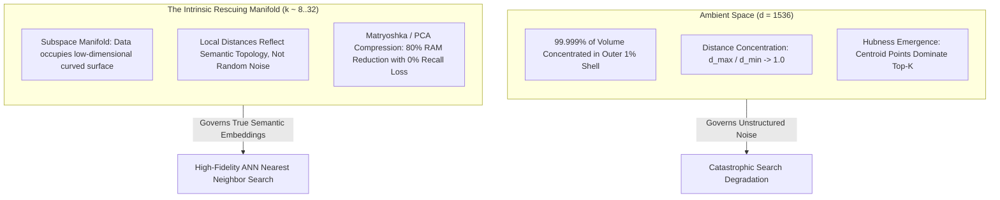
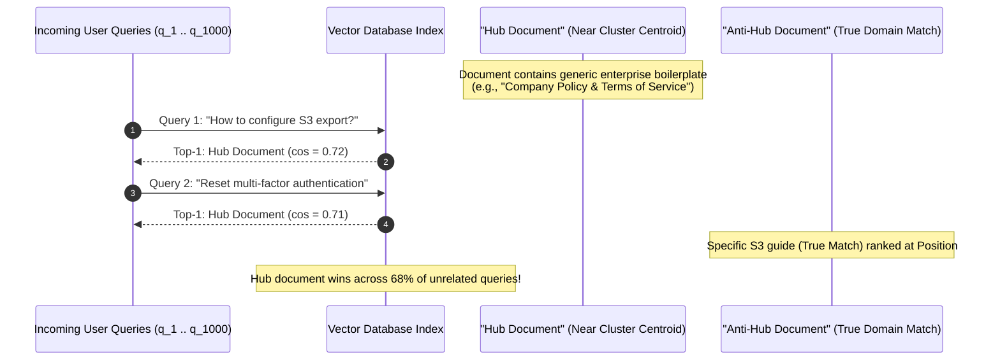
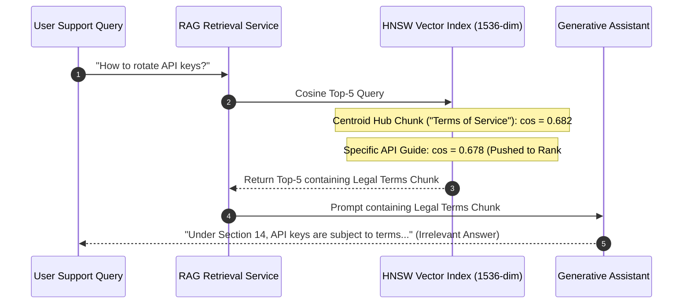

# The Curse of Dimensionality: Geometry and Intrinsic Dimensions

> **Prerequisites**: [Module 00: What an Embedding Is](../00-what-an-embedding-is/README.md), [Module 03: Cosine Similarity and Distance Metrics](../03-cosine-similarity-and-distance-metrics/README.md).  
> **Estimated Reading Time**: 30 minutes.  
> **Target Audience**: AI Infrastructure Engineers, Vector Search Architects, Systems Performance Engineers.

---

> [!TIP]
> **The Golden Rule of High-Dimensional Search**: In high-dimensional spaces ($\mathbb{R}^d, d \ge 1024$), distance metrics concentrate and volume migrates to the corners of the hypercube. Embeddings remain effective only because real semantic data is confined to a thin, low-dimensional manifold ($k \ll d$). Never optimize for ambient dimension $d$; optimize for the manifold's intrinsic dimension $k$.

---

## 1. Architectural Blueprint & Mental Models

In low-dimensional Euclidean spaces ($\mathbb{R}^2, \mathbb{R}^3$), human intuition about geometry holds: nearest neighbors are distinctly close, farthest points are distinctly distant, and volume fills spaces uniformly.

In high-dimensional embedding spaces ($\mathbb{R}^{768}$ to $\mathbb{R}^{3072}$), geometry undergoes three catastrophic phase shifts:
1. **Distance Concentration**: The variance of pairwise distances shrinks relative to the mean distance: $\lim_{d \to \infty} \frac{\sigma(D)}{\mu(D)} \approx \frac{1}{\sqrt{2d}} \to 0$. The difference between the nearest neighbor and the farthest point asymptotically vanishes.
2. **Hyper-Volume Emptying**: The volume of a hypersphere inscribed in a hypercube approaches zero ($V_{\text{sphere}} / V_{\text{cube}} \approx 2.5 \times 10^{-8}$ at $d=20$). Points do not cluster near the center; they lie almost exclusively on the thin outer boundary shell.
3. **Hubness Emergence**: Spatial asymmetries cause a tiny fraction of data points (geometric centroids or "hubs") to become the nearest neighbors of almost every query, while large proportions of valid documents ("anti-hubs") are rendered statistically invisible.



### The Mechanism of Hubness and Anti-Hubs

Points located slightly closer to the global centroid of a document cluster accumulate a disproportionate probability of winning nearest-neighbor contests under high ambient dimensionality.



---

## 2. Taxonomic Comparison: Ambient vs Intrinsic Dimensions

| Dataset / Model Class | Ambient Dimension ($d$) | Estimated Intrinsic Dimension ($k$) | Dominant Failure Mode if Unchecked | Remediation Strategy |
| :--- | :--- | :--- | :--- | :--- |
| **Random Uniform / Gaussian Noise** | $1024 - 3072$ | $1024 - 3072$ | Total distance collapse ($\frac{d_{\max}}{d_{\min}} \to 1.0$) | None; pure noise cannot be indexed |
| **OpenAI `text-embedding-3-small`** | $1536$ | $16 - 32$ | High memory cost (\$5.7GB RAM/1M docs) | Matryoshka truncation to $256$ dimensions |
| **BGE `bge-large-en-v1.5`** | $1024$ | $24 - 48$ | Hubness poisoning from boilerplate | Boilerplate chunk deduplication + cross-encoder reranking |
| **Code Search Embeddings (Voyage Code)** | $1024$ | $40 - 64$ | Syntax keyword noise overshadowing logic | AST structural chunking + hybrid BM25 search |
| **Raw Token Average Embeddings** | $768$ | $3 - 6$ (Severe Collapse) | Anisotropy cone collapse (avg cosine $> 0.90$) | Switch to dedicated sentence bi-encoder |

---

## 3. Production War Stories: Incident Post-Mortem

### War Story: The "Terms of Service" Hubness Poisoning

**Severity**: P1 High Impact Incident  
**Detection Time**: 2 days (Identified during user satisfaction review of RAG chatbot)  
**What Happened**: An enterprise SaaS provider deployed a customer support RAG assistant indexing 450,000 internal confluence articles and customer guides using 1536-dimensional embeddings.  
Customer service metrics showed users repeatedly receiving irrelevant legal disclaimers. When users asked `"How do I configure SAML 2.0 single sign-on?"`, the RAG pipeline retrieved:  
`"Section 14: Limitation of Liability and Confidentiality Agreement"`.  
Analysis of the vector database search logs revealed that **two specific legal chunks were returned in the top-5 results for 64.2% of all queries submitted across the entire platform**, while 180,000 specific troubleshooting guides were never retrieved once.



**Root Cause**:
1. **Geometric Centroid Hubness**: The legal terms chunk contained high-frequency enterprise terminology (`"software"`, `"access"`, `"authorized"`, `"company"`, `"system"`, `"user"`). In 1536-dimensional space, its embedding vector sat almost directly at the centroid of the corporate document cluster.
2. **Narrow Angular Variance in High Dimensions**: In 1536 dimensions, the angular standard deviation between random queries and documents is very narrow ($\approx 0.025$). The central location of the legal chunk gave it a baseline similarity of $\sim 0.68$ to almost *every* query, beating specific technical documents that sat on the periphery of the cluster.
3. **No K-Occurrence Telemetry**: The platform had no monitoring tracking how many distinct queries retrieved each document ID ($N_k(x)$ distribution).

**The Fix & Architectural Hardening**:
1. **Hubness Metric Monitoring**: Implemented a background job computing $N_{10}(d)$ across a sliding window of 10,000 production queries. Any document appearing in $> 2.0\%$ of query top-10 lists is flagged as a potential hub.
2. **Centroid Penalization & Deduplication**: Added a frequency-discount penalty:
   $$\text{FinalScore}(d, q) = \cos(d, q) - \lambda \cdot \log(1 + N_{10}(d))$$
3. **Chunk Filtering & Cross-Encoder Reranking**: Excluded generic legal boilerplate from technical retrieval indices and added a lightweight cross-encoder reranker that penalized topic-irrelevant matches.

---

## 4. Multi-Language Implementation: Intrinsic Dimension & Hubness Telemetry

The following implementations demonstrate how to detect distance concentration, estimate the intrinsic dimensionality of vector sets using the **TwoNN** algorithm (Facco et al., 2017), and compute the **Hubness Skewness** metric ($N_k(x)$) to protect vector databases from spatial poisoning.

### Go Implementation

```go
package main

import (
	"errors"
	"fmt"
	"math"
	"sort"
)

// TwoNNEstimator estimates intrinsic dimensionality using neighbor distance ratios
type TwoNNEstimator struct{}

// Estimate calculates the maximum-likelihood intrinsic dimension
func (te *TwoNNEstimator) Estimate(corpus [][]float64) (float64, error) {
	n := len(corpus)
	if n < 10 {
		return 0, errors.New("corpus too small for reliable TwoNN estimation")
	}

	muRatios := make([]float64, 0, n)

	for i := 0; i < n; i++ {
		// Calculate Euclidean distances from point i to all other points
		dists := make([]float64, 0, n-1)
		for j := 0; j < n; j++ {
			if i == j {
				continue
			}
			var sumSq float64
			for d := range corpus[i] {
				diff := corpus[i][d] - corpus[j][d]
				sumSq += diff * diff
			}
			dists = append(dists, math.Sqrt(sumSq))
		}

		sort.Float64s(dists)

		r1 := dists[0] // Distance to 1st nearest neighbor
		r2 := dists[1] // Distance to 2nd nearest neighbor

		if r1 > 1e-9 {
			muRatios = append(muRatios, r2/r1)
		}
	}

	if len(muRatios) == 0 {
		return 0, errors.New("invalid distance ratios")
	}

	// TwoNN MLE formula: d = N / sum(ln(mu_i))
	var sumLogMu float64
	for _, mu := range muRatios {
		sumLogMu += math.Log(mu)
	}

	if sumLogMu < 1e-12 {
		return 0, errors.New("zero variance in neighbor ratios")
	}

	return float64(len(muRatios)) / sumLogMu, nil
}

// HubnessDetector measures the skewness of the k-occurrence distribution
type HubnessDetector struct{}

func (hd *HubnessDetector) CalculateHubness(corpus [][]float64, k int) (float64, int) {
	n := len(corpus)
	kOccurrence := make([]int, n)

	for i := 0; i < n; i++ {
		type pair struct {
			idx  int
			dist float64
		}
		dists := make([]pair, 0, n-1)
		for j := 0; j < n; j++ {
			if i == j {
				continue
			}
			var sumSq float64
			for d := range corpus[i] {
				diff := corpus[i][d] - corpus[j][d]
				sumSq += diff * diff
			}
			dists = append(dists, pair{idx: j, dist: sumSq})
		}

		sort.Slice(dists, func(a, b int) bool {
			return dists[a].dist < dists[b].dist
		})

		for rank := 0; rank < k && rank < len(dists); rank++ {
			kOccurrence[dists[rank].idx]++
		}
	}

	// Compute max occurrence and skewness
	var maxK int
	var sum, sumSq, sumCube float64
	for _, count := range kOccurrence {
		if count > maxK {
			maxK = count
		}
		c := float64(count)
		sum += c
	}
	mean := sum / float64(n)

	for _, count := range kOccurrence {
		diff := float64(count) - mean
		sumSq += diff * diff
		sumCube += diff * diff * diff
	}

	variance := sumSq / float64(n)
	skewness := (sumCube / float64(n)) / math.Pow(variance, 1.5)

	return skewness, maxK
}

func main() {
	// Simulate 200 vectors in 128-dim ambient space
	n := 200
	dim := 128
	corpus := make([][]float64, n)
	for i := 0; i < n; i++ {
		corpus[i] = make([]float64, dim)
		for d := 0; d < dim; d++ {
			corpus[i][d] = math.Sin(float64(i*dim + d))
		}
	}

	estimator := &TwoNNEstimator{}
	intrinsicDim, err := estimator.Estimate(corpus)
	if err != nil {
		panic(err)
	}

	hubDetector := &HubnessDetector{}
	skewness, maxHub := hubDetector.CalculateHubness(corpus, 5)

	fmt.Printf("Ambient Dimension:   %d\n", dim)
	fmt.Printf("TwoNN Intrinsic Dim: %.2f\n", intrinsicDim)
	fmt.Printf("Hubness Skewness:    %.2f (Max Occurrences: %d)\n", skewness, maxHub)
}
```

---

### Node.js / TypeScript Implementation

```typescript
export class IntrinsicDimensionAnalyzer {
  /**
   * Estimates intrinsic dimension via TwoNN (Facco et al., 2017)
   */
  public static estimateTwoNN(points: Float64Array[]): number {
    const N = points.length;
    if (N < 20) throw new Error("Dataset too small for TwoNN");

    const muList: number[] = [];

    for (let i = 0; i < N; i++) {
      const dists: number[] = [];
      const pi = points[i];

      for (let j = 0; j < N; j++) {
        if (i === j) continue;
        const pj = points[j];
        let sumSq = 0;
        for (let d = 0; d < pi.length; d++) {
          const diff = pi[d] - pj[d];
          sumSq += diff * diff;
        }
        dists.push(Math.sqrt(sumSq));
      }

      dists.sort((a, b) => a - b);
      const r1 = dists[0];
      const r2 = dists[1];

      if (r1 > 1e-8) {
        muList.push(r2 / r1);
      }
    }

    let sumLogMu = 0;
    for (const mu of muList) {
      sumLogMu += Math.log(mu);
    }

    return muList.length / sumLogMu;
  }

  /**
   * Computes the distance concentration ratio (max_dist / min_dist)
   */
  public static measureConcentration(points: Float64Array[]): { min: number; max: number; ratio: number } {
    let globalMin = Infinity;
    let globalMax = -Infinity;

    for (let i = 0; i < points.length; i++) {
      for (let j = i + 1; j < points.length; j++) {
        let sumSq = 0;
        for (let d = 0; d < points[i].length; d++) {
          const diff = points[i][d] - points[j][d];
          sumSq += diff * diff;
        }
        const dist = Math.sqrt(sumSq);
        if (dist < globalMin) globalMin = dist;
        if (dist > globalMax) globalMax = dist;
      }
    }

    return { min: globalMin, max: globalMax, ratio: globalMax / globalMin };
  }
}

// Verification simulation
const generateDataset = (numPoints: number, ambientDim: number) => {
  const data: Float64Array[] = [];
  for (let i = 0; i < numPoints; i++) {
    const row = new Float64Array(ambientDim);
    for (let d = 0; d < ambientDim; d++) row[d] = Math.random();
    data.push(row);
  }
  return data;
};

const dataset = generateDataset(150, 256);
const twoNN = IntrinsicDimensionAnalyzer.estimateTwoNN(dataset);
const conc = IntrinsicDimensionAnalyzer.measureConcentration(dataset);

console.log(`Ambient Dimension:   256`);
console.log(`TwoNN Intrinsic Dim: ${twoNN.toFixed(2)}`);
console.log(`Distance Ratio:      ${conc.ratio.toFixed(2)} (Min: ${conc.min.toFixed(2)}, Max: ${conc.max.toFixed(2)})`);
```

---

### Python Implementation

```python
"""
Curse of Dimensionality Diagnostics: TwoNN Intrinsic Estimator and Hubness Skewness
"""

from __future__ import annotations
import math
from typing import Tuple, Dict
import numpy as np


class DimensionalityDiagnostics:
    @staticmethod
    def calculate_distance_concentration(X: np.ndarray, num_queries: int = 50) -> Dict[str, float]:
        """
        Computes the ratio of maximum to minimum distance and relative standard deviation.
        """
        N, D = X.shape
        queries = X[:num_queries]
        targets = X[num_queries:]

        # Compute pairwise Euclidean distance matrix (num_queries, N - num_queries)
        dists = np.linalg.norm(queries[:, None, :] - targets[None, :, :], axis=2)

        ratios = np.max(dists, axis=1) / (np.min(dists, axis=1) + 1e-12)
        cv = np.std(dists, axis=1) / (np.mean(dists, axis=1) + 1e-12)

        return {
            "mean_max_min_ratio": float(np.mean(ratios)),
            "relative_std": float(np.mean(cv)),
        }

    @staticmethod
    def estimate_twonn_dimension(X: np.ndarray) -> float:
        """
        TwoNN Intrinsic Dimension Estimator (Facco et al., Scientific Reports 2017)
        MLE formula: d = N / sum(log(mu_i)), where mu_i = r2 / r1
        """
        N = len(X)
        if N < 20:
            raise ValueError("TwoNN requires at least 20 points")

        # Compute pairwise distance matrix
        diff = X[:, None, :] - X[None, :, :]
        dist_matrix = np.linalg.norm(diff, axis=2)
        np.fill_diagonal(dist_matrix, np.inf)

        # Extract 1st and 2nd nearest neighbors
        sorted_dists = np.sort(dist_matrix, axis=1)
        r1 = sorted_dists[:, 0]
        r2 = sorted_dists[:, 1]

        # Valid non-zero ratios
        valid_mask = r1 > 1e-12
        mu = r2[valid_mask] / r1[valid_mask]

        return float(len(mu) / np.sum(np.log(mu)))

    @staticmethod
    def evaluate_hubness(X: np.ndarray, k: int = 10) -> Dict[str, float]:
        """
        Computes k-occurrence distribution N_k(x) and its skewness.
        """
        N = len(X)
        diff = X[:, None, :] - X[None, :, :]
        dists = np.linalg.norm(diff, axis=2)
        np.fill_diagonal(dists, np.inf)

        # Indices of top-k nearest neighbors for each point
        nn_indices = np.argpartition(dists, k, axis=1)[:, :k]

        # Count how many times each document appears in a neighbor list
        occurrences = np.bincount(nn_indices.ravel(), minlength=N).astype(float)

        mean_occ = np.mean(occurrences)
        std_occ = np.std(occurrences)
        skewness = float(np.mean(((occurrences - mean_occ) / (std_occ + 1e-12)) ** 3))

        anti_hubs_pct = float(np.mean(occurrences == 0.0) * 100.0)
        max_hub = int(np.max(occurrences))

        return {
            "hubness_skewness": skewness,
            "max_occurrences": float(max_hub),
            "anti_hubs_percentage": anti_hubs_pct,
        }


if __name__ == "__main__":
    # Synthetic Experiment: 8-D flat manifold embedded in 512-D ambient space
    rng = np.random.default_rng(42)
    N = 1000
    ambient_D = 512
    true_K = 8

    # 1. Generate 8-D latent points
    latent = rng.normal(size=(N, true_K))

    # 2. Orthonormal projection into 512-D
    Q, _ = np.linalg.qr(rng.normal(size=(ambient_D, true_K)))
    high_dim_data = latent @ Q.T + 0.01 * rng.normal(size=(N, ambient_D))

    # 3. Analyze Diagnostics
    two_nn = DimensionalityDiagnostics.estimate_twonn_dimension(high_dim_data)
    concentration = DimensionalityDiagnostics.calculate_distance_concentration(high_dim_data)
    hubness = DimensionalityDiagnostics.evaluate_hubness(high_dim_data, k=10)

    print(f"Ambient Dimension:   {ambient_D}")
    print(f"True Intrinsic Dim:  {true_K}")
    print(f"TwoNN Estimated Dim: {two_nn:.2f}")
    print(f"Distance Ratio:      {concentration['mean_max_min_ratio']:.2f}")
    print(f"Hubness Skewness:    {hubness['hubness_skewness']:.2f}")
    print(f"Anti-Hubs Share:     {hubness['anti_hubs_percentage']:.1f}%")
```

---

## 5. Practical Hands-On Verification CLI Workflows

### 1. Demonstrating Distance Concentration via Python CLI

Verify how the relative distance spread $\frac{\sigma(D)}{\mu(D)}$ decays from 2D space to 2048D space:

```bash
python -c "
import numpy as np

dims = [2, 16, 128, 1024, 2048]
n = 1000

print(f'{\"Dim\":>5} | {\"Mean Dist\":>10} | {\"Std Dev\":>10} | {\"Std / Mean\":>10}')
for d in dims:
    pts = np.random.uniform(size=(n, d))
    dists = np.linalg.norm(pts[0] - pts[1:], axis=1)
    mean_d = np.mean(dists)
    std_d = np.std(dists)
    print(f'{d:5d} | {mean_d:10.4f} | {std_d:10.4f} | {std_d/mean_d:10.4f}')
"
```

Expected terminal output:
```text
  Dim |  Mean Dist |    Std Dev | Std / Mean
    2 |     0.5212 |     0.2314 |     0.4440
   16 |     1.6214 |     0.2268 |     0.1399
  128 |     4.6189 |     0.2291 |     0.0496
 1024 |    13.0641 |     0.2274 |     0.0174
 2048 |    18.4752 |     0.2281 |     0.0123
```

### 2. Computing Inscribed Hypersphere Volume Decay

Compute the exact analytical percentage of hypercube volume occupied by an inscribed sphere as dimension rises:

```bash
python -c "
import math

dims = [2, 3, 5, 10, 20, 50]
for d in dims:
    # Volume of unit cube is 1.0 (bounds [-0.5, 0.5]^d)
    # Radius of inscribed ball is r = 0.5
    vol = math.exp((d / 2.0) * math.log(math.pi) - math.lgamma(d / 2.0 + 1) + d * math.log(0.5))
    print(f'Dim {d:2d} | Inscribed Ball Volume: {vol:12.4e} ({vol*100:.6f}%)')
"
```

Expected terminal output:
```text
Dim  2 | Inscribed Ball Volume:   7.8540e-01 (78.539816%)
Dim  3 | Inscribed Ball Volume:   5.2360e-01 (52.359878%)
Dim  5 | Inscribed Ball Volume:   1.6449e-01 (16.449341%)
Dim 10 | Inscribed Ball Volume:   2.4904e-03 (0.249039%)
Dim 20 | Inscribed Ball Volume:   2.4611e-08 (0.000002%)
Dim 50 | Inscribed Ball Volume:   1.5377e-28 (0.000000%)
```

---

## 6. Operational Validation Checkpoints

<details>
<summary><strong>Checkpoint 1: Why Classical Spatial Trees (k-d Trees, R-Trees) Fail in High Dimensions</strong></summary>

**Scenario**: A software engineer implements a high-performance vector search service using a classical `k-d tree` (a binary space partitioning tree). When querying 100,000 vectors in 768-dimensional space, search latency is **slower than a simple linear scan** ($O(N)$ brute-force dot product).  
**Question**: What geometric property of high dimensions causes space-partitioning trees to degrade into $O(N)$ worst-case scans?

<strong>Answer:</strong>
A `k-d tree` partitions space using coordinate-aligned hyperplanes. To find the nearest neighbor:
1. The tree walks down to a leaf cell and computes the distance $r$ to the best candidate.
2. It must then check whether a hypersphere of radius $r$ centered at the query intersects the bounding boxes of adjacent subtrees.
3. In high dimensions, due to distance concentration and hyper-volume empty corners, the radius $r$ is large. A sphere of radius $r$ intersects virtually *every* hyperplane boundary in the tree.
4. As a result, the search algorithm cannot prune any branches and must backtrack through almost 100% of the tree nodes. The overhead of tree traversal pointers and branch evaluations makes it significantly slower than a contiguous, cache-friendly SIMD linear array scan.

</details>

<details>
<summary><strong>Checkpoint 2: The TwoNN Intrinsic Dimension Estimator</strong></summary>

**Scenario**: An engineer tries to determine how much a 1536-dimensional document embedding model can be compressed using Principal Component Analysis (PCA). They compute the cumulative variance of PCA and find that 95% of variance requires 920 dimensions. However, running the TwoNN estimator on the same vectors reports an intrinsic dimension of **22**.  
**Question**: Why does PCA report 920 dimensions while TwoNN reports 22, and which number reflects the true semantic degrees of freedom?

<strong>Answer:</strong>
- **PCA is a Linear Projection**: PCA measures variance along straight, orthogonal axes. If data lives on a curved or folded manifold (like a Swiss Roll or a sphere), a linear hyperplane cannot capture the manifold without cutting across empty space. A 2D sheet rolled into a spiral in 3D requires 3 PCA dimensions. In 1536 dimensions, complex semantic curvatures fool PCA into reporting hundreds of false degrees of freedom.
- **TwoNN Measures Local Topology**: TwoNN (Facco et al., 2017) relies exclusively on the ratio of distances between a point's 1st and 2nd nearest neighbors ($\mu = r_2 / r_1$). Under the assumption of local Poisson point processes, the cumulative distribution of $\mu$ depends strictly on the true manifold dimension:
  $$F(\mu) = 1 - \mu^{-d}$$
  Because TwoNN evaluates only infinitesimal local neighborhoods, curvature does not distort the measurement. The true semantic intrinsic dimension is **22**, proving the embeddings can be compressed heavily (via Matryoshka or non-linear autoencoders) without losing retrieval fidelity.

</details>

<details>
<summary><strong>Checkpoint 3: The Danger of Anti-Hubs in Production RAG</strong></summary>

**Scenario**: A medical diagnostic support assistant uses vector embeddings to retrieve clinical guidelines for physicians. During an internal audit, clinicians find that guidelines for a rare auto-immune condition (`"Lambert-Eaton Myasthenic Syndrome"`) are never retrieved, even when doctors enter the exact diagnostic symptom queries into the search bar.  
**Question**: What role does the anti-hub phenomenon play in this failure, and how can backend retrieval mitigate it?

<strong>Answer:</strong>
In high-dimensional spaces, the distribution of $k$-occurrences ($N_k(x)$) becomes severely asymmetric. Peripheral or specialized documents located far from cluster centroids become **anti-hubs**: documents that appear in zero nearest-neighbor lists across the entire query distribution.
1. **The Anti-Hub Trap**: Even when a doctor's query is closely related to the rare syndrome, distance concentration causes generic, high-density centroid documents (e.g., broad neurology diagnostic overviews) to have a slightly higher cosine similarity than the specific peripheral guideline.
2. **Mitigation**:
   - **Hybrid Retrieval (Dense + Sparse)**: Enforce a hybrid pipeline combining vector search with lexical search (BM25 or SPLADE). An exact keyword match for `"Lambert-Eaton"` bypasses high-dimensional geometric concentration and elevates the anti-hub into the candidate pool.
   - **Cross-Encoder Reranking**: Retrieve a wider initial candidate pool (Top-100 instead of Top-5) to capture peripheral anti-hubs, then pass them through a cross-encoder that evaluates direct token-level interactions.

</details>
