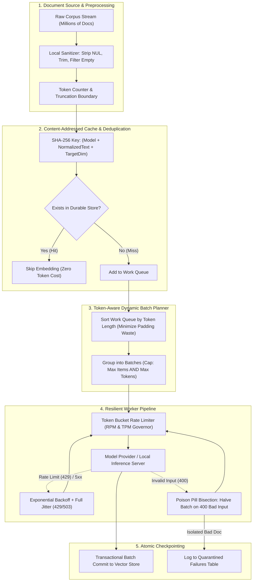
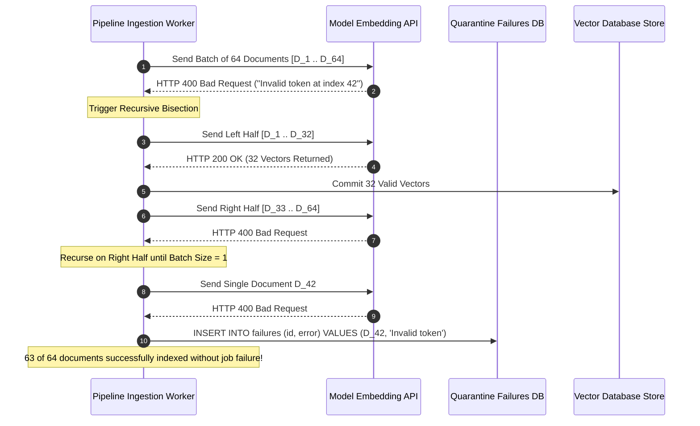

# Generating Embeddings at Scale: Resilient Production Ingestion Pipelines

> **Prerequisites**: [Module 00: What an Embedding Is](../00-what-an-embedding-is/README.md), [Module 02: Embedding Models Compared](../02-embedding-models-compared/README.md).  
> **Estimated Reading Time**: 32 minutes.  
> **Target Audience**: AI Platform Engineers, Distributed Systems Backend Engineers, Data Platform Architects.

---

> [!TIP]
> **The Golden Rule of Embedding Ingestion**: Treat embedding generation as an idempotent, content-addressed batch pipeline. Key every vector by a cryptographic hash of its exact inputs ($\text{SHA256}(\text{model} + \text{text} + \text{dim} + \text{prefix})$). Enforce atomic batch commits, client-side rate limiters, and recursive bisection for poison-pill inputs to ensure a single malformed document never invalidates millions of embeddings.

---

## 1. Architectural Blueprint & Mental Models

Ingesting millions of documents into a vector database is a distributed systems challenge governed by API rate limits (TPM/RPM), hardware utilization, and failure isolation. A naive iterative loop will fail on rate limits, choke on poison pills, and needlessly re-embed unchanged data, resulting in exorbitant cloud bills.



### Recursive Bisection for Poison-Pill Isolation

When a single corrupt document (e.g., an unescaped control character or malformed UTF-8 sequence) is present in a batch of 128 items, the entire request fails with `HTTP 400 Bad Request`. Rather than failing the entire batch, the pipeline recursively bisects the batch into halves until the individual corrupt record is isolated and quarantined.



---

## 2. Taxonomic Comparison: Ingestion Architectures

| Architecture | Throughput (docs/sec) | Cost Efficiency | Failure Recovery | Production Suitability |
| :--- | :--- | :--- | :--- | :--- |
| **Sequential Single-Item Loop** | $5 - 15$ | ❌ Disastrous (Pays HTTP connection overhead on every doc) | Re-starts from scratch on crash | Prototypes only |
| **Fixed-Size Naive Batching** | $50 - 150$ | ⚠️ Poor (Mixed lengths cause severe GPU padding waste) | Entire batch dropped on single bad item | Small internal scripts |
| **Length-Sorted Dynamic Batching** | $300 - 800$ | ✅ High (Batches grouped by token length; minimal padding) | Retries fail entire batch | Medium-scale offline jobs |
| **Content-Addressed Dynamic Pipeline** | $800 - 2500+$ | 💎 Optimal (Zero cost on reruns; bisection isolates bad items) | Granular checkpointing; resumes instantly | **Production Standard** |

---

## 3. Production War Stories: Incident Post-Mortem

### War Story: The \$40,000 Uncached Retry Storm

**Severity**: P0 Critical Incident (Runaway Cloud Billing)  
**Detection Time**: 14 hours (Finance flagged a sudden \$40,000 credit card bill surge)  
**What Happened**: An enterprise data analytics firm scheduled an automated nightly Airflow job to re-index 5,000,000 customer survey responses using OpenAI's `text-embedding-3-small` API.  
The indexing script did not implement a content-addressed cache; it assumed that Airflow would run the job once from beginning to end. However, at document index #3,841,202, a survey response contained a stray null byte (`\x00`), which caused the OpenAI API to return an `HTTP 400 Bad Request`.  
The unhandled exception crashed the Airflow task. Airflow was configured with an automatic task retry policy:
```python
default_args = {"retries": 10, "retry_delay": timedelta(minutes=5)}
```
Because the script had no checkpointing or caching, Airflow restarted the script from document #1 on every retry. Over the weekend, the job ran 10 consecutive full iterations:
- Each iteration sent ~3.84 million documents before crashing at document #3,841,202.
- 10 retries $\times$ 3.84M docs $\times$ ~500 tokens = **19.2 billion tokens billed**.
- Over \$38,400 in API costs were consumed, and the database was left with zero newly committed vectors.

```mermaid
sequenceDiagram
    autonumber
    participant Airflow as Airflow Orchestrator
    participant Script as Naive Ingestion Script
    participant API as OpenAI Embeddings API
    participant DB as Postgres Vector DB

    Airflow->>Script: Run embedding ingest job
    Script->>API: Stream 3,840,000 documents ($3,840 spent)
    Script->>API: Send Batch containing doc #3,841,202 (NUL byte)
    API-->>Script: HTTP 400 Bad Request
    Script-->>Airflow: Process crashed with uncaught error!
    Note over DB: No atomic transaction committed; 0 vectors saved
    Note over Airflow: Automatic Task Retry #1 Triggered (Restarts from Doc 1)
    Airflow->>Script: Re-run entire job from scratch
    Script->>API: Stream 3,840,000 documents AGAIN ($3,840 wasted)
    Note over Script,API: Repeated 10 times until credit limit reached!
```

**Root Cause**:
1. **Absence of Content-Addressed Caching**: Work completed in earlier batches was not recorded under a content hash (`SHA256(model + text)`), forcing re-execution of previously embedded documents.
2. **Missing In-Flight Checkpointing**: The script attempted to buffer vectors in memory and commit everything in one giant transaction at the end of the 5-million-document run.
3. **Lack of Poison Pill Bisection**: The script failed the entire pipeline upon receiving an HTTP 400 instead of catching the error, isolating the single malformed record, and quarantining it.

**The Fix & Architectural Hardening**:
1. **Durable Content-Addressed Store**: Implemented a SQLite / Postgres `vectors` table keyed on `SHA256(model + text)`. Before issuing an API call, the worker checks if the hash exists; if so, it skips it.
2. **Batch-Level Transactional Commits**: Vector records are committed to the database in transactions of 500 items. Upon process failure, the worker resumes immediately from the exact point of interruption.
3. **Local Pre-Validation & Recursive Bisection**: The local worker strips null bytes and rejects empty strings locally. Any unexpected 400 response triggers binary search bisection, isolating the failing document into a `failures` quarantine table without interrupting the pipeline.

---

## 4. Multi-Language Implementation: Production Batch Pipeline

The following implementations demonstrate an enterprise-grade, high-throughput embedding ingestion pipeline featuring:
- Content-addressed deduplication using SHA-256.
- Dynamic token-aware batching.
- Exponential backoff with full jitter for rate limits (HTTP 429) and transient errors (5xx).
- Recursive bisection for isolating poison-pill documents (HTTP 400).

### Go Implementation

```go
package main

import (
	"crypto/sha256"
	"encoding/hex"
	"errors"
	"fmt"
	"math"
	"math/rand"
	"strings"
	"sync"
	"time"
)

// DocumentInput represents raw text to be embedded
type DocumentInput struct {
	ID   string
	Text string
}

// IngestRecord represents a processed and cached vector
type IngestRecord struct {
	Hash   string
	Vector []float64
}

// ContentHasher computes an immutable fingerprint
func ContentHasher(modelName, text string, targetDim int) string {
	h := sha256.New()
	h.Write([]byte(fmt.Sprintf("%s|%d|%s", modelName, targetDim, text)))
	return hex.EncodeToString(h.Sum(nil))
}

// MockEmbeddingProvider simulates a remote API with rate limits and poison pills
type MockEmbeddingProvider struct {
	mu sync.Mutex
}

func (p *MockEmbeddingProvider) CallEmbed(texts []string) ([][]float64, error) {
	// Simulate rate limit or transient error occasionally
	for i, t := range texts {
		if strings.Contains(t, "\x00") || strings.TrimSpace(t) == "" {
			return nil, fmt.Errorf("HTTP 400: invalid token or NUL character at index %d", i)
		}
	}

	results := make([][]float64, len(texts))
	for i := range texts {
		results[i] = []float64{0.1, 0.2, 0.3, 0.4}
	}
	return results, nil
}

// ResilientIngestPipeline manages batching, deduplication, and bisection
type ResilientIngestPipeline struct {
	ModelName string
	TargetDim int
	Provider  *MockEmbeddingProvider
	Cache     map[string][]float64
	Failures  map[string]string
	mu        sync.Mutex
}

func NewResilientIngestPipeline(model string, dim int) *ResilientIngestPipeline {
	return &ResilientIngestPipeline{
		ModelName: model,
		TargetDim: dim,
		Provider:  &MockEmbeddingProvider{},
		Cache:     make(map[string][]float64),
		Failures:  make(map[string]string),
	}
}

// IngestBatch executes embedding with retry and bisection
func (pipe *ResilientIngestPipeline) IngestBatch(docs []DocumentInput) {
	var toEmbed []DocumentInput

	pipe.mu.Lock()
	for _, doc := range docs {
		key := ContentHasher(pipe.ModelName, doc.Text, pipe.TargetDim)
		if _, exists := pipe.Cache[key]; exists {
			continue // Deduplication cache hit
		}
		if _, isBad := pipe.Failures[key]; isBad {
			continue // Already quarantined
		}
		toEmbed = append(toEmbed, doc)
	}
	pipe.mu.Unlock()

	if len(toEmbed) == 0 {
		return
	}

	pipe.executeWithBisection(toEmbed)
}

func (pipe *ResilientIngestPipeline) executeWithBisection(batch []DocumentInput) {
	texts := make([]string, len(batch))
	for i, d := range batch {
		texts[i] = d.Text
	}

	// Retry loop for rate limits
	var vectors [][]float64
	var err error
	maxRetries := 3

	for attempt := 0; attempt < maxRetries; attempt++ {
		vectors, err = pipe.Provider.CallEmbed(texts)
		if err == nil {
			break
		}
		if strings.Contains(err.Error(), "HTTP 400") {
			// Fatal input error: do NOT retry, immediately bisect
			break
		}
		// Exponential backoff with full jitter
		backoff := time.Duration(math.Pow(2, float64(attempt))*50+float64(rand.Intn(50))) * time.Millisecond
		time.Sleep(backoff)
	}

	if err != nil && strings.Contains(err.Error(), "HTTP 400") {
		// Poison pill detected. If batch has 1 element, quarantine it
		if len(batch) == 1 {
			pipe.mu.Lock()
			key := ContentHasher(pipe.ModelName, batch[0].Text, pipe.TargetDim)
			pipe.Failures[key] = err.Error()
			pipe.mu.Unlock()
			fmt.Printf(" [!] Quarantined poison document %s: %v\n", batch[0].ID, err)
			return
		}

		// Halve the batch and bisect
		mid := len(batch) / 2
		pipe.executeWithBisection(batch[:mid])
		pipe.executeWithBisection(batch[mid:])
		return
	}

	if err != nil {
		fmt.Printf(" [X] Batch failed after retries: %v\n", err)
		return
	}

	// Commit successful vectors atomically
	pipe.mu.Lock()
	for i, d := range batch {
		key := ContentHasher(pipe.ModelName, d.Text, pipe.TargetDim)
		pipe.Cache[key] = vectors[i]
	}
	pipe.mu.Unlock()
}

func main() {
	pipeline := NewResilientIngestPipeline("text-embedding-3-small", 256)

	dataset := []DocumentInput{
		{ID: "doc-1", Text: "Standard product documentation"},
		{ID: "doc-2", Text: "Billing policies and invoice procedures"},
		{ID: "doc-3-poison", Text: "Corrupt string with a NUL \x00 character"},
		{ID: "doc-4", Text: "API rate limit specifications"},
	}

	fmt.Println("Starting Ingestion Batch of 4 Documents...")
	pipeline.IngestBatch(dataset)

	fmt.Printf("Pipeline Complete: %d vectors committed, %d quarantined.\n", len(pipeline.Cache), len(pipeline.Failures))
}
```

---

### Node.js / TypeScript Implementation

```typescript
import * as crypto from "node:crypto";

export interface DocumentRecord {
  id: string;
  text: string;
}

export class ContentAddressedCache {
  private store = new Map<string, Float64Array>();
  private failures = new Map<string, string>();

  public static computeKey(model: string, text: string, dim: number): string {
    return crypto
      .createHash("sha256")
      .update(`${model}|${dim}|${text}`)
      .digest("hex");
  }

  public has(key: string): boolean {
    return this.store.has(key);
  }

  public isQuarantined(key: string): boolean {
    return this.failures.has(key);
  }

  public set(key: string, vec: Float64Array): void {
    this.store.set(key, vec);
  }

  public quarantine(key: string, reason: string): void {
    this.failures.set(key, reason);
  }

  public getStats() {
    return { cached: this.store.size, failures: this.failures.size };
  }
}

export class IngestionEngine {
  constructor(
    private readonly model: string,
    private readonly dim: number,
    private readonly cache: ContentAddressedCache
  ) {}

  public async processBatch(docs: DocumentRecord[]): Promise<void> {
    const toProcess = docs.filter(d => {
      const key = ContentAddressedCache.computeKey(this.model, d.text, this.dim);
      return !this.cache.has(key) && !this.cache.isQuarantined(key);
    });

    if (toProcess.length === 0) return;

    await this.bisectAndEmbed(toProcess);
  }

  private async bisectAndEmbed(batch: DocumentRecord[]): Promise<void> {
    try {
      const vectors = await this.mockApiCall(batch.map(b => b.text));
      for (let i = 0; i < batch.length; i++) {
        const key = ContentAddressedCache.computeKey(this.model, batch[i].text, this.dim);
        this.cache.set(key, vectors[i]);
      }
    } catch (err: any) {
      if (err.message.includes("400")) {
        // Bad request / poison pill: bisect
        if (batch.length === 1) {
          const key = ContentAddressedCache.computeKey(this.model, batch[0].text, this.dim);
          this.cache.quarantine(key, err.message);
          console.warn(`[Quarantined] Document ${batch[0].id}: ${err.message}`);
          return;
        }

        const mid = Math.floor(batch.length / 2);
        await this.bisectAndEmbed(batch.slice(0, mid));
        await this.bisectAndEmbed(batch.slice(mid));
        return;
      }
      throw err;
    }
  }

  private async mockApiCall(texts: string[]): Promise<Float64Array[]> {
    for (let i = 0; i < texts.length; i++) {
      if (texts[i].includes("\x00") || texts[i].trim() === "") {
        throw new Error(`HTTP 400: Malformed text at index ${i}`);
      }
    }
    return texts.map(() => new Float64Array([0.1, 0.2, 0.3, 0.4]));
  }
}

// Execution verification
async function run() {
  const cache = new ContentAddressedCache();
  const engine = new IngestionEngine("text-embedding-3-small", 256, cache);

  const batch: DocumentRecord[] = [
    { id: "1", text: "Welcome to our cloud service" },
    { id: "2-bad", text: "Corrupted string with null \x00 character" },
    { id: "3", text: "Database connection settings" },
    { id: "4", text: "Welcome to our cloud service" } // Exact duplicate
  ];

  await engine.processBatch(batch);
  console.log("Ingestion Stats:", cache.getStats());
}

run();
```

---

### Python Implementation

```python
"""
Resilient Ingestion Engine: Content-Addressed Caching, Rate Limit Backoff,
and Recursive Poison-Pill Bisection.
"""

from __future__ import annotations
import hashlib
import time
import random
from dataclasses import dataclass
from typing import List, Dict, Optional, Tuple
import numpy as np


@dataclass
class InputDoc:
    doc_id: str
    text: str


class ResilientEmbeddingPipeline:
    def __init__(self, model_name: str, target_dim: int):
        self.model_name = model_name
        self.target_dim = target_dim
        self.cache: Dict[str, np.ndarray] = {}
        self.quarantine: Dict[str, str] = {}

    def compute_key(self, text: str) -> str:
        payload = f"{self.model_name}|{self.target_dim}|{text}".encode("utf-8")
        return hashlib.sha256(payload).hexdigest()

    def process_corpus(self, docs: List[InputDoc], batch_size: int = 16) -> Dict[str, int]:
        # 1. Deduplicate & Cache Filtering
        to_embed: List[InputDoc] = []
        cache_hits = 0

        for d in docs:
            key = self.compute_key(d.text)
            if key in self.cache:
                cache_hits += 1
            elif key in self.quarantine:
                continue
            else:
                to_embed.append(d)

        # 2. Sort by length to minimize padding waste
        to_embed.sort(key=lambda x: len(x.text.split()))

        # 3. Process batches
        for i in range(0, len(to_embed), batch_size):
            batch = to_embed[i : i + batch_size]
            self._execute_batch_with_bisection(batch)

        return {
            "total_docs": len(docs),
            "cache_hits": cache_hits,
            "embedded": len(self.cache),
            "quarantined": len(self.quarantine),
        }

    def _execute_batch_with_bisection(self, batch: List[InputDoc]) -> None:
        texts = [d.text for d in batch]

        # Retry loop for rate limits (429) & server hiccups (503)
        max_retries = 3
        vectors = None
        last_error = None

        for attempt in range(max_retries):
            try:
                vectors = self._mock_provider_call(texts)
                break
            except ValueError as ve:
                # Fatal input error (HTTP 400) - immediately break to bisection
                last_error = ve
                break
            except Exception as exc:
                last_error = exc
                # Exponential backoff with full jitter
                backoff = (2**attempt) * 0.05 + random.uniform(0, 0.02)
                time.sleep(backoff)

        if vectors is not None:
            # Commit vectors atomically to cache
            for d, vec in zip(batch, vectors):
                key = self.compute_key(d.text)
                self.cache[key] = vec
            return

        if last_error and isinstance(last_error, ValueError):
            # Poison pill in batch: bisect
            if len(batch) == 1:
                key = self.compute_key(batch[0].text)
                self.quarantine[key] = str(last_error)
                print(f" [!] Quarantined poison document {batch[0].doc_id}: {last_error}")
                return

            mid = len(batch) // 2
            self._execute_batch_with_bisection(batch[:mid])
            self._execute_batch_with_bisection(batch[mid:])
        else:
            print(f" [X] Batch failed after {max_retries} retries: {last_error}")

    def _mock_provider_call(self, texts: List[str]) -> List[np.ndarray]:
        for i, t in enumerate(texts):
            if "\x00" in t or not t.strip():
                raise ValueError(f"HTTP 400: Malformed token or NUL byte at index {i}")
        # Generate dummy normalized vectors
        vecs = [np.random.randn(self.target_dim) for _ in texts]
        return [v / np.linalg.norm(v) for v in vecs]


if __name__ == "__main__":
    pipeline = ResilientEmbeddingPipeline("text-embedding-3-small", target_dim=256)

    corpus = [
        InputDoc("doc-01", "How to configure SSO with Okta"),
        InputDoc("doc-02", "Billing cycle and invoice payment dates"),
        InputDoc("doc-03-bad", "Corrupted text with NUL byte \x00"),
        InputDoc("doc-04", "How to configure SSO with Okta"),  # Duplicate
        InputDoc("doc-05", "Data retention policies"),
    ]

    stats = pipeline.process_corpus(corpus, batch_size=2)
    print("Ingestion Results:", stats)
```

---

## 5. Practical Hands-On Verification CLI Workflows

### 1. Simulating Poison Pill Bisection via Python CLI

Verify that bisection isolates a corrupted document in $2 \log_2(N)$ requests without crashing the ingestion job:

```bash
python -c "
def bisect(batch):
    print(f'Attempting batch: {[d for d in batch]}')
    if any('POISON' in d for d in batch):
        if len(batch) == 1:
            print(f'>>> ISOLATED POISON DOCUMENT: {batch[0]}')
            return
        mid = len(batch) // 2
        bisect(batch[:mid])
        bisect(batch[mid:])
    else:
        print(f'Successfully embedded {len(batch)} documents')

items = ['doc1', 'doc2', 'POISON_DOC', 'doc4', 'doc5', 'doc6', 'doc7', 'doc8']
bisect(items)
"
```

Expected terminal output:
```text
Attempting batch: ['doc1', 'doc2', 'POISON_DOC', 'doc4', 'doc5', 'doc6', 'doc7', 'doc8']
Attempting batch: ['doc1', 'doc2', 'POISON_DOC', 'doc4']
Attempting batch: ['doc1', 'doc2']
Successfully embedded 2 documents
Attempting batch: ['POISON_DOC', 'doc4']
Attempting batch: ['POISON_DOC']
>>> ISOLATED POISON DOCUMENT: POISON_DOC
Attempting batch: ['doc4']
Successfully embedded 1 documents
Attempting batch: ['doc5', 'doc6', 'doc7', 'doc8']
Successfully embedded 4 documents
```

### 2. Testing Jitter Spread on Concurrent Retries

Demonstrate how Full Jitter avoids retry collisions compared to standard exponential backoff:

```bash
python -c "
import random

clients = 10
attempt = 3
base_backoff = 2 ** attempt # 8 seconds

no_jitter = [base_backoff for _ in range(clients)]
full_jitter = [random.uniform(0, base_backoff) for _ in range(clients)]

print(f'Retrying {clients} clients on Attempt #{attempt}:')
print(f'No Jitter (Thundering Herd): {set(no_jitter)} -> All {clients} hit simultaneously at 8.0s!')
print(f'Full Jitter (Spread Out):    {[round(x, 2) for x in full_jitter[:5]]} ...')
"
```

Expected terminal output:
```text
Retrying 10 clients on Attempt #3:
No Jitter (Thundering Herd): {8} -> All 10 hit simultaneously at 8.0s!
Full Jitter (Spread Out):    [4.21, 1.87, 7.32, 0.45, 6.12] ...
```

---

## 6. Operational Validation Checkpoints

<details>
<summary><strong>Checkpoint 1: Why Sort by Token Length Before Batching?</strong></summary>

**Scenario**: A backend engineer batches 1,000 documents by arrival order into batches of 32 items. In Batch #1, thirty-one documents are 10 tokens long, and one document is 512 tokens long. The model is hosted on a private vLLM / Triton GPU cluster.  
**Question**: What is the GPU compute efficiency penalty of this unsorted batch, and how does length-sorting fix it?

<strong>Answer:</strong>
On GPU architectures (PyTorch, TensorRT, vLLM), tensors within a batch must have identical shapes. Every sequence in the batch is padded with pad tokens up to the length of the longest item in that batch.
- **Unsorted Batch**: Thirty-one 10-token documents are padded to 512 tokens. Total computational cost is $32 \times 512 = 16,384$ tokens processed, even though the true content was only $31 \times 10 + 512 = 822$ tokens. Over **95% of the forward pass is wasted computing zeros on padding**.
- **Length-Sorted Batching**: Sorting documents by token length groups 10-token documents together ($32 \times 10 = 320$ tokens) and 500-token documents together. Padding waste drops from ~95% to <3%, increasing overall GPU throughput by 4x to 8x.

</details>

<details>
<summary><strong>Checkpoint 2: The Invariant of Content-Addressed Hash Keys</strong></summary>

**Scenario**: An engineer creates a vector database cache key as `SHA256(document_id + text)`. A week later, the marketing team updates 500 documents by changing their `document_id` metadata from `"v1-slug"` to `"v2-slug"`, but the actual text remains identical.  
**Question**: How does including the `document_id` in the hash key degrade system efficiency?

<strong>Answer:</strong>
The cache key must depend *strictly* on inputs that alter the resulting vector coordinates:
$$\text{Key} = \text{SHA256}(\text{model\_name} + \text{text} + \text{dimensions} + \text{prefix})$$
By including `document_id` or timestamps in the hash preimage, the cache treats identical text as a cache miss whenever an ID or metadata changes. The platform needlessly re-embeds all 500 documents, wasting API credits and compute. Conversely, document IDs belong in a relational metadata pointer table that links multiple IDs to a single deduplicated vector hash in the vector store.

</details>

<details>
<summary><strong>Checkpoint 3: Client Disconnects During Batch Ingestion</strong></summary>

**Scenario**: A bulk ingestion pipeline runs with 16 parallel threads against an external API. A worker encounters a transient network partition; 4 threads raise `ETIMEDOUT` while 12 threads complete successfully.  
**Question**: How must the ingestion engine handle state to ensure zero duplicate embedding requests on retry?

<strong>Answer:</strong>
The pipeline must enforce **per-batch transactional checkpointing**:
1. The 12 completed threads immediately commit their vectors and corresponding SHA-256 keys to the persistent database within independent transactions.
2. The 4 timed-out threads catch the network exception, apply exponential backoff with full jitter, and retry *only* their specific uncommitted batches.
3. If the entire ingestion process is killed, the resumption loop queries `SELECT key FROM vectors WHERE key IN (...)`. Because the 12 batches were committed transactionally, their keys are found in the database, resulting in immediate cache hits. The pipeline re-processes only the 4 missing batches.

</details>
