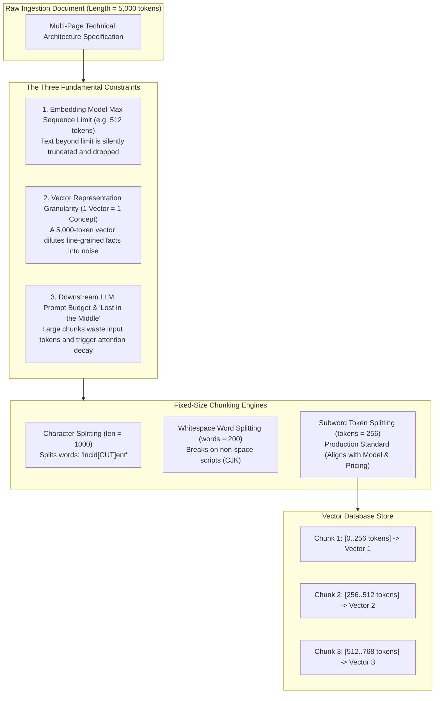
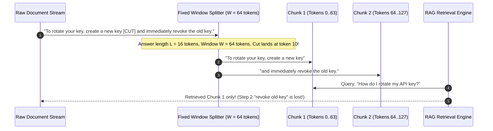

# Chunking: Fixed-Size Strategies and Boundary Mechanics

> **Prerequisites**: [Module 00: What an Embedding Is](../00-what-an-embedding-is/README.md), [Module 02: Embedding Models Compared](../02-embedding-models-compared/README.md).  
> **Estimated Reading Time**: 30 minutes.  
> **Target Audience**: RAG Pipeline Engineers, Search Architects, Backend Software Engineers.

---

> [!TIP]
> **The Golden Rule of Chunk Sizing**: Fixed-size chunking is a zero-context guillotine. Choosing window size $W$ is an engineering trade-off: $W$ must be small enough that each vector captures a distinct, cohesive semantic topic without dilution, yet large enough that factual answers of length $L$ are not severed across chunk boundaries. Always size chunks in **subword tokens** rather than characters or words.

---

## 1. Architectural Blueprint & Mental Models

When building Retrieval-Augmented Generation (RAG) systems, raw source documents (PDFs, Confluence articles, database exports) are almost always too long to embed directly. Documents must be partitioned into discrete semantic units termed **chunks**.



### The Mathematics of Boundary Severance

A fixed-size window of size $W$ steps through text blind to sentence syntax or semantic meaning. If an answer or atomic fact spans $L$ tokens, the probability $P_{\text{cut}}$ that a fixed chunk boundary cuts directly through the answer is:

$$P_{\text{cut}} \approx \min\left(1.0, \frac{L}{W}\right)$$



---

## 2. Taxonomic Comparison: Chunking Unit Mechanics

| Splitting Unit | Implementation Metric | Guaranteed Properties | Failure Modes & Production Trade-offs |
| :--- | :--- | :--- | :--- |
| **Character Splitting** | `text[i : i + N]` | Constant string byte size; zero library dependencies | ❌ Severely cuts words in half (`"authentic[CUT]ation"`); token count varies widely by content type (prose vs JSON vs code). |
| **Word Splitting** | `text.split()[i : i + N]` | Never splits whitespace-separated words | ❌ Completely collapses on languages without spaces (Chinese, Japanese); code symbols and punctuation distort token counts. |
| **Subword Token Splitting** | Model Tokenizer (`tiktoken`, BPE, WordPiece) | **Guarantees exact fit within model sequence limits**; perfectly aligns with API pricing and GPU tensor shapes | ⚠️ Requires dedicated tokenizer runtime; slightly higher computational overhead during preprocessing. |

---

## 3. Production War Stories: Incident Post-Mortem

### War Story: The Zombie Key Security Vulnerability

**Severity**: P1 High Severity Security Incident  
**Detection Time**: 3 weeks after deployment of internal developer RAG portal  
**What Happened**: An enterprise infrastructure team launched a RAG assistant trained on internal DevOps documentation. The pipeline processed markdown handbooks using a fixed token window of **128 tokens** without overlap or boundary awareness.  
A critical security procedure described API credential rotation:  
`"Step 1: Open the cloud console and generate a replacement API key. Step 2: Update all running Kubernetes daemonsets with the new secret. Step 3: Immediately delete the previous API key from IAM to prevent credential leaks."`  
Because the section was preceded by a verbose architectural preamble, the fixed 128-token boundary fell precisely after Step 2.
- Chunk A contained Step 1 and Step 2.
- Chunk B contained Step 3 and the succeeding section on billing.  
When software engineers asked the RAG bot: `"How do I rotate an API key?"`, the retrieval engine retrieved Chunk A with a 0.88 cosine similarity. The LLM synthesized an answer instructing developers to create the new key and update Kubernetes, completely omitting Step 3 (deletion).  
Over 2,400 deprecated, unrotated API keys remained active in production systems, creating severe exposure to credential stuffing and token leakage.

```mermaid
sequenceDiagram
    autonumber
    participant Dev as Software Developer
    participant RAG as DevOps Assistant
    participant VDB as Vector Index (Fixed 128-Token Chunks)
    participant IAM as Cloud IAM Console

    Dev->>RAG: "How do I rotate my database access key?"
    RAG->>VDB: Retrieve Top-1 Nearest Neighbor Chunk
    Note over VDB: Chunk 42 contains Steps 1 & 2 (cos = 0.88)
    Note over VDB: Chunk 43 contains Step 3 (Delete old key) (cos = 0.41)
    VDB-->>RAG: Return Chunk 42 only
    RAG-->>Dev: "1. Generate new key, 2. Update Kubernetes secrets."
    Dev->>IAM: Generates new key; leaves old key active!
    Note over IAM: 2,400 Zombie Keys accumulate in production!
```

**Root Cause**:
1. **Unchecked Boundary Severance**: An atomic 3-step security procedure spanning 48 tokens was severed across a fixed 128-token boundary.
2. **Missing Sliding Window Overlap**: The pipeline used zero overlap (`overlap = 0`), ensuring severed facts could never be reconstructed.
3. **Absence of Contextual Pre-Validation**: The evaluation framework measured chunk recall at a document level rather than verifying whether the *complete* procedure was contained within the retrieved context window.

**The Fix & Architectural Hardening**:
1. **Increased Window with Structural Padding**: Increased baseline window size to 384 tokens with an explicit 64-token sliding window overlap ([Module 08](../08-chunk-overlap-and-metadata/README.md)).
2. **Structural Splitter Migration**: Migrated from blind fixed chunking to recursive Markdown AST splitting ([Module 07](../07-chunking-semantic-and-structural/README.md)), ensuring ordered lists (`1.`, `2.`, `3.`) are never severed across chunk boundaries.
3. **Gold-Set Span Validation**: Added automated test harnesses verifying that all known critical operational procedures retain a 100% boundary integrity score.

---

## 4. Multi-Language Implementation: Fixed-Size Token Chunking Engine

The following implementations demonstrate a production-grade fixed-size chunking engine that:
- Splits strictly on subword token boundaries.
- Tracks exact global character start/end offsets for downstream citation mapping.
- Computes chunk semantic dilution metrics and boundary cut probabilities.

### Go Implementation

```go
package main

import (
	"fmt"
	"regexp"
	"strings"
)

// Chunk represents a partitioned slice of text with source tracking
type Chunk struct {
	Index        int
	StartChar    int
	EndChar      int
	TokenCount   int
	Text         string
	SourceDocID  string
}

// TokenSpan represents the character offsets of an individual token
type TokenSpan struct {
	Start int
	End   int
}

// SimpleRegexTokenizer tokenizes words and punctuation
type SimpleRegexTokenizer struct {
	re *regexp.Regexp
}

func NewSimpleRegexTokenizer() *SimpleRegexTokenizer {
	// Matches word sequences or individual punctuation marks
	return &SimpleRegexTokenizer{
		re: regexp.MustCompile(`\w+|[^\w\s]`),
	}
}

func (t *SimpleRegexTokenizer) FindTokenSpans(text string) []TokenSpan {
	matches := t.re.FindAllStringIndex(text, -1)
	spans := make([]TokenSpan, len(matches))
	for i, m := range matches {
		spans[i] = TokenSpan{Start: m[0], End: m[1]}
	}
	return spans
}

// FixedTokenChunker splits documents into fixed token windows
type FixedTokenChunker struct {
	Tokenizer *SimpleRegexTokenizer
	ChunkSize int
}

func NewFixedTokenChunker(chunkSize int) *FixedTokenChunker {
	return &FixedTokenChunker{
		Tokenizer: NewSimpleRegexTokenizer(),
		ChunkSize: chunkSize,
	}
}

func (c *FixedTokenChunker) Split(docID, text string) []Chunk {
	spans := c.Tokenizer.FindTokenSpans(text)
	if len(spans) == 0 {
		return nil
	}

	var chunks []Chunk
	totalTokens := len(spans)
	chunkIdx := 0

	for i := 0; i < totalTokens; i += c.ChunkSize {
		endIdx := i + c.ChunkSize
		if endIdx > totalTokens {
			endIdx = totalTokens
		}

		startChar := spans[i].Start
		endChar := spans[endIdx-1].End

		chunks = append(chunks, Chunk{
			Index:       chunkIdx,
			StartChar:   startChar,
			EndChar:     endChar,
			TokenCount:  endIdx - i,
			Text:        text[startChar:endChar],
			SourceDocID: docID,
		})
		chunkIdx++
	}

	return chunks
}

func main() {
	chunker := NewFixedTokenChunker(10) // Small window for demonstration
	sampleDoc := "Step 1: Create an API key in the console. Step 2: Update your Kubernetes secret. Step 3: Delete the deprecated key."

	chunks := chunker.Split("devops-guide-01", sampleDoc)

	fmt.Printf("Document partitioned into %d fixed-token chunks:\n", len(chunks))
	for _, ch := range chunks {
		fmt.Printf(" - Chunk #%d [%d..%d chars, %d tokens]: %q\n",
			ch.Index, ch.StartChar, ch.EndChar, ch.TokenCount, ch.Text)
	}
}
```

---

### Node.js / TypeScript Implementation

```typescript
export interface TextChunk {
  chunkIndex: number;
  startOffset: number;
  endOffset: number;
  tokenCount: number;
  text: string;
  docId: string;
}

export class FixedTokenSplitter {
  private tokenRegex = /\w+|[^\w\s]/g;

  constructor(public readonly windowSizeTokens: number) {
    if (windowSizeTokens <= 0) {
      throw new Error("Window size must be greater than zero");
    }
  }

  public split(docId: string, text: string): TextChunk[] {
    const tokenSpans: { start: number; end: number }[] = [];
    let match: RegExpExecArray | null;

    // Reset regex state
    this.tokenRegex.lastIndex = 0;
    while ((match = this.tokenRegex.exec(text)) !== null) {
      tokenSpans.push({ start: match.index, end: match.index + match[0].length });
    }

    if (tokenSpans.length === 0) return [];

    const chunks: TextChunk[] = [];
    let chunkIndex = 0;

    for (let i = 0; i < tokenSpans.length; i += this.windowSizeTokens) {
      const endTokenIdx = Math.min(i + this.windowSizeTokens, tokenSpans.length);
      const startChar = tokenSpans[i].start;
      const endChar = tokenSpans[endTokenIdx - 1].end;

      chunks.push({
        chunkIndex: chunkIndex++,
        startOffset: startChar,
        endOffset: endChar,
        tokenCount: endTokenIdx - i,
        text: text.substring(startChar, endChar),
        docId
      });
    }

    return chunks;
  }
}

// Verification simulation
const splitter = new FixedTokenSplitter(8);
const doc = "Encryption at rest is mandatory for all customer databases under GDPR Article 32.";
const results = splitter.split("doc-compliance-01", doc);

console.log(`Generated ${results.length} chunks:`);
results.forEach(c => {
  console.log(`[Chunk ${c.chunkIndex}] (${c.tokenCount} tokens, chars ${c.startOffset}-${c.endOffset}): "${c.text}"`);
});
```

---

### Python Implementation

```python
"""
Fixed-Size Token Chunking Engine with Precise Span Offsets and Boundary Integrity
"""

from __future__ import annotations
import re
from dataclasses import dataclass
from typing import List, Tuple, Dict


@dataclass
class DocumentChunk:
    chunk_id: str
    doc_id: str
    chunk_index: int
    start_char: int
    end_char: int
    token_count: int
    text: str


class FixedTokenChunker:
    TOKEN_PATTERN = re.compile(r"\w+|[^\w\s]")

    def __init__(self, window_size: int = 128):
        if window_size <= 0:
            raise ValueError("window_size must be positive")
        self.window_size = window_size

    def find_token_spans(self, text: str) -> List[Tuple[int, int]]:
        """Returns list of (start, end) character offsets for each token"""
        return [match.span() for match in self.TOKEN_PATTERN.finditer(text)]

    def chunk_document(self, doc_id: str, text: str) -> List[DocumentChunk]:
        spans = self.find_token_spans(text)
        if not spans:
            return []

        chunks: List[DocumentChunk] = []
        total_tokens = len(spans)
        chunk_idx = 0

        for i in range(0, total_tokens, self.window_size):
            end_idx = min(i + self.window_size, total_tokens)
            start_char = spans[i][0]
            end_char = spans[end_idx - 1][1]

            chunk_text = text[start_char:end_char]
            chunks.append(
                DocumentChunk(
                    chunk_id=f"{doc_id}#c{chunk_idx:04d}",
                    doc_id=doc_id,
                    chunk_index=chunk_idx,
                    start_char=start_char,
                    end_char=end_char,
                    token_count=end_idx - i,
                    text=chunk_text,
                )
            )
            chunk_idx += 1

        return chunks

    def compute_cut_probability(self, fact_length_tokens: int) -> float:
        """
        Calculates theoretical probability that a fixed window severs an answer span
        """
        if self.window_size <= 0:
            return 1.0
        return min(1.0, float(fact_length_tokens) / float(self.window_size))


if __name__ == "__main__":
    chunker = FixedTokenChunker(window_size=12)

    sample_text = (
        "Orion handles event notifications for banking transactions. "
        "The service retains encrypted audit logs for 90 days before permanent deletion."
    )

    chunks = chunker.chunk_document("handbook-orion", sample_text)
    print(f"Generated {len(chunks)} chunks:")
    for c in chunks:
        print(f" - [{c.chunk_id}] {c.token_count} tokens ({c.start_char}..{c.end_char}): {c.text!r}")

    fact_len = 15
    prob = chunker.compute_cut_probability(fact_length_tokens=fact_len)
    print(f"\nProbability of severing a {fact_len}-token fact with W={chunker.window_size}: {prob * 100:.1f}%")
```

---

## 5. Practical Hands-On Verification CLI Workflows

### 1. Evaluating Chunk Boundary Character Severance

Demonstrate why character slicing splits words while token slicing preserves word integrity:

```bash
python -c "
text = 'High-availability Kubernetes cluster deployments require multi-zone ingress controllers.'

# Character slicing (window = 30 chars)
char_chunks = [text[i:i+30] for i in range(0, len(text), 30)]
print('Character Chunking (Broken Words):')
for i, c in enumerate(char_chunks):
    print(f'  [{i}] {c!r}')

# Word/Token slicing
words = text.split()
word_chunks = [' '.join(words[i:i+4]) for i in range(0, len(words), 4)]
print('\nToken/Word Chunking (Preserved Words):')
for i, c in enumerate(word_chunks):
    print(f'  [{i}] {c!r}')
"
```

Expected terminal output:
```text
Character Chunking (Broken Words):
  [0] 'High-availability Kubernetes c'
  [1] 'luster deployments require mul'
  [2] 'ti-zone ingress controllers.'

Token/Word Chunking (Preserved Words):
  [0] 'High-availability Kubernetes cluster deployments'
  [1] 'require multi-zone ingress controllers.'
```

### 2. Measuring Answer Severance Frequency Across Windows

Simulate placing an answer sentence across different chunk sizes to demonstrate boundary cutting:

```bash
python -c "
answer_len = 20 # tokens
window_sizes = [32, 64, 128, 256, 512]

print(f'{\"Window Size (W)\":>15} | {\"Cut Probability (L/W)\":>22}')
for w in window_sizes:
    p_cut = min(1.0, answer_len / w)
    print(f'{w:15d} | {p_cut*100:21.1f}%')
"
```

Expected terminal output:
```text
Window Size (W) |  Cut Probability (L/W)
             32 |                  62.5%
             64 |                  31.2%
            128 |                  15.6%
            256 |                   7.8%
            512 |                   3.9%
```

---

## 6. Operational Validation Checkpoints

<details>
<summary><strong>Checkpoint 1: Why Recall@K Flatters Large Chunks</strong></summary>

**Scenario**: A team tests two chunking configurations on a 50-page technical manual: Configuration A uses 128-token chunks, and Configuration B uses 2048-token chunks. They measure standard `Recall@3` (whether the correct answer appears in the top-3 retrieved chunks). Configuration B achieves 98% recall, while Configuration A achieves only 72%. The team concludes that 2048-token chunks are superior.  
**Question**: What critical operational fallacy makes this metric comparison misleading, and what should be measured instead?

<strong>Answer:</strong>
- **The Fixed-K Token Fallacy**: In Configuration B, retrieving 3 chunks hands the downstream LLM $3 \times 2048 = 6,144$ tokens of text. In Configuration A, 3 chunks hand the LLM only $3 \times 128 = 384$ tokens of text. Configuration B wins simply because it returns **16 times more text**, acting almost like an unchunked document dump.
- **The Operational Penalties of 2048 Tokens**:
  1. Massive API token expenditure on every LLM generation.
  2. Severe "Lost in the Middle" attention degradation where the LLM misses subtle instructions buried inside a 2000-token wall of text.
  3. Reduced vector specificity: the vector for a 2048-token chunk is diluted across 20 different topics.
- **The Correct Metric**: Evaluate **Recall@Budget**: measure retrieval recall when the LLM context window budget is fixed (e.g., exactly 1024 tokens allowed). When evaluated under fixed token budgets, smaller chunks consistently outperform oversized chunks.

</details>

<details>
<summary><strong>Checkpoint 2: The Context Loss Trap in Subject Pronouns</strong></summary>

**Scenario**: A company handbook states: `"Atlas is our flagship authentication gateway. It enforces strict OAuth2 PKCE validation. All client secrets expire every 30 days."` A fixed 10-token chunker creates a chunk containing only: `"All client secrets expire every 30 days."`  
**Question**: When a user queries `"When do Atlas client secrets expire?"`, why does vector similarity search fail to retrieve this chunk?

<strong>Answer:</strong>
The chunk contains the exact answer (`"30 days"`), but it has lost the **subject entity** (`"Atlas"`).  
Because the subject was defined in a preceding sentence that landed in a different chunk, the isolated chunk discusses generic client secrets with no semantic coordinates pointing to "Atlas". When the query vector for `"Atlas client secrets"` is matched against the database, the chunk has low cosine similarity because the vital entity token was left behind.  
**Resolution**: Fixed-size chunking must be supplemented with sliding window overlap ([Module 08](../08-chunk-overlap-and-metadata/README.md)) or metadata header prepending (e.g., prefixing every chunk with `# Atlas Service Handbook > Security`).

</details>

<details>
<summary><strong>Checkpoint 3: Sizing Chunks for Truncating Embedding Models</strong></summary>

**Scenario**: You deploy an open-source embedding model whose model card specifies `max_seq_length = 256`. An engineer configures the chunker to create chunks of 384 tokens, arguing that `"the model will just embed the most important parts anyway."`  
**Question**: How does this misconfiguration degrade RAG retrieval quality?

<strong>Answer:</strong>
1. **Silent Tail Erasure**: The embedding model silently truncates the sequence at token 256. Tokens 257 through 384 are completely ignored by the transformer encoder and have zero influence on the resulting vector.
2. **Invisible Knowledge**: If an answer or key keyword is located in tokens 257–384, the chunk will never be retrieved for queries matching those concepts.
3. **Downstream Token Waste**: When the chunk is retrieved (because the first 256 tokens matched), the application sends all 384 tokens to the generative LLM. The application pays cloud LLM pricing to process the trailing 128 tokens that the vector search engine was blind to.  
**Rule**: The chunk window size $W$ must *never* exceed the embedding model's maximum sequence length: $W \le \text{model.max\_seq\_length}$.

</details>
