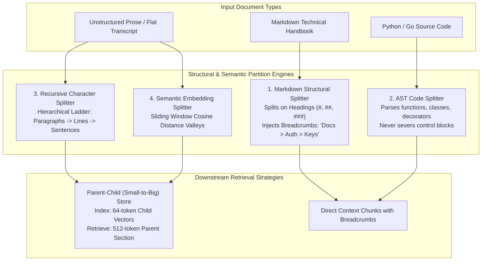
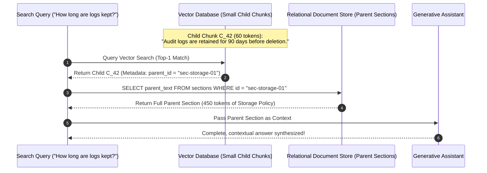
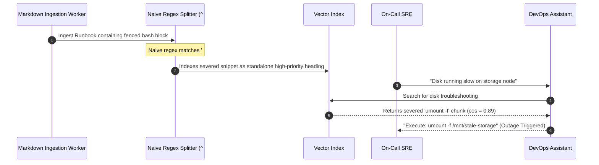

# Chunking: Semantic, Structural, and Code-Aware Strategies

> **Prerequisites**: [Module 00: What an Embedding Is](../00-what-an-embedding-is/README.md), [Module 03: Cosine Similarity and Distance Metrics](../03-cosine-similarity-and-distance-metrics/README.md), [Module 06: Chunking: Fixed-Size Strategies](../06-chunking-fixed-size-strategies/README.md).  
> **Estimated Reading Time**: 34 minutes.  
> **Target Audience**: Senior AI Platform Engineers, Search Infrastructure Architects, RAG Systems Engineers.

---

> [!TIP]
> **The Golden Rule of Structural Chunking**: Never split across semantic boundaries that authors or compilers have already defined for you. Cut along document seams (headings, paragraphs, AST nodes), preserve ancestor hierarchy paths as prepended breadcrumbs, and reserve semantic distance chunking only for unformatted, seam-free text streams.

---

## 1. Architectural Blueprint & Mental Models

Fixed-size chunking treats documents as homogenous streams of characters or tokens, inevitably severing sentences, code blocks, and logical sections. **Structural, Semantic, and Code-Aware Chunking** aligns partition boundaries with the natural semantic topology of the content.



### Parent-Child (Small-to-Big) Architecture

A major dilemma in chunk design is the tension between **vector precision** and **LLM context completeness**:
- Small chunks (e.g. 50 tokens) produce sharp, focused embeddings that match specific queries easily, but lack surrounding context.
- Large chunks (e.g. 500 tokens) provide rich context to the LLM, but their vector representations are semantically diluted across multiple ideas.

**Parent-Child Retrieval** decouples the search index unit from the generative context unit:



---

## 2. Taxonomic Reference Grids: Structural vs Semantic Chunkers

| Chunking Strategy | Input Types | Splitting Mechanism | Pros | Cons & Failure Modes |
| :--- | :--- | :--- | :--- | :--- |
| **Recursive Character Splitting** | General prose, documentation | Coarse-to-fine separator hierarchy (`\n\n` $\to$ `\n` $\to$ `.` $\to$ ` `) | Universal; respects paragraphs and sentences without external parser | Merges disparate paragraphs if budget allows; ignores code syntax |
| **Markdown Header Splitting** | Markdown docs, Readmes | Heading regex / AST (`#`, `##`, `###`) with breadcrumb path injection | Zero semantic loss across sections; perfect context retention via breadcrumbs | Unclosed code fences cause comments (`# comment`) to be misparsed as headings |
| **AST Code Splitting** | Source code (`.py`, `.go`, `.ts`) | Concrete Syntax Tree / AST parsing (`ast`, `tree-sitter`) | Keeps functions, classes, docstrings, and decorators intact | Language-dependent; fails if source code has syntax errors |
| **Semantic Distance Chunking** | Raw transcripts, flat OCR, speeches | Consecutive sentence embedding cosine distance drops (valleys) | Discovers topic shifts in flat, unformatted text | Expensive ($O(S)$ embedding calls); threshold tuning is highly sensitive |
| **Parent-Child (Small-to-Big)** | Multi-topic handbooks, manuals | Hierarchical multi-level chunking with foreign key pointers | Optimal vector specificity + maximal LLM context richness | Higher storage overhead (stores both children and parents) |

---

## 3. Production War Stories: Incident Post-Mortem

### War Story: The Shell Comment Markdown Injection Catastrophe

**Severity**: P0 Critical Security Incident  
**Detection Time**: 6 hours after rolling out automated DevOps runbook retrieval  
**What Happened**: An enterprise cloud platform used a naive line-based Markdown splitter for its internal RAG cluster runbooks. The splitter searched for lines starting with `^#` to identify heading sections.  
An engineer added a runbook on node remediation that contained a bash script inside a fenced code block:
````markdown
# Kubernetes Node Remediation Guide
Run the following script to flush caches:
```bash
# Clear OS page cache
sync; echo 1 > /proc/sys/vm/drop_caches
# Danger: Unmount all stale volumes
umount -f /mnt/stale-storage
```
````
The naive regex detected `# Clear OS page cache` and `# Danger: Unmount all stale volumes` as H1 Markdown headings!  
The splitter severed the code block mid-execution, creating an isolated chunk containing only:
```text
Heading: # Danger: Unmount all stale volumes
umount -f /mnt/stale-storage
```
When a junior SRE asked the DevOps assistant: `"How do I resolve a slow disk issue on worker node 4?"`, the assistant retrieved the severed chunk out of context and instructed the engineer to unmount active storage volumes, causing a cascading storage partition outage.



**Root Cause**:
1. **Blind Regex Splitting**: Matching `^#` without tracking fenced code block state (```` ``` ```` or `~~~`). In the CommonMark specification, lines within code fences are strictly literal strings.
2. **Missing Syntactic AST Parsing**: The ingestion pipeline did not use an AST parser to distinguish prose headings from code comments.
3. **Absence of Context Breadcrumbs**: The severed snippet lacked its parent document context, disguising a dangerous cleanup utility as a general diagnostic step.

**The Fix & Architectural Hardening**:
1. **Fenced-State Aware Parser**: Implemented state machine tracking opening/closing code fences (`^ {0,3}(`{3,}|~{3,})`), ensuring `#` within code blocks is never interpreted as a heading.
2. **Breadcrumb Prepending**: All Markdown chunks prepend the full heading hierarchy path (`Runbook > Kubernetes Node Remediation > Bash Script`) to prevent ambiguous orphaned steps.
3. **AST Code Isolation**: Wrapped code blocks in structural metadata identifying them as executable blocks rather than general explanatory text.

---

## 4. Multi-Language Implementation: Structural and Semantic Chunkers

The following implementations demonstrate:
- Recursive character splitting with hierarchical separators.
- CommonMark-compliant Markdown splitting with fence state tracking and breadcrumb injection.
- Parent-child hierarchical indexing logic.

### Go Implementation

```go
package main

import (
	"fmt"
	"regexp"
	"strings"
)

// MarkdownChunk represents a section tagged with its heading ancestry
type MarkdownChunk struct {
	Breadcrumbs []string
	Text        string
}

// MarkdownSectionSplitter parses headings while ignoring code fences
type MarkdownSectionSplitter struct {
	headingRegex *regexp.Regexp
	fenceRegex   *regexp.Regexp
}

func NewMarkdownSectionSplitter() *MarkdownSectionSplitter {
	return &MarkdownSectionSplitter{
		// Matches lines starting with 1 to 6 '#' followed by space
		headingRegex: regexp.MustCompile(`^ {0,3}(#{1,6})\s+(.+?)\s*#*\s*$`),
		// Matches opening/closing code fences
		fenceRegex: regexp.MustCompile(`^ {0,3}(` + "`{3,}|~{3,})"),
	}
}

func (s *MarkdownSectionSplitter) Split(markdownText string) []MarkdownChunk {
	lines := strings.Split(markdownText, "\n")
	var chunks []MarkdownChunk

	type headingNode struct {
		level int
		title string
	}
	var stack []headingNode
	var currentBuffer []string
	var inFence string

	flush := func() {
		content := strings.TrimSpace(strings.Join(currentBuffer, "\n"))
		if content != "" {
			var breadcrumbs []string
			for _, node := range stack {
				breadcrumbs = append(breadcrumbs, node.title)
			}
			chunks = append(chunks, MarkdownChunk{
				Breadcrumbs: breadcrumbs,
				Text:        content,
			})
		}
		currentBuffer = nil
	}

	for _, line := range lines {
		// Check for code fence toggling
		if fenceMatch := s.fenceRegex.FindStringSubmatch(line); fenceMatch != nil {
			fenceStr := fenceMatch[1]
			if inFence == "" {
				inFence = fenceStr
			} else if strings.HasPrefix(fenceStr, inFence[:1]) && len(fenceStr) >= len(inFence) {
				inFence = ""
			}
			currentBuffer = append(currentBuffer, line)
			continue
		}

		// Only match headings if OUTSIDE a code fence
		if inFence == "" {
			if headingMatch := s.headingRegex.FindStringSubmatch(line); headingMatch != nil {
				flush()
				level := len(headingMatch[1])
				title := headingMatch[2]

				// Pop deeper or equal headings from stack
				for len(stack) > 0 && stack[len(stack)-1].level >= level {
					stack = stack[:len(stack)-1]
				}
				stack = append(stack, headingNode{level: level, title: title})
				continue
			}
		}

		currentBuffer = append(currentBuffer, line)
	}

	flush()
	return chunks
}

func main() {
	doc := `# Infrastructure Handbook
Welcome to cloud operations.

## Security
Enforce TLS 1.3 everywhere.

### API Credentials
Run the following script to rotate keys:
` + "```bash\n# Generate new key\ncurl -X POST https://api.internal/keys\n```\n" + `
Never commit keys to Git.`

	splitter := NewMarkdownSectionSplitter()
	chunks := splitter.Split(doc)

	fmt.Printf("Split into %d structural sections:\n", len(chunks))
	for i, c := range chunks {
		path := strings.Join(c.Breadcrumbs, " > ")
		fmt.Printf("\n[Chunk %d] Breadcrumbs: [%s]\nText:\n%s\n", i, path, c.Text)
	}
}
```

---

### Node.js / TypeScript Implementation

```typescript
export interface MarkdownChunk {
  breadcrumbs: string[];
  content: string;
  augmentedText: string; // Breadcrumbs prepended to content for dense indexing
}

export class MarkdownASTSplitter {
  private headingRe = /^ {0,3}(#{1,6})\s+(.+?)\s*#*\s*$/;
  private fenceRe = /^ {0,3}(`{3,}|~{3,})/;

  public split(markdown: string): MarkdownChunk[] {
    const lines = markdown.split("\n");
    const chunks: MarkdownChunk[] = [];

    const stack: { level: number; title: string }[] = [];
    let buffer: string[] = [];
    let inFence: string | null = null;

    const flush = () => {
      const content = buffer.join("\n").trim();
      if (content.length > 0) {
        const breadcrumbs = stack.map(s => s.title);
        const pathPrefix = breadcrumbs.length > 0 ? `# ${breadcrumbs.join(" > ")}\n\n` : "";
        chunks.push({
          breadcrumbs,
          content,
          augmentedText: `${pathPrefix}${content}`
        });
      }
      buffer = [];
    };

    for (const line of lines) {
      // 1. Code fence check
      const fenceMatch = this.fenceRe.exec(line);
      if (fenceMatch) {
        const fenceStr = fenceMatch[1];
        if (!inFence) {
          inFence = fenceStr;
        } else if (fenceStr[0] === inFence[0] && fenceStr.length >= inFence.length) {
          inFence = null;
        }
        buffer.push(line);
        continue;
      }

      // 2. Heading match outside code fence
      if (!inFence) {
        const headingMatch = this.headingRe.exec(line);
        if (headingMatch) {
          flush();
          const level = headingMatch[1].length;
          const title = headingMatch[2].trim();

          while (stack.length > 0 && stack[stack.length - 1].level >= level) {
            stack.pop();
          }
          stack.push({ level, title });
          continue;
        }
      }

      buffer.push(line);
    }

    flush();
    return chunks;
  }
}

// Verification simulation
const doc = `
# Atlas Auth System
Overview of IAM credentials.

## API Keys
Rotate keys monthly.

### Setup Script
\`\`\`bash
# Bash comment that should not trigger heading
./setup.sh --force
\`\`\`
Follow on-screen instructions.
`;

const splitter = new MarkdownASTSplitter();
const results = splitter.split(doc);
console.log(`Generated ${results.length} chunks:`);
results.forEach((c, i) => {
  console.log(`--- [Chunk ${i}] Path: ${c.breadcrumbs.join(" > ")} ---`);
  console.log(c.augmentedText);
});
```

---

### Python Implementation

```python
"""
Structural Markdown Splitter with Code Fence Protection and Breadcrumb Augmentation
"""

from __future__ import annotations
import re
from dataclasses import dataclass
from typing import List, Optional


@dataclass
class StructuredChunk:
    breadcrumbs: List[str]
    content: str
    augmented_text: str  # Prepended with breadcrumb hierarchy for dense search


class StructuralMarkdownSplitter:
    HEADING_PATTERN = re.compile(r"^ {0,3}(#{1,6})\s+(.+?)\s*#*\s*$")
    FENCE_PATTERN = re.compile(r"^ {0,3}(`{3,}|~{3,})")

    def split_markdown(self, text: str) -> List[StructuredChunk]:
        lines = text.splitlines(keepends=True)
        chunks: List[StructuredChunk] = []

        stack: List[Tuple[int, str]] = []  # [(level, title)]
        buffer: List[str] = []
        in_fence: Optional[str] = None

        def flush():
            content = "".join(buffer).strip()
            if content:
                breadcrumbs = [title for _, title in stack]
                breadcrumb_header = " > ".join(breadcrumbs)
                augmented = f"Context: {breadcrumb_header}\n\n{content}" if breadcrumbs else content
                chunks.append(
                    StructuredChunk(
                        breadcrumbs=breadcrumbs,
                        content=content,
                        augmented_text=augmented,
                    )
                )
            buffer.clear()

        for line in lines:
            fence_match = self.FENCE_PATTERN.match(line)
            if fence_match:
                marker = fence_match.group(1)
                if in_fence is None:
                    in_fence = marker
                elif marker[0] == in_fence[0] and len(marker) >= len(in_fence):
                    in_fence = None
                buffer.append(line)
                continue

            if in_fence is None:
                heading_match = self.HEADING_PATTERN.match(line)
                if heading_match:
                    flush()
                    level = len(heading_match.group(1))
                    title = heading_match.group(2).strip()

                    while stack and stack[-1][0] >= level:
                        stack.pop()
                    stack.append((level, title))
                    continue

            buffer.append(line)

        flush()
        return chunks


if __name__ == "__main__":
    sample_markdown = """# Storage Architecture
Overview of distributed object storage.

## Retention Policies
Data is retained for 90 days.

### Automation Scripts
```python
# Python comment: this must NOT be parsed as an H1 heading!
def delete_stale_records():
    pass
```
Run this script weekly.
"""

    splitter = StructuralMarkdownSplitter()
    chunks = splitter.split_markdown(sample_markdown)

    print(f"Successfully extracted {len(chunks)} structural chunks:")
    for i, c in enumerate(chunks):
        print(f"\n[Chunk {i}] Breadcrumbs: {c.breadcrumbs}")
        print(c.augmented_text)
```

---

## 5. Practical Hands-On Verification CLI Workflows

### 1. Testing Code Fence Heading False-Positive Rejection

Verify that comments inside code fences are ignored while true headings are parsed:

```bash
python -c "
import re
heading_re = re.compile(r'^ {0,3}(#{1,6})\s+(.+?)\s*#*\s*$')
fence_re = re.compile(r'^ {0,3}(`{3,}|~{3,})')

lines = [
    '# True Document Heading',
    'Some description.',
    '```bash',
    '# Comment inside code block',
    'ls -la',
    '```',
    '## Second True Heading'
]

in_fence = False
for line in lines:
    if fence_re.match(line):
        in_fence = not in_fence
        print(f'FENCE TOGGLE: {line}')
        continue
    if not in_fence and heading_re.match(line):
        print(f'>>> VALID HEADING DETECTED: {line}')
    elif in_fence and heading_re.match(line):
        print(f'IGNORED CODE COMMENT: {line}')
"
```

Expected terminal output:
```text
>>> VALID HEADING DETECTED: # True Document Heading
FENCE TOGGLE: ```bash
IGNORED CODE COMMENT: # Comment inside code block
FENCE TOGGLE: ```
>>> VALID HEADING DETECTED: ## Second True Heading
```

### 2. Measuring Semantic Valley Transitions

Simulate detecting a topic transition between two paragraphs using cosine similarity:

```bash
python -c "
import numpy as np

# Simulate sentence vectors for 2 sentences of Topic A and 2 sentences of Topic B
v_a1 = np.array([0.9, 0.1, 0.0])
v_a2 = np.array([0.88, 0.12, 0.0])
v_b1 = np.array([0.05, 0.1, 0.95])
v_b2 = np.array([0.02, 0.15, 0.94])

sentences = [v_a1, v_a2, v_b1, v_b2]

print('Consecutive Cosine Similarities:')
for i in range(len(sentences) - 1):
    dot = np.dot(sentences[i], sentences[i+1])
    cos = dot / (np.linalg.norm(sentences[i]) * np.linalg.norm(sentences[i+1]))
    is_valley = '<<< TOPIC BOUNDARY BREAKPOINT' if cos < 0.5 else 'Smooth'
    print(f'Sentence {i} -> {i+1}: cos={cos:.4f} ({is_valley})')
"
```

Expected terminal output:
```text
Consecutive Cosine Similarities:
Sentence 0 -> 1: cos=0.9998 (Smooth)
Sentence 1 -> 2: cos=0.0655 (<<< TOPIC BOUNDARY BREAKPOINT)
Sentence 2 -> 3: cos=0.9994 (Smooth)
```

---

## 6. Operational Validation Checkpoints

<details>
<summary><strong>Checkpoint 1: The Breadcrumb Injection Dilemma</strong></summary>

**Scenario**: You implement Markdown structural chunking. A chunk under `# Security > API Keys > Rotation Policy` contains: `"The default expiration is 30 days."` A developer proposes storing the heading breadcrumb *only* in the relational database metadata column and embedding only the raw body text.  
**Question**: Why will this cause queries like `"What is the API key expiration policy?"` to miss the chunk, and how should breadcrumbs be handled?

<strong>Answer:</strong>
The embedding model vectorizes only the string passed into its tokenizer.
- **Metadata-Only Failure**: If breadcrumbs are stored only in a database column (`metadata: {"path": "Security > API Keys"}`), the vector represents only `"The default expiration is 30 days."` The vector space has no coordinates corresponding to "Security" or "API Keys", causing cosine similarity to fall below the retrieval threshold for queries containing those domain terms.
- **The Correct Architecture**: Prepend the breadcrumb path directly to the text payload that is embedded:
  $$\text{Payload} = \text{"Context: Security > API Keys > Rotation Policy\n\nThe default expiration is 30 days."}$$
  The resulting vector incorporates the semantic authority of the ancestor headings, ensuring robust cosine alignment for general hierarchical queries.

</details>

<details>
<summary><strong>Checkpoint 2: The Computational Cost of Semantic Chunking</strong></summary>

**Scenario**: A team plans to ingest 500,000 documents (each averaging 100 sentences). An engineer proposes using Semantic Chunking (embedding every sentence and detecting cosine valleys) using OpenAI's API instead of Recursive Character Splitting.  
**Question**: What is the computational and billing impact of this proposal?

<strong>Answer:</strong>
1. **API Call Explosion**: Semantic chunking requires embedding every sentence individually to calculate the cosine distance between neighboring sentences ($500,000 \times 100 = 50,000,000$ individual sentence embeddings).
2. **Double Billing Overhead**: After semantic chunking calculates the boundary breakpoints and forms the chunks, the application must embed the final chunks *again* to insert them into the vector database.
3. **Latency**: Performing 50 million network calls introduces significant rate-limit queueing and days of ingestion latency.
4. **Production Recommendation**: Use structural splitting (Markdown / HTML / AST) or recursive character splitting with sentence packing. Semantic distance chunking should be reserved strictly for unstructured, unformatted text streams (such as raw Whisper speech-to-text transcripts) where no explicit paragraph or heading boundaries exist.

</details>

<details>
<summary><strong>Checkpoint 3: Oversized Sections in Structural Chunking</strong></summary>

**Scenario**: A Markdown splitter splits text strictly by H2 (`##`) headings. A technical specification contains a 4,500-token section under `## System Architecture`. The downstream embedding model has a maximum sequence length of 512 tokens.  
**Question**: What happens if the structural chunker does not implement a secondary size guard?

<strong>Answer:</strong>
The embedding model's inference client will either:
1. Crash with `HTTP 400 Bad Request: input exceeds max_seq_length (4500 > 512)`, failing the ingestion job.
2. Silently truncate the text at token 512, dropping tokens 513 through 4500 into oblivion.  
**The Hardening Invariant**: Structural chunking must always be paired with a **secondary recursive splitter**:
```python
if len(section.text) > model_max_tokens:
    sub_chunks = recursive_split(section.text, max_len=model_max_tokens)
```
Every sub-chunk inherits the parent's heading breadcrumb, ensuring both structural integrity and compliance with embedding model hardware limits.

</details>
