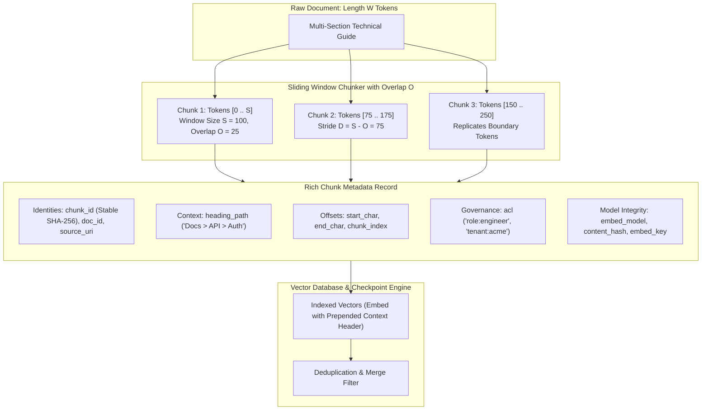
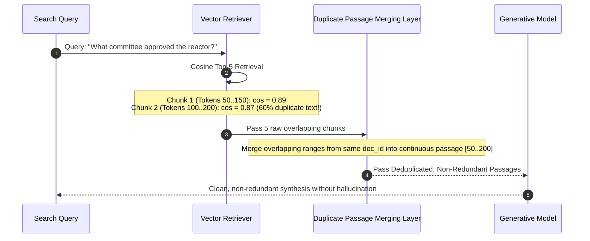
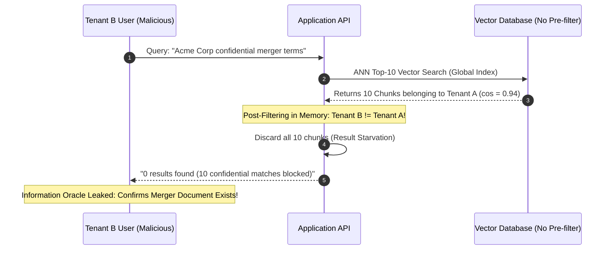

# Chunk Overlap and Metadata: Boundary Preservation and Provenance

> **Prerequisites**: [Module 00: What an Embedding Is](../00-what-an-embedding-is/README.md), [Module 06: Chunking: Fixed-Size Strategies](../06-chunking-fixed-size-strategies/README.md), [Module 07: Chunking: Semantic and Structural](../07-chunking-semantic-and-structural/README.md).  
> **Estimated Reading Time**: 32 minutes.  
> **Target Audience**: RAG Platform Architects, Vector Database Engineers, Compliance & Security Systems Engineers.

---

> [!TIP]
> **The Golden Rule of Overlap and Metadata**: Overlap prevents the catastrophic loss of facts that straddle chunk boundaries, governed strictly by the invariant $L \le O + 1$ (any evidence of length $L$ is guaranteed intact if overlap $O \ge L - 1$). Never store isolated text chunks without immutable provenance metadata—unanchored vectors cannot be cited, access-controlled, de-duplicated, or refreshed without full re-indexing.

---

## 1. Architectural Blueprint & Mental Models

In production retrieval systems, two silent failure modes degrade vector quality:
1. **The Severed Fact Boundary**: An answer spans two sentences. Sentence A ends in Chunk 1; Sentence B begins in Chunk 2. Neither chunk contains the complete fact, causing retrieval failure.
2. **The Amnesiac Vector**: A chunk contains text like `"The default timeout is 5 seconds"`, but lacks document provenance, section context, and access-control tags.

**Sliding Window Overlap** and **Structured Metadata Records** resolve these failures by replicating boundary context and attaching cryptographic provenance to every vector.



### The Mathematics of Overlap and Index Inflation

Let $S$ be chunk size in tokens, and $O$ be the overlap tokens between consecutive chunks. The stride is $D = S - O$.

1. **Safety Bound**: For an evidence fact of length $L$ tokens, the fact is **guaranteed** to be captured whole inside at least one chunk if:
   $$L \le O + 1$$
2. **Index Inflation Factor**: Because every chunk after the first repeats $O$ tokens, the total stored tokens grow by:
   $$\text{Inflation} = \frac{S}{S - O} = \frac{1}{1 - \frac{O}{S}}$$
   - At $10\%$ overlap ($O/S = 0.10$): Index grows by $1.11\times$
   - At $25\%$ overlap ($O/S = 0.25$): Index grows by $1.33\times$
   - At $50\%$ overlap ($O/S = 0.50$): Index grows by $2.00\times$ (doubles storage and embedding costs)



---

## 2. Taxonomic Reference Grids: Metadata Schema Invariants

| Field | Type | Cryptographic Formulation | Production Purpose |
| :--- | :--- | :--- | :--- |
| `chunk_id` | `string` | $\text{SHA256}(\text{doc\_id} + \text{content\_hash} + \text{occurrence})[0:32]$ | Immutable primary key; enables idempotent upserts without duplicate records. |
| `doc_id` | `string` | Canonical URI / Asset UUID | Groups chunks belonging to one document; enables cascading deletes and re-indexing. |
| `content_hash`| `string` | $\text{SHA256}(\text{normalized\_text})$ | Identifies identical text across different documents (global deduplication). |
| `embed_key` | `string` | $\text{SHA256}(\text{model\_name} + \text{header} + \text{text})$ | Cache invalidation key; detects when a model upgrade or header rename requires re-embedding. |
| `heading_path`| `string[]` | Array of section titles: `["API", "Auth", "Keys"]` | Prepending contextual breadcrumbs during embedding; citations and facet filtering. |
| `start_char` | `int` | Global source 0-based character index | Precision citation highlighting in UI; exact document text span verification. |
| `end_char` | `int` | Global source 0-based character index | Boundary verification and passage reconstruction. |
| `acl` | `string[]` | RBAC/Tenant tags: `["tenant:prod", "team:sec"]` | Mandatory pre-filtering in vector database to prevent unauthorized data exposure. |
| `doc_updated` | `string` | ISO 8601 UTC timestamp | Incremental sync; freshness filters ("newer than 30 days"). |

---

## 3. Production War Stories: Incident Post-Mortem

### War Story: The ACL Post-Filtering Security Leak & Starvation

**Severity**: P0 Critical Security & Privacy Incident  
**Detection Time**: 24 hours (External security researcher audit)  
**What Happened**: An enterprise legal tech platform indexed 2,000,000 internal documents into a vector database. To enforce multi-tenant security, the team implemented **post-query filtering**:
1. Search the vector database for Top-10 nearest neighbors.
2. Filter the 10 results in application memory by comparing the user's tenant ID with `chunk.metadata.tenant_id`.
3. If an unauthorized chunk was retrieved, discard it.  
A malicious user from Tenant B submitted a query crafted with proprietary keywords from Tenant A: `"Acme Corp confidential merger acquisition pricing"`.  
The vector index returned 10 documents belonging to Tenant A as the Top-10 nearest neighbors. The application's post-filtering logic discarded all 10 documents because the user belonged to Tenant B.  
The API returned:
```json
{ "results": [], "query_diagnostics": { "total_candidates_evaluated": 10, "unauthorized_discarded": 10 } }
```
The user confirmed the exact existence of the confidential merger negotiations and harvested internal document IDs, causing an emergency security breach notification.



**Root Cause**:
1. **Post-Query Filtering Architecture**: Applying authorization checks *after* approximate nearest-neighbor search wastes the Top-K budget and leaks information via query side-channels.
2. **Result Starvation**: If all top candidates belong to another tenant, the legitimate user receives zero results, even if relevant documents belonging to their own tenant were ranked at positions 11–20.
3. **Missing Index-Level Partitioning**: The vector database was not configured with metadata pre-filtering (`tenant_id == 'tenant_b'`), allowing unauthorized vectors to compete in the HNSW graph traversal.

**The Fix & Architectural Hardening**:
1. **Mandatory Vector Pre-Filtering**: Configured database queries to enforce index-level constraints *prior* to nearest-neighbor traversal:
   ```sql
   SELECT id, text, 1 - (embedding <=> $query) AS score
   FROM chunks
   WHERE acl && ARRAY['tenant:tenant_b']::text[]
   ORDER BY embedding <=> $query ASC LIMIT 10;
   ```
2. **Zero Metadata Leakage**: Suppressed diagnostic counters in public API error payloads.
3. **Partitioned Namespaces**: Enforced isolated vector collections or physical namespaces per enterprise tenant.

---

## 4. Multi-Language Implementation: Sliding Window Overlap & Rich Metadata

The following implementations demonstrate:
- Sliding window chunking with mathematically verified overlap ($S$ and $O$).
- Cryptographic content-addressed metadata record generation (`chunk_id`, `embed_key`, `content_hash`).
- Deduplication and hit-merging layer for overlapping retrieved search passages.

### Go Implementation

```go
package main

import (
	"crypto/sha256"
	"encoding/hex"
	"fmt"
	"sort"
	"strings"
	"time"
)

// ChunkMetadata holds rich operational attributes
type ChunkMetadata struct {
	ChunkID     string    `json:"chunk_id"`
	DocID       string    `json:"doc_id"`
	SourceURI   string    `json:"source_uri"`
	ChunkIndex  int       `json:"chunk_index"`
	StartChar   int       `json:"start_char"`
	EndChar     int       `json:"end_char"`
	HeadingPath []string  `json:"heading_path"`
	ACL         []string  `json:"acl"`
	ContentHash string    `json:"content_hash"`
	EmbedKey    string    `json:"embed_key"`
	Text        string    `json:"text"`
}

// ComputeHash computes SHA-256 hex string
func ComputeHash(input string) string {
	h := sha256.New()
	h.Write([]byte(input))
	return hex.EncodeToString(h.Sum(nil))
}

// SlidingWindowChunker generates overlapping token/word chunks
type SlidingWindowChunker struct {
	Size    int // Words per chunk
	Overlap int // Words overlap
}

func (c *SlidingWindowChunker) ChunkDocument(docID, sourceURI, text string, headings []string, acls []string) []ChunkMetadata {
	words := strings.Fields(text)
	nWords := len(words)
	if nWords == 0 {
		return nil
	}

	stride := c.Size - c.Overlap
	if stride <= 0 {
		panic("stride must be positive: Overlap must be strictly less than Size")
	}

	var records []ChunkMetadata
	chunkIdx := 0
	wordOffset := 0

	for wordOffset < nWords {
		endWord := wordOffset + c.Size
		if endWord > nWords {
			endWord = nWords
		}

		chunkWords := words[wordOffset:endWord]
		chunkText := strings.Join(chunkWords, " ")

		// Compute cryptographic identities
		contentHash := ComputeHash(chunkText)
		chunkID := ComputeHash(fmt.Sprintf("%s|%s|%d", docID, contentHash, chunkIdx))[:32]
		embedKey := ComputeHash(fmt.Sprintf("text-embedding-3-small|%s|%s", strings.Join(headings, " > "), chunkText))

		records = append(records, ChunkMetadata{
			ChunkID:     chunkID,
			DocID:       docID,
			SourceURI:   sourceURI,
			ChunkIndex:  chunkIdx,
			HeadingPath: headings,
			ACL:         acls,
			ContentHash: contentHash,
			EmbedKey:    embedKey,
			Text:        chunkText,
		})

		if endWord == nWords {
			break
		}
		wordOffset += stride
		chunkIdx++
	}

	return records
}

// RetrievedHit represents a matched search candidate
type RetrievedHit struct {
	DocID      string
	StartWord  int
	EndWord    int
	Score      float64
	ChunkText  string
}

// MergeOverlappingHits consolidates overlapping passages from the same document
func MergeOverlappingHits(hits []RetrievedHit) []RetrievedHit {
	if len(hits) == 0 {
		return nil
	}

	// Sort primarily by DocID, secondarily by StartWord
	sortedHits := make([]RetrievedHit, len(hits))
	copy(sortedHits, hits)
	sort.Slice(sortedHits, func(i, j int) bool {
		if sortedHits[i].DocID != sortedHits[j].DocID {
			return sortedHits[i].DocID < sortedHits[j].DocID
		}
		return sortedHits[i].StartWord < sortedHits[j].StartWord
	})

	var merged []RetrievedHit
	for _, hit := range sortedHits {
		if len(merged) == 0 {
			merged = append(merged, hit)
			continue
		}

		last := &merged[len(merged)-1]
		if last.DocID == hit.DocID && hit.StartWord <= last.EndWord {
			// Overlapping passage: merge ranges and update score
			if hit.EndWord > last.EndWord {
				last.EndWord = hit.EndWord
			}
			if hit.Score > last.Score {
				last.Score = hit.Score
			}
		} else {
			merged = append(merged, hit)
		}
	}

	return merged
}

func main() {
	chunker := SlidingWindowChunker{Size: 20, Overlap: 5}
	text := "The Zorvan reactor was constructed in the northern sector in 1985. It was formally approved by the Halden nuclear safety committee."

	records := chunker.ChunkDocument("doc-reactor-01", "https://internal.wiki/reactor", text, []string{"Infrastructure", "Nuclear"}, []string{"role:engineer"})

	fmt.Printf("Generated %d chunks with %d-word overlap:\n", len(records), chunker.Overlap)
	for _, r := range records {
		fmt.Printf(" - [%s] (EmbedKey: %s): %q\n", r.ChunkID, r.EmbedKey[:8], r.Text)
	}
}
```

---

### Node.js / TypeScript Implementation

```typescript
import * as crypto from "node:crypto";

export interface ChunkRecord {
  chunkId: string;
  docId: string;
  sourceUri: string;
  chunkIndex: number;
  headingPath: string[];
  acl: string[];
  contentHash: string;
  embedKey: string;
  text: string;
}

export class SlidingWindowOverlapper {
  constructor(public readonly sizeTokens: number, public readonly overlapTokens: number) {
    if (overlapTokens >= sizeTokens || overlapTokens < 0) {
      throw new Error("Overlap must satisfy: 0 <= overlap < size");
    }
  }

  public chunk(docId: string, uri: string, text: string, headings: string[], acl: string[]): ChunkRecord[] {
    const tokens = text.split(/\s+/).filter(t => t.length > 0);
    const n = tokens.length;
    if (n === 0) return [];

    const stride = this.sizeTokens - this.overlapTokens;
    const records: ChunkRecord[] = [];
    let startIdx = 0;
    let chunkIndex = 0;

    while (startIdx < n) {
      const endIdx = Math.min(startIdx + this.sizeTokens, n);
      const chunkText = tokens.slice(startIdx, endIdx).join(" ");

      const contentHash = crypto.createHash("sha256").update(chunkText).digest("hex");
      const chunkId = crypto
        .createHash("sha256")
        .update(`${docId}|${contentHash}|${chunkIndex}`)
        .digest("hex")
        .substring(0, 32);

      const header = headings.join(" > ");
      const embedKey = crypto
        .createHash("sha256")
        .update(`text-embedding-3-small|${header}|${chunkText}`)
        .digest("hex");

      records.push({
        chunkId,
        docId,
        sourceUri: uri,
        chunkIndex: chunkIndex++,
        headingPath: headings,
        acl,
        contentHash,
        embedKey,
        text: chunkText
      });

      if (endIdx === n) break;
      startIdx += stride;
    }

    return records;
  }
}

// Verification simulation
const chunker = new SlidingWindowOverlapper(15, 5);
const doc = "First sentence establishing Zorvan reactor specs. Second sentence explaining that the Halden committee issued compliance.";
const chunks = chunker.chunk("doc-001", "https://wiki.corp/doc", doc, ["Engineering", "Specs"], ["public"]);

console.log(`Generated ${chunks.length} Overlapping Chunks:`);
chunks.forEach(c => {
  console.log(`[Chunk ${c.chunkIndex}] ID: ${c.chunkId} | Text: "${c.text}"`);
});
```

---

### Python Implementation

```python
"""
Sliding Window Overlap Chunker and Metadata Ingestion Engine
"""

from __future__ import annotations
import hashlib
from dataclasses import dataclass, asdict
from typing import List, Tuple, Dict, Optional


@dataclass(frozen=True)
class ProductionChunk:
    chunk_id: str
    doc_id: str
    source_uri: str
    chunk_index: int
    heading_path: Tuple[str, ...]
    acl: Tuple[str, ...]
    content_hash: str
    embed_key: str
    text: str


class SlidingWindowChunker:
    def __init__(self, size: int = 100, overlap: int = 25):
        if not (0 <= overlap < size):
            raise ValueError(f"Invalid overlap: require 0 <= overlap < size, got size={size}, overlap={overlap}")
        self.size = size
        self.overlap = overlap
        self.stride = size - overlap

    def chunk_document(
        self,
        doc_id: str,
        source_uri: str,
        text: str,
        headings: List[str] = (),
        acl: List[str] = ("public",),
    ) -> List[ProductionChunk]:
        words = text.split()
        total_words = len(words)
        if total_words == 0:
            return []

        chunks: List[ProductionChunk] = []
        start_idx = 0
        chunk_idx = 0

        while start_idx < total_words:
            end_idx = min(start_idx + self.size, total_words)
            chunk_text = " ".join(words[start_idx:end_idx])

            content_hash = hashlib.sha256(chunk_text.encode("utf-8")).hexdigest()
            chunk_id = hashlib.sha256(f"{doc_id}|{content_hash}|{chunk_idx}".encode("utf-8")).hexdigest()[:32]

            header = " > ".join(headings)
            embed_payload = f"Context: {header}\n\n{chunk_text}" if header else chunk_text
            embed_key = hashlib.sha256(f"model-v1|{embed_payload}".encode("utf-8")).hexdigest()

            chunks.append(
                ProductionChunk(
                    chunk_id=chunk_id,
                    doc_id=doc_id,
                    source_uri=source_uri,
                    chunk_index=chunk_idx,
                    heading_path=tuple(headings),
                    acl=tuple(acl),
                    content_hash=content_hash,
                    embed_key=embed_key,
                    text=chunk_text,
                )
            )

            if end_idx == total_words:
                break
            start_idx += self.stride
            chunk_idx += 1

        return chunks

    def calculate_inflation(self) -> float:
        """Returns theoretical index inflation factor: S / (S - O)"""
        return self.size / float(self.size - self.overlap)


if __name__ == "__main__":
    chunker = SlidingWindowChunker(size=12, overlap=4)
    sample_text = (
        "The Zorvan reactor was constructed in the northern district in 1985. "
        "It was formally approved by the Halden nuclear safety committee."
    )

    records = chunker.chunk_document(
        doc_id="doc-0042",
        source_uri="https://wiki.corp/zorvan",
        text=sample_text,
        headings=["Infrastructure", "Reactors"],
        acl=["role:admin", "tenant:core"],
    )

    print(f"Generated {len(records)} chunks (Inflation Factor: {chunker.calculate_inflation():.2f}x):")
    for r in records:
        print(f" - [{r.chunk_id}] (Idx {r.chunk_index}): {r.text!r}")
```

---

## 5. Practical Hands-On Verification CLI Workflows

### 1. Verifying Index Inflation vs Overlap Ratio

Compute index inflation factors across various overlap configurations:

```bash
python -c "
chunk_size = 512
overlaps = [0, 64, 128, 256]

print(f'{\"Chunk Size\":>10} | {\"Overlap\":>8} | {\"Overlap %\":>10} | {\"Inflation Factor\":>18}')
for ov in overlaps:
    inflation = chunk_size / (chunk_size - ov)
    print(f'{chunk_size:10d} | {ov:8d} | {ov/chunk_size*100:9.1f}% | {inflation:17.3f}x')
"
```

Expected terminal output:
```text
Chunk Size |  Overlap |  Overlap % |   Inflation Factor
       512 |        0 |       0.0% |            1.000x
       512 |       64 |      12.5% |            1.143x
       512 |      128 |      25.0% |            1.333x
       512 |      256 |      50.0% |            2.000x
```

### 2. Testing Cryptographic Stable ID Idempotency

Verify that re-ingesting identical content produces identical chunk IDs, while modifying text triggers new IDs:

```bash
python -c "
import hashlib

def gen_id(doc_id, text, idx):
    c_hash = hashlib.sha256(text.encode()).hexdigest()
    return hashlib.sha256(f'{doc_id}|{c_hash}|{idx}'.encode()).hexdigest()[:32]

id_initial = gen_id('doc-1', 'Audit logs retained for 90 days', 0)
id_rerun   = gen_id('doc-1', 'Audit logs retained for 90 days', 0)
id_edited  = gen_id('doc-1', 'Audit logs retained for 180 days', 0)

print(f'Initial ID: {id_initial}')
print(f'Rerun ID:   {id_rerun} (Identical: {id_initial == id_rerun})')
print(f'Edited ID:  {id_edited} (Changed:   {id_initial != id_edited})')
assert id_initial == id_rerun, 'Idempotency failure!'
assert id_initial != id_edited, 'Hash collision failure!'
"
```

Expected terminal output:
```text
Initial ID: d9e07f9c894c25be8e04b4c7c88b901b
Rerun ID:   d9e07f9c894c25be8e04b4c7c88b901b (Identical: True)
Edited ID:  5dfb142eaef28b8132ab74488db9ff3a (Changed:   True)
```

---

## 6. Operational Validation Checkpoints

<details>
<summary><strong>Checkpoint 1: The Diminishing Returns of Excessive Overlap</strong></summary>

**Scenario**: A team configures their chunker with $S = 200$ tokens and $O = 100$ tokens ($50\%$ overlap). They observe that retrieval recall increases from 82% to 94%. Encouraged by this, an engineer proposes increasing overlap to $O = 180$ tokens ($90\%$ overlap) to reach 99% recall.  
**Question**: What is the catastrophic performance and cost penalty of $90\%$ overlap?

<strong>Answer:</strong>
1. **Exponential Index Inflation**:
   $$\text{Inflation} = \frac{S}{S - O} = \frac{200}{200 - 180} = \frac{200}{20} = 10.0\times$$
   A 90% overlap inflates the database vector count and embedding API costs by **1,000% (10x)**.
2. **Redundant Top-K Saturation**: When a user queries the index, the Top-10 nearest neighbors will consist of 10 near-identical copies of the exact same sentence, shifted by only 20 tokens each. The LLM receives 10 duplicate passages, displacing other diverse viewpoints and wasting prompt token budgets.
3. **Engineering Standard**: Overlap should be sized strictly to cover the length of the expected atomic evidence span ($L \le O + 1$). Overlap between $10\%$ and $20\%$ is typically sufficient; exceeding $25\%$ rarely yields statistically significant recall improvements while multiplying storage costs.

</details>

<details>
<summary><strong>Checkpoint 2: Pre-Filtering vs Post-Filtering on Access Control Lists</strong></summary>

**Scenario**: A multi-tenant RAG platform indexes sensitive customer records tagged with `tenant_id`. An architect proposes running ANN search on the full index to retrieve Top-10 candidates, followed by an in-memory application check: `if (candidate.tenant_id == user.tenant_id) return candidate`.  
**Question**: Why is post-filtering in memory an unacceptable architecture for multi-tenant vector search?

<strong>Answer:</strong>
1. **Result Starvation**: If Tenant A has 10 documents with cosine similarity $0.92$, and Tenant B has relevant documents with cosine similarity $0.85$, a search by a Tenant B user will return 10 Tenant A documents from the HNSW index. Post-filtering discards all 10 documents, returning an empty result set (`0 results`) to the user despite relevant Tenant B documents existing in the database.
2. **Side-Channel Metadata Leaks**: Returning "Access Denied" or varying response latencies when confidential documents match an unauthorized query acts as an information oracle, leaking the existence of confidential internal projects.
3. **The Solution (Index-Level Pre-Filtering)**: Vector databases must enforce pre-filtering (or single-stage filtered HNSW traversal) where vectors outside the user's `acl` are pruned *during* the graph search, guaranteeing that all Top-K returned items are authorized.

</details>

<details>
<summary><strong>Checkpoint 3: The Danger of Random UUIDs for Chunk Identifiers</strong></summary>

**Scenario**: A data pipeline assigns a random `uuid.v4()` to every chunk during document ingestion and inserts them into Pinecone. A daily cron job re-indexes all markdown documents to incorporate edits.  
**Question**: What happens to the vector index over time if random UUIDs are used as chunk IDs?

<strong>Answer:</strong>
Because random UUIDs are non-deterministic, re-ingesting an unchanged document generates completely new chunk IDs.
1. **Ghost Vector Accumulation**: The vector database inserts the new UUID records alongside the existing records. Over 30 days, the database accumulates 30 duplicate vector copies of every document.
2. **Search Quality Degradation**: Search results become dominated by duplicate versions of the same document, diluting the Top-K ranking.
3. **Storage Billing Bloat**: Vector database storage and index maintenance costs grow linearly with every scheduled re-ingestion.  
**The Invariant**: Chunk IDs must be deterministic content-addressed hashes:
$$\text{chunk\_id} = \text{SHA256}(\text{doc\_id} + \text{content\_hash} + \text{chunk\_index})[0:32]$$
Writing an identical chunk replaces or no-ops the existing record, ensuring perfect idempotency.

</details>
