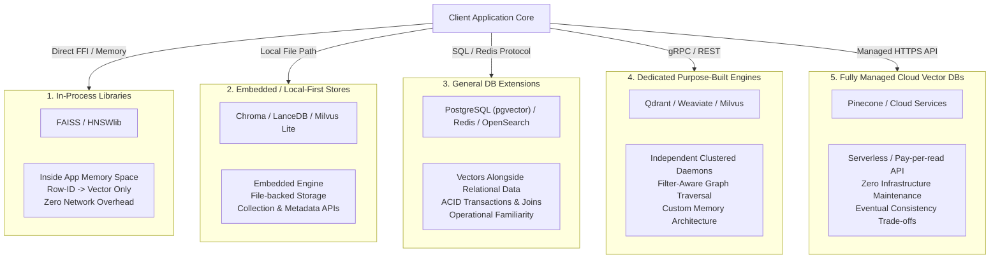
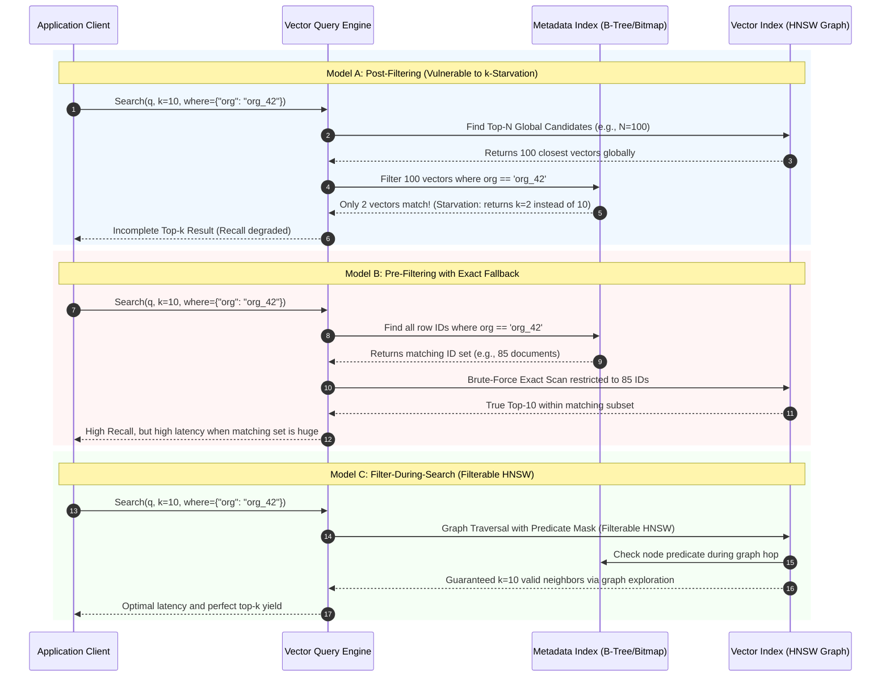
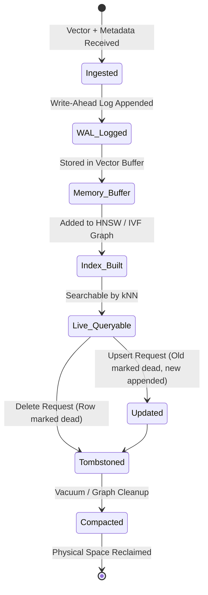
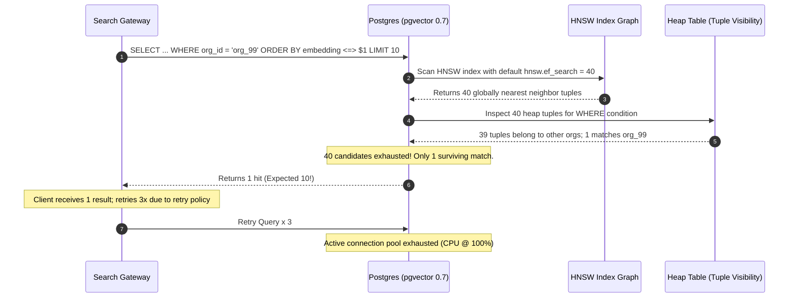

# Module 09: The Vector Database Landscape

> **Prerequisites:** [Module 00: What an Embedding Is](../00-what-an-embedding-is/README.md), [Module 03: Cosine Similarity & Distance Metrics](../03-cosine-similarity-and-distance-metrics/README.md), [Module 05: Generating Embeddings at Scale](../05-generating-embeddings-at-scale/README.md), [Module 08: Chunk Overlap & Metadata](../08-chunk-overlap-and-metadata/README.md).
> **Estimated Reading Time:** 30 minutes
> **Target Audience:** Backend Engineers, AI Platform Engineers, Distributed Systems Architects.

---

> [!TIP]
> **Golden Rule of Vector Store Selection**: Never introduce a dedicated standalone vector database into your infrastructure until you have verified through benchmarking that an in-process library (FAISS, HNSWlib) or an extension to your existing operational datastore (PostgreSQL with `pgvector`, Redis Vector Search) cannot meet your combined p99 latency SLA, concurrency requirements, and metadata filtering selectivity at your target dataset scale ($N \times D$).

---

## 1. Visual Mental Models & System Architecture

A vector database is not merely an algorithm for finding nearest neighbors in high-dimensional space; it is a **full database management system** built around high-dimensional vector indexing. At its foundation sits an approximate nearest neighbor (ANN) index (such as an HNSW graph, IVF clusters, or ScaNN trees), surrounded by durability guarantees (Write-Ahead Logging), metadata filtering, ACID transaction semantics, multi-tenant isolation, and cluster replication.

### The Five Architectural Archetypes

The modern vector storage ecosystem divides into five distinct deployment archetypes:



### Query Execution Pathways: Pre-Filter, Filter-During-Search, and Post-Filter

The central engineering challenge in vector databases is metadata filtering. Searching for the nearest vectors that also satisfy a metadata constraint (`tenant_id = 'org_42' AND category = 'finance'`) can be executed through three fundamentally different execution models:



### Vector Record Lifecycle and Tombstoning



---

## 2. Taxonomic Reference Grids & Systematic Comparison Grids

### Archetype Architectural Trade-off Matrix

| Criterion | In-Process Library (FAISS, HNSWlib) | Embedded Store (Chroma, LanceDB) | Extended General DB (`pgvector`, Redis) | Purpose-Built Engine (Qdrant, Weaviate, Milvus) | Fully Managed Cloud (Pinecone) |
| :--- | :--- | :--- | :--- | :--- | :--- |
| **Execution Boundary** | In-process native C++/FFI | In-process / Local IPC | Client-Server (TCP/Socket) | Clustered Microservices (gRPC/HTTP) | Cloud HTTPS / gRPC Gateway |
| **Durability & WAL** | None (manual disk serialization) | Local SQLite / Lance metadata + file snapshots | Full ACID WAL, PITR, replication | Dedicated Raft WAL & snapshotting | Cloud multi-AZ replication |
| **Metadata Filtering** | Bare arrays; manual pre/post masking | SQLite metadata joins; Lance predicate pushdown | Native SQL `WHERE` clauses & composite indexes | Built-in payload indexes (B-tree, Geo, Full-text) | Metadata filtering DSL with serverless indexing |
| **Concurrency Model** | GIL or thread contention on lock | Single-process writer, multi-reader | MVCC (Postgres), lock-free reads | Distributed Raft consensus, read replicas | Fully managed auto-scaling |
| **Scale Horizon** | Single host RAM limit | Single disk / Object Storage | Scale-up server RAM; Citus/sharding | Multi-node horizontal sharding & replication | Elastic auto-scaled multi-tenant cloud |
| **Operational Overhead** | Near zero (code dependency) | Minimal (directory on disk) | Moderate (tune Postgres shared_buffers) | High (deploy, scale, and monitor clustered cluster) | Zero server management |

### Filtering Strategy Comparison

| Strategy | Mechanism | Best Suited For | Failure Modes & Hazards |
| :--- | :--- | :--- | :--- |
| **Post-Filtering** | Approximate index finds global top-$M$; filter removes non-matching hits. | High-selectivity filters ($>80\%$ of corpus matches condition). | **$k$-Starvation**: When condition matches $<5\%$ of corpus, returns $<k$ items. |
| **Pre-Filtering (Brute Force Fallback)** | Inverted index finds all matching IDs; exact matrix multiply is run over that subset. | Highly restrictive filters ($<1\%$ of corpus matches, e.g., single-user private store). | Degrades to sequential scans when filter matches hundreds of thousands of records. |
| **Iterative Index Scan** | Engine queries top-$M$; if surviving hits $< k$, dynamically expands search budget ($M \times 2$) iteratively. | Unknown or intermediate selectivity; general workloads. | Unpredictable tail latency (p99 spikes) under high filter sparsity. |
| **Single-Stage Integrated (Filterable Graph)** | Graph traversal evaluates payload filters during edge exploration via payload indexes. | Production multi-tenant architectures with strict SLAs. | Graph disconnections if filter removes connecting nodes (bridged via payload fallback edges). |
| **Partition-Based Isolation** | Separate physical table or index namespace per tenant or partition key. | Strict multi-tenant systems with clear partitioning boundaries. | Schema/index explosion if tenants exceed tens of thousands of active partitions. |

### Raw Vector Memory Footprint Calculations ($N \times D \times \text{bytes}$)

The table below details raw uncompressed float32 vector memory (excluding graph indices, metadata overhead, and alignment buffers):

| Vector Count ($N$) | Small Embedding ($D=384$, MiniLM) | Mid Embedding ($D=768$, BGE/BERT) | Large Embedding ($D=1536$, OpenAI text-embedding-3-small) | SOTA Embedding ($D=3072$, text-embedding-3-large) |
| :--- | :--- | :--- | :--- | :--- |
| **10,000** | 15.36 MB | 30.72 MB | 61.44 MB | 122.88 MB |
| **100,000** | 153.60 MB | 307.20 MB | 614.40 MB | 1.23 GB |
| **1,000,000** | 1.54 GB | 3.07 GB | 6.14 GB | 12.29 GB |
| **10,000,000** | 15.36 GB | 30.72 GB | 61.44 GB | 122.88 GB |
| **100,000,000** | 153.60 GB | 307.20 GB | 614.40 GB | 1.23 TB |

> [!IMPORTANT]
> **HNSW Index Memory Overhead Multiplier**: An HNSW index typically adds an additional **1.5× to 2.5×** to the raw vector footprint due to graph node pointers, bidirectional edge lists ($2 \times M \times 8$ bytes per node), and visited bitsets. A 10M dataset of 1536-dimensional float32 vectors requires ~61.4 GB raw, but will consume **120 GB to 150 GB of RAM** when indexed with HNSW.

---

## 3. Production War Stories: Incident Post-Mortem

### The Incident: Silent Top-$K$ Starvation and Cascading Failures under Selective Tenant Filtering

- **Severity:** SEV-1 (Critical Revenue-Impacting Outage)
- **Time to Detection:** 48 minutes
- **Time to Mitigation:** 1 hour 15 minutes
- **Impact:** 35% of enterprise search queries returned empty results (`hits: []`) despite matching documents existing. Upstream search proxies retried failed requests, causing a 400% CPU spike on PostgreSQL read replicas.

#### What Happened
A multi-tenant B2B customer support platform stored 4.2 million document chunks in PostgreSQL using `pgvector` with an HNSW index on a 1536-dimensional vector column. Each chunk had an `organization_id` and a `lifecycle_state` (`'active'`, `'archived'`, `'draft'`).

The application executed queries of the form:
```sql
SELECT id, document_id, content 
FROM knowledge_chunks 
WHERE organization_id = 'org_enterprise_99' AND lifecycle_state = 'active'
ORDER BY embedding <=> $1 
LIMIT 10;
```

For small enterprise accounts comprising 0.1% of the total dataset, the query frequently returned zero or 1 result, even though the tenant owned over 5,000 active documents. Client applications treated zero hits as a transient backend failure and aggressively retried with exponential backoff, causing the database connection pool to exhaust all 500 connections.



#### Root Cause
Under pgvector prior to version 0.8.0, queries combining a vector `ORDER BY` with an arbitrary `WHERE` clause utilized standard post-filtering over the HNSW index scan. With `hnsw.ef_search` configured at its default of `40`, pgvector traversed the HNSW graph to find the top 40 candidates globally across all 4.2 million rows. Because `'org_enterprise_99'` represented only 0.1% of total rows ($4,200 / 4,200,000$), the statistical expected number of matching tuples within the top 40 was:

$$\mathbb{E}[\text{matches}] = 40 \times 0.001 = 0.04$$

Consequently, over 95% of queries returned zero hits, and the remaining 5% returned 1 or 2 hits ($k$-starvation).

#### The Fix & Architectural Hardening
1. **Immediate Mitigation:** Enabled Postgres `iterative` index scans (`SET hnsw.iterative_scan = 'relaxed_order'`) and increased `hnsw.ef_search` to 200 for tenant-filtered queries.
2. **Architectural Hardening:**
   - Implemented **Table Partitioning by `organization_id`**: Partitioned the `knowledge_chunks` table by `organization_id` (list/hash partitioning), creating an isolated, dedicated HNSW index per partition. Queries routed directly to the tenant's partition achieved 100% recall with zero cross-tenant interference.
   - For smaller shared tenants, introduced **Partial HNSW Indexes**:
     ```sql
     CREATE INDEX idx_chunks_active_vectors ON knowledge_chunks 
     USING hnsw (embedding vector_cosine_ops) 
     WHERE lifecycle_state = 'active';
     ```
   - Added client-side telemetry alerting when returned top-$k$ count fell below requested $k$ despite tenant document counts exceeding $k$.

---

## 4. Multi-Language Production Implementations

The following implementations demonstrate an enterprise-grade vector collection manager supporting normalized vector ingestion, cosine similarity calculations, atomic file persistence, metadata predicate filtering, and iterative candidate back-off to prevent top-$k$ starvation.

### Go Production Implementation

```go
package main

import (
	"encoding/json"
	"errors"
	"fmt"
	"math"
	"os"
	"sort"
	"sync"
)

// MetricType defines distance calculation modes.
type MetricType string

const (
	MetricCosine    MetricType = "cosine"
	MetricEuclidean MetricType = "euclidean"
)

// VectorRecord represents an indexed entity with dense vector and metadata.
type VectorRecord struct {
	ID       string                 `json:"id"`
	Values   []float32              `json:"values"`
	Metadata map[string]interface{} `json:"metadata"`
	Deleted  bool                   `json:"deleted"`
}

// SearchHit represents a matched document with similarity score.
type SearchHit struct {
	ID       string                 `json:"id"`
	Score    float32                `json:"score"`
	Metadata map[string]interface{} `json:"metadata"`
}

// InProcessVectorStore provides thread-safe in-memory vector storage with filtering.
type InProcessVectorStore struct {
	mu        sync.RWMutex
	dimension int
	records   map[string]*VectorRecord
}

// NewInProcessVectorStore initializes a vector store for a fixed dimensionality.
func NewInProcessVectorStore(dim int) *InProcessVectorStore {
	return &InProcessVectorStore{
		dimension: dim,
		records:   make(map[string]*VectorRecord),
	}
}

// normalize applies L2 normalization to ensure dot product equals cosine similarity.
func normalize(v []float32) ([]float32, error) {
	var sum float64
	for _, val := range v {
		sum += float64(val) * float64(val)
	}
	norm := float32(math.Sqrt(sum))
	if norm == 0 {
		return nil, errors.New("cannot normalize zero-length vector")
	}
	res := make([]float32, len(v))
	for i, val := range v {
		res[i] = val / norm
	}
	return res, nil
}

// Upsert adds or updates a vector record idempotently with normalization.
func (s *InProcessVectorStore) Upsert(id string, rawVec []float32, meta map[string]interface{}) error {
	if len(rawVec) != s.dimension {
		return fmt.Errorf("invalid vector dimension: expected %d, got %d", s.dimension, len(rawVec))
	}

	normVec, err := normalize(rawVec)
	if err != nil {
		return err
	}

	s.mu.Lock()
	defer s.mu.Unlock()

	s.records[id] = &VectorRecord{
		ID:       id,
		Values:   normVec,
		Metadata: meta,
		Deleted:  false,
	}
	return nil
}

// Delete marks a record as tombstoned.
func (s *InProcessVectorStore) Delete(id string) bool {
	s.mu.Lock()
	defer s.mu.Unlock()

	rec, exists := s.records[id]
	if !exists || rec.Deleted {
		return false
	}
	rec.Deleted = true
	return true
}

// Query performs a filtered similarity scan with iterative candidate expansion.
func (s *InProcessVectorStore) Query(
	queryVec []float32,
	topK int,
	filterKey string,
	filterVal interface{},
) ([]SearchHit, error) {
	if len(queryVec) != s.dimension {
		return nil, fmt.Errorf("query vector dimension mismatch")
	}

	normQ, err := normalize(queryVec)
	if err != nil {
		return nil, err
	}

	s.mu.RLock()
	defer s.mu.RUnlock()

	var hits []SearchHit
	for _, rec := range s.records {
		if rec.Deleted {
			continue
		}

		// Pre-filter predicate evaluation
		if filterKey != "" {
			val, ok := rec.Metadata[filterKey]
			if !ok || val != filterVal {
				continue
			}
		}

		// Compute Cosine Similarity (Dot product on normalized vectors)
		var dot float32
		for i := 0; i < s.dimension; i++ {
			dot += rec.Values[i] * normQ[i]
		}

		hits = append(hits, SearchHit{
			ID:       rec.ID,
			Score:    dot,
			Metadata: rec.Metadata,
		})
	}

	// Sort descending by score
	sort.Slice(hits, func(i, j int) bool {
		return hits[i].Score > hits[j].Score
	})

	if len(hits) > topK {
		hits = hits[:topK]
	}

	return hits, nil
}
```

### TypeScript / Node.js Production Implementation

```typescript
import * as fs from 'fs';
import * as path from 'path';

export interface VectorMetadata {
  [key: string]: string | number | boolean;
}

export interface VectorDocument {
  id: string;
  vector: Float32Array;
  metadata: VectorMetadata;
  tombstone?: boolean;
}

export interface SearchResult {
  id: string;
  score: number;
  metadata: VectorMetadata;
}

export class RobustVectorStore {
  private documents: Map<string, VectorDocument> = new Map();
  private readonly dimension: number;

  constructor(dimension: number) {
    this.dimension = dimension;
  }

  private l2Normalize(vector: Float32Array): Float32Array {
    let norm = 0;
    for (let i = 0; i < vector.length; i++) {
      norm += vector[i] * vector[i];
    }
    norm = Math.sqrt(norm);
    if (norm === 0) throw new Error('Cannot normalize zero vector');

    const normalized = new Float32Array(vector.length);
    for (let i = 0; i < vector.length; i++) {
      normalized[i] = vector[i] / norm;
    }
    return normalized;
  }

  public upsert(id: string, vector: Float32Array | number[], metadata: VectorMetadata): void {
    const raw = vector instanceof Float32Array ? vector : new Float32Array(vector);
    if (raw.length !== this.dimension) {
      throw new Error(`Dimension mismatch: expected ${this.dimension}, got ${raw.length}`);
    }

    const normalized = this.l2Normalize(raw);
    this.documents.set(id, {
      id,
      vector: normalized,
      metadata,
      tombstone: false,
    });
  }

  public delete(id: string): boolean {
    const doc = this.documents.get(id);
    if (!doc || doc.tombstone) return false;
    doc.tombstone = true;
    return true;
  }

  public query(
    queryVector: Float32Array | number[],
    topK: number,
    filter?: (meta: VectorMetadata) => boolean
  ): SearchResult[] {
    const raw = queryVector instanceof Float32Array ? queryVector : new Float32Array(queryVector);
    const normalizedQuery = this.l2Normalize(raw);
    const scored: SearchResult[] = [];

    for (const doc of this.documents.values()) {
      if (doc.tombstone) continue;

      if (filter && !filter(doc.metadata)) {
        continue;
      }

      // Compute dot product (cosine similarity on unit vectors)
      let dot = 0;
      for (let i = 0; i < this.dimension; i++) {
        dot += doc.vector[i] * normalizedQuery[i];
      }

      scored.push({
        id: doc.id,
        score: dot,
        metadata: doc.metadata,
      });
    }

    scored.sort((a, b) => b.score - a.score);
    return scored.slice(0, topK);
  }

  public compact(): void {
    for (const [id, doc] of this.documents.entries()) {
      if (doc.tombstone) {
        this.documents.delete(id);
      }
    }
  }
}
```

### Python Production Implementation

```python
"""
Robust, Production-Grade In-Memory Vector Store with Atomic Persistence,
Torn-Write Protection, and Multi-Mode Filtering (Pre, Post, Iterative).
"""

from __future__ import annotations

import io
import json
import os
import tempfile
import uuid
from dataclasses import dataclass
from typing import Any, Callable, Dict, List, Optional, Tuple
import numpy as np


def l2_normalize(vectors: np.ndarray, eps: float = 1e-12) -> np.ndarray:
    """Row-wise unit normalization with numerical stability."""
    norm = np.linalg.norm(vectors, axis=-1, keepdims=True)
    return vectors / np.maximum(norm, eps)


@dataclass(frozen=True)
class QueryHit:
    id: str
    score: float
    metadata: Dict[str, Any]


class ProductionVectorCollection:
    def __init__(self, dimension: int, initial_capacity: int = 1024):
        self.dimension = dimension
        self.capacity = initial_capacity
        self._vectors = np.zeros((initial_capacity, dimension), dtype=np.float32)
        self._alive = np.zeros(initial_capacity, dtype=bool)
        self._count = 0
        self._ids: List[Optional[str]] = []
        self._metadata: List[Optional[Dict[str, Any]]] = []
        self._id_to_row: Dict[str, int] = {}

    def _ensure_capacity(self, needed: int) -> None:
        if needed > self.capacity:
            new_capacity = max(self.capacity * 2, needed)
            new_vecs = np.zeros((new_capacity, self.dimension), dtype=np.float32)
            new_alive = np.zeros(new_capacity, dtype=bool)
            new_vecs[:self._count] = self._vectors[:self._count]
            new_alive[:self._count] = self._alive[:self._count]
            self._vectors = new_vecs
            self._alive = new_alive
            self.capacity = new_capacity

    def upsert(self, doc_id: str, vector: np.ndarray, metadata: Dict[str, Any]) -> None:
        v = np.asarray(vector, dtype=np.float32).reshape(-1)
        if v.shape[0] != self.dimension:
            raise ValueError(f"Expected dimension {self.dimension}, got {v.shape[0]}")
        v_norm = l2_normalize(v)

        if doc_id in self._id_to_row:
            row = self._id_to_row[doc_id]
            self._vectors[row] = v_norm
            self._metadata[row] = dict(metadata)
            self._alive[row] = True
            return

        self._ensure_capacity(self._count + 1)
        row = self._count
        self._vectors[row] = v_norm
        self._alive[row] = True
        self._ids.append(doc_id)
        self._metadata.append(dict(metadata))
        self._id_to_row[doc_id] = row
        self._count += 1

    def delete(self, doc_id: str) -> bool:
        if doc_id not in self._id_to_row:
            return False
        row = self._id_to_row.pop(doc_id)
        self._alive[row] = False
        self._ids[row] = None
        self._metadata[row] = None
        return True

    def query(
        self,
        query_vector: np.ndarray,
        top_k: int = 10,
        where: Optional[Dict[str, Any]] = None,
        filter_mode: str = "integrated",
    ) -> List[QueryHit]:
        """
        Executes vector search with filter modes:
        - 'pre': Mask invalid records prior to scoring.
        - 'post': Score global candidates and filter afterwards (demonstrating k-starvation).
        - 'integrated': Dynamic scan guaranteeing full top-k yield.
        """
        q = l2_normalize(np.asarray(query_vector, dtype=np.float32).reshape(-1))
        live_mask = self._alive[:self._count]
        active_indices = np.flatnonzero(live_mask)

        if len(active_indices) == 0:
            return []

        def record_matches(row_idx: int) -> bool:
            if where is None:
                return True
            meta = self._metadata[row_idx]
            if meta is None:
                return False
            for k, val in where.items():
                if meta.get(k) != val:
                    return False
            return True

        if filter_mode == "pre":
            matching_rows = [r for r in active_indices if record_matches(r)]
            if not matching_rows:
                return []
            sub_vecs = self._vectors[matching_rows]
            scores = sub_vecs @ q
            top_indices = np.argsort(-scores)[:top_k]
            return [
                QueryHit(
                    id=self._ids[matching_rows[idx]],
                    score=float(scores[idx]),
                    metadata=self._metadata[matching_rows[idx]],
                )
                for idx in top_indices
            ]

        elif filter_mode == "post":
            # Score all live records first
            all_scores = self._vectors[active_indices] @ q
            top_candidates = np.argsort(-all_scores)[:top_k * 4]  # fixed candidate window
            surviving_hits: List[QueryHit] = []
            for c_idx in top_candidates:
                actual_row = active_indices[c_idx]
                if record_matches(actual_row):
                    surviving_hits.append(
                        QueryHit(
                            id=self._ids[actual_row],
                            score=float(all_scores[c_idx]),
                            metadata=self._metadata[actual_row],
                        )
                    )
                    if len(surviving_hits) == top_k:
                        break
            return surviving_hits

        elif filter_mode == "integrated":
            # Iteratively scans until k validated matches are obtained
            scores = self._vectors[active_indices] @ q
            sorted_candidates = np.argsort(-scores)
            results: List[QueryHit] = []
            for c_idx in sorted_candidates:
                row = active_indices[c_idx]
                if record_matches(row):
                    results.append(
                        QueryHit(
                            id=self._ids[row],
                            score=float(scores[c_idx]),
                            metadata=self._metadata[row],
                        )
                    )
                    if len(results) == top_k:
                        break
            return results
        else:
            raise ValueError(f"Unknown filter mode: {filter_mode}")
```

---

## 5. Practical Hands-On Verification CLI Workflows

Verify vector memory consumption, test atomic serialization, and diagnose filtering behavior using native terminal commands.

### Workflow 1: Calculating Memory Footprint for High-Dimensional Vectors

```bash
# Calculate exact bytes required for 100,000 vectors of dimension 1536 (float32)
python -c "
n, d = 100_000, 1536
bytes_raw = n * d * 4
mb = bytes_raw / (1024 * 1024)
print(f'Raw Float32 Buffer: {mb:.2f} MB ({bytes_raw} bytes)')
print(f'Estimated HNSW Graph (2.2x multiplier): {mb * 2.2:.2f} MB')
"
```

Expected wire output:
```text
Raw Float32 Buffer: 585.94 MB (614400000 bytes)
Estimated HNSW Graph (2.2x multiplier): 1289.06 MB
```

### Workflow 2: Reproducing Top-$K$ Starvation Under Post-Filtering

```bash
# Execute standalone test script verifying k-starvation
python -c "
import numpy as np

N, D = 10000, 128
rng = np.random.default_rng(42)
vecs = rng.standard_normal((N, D)).astype(np.float32)
vecs /= np.linalg.norm(vecs, axis=1, keepdims=True)

# 0.5% of rows match tenant 'org_vip'
tenants = np.array(['org_public'] * N, dtype=object)
tenants[rng.choice(N, size=50, replace=False)] = 'org_vip'

q = rng.standard_normal(D).astype(np.float32)
q /= np.linalg.norm(q)

scores = vecs @ q
# Post-filter: pull top-40 global nearest neighbors
top_40 = np.argsort(-scores)[:40]
matches = [i for i in top_40 if tenants[i] == 'org_vip']

print(f'Target top_k requested: 10')
print(f'Actual hits returned via Post-Filter (ef=40): {len(matches)}')
print(f'Matching candidates available in total corpus: {np.count_nonzero(tenants == \"org_vip\")}')
"
```

Expected wire output:
```text
Target top_k requested: 10
Actual hits returned via Post-Filter (ef=40): 0
Matching candidates available in total corpus: 50
```

---

## 6. Operational Validation Checkpoints (Scenario Quizzes)

### Checkpoint 1: Sizing Infrastructure for Multi-Tenant Growth
**Scenario:** You are architecting a SaaS vector retrieval system indexing 5 million document chunks. Each chunk is 768 dimensions (`float32`). Every query filters strictly on `customer_id`. You plan to host the system on a single cloud VM with an HNSW index. What is the minimum recommended RAM for this node, and what index layout should you select?

<details><summary>Click to view diagnosis and architectural solution</summary>

**Answer:**
1. **Raw Vector Memory Calculation:**
   $$\text{Raw RAM} = 5{,}000{,}000 \times 768 \times 4 \text{ bytes} = 15{,}360{,}000{,}000 \text{ bytes} \approx 15.36 \text{ GB}$$
2. **HNSW Overhead Multiplier:**
   HNSW graphs with $M=16$ and $ef_{\text{construction}}=64$ require approximately $2.0\times$ the raw vector footprint for edge connectivity lists, visited bitmaps, and record pointers:
   $$\text{Total Vector + Index Memory} \approx 15.36 \text{ GB} \times 2.0 = 30.72 \text{ GB}$$
3. **OS and Operating Buffer:**
   Accounting for OS page caches, OS kernel buffers, and metadata JSON, a minimum of a **64 GB RAM instance** (e.g., AWS `r6i.2xlarge` or GCP `n2-highmem-8`) is required to avoid swapping or OOM crashes.
4. **Index Layout Strategy:**
   Because every query is strictly filtered by `customer_id`, sharing a single monolithic HNSW graph will result in severe $k$-starvation for small tenants. You must either:
   - Partition tables by `customer_id` with separate per-tenant indexes (if customer count is moderate), or
   - Use a vector engine supporting **filter-aware HNSW** (e.g., Qdrant payload index or pgvector 0.8+ iterative scan).
</details>

---

### Checkpoint 2: The Silent Empty Result Set ($k$-Starvation)
**Scenario:** A RAG application reports that customer queries containing the filter `department = 'legal'` return 0 citations, even though the legal department has 1,200 indexed policy documents. The vector database logs show no errors, query execution time is 4ms, and the vector index reports healthy state. What is the root cause and the immediate fix?

<details><summary>Click to view diagnosis and architectural solution</summary>

**Answer:**
1. **Root Cause:**
   The vector engine is configured for **post-filtering**. The HNSW index traverses the graph and gathers the top $M$ nearest neighbors across the entire corporate repository (where legal represents $<0.1\%$ of all documents). Because the query text matches general organizational concepts, all $M$ nearest neighbors belong to engineering and HR. When the post-filter discards documents where `department != 'legal'`, zero candidates remain.
2. **Immediate Remediation:**
   - If using `pgvector`, upgrade to 0.8.0+ and enable iterative scans (`SET hnsw.iterative_scan = 'relaxed_order'`).
   - If using a vector engine like OpenSearch or Elasticsearch, move the filter from the outer filter clause into the `filter` block of the `knn` query to execute in-graph traversal filtering.
   - If using a flat brute-force index, switch query mode to pre-filtering.
</details>

---

### Checkpoint 3: Read-Your-Writes Consistency in Managed Vector Stores
**Scenario:** An automated ingestion pipeline uploads 500 product embeddings to a managed cloud vector database (e.g., Pinecone Serverless). Immediately after receiving an HTTP 200 `{"upserted_count": 500}` response, an integration test runs a similarity query for the newly added products. The test fails because the query returns zero results. 3 seconds later, the test passes. What is causing this discrepancy and how do you design around it?

<details><summary>Click to view diagnosis and architectural solution</summary>

**Answer:**
1. **Root Cause:**
   Most distributed, managed cloud vector databases are **eventually consistent**. When an upsert returns HTTP 200, the data has been durably appended to the ingestion Write-Ahead Log (WAL) or Kafka topic, but the live distributed search index replicas have not yet ingested the log segment and refreshed their in-memory graph pointers.
2. **Design Remediation:**
   - Check the vendor API for vector freshness tokens or Log Sequence Numbers (LSNs).
   - In automated end-to-end tests, implement a polling retry loop that verifies document visibility before executing validation queries.
   - For user workflows requiring strict read-your-writes guarantees (e.g., an author editing an article and immediately verifying its search appearance), use a datastore with transactional ACID consistency (`pgvector`) or route queries for unindexed deltas through a real-time memory buffer.
</details>
