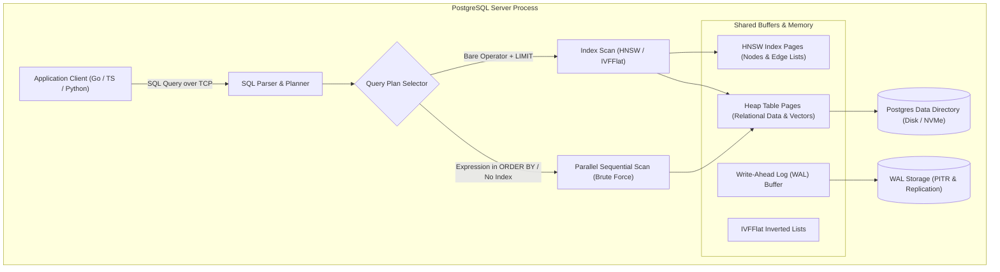
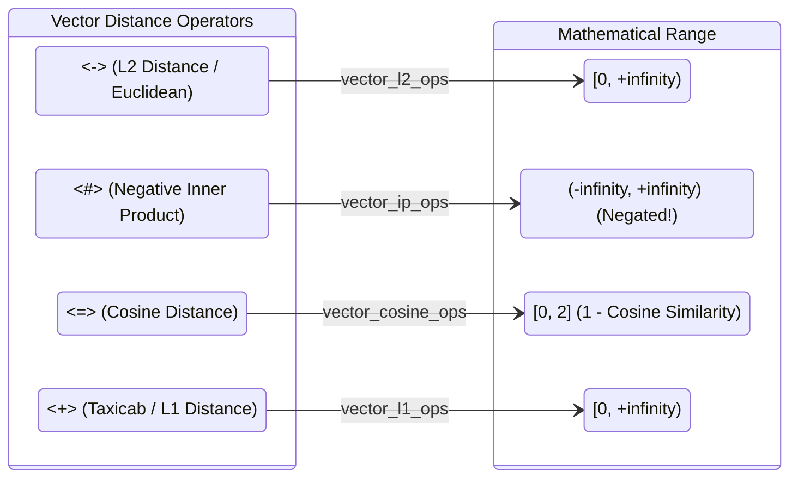
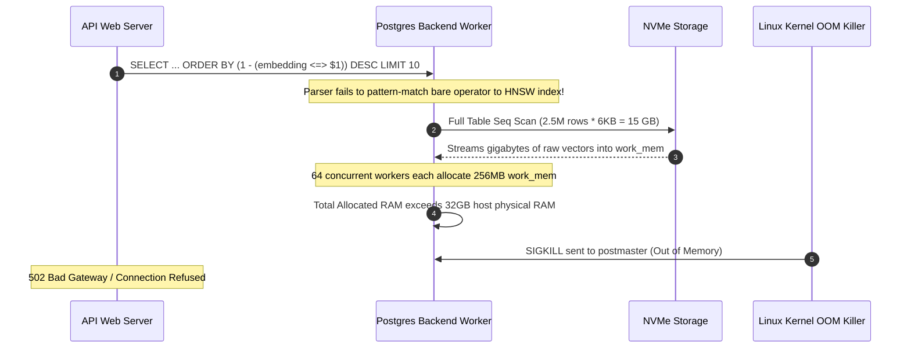

# Module 10: pgvector and Postgres

> **Prerequisites:** [Module 00: What an Embedding Is](../00-what-an-embedding-is/README.md), [Module 03: Cosine Similarity & Distance Metrics](../03-cosine-similarity-and-distance-metrics/README.md), [Module 05: Generating Embeddings at Scale](../05-generating-embeddings-at-scale/README.md), [Module 09: The Vector Database Landscape](../09-the-vector-database-landscape/README.md).
> **Estimated Reading Time:** 30 minutes
> **Target Audience:** Backend Engineers, Database Administrators, AI Infrastructure Engineers.

---

> [!TIP]
> **Golden Rule of pgvector**: Always ensure your vector similarity query uses a bare distance operator (`<->`, `<#>`, `<=>`, `<+>`) in **ascending order** directly within the `ORDER BY` clause accompanied by an explicit `LIMIT`, and create your index using the exact operator class (`vector_cosine_ops`, `vector_l2_ops`, `vector_ip_ops`) matching that operator. Never wrap the distance expression inside arithmetic or helper functions in the `ORDER BY` (e.g., `ORDER BY (1 - (embedding <=> $1)) DESC`), as doing so silently disables the vector index scan and triggers an catastrophic full-table sequential scan.

---

## 1. Visual Mental Models & System Architecture

PostgreSQL with the `pgvector` extension provides native high-dimensional vector types (`vector`, `halfvec`, `sparsevec`), hardware-accelerated distance operators (SIMD AVX-512 / ARM NEON), and two approximate nearest neighbor (ANN) index architectures: **HNSW** (Hierarchical Navigable Small World) and **IVFFlat** (Inverted File Flat).

### The Unified Relational & Vector Engine Architecture



### Vector Query Execution Plan: Index Scan vs. Sequential Scan

```mermaid
sequenceDiagram
    autonumber
    participant App as App Service
    participant Planner as Postgres Query Planner
    participant HNSW as HNSW Index Engine
    participant Heap as Heap Storage (Tuples)

    rect rgb(240, 248, 255)
    note over App, Heap: Plan A: Fast Vector Index Scan (Index Scan using idx_chunks_embedding)
    App->>Planner: SELECT id, title FROM chunks ORDER BY embedding <=> $1 LIMIT 5
    Planner->>HNSW: Traverse multilayer graph (ef_search = 40)
    HNSW-->>Planner: Returns top-40 candidate ItemPointers (TIDs)
    Planner->>Heap: Fetch 5 tuples directly by TID
    Heap-->>App: Query results returned in 1.8ms
    end

    rect rgb(255, 245, 245)
    note over App, Heap: Plan B: Accidental Sequential Scan (Expression in ORDER BY)
    App->>Planner: SELECT id, title FROM chunks ORDER BY (1 - (embedding <=> $1)) DESC LIMIT 5
    Planner->>Planner: Expression detected in ORDER BY -> Vector Index unusable!
    Planner->>Heap: Parallel Seq Scan (reads 2,000,000 tuples across all workers)
    Note over Heap: 100% CPU on all CPU cores; reads 4.8 GB from disk
    Heap-->>App: Query results returned in 1,420ms (P99 degraded!)
    end
```

### The Four Distance Operators and the Negative Inner Product Rule

PostgreSQL index scans strictly traverse B-trees and GiST/GIN/vector indexes in **Ascending (`ASC`)** order. Because similarity is maximized when inner product is largest, pgvector defines `<#>` as the **negative inner product**:

$$-(\mathbf{u} \cdot \mathbf{v}) = -\sum_{i=1}^{D} u_i v_i$$

Sorting in `ASC` order sorts from most negative to least negative, naturally surfacing the largest dot products first!



---

## 2. Taxonomic Reference Grids & Systematic Comparison Grids

### Distance Operators & Index Operator Classes

| Operator | Distance Metric | Mathematical Definition | Valid Range | Index Operator Class | Correct Query ORDER BY Clause |
| :--- | :--- | :--- | :--- | :--- | :--- |
| `<->` | Euclidean ($L_2$) | $\sqrt{\sum_{i=1}^D (u_i - v_i)^2}$ | $[0, +\infty)$ | `vector_l2_ops` | `ORDER BY embedding <-> $1 ASC LIMIT k` |
| `<#>` | **Negative** Inner Product | $-\sum_{i=1}^D u_i v_i$ | $(-\infty, +\infty)$ | `vector_ip_ops` | `ORDER BY embedding <#> $1 ASC LIMIT k` |
| `<=>` | Cosine Distance | $1 - \frac{\mathbf{u} \cdot \mathbf{v}}{\|\mathbf{u}\| \|\mathbf{v}\|}$ | $[0, 2]$ | `vector_cosine_ops` | `ORDER BY embedding <=> $1 ASC LIMIT k` |
| `<+>` | Taxicab ($L_1$ / Manhattan) | $\sum_{i=1}^D \|u_i - v_i\|$ | $[0, +\infty)$ | `vector_l1_ops` (HNSW only) | `ORDER BY embedding <+> $1 ASC LIMIT k` |

> [!CAUTION]
> **The `<#>` Sorting Pitfall**: Writing `ORDER BY embedding <#> $1 DESC` attempts to sort descending, which returns vectors with the largest positive negative inner products (i.e., the **most dissimilar** or opposite vectors). Always sort ascending: `ORDER BY embedding <#> $1 ASC`.

### HNSW vs. IVFFlat Architectural Comparison

| Architectural Property | HNSW (`USING hnsw`) | IVFFlat (`USING ivfflat`) |
| :--- | :--- | :--- |
| **Data Structure** | Multi-layer bidirectional hierarchical graph | Inverted lists partitioned by $k$-means centroids |
| **Index Build Speed** | Slower (builds full proximity graph) | Faster ($k$-means clustering on table sample) |
| **Memory Footprint** | Higher (~1.5× to 2.5× raw vector size) | Lower (~0.1× to 0.2× raw vector size) |
| **Recall vs. Latency Curve** | Superior (typically 95-99% recall @ <5ms) | Lower (often 80-90% recall; sensitive to list skew) |
| **Build Timing Requirement** | Can be created on an empty table | **Must** be created after data is loaded (needs sample) |
| **Build Configuration Parameters** | `m = 16` (max edges per node, 2-100)<br>`ef_construction = 64` (search depth, 4-1000) | `lists = 100` (recommended: $\sqrt{N}$ up to 1M rows) |
| **Query Tuning Parameter** | `SET hnsw.ef_search = 40;` (default 40, range 1-1000) | `SET ivfflat.probes = 1;` (default 1, range 1-`lists`) |
| **Iterative Scan Support** | Yes (in pgvector 0.8.0+, `hnsw.iterative_scan`) | Yes (in pgvector 0.8.0+, `ivfflat.iterative_scan`) |

### Index Build Resource Configuration

When building indexes on millions of vectors, the default PostgreSQL configuration will result in disk-spilling external sorts and single-threaded bottlenecks. Configure these parameters before executing `CREATE INDEX`:

```sql
-- Allocate sufficient RAM for building the graph in-memory
SET maintenance_work_mem = '4GB';

-- Maximize parallel worker threads for parallel index build
SET max_parallel_maintenance_workers = 7;
```

---

## 3. Production War Stories: Incident Post-Mortem

### The Incident: Unbounded OOM Crashes from Accidental Expression in Vector ORDER BY

- **Severity:** SEV-1 (Production Database Crash & Failover)
- **Time to Detection:** 18 minutes
- **Time to Mitigation:** 45 minutes
- **Impact:** Primary PostgreSQL instance experienced kernel Out-Of-Memory (OOM) termination. 12,000 active web sessions dropped; database read replicas overloaded during failover recovery.

#### What Happened
A product engineering team deployed a user-facing semantic search update. The frontend required a "similarity percentage" between 0% and 100%. To simplify application code, an engineer modified the repository query from:

```sql
-- Original Query (Used HNSW Index cleanly)
SELECT id, title, content 
FROM documents 
ORDER BY embedding <=> $1 
LIMIT 10;
```

to:

```sql
-- Buggy Query: Attempted to sort by similarity percentage descending
SELECT id, title, content, (1 - (embedding <=> $1)) AS similarity_score
FROM documents 
ORDER BY (1 - (embedding <=> $1)) DESC 
LIMIT 10;
```

Within 5 minutes of release, as concurrent search traffic reached 150 QPS across a 2.5 million row table ($D=1536$), database CPU spiked to 100%, disk I/O saturated at 12,000 IOPS, and the Linux kernel OOM killer abruptly terminated the `postgres` postmaster process.



#### Root Cause
Under PostgreSQL, an index scan on a functional or specialized operator class is triggered **only** when the `ORDER BY` clause contains the exact bare operator defined in the operator family. Wrapping `embedding <=> $1` inside `(1 - (...)) DESC` rendered the HNSW index inaccessible to the planner. 

The query planner defaulted to a `Parallel Seq Scan` followed by a `Sort`. With 64 concurrent queries scanning 2.5 million 1536-dimensional float vectors (15 GB of raw table pages), each backend process exhausted its assigned `work_mem`, leading to aggregate memory exhaustion and kernel OOM invocation.

#### The Fix & Architectural Hardening
1. **Immediate SQL Patch:** Restored the bare operator in the `ORDER BY` and computed the similarity score strictly in the `SELECT` projection list:
   ```sql
   SELECT id, title, content, 1 - (embedding <=> $1) AS similarity_score
   FROM documents 
   ORDER BY embedding <=> $1 ASC 
   LIMIT 10;
   ```
2. **Execution Plan Validation with EXPLAIN:**
   Verified in staging that the plan utilizes `Index Scan using idx_documents_embedding on documents`:
   ```sql
   EXPLAIN ANALYZE
   SELECT id FROM documents ORDER BY embedding <=> $1 ASC LIMIT 10;
   ```
3. **CI Pipeline SQL Linter:** Added an AST linter rule in CI that rejects any SQL containing `vector` distance operators combined with `DESC` or wrapped in arithmetic within `ORDER BY`.

---

## 4. Multi-Language Production Implementations

The following code tabs demonstrate enterprise-grade integration with PostgreSQL and `pgvector`, featuring connection pooling, transactional upserts with `ON CONFLICT`, SIMD vector serialization, and safe parameterized query execution.

### Go Production Implementation

```go
package main

import (
	"context"
	"fmt"
	"log"
	"time"

	"github.com/jackc/pgx/v5"
	"github.com/jackc/pgx/v5/pgxpool"
	"github.com/pgvector/pgvector-go"
)

type DocumentChunk struct {
	ID        string            `json:"id"`
	Content   string            `json:"content"`
	Metadata  map[string]any    `json:"metadata"`
	Embedding []float32         `json:"embedding"`
}

type SearchResult struct {
	ID         string  `json:"id"`
	Content    string  `json:"content"`
	Distance   float64 `json:"distance"`
	Similarity float64 `json:"similarity"`
}

type PgVectorRepository struct {
	pool *pgxpool.Pool
}

func NewPgVectorRepository(ctx context.Context, connString string) (*PgVectorRepository, error) {
	config, err := pgxpool.ParseConfig(connString)
	if err != nil {
		return nil, fmt.Errorf("unable to parse database config: %w", err)
	}

	config.MaxConns = 30
	config.MinConns = 5
	config.MaxConnLifetime = 1 * time.Hour
	config.MaxConnIdleTime = 15 * time.Minute

	// Register pgvector types on connection creation
	config.AfterConnect = func(ctx context.Context, conn *pgx.Conn) error {
		return pgvector.RegisterTypes(ctx, conn)
	}

	pool, err := pgxpool.NewWithConfig(ctx, config)
	if err != nil {
		return nil, fmt.Errorf("failed to create connection pool: %w", err)
	}

	return &PgVectorRepository{pool: pool}, nil
}

// UpsertChunk stores or updates a document chunk transactionally.
func (r *PgVectorRepository) UpsertChunk(ctx context.Context, chunk DocumentChunk) error {
	query := `
		INSERT INTO document_chunks (id, content, metadata, embedding)
		VALUES ($1, $2, $3, $4)
		ON CONFLICT (id) DO UPDATE SET
			content = EXCLUDED.content,
			metadata = EXCLUDED.metadata,
			embedding = EXCLUDED.embedding,
			updated_at = NOW();
	`
	vec := pgvector.NewVector(chunk.Embedding)
	_, err := r.pool.Exec(ctx, query, chunk.ID, chunk.Content, chunk.Metadata, vec)
	if err != nil {
		return fmt.Errorf("failed to upsert chunk: %w", err)
	}
	return nil
}

// SearchSimilar executes an HNSW-indexed cosine distance similarity query.
func (r *PgVectorRepository) SearchSimilar(ctx context.Context, queryEmbedding []float32, topK int, tenantID string) ([]SearchResult, error) {
	query := `
		SELECT 
			id, 
			content, 
			embedding <=> $1 AS distance,
			1 - (embedding <=> $1) AS similarity
		FROM document_chunks
		WHERE metadata->>'tenant_id' = $2
		ORDER BY embedding <=> $1 ASC
		LIMIT $3;
	`
	vec := pgvector.NewVector(queryEmbedding)
	rows, err := r.pool.Query(ctx, query, vec, tenantID, topK)
	if err != nil {
		return nil, fmt.Errorf("vector search failed: %w", err)
	}
	defer rows.Close()

	var results []SearchResult
	for rows.Next() {
		var res SearchResult
		if err := rows.Scan(&res.ID, &res.Content, &res.Distance, &res.Similarity); err != nil {
			return nil, fmt.Errorf("failed to scan vector hit: %w", err)
		}
		results = append(results, res)
	}

	return results, nil
}
```

### TypeScript / Node.js Production Implementation

```typescript
import { Pool, PoolClient } from 'pg';
import { toSql } from 'pgvector';

export interface ChunkRecord {
  id: string;
  content: string;
  tenantId: string;
  embedding: number[];
}

export interface VectorHit {
  id: string;
  content: string;
  distance: number;
  similarity: number;
}

export class PgVectorClient {
  private pool: Pool;

  constructor(connectionString: string) {
    this.pool = new Pool({
      connectionString,
      max: 20,
      idleTimeoutMillis: 30000,
      connectionTimeoutMillis: 5000,
    });
  }

  public async initSchema(): Promise<void> {
    const client = await this.pool.connect();
    try {
      await client.query('CREATE EXTENSION IF NOT EXISTS vector;');
      await client.query(`
        CREATE TABLE IF NOT EXISTS document_chunks (
          id TEXT PRIMARY KEY,
          content TEXT NOT NULL,
          tenant_id TEXT NOT NULL,
          embedding vector(1536) NOT NULL,
          created_at TIMESTAMPTZ DEFAULT NOW()
        );
      `);
      await client.query(`
        CREATE INDEX IF NOT EXISTS idx_chunks_embedding_hnsw 
        ON document_chunks 
        USING hnsw (embedding vector_cosine_ops)
        WITH (m = 16, ef_construction = 64);
      `);
    } finally {
      client.release();
    }
  }

  public async upsertChunk(chunk: ChunkRecord): Promise<void> {
    const query = `
      INSERT INTO document_chunks (id, content, tenant_id, embedding)
      VALUES ($1, $2, $3, $4)
      ON CONFLICT (id) DO UPDATE SET
        content = EXCLUDED.content,
        tenant_id = EXCLUDED.tenant_id,
        embedding = EXCLUDED.embedding;
    `;
    // Format vector array into pgvector literal "[0.12, 0.45, ...]"
    const vectorLiteral = toSql(chunk.embedding);
    await this.pool.query(query, [chunk.id, chunk.content, chunk.tenantId, vectorLiteral]);
  }

  public async searchCosine(
    queryVector: number[],
    tenantId: string,
    limit: number = 10
  ): Promise<VectorHit[]> {
    const query = `
      SELECT 
        id, 
        content, 
        embedding <=> $1 AS distance,
        1 - (embedding <=> $1) AS similarity
      FROM document_chunks
      WHERE tenant_id = $2
      ORDER BY embedding <=> $1 ASC
      LIMIT $3;
    `;
    const vectorLiteral = toSql(queryVector);
    const { rows } = await this.pool.query(query, [vectorLiteral, tenantId, limit]);
    
    return rows.map((r) => ({
      id: r.id,
      content: r.content,
      distance: parseFloat(r.distance),
      similarity: parseFloat(r.similarity),
    }));
  }

  public async close(): Promise<void> {
    await this.pool.end();
  }
}
```

### Python Production Implementation

```python
"""
Enterprise PostgreSQL Vector Repository using Psycopg 3 with Binary Copy,
Type-Safe PgVector Integration, and HNSW Query Tuning.
"""

from __future__ import annotations

import logging
from typing import Any, Dict, List, Optional
import psycopg
from psycopg.rows import dict_row
from pgvector.psycopg import register_vector
import numpy as np

logger = logging.getLogger(__name__)


class PgVectorRepository:
    def __init__(self, dsn: str):
        self.dsn = dsn

    def setup_database(self) -> None:
        with psycopg.connect(self.dsn, autocommit=True) as conn:
            register_vector(conn)
            with conn.cursor() as cur:
                cur.execute("CREATE EXTENSION IF NOT EXISTS vector;")
                cur.execute("""
                    CREATE TABLE IF NOT EXISTS knowledge_base (
                        id TEXT PRIMARY KEY,
                        content TEXT NOT NULL,
                        metadata JSONB NOT NULL DEFAULT '{}'::jsonb,
                        embedding vector(1536) NOT NULL
                    );
                """)
                # Create HNSW index using cosine operator class
                cur.execute("""
                    CREATE INDEX IF NOT EXISTS idx_kb_embedding_hnsw
                    ON knowledge_base
                    USING hnsw (embedding vector_cosine_ops)
                    WITH (m = 16, ef_construction = 64);
                """)
        logger.info("Database schema and HNSW index verified.")

    def upsert_vectors(self, records: List[Dict[str, Any]]) -> None:
        """Batch upsert using PostgreSQL's ON CONFLICT DO UPDATE clause."""
        sql = """
            INSERT INTO knowledge_base (id, content, metadata, embedding)
            VALUES (%s, %s, %s, %s)
            ON CONFLICT (id) DO UPDATE SET
                content = EXCLUDED.content,
                metadata = EXCLUDED.metadata,
                embedding = EXCLUDED.embedding;
        """
        params = [
            (
                r["id"],
                r["content"],
                psycopg.types.json.Jsonb(r.get("metadata", {})),
                np.asarray(r["embedding"], dtype=np.float32),
            )
            for r in records
        ]

        with psycopg.connect(self.dsn) as conn:
            register_vector(conn)
            with conn.cursor() as cur:
                cur.executemany(sql, params)
            conn.commit()

    def search_similar(
        self,
        query_vector: np.ndarray,
        top_k: int = 10,
        ef_search: int = 40,
        tenant_id: Optional[str] = None,
    ) -> List[Dict[str, Any]]:
        """
        Executes similarity search with local HNSW ef_search parameter configuration.
        """
        q_vec = np.asarray(query_vector, dtype=np.float32)
        
        with psycopg.connect(self.dsn, row_factory=dict_row) as conn:
            register_vector(conn)
            with conn.cursor() as cur:
                # Set session-local ef_search trade-off
                cur.execute(f"SET LOCAL hnsw.ef_search = {ef_search};")
                
                if tenant_id:
                    query = """
                        SELECT 
                            id, 
                            content, 
                            metadata, 
                            embedding <=> %s AS distance,
                            (1 - (embedding <=> %s)) AS similarity
                        FROM knowledge_base
                        WHERE metadata->>'tenant_id' = %s
                        ORDER BY embedding <=> %s ASC
                        LIMIT %s;
                    """
                    cur.execute(query, (q_vec, q_vec, tenant_id, q_vec, top_k))
                else:
                    query = """
                        SELECT 
                            id, 
                            content, 
                            metadata, 
                            embedding <=> %s AS distance,
                            (1 - (embedding <=> %s)) AS similarity
                        FROM knowledge_base
                        ORDER BY embedding <=> %s ASC
                        LIMIT %s;
                    """
                    cur.execute(query, (q_vec, q_vec, q_vec, top_k))

                return cur.fetchall()
```

---

## 5. Practical Hands-On Verification CLI Workflows

Execute complete end-to-end verification of pgvector installation, index creation, and execution plan validation using `psql`.

### Workflow 1: Verifying Extension and Checking Vector Index Plans

```bash
# Connect to PostgreSQL and verify pgvector extension version
psql "$DATABASE_URL" -c "SELECT extname, extversion FROM pg_extension WHERE extname = 'vector';"
```

Expected wire output:
```text
 extname | extversion 
---------+------------
 vector  | 0.8.0
(1 row)
```

### Workflow 2: Testing EXPLAIN (ANALYZE, BUFFERS) for HNSW Index Hit

```bash
# Verify that the query executes an Index Scan rather than a Sequential Scan
psql "$DATABASE_URL" -c "
SET hnsw.ef_search = 40;
EXPLAIN (ANALYZE, BUFFERS)
SELECT id, 1 - (embedding <=> '[0.012, -0.045, 0.089, ...]'::vector) AS score
FROM knowledge_base
ORDER BY embedding <=> '[0.012, -0.045, 0.089, ...]'::vector ASC
LIMIT 5;
"
```

Expected wire output:
```text
                                                        QUERY PLAN                                                        
--------------------------------------------------------------------------------------------------------------------------
 Limit  (cost=6.12..18.45 rows=5 width=44) (actual time=0.812..1.124 rows=5 loops=1)
   Buffers: shared hit=42
   ->  Index Scan using idx_kb_embedding_hnsw on knowledge_base  (cost=6.12..2471.80 rows=1000 width=44) (actual time=0.810..1.121 rows=5 loops=1)
         Order By: (embedding <=> '[0.012,-0.045,0.089,...]'::vector)
         Buffers: shared hit=42
 Planning Time: 0.154 ms
 Execution Time: 1.189 ms
(7 rows)
```

---

## 6. Operational Validation Checkpoints (Scenario Quizzes)

### Checkpoint 1: The Disastrous Negative Inner Product Descending Sort
**Scenario:** A developer implements semantic search on normalized embeddings using the inner product operator `<#>`. Looking at product documentation, they write:
```sql
SELECT id FROM items ORDER BY embedding <#> $1 DESC LIMIT 10;
```
When tested, users report that search returns the least relevant items possible (e.g., searching for "database tuning" returns "cookie baking recipes"). Why did this occur, and what is the exact one-word SQL fix?

<details><summary>Click to view diagnosis and architectural solution</summary>

**Answer:**
1. **Root Cause:**
   PostgreSQL index scans can only traverse indexes in **Ascending (`ASC`)** order. To make highest dot product sort first in ascending order, pgvector defines `<#>` as the **negative inner product** ($-(\mathbf{u} \cdot \mathbf{v})$). If $\mathbf{u} \cdot \mathbf{v} = 0.95$, `<#>` returns $-0.95$. Sorting `DESC` orders from largest number to smallest, so it returns positive values first (e.g., $\mathbf{u} \cdot \mathbf{v} = -0.95 \implies <\#> = +0.95$), returning the most diametrically opposed vectors.
2. **The Exact SQL Fix:**
   Change `DESC` to `ASC`:
   ```sql
   SELECT id FROM items ORDER BY embedding <#> $1 ASC LIMIT 10;
   ```
</details>

---

### Checkpoint 2: Tuning IVFFlat vs. HNSW for High-Velocity Ingestion
**Scenario:** An application ingests 200,000 new vector embeddings every night in a batch job. With an existing IVFFlat index on the table, search recall steadily drops from 94% down to 61% over the course of two months without any errors in the logs. What caused the recall degradation, and what is the resolution?

<details><summary>Click to view diagnosis and architectural solution</summary>

**Answer:**
1. **Root Cause:**
   IVFFlat builds $k$-means centroid clusters based on the data distribution present in the table **at the exact moment `CREATE INDEX` was run**. As new vectors are inserted, they are assigned to the nearest existing cluster centroid. Over time, as data drifts and the dataset triples in size, the original centroids become severely skewed, resulting in empty clusters, overcrowded lists, and massive recall collapse.
2. **Resolution Options:**
   - **Switch to HNSW:** HNSW graphs dynamically integrate newly inserted nodes and rewire edge connections incrementally on every insert, maintaining high recall without index rebuilds.
   - **Rebuild IVFFlat Periodically:** If memory constraints force IVFFlat usage, execute `REINDEX INDEX CONCURRENTLY idx_items_embedding;` after large batch ingestions to recalculate optimal $k$-means centroids.
</details>

---

### Checkpoint 3: Dead Tuple Bloat and HNSW Vacuuming
**Scenario:** A microservice updates vector embeddings for 50,000 user profiles every hour using `UPDATE profiles SET embedding = $1 WHERE user_id = $2`. After three weeks, table read performance degrades from 3ms to 180ms, and disk usage for the table grows from 500MB to 28GB. What is happening inside PostgreSQL and how do you resolve it?

<details><summary>Click to view diagnosis and architectural solution</summary>

**Answer:**
1. **Root Cause:**
   PostgreSQL uses Multi-Version Concurrency Control (MVCC). An `UPDATE` does not overwrite the existing row in-place; it creates a brand new tuple on a new disk page and marks the old tuple as a "dead tuple". Because vector rows are wide (several kilobytes each), frequent updates rapidly create gigabytes of dead tuples. In older pgvector versions or with default autovacuum settings, HNSW index graphs retain pointers to dead tuples until cleaned, causing index scans to spend 95% of their time reading dead rows.
2. **Remediation & Hardening:**
   - Tune autovacuum aggressively for the vector table:
     ```sql
     ALTER TABLE profiles SET (
       autovacuum_vacuum_scale_factor = 0.05,
       autovacuum_vacuum_cost_limit = 1000
     );
     ```
   - Run `VACUUM (VERBOSE, ANALYZE) profiles;` to allow pgvector to prune dead index edges.
   - Isolate rapidly updating vector columns from static profile attributes into a separate 1:1 table to minimize write amplification.
</details>
