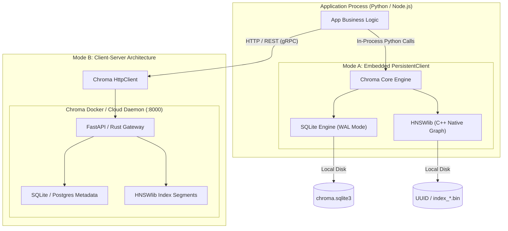
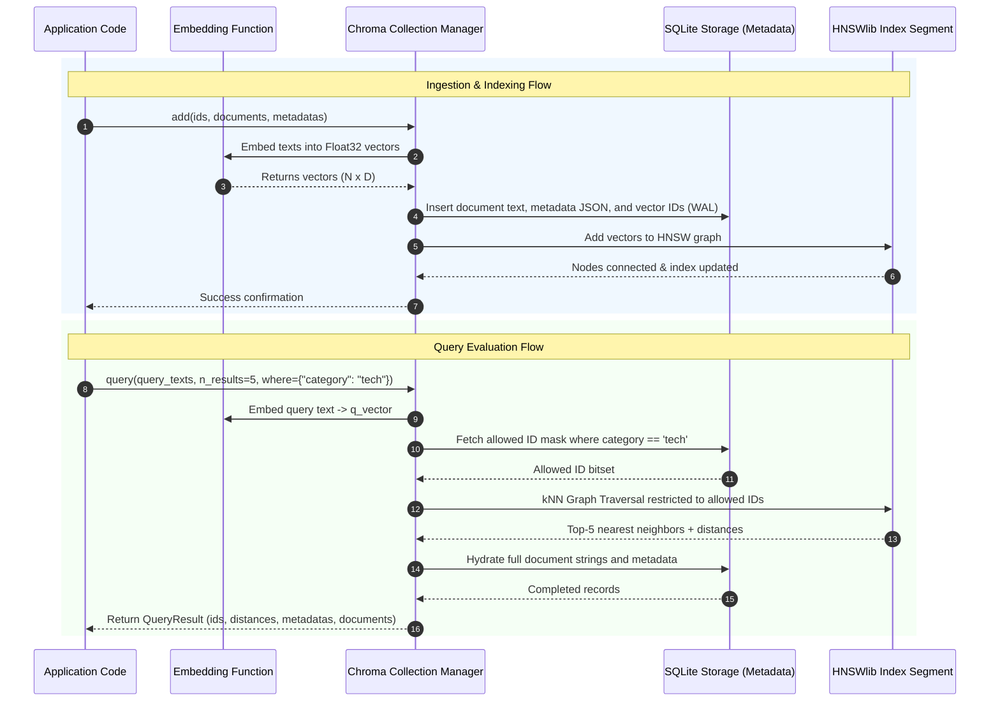
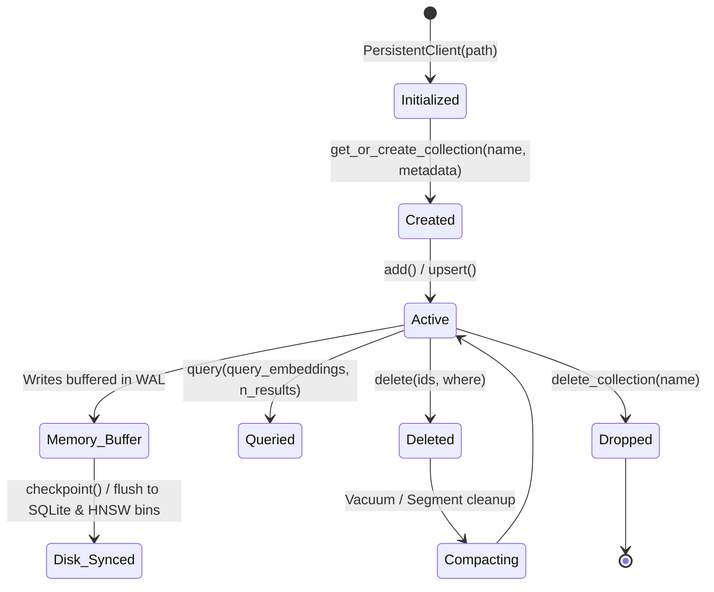
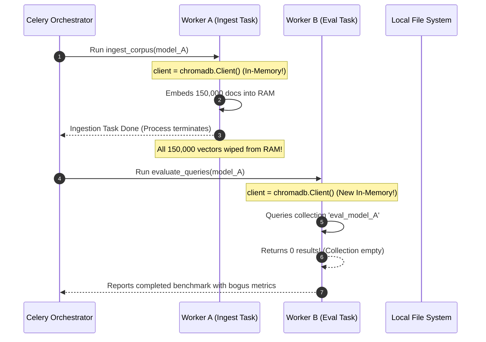

# Module 11: Chroma and Local Development

> **Prerequisites:** [Module 00: What an Embedding Is](../00-what-an-embedding-is/README.md), [Module 03: Cosine Similarity & Distance Metrics](../03-cosine-similarity-and-distance-metrics/README.md), [Module 05: Generating Embeddings at Scale](../05-generating-embeddings-at-scale/README.md), [Module 09: The Vector Database Landscape](../09-the-vector-database-landscape/README.md).
> **Estimated Reading Time:** 30 minutes
> **Target Audience:** AI Engineers, Backend Developers, Local-First System Architects.

---

> [!TIP]
> **Golden Rule of Local Vector Development**: Always instantiate Chroma with explicit persistence (`PersistentClient(path="./chroma_data")`) and a deterministic distance function (`metadata={"hnsw:space": "cosine"}`). Never rely on default ephemeral in-memory clients (`Client()`) in test suites or local services expecting state preservation across process restarts, and always explicitly configure your embedding function or pass pre-computed vectors to prevent silent model drift between indexing and query time.

---

## 1. Visual Mental Models & System Architecture

Chroma is an open-source, embedded vector database designed to minimize operational friction during local development, prototyping, and single-node production workloads. It integrates an in-process **SQLite** database for relational metadata and ACID transaction logging with native **HNSWlib** C++ bindings for approximate nearest neighbor search.

### Chroma Architecture: In-Process vs. Client-Server Modes



### Document Ingestion and Query Pipeline



### Collection Lifecycle and Segment Compaction



---

## 2. Taxonomic Reference Grids & Systematic Comparison Grids

### Chroma Client Operational Modes

| Deployment Mode | Instantiation Syntax | Storage Location | Concurrency Model | Best Suited For |
| :--- | :--- | :--- | :--- | :--- |
| **Ephemeral (In-Memory)** | `chromadb.Client()` | RAM only (Process Heap) | Single-process only | Unit tests, ephemeral CI pipelines, quick scratchpads. |
| **Persistent (Local Disk)** | `chromadb.PersistentClient(path="./data")` | Local directory (`chroma.sqlite3` + bin files) | Multi-reader, single-writer (SQLite lock) | Desktop apps, local CLI tools, edge devices, single-worker APIs. |
| **HTTP Client / Server** | `chromadb.HttpClient(host="localhost", port=8000)` | Remote Docker container or VM storage | High concurrency; concurrent read/write workers | Multi-container Docker Compose, Kubernetes, team dev environments. |
| **Chroma Cloud** | `chromadb.CloudClient(tenant="...", database="...")` | Managed multi-tenant cloud infrastructure | Fully managed distributed scale | Serverless production workloads requiring zero ops. |

### Distance Space Configuration (`hnsw:space`)

When initializing a collection via `client.create_collection(name, metadata={"hnsw:space": ...})`, Chroma configures the underlying HNSWlib distance metric:

| Metric Name | `hnsw:space` Key | Mathematical Distance Formula | Chroma Return Value | Ideal Use Case |
| :--- | :--- | :--- | :--- | :--- |
| **Cosine Distance** | `"cosine"` | $1 - \frac{\mathbf{u} \cdot \mathbf{v}}{\|\mathbf{u}\|_2 \|\mathbf{v}\|_2}$ | $[0, 2]$ (0 is identical, 2 is opposite) | Text embeddings (OpenAI, Voyage, Cohere, BGE). |
| **L2 (Squared Euclidean)** | `"l2"` | $\sum_{i=1}^D (u_i - v_i)^2$ | $[0, +\infty)$ (0 is identical) | Computer vision, spatial embeddings, unnormalized data. |
| **Inner Product** | `"ip"` | $1 - (\mathbf{u} \cdot \mathbf{v})$ | $(-\infty, +\infty)$ | Pre-normalized unit vectors where raw dot product is desired. |

### Chroma Metadata Filter DSL (`where` clauses)

| Operator | Syntax Example | Meaning |
| :--- | :--- | :--- |
| `$eq` | `where={"status": {"$eq": "published"}}` (or `where={"status": "published"}`) | Value equals target. |
| `$ne` | `where={"status": {"$ne": "archived"}}` | Value does not equal target. |
| `$gt` / `$gte` | `where={"rating": {"$gte": 4.5}}` | Numeric comparison greater than or equal. |
| `$lt` / `$lte` | `where={"price": {"$lt": 100}}` | Numeric comparison less than. |
| `$in` | `where={"tag": {"$in": ["python", "go"]}}` | Field matches any value in list. |
| `$nin` | `where={"tag": {"$nin": ["draft", "trash"]}}` | Field does not match any value in list. |
| `$and` | `where={"$and": [{"role": "admin"}, {"age": {"$gte": 21}}]}` | Logical conjunction across conditions. |
| `$or` | `where={"$or": [{"category": "news"}, {"priority": "high"}]}` | Logical disjunction across conditions. |

---

## 3. Production War Stories: Incident Post-Mortem

### The Incident: The Phantom Evaluation Pipeline and the Ephemeral Default Client

- **Severity:** SEV-2 (Invalid Data / Silent Testing Failure)
- **Time to Detection:** 3 hours 20 minutes
- **Time to Mitigation:** 25 minutes
- **Impact:** An offline evaluation benchmark evaluating 12 embedding models across 150,000 corporate documents produced 100% false recall results, leading to an incorrect model architecture selection before deployment.

#### What Happened
A machine learning platform team built a distributed model evaluation pipeline using Celery and Docker. The pipeline had two separate task stages:
1. `ingest_corpus(model_name)`: Read 150,000 documents, computed embeddings, and stored them in Chroma.
2. `evaluate_queries(model_name)`: Executed 1,000 golden queries against Chroma and calculated Mean Reciprocal Rank (MRR@10) and Recall@10.

An engineer instantiated the client inside the Celery tasks using:
```python
client = chromadb.Client()  # Inadvertently created an in-memory client
collection = client.get_or_create_collection(f"eval_{model_name}")
```

Because `chromadb.Client()` defaults to an ephemeral in-memory database, task 1 indexed 150,000 documents into the RAM of Worker A. When task 1 finished, the Celery worker process exited or became idle. Task 2 ran on Worker B, instantiated a brand new in-memory `chromadb.Client()`, queried an empty collection, and handled the resulting empty response by logging default fallback scores.



#### Root Cause
The code relied on `chromadb.Client()`, which operates entirely within process volatile memory. In a multi-process or containerized architecture, state is not shared between processes or preserved across task invocations.

#### The Fix & Architectural Hardening
1. **Migration to PersistentClient:** Replaced `chromadb.Client()` with an explicit `PersistentClient` pointed at an environment-configured volume path:
   ```python
   client = chromadb.PersistentClient(path=os.getenv("CHROMA_PERSIST_DIR", "/data/chroma"))
   ```
2. **Pre-Flight Query Assertion:** Added a mandatory pre-condition check in all retrieval services:
   ```python
   count = collection.count()
   if count == 0:
       raise RuntimeError(f"Pre-flight validation failed: collection '{name}' has 0 records!")
   ```
3. **Containerized Server Deployment:** Switched the development and evaluation environment to `chromadb.HttpClient(host="chroma-service", port=8000)` hosted as a dedicated Docker container.

---

## 4. Multi-Language Production Implementations

The following code tabs demonstrate how to manage Chroma collections, configure custom distance spaces, execute batch ingestion with progress tracking, and run parameterized metadata queries.

### Go Production Implementation (Chroma REST API Client)

```go
package main

import (
	"bytes"
	"context"
	"encoding/json"
	"fmt"
	"io"
	"net/http"
	"time"
)

type ChromaHttpClient struct {
	baseURL    string
	httpClient *http.Client
	tenant     string
	database   string
}

func NewChromaHttpClient(baseURL string) *ChromaHttpClient {
	return &ChromaHttpClient{
		baseURL: baseURL,
		httpClient: &http.Client{
			Timeout: 10 * time.Second,
		},
		tenant:   "default_tenant",
		database: "default_database",
	}
}

// CreateCollectionPayload represents the JSON payload to create a collection.
type CreateCollectionPayload struct {
	Name     string                 `json:"name"`
	Metadata map[string]interface{} `json:"metadata"`
}

type AddDocumentsPayload struct {
	IDs        []string                 `json:"ids"`
	Embeddings [][]float32              `json:"embeddings"`
	Metadatas  []map[string]interface{} `json:"metadatas"`
	Documents  []string                 `json:"documents"`
}

type QueryPayload struct {
	QueryEmbeddings [][]float32            `json:"query_embeddings"`
	NResults        int                    `json:"n_results"`
	Where           map[string]interface{} `json:"where,omitempty"`
}

type QueryResponse struct {
	IDs       [][]string                 `json:"ids"`
	Distances [][]float64                `json:"distances"`
	Metadatas [][]map[string]interface{} `json:"metadatas"`
	Documents [][]string                 `json:"documents"`
}

// CreateCollection initializes a collection with cosine distance.
func (c *ChromaHttpClient) CreateCollection(ctx context.Context, name string) (string, error) {
	url := fmt.Sprintf("%s/api/v1/collections?tenant=%s&database=%s", c.baseURL, c.tenant, c.database)
	payload := CreateCollectionPayload{
		Name: name,
		Metadata: map[string]interface{}{
			"hnsw:space": "cosine",
		},
	}
	body, _ := json.Marshal(payload)
	req, err := http.NewRequestWithContext(ctx, "POST", url, bytes.NewBuffer(body))
	if err != nil {
		return "", err
	}
	req.Header.Set("Content-Type", "application/json")

	resp, err := c.httpClient.Do(req)
	if err != nil {
		return "", err
	}
	defer resp.Body.Close()

	if resp.StatusCode != http.StatusOK && resp.StatusCode != http.StatusCreated {
		respBody, _ := io.ReadAll(resp.Body)
		return "", fmt.Errorf("create collection failed: %s", string(respBody))
	}

	var res map[string]interface{}
	json.NewDecoder(resp.Body).Decode(&res)
	return res["id"].(string), nil
}

// QueryCollection executes a vector search with metadata filtering.
func (c *ChromaHttpClient) QueryCollection(
	ctx context.Context,
	collectionID string,
	queryVec []float32,
	topK int,
	where map[string]interface{},
) (*QueryResponse, error) {
	url := fmt.Sprintf("%s/api/v1/collections/%s/query", c.baseURL, collectionID)
	payload := QueryPayload{
		QueryEmbeddings: [][]float32{queryVec},
		NResults:        topK,
		Where:           where,
	}
	body, _ := json.Marshal(payload)
	req, err := http.NewRequestWithContext(ctx, "POST", url, bytes.NewBuffer(body))
	if err != nil {
		return nil, err
	}
	req.Header.Set("Content-Type", "application/json")

	resp, err := c.httpClient.Do(req)
	if err != nil {
		return nil, err
	}
	defer resp.Body.Close()

	if resp.StatusCode != http.StatusOK {
		respBody, _ := io.ReadAll(resp.Body)
		return nil, fmt.Errorf("query failed: %s", string(respBody))
	}

	var qr QueryResponse
	if err := json.NewDecoder(resp.Body).Decode(&qr); err != nil {
		return nil, err
	}
	return &qr, nil
}
```

### TypeScript / Node.js Production Implementation

```typescript
import { ChromaClient, Collection } from 'chromadb';

export interface DocumentItem {
  id: string;
  text: string;
  metadata: Record<string, string | number | boolean>;
  embedding: number[];
}

export class LocalChromaManager {
  private client: ChromaClient;
  private collection: Collection | null = null;

  constructor(serverUrl: string = 'http://localhost:8000') {
    this.client = new ChromaClient({ path: serverUrl });
  }

  public async initializeCollection(collectionName: string): Promise<void> {
    // Configure collection with explicit cosine distance space
    this.collection = await this.client.getOrCreateCollection({
      name: collectionName,
      metadata: { 'hnsw:space': 'cosine' },
    });
  }

  public async addBatch(items: DocumentItem[]): Promise<void> {
    if (!this.collection) {
      throw new Error('Collection must be initialized before adding documents.');
    }

    const ids = items.map((i) => i.id);
    const documents = items.map((i) => i.text);
    const metadatas = items.map((i) => i.metadata);
    const embeddings = items.map((i) => i.embedding);

    await this.collection.add({
      ids,
      documents,
      metadatas,
      embeddings,
    });
  }

  public async searchWithFilter(
    queryEmbedding: number[],
    topK: number,
    categoryFilter?: string
  ) {
    if (!this.collection) {
      throw new Error('Collection not initialized.');
    }

    const whereClause = categoryFilter ? { category: { $eq: categoryFilter } } : undefined;

    const results = await this.collection.query({
      queryEmbeddings: [queryEmbedding],
      nResults: topK,
      where: whereClause,
    });

    return results;
  }

  public async getStats(): Promise<{ count: number }> {
    if (!this.collection) throw new Error('Collection not initialized.');
    const count = await this.collection.count();
    return { count };
  }
}
```

### Python Production Implementation

```python
"""
Robust, Local Persistent Chroma Manager with Explicit Cosine Metric,
Batch Ingestion, and Robust Error Handling.
"""

from __future__ import annotations

import logging
import os
from typing import Any, Dict, List, Optional
import chromadb
from chromadb.config import Settings
import numpy as np

logger = logging.getLogger(__name__)


class PersistentChromaService:
    def __init__(self, storage_path: str = "./chroma_storage"):
        self.storage_path = os.path.abspath(storage_path)
        os.makedirs(self.storage_path, exist_ok=True)
        
        # Instantiate persistent local disk client with SQLite WAL enabled
        self.client = chromadb.PersistentClient(
            path=self.storage_path,
            settings=Settings(
                anonymized_telemetry=False,
                allow_reset=True,
            ),
        )
        self._collections: Dict[str, chromadb.Collection] = {}

    def get_or_create_collection(
        self, name: str, distance_metric: str = "cosine"
    ) -> chromadb.Collection:
        """
        Retrieves or initializes a collection with guaranteed distance metric space.
        Valid metrics: 'cosine', 'l2', 'ip'.
        """
        if name in self._collections:
            return self._collections[name]

        collection = self.client.get_or_create_collection(
            name=name,
            metadata={"hnsw:space": distance_metric},
        )
        self._collections[name] = collection
        return collection

    def upsert_batch(
        self,
        collection_name: str,
        ids: List[str],
        embeddings: np.ndarray,
        documents: List[str],
        metadatas: List[Dict[str, Any]],
        batch_size: int = 500,
    ) -> None:
        """Upserts documents in batches to avoid SQLite variable limits."""
        coll = self.get_or_create_collection(collection_name)
        total = len(ids)

        for i in range(0, total, batch_size):
            end = min(i + batch_size, total)
            coll.upsert(
                ids=ids[i:end],
                embeddings=embeddings[i:end].tolist(),
                documents=documents[i:end],
                metadatas=metadatas[i:end],
            )
            logger.debug("Upserted batch %d - %d of %d", i, end, total)

    def query_similarity(
        self,
        collection_name: str,
        query_vector: np.ndarray,
        top_k: int = 5,
        where_filter: Optional[Dict[str, Any]] = None,
    ) -> Dict[str, Any]:
        """
        Executes query against the persistent collection with optional metadata predicate.
        """
        coll = self.get_or_create_collection(collection_name)
        q_list = query_vector.astype(np.float32).reshape(-1).tolist()

        return coll.query(
            query_embeddings=[q_list],
            n_results=top_k,
            where=where_filter,
            include=["documents", "metadatas", "distances"],
        )
```

---

## 5. Practical Hands-On Verification CLI Workflows

Verify Chroma server operation, create collections, and inspect HTTP responses using standard CLI utilities.

### Workflow 1: Launching Standalone Chroma Server via Docker

```bash
# Start an isolated Chroma server on port 8000 backed by a local data volume
docker run -d \
  --name chroma-local-test \
  -p 8000:8000 \
  -v "$(pwd)/chroma_data:/chroma/chroma" \
  -e IS_PERSISTENT=TRUE \
  -e ANONYMIZED_TELEMETRY=FALSE \
  chromadb/chroma:latest
```

### Workflow 2: Checking Heartbeat and Inspecting Collections via cURL

```bash
# Verify API heartbeat
curl -s http://localhost:8000/api/v1/heartbeat
```

Expected wire output:
```json
{"nanosecond heartbeat": 1731248920123456789}
```

```bash
# Create a new collection with cosine distance metadata
curl -s -X POST "http://localhost:8000/api/v1/collections" \
  -H "Content-Type: application/json" \
  -d '{
    "name": "test_collection",
    "metadata": {"hnsw:space": "cosine"}
  }' | jq .
```

Expected wire output:
```json
{
  "id": "3b29c512-87f1-4b19-94b1-a67b9d14f2e1",
  "name": "test_collection",
  "metadata": {
    "hnsw:space": "cosine"
  }
}
```

---

## 6. Operational Validation Checkpoints (Scenario Quizzes)

### Checkpoint 1: Multi-Process SQLite Locking in PersistentClient
**Scenario:** A FastAPI application runs under Uvicorn with 4 worker processes (`uvicorn app:app --workers 4`). Each worker instantiates `chromadb.PersistentClient(path="./data")`. Under high write load, the API begins throwing errors: `sqlite3.OperationalError: database is locked`. Why is this occurring and how do you resolve it?

<details><summary>Click to view diagnosis and architectural solution</summary>

**Answer:**
1. **Root Cause:**
   `chromadb.PersistentClient` uses SQLite as its embedded catalog and metadata store. SQLite supports multiple concurrent readers, but only a **single writer at a time**. When 4 separate OS worker processes concurrently execute `collection.add()` or `collection.upsert()`, multiple processes attempt to acquire SQLite exclusive write locks simultaneously, causing write lock timeouts (`database is locked`).
2. **Architectural Resolution:**
   - **Switch to Client-Server Mode:** Run Chroma as a standalone service (e.g., via Docker on port 8000) and have the Uvicorn workers use `chromadb.HttpClient(host="127.0.0.1", port=8000)`. The server process queues and serializes writes cleanly.
   - **Worker Architecture Change:** If running embedded is mandatory, dedicate a single writer worker process fed by a message queue (RabbitMQ / Redis stream), while web API workers open read-only connections.
</details>

---

### Checkpoint 2: The Silent Embedding Model Mismatch
**Scenario:** A team indexes 10,000 documents using Chroma's default embedding function without passing `embeddings=[...]`. Later, an engineer builds a query API that passes raw embeddings generated by OpenAI's `text-embedding-3-small` (1536 dimensions). When running `collection.query(query_embeddings=[...])`, Chroma raises: `ValueError: Embedding dimension 1536 does not match collection dimension 384`. What happened?

<details><summary>Click to view diagnosis and architectural solution</summary>

**Answer:**
1. **Root Cause:**
   When documents are added to Chroma without pre-computed vectors, Chroma automatically applies its default built-in embedding function: the `all-MiniLM-L6-v2` model from `sentence-transformers`, which produces **384-dimensional** embeddings. When the query API attempted to query the collection using OpenAI's **1536-dimensional** vector, Chroma caught the dimension mismatch.
2. **Resolution & Best Practice:**
   Never mix implicit and explicit embedding generation. Always either:
   - Configure the collection with an explicit embedding function at initialization:
     ```python
     from chromadb.utils import embedding_functions
     openai_ef = embedding_functions.OpenAIEmbeddingFunction(api_key="...", model_name="text-embedding-3-small")
     collection = client.create_collection("docs", embedding_function=openai_ef)
     ```
   - Or generate all embeddings explicitly in your application pipeline and pass only raw float vectors (`embeddings=vecs`) to Chroma for both ingestion and querying.
</details>

---

### Checkpoint 3: Silent Empty Query Responses under Type Mismatches
**Scenario:** A developer indexes documents with metadata containing numerical IDs: `{"doc_id": 1042}` (stored as integer). The frontend search UI submits queries with a filter: `where={"doc_id": "1042"}` (passed as string). The query executes without any errors, returns HTTP 200, but yields 0 results. What is the root cause?

<details><summary>Click to view diagnosis and architectural solution</summary>

**Answer:**
1. **Root Cause:**
   Chroma evaluates metadata equality filters strictly according to type. In SQLite and Python metadata evaluation, `1042 == "1042"` evaluates to `False`. Because equality checks across incompatible types silently evaluate to `False` rather than raising a type error, the predicate excludes every document in the collection, returning zero matches.
2. **Resolution & Hardening:**
   - Enforce a strict schema validation layer (e.g., Pydantic or Zod) at the API ingress boundary to cast filter parameters to their exact stored primitive types prior to constructing the Chroma query.
   - Monitor and alert when filtered queries return zero results for known entities.
</details>
