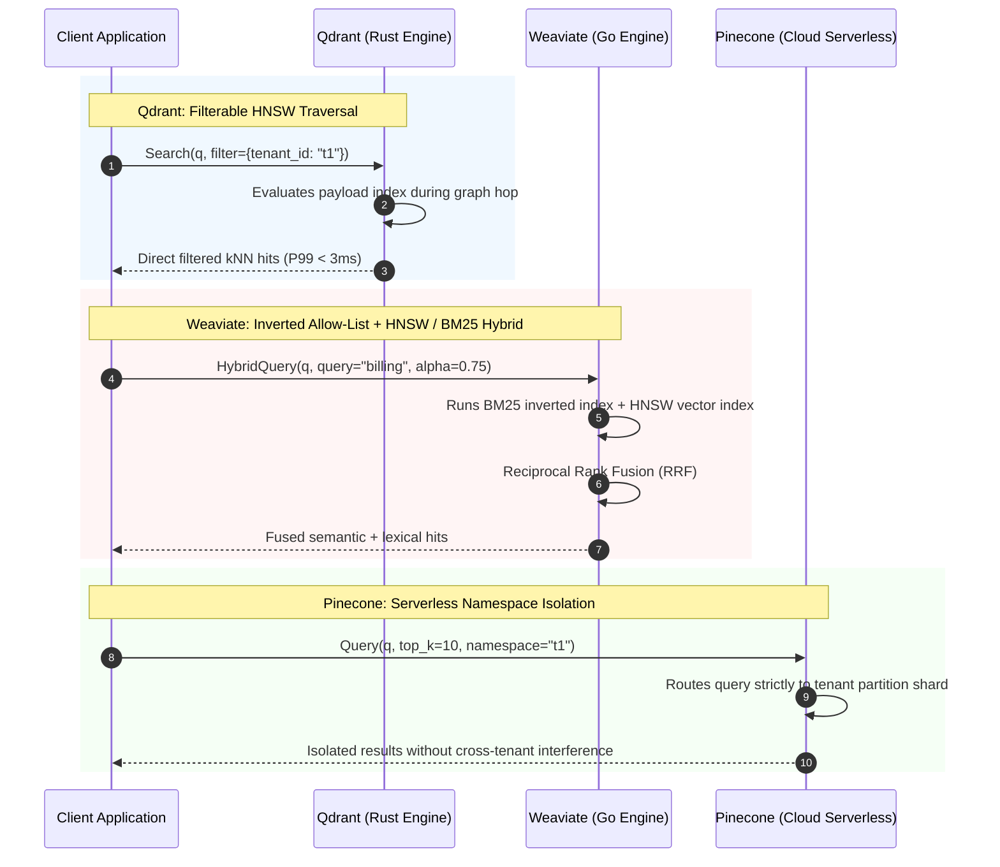
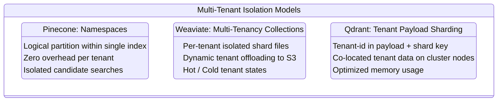
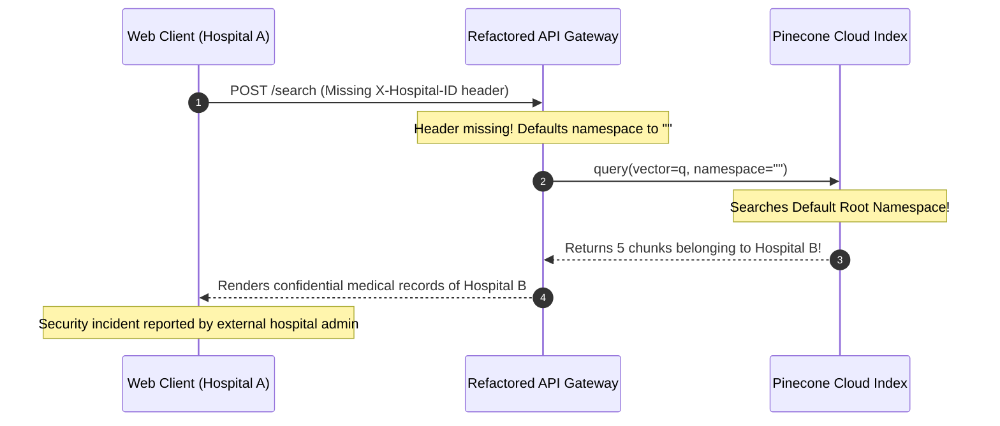

# Module 12: Pinecone, Weaviate, and Qdrant

> **Prerequisites:** [Module 00: What an Embedding Is](../00-what-an-embedding-is/README.md), [Module 03: Cosine Similarity & Distance Metrics](../03-cosine-similarity-and-distance-metrics/README.md), [Module 09: The Vector Database Landscape](../09-the-vector-database-landscape/README.md), [Module 10: pgvector and Postgres](../10-pgvector-and-postgres/README.md).
> **Estimated Reading Time:** 30 minutes
> **Target Audience:** Backend Engineers, ML Platform Engineers, Distributed Systems Architects.

---

> [!TIP]
> **Golden Rule of Dedicated Vector Engines**: Choose **Qdrant** when you need raw Rust-speed, single-stage filterable HNSW graphs with payload indexing, and flexible self-hosting or hybrid cloud options; choose **Weaviate** when you require native multi-modal vectorization pipelines, modular architecture, and out-of-the-box hybrid search (BM25 + Dense); and choose **Pinecone** when you demand a zero-ops, serverless cloud API with multi-tenant namespaces and are willing to accept vendor lock-in and eventual consistency.

---

## 1. Visual Mental Models & System Architecture

As vector datasets expand past single-machine memory limits ($N > 10{,}000{,}000$) or query concurrency exceeds hundreds of QPS with complex filtering SLAs, dedicated vector engines replace in-process libraries and relational database extensions. The three dominant standalone engines represent distinct design philosophies:

```mermaid
flowchart TD
    subgraph Pinecone["Pinecone (Serverless Cloud Architecture)"]
        P_GW["Global Cloud API Gateway (HTTPS/gRPC)"]
        P_Log["Distributed Write-Ahead Log (Kafka/Blob)"]
        P_Index["Stateless Index Workers (Separated Storage & Compute)"]
        P_Obj[("Cloud Object Storage (S3/GCS)")]
        P_GW --> P_Log --> P_Index <--> P_Obj
    end

    subgraph Weaviate["Weaviate (Modular Cloud-Native Architecture)"]
        W_GW["GraphQL / REST / gRPC Ingress"]
        W_Core["Weaviate Core (Go Engine)"]
        W_Mods["Vectorizer Modules (Text2Vec, Multi2Vec, NER)"]
        W_LSM["LSM-Tree Vector & Inverted Index Store"]
        W_GW --> W_Core <--> W_Mods
        W_Core <--> W_LSM
    end

    subgraph Qdrant["Qdrant (High-Performance Engine in Rust)"]
        Q_API["gRPC / REST Gateway (Raft Consensus)"]
        Q_Segments["Segmented Storage Engine (WAL + Memmap)"]
        Q_HNSW["Filterable HNSW Graph (Payload Aware)"]
        Q_Payload["Payload Index (B-Tree, Geo, Full-Text)"]
        Q_API --> Q_Segments
        Q_Segments --> Q_HNSW
        Q_Segments --> Q_Payload
    end
```



### Ingestion and Query Execution Paths Compared



### Multi-Tenancy Architecture Patterns



---

## 2. Taxonomic Reference Grids & Systematic Comparison Grids

### Comprehensive Three-Way Architectural Breakdown

| Architectural Dimension | Pinecone | Weaviate | Qdrant |
| :--- | :--- | :--- | :--- |
| **Core Implementation Language** | Proprietary C++ / Cloud Services | Go (with C/C++ vector extensions) | Rust (Native SIMD AVX-512/NEON) |
| **Deployment Model** | Fully Managed Cloud (AWS, GCP, Azure) | Self-Hosted (Docker, K8s) or Weaviate Cloud (WCD) | Self-Hosted (Binary, Docker, K8s) or Qdrant Cloud |
| **Storage Architecture** | Disaggregated Compute & Object Storage (Serverless) | LSM-tree disk storage + in-memory graphs | Segmented append-only WAL + memmap/on-disk vectors |
| **Vector Index Structures** | Proprietary Serverless ANN / Graph | HNSW, Dynamic Index (Flat fallback) | Filterable HNSW, Quantized Flat Index |
| **Quantization Methods** | Managed binary and scalar quantization | Scalar Quantization (SQ), Product Quantization (PQ) | Scalar (int8), Product (PQ), Binary (BQ) Quantization |
| **Metadata Filtering** | JSON Metadata DSL; pre/post filter execution | Inverted index allow-lists evaluated before/during search | Single-stage filterable HNSW via Payload Indexes |
| **Hybrid Search Support** | Sparse-dense vectors (SPLADE/BM25) | Native built-in BM25 + Vector with configurable $\alpha$ | Native dense + sparse vectors with RRF fusion |
| **Multi-Tenancy Primitives** | Namespaces (unlimited per index, zero cost) | Native multi-tenancy with tenant offloading to cold storage | Shard keys (`shard_key_selector`) based on tenant ID |
| **Consistency Guarantees** | Eventual consistency (read-your-writes delay) | Tunable consistency (`ONE`, `QUORUM`, `ALL`) via Raft | Strong consistency on write; Raft-based consensus |

### Filter & Payload Indexing Capabilities

| Feature | Pinecone | Weaviate | Qdrant |
| :--- | :--- | :--- | :--- |
| **Payload Index Types** | Automatic serverless metadata indexing | Inverted index (string, int, text, boolean) | B-tree (numeric), Keyword, Full-Text, Geo, Bool |
| **Payload Memory Location** | Managed cloud storage | Inverted index files (disk/RAM) | In-memory or memory-mapped on disk |
| **Filter Selectivity Sweet Spot** | General purpose (serverless optimizer) | Extremely fast for high & medium selectivity | Unrivaled latency on highly restrictive filters ($<0.1\%$) |
| **Payload Storage Limit** | 40 KB per vector | No strict limit (bound by node disk) | No strict limit (stored in payload segment) |

---

## 3. Production War Stories: Incident Post-Mortem

### The Incident: Cross-Tenant Data Leakage from Missing Namespace Parameter in API Gateway

- **Severity:** SEV-1 (Critical Security & Compliance Breach)
- **Time to Detection:** 34 minutes
- **Time to Mitigation:** 12 minutes
- **Impact:** 2,400 multi-tenant semantic search queries returned document chunks across enterprise customer boundaries. Immediate disclosure required under GDPR/SOC2 compliance.

#### What Happened
A healthtech startup utilized a single Pinecone Pod index to store clinical knowledge chunks across 450 hospital networks. Each hospital's data was segregated using Pinecone **Namespaces**:

```python
# Intended search query
index.query(
    vector=query_embedding,
    top_k=5,
    namespace=hospital_id,  # e.g., "hospital_st_jude_101"
)
```

During a microservice refactoring to migrate from Flask to FastAPI, an engineer updated the request validation schema. The `hospital_id` header was extracted using:

```python
# Defective code in API Gateway
tenant_namespace = request.headers.get("X-Hospital-ID", "")
```

When an automated health check probe made internal search requests without the header, `tenant_namespace` defaulted to the empty string `""`. In Pinecone, passing `namespace=""` (or omitting the parameter) directs the query to the **default/root namespace**. 

Because earlier bulk-loading scripts had erroneously ingested 35,000 legacy records into the root namespace without a namespace prefix, internal and external search queries began returning patient treatment protocols from other hospital networks.



#### Root Cause
Pinecone namespaces are purely logical partition keys within an index. Omitting or passing an empty string does not reject the query; it silently targets the default namespace. The API gateway lacked invariant validation ensuring that non-empty tenant identifiers were strictly present before dispatching downstream vector searches.

#### The Fix & Architectural Hardening
1. **Immediate Gateway Guardrail:** Deployed an API gateway interceptor that rejects any vector search request with HTTP 400 Bad Request if `namespace` is absent or empty:
   ```python
   if not tenant_namespace or not tenant_namespace.strip():
       raise HTTPException(status_code=400, detail="Missing mandatory tenant namespace")
   ```
2. **Purged Root Namespace:** Completely flushed all vectors accidentally indexed into the default `""` namespace.
3. **Automated Cross-Tenant CI Assertions:** Implemented integration tests in the CI pipeline verifying that queries executed with Tenant A's token cannot retrieve vectors tagged with Tenant B's vectors under any condition.

---

## 4. Multi-Language Production Implementations

The following code tabs illustrate production patterns across all three engines: Qdrant with payload filtering in Go, Pinecone with namespace isolation in TypeScript, and Weaviate with hybrid search in Python.

### Go Production Implementation (Qdrant gRPC Client)

```go
package main

import (
	"context"
	"fmt"
	"log"
	"time"

	"github.com/google/uuid"
	pb "github.com/qdrant/go-client/qdrant"
	"google.golang.org/grpc"
	"google.golang.org/grpc/credentials/insecure"
)

type QdrantService struct {
	conn           *grpc.ClientConn
	pointsClient   pb.PointsClient
	collClient     pb.CollectionsClient
	collectionName string
}

func NewQdrantService(addr, collection string) (*QdrantService, error) {
	conn, err := grpc.Dial(addr, grpc.WithTransportCredentials(insecure.NewCredentials()))
	if err != nil {
		return nil, fmt.Errorf("failed to connect to Qdrant: %w", err)
	}

	return &QdrantService{
		conn:           conn,
		pointsClient:   pb.NewPointsClient(conn),
		collClient:     pb.NewCollectionsClient(conn),
		collectionName: collection,
	}, nil
}

// EnsureCollection verifies collection exists or creates it with Cosine distance.
func (s *QdrantService) EnsureCollection(ctx context.Context, dim uint64) error {
	_, err := s.collClient.Get(ctx, &pb.GetCollectionInfoRequest{
		CollectionName: s.collectionName,
	})
	if err == nil {
		return nil // Collection exists
	}

	_, err = s.collClient.Create(ctx, &pb.CreateCollection{
		CollectionName: s.collectionName,
		VectorsConfig: &pb.VectorsConfig{
			Config: &pb.VectorsConfig_Params{
				Params: &pb.VectorParams{
					Size:     dim,
					Distance: pb.Distance_Cosine,
				},
			},
		},
	})
	return err
}

// UpsertPoint inserts a vector with tenant payload.
func (s *QdrantService) UpsertPoint(ctx context.Context, id string, vector []float32, tenantID string) error {
	pointID := &pb.PointId{
		PointIdOptions: &pb.PointId_Uuid{Uuid: id},
	}

	payload := map[string]*pb.Value{
		"tenant_id": {Kind: &pb.Value_StringValue{StringValue: tenantID}},
		"timestamp": {Kind: &pb.Value_IntegerValue{IntegerValue: time.Now().Unix()}},
	}

	_, err := s.pointsClient.Upsert(ctx, &pb.UpsertPoints{
		CollectionName: s.collectionName,
		Points: []*pb.PointStruct{
			{
				Id:      pointID,
				Vectors: &pb.Vectors{VectorsOptions: &pb.Vectors_Vector{Vector: &pb.Vector{Data: vector}}},
				Payload: payload,
			},
		},
	})
	return err
}

// SearchTenantFiltered performs single-stage filterable HNSW search.
func (s *QdrantService) SearchTenantFiltered(ctx context.Context, vector []float32, tenantID string, limit uint64) ([]*pb.ScoredPoint, error) {
	filter := &pb.Filter{
		Must: []*pb.Condition{
			{
				ConditionOneOf: &pb.Condition_Field{
					Field: &pb.FieldCondition{
						Key: "tenant_id",
						Match: &pb.Match{
							MatchValue: &pb.Match_Keyword{Keyword: tenantID},
						},
					},
				},
			},
		},
	}

	res, err := s.pointsClient.Search(ctx, &pb.SearchPoints{
		CollectionName: s.collectionName,
		Vector:         vector,
		Limit:          limit,
		Filter:         filter,
		WithPayload:    &pb.WithPayloadSelector{SelectorOptions: &pb.WithPayloadSelector_Enable{Enable: true}},
	})
	if err != nil {
		return nil, err
	}
	return res.Result, nil
}
```

### TypeScript / Node.js Production Implementation (Pinecone Client)

```typescript
import { Pinecone, RecordMetadata } from '@pinecone-database/pinecone';

export interface KnowledgeDocument {
  id: string;
  vector: number[];
  tenantId: string;
  category: string;
  content: string;
}

export class PineconeTenantStore {
  private client: Pinecone;
  private indexName: string;

  constructor(apiKey: string, indexName: string) {
    this.client = new Pinecone({ apiKey });
    this.indexName = indexName;
  }

  public async upsertDocument(doc: KnowledgeDocument): Promise<void> {
    if (!doc.tenantId || doc.tenantId.trim() === '') {
      throw new Error('Security Invariant Violated: tenantId must be non-empty.');
    }

    const index = this.client.index(this.indexName);
    // Strict isolation using Pinecone Namespaces
    const namespaceIndex = index.namespace(doc.tenantId);

    await namespaceIndex.upsert([
      {
        id: doc.id,
        values: doc.vector,
        metadata: {
          category: doc.category,
          content: doc.content,
        },
      },
    ]);
  }

  public async searchTenant(
    tenantId: string,
    queryVector: number[],
    topK: number = 5,
    categoryFilter?: string
  ) {
    if (!tenantId || tenantId.trim() === '') {
      throw new Error('Security Invariant Violated: tenantId must be non-empty.');
    }

    const index = this.client.index(this.indexName);
    const namespaceIndex = index.namespace(tenantId);

    const filterObj: RecordMetadata = categoryFilter
      ? { category: { $eq: categoryFilter } }
      : {};

    const queryResponse = await namespaceIndex.query({
      vector: queryVector,
      topK,
      includeMetadata: true,
      filter: Object.keys(filterObj).length > 0 ? filterObj : undefined,
    });

    return queryResponse.matches;
  }
}
```

### Python Production Implementation (Weaviate v4 Client)

```python
"""
Enterprise Weaviate v4 Production Repository demonstrating Native Multi-Tenancy
and Hybrid Search (BM25 + Dense Vectors) with Reciprocal Rank Fusion.
"""

from __future__ import annotations

import logging
from typing import Any, Dict, List, Optional
import weaviate
from weaviate.classes.config import Configure, Property, DataType
from weaviate.classes.query import MetadataQuery, Filter

logger = logging.getLogger(__name__)


class WeaviateHybridStore:
    def __init__(self, weaviate_url: str = "http://localhost:8080"):
        self.client = weaviate.connect_to_local(
            host="localhost",
            port=8080,
            grpc_port=50051,
        )
        self.collection_name = "EnterpriseDocument"

    def init_schema(self) -> None:
        """Initializes collection schema with multi-tenancy enabled."""
        if self.client.collections.exists(self.collection_name):
            return

        self.client.collections.create(
            name=self.collection_name,
            # Enable native multi-tenancy isolation
            multi_tenancy_config=Configure.multi_tenancy(enabled=True),
            vector_index_config=Configure.VectorIndex.hnsw(
                distance_metric=weaviate.classes.config.VectorDistances.COSINE,
                ef_construction=64,
                max_connections=16,
            ),
            properties=[
                Property(name="content", data_type=DataType.TEXT),
                Property(name="category", data_type=DataType.TEXT),
            ],
        )
        logger.info("Created multi-tenant collection %s", self.collection_name)

    def add_tenant(self, tenant_id: str) -> None:
        collection = self.client.collections.get(self.collection_name)
        collection.tenants.create([weaviate.classes.tenants.Tenant(name=tenant_id)])

    def hybrid_search(
        self,
        tenant_id: str,
        query_text: str,
        query_vector: List[float],
        alpha: float = 0.75,
        limit: int = 5,
    ) -> List[Dict[str, Any]]:
        """
        Executes hybrid search combining BM25 keyword search and dense vector search:
        score = alpha * vector_score + (1 - alpha) * bm25_score.
        """
        collection = self.client.collections.get(self.collection_name)
        # Target the specific tenant shard
        tenant_collection = collection.with_tenant(tenant_id)

        response = tenant_collection.query.hybrid(
            query=query_text,
            vector=query_vector,
            alpha=alpha,
            limit=limit,
            return_metadata=MetadataQuery(score=True, distance=True),
        )

        results = []
        for obj in response.objects:
            results.append({
                "id": str(obj.uuid),
                "properties": obj.properties,
                "score": obj.metadata.score,
            })
        return results

    def close(self) -> None:
        self.client.close()
```

---

## 5. Practical Hands-On Verification CLI Workflows

Verify dedicated vector engine connectivity and test payload filtering capabilities using command-line tools.

### Workflow 1: Running Qdrant Container and Creating Collection via REST

```bash
# Launch Qdrant Docker container
docker run -d --name qdrant-test -p 6333:6333 -p 6334:6334 qdrant/qdrant:latest

# Check server health
curl -s http://localhost:6333/healthz
```

Expected wire output:
```text
healthz check passed
```

```bash
# Create a collection with 768-dimensional cosine vector space
curl -s -X PUT "http://localhost:6333/collections/knowledge_base" \
  -H "Content-Type: application/json" \
  -d '{
    "vectors": {
      "size": 768,
      "distance": "Cosine"
    }
  }' | jq .
```

Expected wire output:
```json
{
  "result": true,
  "status": "ok",
  "time": 0.0123
}
```

### Workflow 2: Creating a Payload Index in Qdrant for Single-Stage Filtering

```bash
# Index the tenant_id field in payload for ultra-fast single-stage HNSW filtering
curl -s -X PUT "http://localhost:6333/collections/knowledge_base/index" \
  -H "Content-Type: application/json" \
  -d '{
    "field_name": "tenant_id",
    "field_schema": "keyword"
  }' | jq .
```

Expected wire output:
```json
{
  "result": {
    "operation_id": 0,
    "status": "completed"
  },
  "status": "ok",
  "time": 0.0045
}
```

---

## 6. Operational Validation Checkpoints (Scenario Quizzes)

### Checkpoint 1: Pinecone Serverless vs. Pod Architecture Trade-Offs
**Scenario:** A company is choosing between Pinecone Pod-based (dedicated instances) and Pinecone Serverless for a customer support bot with spiky traffic (100 QPS during business hours, 0.1 QPS overnight). Which architecture should they select, and what performance trade-off must they expect during sudden morning traffic bursts?

<details><summary>Click to view diagnosis and architectural solution</summary>

**Answer:**
1. **Architecture Selection:**
   They should choose **Pinecone Serverless**. In Serverless, compute and storage are decoupled; billing is strictly based on Read Units (RUs) and Write Units (WUs). Overnight idle costs drop to near-zero, saving ~80% compared to paying 24/7 for fixed Pod replicas.
2. **Performance Trade-Off:**
   Serverless stores vectors in cloud object storage (S3/GCS) and loads active working sets dynamically into stateless compute nodes. During a sudden morning traffic spike after prolonged overnight inactivity, the initial queries will experience a **cold-start latency spike** (p99 latency elevating to 50ms-150ms) as index segments are paged from object storage into RAM before settling back to sub-10ms performance.
</details>

---

### Checkpoint 2: Tuning Hybrid Search Alpha ($\alpha$) in Weaviate
**Scenario:** A legal research RAG application using Weaviate Hybrid Search reports that when attorneys search for specific contract clauses containing serial numbers like "Section 14.2(b)", the vector search returns general contract definitions rather than the exact section. How should the hybrid search $\alpha$ parameter be adjusted?

<details><summary>Click to view diagnosis and architectural solution</summary>

**Answer:**
1. **Understanding $\alpha$:**
   In Weaviate hybrid search:
   - $\alpha = 1.0$: 100% Dense Vector Search (pure semantic meaning).
   - $\alpha = 0.0$: 100% Sparse BM25 Search (exact keyword / lexical matching).
   - $\alpha = 0.5$: Equal weighting between dense semantic and sparse BM25 scores.
2. **Remediation:**
   Serial numbers, error codes, and legal clause identifiers have arbitrary semantic embeddings and are poorly represented in dense vector space. To prioritize exact lexical matches for technical or clause-specific queries, decrease $\alpha$ to **0.2 or 0.3**, heavily favoring BM25 keyword matching while retaining a slight semantic boost.
</details>

---

### Checkpoint 3: Qdrant Payload Indexing and Memory Footprint
**Scenario:** A Qdrant cluster hosts 20 million points ($D=1536$). The cluster begins crashing due to Linux kernel OOM killer after an engineer adds payload indexes for 12 different metadata fields (including large text payloads and integer timestamps). How do payload indexes impact Qdrant RAM and what is the remediation?

<details><summary>Click to view diagnosis and architectural solution</summary>

**Answer:**
1. **Root Cause:**
   In Qdrant, creating a payload index builds in-memory data structures (B-trees, inverted indexes, or hash sets) for every point in the collection. Indexing 12 different fields across 20 million points creates significant memory bloat, competing directly with the HNSW graph and vector buffers for physical RAM.
2. **Remediation & Hardening:**
   - **Selective Indexing:** Only create payload indexes on fields actively evaluated in query `Filter` clauses (e.g., `tenant_id`, `status`). Do not index fields used solely for display or retrieval.
   - **On-Disk Payloads:** Configure `on_disk_payload: true` in the collection settings so that payload data is memory-mapped from disk rather than resident entirely in physical RAM.
   - **Quantization:** Enable Scalar Quantization (SQ) or Product Quantization (PQ) on the vectors to reduce the vector RAM footprint by 75%, leaving ample headroom for necessary payload indexes.
</details>
