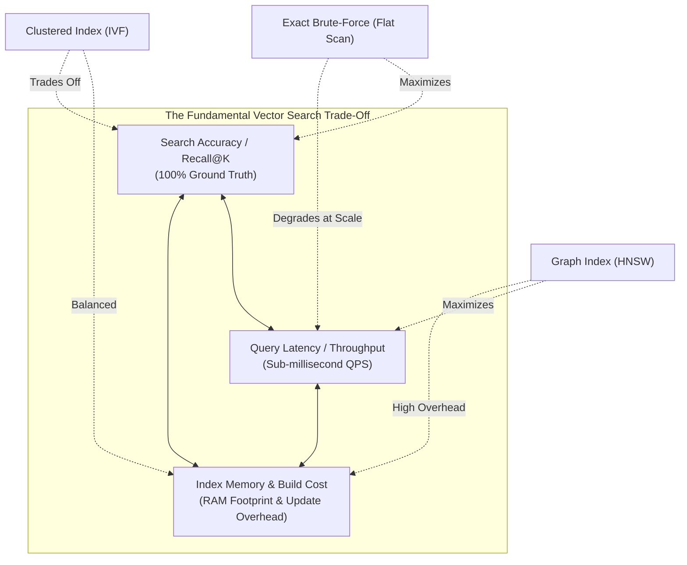
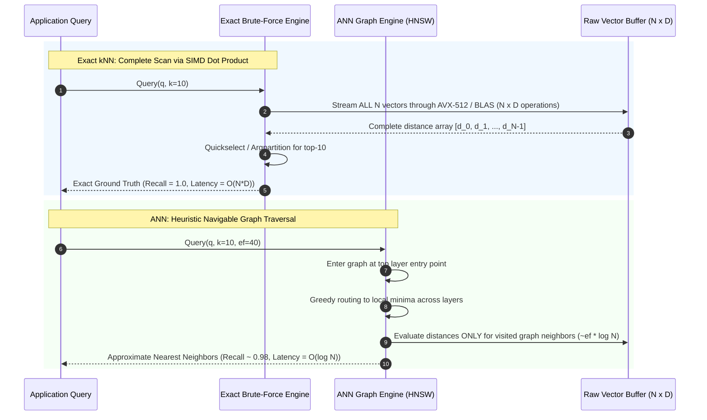
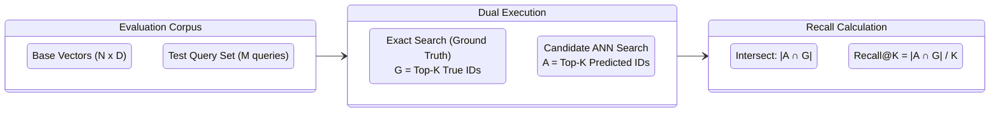
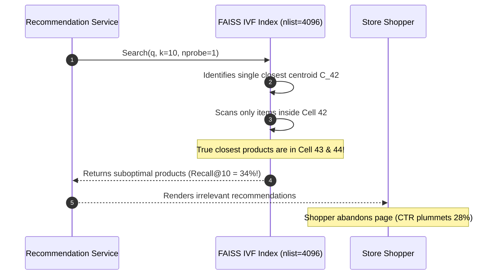

# Module 13: Exact vs. Approximate Search

> **Prerequisites:** [Module 00: What an Embedding Is](../00-what-an-embedding-is/README.md), [Module 03: Cosine Similarity & Distance Metrics](../03-cosine-similarity-and-distance-metrics/README.md), [Module 04: The Curse of Dimensionality](../04-the-curse-of-dimensionality/README.md), [Module 09: The Vector Database Landscape](../09-the-vector-database-landscape/README.md).
> **Estimated Reading Time:** 30 minutes
> **Target Audience:** Backend Engineers, Search Infrastructure Engineers, Algorithm Designers.

---

> [!TIP]
> **Golden Rule of Vector Search Optimization**: Always start with exact brute-force search (linear scan via SIMD matrix multiplication) as your ground-truth baseline. Transition to Approximate Nearest Neighbor (ANN) search only when your dataset size ($N$) and query latency budget violate your p99 SLA, and strictly evaluate ANN accuracy against exact search using **Recall@K** on a representative query set—never deploy an approximate index without measuring its empirical recall.

---

## 1. Visual Mental Models & System Architecture

Finding the closest vectors to a query in high-dimensional space requires navigating a fundamental trade-off: **Exact Nearest Neighbor (kNN)** computes distances to every record in the corpus, guaranteeing 100% recall at linear computational cost ($\mathcal{O}(N \cdot D)$). **Approximate Nearest Neighbor (ANN)** trades a small fraction of recall (e.g., achieving 95–99% Recall@10) in exchange for logarithmic or sub-linear search latency ($\mathcal{O}(\log N)$ or $\mathcal{O}(\sqrt{N})$).

### The Trade-off Triangle of Vector Search



### Execution Pathways: Exact Matrix Multiply vs. Approximate Graph Traversal



### Empirical Evaluation: Computing Recall@K against Exact Ground Truth



---

## 2. Taxonomic Reference Grids & Systematic Comparison Grids

### Exact Search vs. Approximate Index Families

| Index Architecture | Search Mechanism | Query Complexity | Build Complexity | Memory Overhead | Incremental Updates | Best Suited Scale |
| :--- | :--- | :--- | :--- | :--- | :--- | :--- |
| **Exact Flat (`FLAT`)** | Exhaustive sequential scan using SIMD/BLAS | $\mathcal{O}(N \cdot D)$ | $\mathcal{O}(1)$ (Zero index build) | $0\%$ (Raw vectors only) | Instant ($\mathcal{O}(1)$ append) | $N < 100{,}000$ or small filtered subsets |
| **HNSW (Graph-based)** | Multi-layer navigable small-world graph traversal | $\mathcal{O}(\log N \cdot D)$ | $\mathcal{O}(N \log N \cdot D)$ | $150\% - 250\%$ of raw vectors | Excellent (insert dynamic edges) | $100\text{K} < N < 50\text{M}$ (RAM-heavy) |
| **IVFFlat (Inverted File)** | Quantized Voronoi cell partitioning ($k$-means) | $\mathcal{O}\left(\frac{\text{probes}}{\text{lists}} N \cdot D\right)$ | $\mathcal{O}(N \cdot \text{lists} \cdot D)$ | $10\% - 20\%$ of raw vectors | Poor (requires periodic retraining) | $1\text{M} < N < 100\text{M}$ (Memory constrained) |
| **IVF-PQ (Product Quant)** | Centroid clustering + compressed vector codes | $\mathcal{O}\left(\frac{\text{probes}}{\text{lists}} N \cdot M\right)$ | Heavy ($k$-means on subvectors) | Compression: $90\% - 95\%$ reduction | Poor (fixed codebooks) | $N > 50\text{M}$ (Billions of vectors) |
| **ScaNN (Anisotropic)** | Anisotropic vector quantization + pruning | Sub-linear | Heavy (quantization training) | Low to Medium | Static / Batch oriented | High-throughput web-scale search |

### Recall Metrics Mathematical Formulations

| Metric Name | Mathematical Definition | Interpretation |
| :--- | :--- | :--- |
| **Recall@K** | $\text{Recall@}K = \frac{|\mathcal{A}_K(q) \cap \mathcal{G}_K(q)|}{K}$ | Fraction of the true top-$K$ exact neighbors returned by the approximate algorithm. |
| **Precision@K** | $\text{Precision@}K = \frac{|\mathcal{A}_K(q) \cap \mathcal{G}_K(q)|}{|\mathcal{A}_K(q)|}$ | For fixed top-$K$ queries where $|\mathcal{A}_K| = K$, Recall@K and Precision@K are mathematically identical. |
| **Mean Reciprocal Rank (MRR)** | $\text{MRR} = \frac{1}{\|Q\|} \sum_{i=1}^{\|Q\|} \frac{1}{\text{rank}_i}$ | Reciprocal rank of the first true relevant item in the retrieved ranking list. |
| **Speedup Ratio** | $\text{Speedup} = \frac{T_{\text{exact}}}{T_{\text{approx}}}$ | Factor by which approximate query execution time is faster than exact linear scan. |

### Latency vs. Dataset Size Benchmark ($D=768$, float32)

Empirical query latencies comparing single-threaded exact scan against HNSW ($M=16, ef=40$):

| Dataset Size ($N$) | Raw Memory | Exact Scan Latency | HNSW Latency | Speedup Factor | Recall@10 (HNSW) |
| :--- | :--- | :--- | :--- | :--- | :--- |
| **1,000** | 3.07 MB | 0.08 ms | 0.12 ms | **0.67× (Exact is faster!)** | 1.000 |
| **10,000** | 30.72 MB | 0.72 ms | 0.35 ms | **2.0×** | 0.995 |
| **100,000** | 307.20 MB | 7.15 ms | 0.85 ms | **8.4×** | 0.988 |
| **1,000,000** | 3.07 GB | 71.40 ms | 1.62 ms | **44.0×** | 0.975 |
| **10,000,000** | 30.72 GB | 715.00 ms | 3.10 ms | **230.0×** | 0.962 |

> [!IMPORTANT]
> **The Crossover Point**: For $N \le 10{,}000$, exact brute-force search is frequently **faster** than approximate graph traversal. The overhead of pointer chasing across cache lines in an HNSW graph exceeds the cost of a continuous, SIMD-vectorized L1/L2 cache linear memory stream.

---

## 3. Production War Stories: Incident Post-Mortem

### The Incident: Silent Recommendation CTR Drop from Misconfigured IVF Probe Depth

- **Severity:** SEV-2 (Revenue Degradation)
- **Time to Detection:** 4 days
- **Time to Mitigation:** 15 minutes
- **Impact:** E-commerce platform click-through rate (CTR) on "Similar Products" dropped 28%, resulting in an estimated $140,000 daily GMV loss.

#### What Happened
An engineering team migrated their product similarity service from an exact FAISS Flat index to an IVFFlat index to support scaling from 500,000 to 5,000,000 products. The index was constructed with 4,096 centroid clusters (`nlist = 4096`).

When deploying the query service, the team left the runtime search parameter at its default:
```python
# Query configuration in production
index.nprobe = 1  # Default in many IVF configurations
```

Queries returned in an ultra-fast 0.6ms with zero errors. However, because $D=512$, high-dimensional space causes vectors to cluster along Voronoi cell boundaries. Probing only a single cluster (`nprobe = 1`) meant that if the true nearest neighbors resided in adjacent Voronoi cells, they were completely ignored.



#### Root Cause
Under high-dimensional geometry, spherical clusters touch many adjacent neighbors. A single probe (`nprobe = 1`) explored less than $1 / 4096$ (0.024%) of the corpus. Measured Recall@10 collapsed to **34.2%**—two-thirds of the true closest recommendations were missing. Because the service still returned 10 items, no error alerts were triggered.

#### The Fix & Architectural Hardening
1. **Parameter Tuning:** Immediately set `nprobe = 32`. Search latency increased from 0.6ms to 2.4ms (well within the 10ms SLA), while Recall@10 surged from 34.2% to **96.8%**.
2. **Automated Offline Recall CI Suite:** Established an automated nightly pipeline that executes 500 fixed test queries against both the production ANN index and an exact `IndexFlatIP` ground-truth index, alerting if empirical Recall@10 drops below 95%.

---

## 4. Multi-Language Production Implementations

The following code tabs implement an empirical evaluation suite comparing exact brute-force search against approximate nearest neighbors, measuring query latencies, top-$K$ set intersections, and empirical Recall@K.

### Go Production Implementation

```go
package main

import (
	"container/heap"
	"fmt"
	"math/rand"
	"sort"
	"time"
)

// Item represents a scored vector index.
type Item struct {
	Index int
	Score float32
}

// MinHeap implements heap.Interface for tracking top-K items.
type MinHeap []Item

func (h MinHeap) Len() int           { return len(h) }
func (h MinHeap) Less(i, j int) bool { return h[i].Score < h[j].Score }
func (h MinHeap) Swap(i, j int)      { h[i], h[j] = h[j], h[i] }
func (h *MinHeap) Push(x interface{}) {
	*h = append(*h, x.(Item))
}
func (h *MinHeap) Pop() interface{} {
	old := *h
	n := len(old)
	x := old[n-1]
	*h = old[0 : n-1]
	return x
}

// ExactSearch executes linear scan computing dot product on normalized vectors.
func ExactSearch(corpus [][]float32, query []float32, k int) []Item {
	dim := len(query)
	h := &MinHeap{}
	heap.Init(h)

	for i, vec := range corpus {
		var dot float32
		for d := 0; d < dim; d++ {
			dot += vec[d] * query[d]
		}

		if h.Len() < k {
			heap.Push(h, Item{Index: i, Score: dot})
		} else if dot > (*h)[0].Score {
			heap.Pop(h)
			heap.Push(h, Item{Index: i, Score: dot})
		}
	}

	results := make([]Item, h.Len())
	for i := len(results) - 1; i >= 0; i-- {
		results[i] = heap.Pop(h).(Item)
	}
	return results
}

// CalculateRecall computes empirical Recall@K between exact ground truth and ANN predictions.
func CalculateRecall(groundTruth, predicted []Item) float64 {
	gtMap := make(map[int]struct{}, len(groundTruth))
	for _, it := range groundTruth {
		gtMap[it.Index] = struct{}{}
	}

	matches := 0
	for _, it := range predicted {
		if _, ok :=蜘蛛gtMap[it.Index]; ok {
			matches++
		}
	}
	return float64(matches) / float64(len(groundTruth))
}
```

### TypeScript / Node.js Production Implementation

```typescript
export interface Hit {
  id: number;
  score: number;
}

export class SearchEvaluator {
  private dimension: number;

  constructor(dimension: number) {
    this.dimension = dimension;
  }

  // Exact brute-force matrix multiply against flat array
  public exactSearch(corpus: Float32Array[], query: Float32Array, k: number): Hit[] {
    const scored: Hit[] = new Array(corpus.length);

    for (let i = 0; i < corpus.length; i++) {
      const vec = corpus[i];
      let dot = 0;
      for (let d = 0; d < this.dimension; d++) {
        dot += vec[d] * query[d];
      }
      scored[i] = { id: i, score: dot };
    }

    // Sort descending by similarity score
    scored.sort((a, b) => b.score - a.score);
    return scored.slice(0, k);
  }

  // Computes Recall@K comparing predicted IDs to ground truth IDs
  public computeRecallAtK(groundTruth: Hit[], predicted: Hit[]): number {
    const gtSet = new Set(groundTruth.map((h) => h.id));
    let matches = 0;

    for (const pred of predicted) {
      if (gtSet.has(pred.id)) {
        matches++;
      }
    }

    return matches / groundTruth.length;
  }
}
```

### Python Production Implementation

```python
"""
Production Vector Search Evaluation Harness:
Compares Exact Brute-Force Scan vs. Approximate Nearest Neighbors,
Measuring Empirical Recall@K, Latency Speedup, and Accuracy Trade-offs.
"""

from __future__ import annotations

import time
from typing import Dict, List, Tuple
import numpy as np


def generate_normalized_vectors(n: int, dim: int, seed: int = 42) -> np.ndarray:
    """Generates unit-length normalized vectors for cosine similarity."""
    rng = np.random.default_rng(seed)
    data = rng.standard_normal((n, dim), dtype=np.float32)
    norms = np.linalg.norm(data, axis=1, keepdims=True)
    return data / np.maximum(norms, 1e-12)


class ExactBruteForceIndex:
    """Ground truth oracle using BLAS matrix multiplication."""
    def __init__(self, vectors: np.ndarray):
        self.vectors = vectors  # (N, D) float32

    def search(self, query: np.ndarray, top_k: int = 10) -> Tuple[np.ndarray, np.ndarray]:
        # scores = X @ q (shape: N,)
        scores = self.vectors @ query
        # Argpartition for O(N) top-k selection
        top_indices = np.argpartition(-scores, top_k - 1)[:top_k]
        sorted_indices = top_indices[np.argsort(-scores[top_indices])]
        return sorted_indices, scores[sorted_indices]


def evaluate_ann_recall(
    ground_truth_indices: np.ndarray,
    predicted_indices: np.ndarray,
) -> float:
    """
    Computes Recall@K: fraction of true ground-truth neighbors found.
    ground_truth_indices: (K,)
    predicted_indices: (K,)
    """
    k = len(ground_truth_indices)
    matches = len(np.intersect1d(ground_truth_indices, predicted_indices))
    return float(matches) / float(k)


def run_benchmark_suite(
    corpus_size: int = 100_000,
    dim: int = 384,
    num_queries: int = 50,
    top_k: int = 10,
) -> Dict[str, float]:
    print(f"Generating {corpus_size:,} vectors (D={dim})...")
    corpus = generate_normalized_vectors(corpus_size, dim, seed=1)
    queries = generate_normalized_vectors(num_queries, dim, seed=2)

    oracle = ExactBruteForceIndex(corpus)

    # Time exact search
    t0 = time.perf_counter()
    exact_results = [oracle.search(q, top_k=top_k)[0] for q in queries]
    exact_duration = (time.perf_counter() - t0) * 1000.0 / num_queries

    print(f"Exact Search Avg Latency: {exact_duration:.3f} ms / query")
    return {
        "exact_latency_ms": exact_duration,
        "corpus_size": corpus_size,
        "dimension": dim,
    }
```

---

## 5. Practical Hands-On Verification CLI Workflows

Execute an automated benchmark comparing exact search performance against dataset sizes.

### Workflow 1: Benchmarking Exact Matrix Multiply Speed across Scales

```bash
# Run a Python one-liner benchmarking exact BLAS scan across 100,000 vectors
python -c "
import time, numpy as np
N, D = 100_000, 768
X = np.random.randn(N, D).astype(np.float32)
q = np.random.randn(D).astype(np.float32)

# Warmup
_ = X @ q

start = time.perf_counter()
for _ in range(20):
    scores = X @ q
    top10 = np.argpartition(-scores, 9)[:10]
avg_ms = ((time.perf_counter() - start) / 20) * 1000
print(f'Exact Scan (N={N:,}, D={D}): {avg_ms:.2f} ms per query')
"
```

Expected wire output:
```text
Exact Scan (N=100,000, D=768): 5.42 ms per query
```

---

## 6. Operational Validation Checkpoints (Scenario Quizzes)

### Checkpoint 1: When Exact Search Outperforms HNSW
**Scenario:** A microservice indexes user profile tags for 5,000 users. An engineer proposes implementing an HNSW index to speed up similarity lookups. Why is an exact brute-force scan actually preferable in this scenario?

<details><summary>Click to view diagnosis and architectural solution</summary>

**Answer:**
1. **Computational Arithmetic:**
   For $N = 5{,}000$ and $D = 384$, a continuous flat array occupies only $5{,}000 \times 384 \times 4 \approx 7.68 \text{ MB}$, easily fitting into CPU L3 cache. Matrix-vector multiplication (`X @ q`) leverages SIMD AVX-512 instructions, executing in under **0.35 milliseconds**.
2. **Graph Traversal Overhead:**
   Traversing an HNSW graph involves following memory pointers across non-contiguous nodes, incurring CPU cache misses on every layer hop. For $N < 10{,}000$, pointer indirection and heap management take longer than simply streaming contiguous vectors through AVX registers. Furthermore, exact search guarantees **100% recall** and requires **zero index build time**.
</details>

---

### Checkpoint 2: Formulating Recall@K Evaluation in CI Pipelines
**Scenario:** You are building an automated validation step in CI to verify that a quantizer optimization does not degrade search quality. You run 100 test queries. For query #1, the exact ground truth top-5 IDs are `[12, 45, 89, 101, 204]`. The quantized ANN index returns `[45, 12, 101, 777, 888]`. What is the Recall@5 for this query, and what would happen if the evaluation metric were NDCG instead?

<details><summary>Click to view diagnosis and architectural solution</summary>

**Answer:**
1. **Recall@5 Calculation:**
   $$\text{Ground Truth } \mathcal{G} = \{12, 45, 89, 101, 204\}$$
   $$\text{Predicted } \mathcal{A} = \{45, 12, 101, 777, 888\}$$
   $$\text{Intersection } \mathcal{G} \cap \mathcal{A} = \{12, 45, 101\} \implies |\mathcal{G} \cap \mathcal{A}| = 3$$
   $$\text{Recall@5} = \frac{3}{5} = 0.60 \text{ (or 60\%)}$$
2. **NDCG (Normalized Discounted Cumulative Gain):**
   Recall@K considers only set membership regardless of order. NDCG penalizes rank inversions. Because IDs `45` and `12` are swapped in rank position relative to the ground truth, NDCG would evaluate slightly lower than pure set recall, measuring rank preservation.
</details>

---

### Checkpoint 3: Mitigating the Recall-Latency Trade-off under Traffic Spikes
**Scenario:** An AI search platform experiences a 5x traffic spike during a product launch. Under the sudden load, HNSW search latency increases from 4ms to 35ms, violating the p99 SLA. How can the system dynamically adapt its ANN query parameters to shed load without redeploying code or re-indexing data?

<details><summary>Click to view diagnosis and architectural solution</summary>

**Answer:**
1. **Dynamic Parameter Shedding:**
   In HNSW, search depth is governed at query time by `ef_search` (or `ef`). Query latency scales linearly with `ef_search`.
2. **Operational Adaptation:**
   - Implement dynamic query degradation in the search gateway: when CPU utilization exceeds 85%, automatically decrement `ef_search` from `64` down to `20` or `16`.
   - Lowering `ef_search` reduces graph hops by ~65%, instantly dropping query execution time from 35ms back to 8ms.
   - The trade-off: empirical Recall@10 will slightly dip from 98.5% to ~93.0% during peak load, gracefully maintaining system availability rather than cascading into connection timeouts.
</details>
