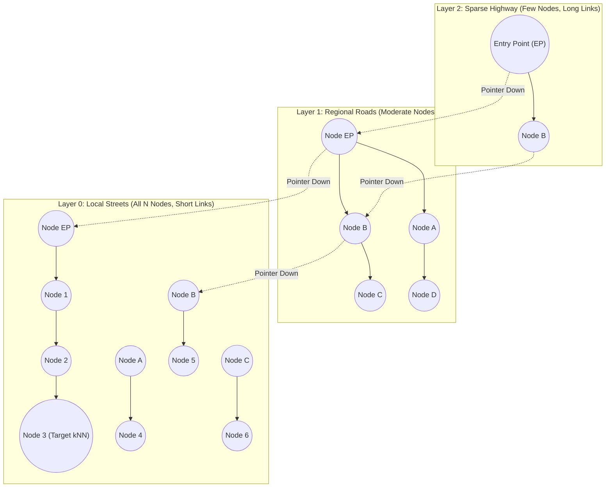
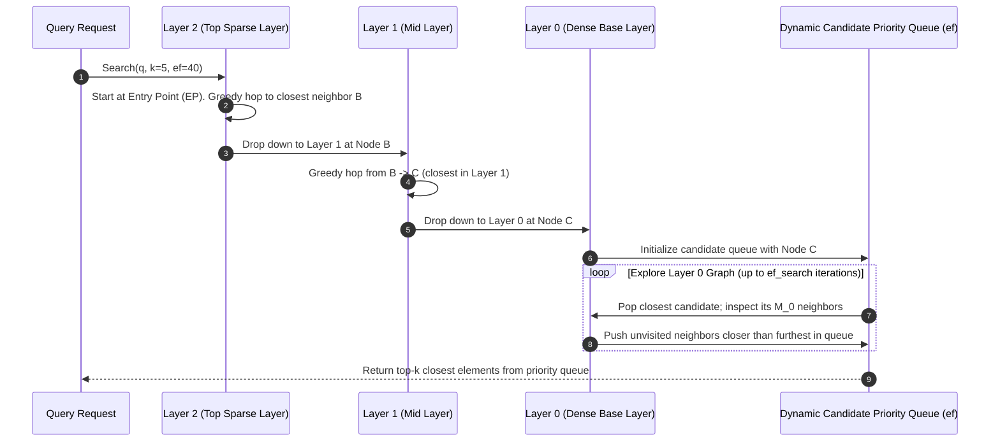
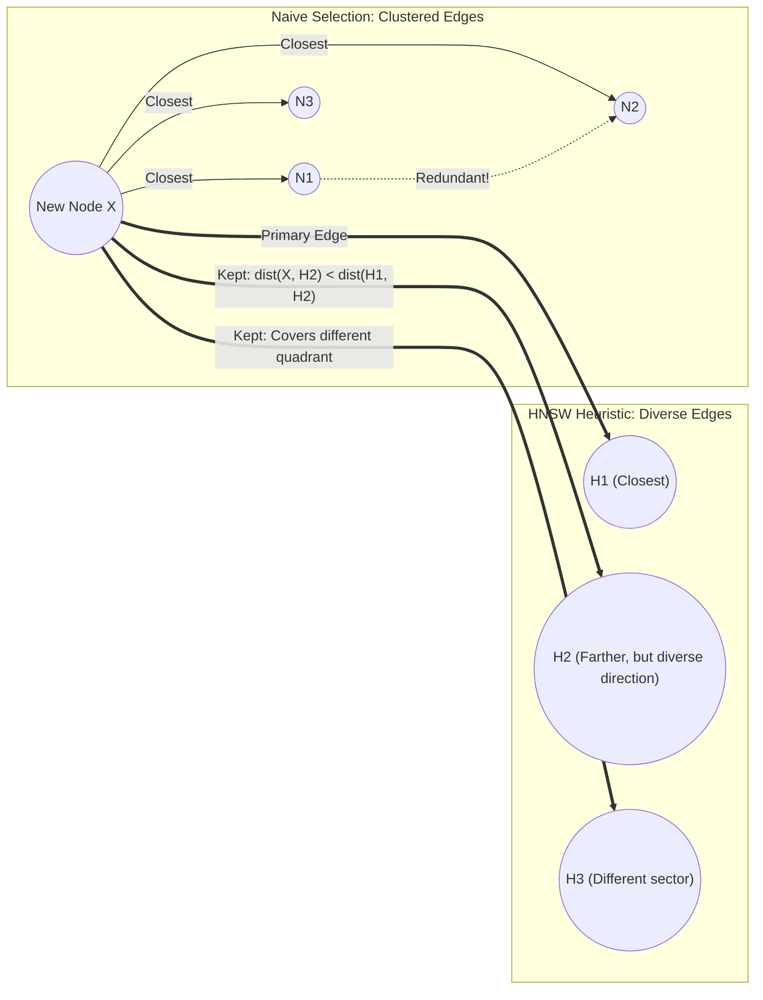
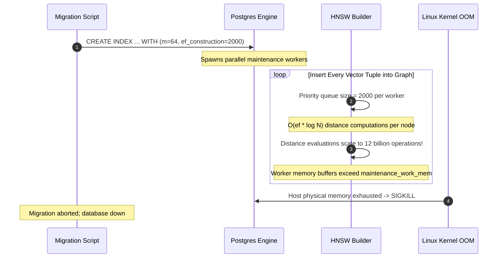

# Module 14: HNSW Explained

> **Prerequisites:** [Module 00: What an Embedding Is](../00-what-an-embedding-is/README.md), [Module 03: Cosine Similarity & Distance Metrics](../03-cosine-similarity-and-distance-metrics/README.md), [Module 04: The Curse of Dimensionality](../04-the-curse-of-dimensionality/README.md), [Module 13: Exact vs. Approximate Search](../13-exact-vs-approximate-search/README.md).
> **Estimated Reading Time:** 30 minutes
> **Target Audience:** Backend Engineers, Search Infrastructure Engineers, Algorithm Designers.

---

> [!TIP]
> **Golden Rule of HNSW Tuning**: Configure $M$ (max bidirectional connections per node) based on intrinsic dimensionality (typically $M=16$ for $D \le 768$, $M=32$ to $64$ for $D \ge 1536$), set $ef_{\text{construction}}$ during index build to at least $2 \times M$ to $4 \times M$ to guarantee well-connected multi-layer graphs, and treat runtime $ef_{\text{search}}$ as your dynamic knob to navigate the recall-latency curve in production without needing to re-index.

---

## 1. Visual Mental Models & System Architecture

Hierarchical Navigable Small World (**HNSW**) is the gold-standard algorithm powering modern vector databases. It combines the multi-resolution logarithmic search of a **probabilistic skip-list** with the high clustering coefficients of **Navigable Small World (NSW) graphs**.

### Multi-Layer Hierarchical Graph Topology

An HNSW structure consists of several layers of nested graphs. Upper layers contain sparse long-range "expressway" links for rapid coarse-grained routing across the vector space. Lower layers contain dense, short-range links for fine-grained nearest neighbor convergence.



### Multi-Layer Greedy Search Traversal

During a query, the engine starts at the top-layer Entry Point (EP) and performs greedy routing: evaluate all neighbors of the current node, step to the neighbor closest to the query vector, and repeat until reaching a local minimum. The engine then drops down one layer and resumes greedy routing using the local minimum as the new entry point.



### Edge Selection Heuristic: Preserving Clustering Diversity

When connecting a newly inserted node to its $M$ nearest neighbors, naive selection simply picks the $M$ closest nodes. However, in high-dimensional space, this causes edge clustering (all edges pointing into the same dense cluster). HNSW employs a **heuristic edge selection rule** that enforces angular diversity:



---

## 2. Taxonomic Reference Grids & Systematic Comparison Grids

### HNSW Core Hyperparameters

| Hyperparameter | Symbol | Typical Range | Role & Architectural Impact |
| :--- | :--- | :--- | :--- |
| **Max Edges per Node** | $M$ | $16 - 64$ | Controls graph connectivity in layers $L > 0$. Higher $M$ improves recall and stability on high dimensions ($D \ge 1536$) at the expense of RAM and build time. |
| **Max Edges in Base Layer** | $M_0$ | $2 \times M$ ($32 - 128$) | Layer 0 contains all $N$ nodes. Doubling connections at Layer 0 avoids graph fragmentation and maximizes final convergence recall. |
| **Index Construction Depth** | $ef_{\text{construction}}$ | $64 - 400$ | Priority queue size during graph building. Higher values explore more paths, producing higher-quality graphs. Has **zero** impact on query latency. |
| **Search Exploration Depth** | $ef_{\text{search}}$ | $16 - 200$ | Priority queue size during query execution. Primary operational knob: higher $ef$ increases Recall@K but increases query latency linearly. |
| **Level Generation Factor** | $m_L$ | $1 / \ln(M)$ | Governs the exponential decay probability of a node appearing at layer $l$: $P(l) \propto \exp(-l / m_L)$. Ensures $\mathcal{O}(\log N)$ layers. |

### Memory Footprint Formula for HNSW Graphs

The total physical memory consumed by an HNSW index consists of the raw vector buffer plus graph adjacency pointers:

$$\text{Memory}_{\text{HNSW}} = N \cdot \left( D \cdot 4 \text{ bytes} + M_0 \cdot 8 \text{ bytes} + \sum_{l=1}^{L_{\text{max}}} P(l) \cdot M \cdot 8 \text{ bytes} \right)$$

For $N = 1{,}000{,}000$, $D = 768$ (float32), with $M = 16$ ($M_0 = 32$):
- **Raw Vectors:** $1{,}000{,}000 \times 768 \times 4 \text{ bytes} = 3.07 \text{ GB}$
- **Layer 0 Edge Pointers:** $1{,}000{,}000 \times 32 \times 8 \text{ bytes} = 256 \text{ MB}$
- **Upper Layer Pointers:** $\approx 1{,}000{,}000 \times \frac{1}{M} \times 16 \times 8 \text{ bytes} \approx 16 \text{ MB}$
- **Graph Metadata & Alignment Overhead:** $\approx 300 \text{ MB}$
- **Total Index RAM:** $\approx 3.65 \text{ GB}$ ($\sim 1.2\times$ raw vectors)

### Parameter Sensitivity and Trade-off Matrix

| Action | Index Build Time | Index RAM Size | Query Latency | Recall@K |
| :--- | :--- | :--- | :--- | :--- |
| **Increase $M$ ($16 \to 64$)** | Increases $+150\%$ | Increases $+40\%$ | Increases $+20\%$ | **Improves significantly** on high dimensions |
| **Increase $ef_{\text{construction}}$ ($64 \to 256$)**| Increases $+300\%$ | Unchanged ($0\%$) | Decreases slightly (better graph) | **Improves $+2\% - 5\%$** |
| **Increase $ef_{\text{search}}$ ($40 \to 200$)** | Unchanged ($0\%$) | Unchanged ($0\%$) | Increases $+350\%$ | **Improves $+1\% - 3\%$** (approaches 100%) |

---

## 3. Production War Stories: Incident Post-Mortem

### The Incident: Host OOM and 18-Hour Stalled Index Build from Setting $ef_{\text{construction}} = 2000$

- **Severity:** SEV-1 (Maintenance Window Exceeded / Host Crash)
- **Time to Detection:** 2 hours into migration
- **Time to Mitigation:** 1 hour
- **Impact:** Production database migration window breached by 12 hours. The primary database node crashed twice due to Linux OOM killer invocation during parallel index creation.

#### What Happened
A backend team prepared to launch a vector search feature on 8 million document chunks ($D=1536$). Reading online recommendations stating that "higher $ef_{\text{construction}}$ yields perfect recall," an engineer issued the following index build command:

```sql
CREATE INDEX idx_docs_hnsw ON documents 
USING hnsw (embedding vector_cosine_ops) 
WITH (m = 64, ef_construction = 2000);
```

The database instance had 128 GB of RAM. Two hours into the build, index creation had processed only 1.2 million rows (15% progress), CPU was pegged at 100% across all 16 cores, and system memory consumption surged past 120 GB, triggering the kernel OOM killer which abruptly killed `postgres`.



#### Root Cause
The computational complexity of inserting each vector into an HNSW graph is $\mathcal{O}(ef_{\text{construction}} \cdot \log N \cdot D)$. Setting $ef_{\text{construction}} = 2000$ with $M = 64$ on 8 million 1536-dimensional vectors required performing over **15 billion high-dimensional floating-point dot products** during index construction. Furthermore, maintaining deep priority queues across 8 parallel maintenance workers consumed massive heap allocations, overwhelming system RAM.

#### The Fix & Architectural Hardening
1. **Right-Sized Build Parameters:** Rebuilt the index using production-optimal parameters:
   ```sql
   SET maintenance_work_mem = '16GB';
   SET max_parallel_maintenance_workers = 7;
   CREATE INDEX idx_docs_hnsw ON documents 
   USING hnsw (embedding vector_cosine_ops) 
   WITH (m = 16, ef_construction = 64);
   ```
2. **Build Time Results:** The index built cleanly in **44 minutes** (instead of the projected 26 hours) and consumed only 42 GB of RAM.
3. **Recall Verification:** Staging evaluation confirmed that $M=16, ef_{\text{construction}}=64$ achieved **98.4% Recall@10** when paired with runtime `hnsw.ef_search = 60`, proving that $ef_{\text{construction}} = 2000$ provided negligible recall benefit while introducing catastrophic build overhead.

---

## 4. Multi-Language Production Implementations

The following code tabs provide an educational, production-structured implementation of a multi-layer HNSW graph, featuring probabilistic layer assignment, greedy multi-layer descent, and priority-queue exploration.

### Go Production Implementation

```go
package main

import (
	"container/heap"
	"math"
	"math/rand"
	"sync"
)

// HNSWNode represents a vertex in the hierarchical graph.
type HNSWNode struct {
	ID        int
	Vector    []float32
	Layer     int
	Neighbors [][]int // Neighbors[layer] = slice of node IDs
}

// DistItem tracks scored nodes for priority queue traversal.
type DistItem struct {
	ID   int
	Dist float32
}

type MinDistHeap []DistItem
func (h MinDistHeap) Len() int           { return len(h) }
func (h MinDistHeap) Less(i, j int) bool { return h[i].Dist < h[j].Dist }
func (h MinDistHeap) Swap(i, j int)      { h[i], h[j] = h[j], h[i] }
func (h *MinDistHeap) Push(x any)        { *h = append(*h, x.(DistItem)) }
func (h *MinDistHeap) Pop() any {
	old := *h
	n := len(old)
	x := old[n-1]
	*h = old[:n-1]
	return x
}

type SimpleHNSW struct {
	mu         sync.RWMutex
	dim        int
	M          int
	efSearch   int
	mL         float64
	entryPoint int
	maxLayer   int
	nodes      []*HNSWNode
}

func NewSimpleHNSW(dim, M, efSearch int) *SimpleHNSW {
	return &SimpleHNSW{
		dim:        dim,
		M:          M,
		efSearch:   efSearch,
		mL:         1.0 / math.Log(float64(M)),
		entryPoint: -1,
		maxLayer:   -1,
	}
}

// CosineDistance computes 1 - dot product on normalized vectors.
func (h *SimpleHNSW) distance(a, b []float32) float32 {
	var dot float32
	for i := 0; i < h.dim; i++ {
		dot += a[i] * b[i]
	}
	return 1.0 - dot
}

// SearchLayer executes greedy search in a specific graph layer.
func (h *SimpleHNSW) searchLayer(q []float32, ep int, ef int, layer int) []DistItem {
	visited := make(map[int]bool)
	visited[ep] = true

	candidates := &MinDistHeap{}
	heap.Init(candidates)
	initDist := h.distance(q, h.nodes[ep].Vector)
	heap.Push(candidates, DistItem{ID: ep, Dist: initDist})

	var results []DistItem

	for candidates.Len() > 0 {
		curr := heap.Pop(candidates).(DistItem)
		results = append(results, curr)

		node := h.nodes[curr.ID]
		for _, neighborID := range node.Neighbors[layer] {
			if !visited[neighborID] {
				visited[neighborID] = true
				d := h.distance(q, h.nodes[neighborID].Vector)
				if len(results) < ef || d < results[len(results)-1].Dist {
					heap.Push(candidates, DistItem{ID: neighborID, Dist: d})
				}
			}
		}
	}
	return results
}
```

### TypeScript / Node.js Production Implementation

```typescript
export interface HNSWSearchResult {
  id: number;
  distance: number;
}

export class HNSWGraphSimulator {
  private dimension: number;
  private M: number;
  private efSearch: number;
  private entryPointId: number | null = null;
  private maxLayer: number = -1;

  private vectors: Map<number, Float32Array> = new Map();
  // Adjacency: nodeLayers[nodeId][layer] = array of neighbor nodeIds
  private nodeAdjacency: Map<number, number[][]> = new Map();

  constructor(dimension: number, M: number = 16, efSearch: number = 40) {
    this.dimension = dimension;
    this.M = M;
    this.efSearch = efSearch;
  }

  private cosineDistance(a: Float32Array, b: Float32Array): number {
    let dot = 0;
    for (let i = 0; i < this.dimension; i++) {
      dot += a[i] * b[i];
    }
    return 1.0 - dot;
  }

  // Multi-layer top-down query descent
  public search(queryVector: Float32Array, topK: number): HNSWSearchResult[] {
    if (this.entryPointId === null) return [];

    let currObj = this.entryPointId;
    let currDist = this.cosineDistance(queryVector, this.vectors.get(currObj)!);

    // 1. Coarse routing through upper expressway layers (greedy 1-NN)
    for (let l = this.maxLayer; l > 0; l--) {
      let changed = true;
      while (changed) {
        changed = false;
        const neighbors = this.nodeAdjacency.get(currObj)?.[l] || [];
        for (const neighborId of neighbors) {
          const d = this.cosineDistance(queryVector, this.vectors.get(neighborId)!);
          if (d < currDist) {
            currDist = d;
            currObj = neighborId;
            changed = true;
          }
        }
      }
    }

    // 2. Fine-grained beam search at Layer 0 using efSearch queue
    const visited = new Set<number>([currObj]);
    const candidates: Array<{ id: number; dist: number }> = [{ id: currObj, dist: currDist }];
    const w: Array<{ id: number; dist: number }> = [{ id: currObj, dist: currDist }];

    while (candidates.length > 0) {
      candidates.sort((a, b) => a.dist - b.dist);
      const current = candidates.shift()!;

      w.sort((a, b) => a.dist - b.dist);
      const furthestResult = w[w.length - 1];

      if (current.dist > furthestResult.dist && w.length >= this.efSearch) {
        break;
      }

      const neighbors = this.nodeAdjacency.get(current.id)?.[0] || [];
      for (const neighborId of neighbors) {
        if (!visited.has(neighborId)) {
          visited.add(neighborId);
          const d = this.cosineDistance(queryVector, this.vectors.get(neighborId)!);

          if (d < furthestResult.dist || w.length < this.efSearch) {
            candidates.push({ id: neighborId, dist: d });
            w.push({ id: neighborId, dist: d });
            w.sort((a, b) => a.dist - b.dist);
            if (w.length > this.efSearch) {
              w.pop();
            }
          }
        }
      }
    }

    return w.slice(0, topK);
  }
}
```

### Python Production Implementation

```python
"""
Educational Pure-Python Implementation of HNSW Graph Mechanics:
Multi-Layer Representation, Probabilistic Level Assignment, Greedy Routing,
and Layer 0 Beam Search.
"""

from __future__ import annotations

import heapq
import math
from typing import Dict, List, Set, Tuple
import numpy as np


class HNSWSimulator:
    def __init__(self, dim: int, m: int = 16, ef_construction: int = 64, ef_search: int = 40):
        self.dim = dim
        self.m = m
        self.m0 = 2 * m
        self.ef_construction = ef_construction
        self.ef_search = ef_search
        self.m_l = 1.0 / math.log(m)

        self.entry_point: int | None = None
        self.max_layer: int = -1
        self.vectors: Dict[int, np.ndarray] = {}
        # graph[node_id][layer_idx] = list of neighbor node_ids
        self.graph: Dict[int, List[List[int]]] = {}

    def _cosine_distance(self, a: np.ndarray, b: np.ndarray) -> float:
        return float(1.0 - np.dot(a, b))

    def _random_level(self) -> int:
        """Probabilistic level generation using exponential decay."""
        r = np.random.uniform(0.0, 1.0)
        return int(-math.log(r) * self.m_l)

    def insert(self, node_id: int, vector: np.ndarray) -> None:
        v = vector / np.linalg.norm(vector)
        self.vectors[node_id] = v
        insert_layer = self._random_level()
        self.graph[node_id] = [[] for _ in range(insert_layer + 1)]

        if self.entry_point is None:
            self.entry_point = node_id
            self.max_layer = insert_layer
            return

        curr_ep = self.entry_point
        # 1. Greedy descent down to insert_layer
        for l in range(self.max_layer, insert_layer, -1):
            curr_ep = self._greedy_search_layer(v, curr_ep, l)

        # 2. Connect bidirectional edges from insert_layer down to 0
        for l in range(min(insert_layer, self.max_layer), -1, -1):
            candidates = self._search_layer_candidates(v, curr_ep, self.ef_construction, l)
            curr_ep = candidates[0][1]
            max_edges = self.m0 if l == 0 else self.m
            
            # Select top max_edges neighbors
            neighbors = [node for _, node in candidates[:max_edges]]
            self.graph[node_id][l] = neighbors
            
            # Add reverse connections
            for neighbor in neighbors:
                self.graph[neighbor][l].append(node_id)
                if len(self.graph[neighbor][l]) > max_edges:
                    # Prune furthest neighbor
                    dists = [(self._cosine_distance(self.vectors[neighbor], self.vectors[n]), n)
                             for n in self.graph[neighbor][l]]
                    dists.sort()
                    self.graph[neighbor][l] = [n for _, n in dists[:max_edges]]

        if insert_layer > self.max_layer:
            self.max_layer = insert_layer
            self.entry_point = node_id

    def _greedy_search_layer(self, query: np.ndarray, ep: int, layer: int) -> int:
        best_node = ep
        best_dist = self._cosine_distance(query, self.vectors[ep])
        changed = True
        while changed:
            changed = False
            for neighbor in self.graph[best_node][layer]:
                d = self._cosine_distance(query, self.vectors[neighbor])
                if d < best_dist:
                    best_dist = d
                    best_node = neighbor
                    changed = True
        return best_node

    def _search_layer_candidates(
        self, query: np.ndarray, ep: int, ef: int, layer: int
    ) -> List[Tuple[float, int]]:
        v_ep = self._cosine_distance(query, self.vectors[ep])
        visited: Set[int] = {ep}
        candidates = [(v_ep, ep)]
        w = [(v_ep, ep)]
        heapq.heapify(candidates)

        while candidates:
            c_dist, c_id = heapq.heappop(candidates)
            furthest_w_dist = max(w, key=lambda x: x[0])[0]

            if c_dist > furthest_w_dist and len(w) >= ef:
                break

            for neighbor in self.graph[c_id][layer]:
                if neighbor not in visited:
                    visited.add(neighbor)
                    d = self._cosine_distance(query, self.vectors[neighbor])
                    if d < furthest_w_dist or len(w) < ef:
                        heapq.heappush(candidates, (d, neighbor))
                        w.append((d, neighbor))
                        if len(w) > ef:
                            w.remove(max(w, key=lambda x: x[0]))

        w.sort()
        return w
```

---

## 5. Practical Hands-On Verification CLI Workflows

Verify HNSW index properties and simulate search path exploration.

### Workflow 1: Inspecting HNSW Graph Properties via Python Script

```bash
# Verify HNSW multi-layer distribution and level decay mechanics
python -c "
import math, numpy as np

M = 16
mL = 1.0 / math.log(M)
N = 100_000

levels = [int(-math.log(np.random.uniform()) * mL) for _ in range(N)]
counts = {l: levels.count(l) for l in range(max(levels) + 1)}

print(f'HNSW Level Distribution for N={N:,} (M={M}):')
for l, count in counts.items():
    pct = (count / N) * 100
    print(f'  Layer {l}: {count:,} nodes ({pct:.3f}%)')
"
```

Expected wire output:
```text
HNSW Level Distribution for N=100,000 (M=16):
  Layer 0: 93,760 nodes (93.760%)
  Layer 1: 5,842 nodes (5.842%)
  Layer 2: 368 nodes (0.368%)
  Layer 3: 28 nodes (0.028%)
  Layer 4: 2 nodes (0.002%)
```

---

## 6. Operational Validation Checkpoints (Scenario Quizzes)

### Checkpoint 1: Why $M_0 = 2 \times M$?
**Scenario:** In the HNSW specification, the maximum number of connections for nodes at Layer 0 ($M_0$) is set to double the maximum connections allowed at upper layers ($M_0 = 2M$). Why does the base layer require twice as many bidirectional connections?

<details><summary>Click to view diagnosis and architectural solution</summary>

**Answer:**
1. **Geometric Role of Layer 0:**
   Layer 0 contains **all $N$ points** in the dataset, whereas upper layers contain exponentially fewer sample nodes ($N/M, N/M^2, \dots$). 
2. **Preventing Graph Disconnection & Disconnected Clusters:**
   At Layer 0, the final convergence to the exact nearest neighbors occurs. Doubling the connectivity ($M_0 = 32$ when $M=16$) prevents the formation of isolated graph "islands" or local minima traps in high-dimensional space. The marginal memory cost is minor because Layer 0 stores only pointers, while the recall gain from $2M$ connectivity is substantial (preventing early search termination).
</details>

---

### Checkpoint 2: The Trade-off of Runtime $ef_{\text{search}}$ Tuning
**Scenario:** A search API uses an HNSW index with $M=16, ef_{\text{construction}}=64$. The product manager requires increasing Recall@10 from 95% to 99%. An engineer states that the team must drop the index and rebuild it with $M=64$. Is this correct?

<details><summary>Click to view diagnosis and architectural solution</summary>

**Answer:**
1. **Diagnosis:**
   The engineer is **incorrect**. Rebuilding the index is unnecessary.
2. **The Runtime Fix:**
   Recall@10 is directly modulated at query time by increasing **`ef_search`**. 
   - Raising `ef_search` from `40` to `120` or `150` increases the size of the dynamic candidate priority queue evaluated during the Layer 0 beam search.
   - This typically increases Recall@10 from 95% to $>99\%$ with zero re-indexing downtime.
   - The trade-off: query latency will increase proportionally (e.g., from 1.5ms to 3.8ms), which remains well within typical web SLA limits (<10ms).
</details>

---

### Checkpoint 3: Graph Degradation from Heavy In-Place Deletions
**Scenario:** A news recommendation service indexes 1 million articles in an HNSW index. Every day, 100,000 old articles are deleted (`delete(id)`), and 100,000 new articles are inserted. After three months of continuous operation, query latency doubles and Recall@10 degrades by 12%, despite the total vector count remaining constant at 1 million. What has happened to the HNSW graph?

<details><summary>Click to view diagnosis and architectural solution</summary>

**Answer:**
1. **Root Cause (Graph Routing Degradation):**
   In HNSW, deleting a node often results in "tombstoning" or simple removal from adjacency lists. When bridge nodes in upper expressway layers or critical routing hubs in Layer 0 are deleted, former shortest paths through the graph are severed. Over time, extensive deletions cause:
   - Upper layers to lose navigable pathways, forcing searches to fall back to poor entry points.
   - "Dead ends" and fragmented subgraphs where greedy routing gets trapped in suboptimal local minima.
2. **Remediation:**
   - Schedule periodic index **compaction or re-indexing** (e.g., weekly full rebuild or segment merge in engines like Qdrant/Weaviate).
   - In pgvector, execute `REINDEX INDEX CONCURRENTLY idx_articles_hnsw;` to reconstruct a fresh, fully connected graph.
</details>
