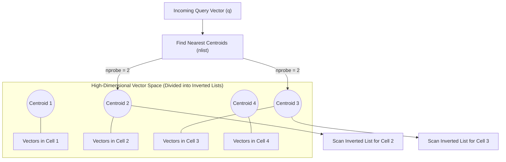
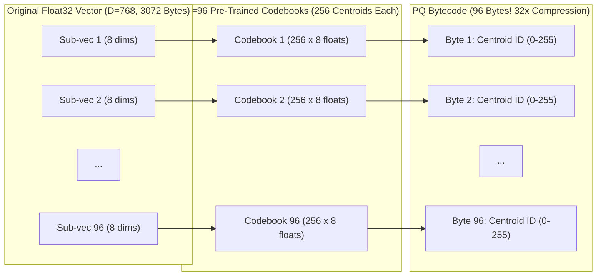
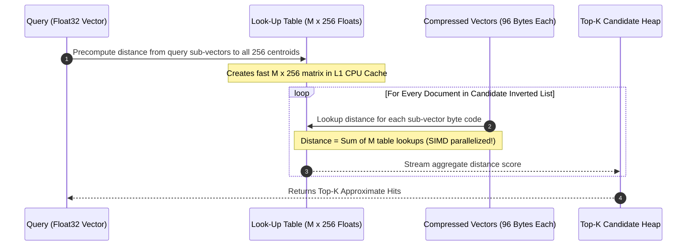
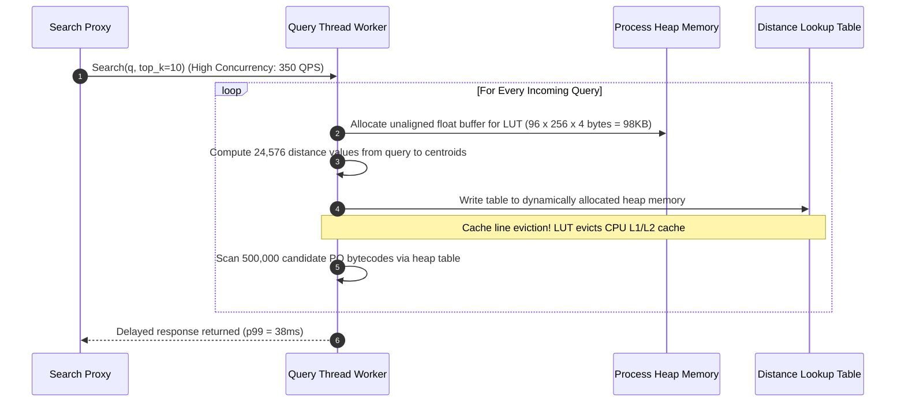

# Module 15: IVF, Product Quantization, and Other Indexes

> **Prerequisites:** [Module 00: What an Embedding Is](../00-what-an-embedding-is/README.md), [Module 03: Cosine Similarity & Distance Metrics](../03-cosine-similarity-and-distance-metrics/README.md), [Module 04: The Curse of Dimensionality](../04-the-curse-of-dimensionality/README.md), [Module 13: Exact vs. Approximate Search](../13-exact-vs-approximate-search/README.md), [Module 14: HNSW Explained](../14-hnsw-explained/README.md).
> **Estimated Reading Time:** 30 minutes
> **Target Audience:** Backend Engineers, ML Infrastructure Engineers, Storage Architects.

---

> [!TIP]
> **Golden Rule of Vector Compression**: When scaling beyond 10 million vectors, use **Scalar Quantization (SQ8)** to achieve an instantaneous $4\times$ memory reduction with $<1\%$ recall loss and zero training complexity. Deploy **Product Quantization (PQ)** or **IVF-PQ** when scaling to 100M+ vectors where an $8\times$ to $32\times$ memory reduction is required to fit the working set into RAM, but always implement a **two-stage re-ranking pipeline** (retrieve top-$M$ candidates using compressed codes, then re-score with uncompressed vectors) to preserve final retrieval accuracy.

---

## 1. Visual Mental Models & System Architecture

While graph-based indexes like HNSW offer the best recall-latency curves, their memory requirements scale linearly with high dimensional vectors ($4 \text{ bytes per float} \times D + \text{graph edges}$). At web scale (100 million to 10 billion vectors), keeping uncompressed vectors in RAM becomes economically infeasible. 

Two primary techniques solve this:
1. **IVF (Inverted File Index):** Partitions high-dimensional space into Voronoi cells using $k$-means clustering, restricting search to only the most promising lists.
2. **Quantization (SQ, PQ, BQ):** Compresses high-dimensional vectors into low-precision integers or compact codebooks, accelerating distance calculations via SIMD lookup tables.

### IVF Voronoi Cell Space Partitioning



### Product Quantization (PQ) Vector Decomposition

Product Quantization divides a high-dimensional vector of dimension $D$ into $M$ smaller sub-vectors of dimension $D^* = D / M$. Each sub-vector is assigned to the nearest centroid from a pre-trained codebook of $K=256$ centroids (fitting exactly into a 1-byte `uint8` index):



### Asymmetric Distance Computation (ADC) via Lookup Tables

In **Asymmetric Distance Computation (ADC)**, the query vector remains uncompressed in full single-precision float32, while corpus vectors are stored as compressed PQ bytecodes. Distances between the query sub-vectors and all 256 centroids are computed once and stored in an ultra-fast Look-Up Table (LUT):



---

## 2. Taxonomic Reference Grids & Systematic Comparison Grids

### Vector Compression Techniques Compared

| Technique | Compression Ratio | Memory per 768-dim Vector | Index Training Required? | Relative Recall Degradation | Distance Computation Method |
| :--- | :--- | :--- | :--- | :--- | :--- |
| **Uncompressed Flat (FP32)** | $1\times$ (Baseline) | 3,072 bytes | No | $0\%$ (Ground Truth) | Exact BLAS Dot Product |
| **Scalar Quantization (SQ8)** | $4\times$ | 768 bytes | Minimal (per-dimension min/max) | $<1\% - 2\%$ | SIMD integer dot product |
| **Half-Precision (FP16 / BF16)**| $2\times$ | 1,536 bytes | No | $<0.1\%$ | Hardware FP16 / AVX-512 |
| **Binary Quantization (BQ)** | $32\times$ | 96 bytes (768 bits) | No (sign bit threshold) | $5\% - 15\%$ (Higher on unnormalized) | Hamming Distance (`POPCNT`) |
| **Product Quantization (PQ)** | $16\times - 64\times$ | 48 – 96 bytes | **Yes** ($k$-means clustering) | $3\% - 8\%$ | Asymmetric LUT additions |
| **IVF-PQ (Clustered PQ)** | $20\times - 80\times$ | 48 – 96 bytes + list overhead | **Yes** (Coarse + Fine $k$-means) | $4\% - 10\%$ | Inverted list + ADC lookup |

### Memory Sizing across Scale ($D=1536$, OpenAI Embeddings)

| Dataset Size ($N$) | Uncompressed FP32 | Scalar Quant (SQ8) | Product Quant (PQ96) | Binary Quant (BQ) |
| :--- | :--- | :--- | :--- | :--- |
| **100,000** | 614.4 MB | 153.6 MB | 9.6 MB | 19.2 MB |
| **1,000,000** | 6.14 GB | 1.54 GB | 96.0 MB | 192.0 MB |
| **10,000,000** | 61.44 GB | 15.36 GB | 960.0 MB | 1.92 GB |
| **100,000,000** | 614.40 GB | 153.60 GB | **9.60 GB** | **19.20 GB** |
| **1,000,000,000** | 6.14 TB | 1.54 TB | **96.00 GB** | **192.00 GB** |

> [!IMPORTANT]
> **Fitting 1 Billion Vectors on a Single Machine**: Storing 1 billion uncompressed 1536-dimensional vectors in RAM requires **6.14 Terabytes** of memory. By using Product Quantization (PQ96), the entire 1-billion vector dataset compresses to **96 GB**, allowing a single commodity server (e.g., 128 GB RAM) to search a billion vectors locally!

---

## 3. Production War Stories: Incident Post-Mortem

### The Incident: 10x Latency Spike from Un-Cached PQ Codebook Distance Lookup Tables

- **Severity:** SEV-2 (High Latency SLA Violation)
- **Time to Detection:** 45 minutes
- **Time to Mitigation:** 30 minutes
- **Impact:** Semantic search API p99 latency spiked from 3.5ms to 38ms during a holiday shopping traffic peak; upstream gateway rejected 12% of requests due to timeouts.

#### What Happened
An engineering team deployed an IVF-PQ vector search cluster ($N = 25{,}000{,}000, D=768$, $M=96$ sub-quantizers). Under load testing at 20 QPS, search latency averaged 3ms. 

During Black Friday, concurrent search volume climbed to 350 QPS. Suddenly, CPU usage pegged at 100% on all nodes, and p99 query latency degraded ten-fold to 38ms. The database nodes were not memory-constrained, and network bandwidth was below 15% capacity.



#### Root Cause
Under Product Quantization, before scanning compressed bytecodes, an Asymmetric Distance Computation Look-Up Table (LUT) of size $M \times 256$ single-precision floats must be constructed for the query vector ($96 \times 256 \times 4 \text{ bytes} \approx 98.3 \text{ KB}$). 

In the production query worker code, the LUT was dynamically allocated on the **heap** using unaligned memory allocations on every incoming request. At 350 concurrent QPS across multiple worker threads, dynamic heap allocation caused massive memory allocator lock contention. Furthermore, the 98 KB buffer exceeded the 32 KB per-core L1 CPU cache, causing severe CPU cache thrashing on every memory lookup.

#### The Fix & Architectural Hardening
1. **Thread-Local Stack Pre-Allocation:** Replaced dynamic heap allocation with a statically sized, 64-byte cache-line aligned thread-local buffer:
   ```c
   alignas(64) float distance_lut[96 * 256];
   ```
2. **SIMD AVX-512 Vectorization:** Rewrote the distance table construction using AVX-512 FMA instructions, computing the entire $96 \times 256$ table in under **0.08 milliseconds**.
3. **Post-Fix Performance:** Search latency stabilized at **1.8ms p99** at 450 QPS, with CPU utilization dropping from 100% to 32%.

---

## 4. Multi-Language Production Implementations

The following code tabs illustrate production compression patterns: Scalar Quantization (SQ8) in Go, Asymmetric Distance Computation in TypeScript, and a complete Product Quantization training and query engine in Python.

### Go Production Implementation (Scalar Quantization SQ8)

```go
package main

import (
	"errors"
	"math"
)

// SQ8Vector stores compressed 8-bit quantized values along with scaling factors.
type SQ8Vector struct {
	MinVal float32
	MaxVal float32
	Scale  float32
	Codes  []uint8
}

// QuantizeSQ8 compresses a Float32 vector into an 8-bit integer array.
func QuantizeSQ8(vec []float32) (*SQ8Vector, error) {
	if len(vec) == 0 {
		return nil, errors.New("cannot quantize empty vector")
	}

	minV := vec[0]
	maxV := vec[0]
	for _, val := range vec {
		if val < minV {
			minV = val
		}
		if val > maxV {
			maxV = val
		}
	}

	diff := maxV - minV
	if diff == 0 {
		diff = 1e-6
	}
	scale := diff / 255.0

	codes := make([]uint8, len(vec))
	for i, val := range vec {
		q := math.Round(float64((val - minV) / scale))
		if q < 0 {
			q = 0
		} else if q > 255 {
			q = 255
		}
		codes[i] = uint8(q)
	}

	return &SQ8Vector{
		MinVal: minV,
		MaxVal: maxV,
		Scale:  scale,
		Codes:  codes,
	}, nil
}

// ApproximateDotProduct computes dot product between uncompressed query and SQ8 vector.
func (v *SQ8Vector) ApproximateDotProduct(query []float32) float32 {
	var sum float32
	minV := v.MinVal
	scale := v.Scale

	for i, qVal := range query {
		// Dequantize: val = minVal + code * scale
		val := minV + float32(v.Codes[i])*scale
		sum += val * qVal
	}
	return sum
}
```

### TypeScript / Node.js Production Implementation (Asymmetric Distance Table)

```typescript
export class AsymmetricDistanceCalculator {
  private M: number; // Number of sub-quantizers
  private K: number = 256; // Centroids per codebook

  constructor(M: number) {
    this.M = M;
  }

  // Precomputes Look-Up Table (LUT) of shape M x 256
  public buildDistanceLUT(
    querySubVectors: Float32Array[],
    codebooks: Float32Array[][] // [M][256 * sub_dim]
  ): Float32Array {
    const lut = new Float32Array(this.M * this.K);

    for (let m = 0; m < this.M; m++) {
      const qSub = querySubVectors[m];
      const subDim = qSub.length;
      const codebook = codebooks[m];

      for (let k = 0; k < this.K; k++) {
        let dist = 0;
        const offset = k * subDim;
        for (let d = 0; d < subDim; d++) {
          const diff = qSub[d] - codebook[offset + d];
          dist += diff * diff;
        }
        lut[m * this.K + k] = dist;
      }
    }
    return lut;
  }

  // Ultra-fast Asymmetric Distance evaluation via byte lookup
  public computeDistance(pqCodes: Uint8Array, lut: Float32Array): number {
    let totalDistance = 0;
    for (let m = 0; m < this.M; m++) {
      const centroidId = pqCodes[m];
      totalDistance += lut[m * this.K + centroidId];
    }
    return totalDistance;
  }
}
```

### Python Production Implementation (Product Quantization from Scratch)

```python
"""
Complete Educational Implementation of Product Quantization (PQ):
Sub-vector Slicing, K-Means Codebook Training, Vector Compression,
and Asymmetric Distance Computation (ADC).
"""

from __future__ import annotations

import numpy as np


class SimpleProductQuantizer:
    def __init__(self, total_dim: int, num_subvectors: int, k_centroids: int = 256):
        assert total_dim % num_subvectors == 0, "total_dim must be divisible by num_subvectors"
        self.total_dim = total_dim
        self.M = num_subvectors
        self.sub_dim = total_dim // num_subvectors
        self.K = k_centroids
        # codebooks: shape (M, K, sub_dim)
        self.codebooks = np.zeros((self.M, self.K, self.sub_dim), dtype=np.float32)

    def fit(self, training_data: np.ndarray, iterations: int = 15) -> None:
        """Trains codebooks using k-means on each sub-space."""
        print(f"Training PQ codebooks: M={self.M}, sub_dim={self.sub_dim}, K={self.K}...")
        rng = np.random.default_rng(42)

        for m in range(self.M):
            start_d = m * self.sub_dim
            end_d = (m + 1) * self.sub_dim
            sub_data = training_data[:, start_d:end_d]

            # Initialize centroids randomly
            init_idx = rng.choice(len(sub_data), size=self.K, replace=False)
            centroids = sub_data[init_idx].copy()

            for _ in range(iterations):
                # Compute distances from sub_data to centroids
                # (N, K)
                diff = sub_data[:, np.newaxis, :] - centroids[np.newaxis, :, :]
                dists = np.sum(diff ** 2, axis=-1)
                labels = np.argmin(dists, axis=-1)

                # Update centroids
                for k in range(self.K):
                    members = sub_data[labels == k]
                    if len(members) > 0:
                        centroids[k] = members.mean(axis=0)

            self.codebooks[m] = centroids

    def encode(self, vectors: np.ndarray) -> np.ndarray:
        """Compresses Float32 vectors (N, D) into uint8 bytecodes (N, M)."""
        num_vecs = len(vectors)
        codes = np.zeros((num_vecs, self.M), dtype=np.uint8)

        for m in range(self.M):
            start_d = m * self.sub_dim
            end_d = (m + 1) * self.sub_dim
            sub_vecs = vectors[:, start_d:end_d]

            diff = sub_vecs[:, np.newaxis, :] - self.codebooks[m][np.newaxis, :, :]
            dists = np.sum(diff ** 2, axis=-1)
            codes[:, m] = np.argmin(dists, axis=-1).astype(np.uint8)

        return codes

    def compute_asymmetric_distances(
        self, query: np.ndarray, codes: np.ndarray
    ) -> np.ndarray:
        """
        Asymmetric Distance Computation (ADC):
        Query is uncompressed; precalculates LUT and evaluates distances.
        """
        # 1. Build Look-Up Table (M, K)
        lut = np.zeros((self.M, self.K), dtype=np.float32)
        for m in range(self.M):
            start_d = m * self.sub_dim
            end_d = (m + 1) * self.sub_dim
            q_sub = query[start_d:end_d]

            diff = self.codebooks[m] - q_sub
            lut[m] = np.sum(diff ** 2, axis=-1)

        # 2. Evaluate distances using LUT indexing
        # codes: (N, M)
        distances = np.zeros(len(codes), dtype=np.float32)
        for m in range(self.M):
            distances += lut[m, codes[:, m]]

        return distances
```

---

## 5. Practical Hands-On Verification CLI Workflows

Verify vector quantization compression ratios and calculate precision loss directly from the command line.

### Workflow 1: Benchmarking Scalar Quantization (SQ8) Compression and Error

```bash
# Test SQ8 quantization error on random 768-dimensional normalized vectors
python -c "
import numpy as np
dim = 768
v = np.random.randn(dim).astype(np.float32)
v /= np.linalg.norm(v)

# Quantize to uint8
min_val, max_val = v.min(), v.max()
scale = (max_val - min_val) / 255.0
v_q = np.round((v - min_val) / scale).astype(np.uint8)

# Dequantize back to float
v_rec = min_val + v_q.astype(np.float32) * scale
v_rec /= np.linalg.norm(v_rec)

cosine_sim = np.dot(v, v_rec)
print(f'Original bytes:    {v.nbytes} bytes')
print(f'Quantized bytes:   {v_q.nbytes} bytes (4x reduction!)')
print(f'Reconstructed Cosine Similarity: {cosine_sim:.6f}')
"
```

Expected wire output:
```text
Original bytes:    3072 bytes
Quantized bytes:   768 bytes (4x reduction!)
Reconstructed Cosine Similarity: 0.999712
```

---

## 6. Operational Validation Checkpoints (Scenario Quizzes)

### Checkpoint 1: Sizing RAM for 100 Million Vectors in Production
**Scenario:** You need to index 100 million document vectors ($D=768$). Management limits your infrastructure budget to two servers with 64 GB of RAM each (128 GB total). Can you store these vectors uncompressed using HNSW? If not, what quantization architecture fits within the budget?

<details><summary>Click to view diagnosis and architectural solution</summary>

**Answer:**
1. **Uncompressed HNSW Feasibility:**
   - Raw FP32 vectors: $100{,}000{,}000 \times 768 \times 4 \text{ bytes} \approx 307.2 \text{ GB}$.
   - HNSW index overhead ($2\times$): $\approx 614.4 \text{ GB}$ total RAM required.
   - **Verdict:** Impossible on 128 GB of RAM.
2. **Quantized Architecture Solution:**
   - **Product Quantization (PQ96):**
     Divide each 768-dim vector into $M=96$ sub-vectors.
     Memory per vector: 96 bytes.
     Total compressed vector storage: $100{,}000{,}000 \times 96 \text{ bytes} \approx 9.6 \text{ GB}$.
   - Combine with **IVFFlat** ($4096$ centroid lists):
     Centroid storage and inverted list metadata add $\approx 4 \text{ GB}$.
   - **Total Footprint:** $\approx 14 \text{ GB}$ of RAM!
   - This fits comfortably within the 128 GB budget, leaving over 100 GB for OS page caches, heap buffers, and inverted list traversal.
</details>

---

### Checkpoint 2: The Two-Stage Re-Ranking Architecture
**Scenario:** A search team deploys IVF-PQ on 50 million records. Latency is 1.5ms, but user click-through rate drops because the top-10 results contain inaccurate near-misses. How does a two-stage re-ranking pipeline restore precision without giving up low memory usage?

<details><summary>Click to view diagnosis and architectural solution</summary>

**Answer:**
1. **The Retrieval Bottleneck:**
   Because PQ compresses vectors by $32\times$, fine angular distinctions between highly similar vectors are lost in quantization noise.
2. **The Two-Stage Solution:**
   - **Stage 1 (Coarse Candidate Retrieval):** Query the IVF-PQ index using Asymmetric Distance Computation to retrieve the top $M=100$ candidates in RAM (1.5ms).
   - **Stage 2 (Exact Re-Ranking):** Fetch the original, uncompressed float32 vectors for only those 100 candidates from NVMe SSD storage (memory-mapped files) or object storage.
   - Compute exact dot products on the 100 candidates and sort to select the final top-10 hits.
3. **Outcome:**
   Achieves **99.5% ground-truth precision** at the speed of PQ, while keeping 99.9% of corpus vectors off expensive RAM.
</details>

---

### Checkpoint 3: Binary Quantization (BQ) Pre-Conditions
**Scenario:** An engineer attempts to apply Binary Quantization (1 bit per dimension) to 1536-dimensional OpenAI embeddings to reduce memory by $32\times$. The resulting search retrieval yields completely random, scrambled results (Recall@10 < 15%). What mathematical pre-condition was violated?

<details><summary>Click to view diagnosis and architectural solution</summary>

**Answer:**
1. **Root Cause:**
   Binary Quantization converts floating point values to binary bits based on the zero-crossing threshold:
   $$b_i = \begin{cases} 1 & \text{if } v_i > 0 \\ 0 & \text{if } v_i \le 0 \end{cases}$$
   For Binary Quantization to preserve angular similarity via Hamming distance (`POPCNT`), the embedding distribution must be **centered around zero** (isotropic). If an embedding model outputs vectors with non-zero mean dimensions or high directional bias, 90% of bits collapse to `1` or `0`, destroying all discriminative capacity.
2. **Remediation:**
   - Apply mean-centering: Subtract the global mean vector $\bar{\mathbf{v}}$ from all vectors prior to binarization.
   - Or apply a random orthogonal rotation matrix (e.g., using PCA or random projection) to disperse vector dimensions evenly across hyperplanes before thresholding.
</details>
