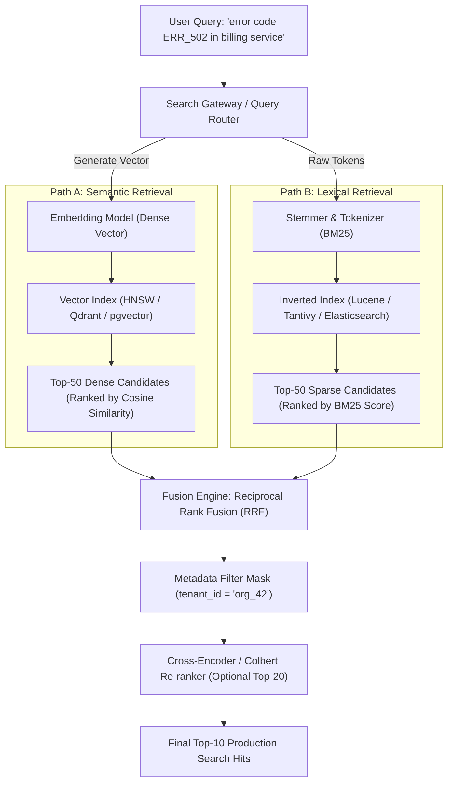
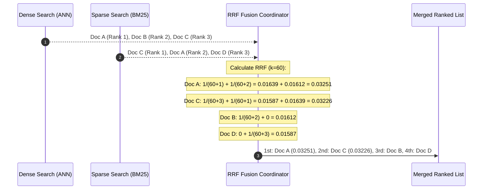
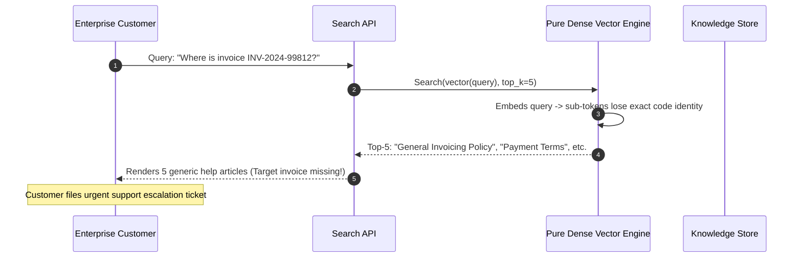

# Module 16: Metadata Filtering and Hybrid Queries

> **Prerequisites:** [Module 00: What an Embedding Is](../00-what-an-embedding-is/README.md), [Module 03: Cosine Similarity & Distance Metrics](../03-cosine-similarity-and-distance-metrics/README.md), [Module 08: Chunk Overlap & Metadata](../08-chunk-overlap-and-metadata/README.md), [Module 09: The Vector Database Landscape](../09-the-vector-database-landscape/README.md), [Module 12: Pinecone, Weaviate, and Qdrant](../12-pinecone-weaviate-and-qdrant/README.md).
> **Estimated Reading Time:** 30 minutes
> **Target Audience:** Backend Engineers, Search Specialists, Information Retrieval Engineers.

---

> [!TIP]
> **Golden Rule of Hybrid Search**: Combine dense vector retrieval (semantic concepts) with sparse lexical search (BM25 for exact part numbers, error codes, and entity names) using **Reciprocal Rank Fusion (RRF)** rather than linear score interpolation ($\alpha$). RRF is scale-invariant, requires zero cross-distribution score normalization, and ensures that exact keyword matches are never drowned out by high-magnitude semantic drift.

---

## 1. Visual Mental Models & System Architecture

Pure dense vector search excels at understanding conceptual intent ("how do I reset my credentials") but fails when queries demand exact lexical precision (part numbers, serial codes, function names, legal clauses, or SKU identifiers). Conversely, sparse lexical search (BM25 / TF-IDF) matches exact tokens effortlessly but fails on synonyms and paraphrasing.

**Hybrid Search** fuses both paradigms into a dual-retrieval pipeline, backed by **Metadata Filtering** to enforce hard enterprise constraints (multi-tenancy, date ranges, permissions).

### The Dual-Engine Hybrid Retrieval Architecture



### Reciprocal Rank Fusion (RRF) Mathematics

Instead of normalizing disparate score distributions (cosine similarity $[0, 1]$ vs unbounded BM25 scores $[0, +\infty)$), RRF evaluates purely the **ordinal rank position** of documents across candidate lists:

$$\text{RRF\_Score}(d) = \sum_{m \in M} \frac{1}{k + r_m(d)}$$

Where:
- $M$: Set of retrieval systems (e.g., Dense Vector and BM25 Sparse).
- $r_m(d)$: Rank position of document $d$ in system $m$ ($1, 2, 3, \dots$).
- $k$: Smoothing constant (industry standard: $k=60$) to prevent top-ranked outliers from dominating.



---

## 2. Taxonomic Reference Grids & Systematic Comparison Grids

### Dense Retrieval vs. Sparse Retrieval vs. Hybrid Search

| Retrieval Capability | Dense Vector Search (Embeddings) | Sparse Lexical Search (BM25) | Hybrid Search (RRF Dense + BM25) |
| :--- | :--- | :--- | :--- |
| **Matching Principle** | Latent semantic meaning & context | Exact lexical token & n-gram frequency | Semantic intent + exact keyword matching |
| **Out-Of-Vocabulary (OOV) Terms**| Poor (sub-words map to generic embeddings) | **Exceptional** (indexes exact token strings) | **Exceptional** (rescued by sparse branch) |
| **Synonym & Paraphrasing Handling** | **Exceptional** ("buy" matches "purchase") | Poor (requires manual synonym dictionaries) | **Exceptional** (rescued by dense branch) |
| **Score Distribution** | Bounded ($[0, 1]$ or $[-1, 1]$) | Unbounded ($[0, +\infty)$ based on corpus IDF) | Scale-invariant rank fusion ($[0, \sim 0.04]$) |
| **Computational Cost** | High (Dense matrix dot products / HNSW) | Low (Inverted list pointer intersection) | Medium (Two parallel low-latency queries) |
| **Index Size** | Large ($N \times D \times 4$ bytes + graph edges) | Compact (Postings lists with delta compression) | Combined (requires both index structures) |

### Metadata Filtering Mechanisms: Architectural Trade-offs

| Strategy | When Evaluated | Mechanics | Risk / Failure Mode |
| :--- | :--- | :--- | :--- |
| **Pre-Filtering** | Before vector search | Inverted metadata index evaluates condition; restricts vector scan to ID set. | Expensive sequential scans if matching ID set is large ($>50{,}000$ rows). |
| **Post-Filtering** | After vector search | Global ANN index finds top-$M$ nearest candidates; filter discards non-matching hits. | **$k$-Starvation**: Returns $<k$ hits if filter matches $<5\%$ of corpus. |
| **Single-Stage Filterable HNSW** | During graph traversal | HNSW graph explorer checks metadata bitmap or payload index on every hop. | Disconnection traps if filter eliminates all outgoing graph edges (needs bridge links). |
| **Partition / Namespace** | At index routing boundary | Queries target physically segregated partition shards or tenant namespaces. | Schema overhead if partitions exceed tens of thousands of active tenants. |

---

## 3. Production War Stories: Incident Post-Mortem

### The Incident: Silent Disappearance of Customer Support Invoices under Pure Vector Search

- **Severity:** SEV-2 (Customer Support Escalation)
- **Time to Detection:** 3 days
- **Time to Mitigation:** 4 hours
- **Impact:** Enterprise finance teams reported that searching the support portal for exact invoice numbers (e.g., `"INV-2024-99812"`) failed to locate corresponding billing records, returning general payment policy articles instead.

#### What Happened
A cloud billing platform replaced their legacy Elasticsearch cluster with a pure dense vector retrieval engine using a state-of-the-art embedding model (`text-embedding-3-small`, 1536 dimensions).

When customers entered specific queries such as:
`"Where is the receipt for invoice INV-2024-99812?"`

The system embedded the query and performed cosine similarity retrieval against chunked customer invoices and billing FAQs. The embedding model tokenized `"INV-2024-99812"` into arbitrary sub-word byte pairs (`["IN", "V", "-", "2024", "-", "99", "812"]`). Because these sub-tokens carried no semantic weight, the vector search prioritized documents discussing general billing concepts ("Receipts", "Credit Card Processing", "Invoices"), ranking the actual document containing `"INV-2024-99812"` at rank position 480—well below the top-5 cutoff!



#### Root Cause
Dense embedding models are trained on natural language semantics, not unique alphanumeric identifiers. They cannot guarantee lexical matching for rare tokens, serial numbers, error codes, or customer identifiers. Storing and searching unstructured enterprise knowledge with pure vector search inevitably destroys exact token precision.

#### The Fix & Architectural Hardening
1. **Implemented Hybrid Search:** Introduced a dual-path hybrid search pipeline combining BM25 lexical search with dense vector embeddings.
2. **Fused via Reciprocal Rank Fusion (RRF):**
   ```python
   # Evaluates both dense semantics and exact sparse matches
   final_scores = rrf_merge(dense_hits, bm25_hits, k=60)
   ```
3. **Outcome:** In BM25, the unique term `"INV-2024-99812"` had an extremely high Inverse Document Frequency (IDF) score, placing the target invoice at **Rank 1** in the sparse branch. RRF merged the results, successfully elevating the target invoice to Rank 1 overall while preserving semantic retrieval for natural language questions.

---

## 4. Multi-Language Production Implementations

The following code tabs implement a complete hybrid search engine with Reciprocal Rank Fusion (RRF) and metadata predicate filtering across Go, TypeScript, and Python.

### Go Production Implementation (RRF Fusion Engine)

```go
package main

import (
	"sort"
)

// SearchHit represents a candidate from either dense or sparse retrieval.
type SearchHit struct {
	ID       string
	Score    float64
	Metadata map[string]interface{}
}

// ScoredDocument represents a fused result with RRF score.
type ScoredDocument struct {
	ID       string
	RRFScore float64
	Metadata map[string]interface{}
}

// ReciprocalRankFusion merges multiple ranked lists of SearchHits using RRF.
// rrf_score = sum( 1.0 / (k + rank) )
func ReciprocalRankFusion(rankedLists [][]SearchHit, k float64, topN int) []ScoredDocument {
	scoreMap := make(map[string]*ScoredDocument)

	for _, list := range rankedLists {
		for rankIdx, hit := range list {
			rank := float64(rankIdx + 1) // 1-based rank
			contribution := 1.0 / (k + rank)

			if existing, found := scoreMap[hit.ID]; found {
				existing.RRFScore += contribution
			} else {
				scoreMap[hit.ID] = &ScoredDocument{
					ID:       hit.ID,
					RRFScore: contribution,
					Metadata: hit.Metadata,
				}
			}
		}
	}

	results := make([]ScoredDocument, 0, len(scoreMap))
	for _, doc := range scoreMap {
		results = append(results, *doc)
	}

	// Sort descending by RRF score
	sort.Slice(results, func(i, j int) bool {
		return results[i].RRFScore > results[j].RRFScore
	})

	if len(results) > topN {
		results = results[:topN]
	}
	return results
}
```

### TypeScript / Node.js Production Implementation

```typescript
export interface RankedHit {
  id: string;
  score: number;
  metadata?: Record<string, any>;
}

export interface FusedHit {
  id: string;
  rrfScore: number;
  metadata?: Record<string, any>;
}

export class HybridSearchCoordinator {
  private rrfK: number;

  constructor(rrfK: number = 60) {
    this.rrfK = rrfK;
  }

  // Merges dense ANN results and sparse BM25 results using Reciprocal Rank Fusion
  public fuseRRF(denseList: RankedHit[], sparseList: RankedHit[], topK: number): FusedHit[] {
    const scores = new Map<string, FusedHit>();

    const applyList = (list: RankedHit[]) => {
      for (let rank = 0; rank < list.length; rank++) {
        const item = list[rank];
        const rankPosition = rank + 1; // 1-indexed
        const rrfContribution = 1.0 / (this.rrfK + rankPosition);

        const existing = scores.get(item.id);
        if (existing) {
          existing.rrfScore += rrfContribution;
        } else {
          scores.set(item.id, {
            id: item.id,
            rrfScore: rrfContribution,
            metadata: item.metadata,
          });
        }
      }
    };

    applyList(denseList);
    applyList(sparseList);

    const merged = Array.from(scores.values());
    merged.sort((a, b) => b.rrfScore - a.rrfScore);
    return merged.slice(0, topK);
  }

  // Evaluates hard metadata predicates against fused results
  public filterMetadata(hits: FusedHit[], filterKey: string, filterValue: any): FusedHit[] {
    return hits.filter((h) => h.metadata && h.metadata[filterKey] === filterValue);
  }
}
```

### Python Production Implementation (Complete BM25 + Dense Hybrid Engine)

```python
"""
Complete Production Hybrid Search Engine:
In-Memory BM25 Lexical Scorer, Cosine Vector Index, Metadata Predicate Filtering,
and Reciprocal Rank Fusion (RRF).
"""

from __future__ import annotations

import collections
import math
from typing import Any, Dict, List, Optional, Tuple
import numpy as np


class SimpleBM25:
    """Minimal in-memory BM25 lexical index."""
    def __init__(self, k1: float = 1.5, b: float = 0.75):
        self.k1 = k1
        self.b = b
        self.corpus_size = 0
        self.avg_doc_len = 0.0
        self.doc_lengths: List[int] = []
        self.doc_ids: List[str] = []
        self.term_df: Dict[str, int] = collections.defaultdict(int)
        self.doc_term_freqs: List[Dict[str, int]] = []

    def fit(self, doc_ids: List[str], tokenized_docs: List[List[str]]) -> None:
        self.doc_ids = doc_ids
        self.corpus_size = len(doc_ids)
        self.doc_lengths = [len(doc) for doc in tokenized_docs]
        self.avg_doc_len = sum(self.doc_lengths) / max(1, self.corpus_size)

        for doc in tokenized_docs:
            tf = collections.defaultdict(int)
            for token in doc:
                tf[token] += 1
            self.doc_term_freqs.append(tf)
            for token in set(doc):
                self.term_df[token] += 1

    def search(self, query_tokens: List[str], top_k: int = 50) -> List[Tuple[str, float]]:
        scores = np.zeros(self.corpus_size, dtype=np.float32)

        for token in query_tokens:
            if token not in self.term_df:
                continue
            df = self.term_df[token]
            idf = math.log((self.corpus_size - df + 0.5) / (df + 0.5) + 1.0)

            for i in range(self.corpus_size):
                tf = self.doc_term_freqs[i].get(token, 0)
                if tf == 0:
                    continue
                num = tf * (self.k1 + 1.0)
                denom = tf + self.k1 * (1.0 - self.b + self.b * (self.doc_lengths[i] / self.avg_doc_len))
                scores[i] += idf * (num / denom)

        top_indices = np.argsort(-scores)[:top_k]
        return [(self.doc_ids[idx], float(scores[idx])) for idx in top_indices if scores[idx] > 0]


class HybridSearchService:
    def __init__(self, rrf_k: int = 60):
        self.rrf_k = rrf_k
        self.bm25 = SimpleBM25()
        self.doc_ids: List[str] = []
        self.metadata: Dict[str, Dict[str, Any]] = {}
        self.vectors: np.ndarray = np.empty((0, 0), dtype=np.float32)

    def index_corpus(
        self,
        doc_ids: List[str],
        texts: List[str],
        vectors: np.ndarray,
        metadatas: List[Dict[str, Any]],
    ) -> None:
        self.doc_ids = doc_ids
        self.metadata = {doc_ids[i]: metadatas[i] for i in range(len(doc_ids))}
        # Normalize vectors for cosine search
        norms = np.linalg.norm(vectors, axis=1, keepdims=True)
        self.vectors = vectors / np.maximum(norms, 1e-12)

        tokenized = [text.lower().split() for text in texts]
        self.bm25.fit(doc_ids, tokenized)

    def hybrid_search(
        self,
        query_text: str,
        query_vector: np.ndarray,
        top_k: int = 10,
        where_filter: Optional[Dict[str, Any]] = None,
    ) -> List[Dict[str, Any]]:
        # 1. Sparse BM25 Search
        q_tokens = query_text.lower().split()
        bm25_hits = self.bm25.search(q_tokens, top_k=50)

        # 2. Dense Vector Search
        q_norm = query_vector / max(np.linalg.norm(query_vector), 1e-12)
        dense_scores = self.vectors @ q_norm
        dense_top_idx = np.argsort(-dense_scores)[:50]
        dense_hits = [(self.doc_ids[idx], float(dense_scores[idx])) for idx in dense_top_idx]

        # 3. Reciprocal Rank Fusion (RRF)
        rrf_scores: Dict[str, float] = collections.defaultdict(float)

        for rank, (doc_id, _) in enumerate(bm25_hits):
            rrf_scores[doc_id] += 1.0 / (self.rrf_k + (rank + 1))

        for rank, (doc_id, _) in enumerate(dense_hits):
            rrf_scores[doc_id] += 1.0 / (self.rrf_k + (rank + 1))

        # 4. Sort and Filter
        sorted_docs = sorted(rrf_scores.items(), key=lambda x: x[1], reverse=True)
        results: List[Dict[str, Any]] = []

        for doc_id, score in sorted_docs:
            meta = self.metadata[doc_id]
            if where_filter:
                match = all(meta.get(k) == v for k, v in where_filter.items())
                if not match:
                    continue

            results.append({
                "id": doc_id,
                "rrf_score": score,
                "metadata": meta,
            })
            if len(results) == top_k:
                break

        return results
```

---

## 5. Practical Hands-On Verification CLI Workflows

Verify Reciprocal Rank Fusion calculations directly using standard CLI utilities.

### Workflow 1: Calculating RRF Fusion Scores via Python One-Liner

```bash
# Verify RRF score computation for a document appearing at rank 1 (dense) and rank 3 (sparse)
python -c "
k = 60
rank_dense = 1
rank_sparse = 3

score = (1.0 / (k + rank_dense)) + (1.0 / (k + rank_sparse))
print(f'RRF Score (Dense Rank {rank_dense}, Sparse Rank {rank_sparse}): {score:.6f}')
"
```

Expected wire output:
```text
RRF Score (Dense Rank 1, Sparse Rank 3): 0.032262
```

---

## 6. Operational Validation Checkpoints (Scenario Quizzes)

### Checkpoint 1: Why Linear Convex Combination ($\alpha$) Fails
**Scenario:** A developer implements hybrid search using linear interpolation:
$$\text{Score} = \alpha \cdot S_{\text{vector}} + (1 - \alpha) \cdot S_{\text{bm25}}$$
They set $\alpha = 0.5$. In production, users report that whenever a query contains a rare product model number (e.g., `"XPS-9530"`), the BM25 score exceeds 45.0, completely dwarfing the vector score (which is bounded in $[0, 1]$), effectively turning search into 100% lexical search. What went wrong and how does RRF fix it?

<details><summary>Click to view diagnosis and architectural solution</summary>

**Answer:**
1. **Root Cause (Score Distribution Mismatch):**
   Cosine similarity scores are strictly bounded in $[0, 1]$ (or $[-1, 1]$). BM25 scores are unbounded $[0, +\infty)$ and scale with document length and corpus Inverse Document Frequency (IDF). For rare keywords, BM25 scores regularly reach 20–50+. A simple linear combination with $\alpha = 0.5$ results in the BM25 score being $50\times$ larger than the vector score, destroying the semantic component.
2. **Remediation with RRF:**
   Reciprocal Rank Fusion (RRF) ignores raw score magnitudes completely. It evaluates only **relative ordinal ranks** ($1^{\text{st}}, 2^{\text{nd}}, 3^{\text{rd}}$), making it completely scale-invariant:
   $$\frac{1}{60 + 1} = 0.01639$$
   Regardless of whether BM25 scored 45.0 or 2.1, being ranked #1 contributes exactly $0.01639$ to the final fusion score, guaranteeing predictable, balanced merging.
</details>

---

### Checkpoint 2: Tuning the RRF Smoothing Constant $k$
**Scenario:** An information retrieval researcher tests $k=0$ versus $k=60$ in an RRF fusion pipeline. What happens to retrieval behavior when $k=0$, and why is $k=60$ the industry default?

<details><summary>Click to view diagnosis and architectural solution</summary>

**Answer:**
1. **Behavior when $k=0$:**
   If $k=0$, the contribution of rank 1 is $\frac{1}{1} = 1.0$, while rank 2 is $\frac{1}{2} = 0.5$, and rank 3 is $0.333$. The difference between rank 1 and rank 2 is a massive **0.50**. This heavily over-penalizes items that appear at rank 2 or 3 in both systems compared to an item that happened to hit rank 1 in only one system.
2. **Role of $k=60$:**
   When $k=60$, rank 1 contributes $\frac{1}{61} \approx 0.01639$, and rank 2 contributes $\frac{1}{62} \approx 0.01612$. The delta is small ($0.00027$). A document that ranks consistently well across **both** systems (e.g., rank 3 in dense and rank 3 in sparse: $0.01587 + 0.01587 = 0.03174$) easily outscores an outlier that ranked #1 in only one branch and was absent from the other ($0.01639$).
</details>

---

### Checkpoint 3: Pre-Filtering vs. In-Graph Traversal on Extreme Selectivity
**Scenario:** You have a multi-tenant vector database with 10 million vectors. Tenant A has only 25 documents (selectivity: $0.00025\%$). Tenant B has 8 million documents (selectivity: $80\%$). How should the query planner execute metadata filtering for Tenant A vs. Tenant B?

<details><summary>Click to view diagnosis and architectural solution</summary>

**Answer:**
1. **For Tenant A (Extremely Selective, 25 documents):**
   - The query planner must use **Pre-Filtering with Exact Scan**: Inverted index instantly retrieves the 25 document IDs. The engine performs an exact brute-force dot product on those 25 vectors in $<0.05\text{ms}$.
   - Running an approximate HNSW graph search here would risk $k$-starvation or graph disconnection.
2. **For Tenant B (Broadly Selective, 8 million documents):**
   - The query planner must use **Single-Stage Filterable HNSW** or **Post-Filtering**: Because 80% of the nodes satisfy the predicate, standard graph traversal has an 80% hit probability on every node visit, rapidly finding the top-$k$ nearest neighbors in $<2\text{ms}$.
   - Pre-filtering would require generating a bitmap of 8 million IDs and scanning all 8 million vectors, taking hundreds of milliseconds.
</details>
