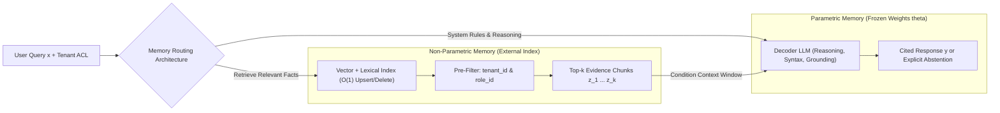
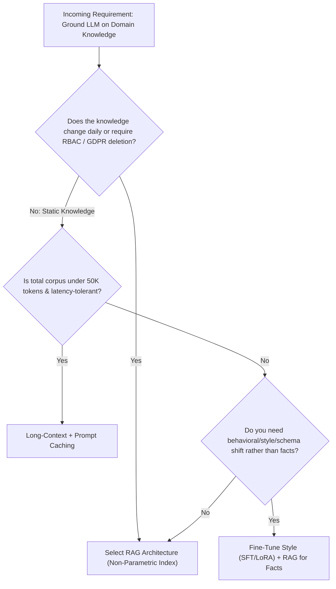
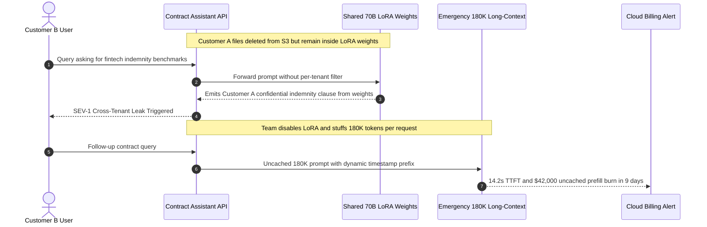

# Module 00: Why RAG Exists

> **Prerequisites:** [Track 04, Module 16: When to Fine-Tune vs. Prompt vs. RAG](../../04-training-fine-tuning-and-alignment/16-when-to-fine-tune-vs-prompt-vs-rag/README.md), [Track 06, Module 16: Pricing, Rate Limits & Quotas](../../06-openai-and-the-model-landscape/16-pricing-rate-limits-and-quotas/README.md), and [Track 08: Embeddings & Vector Databases](../../08-embeddings-and-vector-databases/README.md).  
> **Estimated Reading Time:** 25 minutes  
> **Target Audience:** AI Backend Engineers, LLM Platform Architects, Search Systems Engineers

> [!TIP]
> **The Golden Rule of Retrieval-Augmented Generation:** Never retrain neural weights for facts that change faster than a training cycle. Keep **parametric memory** (model weights) dedicated to language reasoning, syntax, and instruction following, and delegate volatile, proprietary, permissioned, and auditable facts to **non-parametric memory** (an external index supporting $O(1)$ updates, hard deletions, and per-request access control).

---

## Why This Matters

An ungrounded Large Language Model is a frozen snapshot of its training cutoff compressed into billions of floating-point weights. The moment you deploy an LLM against live customer contracts, internal incident runbooks, pricing tables, or tenant-isolated records, pure parametric generation fails along four structural axes: **staleness** (weights cannot reflect an amendment signed five minutes ago), **confabulation** (decoders smoothly predict plausible tokens when they do not know an answer), **unverifiable provenance** (neural weights contain no foreign keys back to source URLs or revision timestamps), and **broken access control** (weights cannot enforce per-user Row-Level Security or GDPR deletion).

At the same time, naive alternatives fail economically and operationally. Continuously fine-tuning models on changing documents burns GPU compute and risks catastrophic forgetting, while stuffing an entire 2-million-token enterprise repository into a frontier long-context window on every query explodes per-request token spend, degrades Time-to-First-Token (TTFT), and suffers from **Lost-in-the-Middle** attention decay. **Retrieval-Augmented Generation (RAG)** resolves this tension by pairing a frozen generator with a dynamic external retriever—delivering sub-second freshness, strict tenant ACL enforcement, verifiable citations, and an order-of-magnitude cost reduction.

---

## 1. Visual Mental Models & Dual-Memory Mechanics

### Parametric vs. Non-Parametric Memory (Lewis et al., 2020)

In *Retrieval-Augmented Generation for Knowledge-Intensive NLP Tasks* (`arXiv:2005.11401`), Lewis et al. formalized a clean architectural boundary between two distinct memory subsystems:

1. **Parametric Memory ($p_\theta$):** Knowledge implicitly encoded inside the pretrained transformer's attention and feed-forward weights $\theta$. Reading it requires a single forward pass, but modifying or deleting a single fact requires gradient updates across millions of parameters.
2. **Non-Parametric Memory ($p_\eta$):** Knowledge stored explicitly outside the model in a dense/sparse document index parameterized by retriever $\eta$. Updating, revoking, or access-controlling a document is an $O(1)$ index write or tombstone delete with zero weight retraining.



Lewis et al. defined two probabilistic marginalization formulations over latent retrieved documents $z \in \text{top-}k(p_\eta(\cdot \mid x))$:

- **RAG-Sequence** uses the *same* retrieved document $z$ to generate the entire output sequence $y = (y_1, \dots, y_N)$:

$$p_{\text{RAG-Sequence}}(y \mid x) \approx \sum_{z \in \text{top-}k(p_\eta(\cdot \mid x))} p_\eta(z \mid x) \prod_{i=1}^{N} p_\theta(y_i \mid x, z, y_{1:i-1})$$

- **RAG-Token** marginalizes over retrieved documents *at every decoding step* $i$, enabling different passages to contribute distinct tokens within a single answer:

$$p_{\text{RAG-Token}}(y \mid x) \approx \prod_{i=1}^{N} \sum_{z \in \text{top-}k(p_\eta(\cdot \mid x))} p_\eta(z \mid x)\, p_\theta(y_i \mid x, z, y_{1:i-1})$$

Modern production RAG systems instantiate a practical **in-context approximation**: the retriever selects the top-$k$ passages $[z_1, \dots, z_k]$ via hybrid vector and lexical scoring, concatenates them into a single delimited prompt alongside strict citation rules, and runs one decoding pass over $p_\theta(y \mid x, z_1, \dots, z_k)$.

### Why Long-Context Stuffing Still Needs RAG: Cost, TTFT, and Attention Decay

When frontier models expanded context windows from `4K` to `128K`–`2M` tokens, many engineering teams asked: *"Did 1M-token windows kill RAG?"* Quantitatively, the answer is no—long-context models *complement* RAG (allowing larger retrieved contexts and richer parent documents) rather than replacing retrieval.

Consider serving $n = 50{,}000$ monthly queries over an evolving $N_C = 2{,}000{,}000$-token knowledge base, with $Q = 400$ prompt/query tokens, $O = 300$ output tokens, and $K_R = 4{,}000$ retrieved RAG context tokens. Even if a long-context provider applies a prompt-cache hit rate $\gamma_{\text{hit}} = 0.85$ at discounted cached input price $c_{\text{cache}}$ (`\$0.25`/1M tokens vs. `\$2.50`/1M uncached input tokens and `\$10.00`/1M output tokens), the unit economics diverge starkly:

$$C_{\text{long-context}}(n) = n \cdot \frac{(N_C + Q)\bigl(\gamma_{\text{hit}} c_{\text{cache}} + (1 - \gamma_{\text{hit}}) c_{\text{in}}\bigr) + O \cdot c_{\text{out}}}{10^6}$$

$$C_{\text{RAG}}(n) = \frac{N_C \cdot c_{\text{embed}}}{10^6} + n \cdot \frac{(K_R + Q)\, c_{\text{in}} + O \cdot c_{\text{out}}}{10^6}$$

Under those baseline assumptions (`\$0.02`/1M embedding tokens), long-context stuffing costs **\$58,911.75/month** (`\$1.1782`/query), whereas RAG costs **\$700.04/month** (`\$0.0140`/query)—**84.2x cheaper** while cutting estimated Time-to-First-Token from **7.6 seconds** to **82 milliseconds**. Furthermore, whenever a single document in the cached prefix changes, the prompt cache invalidates downstream KV blocks, forcing expensive uncached prefill recomputation (`O(N_C)` KV-cache VRAM growth and `O(N_C^2)` prefill attention cost). Worse, Liu et al. (*Lost in the Middle*, `arXiv:2307.03172`) demonstrated that transformer accuracy drops sharply in a **U-shaped curve** when critical evidence is buried in the middle of a massive context rather than ranked cleanly at the top/bottom.



---

## 2. Systematic Reference & Comparison Matrix

### Architectural Paradigm Trade-Offs

| Dimension | Long-Context Stuffing (`128K–2M`) | Fine-Tuning (`SFT / LoRA`) | Naive / Production RAG | Hybrid (`SFT/LoRA + RAG`) |
| :--- | :--- | :--- | :--- | :--- |
| **Knowledge Update Latency** | Instant (breaks KV prefix cache on edit) | Hours to days (GPU retrain + eval + deploy) | **Milliseconds–seconds** ($O(1)$ upsert) | Milliseconds–seconds for facts; slow for behavior |
| **Deletion / GDPR "Right to Forget"** | Immediate (omit from prompt) | **Intractable** (requires full retrain or unlearning) | **Immediate** ($O(1)$ tombstone delete) | Immediate for indexed facts |
| **Tenant / RBAC Enforcement** | Per-request prefix construction (cache fragmentation) | **Broken** (all tenants share parametric weights) | **Native** (pre-filtered metadata ACLs) | Native when facts stay strictly out of weights |
| **Per-Query Token Cost ($2\text{M}$ corpus)** | Very High ($\approx \$1.18$/query even cached) | Low (short prompt; high fixed GPU hosting) | **Low** ($\approx \$0.014$/query at `4K` context) | Low-to-Moderate |
| **TTFT Prefill Latency** | Seconds ($2\text{s}–15\text{s}+$ on cache misses) | Fast (`<200 ms`) | **Fast** (`50–250 ms` incl. retrieval) | Fast |
| **Citation & Auditability** | Possible via line tags, weak middle recall | **None** (no foreign keys in weights) | **Exact** (`doc_id`, `chunk_id`, `page`, offset) | Exact for retrieved evidence |
| **Best Engineering Fit** | Analyzing 1–3 uploaded files per session | Teaching tone, SQL dialect, rare domain jargon | Dynamic, multi-tenant, high-trust Q&A | Regulated assistants with strict style + live data |

---

## 3. Production War Story Post-Mortem: The \$42,000 LoRA Knowledge-Injection Mirage & Cross-Tenant Leak

| Field | Incident Details |
| :--- | :--- |
| **Severity** | **SEV-1** (Cross-Tenant Data Exposure, Non-Compliant GDPR Retention & Runaway Token Spend) |
| **Detection / Resolution Time** | Detected 9 days post-launch via security audit & finance alert / Mitigated in 6 hours (adapter rollback + emergency RAG index cutover) |
| **Impact** | Terminated customer SLA terms surfaced to another tenant; **\$42,000** burned on uncached long-context emergency fallback; `14.2s` p95 TTFT |

### What Happened

A B2B legal-tech startup wanted an AI assistant capable of answering questions across `6,400` active enterprise vendor contracts. Instead of building a retrieval index, the team fine-tuned an open-weight 70B model using nightly LoRA runs over all customer PDFs, believing the adapter weights would "memorize" every contract clause and eliminate retrieval infrastructure.

Within one week, two catastrophic defects surfaced simultaneously:

1. **Cross-Tenant Memorization Leak & Zombie Deletion:** Customer A terminated their account and executed a contractual data-deletion request. Although the raw PDFs were deleted from S3, Customer A's bespoke indemnity cap remained encoded inside the shared LoRA weights—and an adversarial prompt from Customer B (`"Summarize typical fintech indemnity caps in Acme-style agreements"`) elicited Customer A's exact clause verbatim.
2. **\$42,000 Long-Context Panic Fallback:** After disabling the LoRA adapter, the team temporarily routed queries by stuffing each tenant's entire `180K`-token contract bundle directly into a commercial frontier API without prompt-cache stabilization (because timestamps and per-user headers sat at the start of the prompt, invalidating every cache prefix). Over 9 days of load, uncached `180K`-token prefills burned **\$42,000** while p95 TTFT degraded to `14.2` seconds.



### Root Cause Analysis

1. **Treating parametric weights as an access-controlled database:** Gradient updates blend all training examples into shared matrices. Weights lack row-level ACL predicates (`WHERE tenant_id = ?`) and cannot support deterministic $O(1)$ record deletion.
2. **Cache-busting prompt assembly in long-context fallback:** Placing mutable metadata (request IDs, user timestamps) ahead of large static documents prevented prefix KV caching, multiplying input cost by `10x` and latency by `50x`.

### The Fix & Architectural Hardening

- **Separated behavior from facts:** Moved all `6,400` contracts into a permissioned non-parametric RAG index enforcing mandatory `tenant_id` pre-filters before vector/BM25 scoring (`Track 08, Module 16`).
- **Guaranteed $O(1)$ cryptographic deletion:** Tied S3/DB deletion events to synchronous vector-store tombstones so offboarded customer chunks vanish within `<5` seconds without touching model weights.
- **Reserved fine-tuning strictly for output format & domain syntax:** Kept the generator focused on legal citation formatting using synthetic schema examples free of client PII.

---

## 4. Multi-Language Production Implementation: RAG vs. Long-Context Strategy Router & ACL Memory Gate

The following production modules implement two essential Day-1 building blocks across **Go**, **TypeScript**, **Python**, and **C#**: (1) a deterministic **Cost & Freshness Architecture Evaluator** that prevents teams from accidentally routing massive corpora into uncached long-context prompts, and (2) an **ACL-Enforced Non-Parametric Memory Gate** proving tenant isolation and $O(1)$ tombstone revocation prior to LLM invocation.

````carousel
```go
package ragarch

import (
	"errors"
	"fmt"
	"sync"
)

// StrategyDecision encodes the selected architecture and projected monthly cost.
type StrategyDecision struct {
	Strategy           string
	EstimatedMonthly   float64
	EstimatedTTFTMs    float64
	Reason             string
}

// EvaluateStrategy compares RAG vs cached Long-Context economics and freshness constraints.
func EvaluateStrategy(
	corpusTokens int,
	monthlyQueries int,
	hasDynamicACLs bool,
	gdprDeleteRequired bool,
) StrategyDecision {
	const (
		ragContextTokens    = 4000.0
		queryTokens         = 400.0
		outputTokens        = 300.0
		inputPricePerM      = 2.50
		cachedInputPricePerM = 0.25
		outputPricePerM     = 10.00
		cacheHitRate        = 0.85
	)

	ragPerQuery := ((ragContextTokens+queryTokens)/1_000_000.0)*inputPricePerM +
		(outputTokens/1_000_000.0)*outputPricePerM
	ragMonthly := float64(monthlyQueries) * ragPerQuery

	effLCPrice := cacheHitRate*cachedInputPricePerM + (1.0-cacheHitRate)*inputPricePerM
	lcPerQuery := ((float64(corpusTokens)+queryTokens)/1_000_000.0)*effLCPrice +
		(outputTokens/1_000_000.0)*outputPricePerM
	lcMonthly := float64(monthlyQueries) * lcPerQuery

	if hasDynamicACLs || gdprDeleteRequired || corpusTokens > 64_000 {
		return StrategyDecision{
			Strategy:         "RAG",
			EstimatedMonthly: ragMonthly,
			EstimatedTTFTMs:  85,
			Reason:           "Enforces O(1) ACL/GDPR deletion and avoids O(N_C) prefill cost.",
		}
	}
	return StrategyDecision{
		Strategy:         "LONG_CONTEXT_CACHED",
		EstimatedMonthly: lcMonthly,
		EstimatedTTFTMs:  float64(corpusTokens) / 120.0,
		Reason:           "Small static single-tenant corpus fits cheaply in cached prefix.",
	}
}

// NonParametricStore models O(1) updatable, tenant-isolated external memory.
type NonParametricStore struct {
	mu   sync.RWMutex
	docs map[string]struct {
		text    string
		tenants map[string]bool
	}
}

func NewNonParametricStore() *NonParametricStore {
	return &NonParametricStore{
		docs: make(map[string]struct {
			text    string
			tenants map[string]bool
		}),
	}
}

func (s *NonParametricStore) Upsert(docID, text string, allowedTenants []string) {
	s.mu.Lock()
	defer s.mu.Unlock()
	tset := make(map[string]bool, len(allowedTenants))
	for _, t := range allowedTenants {
		tset[t] = true
	}
	s.docs[docID] = struct {
		text    string
		tenants map[string]bool
	}{text: text, tenants: tset}
}

func (s *NonParametricStore) DeleteTombstone(docID string) {
	s.mu.Lock()
	defer s.mu.Unlock()
	delete(s.docs, docID)
}

func (s *NonParametricStore) Retrieve(docID, tenantID string) (string, error) {
	s.mu.RLock()
	defer s.mu.RUnlock()
	entry, ok := s.docs[docID]
	if !ok {
		return "", fmt.Errorf("doc %s deleted or missing", docID)
	}
	if !entry.tenants[tenantID] {
		return "", errors.New("access denied: tenant ACL mismatch")
	}
	return entry.text, nil
}
```
<!-- slide -->
```typescript
export interface EconomicsInput {
  readonly corpusTokens: number;
  readonly retrievedTokens: number;
  readonly monthlyQueries: number;
  readonly hasPerUserACLs: boolean;
  readonly requiresInstantDeletion: boolean;
}

export interface ArchitectureRecommendation {
  readonly mode: "RAG" | "LONG_CONTEXT_CACHED";
  readonly ragMonthlyUsd: number;
  readonly longContextMonthlyUsd: number;
  readonly costMultiplier: number;
  readonly rationale: string;
}

export function recommendMemoryArchitecture(input: EconomicsInput): ArchitectureRecommendation {
  const queryTokens = 400;
  const outputTokens = 300;
  const inPerM = 2.5;
  const cachedInPerM = 0.25;
  const outPerM = 10.0;
  const hitRate = 0.85;

  const ragPerQuery =
    ((input.retrievedTokens + queryTokens) / 1_000_000) * inPerM +
    (outputTokens / 1_000_000) * outPerM;
  const ragMonthlyUsd = Number((input.monthlyQueries * ragPerQuery).toFixed(2));

  const effectiveIn = hitRate * cachedInPerM + (1 - hitRate) * inPerM;
  const lcPerQuery =
    ((input.corpusTokens + queryTokens) / 1_000_000) * effectiveIn +
    (outputTokens / 1_000_000) * outPerM;
  const longContextMonthlyUsd = Number((input.monthlyQueries * lcPerQuery).toFixed(2));
  const costMultiplier = Number((longContextMonthlyUsd / Math.max(0.01, ragMonthlyUsd)).toFixed(1));

  if (input.hasPerUserACLs || input.requiresInstantDeletion || costMultiplier > 2.5) {
    return {
      mode: "RAG",
      ragMonthlyUsd,
      longContextMonthlyUsd,
      costMultiplier,
      rationale: "Non-parametric index preserves tenant isolation, O(1) deletion, and avoids prefill blowup.",
    };
  }

  return {
    mode: "LONG_CONTEXT_CACHED",
    ragMonthlyUsd,
    longContextMonthlyUsd,
    costMultiplier,
    rationale: "Small static corpus fits economically within cached context prefix.",
  };
}

export class PermissionedMemoryIndex {
  private readonly records = new Map<string, { text: string; tenants: Set<string> }>();

  upsert(docId: string, text: string, allowedTenants: readonly string[]): void {
    this.records.set(docId, { text, tenants: new Set(allowedTenants) });
  }

  tombstone(docId: string): boolean {
    return this.records.delete(docId);
  }

  getForTenant(docId: string, tenantId: string): string | null {
    const entry = this.records.get(docId);
    if (!entry || !entry.tenants.has(tenantId)) {
      return null;
    }
    return entry.text;
  }
}
```
<!-- slide -->
```python
"""
memory_router.py
Quantifies RAG vs. Long-Context unit economics and enforces tenant-isolated non-parametric reads.
"""
from dataclasses import dataclass
from typing import Optional


@dataclass(frozen=True)
class EconomicsReport:
    recommended_mode: str
    rag_monthly_usd: float
    long_context_monthly_usd: float
    savings_factor: float
    est_rag_ttft_ms: float
    est_lc_ttft_ms: float


def evaluate_rag_vs_long_context(
    corpus_tokens: int,
    monthly_queries: int,
    retrieved_tokens: int = 4_000,
    query_tokens: int = 400,
    output_tokens: int = 300,
    input_price_per_m: float = 2.50,
    cached_input_price_per_m: float = 0.25,
    output_price_per_m: float = 10.00,
    embed_price_per_m: float = 0.02,
    cache_hit_rate: float = 0.85,
    require_rbac_or_gdpr: bool = True,
) -> EconomicsReport:
    eff_lc_in = cache_hit_rate * cached_input_price_per_m + (1.0 - cache_hit_rate) * input_price_per_m
    lc_per_q = ((corpus_tokens + query_tokens) / 1e6) * eff_lc_in + (output_tokens / 1e6) * output_price_per_m
    lc_monthly = monthly_queries * lc_per_q

    ingest_cost = (corpus_tokens / 1e6) * embed_price_per_m
    rag_per_q = ((retrieved_tokens + query_tokens) / 1e6) * input_price_per_m + (output_tokens / 1e6) * output_price_per_m
    rag_monthly = ingest_cost + monthly_queries * rag_per_q

    lc_ttft_ms = (corpus_tokens / 120_000) * 1000 * (1.0 - 0.65 * cache_hit_rate) + 180
    rag_ttft_ms = ((retrieved_tokens + query_tokens) / 120_000) * 1000 + 45
    mode = "RAG" if (require_rbac_or_gdpr or lc_monthly > rag_monthly * 2.0) else "LONG_CONTEXT_CACHED"

    return EconomicsReport(
        recommended_mode=mode,
        rag_monthly_usd=round(rag_monthly, 2),
        long_context_monthly_usd=round(lc_monthly, 2),
        savings_factor=round(lc_monthly / max(0.01, rag_monthly), 1),
        est_rag_ttft_ms=round(rag_ttft_ms, 1),
        est_lc_ttft_ms=round(lc_ttft_ms, 1),
    )


class TenantMemoryStore:
    """O(1) updatable & deletable non-parametric memory with strict pre-read ACL filtering."""

    def __init__(self) -> None:
        self._store: dict[str, tuple[str, set[str]]] = {}

    def upsert(self, doc_id: str, content: str, allowed_tenants: set[str]) -> None:
        self._store[doc_id] = (content, set(allowed_tenants))

    def delete_tombstone(self, doc_id: str) -> None:
        self._store.pop(doc_id, None)

    def read_authorized(self, doc_id: str, tenant_id: str) -> Optional[str]:
        record = self._store.get(doc_id)
        if record is None:
            return None
        content, allowed = record
        return content if tenant_id in allowed else None
```
<!-- slide -->
```csharp
using System;
using System.Collections.Concurrent;
using System.Collections.Generic;

namespace GenAI.RagFoundations;

public sealed record ArchitectureDecision(
    string Mode,
    double RagMonthlyUsd,
    double LongContextMonthlyUsd,
    double SavingsMultiple);

public static class MemoryArchitecturePlanner
{
    public static ArchitectureDecision Evaluate(
        long corpusTokens,
        int monthlyQueries,
        bool requiresTenantIsolation,
        int retrievedTokens = 4000)
    {
        const double queryTokens = 400.0;
        const double outputTokens = 300.0;
        const double inPerM = 2.50;
        const double cachedInPerM = 0.25;
        const double outPerM = 10.00;
        const double cacheHitRate = 0.85;

        double ragPerQuery = ((retrievedTokens + queryTokens) / 1_000_000.0) * inPerM
            + (outputTokens / 1_000_000.0) * outPerM;
        double ragMonthly = monthlyQueries * ragPerQuery;

        double effLcPrice = cacheHitRate * cachedInPerM + (1.0 - cacheHitRate) * inPerM;
        double lcPerQuery = ((corpusTokens + queryTokens) / 1_000_000.0) * effLcPrice
            + (outputTokens / 1_000_000.0) * outPerM;
        double lcMonthly = monthlyQueries * lcPerQuery;

        string mode = (requiresTenantIsolation || lcMonthly > ragMonthly * 2.0)
            ? "RAG"
            : "LONG_CONTEXT_CACHED";

        return new ArchitectureDecision(
            mode,
            Math.Round(ragMonthly, 2),
            Math.Round(lcMonthly, 2),
            Math.Round(lcMonthly / Math.Max(0.01, ragMonthly), 1));
    }
}

public sealed class NonParametricMemoryStore
{
    private readonly ConcurrentDictionary<string, (string Text, HashSet<string> Tenants)> _docs = new();

    public void Upsert(string docId, string text, IEnumerable<string> allowedTenants)
    {
        _docs[docId] = (text, new HashSet<string>(allowedTenants, StringComparer.Ordinal));
    }

    public bool DeleteTombstone(string docId) => _docs.TryRemove(docId, out _);

    public string? RetrieveAuthorized(string docId, string tenantId)
    {
        if (!_docs.TryGetValue(docId, out var entry))
            return null;

        return entry.Tenants.Contains(tenantId) ? entry.Text : null;
    }
}
```
````

---

## 5. Practical Hands-On Verification CLI Workflows

Run these offline, deterministic Python 3.13 verification scripts directly in your terminal—no API keys or third-party dependencies required.

### Workflow 1: Quantify RAG vs. Cached Long-Context Economics and TTFT

Compute monthly spend, per-query token cost, and estimated TTFT for a `2,000,000`-token enterprise knowledge base serving `50,000` queries/month:

```bash
python -c '
def evaluate_economics(
    corpus_tokens=2_000_000, retrieved_tokens=4_000, query_tokens=400, output_tokens=300,
    queries_per_month=50_000, input_price_per_m=2.50, cached_input_price_per_m=0.25,
    output_price_per_m=10.00, embed_price_per_m=0.02, cache_hit_rate=0.85,
):
    eff_in_price = cache_hit_rate * cached_input_price_per_m + (1.0 - cache_hit_rate) * input_price_per_m
    lc_input_per_query = ((corpus_tokens + query_tokens) / 1_000_000) * eff_in_price
    lc_output_per_query = (output_tokens / 1_000_000) * output_price_per_m
    lc_monthly = queries_per_month * (lc_input_per_query + lc_output_per_query)

    ingest_embed_cost = (corpus_tokens / 1_000_000) * embed_price_per_m
    rag_input_per_query = ((retrieved_tokens + query_tokens) / 1_000_000) * input_price_per_m
    rag_output_per_query = (output_tokens / 1_000_000) * output_price_per_m
    rag_monthly = ingest_embed_cost + queries_per_month * (rag_input_per_query + rag_output_per_query)

    lc_ttft_ms = (corpus_tokens / 120_000) * 1000 * (1.0 - 0.65 * cache_hit_rate) + 180
    rag_ttft_ms = ((retrieved_tokens + query_tokens) / 120_000) * 1000 + 45

    print(f"Corpus size          : {corpus_tokens:,} tokens | Monthly queries: {queries_per_month:,}")
    print(f"Long-Context (cached): ${lc_monthly:,.2f}/mo | per-query=${lc_input_per_query + lc_output_per_query:.4f} | est TTFT={lc_ttft_ms:.0f} ms")
    print(f"RAG (top-k={retrieved_tokens} tok): ${rag_monthly:,.2f}/mo | per-query=${rag_input_per_query + rag_output_per_query:.4f} | est TTFT={rag_ttft_ms:.0f} ms")
    print(f"One-time ingest embed: ${ingest_embed_cost:.4f} | Monthly savings: {lc_monthly / rag_monthly:.1f}x cheaper")

evaluate_economics()
'
```

**Expected Output:**

```text
Corpus size          : 2,000,000 tokens | Monthly queries: 50,000
Long-Context (cached): $58,911.75/mo | per-query=$1.1782 | est TTFT=7638 ms
RAG (top-k=4000 tok): $700.04/mo | per-query=$0.0140 | est TTFT=82 ms
One-time ingest embed: $0.0400 | Monthly savings: 84.2x cheaper
```

### Workflow 2: Parametric Staleness vs. $O(1)$ Non-Parametric ACL & Tombstone Enforcement

Observe how frozen weights continue emitting stale facts across tenant boundaries while non-parametric memory enforces instant updates, tenant ACL rejection, and GDPR tombstone deletion:

```bash
python -c '
class ParametricModel:
    def __init__(self, weights_snapshot):
        self._frozen_weights = dict(weights_snapshot)
    def answer(self, key):
        return self._frozen_weights.get(key, "Likely standard 30-day policy (unverified prior).")

class NonParametricStore:
    def __init__(self):
        self._docs = {}
    def upsert(self, doc_id, text, tenants):
        self._docs[doc_id] = (text, set(tenants))
    def delete_tombstone(self, doc_id):
        self._docs.pop(doc_id, None)
    def retrieve(self, doc_id, tenant):
        entry = self._docs.get(doc_id)
        if entry is None:
            return None
        text, allowed = entry
        return text if tenant in allowed else "ACCESS_DENIED"

frozen = ParametricModel({"refund_window": "30 days (Q1 2025 policy)"})
index = NonParametricStore()
index.upsert("refund_window", "30 days (Q1 2025 policy)", {"tenant_a", "tenant_b"})
index.upsert("refund_window", "14 days (Q3 2026 policy)", {"tenant_a"})

print("Parametric (tenant_a):", frozen.answer("refund_window"))
print("RAG Store  (tenant_a):", index.retrieve("refund_window", "tenant_a"))
print("Parametric (tenant_b):", frozen.answer("refund_window"))
print("RAG Store  (tenant_b):", index.retrieve("refund_window", "tenant_b"))
index.delete_tombstone("refund_window")
print("After GDPR delete    :", index.retrieve("refund_window", "tenant_a"))
'
```

**Expected Output:**

```text
Parametric (tenant_a): 30 days (Q1 2025 policy)
RAG Store  (tenant_a): 14 days (Q3 2026 policy)
Parametric (tenant_b): 30 days (Q1 2025 policy)
RAG Store  (tenant_b): ACCESS_DENIED
After GDPR delete    : None
```

### Workflow 3: Verify Lewis et al. RAG-Sequence Marginalization Numerically

Confirm how retrieval probabilities $p_\eta(z \mid x)$ re-weight generator probabilities $p_\theta(y \mid x, z)$ under the formal RAG-Sequence equation:

```bash
python -c '
import math
retrieval_scores = {"doc_1": 3.2, "doc_2": 2.4, "doc_3": 0.9}
max_s = max(retrieval_scores.values())
exp_scores = {k: math.exp(v - max_s) for k, v in retrieval_scores.items()}
z_sum = sum(exp_scores.values())
p_eta = {k: v / z_sum for k, v in exp_scores.items()}

p_theta_y_given_z = {
    "14 days": {"doc_1": 0.85, "doc_2": 0.15, "doc_3": 0.05},
    "30 days": {"doc_1": 0.05, "doc_2": 0.70, "doc_3": 0.60},
}
for ans, doc_probs in p_theta_y_given_z.items():
    marginal = sum(p_eta[d] * doc_probs[d] for d in p_eta)
    print(f"Answer {ans!r} -> P_RAG_Seq(y|x) = {marginal:.4f}")
print("Retrieval weights p_eta:", {k: round(v, 4) for k, v in p_eta.items()})
'
```

**Expected Output:**

```text
Answer '14 days' -> P_RAG_Seq(y|x) = 0.5953
Answer '30 days' -> P_RAG_Seq(y|x) = 0.2741
Retrieval weights p_eta: {'doc_1': 0.6453, 'doc_2': 0.29, 'doc_3': 0.0647}
```

### Hands-On Exercises

1. **Break-Even Corpus Size Sweep:** Modify Workflow 1 to sweep `corpus_tokens` across `[10_000, 50_000, 150_000, 500_000, 2_000_000]` at `10,000` queries/month and find the exact corpus size where RAG becomes cheaper than cached long-context prompting.
2. **Cache-Miss Sensitivity Test:** Re-run Workflow 1 with `cache_hit_rate = 0.10` (simulating frequent document edits or unpinned user headers before the corpus prefix) and observe the cost multiplier shift.
3. **Optional Live API Grounding Probe (Requires API Key):** Using the OpenAI or Anthropic Python SDK, ask a frontier model about an internal invented policy ID (`"POL-2026-ZEBRA"`) first without context (observing refusal or parametric guess), then inject a 2-sentence retrieved passage with an explicit `doc_id` and require inline citation.

### Independent Challenge

A fintech startup is launching a customer-facing tax compliance assistant backed by `45,000` pages of IRS/HMRC tax bulletins (`~18M` tokens) plus `2,500` proprietary firm memos that update hourly and carry strict partner-level ACL restrictions. The product manager proposes fine-tuning Llama-3-70B weekly on all tax bulletins and memos, while storing a fallback `1M`-token prompt cache for recent updates. Write a 3-to-4-sentence architectural critique explaining why **neither** weekly fine-tuning nor `1M` prompt stuffing solves this workload, and propose the correct hybrid separation between parametric weights and non-parametric memory.

<details><summary>Architectural Discussion</summary>

Weekly fine-tuning fails on both **freshness** and **access control**: hourly memo updates violate a 7-day retraining cycle, and baking partner-restricted memos into shared LoRA/full weights creates a severe cross-tenant data leak with no deterministic per-request ACL boundary or audit citation. Conversely, `18M` tokens exceed a `1M`-token context window outright, and stuffing `1M` tokens of mixed-ACL memos into shared prompt caches breaks whenever any memo updates hourly or differs by user permission group. The right architecture keeps the LLM weights dedicated strictly to tax-reasoning style and structured citation formatting (via optional SFT on synthetic, zero-PII outputs), while placing all `45,000` bulletin pages and `2,500` memos into a hybrid RAG index enforcing pre-filtered partner ACLs and $O(1)$ hourly upserts/tombstones.

</details>

---

## 6. Common Mistakes & Troubleshooting

- **Fine-tuning to "teach" an LLM volatile enterprise facts:** Fine-tuning excels at changing *how* a model speaks (tone, domain terminology, JSON/SQL syntax) rather than reliably storing mutable lookup facts. Always default to RAG for factual recall, freshness, and provenance.
- **Assuming `1M`–`2M` context windows eliminate retrieval:** Even when a corpus fits inside a single prompt, unselective context stuffing blows up monthly token spend (`10x–100x`), adds seconds to TTFT, and degrades reasoning accuracy via Lost-in-the-Middle attention dilution.
- **Putting mutable timestamps or user IDs before static documents in cached long-context prompts:** Prompt caches match exact token prefixes. Putting dynamic metadata at token position `0` guarantees `0%` cache hits.
- **Confusing RAG with guaranteed zero hallucinations:** Retrieval supplies relevant context, but a generator can still ignore retrieved snippets or extrapolate beyond them unless constrained by strict grounding prompts, similarity cutoffs, and faithfulness evaluation (covered across the rest of Track 09).

---

## 7. Operational Validation Checkpoints & Checkpoint Quiz

### Operational Validation Checkpoints

<details><summary><strong>Checkpoint 1: Selecting RAG vs. Fine-Tuning for a multi-tenant medical records Q&A system</strong></summary>

A healthcare SaaS team wants its assistant to answer clinician questions over `500,000` patient discharge summaries while ensuring Doctor A can never see Doctor B's clinic records and deleted records vanish immediately under HIPAA/GDPR rules. Should they use LoRA fine-tuning on patient records or RAG?

**Validation:** **RAG exclusively for patient records.** Patient records are dynamic, strictly tenant-scoped, and legally deletable. LoRA weights cannot execute `WHERE clinic_id = 'clinic_a'` predicates or $O(1)$ record deletions. Keep model weights frozen (or fine-tuned solely on de-identified clinical note formatting) and enforce clinic ACLs inside the non-parametric retrieval index before any text enters the prompt.

</details>

<details><summary><strong>Checkpoint 2: Explaining why cached long-context fails under frequent corpus updates</strong></summary>

An engineer argues: *"Our corpus is 400,000 tokens and fits in a cached long-context window with 90% cached token discounts, so RAG isn't needed."* However, `30` documents inside that `400,000`-token prefix are edited every hour by support agents. What happens to the prompt cache and monthly bill?

**Validation:** Because prefix KV caching requires an **exact byte/token prefix match** from token `0`, editing even one document near the front or middle of the `400,000`-token prompt invalidates the cached KV blocks from that offset onward, triggering repeated full-price uncached prefills (`10x` higher token price and multi-second TTFT spikes). RAG isolates each edit to a single chunk upsert (`<1,000` embedding tokens) while keeping every query prompt compact (`~4K` tokens).

</details>

<details><summary><strong>Checkpoint 3: Auditing parametric leakage when retrieved context is empty</strong></summary>

During QA testing, an engineer asks their RAG bot *"What is our company's 2026 Berlin relocation stipend?"* Even though the retrieval index returns `0` chunks, the LLM confidently answers *"Up to \$5,000"* based on generic pretraining priors. Which memory subsystem generated that claim, and what is the architectural fix?

**Validation:** The answer originated from **parametric memory** (general world priors inside frozen weights) rather than non-parametric memory. Fix this at the orchestration gate: (1) hard-abstain before even calling the LLM whenever `len(retrieved_chunks) == 0` or top similarity falls below $\tau_{\min}$, and (2) instruct the generator to refuse whenever evidence is absent from delimited context blocks.

</details>

### Checkpoint Quiz

1. In Lewis et al. (`2005.11401`), what is the fundamental architectural difference between parametric memory and non-parametric memory?
2. How do **RAG-Sequence** and **RAG-Token** differ in how they condition generation on retrieved documents $z$?
3. Why is GDPR "right to be forgotten" compliance trivial in RAG yet practically intractable in fine-tuned model weights?
4. Name three operational reasons why a `2M`-token context window does not make RAG obsolete for production enterprise workloads.
5. When *should* an engineering team combine fine-tuning (SFT/LoRA) with RAG instead of choosing one over the other?

<details><summary>Answers</summary>

1. **Parametric memory** stores knowledge implicitly inside frozen neural network weights ($\theta$), requiring costly gradient updates to modify; **non-parametric memory** stores explicit documents in an external retrieval index ($\eta$), enabling $O(1)$ updates, deletions, metadata ACLs, and exact citations.
2. **RAG-Sequence** marginalizes across top-$k$ retrieved documents at the full sequence level (each candidate document $z$ generates an entire sequence $y$); **RAG-Token** marginalizes at every individual token step $i$, allowing different retrieved documents to guide different tokens in the same output.
3. In RAG, deleting a user's document executes an $O(1)$ tombstone removal from the vector/lexical index (`delete(doc_id)`), instantaneously preventing retrieval. Once facts are trained into neural weights, removing a single training example requires expensive full retraining or fragile machine-unlearning approximations.
4. (a) **Token economics:** stuffing megatoken corpora per query costs `10x–100x` more than retrieving `4K` relevant tokens; (b) **TTFT latency & cache invalidation:** frequent corpus edits bust prefix KV caches and trigger multi-second prefills; (c) **Lost-in-the-Middle & ACLs:** retrieval accuracy drops in deep middles (`Liu et al., 2023`), and shared caches do not enforce per-user Row-Level Security cleanly.
5. Combine **SFT/LoRA + RAG** when the task requires strict domain output formatting, specialized jargon, or behavioral calibration (learned safely in weights using synthetic/non-sensitive style examples) *alongside* fresh, citable, access-controlled factual lookup (supplied dynamically by RAG).

</details>

---

## Further Reading & Sources

- [Retrieval-Augmented Generation for Knowledge-Intensive NLP Tasks (Lewis et al., 2020)](https://arxiv.org/abs/2005.11401) — the foundational paper formalizing parametric vs. non-parametric memory, RAG-Sequence, and RAG-Token.
- [Lost in the Middle: How Language Models Use Long Contexts (Liu et al., 2023)](https://arxiv.org/abs/2307.03172) — empirical demonstration of U-shaped attention degradation across long contexts.
- [OpenAI Docs: Prompt Caching](https://platform.openai.com/docs/guides/prompt-caching) — official reference on prefix KV-cache economics and cache-invalidation constraints.
- [Anthropic Docs: Prompt Caching](https://docs.anthropic.com/en/docs/build-with-claude/prompt-caching) — architectural mechanics of prefix caching and breakpoint pricing.
- [Track 04, Module 16: When to Fine-Tune vs. Prompt vs. RAG](../../04-training-fine-tuning-and-alignment/16-when-to-fine-tune-vs-prompt-vs-rag/README.md) — decision framework comparing adaptation modalities across Track 04.

## Next

[Module 01: Naive RAG End to End](../01-naive-rag-end-to-end/README.md)
