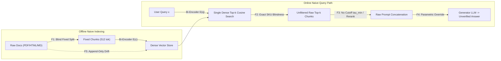
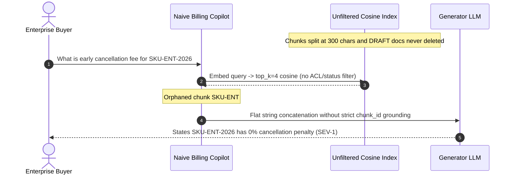

# Module 01: Naive RAG End to End

> **Prerequisites:** [Module 00: Why RAG Exists](../00-why-rag-exists/README.md), [Track 08, Module 06: Chunking — Fixed-Size Strategies](../../08-embeddings-and-vector-databases/06-chunking-fixed-size-strategies/README.md), and [Track 08, Module 13: Exact vs. Approximate Search](../../08-embeddings-and-vector-databases/13-exact-vs-approximate-search/README.md).  
> **Estimated Reading Time:** 30 minutes  
> **Target Audience:** AI Backend Engineers, Full-Stack LLM Engineers, Search Infrastructure Developers

> [!TIP]
> **The Golden Rule of Naive RAG:** Build a minimal end-to-end "Load → Split → Embed → Cosine Top-k → Prompt" loop as your **Day-1 functional baseline and latency benchmark**, never as your production architecture. Every hour spent shipping Naive RAG straight to production without structural chunking, lexical matching, similarity cutoffs, ACL pre-filters, and atomic index updates turns into emergency firefighting later.

---

## Why This Matters

In tutorial notebooks, **Naive RAG** looks effortless: load a folder of documents, slice text every `500` characters, call an embedding API, push vectors into an index, fetch the top `5` nearest neighbors by cosine similarity, and stuff them into `"Answer the question using the context below"`. Within thirty lines of code, your prototype answers semantic questions over private files.

In production, that exact thirty-line pipeline fails silently—and expensively. Customer support copilots quote deprecated policy drafts because old vectors were never deleted; legal assistants miss exact contract SKU codes because dense embeddings smear rare alphanumeric tokens; medical or financial bots hallucinate answers from parametric priors when retrieval returns irrelevant top-5 chunks with low similarity `0.28` because nobody calibrated an abstention threshold $\tau_{\min}$. Understanding the exact mechanics of Naive RAG—and pinning down its **5 structural failure points**—gives you the diagnostic map for the rest of Track 09.

---

## 1. End-to-End Naive RAG Mechanics & The 5 Failure Points

As categorized in Gao et al. (*Retrieval-Augmented Generation for Large Language Models: A Survey*, `arXiv:2312.10997`), Naive RAG follows a rigid two-phase **Index → Retrieve → Generate** pipeline:

1. **Offline Indexing Stage:** Raw files are converted into flat strings, chopped by fixed character or token count with a sliding window overlap, embedded with a bi-encoder model $E_{\text{doc}}(\cdot)$, and appended to a dense vector store.
2. **Online Serving Stage:** An incoming user query $x$ is embedded into vector $q = E_{\text{query}}(x)$, compared via approximate nearest neighbors (HNSW/IVF cosine or dot-product) to retrieve the exact top-$k$ chunks $[c_1, \dots, c_k]$, concatenated linearly into a prompt template, and decoded by the LLM.



### Quantitative Mechanics: Redundancy, Memory, and End-to-End Latency

Before diagnosing failure modes, compute the deterministic math governing any Naive RAG baseline:

- **Chunk Count & Overlap Inflation:** Given a document of $L$ tokens, chunk window $S$, and sliding overlap $O < S$, the step stride is $S - O$, yielding:

$$N_{\text{chunks}} = \left\lceil \frac{\max(0, L - O)}{S - O} \right\rceil, \qquad \text{Inflation Factor} = \frac{S}{S - O}$$

At `S = 512` and `O = 128`, overlap inflates both embedding API spend and vector RAM by `1.33x`; at `O = 256`, spend and RAM double (`2.00x`).

- **Dense Vector RAM Footprint:** Storing $N_{\text{total}}$ float32 embeddings of dimension $d$ (plus ~`1.5x` HNSW graph overhead) requires:

$$M_{\text{index}} \approx N_{\text{total}} \cdot d \cdot 4\text{ bytes} \cdot 1.5$$

- **End-to-End Online Request Latency:** Naive RAG has four sequential stages:

$$L_{\text{total}} = L_{\text{embed}}(q) + L_{\text{ANN}}(N, d, k) + L_{\text{TTFT}}(Q + k \cdot S) + L_{\text{decode}}(O_{\text{ans}})$$

Because $L_{\text{TTFT}}$ scales with prompt prefill tokens $k \cdot S$, raising `top_k` from `4` to `20` chunks at `S = 512` expands prefill from `2K` to `10K` tokens—increasing Time-to-First-Token, inflating inference cost `5x`, and triggering **Lost-in-the-Middle** attention decay (`arXiv:2307.03172`).

### The 5 Exact Production Failure Points of Naive RAG

| Failure Point | Root Mechanism | Observable Production Symptom | Architectural Remedy (Later in Track 09) |
| :--- | :--- | :--- | :--- |
| **1. Blind Fixed-Size Chunking** | Character/token slicing ignores paragraphs, headings, code fences, and table boundaries | Half a clause lands in `#c0` and `"25% early termination fee"` lands in `#c1`; table cells lose column headers | Structure-aware parsing & semantic/hierarchical chunking ([Modules 03–04](../03-document-loaders-and-parsing/README.md)) |
| **2. Dense-Only Exact-Match Blindness** | Bi-encoders compress sequences into continuous semantic space, smearing exact codes (`SKU-ENT-2026`, `ERR_4092`, SHA hashes) | Searching `SKU-ENT-2026` returns `SKU-PRO-2024` at nearly identical cosine similarity (`0.576` vs `0.574`) | Hybrid BM25 lexical + dense retrieval with Reciprocal Rank Fusion ([Modules 06–07](../06-keyword-search-and-bm25/README.md)) |
| **3. Unfiltered Top-k Context Bloat** | Always stuffing `k` vectors with zero similarity floor $\tau_{\min}$, deduplication, or cross-encoder reranking | Off-topic queries still inject `k` noisy snippets (`sim = 0.28`); contradictory chunks sit side by side | Score threshold $\tau_{\min}$, cross-encoder reranking, context compression ([Modules 09–10](../09-reranking-with-cross-encoders/README.md)) |
| **4. Parametric Override & Fake Citations** | Weak prompt templates without XML boundaries, strict grounding rules, or claim-to-chunk binding | When retrieval fails or conflicts, LLM silently answers from training weights and fabricates plausible source names | XML evidence isolation, explicit abstention, verifiable citations ([Modules 10–11](../10-context-assembly-and-prompt-construction/README.md)) |
| **5. Stale Drafts, Zombie Chunks & Missing ACLs** | One-off batch scripts append without versioning/tombstones and lack per-tenant metadata pre-filters | Deleted or `DEPRECATED` files stay searchable; Tenant A reads Tenant B chunks inside top-$k$ | Idempotent CDC ingestion, atomic swaps, pre-filtered tenant ACLs ([Module 02](../02-the-ingestion-pipeline/README.md)) |

---

## 2. Systematic Comparison Matrix: Naive RAG vs. Production-Hardened RAG

| Subsystem | Naive RAG Baseline | Production-Hardened RAG | Primary Failure Prevented |
| :--- | :--- | :--- | :--- |
| **Document Parsing** | Raw `str(file)` or `re.sub("<[^>]+>")` | Format-aware DOM/OOXML/layout extraction preserving `section_path` | Boilerplate pollution & broken tables (Failure #1) |
| **Chunking Unit** | Fixed `512` chars / `50` overlap | Structural blocks + parent-child links + bound table captions | Split assertions & orphaned values (Failure #1) |
| **Ingestion State** | Truncate-reload or blind append | SHA-256 content hashes, CDC sync, atomic version swap + tombstones | Duplicate chunks & zombie deleted docs (Failure #5) |
| **Access Control** | None or post-retrieval prompt filtering | Mandatory metadata pre-filtering (`tenant_id`, `status = ACTIVE`) inside ANN query | Cross-tenant leaks & draft retrieval (Failure #5) |
| **Retrieval Scoring** | Single dense cosine top-$k$ | Hybrid dense + BM25 sparse + cross-encoder reranker + $\tau_{\min}$ gate | Exact SKU misses & low-relevance noise (Failures #2, #3) |
| **Prompt & Grounding** | Flat `"Context:\n" + text` string | Delimited `<evidence chunk_id="...">` blocks + hard abstention on empty gate | Prompt injection & parametric hallucination (Failure #4) |

---

## 3. Production War Story Post-Mortem: The \$180,000 Naive SKU Cancellation Mirage

| Field | Incident Details |
| :--- | :--- |
| **Severity** | **SEV-1** (Customer-Facing Legal/Billing Misrepresentation & Immediate Feature Rollback) |
| **Detection / Resolution Time** | Detected 4 days post-launch via enterprise renewal escalation / Mitigated in 3 hours (endpoint gated behind manual review + emergency hybrid/ACL patch) |
| **Impact** | `14` enterprise customers told `"0% early cancellation fee"` on `SKU-ENT-2026` contracts; **\$180,000** disputed ARR exposure; bot temporarily suspended |

### What Happened

A B2B SaaS company built an AI Billing Assistant over `1,200` Markdown pricing docs and policy PDFs using a 40-line Naive RAG script (`chunk_size=300`, `overlap=30`, `text-embedding-3-small`, `top_k=4`, no metadata filters, no similarity floor).

When an enterprise customer asked *"What is the early cancellation fee for Enterprise Plan SKU-ENT-2026?"*, three naive failure points compounded simultaneously:

1. **Failure #1 (Split Clause):** The `300`-character splitter sliced `"Enterprise Plan SKU-ENT-2026 covers dedicated VPC peering. Early cancellation prior to month 12"` into chunk `#c0`, pushing `"incurs a 25% annual contract fee."` into chunk `#c1` without repeating `SKU-ENT-2026`.
2. **Failure #2 (Exact-Match Blindness):** Pure dense cosine search scored `SKU-PRO-2024` (`"Pro Plan... allows monthly cancellation with 0% fee"`) at `0.79` while orphaned `#c1` (`"incurs a 25% annual contract fee"`) missed `top_k=4` entirely.
3. **Failure #5 (Zombie Draft):** An un-deleted draft document (`billing_v1_DRAFT.md`) containing `"All accounts carry 0% penalty"` ranked `#3` because ingestion lacked `status = PUBLISHED` metadata filtering and tombstone deletion.
4. **Failure #4 (Parametric/Context Synthesis):** Seeing `#1` (`SKU-ENT-2026` with the penalty truncated) alongside `#2` (`0% fee`) and `#3` (`0% penalty`), the LLM smoothly generated: *"Enterprise Plan SKU-ENT-2026 allows cancellation with 0% penalty."*



### Root Cause Analysis

- Fixed character chunking split an atomic billing rule across chunk boundaries, stripping the subject (`SKU-ENT-2026`) from the predicate (`25% fee`).
- Bi-encoder cosine similarity treated `SKU-ENT-2026` and `SKU-PRO-2024` as near-identical semantic neighbors because `85%` of surrounding words matched (`"Plan"`, `"cancellation"`, `"fee"`).
- Ingestion blindly appended files without `status` ACL metadata or tombstone sweeps for `DRAFT` documents.

### The Fix & Architectural Hardening

- **Structure-Aware Chunking:** Replaced `300`-character fixed splitting with Markdown heading-level chunking keeping entire plan clauses intact with section breadcrumbs ([Module 03](../03-document-loaders-and-parsing/README.md)).
- **Metadata Pre-Filtering & Idempotent Sync:** Added mandatory `where: { status: "PUBLISHED", tenant_scope: "public" }` pre-filters and SHA-256 tombstone sweeps on document edits ([Module 02](../02-the-ingestion-pipeline/README.md)).
- **Hybrid BM25 + $\tau_{\min}$ Gate:** Added exact keyword matching for SKU identifiers and rejected ungrounded generation whenever top evidence fell below calibrated similarity/rerank thresholds.

---

## 4. Multi-Language Production Implementation: Instrumented Naive RAG Baseline

Below is a clean, self-contained **Naive RAG Baseline with Diagnostic Guardrails** across **Go**, **TypeScript**, **Python**, and **C#**. It implements the complete `Chunk → Embed → Cosine Top-k → Threshold Gate → Delimited Prompt` loop while surfacing the exact telemetry (`TopScore`, `Abstained`, `DroppedLowSimCount`, `ContextTokens`) you need to diagnose Failures #1–#5 immediately.

````carousel

```go
package naiverag

import (
	"fmt"
	"math"
	"strings"
)

type ChunkRecord struct {
	ChunkID   string
	DocID     string
	Status    string
	Text      string
	Embedding []float64
}

type RetrievalResult struct {
	Chunk ChunkRecord
	Score float64
}

type NaiveRAGResponse struct {
	Abstained          bool
	Reason             string
	Prompt             string
	Selected           []RetrievalResult
	DroppedBelowCutoff int
}

// FixedSizeChunk splits text on rune boundaries with sliding overlap.
func FixedSizeChunk(docID, status, text string, size, overlap int) []ChunkRecord {
	runes := []rune(text)
	if size <= 0 || overlap >= size {
		return nil
	}
	step := size - overlap
	var out []ChunkRecord
	for idx, start := 0, 0; start < len(runes); idx, start = idx+1, start+step {
		end := start + size
		if end > len(runes) {
			end = len(runes)
		}
		out = append(out, ChunkRecord{
			ChunkID: fmt.Sprintf("%s#c%d", docID, idx),
			DocID:   docID,
			Status:  status,
			Text:    string(runes[start:end]),
		})
		if end == len(runes) {
			break
		}
	}
	return out
}

func CosineSimilarity(a, b []float64) float64 {
	if len(a) == 0 || len(a) != len(b) {
		return 0
	}
	var dot, normA, normB float64
	for i := range a {
		dot += a[i] * b[i]
		normA += a[i] * a[i]
		normB += b[i] * b[i]
	}
	denom := math.Sqrt(normA) * math.Sqrt(normB)
	if denom == 0 {
		return 0
	}
	return dot / denom
}

// AssembleGroundedPrompt enforces pre-filter status, similarity cutoff tauMin, and XML isolation.
func AssembleGroundedPrompt(query string, index []ChunkRecord, queryVec []float64, topK int, tauMin float64) NaiveRAGResponse {
	var scored []RetrievalResult
	for _, rec := range index {
		if rec.Status != "PUBLISHED" { // Guards Failure #5
			continue
		}
		scored = append(scored, RetrievalResult{Chunk: rec, Score: CosineSimilarity(queryVec, rec.Embedding)})
	}
	// Selection sort top-k for clarity
	for i := 0; i < len(scored) && i < topK; i++ {
		best := i
		for j := i + 1; j < len(scored); j++ {
			if scored[j].Score > scored[best].Score {
				best = j
			}
		}
		scored[i], scored[best] = scored[best], scored[i]
	}
	limit := topK
	if len(scored) < limit {
		limit = len(scored)
	}

	var kept []RetrievalResult
	dropped := 0
	for _, hit := range scored[:limit] {
		if hit.Score < tauMin { // Guards Failure #3
			dropped++
			continue
		}
		kept = append(kept, hit)
	}
	if len(kept) == 0 { // Guards Failure #4 (parametric override)
		return NaiveRAGResponse{
			Abstained:          true,
			Reason:             fmt.Sprintf("no published chunk exceeded tau_min=%.2f", tauMin),
			DroppedBelowCutoff: dropped,
		}
	}

	var sb strings.Builder
	sb.WriteString("Answer strictly using <evidence>. Cite [chunk_id].\n<evidence>\n")
	for _, hit := range kept {
		sb.WriteString(fmt.Sprintf("  <chunk id=%q score=\"%.3f\">%s</chunk>\n", hit.Chunk.ChunkID, hit.Score, hit.Chunk.Text))
	}
	sb.WriteString("</evidence>\n<question>")
	sb.WriteString(query)
	sb.WriteString("</question>")

	return NaiveRAGResponse{
		Abstained:          false,
		Prompt:             sb.String(),
		Selected:           kept,
		DroppedBelowCutoff: dropped,
	}
}
```

<!-- slide -->

```typescript
export interface NaiveChunk {
  readonly chunkId: string;
  readonly docId: string;
  readonly status: "PUBLISHED" | "DRAFT";
  readonly text: string;
  readonly embedding: readonly number[];
}

export interface ScoredChunk {
  readonly chunk: NaiveChunk;
  readonly score: number;
}

export interface GroundedPromptBuild {
  readonly abstained: boolean;
  readonly reason?: string;
  readonly prompt?: string;
  readonly selected: readonly ScoredChunk[];
  readonly droppedLowSimilarity: number;
}

export function fixedSizeChunkText(
  docId: string,
  text: string,
  chunkSize = 400,
  overlap = 60,
): Array<{ chunkId: string; text: string }> {
  if (chunkSize <= 0 || overlap >= chunkSize) {
    throw new RangeError("chunkSize must be positive and strictly greater than overlap");
  }
  const step = chunkSize - overlap;
  const chunks: Array<{ chunkId: string; text: string }> = [];
  for (let start = 0, idx = 0; start < text.length; start += step, idx += 1) {
    const slice = text.slice(start, start + chunkSize);
    chunks.push({ chunkId: `${docId}#c${idx}`, text: slice });
    if (start + chunkSize >= text.length) break;
  }
  return chunks;
}

export function cosineSimilarity(a: readonly number[], b: readonly number[]): number {
  if (a.length === 0 || a.length !== b.length) return 0;
  let dot = 0;
  let normA = 0;
  let normB = 0;
  for (let i = 0; i < a.length; i += 1) {
    dot += a[i] * b[i];
    normA += a[i] * a[i];
    normB += b[i] * b[i];
  }
  const denom = Math.sqrt(normA) * Math.sqrt(normB);
  return denom === 0 ? 0 : dot / denom;
}

export function retrieveAndBuildPrompt(
  query: string,
  queryEmbedding: readonly number[],
  index: readonly NaiveChunk[],
  options: { topK: number; tauMin: number; maxContextChars: number },
): GroundedPromptBuild {
  const candidates = index
    .filter((c) => c.status === "PUBLISHED") // Pre-filter avoids draft leakage
    .map((chunk) => ({ chunk, score: cosineSimilarity(queryEmbedding, chunk.embedding) }))
    .sort((a, b) => b.score - a.score)
    .slice(0, options.topK);

  const kept: ScoredChunk[] = [];
  let dropped = 0;
  let charBudget = 0;

  for (const hit of candidates) {
    if (hit.score < options.tauMin) {
      dropped += 1;
      continue;
    }
    if (charBudget + hit.chunk.text.length > options.maxContextChars) break;
    kept.push(hit);
    charBudget += hit.chunk.text.length;
  }

  if (kept.length === 0) {
    return {
      abstained: true,
      reason: `All top-${options.topK} candidates fell below tauMin=${options.tauMin.toFixed(2)}`,
      selected: [],
      droppedLowSimilarity: dropped,
    };
  }

  const evidenceXml = kept
    .map((h) => `  <chunk id="${h.chunk.chunkId}" sim="${h.score.toFixed(3)}">${h.chunk.text}</chunk>`)
    .join("\n");

  return {
    abstained: false,
    prompt: `Use ONLY <evidence> to answer. Cite [chunk_id]. If insufficient, say "INSUFFICIENT_EVIDENCE".\n<evidence>\n${evidenceXml}\n</evidence>\n<question>${query}</question>`,
    selected: kept,
    droppedLowSimilarity: dropped,
  };
}
```

<!-- slide -->

```python
"""
naive_rag_baseline.py
End-to-end Naive RAG baseline instrumented with pre-filtering, tau_min cutoff, and token budget caps.
"""
from dataclasses import dataclass
import math
from typing import Sequence


@dataclass(frozen=True)
class ChunkRecord:
    chunk_id: str
    doc_id: str
    status: str  # e.g., "PUBLISHED" | "DRAFT"
    text: str
    embedding: tuple[float, ...]


@dataclass(frozen=True)
class RagGateResult:
    abstained: bool
    reason: str
    prompt: str
    selected_ids: tuple[str, ...]
    dropped_low_sim: int


def fixed_chunk_text(doc_id: str, text: str, chunk_size: int = 400, overlap: int = 60) -> list[tuple[str, str]]:
    if chunk_size <= 0 or overlap >= chunk_size:
        raise ValueError("chunk_size must exceed overlap and be > 0")
    step = chunk_size - overlap
    chunks: list[tuple[str, str]] = []
    for idx, start in enumerate(range(0, len(text), step)):
        chunks.append((f"{doc_id}#c{idx}", text[start : start + chunk_size]))
        if start + chunk_size >= len(text):
            break
    return chunks


def cosine_similarity(a: Sequence[float], b: Sequence[float]) -> float:
    if not a or len(a) != len(b):
        return 0.0
    dot = sum(x * y for x, y in zip(a, b))
    na = math.sqrt(sum(x * x for x in a))
    nb = math.sqrt(sum(y * y for y in b))
    return dot / (na * nb) if na > 0.0 and nb > 0.0 else 0.0


def build_naive_rag_prompt(
    query: str,
    query_vec: Sequence[float],
    index: Sequence[ChunkRecord],
    top_k: int = 5,
    tau_min: float = 0.45,
    max_context_chars: int = 4_000,
) -> RagGateResult:
    scored = sorted(
        (
            (cosine_similarity(query_vec, rec.embedding), rec)
            for rec in index
            if rec.status == "PUBLISHED"
        ),
        key=lambda pair: pair[0],
        reverse=True,
    )[:top_k]

    kept: list[tuple[float, ChunkRecord]] = []
    dropped = 0
    total_chars = 0
    for score, rec in scored:
        if score < tau_min:
            dropped += 1
            continue
        if total_chars + len(rec.text) > max_context_chars:
            break
        kept.append((score, rec))
        total_chars += len(rec.text)

    if not kept:
        return RagGateResult(
            abstained=True,
            reason=f"No published chunk met similarity floor tau_min={tau_min:.2f}",
            prompt="",
            selected_ids=(),
            dropped_low_sim=dropped,
        )

    evidence_lines = "\n".join(
        f'  <chunk id="{rec.chunk_id}" score="{score:.3f}">{rec.text}</chunk>'
        for score, rec in kept
    )
    prompt = (
        "Answer ONLY from <evidence>. Cite [chunk_id] inline. If missing, output INSUFFICIENT_EVIDENCE.\n"
        f"<evidence>\n{evidence_lines}\n</evidence>\n"
        f"<question>{query}</question>"
    )
    return RagGateResult(
        abstained=False,
        reason="ok",
        prompt=prompt,
        selected_ids=tuple(rec.chunk_id for _, rec in kept),
        dropped_low_sim=dropped,
    )
```

<!-- slide -->

```csharp
using System;
using System.Collections.Generic;
using System.Linq;
using System.Text;

namespace GenAI.NaiveRag;

public sealed record ChunkRecord(
    string ChunkId,
    string DocId,
    string Status,
    string Text,
    double[] Embedding);

public sealed record NaiveRagOutcome(
    bool Abstained,
    string Reason,
    string? Prompt,
    IReadOnlyList<string> SelectedChunkIds,
    int DroppedBelowCutoff);

public static class NaiveRagBaseline
{
    public static IReadOnlyList<(string ChunkId, string Text)> FixedSizeChunk(
        string docId,
        string text,
        int chunkSize = 400,
        int overlap = 60)
    {
        if (chunkSize <= 0 || overlap >= chunkSize)
            throw new ArgumentException("chunkSize must exceed overlap and be positive.");

        var step = chunkSize - overlap;
        var chunks = new List<(string, string)>();
        for (int start = 0, idx = 0; start < text.Length; start += step, idx++)
        {
            int len = Math.Min(chunkSize, text.Length - start);
            chunks.Add(($"{docId}#c{idx}", text.Substring(start, len)));
            if (start + chunkSize >= text.Length) break;
        }
        return chunks;
    }

    public static double Cosine(ReadOnlySpan<double> a, ReadOnlySpan<double> b)
    {
        if (a.Length == 0 || a.Length != b.Length) return 0;
        double dot = 0, na = 0, nb = 0;
        for (int i = 0; i < a.Length; i++)
        {
            dot += a[i] * b[i];
            na += a[i] * a[i];
            nb += b[i] * b[i];
        }
        double denom = Math.Sqrt(na) * Math.Sqrt(nb);
        return denom == 0 ? 0 : dot / denom;
    }

    public static NaiveRagOutcome BuildGroundedPrompt(
        string query,
        double[] queryVector,
        IEnumerable<ChunkRecord> index,
        int topK = 5,
        double tauMin = 0.45,
        int maxContextChars = 4000)
    {
        var topCandidates = index
            .Where(c => string.Equals(c.Status, "PUBLISHED", StringComparison.Ordinal))
            .Select(c => (Chunk: c, Score: Cosine(queryVector, c.Embedding)))
            .OrderByDescending(x => x.Score)
            .Take(topK)
            .ToList();

        var kept = new List<(ChunkRecord Chunk, double Score)>();
        int dropped = 0;
        int charBudget = 0;

        foreach (var hit in topCandidates)
        {
            if (hit.Score < tauMin)
            {
                dropped++;
                continue;
            }
            if (charBudget + hit.Chunk.Text.Length > maxContextChars) break;
            kept.Add(hit);
            charBudget += hit.Chunk.Text.Length;
        }

        if (kept.Count == 0)
        {
            return new NaiveRagOutcome(
                Abstained: true,
                Reason: $"All candidates fell below tauMin={tauMin:F2}",
                Prompt: null,
                SelectedChunkIds: Array.Empty<string>(),
                DroppedBelowCutoff: dropped);
        }

        var sb = new StringBuilder();
        sb.AppendLine("Use ONLY <evidence>. Cite [chunk_id]. Output INSUFFICIENT_EVIDENCE if absent.");
        sb.AppendLine("<evidence>");
        foreach (var (chunk, score) in kept)
        {
            sb.AppendLine($"  <chunk id=\"{chunk.ChunkId}\" score=\"{score:F3}\">{chunk.Text}</chunk>");
        }
        sb.AppendLine("</evidence>");
        sb.Append($"<question>{query}</question>");

        return new NaiveRagOutcome(
            Abstained: false,
            Reason: "ok",
            Prompt: sb.ToString(),
            SelectedChunkIds: kept.Select(k => k.Chunk.ChunkId).ToArray(),
            DroppedBelowCutoff: dropped);
    }
}
```

````

---

## 5. Practical Hands-On Verification CLI Workflows

Run these deterministic Python 3.13 verification scripts offline—no third-party packages or API keys required.

### Workflow 1: Reproduce All 5 Naive RAG Failure Points Locally

Build an in-memory fixed-size chunker, deterministic bi-encoder-style char-trigram + token projector, and cosine top-3 retriever to observe semantic success alongside boundary splitting, exact-SKU confusion, stale draft leakage, and out-of-domain noise injection:

```bash
python -c '
import hashlib, math, re

def embed_naive(text, dims=64):
    vec = [0.0] * dims
    for tok in re.findall(r"[a-z0-9]+", text.lower()):
        h = int(hashlib.sha256(tok.encode()).hexdigest(), 16)
        vec[h % dims] += 1.0
        for i in range(max(0, len(tok) - 2)):
            ht = int(hashlib.sha256(tok[i:i+3].encode()).hexdigest(), 16)
            vec[ht % dims] += 0.35
    norm = math.sqrt(sum(x * x for x in vec)) or 1.0
    return [x / norm for x in vec]

def cosine(a, b):
    return sum(x * y for x, y in zip(a, b))

def fixed_chunk(doc_id, text, size=85, overlap=10):
    chunks = []
    step = size - overlap
    for i, start in enumerate(range(0, len(text), step)):
        chunks.append((f"{doc_id}#c{i}", text[start:start+size]))
        if start + size >= len(text):
            break
    return chunks

docs = {
    "policy_v1_DRAFT": "DEPRECATED DRAFT: Standard and Enterprise accounts pay 0% cancellation penalty.",
    "enterprise_sla": "Enterprise Plan SKU-ENT-2026 covers dedicated VPC peering. Early cancellation prior to month 12 incurs a 25% fee.",
    "pro_plan": "Pro Plan SKU-PRO-2024 includes priority email support and allows cancellation with 0% penalty.",
}

index = [(cid, ctxt, embed_naive(ctxt)) for did, txt in docs.items() for cid, ctxt in fixed_chunk(did, txt)]

queries = [
    ("Semantic hit", "Does Enterprise include VPC peering?"),
    ("Split boundary + exact SKU + stale draft", "What is the cancellation penalty for SKU-ENT-2026?"),
    ("Out-of-domain noise (no tau_min)", "What is our Tokyo office Wi-Fi password?"),
]

for label, q in queries:
    qv = embed_naive(q)
    scored = sorted(((cosine(qv, ev), cid, ctxt) for cid, ctxt, ev in index), reverse=True)
    print(f"=== {label}: {q} ===")
    for rank, (score, cid, ctxt) in enumerate(scored[:3], 1):
        print(f"  #{rank} [{cid}] sim={score:.3f} | {ctxt}")
'
```

**Expected Output:**

```text
=== Semantic hit: Does Enterprise include VPC peering? ===
  #1 [enterprise_sla#c0] sim=0.576 | Enterprise Plan SKU-ENT-2026 covers dedicated VPC peering. Early cancellation prior t
  #2 [policy_v1_DRAFT#c0] sim=0.357 | DEPRECATED DRAFT: Standard and Enterprise accounts pay 0% cancellation penalty.
  #3 [pro_plan#c0] sim=0.318 | Pro Plan SKU-PRO-2024 includes priority email support and allows cancellation with 0%
=== Split boundary + exact SKU + stale draft: What is the cancellation penalty for SKU-ENT-2026? ===
  #1 [enterprise_sla#c0] sim=0.576 | Enterprise Plan SKU-ENT-2026 covers dedicated VPC peering. Early cancellation prior t
  #2 [pro_plan#c0] sim=0.472 | Pro Plan SKU-PRO-2024 includes priority email support and allows cancellation with 0%
  #3 [policy_v1_DRAFT#c0] sim=0.353 | DEPRECATED DRAFT: Standard and Enterprise accounts pay 0% cancellation penalty.
=== Out-of-domain noise (no tau_min): What is our Tokyo office Wi-Fi password? ===
  #1 [pro_plan#c0] sim=0.318 | Pro Plan SKU-PRO-2024 includes priority email support and allows cancellation with 0%
  #2 [enterprise_sla#c1] sim=0.309 | on prior to month 12 incurs a 25% fee.
  #3 [pro_plan#c1] sim=0.271 | on with 0% penalty.
```

Observe how the `85`-character fixed splitter severed `"25% fee."` into `enterprise_sla#c1` (which missed `top_k=3` for the SKU query!), `pro_plan#c0` (`0% penalty`) ranked `#2`, `policy_v1_DRAFT#c0` leaked `#3`, and the Wi-Fi query injected unrelated billing snippets at `sim=0.318`.

### Workflow 2: Calibrate Similarity Floor $\tau_{\min}$ for Abstention

Verify how adding a calibrated similarity gate blocks low-similarity noise from entering the generator prompt:

```bash
python -c '
def evaluate_thresholds(candidates, tau_min=0.45):
    for q_type, top_sim in candidates:
        decision = "PASS_TO_LLM" if top_sim >= tau_min else "ABSTAIN_NO_EVIDENCE"
        print(f"{q_type:<26} | top_sim={top_sim:.2f} | tau={tau_min:.2f} -> {decision}")

samples = [
    ("Exact In-Domain Match", 0.78),
    ("Paraphrase In-Domain", 0.61),
    ("Weak / Ambiguous Hit", 0.39),
    ("Out-of-Domain Query", 0.19),
]
evaluate_thresholds(samples, tau_min=0.45)
'
```

**Expected Output:**

```text
Exact In-Domain Match      | top_sim=0.78 | tau=0.45 -> PASS_TO_LLM
Paraphrase In-Domain       | top_sim=0.61 | tau=0.45 -> PASS_TO_LLM
Weak / Ambiguous Hit       | top_sim=0.39 | tau=0.45 -> ABSTAIN_NO_EVIDENCE
Out-of-Domain Query        | top_sim=0.19 | tau=0.45 -> ABSTAIN_NO_EVIDENCE
```

### Workflow 3: Chunk Inflation, Vector RAM, and Online TTFT Budget Sweep

Quantify the memory and latency trade-offs across fixed `chunk_size`, `overlap`, and `top_k` configurations for a `1,000,000`-token corpus (`dims=1536`):

```bash
python -c '
import math

def budget_profile(corpus_tokens=1_000_000, chunk_size=512, overlap=128, dims=1536, top_k=8):
    step = chunk_size - overlap
    n_chunks = math.ceil(max(0, corpus_tokens - overlap) / step)
    inflation = chunk_size / step
    ram_mb = (n_chunks * dims * 4) / (1024 * 1024)
    retrieved_tokens = top_k * chunk_size
    est_ttft_ms = 25 + 18 + (retrieved_tokens / 120_000) * 1000 + 35
    print(f"chunk={chunk_size} overlap={overlap} -> chunks={n_chunks:,} ({inflation:.2f}x inflation) | fp32_ram={ram_mb:.1f} MB | ctx_k={retrieved_tokens:,} tok | est_TTFT={est_ttft_ms:.1f} ms")

for cs, ov, k in [(256, 32, 5), (512, 128, 8), (512, 256, 12), (1024, 128, 10)]:
    budget_profile(chunk_size=cs, overlap=ov, top_k=k)
'
```

**Expected Output:**

```text
chunk=256 overlap=32 -> chunks=4,465 (1.14x inflation) | fp32_ram=26.2 MB | ctx_k=1,280 tok | est_TTFT=88.7 ms
chunk=512 overlap=128 -> chunks=2,604 (1.33x inflation) | fp32_ram=15.3 MB | ctx_k=4,096 tok | est_TTFT=112.1 ms
chunk=512 overlap=256 -> chunks=3,906 (2.00x inflation) | fp32_ram=22.9 MB | ctx_k=6,144 tok | est_TTFT=129.2 ms
chunk=1024 overlap=128 -> chunks=1,116 (1.14x inflation) | fp32_ram=6.5 MB | ctx_k=10,240 tok | est_TTFT=163.3 ms
```

### Hands-On Exercises

1. **Sentence-Aware Chunk Repair:** Extend Workflow 1's `fixed_chunk` function to split on sentence boundaries (`". "`) while staying under `size=110`, then re-run `"What is the cancellation penalty for SKU-ENT-2026?"` and confirm `"25% fee"` stays attached to `SKU-ENT-2026`.
2. **Pre-Filter + $\tau_{\min}$ Fix:** Filter `policy_v1_DRAFT` out before scoring and apply `tau_min=0.45` in Workflow 1. Verify that the Tokyo Wi-Fi query yields `0` passed chunks instead of `3` noisy chunks.
3. **Optional Live API Grounding Probe (Requires API Key):** Using the OpenAI or Anthropic Python SDK with `temperature=0`, send Workflow 1's naive raw chunks (without XML delimiting) vs. the hardened XML `<evidence>` prompt containing `INSUFFICIENT_EVIDENCE` rules for the Tokyo Wi-Fi query, and record whether the unguarded prompt leaks parametric guesses.

### Independent Challenge

A developer relations team deploys a Naive RAG assistant over `4,500` API reference pages (`chunk_size=400 tokens`, `overlap=40`, `top_k=6`, dense embeddings only). Within a week, users file three recurring bug reports: (a) searching exact error codes like `ERR_RATE_QUOTA_429` returns docs for `ERR_AUTH_401`, (b) code examples split across chunk boundaries drop import statements and closing braces, and (c) deprecated `v1` endpoints removed from Git last month still appear in top-6 answers. Diagnose which of the **5 Naive RAG failure points** explain each complaint and outline the exact architectural layer needed to cure each without changing the LLM model.

<details><summary>Architectural Discussion</summary>

Complaint (a) stems from **Failure #2 (Dense-Only Exact-Match Blindness)**: bi-encoders map surrounding tokens (`ERR_`, error-handling prose) close together while losing exact alphanumeric code discrimination; cure with hybrid BM25 lexical search + RRF ([Modules 06–07](../06-keyword-search-and-bm25/README.md)). Complaint (b) stems from **Failure #1 (Blind Fixed-Size Chunking)**: token window slicing breaks code fences mid-function; cure with Markdown/AST fence-aware structural parsing ([Module 03](../03-document-loaders-and-parsing/README.md)). Complaint (c) stems from **Failure #5 (Append-Only Drift & Missing Tombstones)**: deleted Git docs remain as orphan vectors in the store; cure with SHA-256 CDC sync and atomic version/tombstone deletion ([Module 02](../02-the-ingestion-pipeline/README.md)).

</details>

---

## 6. Common Mistakes & Troubleshooting

- **Fixing recall collapse by blindly raising `top_k` from `5` to `25`:** Increasing `k` rarely fixes poor chunking or exact-match misses; instead, it injects distracting lower-ranked passages, triggers Lost-in-the-Middle degradation, and inflates LLM token spend `5x`.
- **Setting overlap `O >= 0.5 * S` to "protect context":** Excessive overlap (`50%+`) doubles embedding spend and vector RAM (`2.0x` inflation) and fills your top-$k$ slots with duplicate overlapping snippets of the exact same paragraph.
- **Using `"Answer based on the context"` without a hard abstention gate:** Without checking `max_sim >= tau_min` *and* explicitly instructing `INSUFFICIENT_EVIDENCE` fallback, frontier LLMs smoothly blend unrelated snippets with parametric guesses.
- **Applying tenant/status ACL filtering *after* `top_k` retrieval:** Fetching `top_k=5` globally and discarding `4` unauthorized/draft chunks leaves only `1` chunk (or `0`) for the user, destroying recall. Always push predicates into the vector store pre-filter.

---

## 7. Operational Validation Checkpoints & Checkpoint Quiz

### Operational Validation Checkpoints

<details><summary><strong>Checkpoint 1: Diagnosing why raising top_k worsened answer accuracy</strong></summary>

An engineer notices their Naive RAG bot misses answers buried inside `500`-token chunks and bumps `top_k` from `4` to `20`. Answer accuracy drops `11%` while TTFT rises `3.4x`. Explain what happened mechanically.

**Validation:** Raising `top_k` to `20` stuffed ~`10,000` raw retrieved tokens into the prompt without similarity cutoff or cross-encoder reranking (**Failure #3: Unfiltered Context Bloat**). Ranks `6–20` introduced off-topic or stale passages that triggered Lost-in-the-Middle attention dilution while tripling prefill compute (`L_TTFT`). Fix by calibrating $\tau_{\min}$, switching to structure-aware chunking, and adding a reranker to keep `top_k <= 6` high-precision chunks.

</details>

<details><summary><strong>Checkpoint 2: Why exact product IDs fail under pure cosine RAG</strong></summary>

Queries like `"Explain timeout behavior for SDK flag OPT_RETRY_V3"` keep retrieving documentation for `OPT_RETRY_V2` even though `OPT_RETRY_V3` exists in the corpus. Identify the Naive RAG failure point and fix.

**Validation:** This is **Failure #2 (Dense-Only Exact-Match Blindness)**. Dense bi-encoders project both passages into nearly identical semantic coordinates because the surrounding prose (`"timeout behavior"`, `"SDK flag"`, `"retry"`) dominates the pooled representation, drowning out the single character difference (`V2` vs `V3`). Cure this by adding sparse lexical/BM25 retrieval alongside dense vectors (Hybrid Search) so exact identifier matches receive decisive lexical boost.

</details>

<details><summary><strong>Checkpoint 3: Auditing a silent "ghost document" retrieval incident</strong></summary>

A compliance officer deletes `legacy_pricing_2023.pdf` from the company SharePoint folder, yet two weeks later the RAG chatbot still quotes `2023` pricing from `legacy_pricing_2023.pdf#c4`. What went wrong in the naive pipeline?

**Validation:** This is **Failure #5 (Append-Only Drift & Missing Tombstones)**. Naive ingestion scripts read files and call `upsert()` on existing/new paths without tracking a document inventory manifest or sweeping removed `doc_id` records. Deleting a file in SharePoint never propagated a tombstone deletion to the vector store, leaving orphan chunks indefinitely searchable.

</details>

### Checkpoint Quiz

1. What are the two distinct phases of a Naive RAG pipeline, and which latency components dominate the online phase?
2. At `chunk_size = 512` tokens and `overlap = 128` tokens, what is the chunk inflation factor, and why does `overlap = 256` harm both cost and retrieval quality?
3. List all **5 production failure points** of Naive RAG.
4. Why is pre-filtering metadata (`status = "PUBLISHED"`, `tenant_id = X`) fundamentally superior to post-filtering top-$k$ dense results?
5. What happens when an out-of-domain query hits a Naive RAG index that lacks a $\tau_{\min}$ similarity threshold?

<details><summary>Answers</summary>

1. The **offline indexing phase** (load, fixed-chunk, embed, vector upsert) and the **online serving phase** (embed query, top-$k$ ANN cosine search, concatenate prompt, LLM generation). Online latency is dominated by $L_{\text{TTFT}}(Q + k \cdot S)$ and $L_{\text{decode}}(O_{\text{ans}})$.
2. Inflation factor is $\frac{512}{512 - 128} = 1.33\times$. Setting `overlap = 256` doubles chunk count ($2.0\times$ RAM and embedding API cost) and fills top-$k$ slots with near-duplicate overlapping slices of the same passage.
3. (1) Blind fixed-size chunking, (2) Dense-only exact-match blindness, (3) Unfiltered top-$k$ context bloat without $\tau_{\min}$/reranking, (4) Parametric override & unverified citations, and (5) Append-only freshness/tombstone drift & missing pre-filter ACLs.
4. Post-filtering removes unauthorized or stale chunks *after* `top_k` selection, shrinking the effective candidate count (potentially to `0`) and hurting recall. Pre-filtering narrows the index scan before scoring so all `k` returned slots are valid and authorized.
5. Even when no chunk is relevant, cosine top-$k$ unconditionally returns the `k` least-dissimilar chunks (e.g., `sim = 0.25–0.32`), injecting irrelevant noise into the prompt and encouraging parametric hallucinations.

</details>

---

## Further Reading & Sources

- [Retrieval-Augmented Generation for Large Language Models: A Survey (Gao et al., 2023)](https://arxiv.org/abs/2312.10997) — systematic taxonomy contrasting Naive RAG, Advanced RAG, and Modular RAG architectures.
- [Retrieval-Augmented Generation for Knowledge-Intensive NLP Tasks (Lewis et al., 2020)](https://arxiv.org/abs/2005.11401) — foundational formulation of retriever-generator RAG systems.
- [Lost in the Middle: How Language Models Use Long Contexts (Liu et al., 2023)](https://arxiv.org/abs/2307.03172) — empirical analysis explaining why naive large-`k` context stuffing degrades middle-chunk recall.
- [Anthropic Docs: Use XML Tags to Structure Your Prompts](https://docs.anthropic.com/en/docs/build-with-claude/prompt-engineering/use-xml-tags) — official pattern for isolating retrieved `<evidence>` chunks from instructions.
- [Track 08, Module 06: Chunking — Fixed-Size Strategies and Boundary Mechanics](../../08-embeddings-and-vector-databases/06-chunking-fixed-size-strategies/README.md) — boundary mechanics behind chunk size and overlap sizing.

## Next

[Module 02: The Ingestion Pipeline](../02-the-ingestion-pipeline/README.md)
