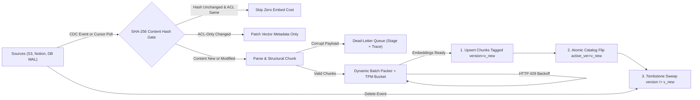
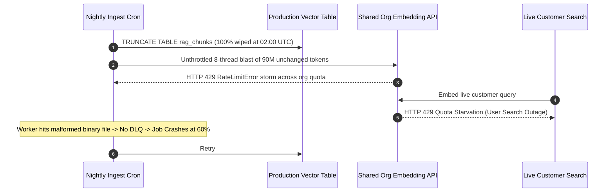

# Module 02: The Ingestion Pipeline

> **Prerequisites:** [Module 01: Naive RAG End to End](../01-naive-rag-end-to-end/README.md) and [Track 08, Module 05: Generating Embeddings at Scale](../../08-embeddings-and-vector-databases/05-generating-embeddings-at-scale/README.md).  
> **Estimated Reading Time:** 30 minutes  
> **Target Audience:** Data Platform Engineers, AI Backend Engineers, Distributed Systems Architects

> [!TIP]
> **The Golden Rule of RAG Ingestion:** Treat RAG ingestion as a **stateful, idempotent, event-driven data pipeline**—never as a nightly `TRUNCATE`-and-reload notebook script. Every chunk must be content-addressed by SHA-256 hash, version-tagged before atomic swap, swept via deterministic tombstones, throttled below organization TPM quotas, and isolated into a Dead-Letter Queue (DLQ) on poison-pill failure.

---

## Why This Matters

A Naive RAG tutorial ingests `50` files once from a local directory. Production RAG ingests `500,000` living enterprise documents across S3, Confluence, Notion, Google Drive, and PostgreSQL where `1%–5%` of pages change daily, permissions shift hourly, and embedding APIs enforce strict organization-wide Tokens-Per-Minute (TPM) and Requests-Per-Minute (RPM) ceilings.

Teams that carry naive ingestion into production hit three predictable disasters:
1. **The `drop-and-reload` Blackout:** Wiping the vector table at `02:00 UTC` and crashing on page `14,200` leaves half the knowledge base invisible to users until manual recovery.
2. **Duplicate & Zombie Chunks:** Re-running append-only scripts creates duplicate vectors (`"Refund policy"` appearing `4x` in `top_k=5`) and leaves deleted or shortened-document chunks lingering forever as ghost evidence.
3. **Runaway Embedding Bills & `429` Storms:** Re-embedding unchanged corpora daily wastes `95%+` of spend and starves live traffic sharing the same organization TPM quota.

---

## 1. Architectural Mental Model: Idempotent CDC & Atomic Generation Swap

Production ingestion separates **change detection** from **embedding compute** and **index visibility** using a persistent **Document State Catalog** (typically PostgreSQL) paired with the vector index.



### Content-Addressable Hashing: Two-Tier SHA-256 Strategy

Instead of blindly trusting file timestamps (`mtime` drifts across CI clones and exports), compute two deterministic cryptographic hashes:

1. **Document Content Hash ($H_{\text{doc}}$):** Computed over canonicalized bytes plus schema/parser version:

$$H_{\text{doc}} = \text{SHA256}\bigl(\text{canonical\_bytes} \parallel \text{parser\_ver} \parallel \text{chunker\_ver}\bigr)$$

   - Track $H_{\text{acl}} = \text{SHA256}(\text{sorted}(\text{allowed\_tenants}))$ separately! If a Slack/Confluence permission changes without altering document text, **patch metadata predicates in place with zero re-embedding cost**.
2. **Chunk Determinism & IDs ($H_{\text{chunk}}$):** Computed per chunk including embedding model identity:

$$H_{\text{chunk}} = \text{SHA256}\bigl(\text{embed\_model\_id} \parallel \text{normalized\_chunk\_text}\bigr), \qquad \text{chunk\_id} = \text{UUID5}\bigl(\text{NS}, \text{doc\_id} : v_{\text{new}} : i : H_{\text{chunk}}\bigr)$$

   - If you upgrade from `text-embedding-3-small` to a newer model, changing `embed_model_id` systematically invalidates $H_{\text{chunk}}$ for zero-ambiguity blue/green backfill.

### Atomic Vector-Chunk Swap & Tombstones (Zero Split-Brain Reads)

Suppose `doc_a` shrinks from `5` chunks (`v1`) to `3` chunks (`v2`). If you naively overwrite `#c0..#c2` in place, `#c3` and `#c4` remain as **zombie chunks** from `v1`! Conversely, if you delete `v1` *before* embedding `v2`, queries arriving during a 40-second rate-limit pause see **zero chunks** for `doc_a`.

Execute every document update in **three ordered stages**:
1. **Write-Ahead Upsert (`v_new`):** Embed and upsert all new chunks tagged `doc_version = v_new` alongside `is_active = true` (or filtered by catalog pointer).
2. **Atomic Pointer Flip:** Commit `active_version = v_new` and `doc_content_hash = H_doc` inside a single database transaction. Reads now resolve cleanly against `v_new`.
3. **Tombstone & Sweep (`v_old`):** Delete (or mark `tombstone = true` for async compaction) all vectors matching `doc_id = X AND doc_version < v_new`.

### Token-Bucket Rate Limiting, Batch Packing & Economics

Commercial embedding endpoints limit throughput by both **TPM** (Tokens Per Minute) and **RPM** (Requests Per Minute) scoped **across your entire organization**, plus per-request array caps (e.g., max `2,048` strings or `8,192–300,000` input tokens depending on provider). Under a token quota $\text{TPM}_{\max}$, sustainable token velocity is:

$$R_{\text{tok/s}} = \frac{\text{TPM}_{\max} \cdot (1 - \alpha_{\text{headroom}})}{60}$$

where $\alpha_{\text{headroom}} \in [0.15, 0.25]$ reserves capacity for live online query embeddings so bulk backfills never cause HTTP `429` timeouts on user searches!

When an HTTP `429` occurs despite pacing, honor `Retry-After` if present, or apply **Exponential Backoff with Full Jitter**:

$$t_{\text{sleep}}(r) = \text{Uniform}\Bigl(0,\; \min\bigl(t_{\max},\; t_{\text{base}} \cdot 2^r\bigr)\Bigr)$$

With $N_{\text{corpus}}$ total tokens, daily churn rate $c_{\text{daily}}$, and embedding price $p_{\text{1M}}$ per million tokens:

$$\text{Monthly Cost}_{\text{drop-reload}} = 30 \cdot \frac{N_{\text{corpus}}}{10^6} \cdot p_{\text{1M}}, \qquad \text{Monthly Cost}_{\text{CDC}} = \left(\frac{N_{\text{corpus}}}{10^6} + 30 \cdot c_{\text{daily}} \cdot \frac{N_{\text{corpus}}}{10^6}\right) \cdot p_{\text{1M}}$$

At $50\text{M}$ tokens and $2\%$ daily churn, incremental SHA-256 CDC cuts steady-state embedding spend and backfill runtime by **`50x`**.

---

## 2. Systematic Comparison Matrix: Ingestion Architectures

| Pattern | Consistency During Update | Zombie / Duplicate Chunk Risk | Cost on `1%` Corpus Edit | Poison-Pill Blast Radius | Best Production Fit |
| :--- | :--- | :--- | :--- | :--- | :--- |
| **Full Drop & Reload** | **Broken** (blackout window while reloading) | Zero post-run; empty mid-run | **`100%`** of entire corpus | Entire nightly batch aborts | Never in production; `<500` local test docs only |
| **Append-Only Upsert** | Split-brain | **Severe** (duplicates + orphaned tail chunks) | `1%–100%` depending on tracking | Skips single file or crashes loop | Unsuitable for mutable knowledge bases |
| **Polling Watermark + Hash Gate** | Eventual (`5–60 min` lag) | Low if paired with manifest diff | **`1%`** (hash-skip unchanged) | Isolated if per-doc `try/catch` + DLQ | Batch connectors lacking webhooks (SFTP, legacy DBs) |
| **CDC Event Bus + Atomic Version Swap + DLQ** | **Strong / Zero-Downtime** | **Zero** (atomic pointer + `v < v_new` sweep) | **`1%`** (`0%` on ACL-only edits) | **Contained** (`1` doc to DLQ, retries bounded) | Production enterprise RAG at scale |

---

## 3. Production War Story Post-Mortem: The \$6,400 Overnight Drop-Reload Crash & Half-Empty Index

| Field | Incident Details |
| :--- | :--- |
| **Severity** | **SEV-1** (40% Knowledge Base Blackout for 4 Hours + Organization-Wide Embedding Quota Exhaustion) |
| **Detection / Resolution Time** | Detected at `07:10 UTC` by rising `"No relevant documentation found"` support alerts / Mitigated in 4 hours via snapshot restore & incremental hotfix |
| **Impact** | **1.8M** chunks dropped and re-embedded in loops; **\$6,400** wasted embedding spend; live user query embeddings hit `429` errors across all teams |

### What Happened

An internal knowledge assistant indexing `180,000` customer wiki pages (`~90M` tokens) ran a nightly cron job at `02:00 UTC` executing: `DELETE FROM rag_chunks;` followed by a sequential loop calling `embed_and_insert()` with `8` worker threads and blind retries.

Two events collided at `03:14 UTC`:
1. A support engineer uploaded a malformed `42 MB` corrupt binary disguised as `.md`, triggering an unhandled parser exception inside worker thread `3`. Because the job lacked a **Dead-Letter Queue**, the orchestrator flagged the entire cron job `FAILED` and restarted from document `0` three times in a row.
2. Each retry ran `DELETE FROM rag_chunks` again and blasted the shared organization embedding API key with `8` unthrottled threads—exhausting the org's `1M` TPM quota, triggering an HTTP `429` retry storm, and starving the live customer-facing search microservice sharing that organization quota. When ops killed the runaway script at `03:50 UTC`, `40%` of the corpus was missing from `rag_chunks` until morning.



### Root Cause Analysis

- **Destructive `TRUNCATE` before build:** Violated atomic version swapping, creating a multi-hour blackout window whenever ingestion stalled or failed.
- **No SHA-256 content-hash cache:** Re-embedded `98%` unchanged documents every night, multiplying cost and API quota pressure `50x`.
- **No DLQ & no TPM headroom reservation:** One corrupt file triggered full job restarts, and zero rate-limit pacing starved live online search traffic.

### The Fix & Architectural Hardening

- **Adopted Document Catalog + SHA-256 Gate:** Tracked `doc_content_hash` and `acl_hash` in Postgres; skipped `98.4%` of unchanged docs nightly.
- **Switched to Atomic Generation Swap:** Tagged new chunks with `doc_version = v_new`, flipped the catalog pointer inside a transaction, and asynchronously swept `version < v_new`.
- **Added Token-Bucket Pacer + DLQ:** Capped background ingestion workers at `75%` of org TPM (`25%` reserved for live query traffic) and routed failing documents after `3` backoff retries into a Postgres `ingestion_dlq` table with stage, stack trace, and replay ID.

---

## 4. Multi-Language Production Implementation: Idempotent Ingestion Worker with Atomic Swap & DLQ

The production implementations below across **Go**, **TypeScript**, **Python**, and **C#** demonstrate the complete four-part ingestion engine: (1) two-tier SHA-256 content & ACL hash gate, (2) dynamic token-budget batch packing + exponential jitter retry, (3) atomic generation swap + stale version tombstone sweep, and (4) poison-pill DLQ routing.

````carousel

```go
package ingestion

import (
	"context"
	"crypto/sha256"
	"encoding/hex"
	"errors"
	"fmt"
	"math/rand"
	"sync"
	"time"
)

type SourceDocument struct {
	DocID   string
	Text    string
	Tenants []string
}

type VectorChunk struct {
	ChunkID string
	DocID   string
	Version int
	Tenants []string
	Text    string
	Vector  []float64
}

type DocState struct {
	ContentHash   string
	ACLHash       string
	ActiveVersion int
}

type DLQEntry struct {
	DocID string
	Stage string
	Error string
}

type IdempotentIngestor struct {
	mu      sync.Mutex
	catalog map[string]DocState
	chunks  map[string]VectorChunk
	DLQ     []DLQEntry
}

func NewIdempotentIngestor() *IdempotentIngestor {
	return &IdempotentIngestor{
		catalog: make(map[string]DocState),
		chunks:  make(map[string]VectorChunk),
	}
}

func sha256Short(s string) string {
	sum := sha256.Sum256([]byte(s))
	return hex.EncodeToString(sum[:])[:16]
}

// IngestOne enforces SHA-256 skip, ACL-only fast patch, atomic version swap, and DLQ isolation.
func (ing *IdempotentIngestor) IngestOne(
	ctx context.Context,
	doc SourceDocument,
	chunker func(string) ([]string, error),
	embedBatch func(context.Context, []string) ([][]float64, error),
) string {
	contentHash := sha256Short("parser_v2|" + doc.Text)
	aclHash := sha256Short(fmt.Sprint(doc.Tenants))

	ing.mu.Lock()
	prev, exists := ing.catalog[doc.DocID]
	ing.mu.Unlock()

	if exists && prev.ContentHash == contentHash {
		if prev.ACLHash == aclHash {
			return "SKIPPED_UNCHANGED"
		}
		ing.mu.Lock()
		for cid, c := range ing.chunks {
			if c.DocID == doc.DocID && c.Version == prev.ActiveVersion {
				c.Tenants = append([]string(nil), doc.Tenants...)
				ing.chunks[cid] = c
			}
		}
		prev.ACLHash = aclHash
		ing.catalog[doc.DocID] = prev
		ing.mu.Unlock()
		return "PATCHED_ACL_ONLY"
	}

	rawChunks, err := chunker(doc.Text)
	if err != nil {
		ing.mu.Lock()
		ing.DLQ = append(ing.DLQ, DLQEntry{DocID: doc.DocID, Stage: "chunk", Error: err.Error()})
		ing.mu.Unlock()
		return "ROUTED_TO_DLQ"
	}

	vecs, err := retryFullJitter(ctx, 3, func() ([][]float64, error) {
		return embedBatch(ctx, rawChunks)
	})
	if err != nil {
		ing.mu.Lock()
		ing.DLQ = append(ing.DLQ, DLQEntry{DocID: doc.DocID, Stage: "embed", Error: err.Error()})
		ing.mu.Unlock()
		return "ROUTED_TO_DLQ"
	}

	newVer := 1
	if exists {
		newVer = prev.ActiveVersion + 1
	}

	ing.mu.Lock()
	defer ing.mu.Unlock()
	for idx, txt := range rawChunks {
		cid := fmt.Sprintf("%s:v%d:%d:%s", doc.DocID, newVer, idx, sha256Short(txt))
		ing.chunks[cid] = VectorChunk{
			ChunkID: cid,
			DocID:   doc.DocID,
			Version: newVer,
			Tenants: append([]string(nil), doc.Tenants...),
			Text:    txt,
			Vector:  vecs[idx],
		}
	}
	ing.catalog[doc.DocID] = DocState{ContentHash: contentHash, ACLHash: aclHash, ActiveVersion: newVer}
	for cid, c := range ing.chunks {
		if c.DocID == doc.DocID && c.Version < newVer {
			delete(ing.chunks, cid)
		}
	}
	return fmt.Sprintf("COMMITTED_v%d", newVer)
}

func retryFullJitter[T any](ctx context.Context, maxAttempts int, fn func() (T, error)) (T, error) {
	var zero T
	for attempt := 0; attempt < maxAttempts; attempt++ {
		res, err := fn()
		if err == nil {
			return res, nil
		}
		if attempt == maxAttempts-1 || ctx.Err() != nil {
			return zero, err
		}
		capMs := 200.0 * float64(int(1)<<attempt)
		if capMs > 4000 {
			capMs = 4000
		}
		sleep := time.Duration(rand.Float64()*capMs) * time.Millisecond
		select {
		case <-time.After(sleep):
		case <-ctx.Done():
			return zero, errors.New("context cancelled during backoff")
		}
	}
	return zero, errors.New("exhausted retries")
}
```

<!-- slide -->

```typescript
import { createHash } from "node:crypto";

export interface SourceDoc {
  readonly docId: string;
  readonly text: string;
  readonly allowedTenants: readonly string[];
}

export interface StoredChunk {
  readonly chunkId: string;
  readonly docId: string;
  readonly version: number;
  readonly text: string;
  tenants: readonly string[];
  readonly vector: readonly number[];
}

export interface DLQRecord {
  readonly docId: string;
  readonly stage: "chunk" | "embed";
  readonly error: string;
}

function sha256Hex(input: string): string {
  return createHash("sha256").update(input, "utf8").digest("hex").slice(0, 16);
}

export function packTokenBatches<T extends { tokens: number }>(
  items: readonly T[],
  maxTokensPerReq: number,
  maxItemsPerReq: number,
): T[][] {
  const batches: T[][] = [];
  let current: T[] = [];
  let currentTokens = 0;

  for (const item of items) {
    if (current.length > 0 && (currentTokens + item.tokens > maxTokensPerReq || current.length >= maxItemsPerReq)) {
      batches.push(current);
      current = [];
      currentTokens = 0;
    }
    current.push(item);
    currentTokens += item.tokens;
  }
  if (current.length > 0) batches.push(current);
  return batches;
}

export class IdempotentIngestionPipeline {
  private readonly catalog = new Map<string, { contentHash: string; aclHash: string; activeVersion: number }>();
  private readonly store = new Map<string, StoredChunk>();
  public readonly dlq: DLQRecord[] = [];

  async ingestDocument(
    doc: SourceDoc,
    chunkFn: (text: string) => string[],
    embedFn: (texts: readonly string[]) => Promise<number[][]>,
  ): Promise<string> {
    const contentHash = sha256Hex(`parser_v2|${doc.text}`);
    const aclHash = sha256Hex([...doc.allowedTenants].sort().join(","));
    const prev = this.catalog.get(doc.docId);

    if (prev && prev.contentHash === contentHash) {
      if (prev.aclHash === aclHash) return "SKIPPED_UNCHANGED";
      for (const chunk of this.store.values()) {
        if (chunk.docId === doc.docId && chunk.version === prev.activeVersion) {
          chunk.tenants = [...doc.allowedTenants];
        }
      }
      this.catalog.set(doc.docId, { ...prev, aclHash });
      return "PATCHED_ACL_ONLY";
    }

    let chunks: string[];
    try {
      chunks = chunkFn(doc.text);
    } catch (err) {
      this.dlq.push({ docId: doc.docId, stage: "chunk", error: String(err) });
      return "ROUTED_TO_DLQ";
    }

    let vectors: number[][];
    try {
      vectors = await this.withFullJitterRetry(() => embedFn(chunks), 3);
    } catch (err) {
      this.dlq.push({ docId: doc.docId, stage: "embed", error: String(err) });
      return "ROUTED_TO_DLQ";
    }

    const newVer = prev ? prev.activeVersion + 1 : 1;
    // Stage 1: Upsert new versioned chunks
    chunks.forEach((text, idx) => {
      const chunkId = `${doc.docId}:v${newVer}:${idx}:${sha256Hex(text)}`;
      this.store.set(chunkId, {
        chunkId,
        docId: doc.docId,
        version: newVer,
        text,
        tenants: [...doc.allowedTenants],
        vector: vectors[idx],
      });
    });
    // Stage 2: Atomic catalog pointer swap
    this.catalog.set(doc.docId, { contentHash, aclHash, activeVersion: newVer });
    // Stage 3: Tombstone sweep of superseded chunks
    for (const [cid, row] of this.store.entries()) {
      if (row.docId === doc.docId && row.version < newVer) {
        this.store.delete(cid);
      }
    }
    return `COMMITTED_v${newVer}`;
  }

  private async withFullJitterRetry<T>(fn: () => Promise<T>, maxAttempts: number): Promise<T> {
    for (let attempt = 0; attempt < maxAttempts; attempt += 1) {
      try {
        return await fn();
      } catch (err) {
        if (attempt === maxAttempts - 1) throw err;
        const capMs = Math.min(4000, 200 * 2 ** attempt);
        const sleepMs = Math.random() * capMs;
        await new Promise((res) => setTimeout(res, sleepMs));
      }
    }
    throw new Error("Unreachable retry loop");
  }
}
```

<!-- slide -->

```python
"""
idempotent_ingestor.py
Production RAG ingestion worker: SHA-256 content/ACL gate, dynamic TPM batch packing,
full-jitter 429 retry, atomic version swap + tombstone sweep, and Dead-Letter Queue.
"""
from dataclasses import dataclass, field
import hashlib
import random
import time
from typing import Callable, Sequence
import uuid

CHUNK_NS = uuid.UUID("7f3b5f40-1b8d-4f66-b4e1-93e401d28a11")


@dataclass(frozen=True)
class SourceDoc:
    doc_id: str
    text: str
    allowed_tenants: tuple[str, ...]


@dataclass
class VectorRow:
    chunk_id: str
    doc_id: str
    version: int
    text: str
    allowed_tenants: tuple[str, ...]
    vector: tuple[float, ...]


@dataclass(frozen=True)
class DLQItem:
    doc_id: str
    stage: str
    error: str


@dataclass
class IngestionCatalogEntry:
    content_hash: str
    acl_hash: str
    active_version: int


class IdempotentIngestionEngine:
    def __init__(self, parser_ver: str = "v2", embed_model: str = "embed-v3") -> None:
        self.parser_ver = parser_ver
        self.embed_model = embed_model
        self.catalog: dict[str, IngestionCatalogEntry] = {}
        self.vectors: dict[str, VectorRow] = {}
        self.dlq: list[DLQItem] = []

    @staticmethod
    def _sha256(payload: str) -> str:
        return hashlib.sha256(payload.encode("utf-8")).hexdigest()[:16]

    def ingest_doc(
        self,
        doc: SourceDoc,
        chunker: Callable[[str], list[str]],
        embedder: Callable[[Sequence[str]], list[list[float]]],
    ) -> str:
        content_hash = self._sha256(f"{self.parser_ver}|{self.embed_model}|{doc.text}")
        acl_hash = self._sha256(",".join(sorted(doc.allowed_tenants)))
        prev = self.catalog.get(doc.doc_id)

        if prev and prev.content_hash == content_hash:
            if prev.acl_hash == acl_hash:
                return "SKIPPED_UNCHANGED"
            for row in self.vectors.values():
                if row.doc_id == doc.doc_id and row.version == prev.active_version:
                    row.allowed_tenants = doc.allowed_tenants
            prev.acl_hash = acl_hash
            return "PATCHED_ACL_ONLY"

        try:
            chunk_texts = chunker(doc.text)
        except Exception as exc:
            self.dlq.append(DLQItem(doc_id=doc.doc_id, stage="chunk", error=str(exc)))
            return "ROUTED_TO_DLQ"

        try:
            vectors = self._call_with_jitter(lambda: embedder(chunk_texts), max_attempts=3)
        except Exception as exc:
            self.dlq.append(DLQItem(doc_id=doc.doc_id, stage="embed", error=str(exc)))
            return "ROUTED_TO_DLQ"

        new_ver = (prev.active_version + 1) if prev else 1
        # Stage 1: Write new versioned chunks without removing active chunks
        for idx, (ctxt, vec) in enumerate(zip(chunk_texts, vectors)):
            chash = self._sha256(f"{self.embed_model}|{ctxt}")
            cid = str(uuid.uuid5(CHUNK_NS, f"{doc.doc_id}:v{new_ver}:{idx}:{chash}"))
            self.vectors[cid] = VectorRow(
                chunk_id=cid,
                doc_id=doc.doc_id,
                version=new_ver,
                text=ctxt,
                allowed_tenants=doc.allowed_tenants,
                vector=tuple(vec),
            )

        # Stage 2: Atomic catalog pointer swap
        self.catalog[doc.doc_id] = IngestionCatalogEntry(content_hash, acl_hash, new_ver)

        # Stage 3: Sweep superseded versions
        stale_ids = [
            cid for cid, row in self.vectors.items()
            if row.doc_id == doc.doc_id and row.version < new_ver
        ]
        for cid in stale_ids:
            del self.vectors[cid]
        return f"COMMITTED_v{new_ver}"

    def delete_tombstone(self, doc_id: str) -> int:
        self.catalog.pop(doc_id, None)
        doomed = [cid for cid, row in self.vectors.items() if row.doc_id == doc_id]
        for cid in doomed:
            del self.vectors[cid]
        return len(doomed)

    @staticmethod
    def _call_with_jitter(fn: Callable[[], list[list[float]]], max_attempts: int) -> list[list[float]]:
        for attempt in range(max_attempts):
            try:
                return fn()
            except Exception:
                if attempt == max_attempts - 1:
                    raise
                sleep_sec = random.uniform(0.0, min(4.0, 0.25 * (2 ** attempt)))
                time.sleep(sleep_sec)
        raise RuntimeError("Unreachable")
```

<!-- slide -->

```csharp
using System;
using System.Collections.Concurrent;
using System.Collections.Generic;
using System.Linq;
using System.Security.Cryptography;
using System.Text;
using System.Threading;
using System.Threading.Tasks;

namespace GenAI.RagIngestion;

public sealed record SourceDocument(string DocId, string Text, IReadOnlyList<string> AllowedTenants);

public sealed record DLQEntry(string DocId, string Stage, string ErrorMessage);

public sealed class VectorChunkRow
{
    public required string ChunkId { get; init; }
    public required string DocId { get; init; }
    public required int Version { get; init; }
    public required string Text { get; init; }
    public required double[] Vector { get; init; }
    public string[] AllowedTenants { get; set; } = Array.Empty<string>();
}

public sealed class IdempotentIngestor
{
    private sealed record CatalogState(string ContentHash, string AclHash, int ActiveVersion);

    private readonly ConcurrentDictionary<string, CatalogState> _catalog = new();
    private readonly ConcurrentDictionary<string, VectorChunkRow> _chunks = new();
    private readonly ConcurrentQueue<DLQEntry> _dlq = new();

    private static string Hash16(string payload)
    {
        var bytes = SHA256.HashData(Encoding.UTF8.GetBytes(payload));
        return Convert.ToHexString(bytes)[..16].ToLowerInvariant();
    }

    public async Task<string> IngestAsync(
        SourceDocument doc,
        Func<string, IReadOnlyList<string>> chunker,
        Func<IReadOnlyList<string>, CancellationToken, Task<double[][]>> embedder,
        CancellationToken ct = default)
    {
        string contentHash = Hash16($"parser_v2|{doc.Text}");
        string aclHash = Hash16(string.Join(",", doc.AllowedTenants.OrderBy(t => t, StringComparer.Ordinal)));

        if (_catalog.TryGetValue(doc.DocId, out var prev) && prev.ContentHash == contentHash)
        {
            if (prev.AclHash == aclHash) return "SKIPPED_UNCHANGED";

            foreach (var row in _chunks.Values.Where(r => r.DocId == doc.DocId && r.Version == prev.ActiveVersion))
                row.AllowedTenants = doc.AllowedTenants.ToArray();

            _catalog[doc.DocId] = prev with { AclHash = aclHash };
            return "PATCHED_ACL_ONLY";
        }

        IReadOnlyList<string> chunkTexts;
        try
        {
            chunkTexts = chunker(doc.Text);
        }
        catch (Exception ex)
        {
            _dlq.Enqueue(new DLQEntry(doc.DocId, "chunk", ex.Message));
            return "ROUTED_TO_DLQ";
        }

        double[][] vectors;
        try
        {
            vectors = await RetryWithFullJitterAsync(() => embedder(chunkTexts, ct), maxAttempts: 3, ct);
        }
        catch (Exception ex)
        {
            _dlq.Enqueue(new DLQEntry(doc.DocId, "embed", ex.Message));
            return "ROUTED_TO_DLQ";
        }

        int newVer = prev is null ? 1 : prev.ActiveVersion + 1;
        for (int i = 0; i < chunkTexts.Count; i++)
        {
            string cid = $"{doc.DocId}:v{newVer}:{i}:{Hash16(chunkTexts[i])}";
            _chunks[cid] = new VectorChunkRow
            {
                ChunkId = cid,
                DocId = doc.DocId,
                Version = newVer,
                Text = chunkTexts[i],
                Vector = vectors[i],
                AllowedTenants = doc.AllowedTenants.ToArray()
            };
        }

        _catalog[doc.DocId] = new CatalogState(contentHash, aclHash, newVer);
        foreach (var staleKey in _chunks.Where(kv => kv.Value.DocId == doc.DocId && kv.Value.Version < newVer).Select(kv => kv.Key).ToList())
            _chunks.TryRemove(staleKey, out _);

        return $"COMMITTED_v{newVer}";
    }

    private static async Task<T> RetryWithFullJitterAsync<T>(Func<Task<T>> action, int maxAttempts, CancellationToken ct)
    {
        for (int attempt = 0; attempt < maxAttempts; attempt++)
        {
            try
            {
                return await action();
            }
            catch when (attempt < maxAttempts - 1)
            {
                double capMs = Math.Min(4000, 200 * Math.Pow(2, attempt));
                int delayMs = (int)(Random.Shared.NextDouble() * capMs);
                await Task.Delay(delayMs, ct);
            }
        }
        throw new InvalidOperationException("Exhausted retry attempts.");
    }
}
```

````

---

## 5. Practical Hands-On Verification CLI Workflows

Run these deterministic Python 3.13 scripts locally with zero external dependencies.

### Workflow 1: SHA-256 Gate, Atomic Generation Swap & Tombstone Sweep

Simulate an initial 2-document ingest, an identical re-run (`0` wasted embeds), a document edit shrinking `doc_a` from `3` chunks to `2` chunks (`v2` committed before `v1` is swept), and a GDPR delete of `doc_b`:

```bash
python -c '
import hashlib, uuid

NS = uuid.UUID("11111111-2222-3333-4444-555555555555")

class AtomicVectorStore:
    def __init__(self):
        self.catalog = {}   # doc_id -> {"content_hash": str, "active_version": int}
        self.chunks = {}    # chunk_id -> {"doc_id": str, "version": int, "text": str}
        self.embed_calls = 0

    def ingest_doc(self, doc_id, chunks_text):
        joined = "\n".join(chunks_text)
        doc_hash = hashlib.sha256(joined.encode()).hexdigest()[:12]
        prev = self.catalog.get(doc_id)
        if prev and prev["content_hash"] == doc_hash:
            return "SKIPPED_UNCHANGED"

        new_ver = (prev["active_version"] + 1) if prev else 1
        # Stage 1: Upsert all new-version chunks BEFORE flipping active pointer
        for idx, text in enumerate(chunks_text):
            chash = hashlib.sha256(f"parser_v2|embed_v3|{text}".encode()).hexdigest()[:12]
            cid = str(uuid.uuid5(NS, f"{doc_id}:v{new_ver}:{idx}:{chash}"))
            self.embed_calls += 1
            self.chunks[cid] = {"doc_id": doc_id, "version": new_ver, "text": text}

        # Stage 2: Atomic catalog pointer flip
        self.catalog[doc_id] = {"content_hash": doc_hash, "active_version": new_ver}

        # Stage 3: Tombstone sweep of superseded versions
        stale_ids = [
            cid for cid, row in self.chunks.items()
            if row["doc_id"] == doc_id and row["version"] < new_ver
        ]
        for cid in stale_ids:
            del self.chunks[cid]
        return f"UPSERTED_v{new_ver} (swept={len(stale_ids)})"

    def delete_doc(self, doc_id):
        self.catalog.pop(doc_id, None)
        doomed = [cid for cid, row in self.chunks.items() if row["doc_id"] == doc_id]
        for cid in doomed:
            del self.chunks[cid]
        return len(doomed)

store = AtomicVectorStore()
print("Run 1 doc_a (3 chunks):", store.ingest_doc("doc_a", ["c0 alpha", "c1 beta", "c2 gamma"]), "| embeds=", store.embed_calls)
print("Run 1 doc_b (2 chunks):", store.ingest_doc("doc_b", ["b0 delta", "b1 eps"]), "| embeds=", store.embed_calls)
print("Run 2 doc_a identical :", store.ingest_doc("doc_a", ["c0 alpha", "c1 beta", "c2 gamma"]), "| embeds=", store.embed_calls)
print("Run 3 doc_a shrunk (2):", store.ingest_doc("doc_a", ["c0 alpha v2", "c1 beta v2"]), "| embeds=", store.embed_calls)
print("Active chunks for doc_a:", [r["version"] for r in store.chunks.values() if r["doc_id"] == "doc_a"])
print("GDPR delete doc_b swept:", store.delete_doc("doc_b"), "| remaining total chunks=", len(store.chunks))
'
```

**Expected Output:**

```text
Run 1 doc_a (3 chunks): UPSERTED_v1 (swept=0) | embeds= 3
Run 1 doc_b (2 chunks): UPSERTED_v1 (swept=0) | embeds= 5
Run 2 doc_a identical : SKIPPED_UNCHANGED | embeds= 5
Run 3 doc_a shrunk (2): UPSERTED_v2 (swept=3) | embeds= 7
Active chunks for doc_a: [2, 2]
GDPR delete doc_b swept: 2 | remaining total chunks= 2
```

### Workflow 2: Token-Bucket Batch Packer, HTTP 429 Full-Jitter Backoff & DLQ Isolation

Observe how a dynamic batch packer respects both token (`500`) and item (`3`) bounds, routes a corrupt document (`d3_bad`) into the DLQ without halting healthy batches, and applies deterministic full-jitter backoff on a transient `429`:

```bash
python -c '
import random

def pack_batches(items, max_tokens=500, max_items=3):
    batches, cur, cur_tok = [], [], 0
    for item in items:
        tok = item["tokens"]
        if cur and (cur_tok + tok > max_tokens or len(cur) >= max_items):
            batches.append(cur)
            cur, cur_tok = [], 0
        cur.append(item)
        cur_tok += tok
    if cur:
        batches.append(cur)
    return batches

docs = [
    {"id": "d1", "tokens": 220, "corrupt": False},
    {"id": "d2", "tokens": 240, "corrupt": False},
    {"id": "d3_bad", "tokens": 180, "corrupt": True},
    {"id": "d4", "tokens": 190, "corrupt": False},
    {"id": "d5", "tokens": 410, "corrupt": False},
    {"id": "d6", "tokens": 150, "corrupt": False},
]

dlq, ready = [], []
for d in docs:
    if d["corrupt"]:
        dlq.append({"doc_id": d["id"], "stage": "parse", "error": "InvalidUTF8OrEncryptedPDF"})
    else:
        ready.append(d)

rng = random.Random(42)
batches = pack_batches(ready, max_tokens=500, max_items=3)
rate_limit_hits = 0
for b_idx, batch in enumerate(batches, 1):
    ids = [x["id"] for x in batch]
    btok = sum(x["tokens"] for x in batch)
    retries = 0
    if b_idx == 2:
        retries = 1
        rate_limit_hits += 1
        backoff = round(rng.uniform(0, min(8.0, 0.5 * (2 ** retries))), 3)
        print(f"Batch {b_idx} hit HTTP 429 -> full-jitter backoff={backoff}s then succeeded")
    print(f"Batch {b_idx} committed: ids={ids} tokens={btok} retries={retries}")
dlq_ids = [x["doc_id"] for x in dlq]
print(f"Summary: committed_docs={len(ready)} dlq_docs={dlq_ids} total_429s={rate_limit_hits}")
'
```

**Expected Output:**

```text
Batch 1 committed: ids=['d1', 'd2'] tokens=460 retries=0
Batch 2 hit HTTP 429 -> full-jitter backoff=0.639s then succeeded
Batch 2 committed: ids=['d4'] tokens=190 retries=1
Batch 3 committed: ids=['d5'] tokens=410 retries=0
Batch 4 committed: ids=['d6'] tokens=150 retries=0
Summary: committed_docs=5 dlq_docs=['d3_bad'] total_429s=1
```

### Workflow 3: Incremental Ingestion Economics & Catch-Up SLA Estimator

Quantify monthly embedding spend and daily backfill catch-up time across churn rates for a `50M`-token knowledge base (`1,000,000` TPM quota, \$0.13/1M embedding tokens):

```bash
python -c '
def ingest_sla(corpus_tokens=50_000_000, daily_churn_pct=0.02, tpm_limit=1_000_000, cost_per_1m=0.13):
    full_daily_cost = (corpus_tokens / 1e6) * cost_per_1m
    cdc_daily_tokens = corpus_tokens * daily_churn_pct
    cdc_daily_cost = (cdc_daily_tokens / 1e6) * cost_per_1m
    full_mins = corpus_tokens / tpm_limit
    cdc_mins = cdc_daily_tokens / tpm_limit
    print(f"Corpus: {corpus_tokens:,} tok | Daily churn: {daily_churn_pct*100:.1f}% | Quota: {tpm_limit:,} TPM")
    print(f"Full Drop-Reload : {full_mins:6.1f} min/day | ${full_daily_cost*30:,.2f}/mo")
    print(f"SHA-256 CDC Sync : {cdc_mins:6.1f} min/day | ${cdc_daily_cost*30:,.2f}/mo ({full_daily_cost/cdc_daily_cost:.0f}x cheaper)")

for churn in [0.005, 0.02, 0.10]:
    ingest_sla(daily_churn_pct=churn)
'
```

**Expected Output:**

```text
Corpus: 50,000,000 tok | Daily churn: 0.5% | Quota: 1,000,000 TPM
Full Drop-Reload :   50.0 min/day | $195.00/mo
SHA-256 CDC Sync :    0.2 min/day | $0.98/mo (200x cheaper)
Corpus: 50,000,000 tok | Daily churn: 2.0% | Quota: 1,000,000 TPM
Full Drop-Reload :   50.0 min/day | $195.00/mo
SHA-256 CDC Sync :    1.0 min/day | $3.90/mo (50x cheaper)
Corpus: 50,000,000 tok | Daily churn: 10.0% | Quota: 1,000,000 TPM
Full Drop-Reload :   50.0 min/day | $195.00/mo
SHA-256 CDC Sync :    5.0 min/day | $19.50/mo (10x cheaper)
```

### Hands-On Exercises

1. **ACL-Only Metadata Fast Path:** Extend Workflow 1's `AtomicVectorStore` to store an `acl_hash` per document and verify that adding `"tenant_c"` to `doc_a` executes a metadata update with `embed_calls` rising by `0`.
2. **Batch Item Oversize Guard:** Modify `pack_batches` in Workflow 2 so an isolated single chunk exceeding `max_tokens` (`e.g., 750` tokens) gets split or routed to DLQ instead of silently overflowing the embedding API per-item limit.
3. **Optional Live Backfill Test (Requires API Key):** Run `pack_batches` against your embedding provider's `/embeddings` endpoint with a `65%` TPM token bucket ceiling, logging real `x-ratelimit-remaining-tokens` headers per response.

### Independent Challenge

Your team needs to migrate a `120M`-token enterprise corpus from `old-embed-1536` to a new embedding model `new-embed-1024` (different vector dimensionality!) while keeping production Q&A serving `24/7` with zero downtime and `<= 5` minutes staleness on live Slack/Confluence updates. Why can't you run an in-place overwrite inside the same `1536`-dim vector column, and how do you architect a zero-downtime dual-write / shadow-index cutover?

<details><summary>Architectural Discussion</summary>

Vector databases enforce fixed column/collection dimensionality (`1536` vs `1024`), so an in-place overwrite inside the same index fails outright. Instead, provision a **new collection (`chunks_v2_1024`)** and enable **dual-write CDC** from your document event bus: every live edit writes to both `chunks_v1_1536` (keeping serving staleness `<= 5 min`) and `chunks_v2_1024`. Simultaneously run an idempotent, TPM-throttled historical backfill across `chunks_v2_1024` (using `embed_model = new-embed-1024` in the chunk hash key), verify retrieval recall via shadow queries, and atomically flip the search router alias from `chunks_v1_1536` to `chunks_v2_1024` before retiring the old collection.

</details>

---

## 6. Common Mistakes & Troubleshooting

- **Using filesystem `mtime` instead of SHA-256 content hashes:** Docker builds, S3 syncs, and Git checkouts mutate `mtime` without altering bytes, causing pointless full re-embeddings; conversely, in-place metadata shifts can leave `mtime` stale. Hash canonical bytes + parser version + model version explicitly.
- **Deleting old document chunks *before* upserting new ones:** Any network timeout or `429` delay between `DELETE` and `UPSERT` creates a read-blackout window where live user searches find zero chunks for that document. Always upsert `v_new` first, swap pointer, then sweep `v_old`.
- **Sharing 100% of organization TPM between offline backfill and online queries:** Embedding API rate limits apply organization-wide, not per API key. Reserve `15%–25%` TPM headroom for online query embeddings so a bulk re-index never causes search downtime.
- **Swallowing or indefinitely retrying poison-pill documents:** A corrupt PDF or `NUL`-byte blob will fail on retry #50 just as it did on retry #1, clogging worker queues. Cap transient retries (`3–5` with jitter) and divert deterministic parser errors directly to a replayable DLQ.

---

## 7. Operational Validation Checkpoints & Checkpoint Quiz

### Operational Validation Checkpoints

<details><summary><strong>Checkpoint 1: Eliminating ghost tail chunks when a document shrinks</strong></summary>

A `10`-chunk policy doc (`doc_77#c0 .. #c9`) is edited down to `4` chunks (`doc_77#c0 .. #c3`). The engineer runs `upsert()` using `id = f"{doc_id}#c{idx}"` and notices `doc_77#c4 .. #c9` are still returned in search results weeks later. Why did this happen and how do you fix it?

**Validation:** Deterministic positional IDs overwrite `#c0..#c3` in place while leaving `#c4..#c9` untouched as orphaned **zombie chunks** from the longer previous revision. Fix this by tagging every chunk with a monotonically increasing `doc_version` (or generation UUID), flipping the active catalog pointer atomically once `#c0..#c3` (`v_new`) are committed, and executing a tombstone sweep `DELETE WHERE doc_id = 'doc_77' AND version < v_new`.

</details>

<details><summary><strong>Checkpoint 2: Handling an ACL update across 80,000 unchanged documents</strong></summary>

A security team adds a new regional auditor group (`"eu_auditors"`) to `80,000` unchanged Confluence pages. Should the ingestion pipeline re-run chunking and embedding API calls across all `80,000` documents?

**Validation:** **No.** By separating $H_{\text{doc}}$ (computed over canonical content + parser/model versions) from $H_{\text{acl}}$ (computed over sorted permission principals), the ingestion worker detects `H_doc == prev.H_doc` and `H_acl != prev.H_acl`. It immediately takes the **metadata-only fast path**, issuing an in-place payload update on `allowed_tenants` in the vector store with **zero** re-chunking and **zero** embedding API spend.

</details>

<details><summary><strong>Checkpoint 3: Preventing bulk re-ingestion from taking down live search</strong></summary>

During a `40M`-token historical backfill, the online customer search endpoint starts failing with `HTTP 429 Too Many Requests` even though the ingestion worker uses a separate API key from the search service. Why?

**Validation:** Commercial LLM/embedding providers enforce RPM and TPM rate limits at the **organization** boundary, not per API key. Running an unthrottled backfill across a second key consumes the shared org TPM pool and starves live query embedding requests. Fix by placing a token-bucket rate limiter on the backfill workers capped at `75%–80%` of org TPM, batching strings efficiently to minimize RPM, and enforcing full-jitter backoff on `429` responses.

</details>

### Checkpoint Quiz

1. Why must two-tier SHA-256 hashing include `parser_version` and `embedding_model_id` alongside document bytes?
2. State the exact three-stage sequence required for a zero-downtime **Atomic Vector-Chunk Swap**.
3. Why does **Exponential Backoff with Full Jitter** outperform deterministic exponential backoff (`2^r`) when `16` ingestion workers hit a `429` simultaneously?
4. What metadata fields belong in an ingestion **Dead-Letter Queue (DLQ)** record?
5. If a `100M`-token corpus has `1%` daily churn and your org quota is `1,000,000` TPM, how long does daily CDC catch-up take vs. a full drop-reload?

<details><summary>Answers</summary>

1. Including `parser_version` and `embedding_model_id` guarantees that upgrading your PDF/HTML extractor or migrating embedding models cleanly invalidates old hashes so stale embeddings or parsed layouts are systematically refreshed rather than erroneously skipped.
2. (1) Embed and upsert all new chunks tagged `doc_version = v_new`; (2) atomically flip `active_version = v_new` in the metadata catalog; (3) tombstone/delete all stale chunks matching `doc_id = X AND doc_version < v_new`.
3. Deterministic backoff causes all `16` workers to wake up at the exact same millisecond (a "thundering herd"), immediately re-triggering another `429`. Full jitter spreads retries uniformly across `[0, min(t_max, t_base * 2^r)]`, smoothing demand smoothly.
4. Minimum fields: `doc_id`, `source_uri`, `content_hash`, failed `stage` (`fetch` | `parse` | `chunk` | `embed` | `upsert`), `error_class`, `stack_trace`, `retry_count`, `failed_at`, and `replay_eligible` flag.
5. `1%` of `100M` = `1M` tokens -> **`1` minute/day** under CDC sync vs. **`100` minutes/day** (`100x` longer and `100x` costlier) under full drop-reload.

</details>

---

## Further Reading & Sources

- [OpenAI Docs: Rate Limits](https://platform.openai.com/docs/guides/rate-limits) — official documentation on organization-scoped TPM/RPM quotas, batching, and exponential backoff handling.
- [OpenAI Docs: Embeddings](https://platform.openai.com/docs/guides/embeddings) — API batch dimensions, token limits per input/request, and model identifiers.
- [Track 08, Module 05: Generating Embeddings at Scale](../../08-embeddings-and-vector-databases/05-generating-embeddings-at-scale/README.md) — worker pool concurrency, token counting, and batching mechanics.
- [Retrieval-Augmented Generation for Large Language Models: A Survey (Gao et al., 2023)](https://arxiv.org/abs/2312.10997) — production RAG data pipeline lifecycle considerations.

## Next

[Module 03: Document Loaders and Parsing](../03-document-loaders-and-parsing/README.md)
