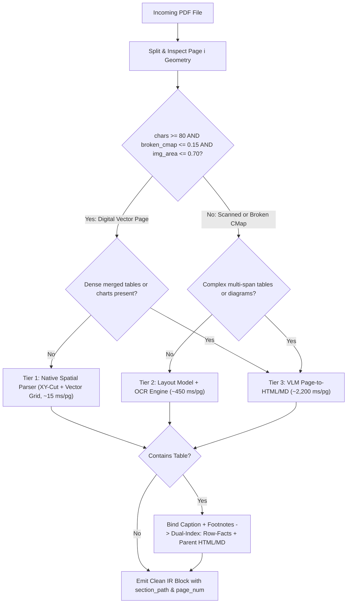
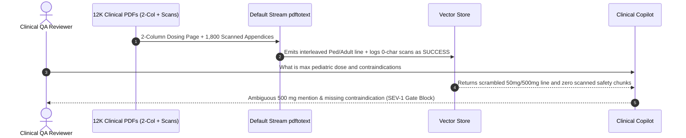

# Module 04: PDFs, Tables and Complex Documents

> **Prerequisites:** [Module 03: Document Loaders and Parsing](../03-document-loaders-and-parsing/README.md) and [Track 16: Speech & Multimodal Models](../../16-speech-and-multimodal-models/README.md).  
> **Estimated Reading Time:** 35 minutes  
> **Target Audience:** AI Backend Engineers, Document Intelligence Architects, Search Systems Engineers

> [!TIP]
> **The Golden Rule of Complex Documents:** A PDF is **not a text document**—it is a low-level 2D canvas of positioned glyphs and vector lines with zero native notion of paragraphs, columns, or tables. Never feed raw PDF stream text into a RAG chunker: triage every page across **Native Spatial Layout vs. OCR vs. Vision-Language Models (VLM)**, reconstruct multi-column reading order via bounding boxes (`XY-Cut`), and serialize tables into self-contained **Row-Facts or Dual-Index Parent Tables** with captions and footnotes permanently bound.

---

## Why This Matters

Enterprise truth lives inside the hardest files on Earth: two-column IEEE specs, scanned 1990s compliance exhibits, SEC 10-K financial tables with `colspan` headers, engineering architecture PDFs, and clinical dosing charts. Standard `pdftotext` or basic `pypdf` extractors fail catastrophically on these documents in three silent ways:
1. **Multi-Column Cross-Scrambling:** Text dumps read horizontally across column gutters, splicing Pediatric Dosing Column 1 into Adult Dosing Column 2 (`"Children 5–12: Administer 500 mg"`).
2. **Silent Scanned-PDF Zero-Byte Ingestion:** Scanned image PDFs return `""` (`0` characters) with exit code `0`, fooling ingestion jobs into marking critical safety appendices `INGESTED_SUCCESS` with zero searchable vectors.
3. **Table Fragmentation:** Fixed-size chunking slices row `7` of a fee schedule away from its header row (`| Tier | Annual Fee |`) and footnote (`*Excludes VAT`), producing orphan numbers ("`| 2026 |` \$4,200 `|`") that confuse both the retriever and the LLM.

---

## 1. Architectural Mental Model: Per-Page PDF Triage & Table Serialization

Instead of forcing one expensive VLM call onto every clean digital page—or trusting a fast CPU parser on a scanned table—production systems route **page by page** using fast geometric telemetry (`extracted_chars`, `broken_cmap_ratio`, `image_area_ratio`, `table_complexity`).



### Why Raw PDFs Scramble Reading Order: Glyph Streams & XY-Cut Reconstruction

Inside a PDF page, text objects are placed anywhere on a 2D coordinate grid (`(x0, y0, x1, y1)` in points, where `72 pt = 1 inch`) via `Tm` text matrices. A multi-column PDF often stores spans out of visual order—or worse, a naive extractor sorting strictly top-to-bottom `(y0, x0)` interleaves Left Column line `i` with Right Column line `i` whenever their `y0` coordinates align!

**Recursive XY-Cut / Gutter Clustering** solves reading order deterministically:
1. Identify **full-width spanning elements** (titles, horizontal banners crossing the midpoint gutter $x_{\text{gutter}}$).
2. Project character bounding boxes onto the horizontal X-axis to locate continuous vertical whitespace valleys (`width >= 14 pt`) spanning the column block height.
3. Split recursively at the widest vertical gutter: emit full-width top banners $\rightarrow$ traverse complete Left Column top-to-bottom $\rightarrow$ traverse complete Right Column top-to-bottom.

### Per-Page Triage Math & Cost Optimization

Two PDF defects masquerade as valid text unless explicitly measured:
- **Scanned Image PDFs:** Nearly `100%` of the page is a single raster XObject (`image_area_ratio > 0.70`) while `extracted_chars < 80`.
- **Broken `/ToUnicode` CMap Font Encoding:** Text extraction emits replacement glyphs (`\ufffd` / `U+FFFD`, `(cid:123)`, or private-use codepoints) instead of readable ASCII/Unicode. Measuring `broken_cmap_ratio = count(unmapped_or_replacement) / total_chars > 0.15` immediately triggers OCR/VLM fallback!

Consider a `500`-page mixed enterprise PDF portfolio (`380` clean digital pages, `75` scanned/broken-CMap pages, `45` dense merged-table/chart pages):
- Routing all `500` pages blindly to a VLM at \$0.008/page costs **\$4.00** (`1,100s` sequential compute).
- Triaging per page (Tier 1 \$0.0001, Tier 2 \$0.0015, Tier 3 \$0.0080) costs **\$0.51** (**`7.8x` cheaper**) and executes **`8x` faster**, reserving expensive multimodal tokens strictly for visually complex pages.

### Table Serialization: 4 Canonical Strategies + Caption Binding

Even when a table is accurately extracted (`PyMuPDF find_tables()`, `TableFormer` in Docling, or VLM), how you **serialize** it determines retrieval recall:

1. **Linear Markdown Pipe Table (`| Col1 | Col2 |`):** Clean and token-frugal for small (`<= 12` rows, zero merged cells) tables. **Breaks** on `colspan`/`rowspan` headers and breaks catastrophically if sliced mid-table by a chunk limit.
2. **Semantic HTML `<table>` (`colspan`, `rowspan`, `<caption>`, `<tfoot>`):** Preserves hierarchical merged headers (`Q1` spanning `Actual` and `Forecast`) natively and is parsed cleanly by modern LLMs during generation—though raw `<td>` tag noise dilutes dense embedding cosine scores.
3. **Self-Contained Per-Row Fact Chunks (`Row-Facts`):** Serialize every row independently with its table caption, all column names (including hierarchical parent column headers), and footnotes:
   - `"Table 3: 2026 Enterprise SLA Credit Schedule | Row 3: Tier=Enterprise; Region=Global; Uptime SLA=99.99%; Service Credit=25%. Note: *Excludes planned Sunday 02:00 UTC maintenance."`
   - Ideal for **retrieval** across `50–500`-row tables!
4. **Dual-Index Pattern (Best Production Architecture):** Embed **both** a concise Table Summary + per-row Row-Facts into the vector/BM25 index carrying `parent_table_id`, while storing the **complete unsplit HTML/Markdown table + caption + footnotes** in the parent docstore. When any Row-Fact hits top-$k$, context assembly injects the parent intact table (or surrounding slice + headers) into the LLM prompt!

---

## 2. Systematic Comparison Matrix: PDF Extractors & Table Serializations

### PDF Extraction Engine Trade-Offs

| Extraction Tier | Multi-Column Accuracy | Merged Table & Chart Handling | Broken CMap / Scan Support | Latency / Page | Inference Cost / 1,000 Pages |
| :--- | :--- | :--- | :--- | :--- | :--- |
| **Raw Stream (`pypdf` text mode)** | **Broken** (stream/y-interleaved) | Destroys rows/columns | **Fails silently** (`0` chars or `cid:` garbage) | `~3 ms` | \$0 (CPU only) |
| **Spatial Bounding-Box (`PyMuPDF` / `pdfplumber`)** | **High** (XY-Cut / block clustering) | Good on clean ruled grids (`find_tables()`) | Fails on scans (triggers Tier 2 triage) | `~10–25 ms` | \$0 (CPU only) |
| **Layout + OCR (`Docling` RT-DETR + `TableFormer` / `PaddleOCR`)** | **Very High** (vision layout segmentation) | **High** (handles borderless & merged cells) | **Full** (OCR + layout detection) | `~300–1,200 ms` | ~\$0.50–\$1.50 GPU/API |
| **Vision-Language Model (VLM Full-Page Markdown/HTML)** | **Highest** (human-level reading order) | **Highest** (diagrams, charts, nested forms) | **Full** (pixels only, immune to CMaps) | `~1,500–3,500 ms` | ~\$3.00–\$15.00 |

### Table Serialization Pattern Matrix

| Serialization Format | Handles `colspan` / `rowspan`? | Retrieval Precision on `100+` Rows | Token Overhead | Best Usage Role |
| :--- | :--- | :--- | :--- | :--- |
| **Linear Markdown (`| a | b |`)** | No | Moderate (breaks if split mid-table) | **Low** | Small unmerged tables (`<= 12` rows) |
| **HTML `<table>` with `<caption>`** | **Yes** | Poor for raw dense embedding (tag bloat) | High (`<td>` tags) | **Generation context** for complex merged financial tables |
| **Self-Contained Row-Facts** | Yes (flattened column paths) | **Highest** (every chunk keeps full headers) | Moderate | **Vector + BM25 indexing** of large tabular datasets |
| **Dual-Index (Summary/Row-Facts -> Parent Table)** | **Yes** | **Highest** (clean lookup + intact context) | Optimal | **Gold standard** for enterprise financial/regulatory RAG |

---

## 3. Production War Story Post-Mortem: The Cross-Column Clinical Dosing Mixup & Silent Blank Scan Outage

| Field | Incident Details |
| :--- | :--- |
| **Severity** | **SEV-1** (Safety-Critical Cross-Column Text Splicing & Silent Zero-Character PDF Drop) |
| **Detection / Resolution Time** | Detected during pre-production clinical red-team audit (blocked GA launch) / Remediated in 3 days via triage router + XY-Cut + VLM fallback |
| **Impact** | **1,800** scanned appendix PDFs marked `INGESTED_SUCCESS` with `0` chunks indexed; two-column dosing guide interleaved Pediatric (`50 mg`) and Adult (`500 mg`) lines |

### What Happened

A healthcare SaaS team ingested `12,000` clinical guidelines and safety appendices using `pdftotext` in default mode without layout flags, minimum character assertions, or OCR fallback.

During clinical red-team QA before GA launch, physicians uncovered two severe defects:
1. **Cross-Column Dosing Splicing:** A two-column guidelines PDF placed *"Pediatric Track (Ages 5–12): Administer 50 mg once daily"* on the left (`x0=40..275`) and *"Adult Track (Ages 18+): Administer 500 mg twice daily"* on the right (`x0=325..560`). Because both spans shared identical `y0` baselines, `pdftotext` read across the center gutter: *"Pediatric Track (Ages 5–12): Adult Track (Ages 18+): Administer 50 mg once daily. Administer 500 mg twice daily."*—causing the assistant to warn ambiguously about `500 mg` on pediatric queries!
2. **Silent Zero-Byte Scan Ingestion:** `1,800` legacy safety appendices were scanned TIFF-inside-PDF wrappers containing zero embedded text streams. The loader returned `""` (`0` characters), produced `0` chunks, logged `status=SUCCESS`, and left every drug contraindication inside those `1,800` PDFs completely invisible to search!



### Root Cause Analysis

- **Zero Spatial Layout Analysis:** Stream/y-order extraction lacked column-gutter detection (`XY-Cut`), interleaving parallel columns sharing vertical baselines.
- **Missing Empty-Text & CMap Gate:** The pipeline treated `len(extracted_text) == 0` as a valid document rather than routing low-character / high-image-area pages to OCR/VLM or DLQ.

### The Fix & Architectural Hardening

- **Implemented Per-Page Triage Gate:** Asserted `extracted_chars >= 80` and `broken_cmap_ratio <= 0.15`; automatically routed failing or image-heavy pages (`image_area > 0.70`) to OCR/VLM.
- **Deployed Bounding-Box XY-Cut & Table Serialization:** Extracted glyph bounding boxes `(x0, y0, x1, y1)`, split columns cleanly across whitespace gutters, and converted dosing tables into caption-bound **Row-Facts** + parent **HTML tables**.

---

## 4. Multi-Language Production Implementation: PDF Page Triage Router, XY-Cut Column Sorter & Table Row-Fact Serializer

The production modules below across **Go**, **TypeScript**, **Python**, and **C#** implement three core primitives: (1) **Per-Page Triage Router** (`TIER_1_NATIVE_CPU` | `TIER_2_OCR_LAYOUT` | `TIER_3_VLM`), (2) **Gutter-Aware XY-Cut Multi-Column Sorter**, and (3) **Caption- & Footnote-Bound Table Serializer** generating both linear Markdown and self-contained Row-Facts.

````carousel

```go
package pdfextract

import (
	"fmt"
	"sort"
	"strings"
)

type PageTelemetry struct {
	PageNumber           int
	ExtractedChars       int
	BrokenCMapRatio      float64
	ImageAreaRatio       float64
	ComplexTablesOrChart bool
}

type SpanBox struct {
	X0, Y0, X1, Y1 float64
	Text           string
}

type TableBlock struct {
	TableID  string
	Caption  string
	Footnote string
	Headers  []string
	Rows     [][]string
}

func RoutePageTier(t PageTelemetry) string {
	if t.ExtractedChars < 80 || t.BrokenCMapRatio > 0.15 || t.ImageAreaRatio > 0.70 {
		if t.ComplexTablesOrChart {
			return "TIER_3_VLM"
		}
		return "TIER_2_OCR_LAYOUT"
	}
	if t.ComplexTablesOrChart {
		return "TIER_3_VLM"
	}
	return "TIER_1_NATIVE_CPU"
}

// XYCutSortTwoColumn separates full-width banners from left/right column boxes across gutterX.
func XYCutSortTwoColumn(boxes []SpanBox, gutterX float64) []SpanBox {
	var banners, left, right []SpanBox
	for _, b := range boxes {
		if b.X0 < gutterX && b.X1 > gutterX {
			banners = append(banners, b)
		} else if b.X1 <= gutterX {
			left = append(left, b)
		} else {
			right = append(right, b)
		}
	}
	sortY := func(s []SpanBox) {
		sort.SliceStable(s, func(i, j int) bool {
			if s[i].Y0 == s[j].Y0 {
				return s[i].X0 < s[j].X0
			}
			return s[i].Y0 < s[j].Y0
		})
	}
	sortY(banners)
	sortY(left)
	sortY(right)

	out := make([]SpanBox, 0, len(boxes))
	out = append(out, banners...)
	out = append(out, left...)
	out = append(out, right...)
	return out
}

// SerializeTableRowFacts produces self-contained indexable chunks with bound caption & footnote.
func SerializeTableRowFacts(tbl TableBlock) []string {
	facts := make([]string, 0, len(tbl.Rows))
	for rowIdx, row := range tbl.Rows {
		var pairs []string
		for colIdx, h := range tbl.Headers {
			val := ""
			if colIdx < len(row) {
				val = row[colIdx]
			}
			pairs = append(pairs, fmt.Sprintf("%s=%s", h, val))
		}
		fact := fmt.Sprintf("%s | Row %d: %s.", tbl.Caption, rowIdx+1, strings.Join(pairs, "; "))
		if tbl.Footnote != "" {
			fact += " Note: " + tbl.Footnote
		}
		facts = append(facts, fact)
	}
	return facts
}
```

<!-- slide -->

```typescript
export type ExtractionTier = "TIER_1_NATIVE_CPU" | "TIER_2_OCR_LAYOUT" | "TIER_3_VLM";

export interface PageTelemetry {
  readonly pageNumber: number;
  readonly extractedChars: number;
  readonly brokenCMapRatio: number;
  readonly imageAreaRatio: number;
  readonly hasComplexTablesOrCharts: boolean;
}

export interface BoundingSpan {
  readonly x0: number;
  readonly y0: number;
  readonly x1: number;
  readonly y1: number;
  readonly text: string;
}

export interface StructuredTable {
  readonly tableId: string;
  readonly caption: string;
  readonly footnote?: string;
  readonly headers: readonly string[];
  readonly rows: readonly (readonly string[])[];
}

export function routePageExtractionTier(t: PageTelemetry): ExtractionTier {
  if (t.extractedChars < 80 || t.brokenCMapRatio > 0.15 || t.imageAreaRatio > 0.7) {
    return t.hasComplexTablesOrCharts ? "TIER_3_VLM" : "TIER_2_OCR_LAYOUT";
  }
  return t.hasComplexTablesOrCharts ? "TIER_3_VLM" : "TIER_1_NATIVE_CPU";
}

export function xyCutTwoColumnSort(spans: readonly BoundingSpan[], gutterX: number): BoundingSpan[] {
  const byY = (a: BoundingSpan, b: BoundingSpan) => (a.y0 !== b.y0 ? a.y0 - b.y0 : a.x0 - b.x0);
  const banners = spans.filter((s) => s.x0 < gutterX && s.x1 > gutterX).sort(byY);
  const leftCol = spans.filter((s) => s.x1 <= gutterX).sort(byY);
  const rightCol = spans.filter((s) => s.x0 >= gutterX).sort(byY);
  return [...banners, ...leftCol, ...rightCol];
}

export function serializeTableOutputs(table: StructuredTable): {
  markdown: string;
  rowFacts: string[];
} {
  const headerLine = `| ${table.headers.join(" | ")} |`;
  const sepLine = `| ${table.headers.map(() => "---").join(" | ")} |`;
  const bodyLines = table.rows.map((r) => `| ${r.join(" | ")} |`);
  const mdParts = [table.caption, headerLine, sepLine, ...bodyLines];
  if (table.footnote) mdParts.push(table.footnote);

  const rowFacts = table.rows.map((row, idx) => {
    const kv = table.headers.map((h, cIdx) => `${h}=${row[cIdx] ?? ""}`).join("; ");
    const note = table.footnote ? ` Note: ${table.footnote}` : "";
    return `${table.caption} | Row ${idx + 1}: ${kv}.${note}`;
  });

  return { markdown: mdParts.join("\n"), rowFacts };
}
```

<!-- slide -->

```python
"""
pdf_triage_and_tables.py
Per-page PDF extraction router (Native CPU vs. OCR vs. VLM), gutter-aware XY-Cut
multi-column sorter, and Dual-Index Table Serializer (Markdown + HTML + Row-Facts).
"""
from dataclasses import dataclass
import html
from typing import Sequence


@dataclass(frozen=True)
class PageSignals:
    page_num: int
    extracted_chars: int
    broken_cmap_ratio: float
    image_area_ratio: float
    complex_tables_or_charts: bool


@dataclass(frozen=True)
class TextSpan:
    x0: float
    y0: float
    x1: float
    y1: float
    text: str


@dataclass(frozen=True)
class TableData:
    table_id: str
    caption: str
    headers: tuple[str, ...]
    rows: tuple[tuple[str, ...], ...]
    footnote: str = ""


def route_pdf_page(sig: PageSignals) -> str:
    needs_vision = sig.extracted_chars < 80 or sig.broken_cmap_ratio > 0.15 or sig.image_area_ratio > 0.70
    if needs_vision:
        return "TIER_3_VLM" if sig.complex_tables_or_charts else "TIER_2_OCR_LAYOUT"
    return "TIER_3_VLM" if sig.complex_tables_or_charts else "TIER_1_NATIVE_CPU"


def xy_cut_sort(spans: Sequence[TextSpan], gutter_x: float) -> list[TextSpan]:
    banners = sorted((s for s in spans if s.x0 < gutter_x < s.x1), key=lambda s: (s.y0, s.x0))
    left_col = sorted((s for s in spans if s.x1 <= gutter_x), key=lambda s: (s.y0, s.x0))
    right_col = sorted((s for s in spans if s.x0 >= gutter_x), key=lambda s: (s.y0, s.x0))
    return banners + left_col + right_col


def serialize_table_dual_index(tbl: TableData) -> dict[str, object]:
    md_rows = [
        tbl.caption,
        "| " + " | ".join(tbl.headers) + " |",
        "| " + " | ".join("---" for _ in tbl.headers) + " |",
        *("| " + " | ".join(r) + " |" for r in tbl.rows),
    ]
    if tbl.footnote:
        md_rows.append(tbl.footnote)

    th_cells = "".join(f"<th>{html.escape(h)}</th>" for h in tbl.headers)
    tr_cells = "".join(
        "<tr>" + "".join(f"<td>{html.escape(cell)}</td>" for cell in row) + "</tr>"
        for row in tbl.rows
    )
    tfoot = f"<tfoot><tr><td colspan=\"{len(tbl.headers)}\">{html.escape(tbl.footnote)}</td></tr></tfoot>" if tbl.footnote else ""
    html_table = f"<table><caption>{html.escape(tbl.caption)}</caption><thead><tr>{th_cells}</tr></thead><tbody>{tr_cells}</tbody>{tfoot}</table>"

    row_facts = []
    for idx, row in enumerate(tbl.rows, 1):
        kv = "; ".join(f"{h}={val}" for h, val in zip(tbl.headers, row))
        suffix = f" Note: {tbl.footnote}" if tbl.footnote else ""
        row_facts.append(f"{tbl.caption} | Row {idx}: {kv}.{suffix}")

    return {
        "table_id": tbl.table_id,
        "parent_markdown": "\n".join(md_rows),
        "parent_html": html_table,
        "indexed_row_facts": row_facts,
    }
```

<!-- slide -->

```csharp
using System;
using System.Collections.Generic;
using System.Linq;
using System.Text;

namespace GenAI.ComplexDocuments;

public enum ExtractionTier
{
    Tier1NativeCpu,
    Tier2OcrLayout,
    Tier3Vlm
}

public sealed record PageSignals(
    int PageNumber,
    int ExtractedChars,
    double BrokenCMapRatio,
    double ImageAreaRatio,
    bool HasComplexTablesOrCharts);

public sealed record PdfSpan(double X0, double Y0, double X1, double Y1, string Text);

public sealed record ExtractedTable(
    string TableId,
    string Caption,
    IReadOnlyList<string> Headers,
    IReadOnlyList<IReadOnlyList<string>> Rows,
    string? Footnote = null);

public static class PdfLayoutProcessor
{
    public static ExtractionTier RoutePage(PageSignals sig)
    {
        bool unreadableNative = sig.ExtractedChars < 80 || sig.BrokenCMapRatio > 0.15 || sig.ImageAreaRatio > 0.70;
        if (unreadableNative)
            return sig.HasComplexTablesOrCharts ? ExtractionTier.Tier3Vlm : ExtractionTier.Tier2OcrLayout;

        return sig.HasComplexTablesOrCharts ? ExtractionTier.Tier3Vlm : ExtractionTier.Tier1NativeCpu;
    }

    public static IReadOnlyList<PdfSpan> XyCutTwoColumnSort(IEnumerable<PdfSpan> spans, double gutterX)
    {
        var list = spans.ToList();
        var banners = list.Where(s => s.X0 < gutterX && s.X1 > gutterX).OrderBy(s => s.Y0).ThenBy(s => s.X0);
        var left = list.Where(s => s.X1 <= gutterX).OrderBy(s => s.Y0).ThenBy(s => s.X0);
        var right = list.Where(s => s.X0 >= gutterX).OrderBy(s => s.Y0).ThenBy(s => s.X0);
        return banners.Concat(left).Concat(right).ToArray();
    }

    public static IReadOnlyList<string> SerializeToRowFacts(ExtractedTable table)
    {
        var facts = new List<string>(table.Rows.Count);
        for (int r = 0; r < table.Rows.Count; r++)
        {
            var row = table.Rows[r];
            var kv = table.Headers.Select((h, c) => $"{h}={(c < row.Count ? row[c] : "")}");
            var sb = new StringBuilder();
            sb.Append($"{table.Caption} | Row {r + 1}: {string.Join("; ", kv)}.");
            if (!string.IsNullOrWhiteSpace(table.Footnote))
                sb.Append($" Note: {table.Footnote}");
            facts.Add(sb.ToString());
        }
        return facts;
    }
}
```

````

---

## 5. Practical Hands-On Verification CLI Workflows

Run these deterministic Python 3.13 verification scripts offline in your terminal.

### Workflow 1: Multi-Column PDF XY-Cut Reconstruction vs. Naive Y-Order Extraction

Simulate PDF glyph bounding boxes from a two-column clinical dosing page (`600 pt` width, center gutter at `x = 300 pt`) and compare naive vertical sorting against gutter-aware XY-Cut reconstruction:

```bash
python -c '
# Simulated PDF glyph bounding boxes: (x0, y0, x1, y1, text) on a 600pt-wide page
spans = [
    (40, 40, 560, 65, "Section 4: Clinical Dosing Guidelines"),
    (40, 90, 275, 110, "Pediatric Track (Ages 5-12):"),
    (325, 90, 560, 110, "Adult Track (Ages 18+):"),
    (40, 120, 275, 140, "Administer 50 mg once daily."),
    (325, 120, 560, 140, "Administer 500 mg twice daily."),
    (40, 150, 275, 170, "Never exceed 100 mg/day."),
    (325, 150, 560, 170, "Monitor renal clearance weekly."),
]

naive_y_order = sorted(spans, key=lambda s: (s[1], s[0]))
print("NAIVE Y-ORDER (INTERLEAVED BUG):")
print(" ", " | ".join(s[4] for s in naive_y_order))

def xy_cut_sort(boxes, gutter_x=300):
    banners = sorted([b for b in boxes if b[0] < gutter_x and b[2] > gutter_x], key=lambda b: b[1])
    left_col = sorted([b for b in boxes if b[2] <= gutter_x], key=lambda b: b[1])
    right_col = sorted([b for b in boxes if b[0] >= gutter_x], key=lambda b: b[1])
    return banners + left_col + right_col

print("XY-CUT RECONSTRUCTED ORDER:")
for b in xy_cut_sort(spans):
    print(" ", b[4])
'
```

**Expected Output:**

```text
NAIVE Y-ORDER (INTERLEAVED BUG):
  Section 4: Clinical Dosing Guidelines | Pediatric Track (Ages 5-12): | Adult Track (Ages 18+): | Administer 50 mg once daily. | Administer 500 mg twice daily. | Never exceed 100 mg/day. | Monitor renal clearance weekly.
XY-CUT RECONSTRUCTED ORDER:
  Section 4: Clinical Dosing Guidelines
  Pediatric Track (Ages 5-12):
  Administer 50 mg once daily.
  Never exceed 100 mg/day.
  Adult Track (Ages 18+):
  Administer 500 mg twice daily.
  Monitor renal clearance weekly.
```

### Workflow 2: Per-Page PDF Triage Cost & Latency Benchmark

Evaluate triage routing across a `500`-page enterprise portfolio (`380` digital pages, `60` raster scans, `15` broken-CMap font pages, and `45` dense table/diagram pages) vs. running a VLM blindly on every page:

```bash
python -c '
def route_page(chars, cmap_err_ratio, img_area_ratio, complex_tables_or_charts):
    if chars < 80 or cmap_err_ratio > 0.15 or img_area_ratio > 0.70:
        if complex_tables_or_charts:
            return "TIER_3_VLM"
        return "TIER_2_OCR_LAYOUT"
    if complex_tables_or_charts:
        return "TIER_3_VLM"
    return "TIER_1_NATIVE_CPU"

portfolio = (
    [{"chars": 2100, "cmap": 0.0, "img": 0.05, "complex": False}] * 380
    + [{"chars": 12, "cmap": 0.0, "img": 0.96, "complex": False}] * 60
    + [{"chars": 950, "cmap": 0.42, "img": 0.10, "complex": False}] * 15
    + [{"chars": 640, "cmap": 0.0, "img": 0.45, "complex": True}] * 45
)

costs = {"TIER_1_NATIVE_CPU": 0.0001, "TIER_2_OCR_LAYOUT": 0.0015, "TIER_3_VLM": 0.0080}
times_ms = {"TIER_1_NATIVE_CPU": 15, "TIER_2_OCR_LAYOUT": 450, "TIER_3_VLM": 2200}
counts = {k: 0 for k in costs}
for p in portfolio:
    counts[route_page(p["chars"], p["cmap"], p["img"], p["complex"])] += 1

total_cost = sum(counts[k] * costs[k] for k in counts)
total_sec = sum(counts[k] * times_ms[k] for k in counts) / 1000.0
all_vlm_cost = len(portfolio) * costs["TIER_3_VLM"]
print("Routed counts:", counts)
print(f"Triaged pipeline: ${total_cost:.3f} | {total_sec:.1f}s sequential CPU/API time")
print(f"Naive All-VLM   : ${all_vlm_cost:.3f} ({all_vlm_cost / total_cost:.1f}x more expensive)")
'
```

**Expected Output:**

```text
Routed counts: {'TIER_1_NATIVE_CPU': 380, 'TIER_2_OCR_LAYOUT': 75, 'TIER_3_VLM': 45}
Triaged pipeline: $0.510 | 138.4s sequential CPU/API time
Naive All-VLM   : $4.000 (7.8x more expensive)
```

### Workflow 3: Table Fragmentation vs. Self-Contained Row-Facts with Caption & Footnote Binding

Observe how slicing a Markdown table at `130` characters orphans row `2` and `3` (`| Growth | ... |`, `| Enterprise | ... |`) from column headers (`Tier`, `Region`, `Uptime SLA`, `Service Credit`), whereas self-contained **Row-Facts** preserve caption, column headers, and footnotes inside every chunk:

```bash
python -c '
caption = "Table 3: 2026 Enterprise SLA Credit Schedule"
footnote = "*Excludes planned Sunday 02:00 UTC maintenance."
headers = ["Tier", "Region", "Uptime SLA", "Service Credit"]
rows = [
    ["Starter", "US-East", "99.5%", "10%"],
    ["Growth", "EU-West", "99.9%", "15%"],
    ["Enterprise", "Global", "99.99%", "25%"],
]

md_lines = [caption, "| " + " | ".join(headers) + " |", "| " + " | ".join(["---"]*4) + " |"]
for r in rows:
    md_lines.append("| " + " | ".join(r) + " |")
md_lines.append(footnote)
md_table = "\n".join(md_lines)

print("=== NAIVE 130-CHAR SLICE ON MARKDOWN TABLE ===")
for i in range(0, len(md_table), 130):
    print(f"Chunk {i//130}: {md_table[i:i+130]!r}")

print("\n=== SELF-CONTAINED ROW-FACTS WITH CAPTION & FOOTNOTE ===")
for idx, r in enumerate(rows, 1):
    kv = "; ".join(f"{h}={v}" for h, v in zip(headers, r))
    fact = f"{caption} | Row {idx}: {kv}. Note: {footnote}"
    print(f"RowFact {idx}: {fact}")
'
```

**Expected Output:**

```text
=== NAIVE 130-CHAR SLICE ON MARKDOWN TABLE ===
Chunk 0: 'Table 3: 2026 Enterprise SLA Credit Schedule\n| Tier | Region | Uptime SLA | Service Credit |\n| --- | --- | --- | --- |\n| Starter |'
Chunk 1: ' US-East | 99.5% | 10% |\n| Growth | EU-West | 99.9% | 15% |\n| Enterprise | Global | 99.99% | 25% |\n*Excludes planned Sunday 02:00 '
Chunk 2: 'UTC maintenance.'

=== SELF-CONTAINED ROW-FACTS WITH CAPTION & FOOTNOTE ===
RowFact 1: Table 3: 2026 Enterprise SLA Credit Schedule | Row 1: Tier=Starter; Region=US-East; Uptime SLA=99.5%; Service Credit=10%. Note: *Excludes planned Sunday 02:00 UTC maintenance.
RowFact 2: Table 3: 2026 Enterprise SLA Credit Schedule | Row 2: Tier=Growth; Region=EU-West; Uptime SLA=99.9%; Service Credit=15%. Note: *Excludes planned Sunday 02:00 UTC maintenance.
RowFact 3: Table 3: 2026 Enterprise SLA Credit Schedule | Row 3: Tier=Enterprise; Region=Global; Uptime SLA=99.99%; Service Credit=25%. Note: *Excludes planned Sunday 02:00 UTC maintenance.
```

### Hands-On Exercises

1. **Dynamic Gutter Detection (3-Column Layout):** Extend Workflow 1's `xy_cut_sort` to detect `x`-projection whitespace gaps automatically across `[0..600]` rather than hardcoding `gutter_x=300`, supporting both `2`-column and `3`-column academic layouts.
2. **Broken-CMap Detector Heuristic:** Write a small helper computing `broken_cmap_ratio` on any extracted page string by counting `\ufffd` (`U+FFFD`), `(cid:\d+)` matches, and non-printable Unicode private-use glyphs, verifying it triggers `TIER_2_OCR_LAYOUT` above `0.15`.
3. **Optional Live Multimodal Table Extraction (Requires API Key):** Render one complex PDF page with `colspan`/`rowspan` headers to a PNG (`PyMuPDF` `page.get_pixmap(dpi=150)`) and prompt a VLM to emit structured HTML `<table>` + `<caption>` + `<tfoot>`, verifying `colspan` preservation.

### Independent Challenge

A financial research firm wants to index `10,000` quarterly SEC filings and earnings decks (`~45` pages each, `450,000` total pages). About `70%` of pages are standard digital prose, `10%` are scanned signature/exhibit PDFs, and `20%` contain dense multi-row-span income statements (`15–40` rows with nested column groups like `FY2025 -> Q1 | Q2` and footnotes `"*Non-GAAP adjusted"`). Sending all `450,000` pages to a frontier VLM exceeds both latency SLAs and budget (**\$3,600+** per ingest). Design the exact triage, table serialization, and parent-child retrieval strategy to cut extraction spend by `>70%` while preserving zero-ambiguity table lookup.

<details><summary>Architectural Discussion</summary>

First, deploy a **per-page geometric triage gate**: route the `315,000` clean digital prose pages (`70%`) through Tier 1 CPU spatial extraction (`XY-Cut`, ~\$31 compute), route the `45,000` scanned signature exhibits (`10%`) through Tier 2 open-weight layout + OCR (~\$68), and send ONLY the `90,000` dense merged-header financial statement pages (`20%`) to Tier 3 VLM extraction (~\$720)—slashing total extraction cost by `~77%` (\$819 vs \$3,600) while staying well inside SLA. Second, instruct the VLM to output semantic HTML `<table>` (preserving `colspan`/`rowspan`, `<caption>`, and `<tfoot>` footnotes) into the parent docstore, while deterministically flattening every table row into self-contained **Row-Facts** (`"Table 2 (Q1 FY2025 Income Statement): LineItem=Operating_Margin; Period=FY2025_Q1; Value=22.4%. Note: *Non-GAAP adjusted"`) tagged `parent_table_id` for vector + BM25 indexing.

</details>

---

## 6. Common Mistakes & Troubleshooting

- **Running OCR or VLM blindly on 100% of PDF pages:** Digital PDFs with valid Unicode CMaps parse `100x` faster and `80x` cheaper via spatial CPU libraries (`PyMuPDF`) than multimodal inference. Always triage per page!
- **Treating `extracted_chars == 0` as an empty/blank page without checking `image_area_ratio`:** Scanned appendices produce `0` characters in native text parsers; marking them `SUCCESS` silently deletes critical evidence from your index.
- **Splitting large tables mid-row with fixed character windows:** Rows `15–40` lose their column headers and captions, turning numeric values into ungrounded orphan numbers. Always index Row-Facts or use a Dual-Index parent table lookup.
- **Dropping table captions and footnotes (`*`, `†`) outside table chunks:** Separating `"*Values in thousands of USD"` or `"*Excluding VAT"` from the table causes `1,000x` scale errors or tax misrepresentations during generation. Bind captions and footnotes directly to every serialized table representation.

---

## 7. Operational Validation Checkpoints & Checkpoint Quiz

### Operational Validation Checkpoints

<details><summary><strong>Checkpoint 1: Detecting and rescuing silent broken-CMap PDF extractions</strong></summary>

A newly ingested batch of `300` legacy engineering manuals appears in the vector DB as `"cid:45 cid:81 cid:12 ..."` or `"\ufffd \ufffd \ufffd"` replacement strings instead of readable English, even though `extracted_chars` is `1,800` characters per page! Why did a simple `chars < 80` check miss this, and what metric catches it?

**Validation:** Some legacy PDFs embed custom Type-3 or subsetted fonts lacking valid `/ToUnicode` CMap tables, so native extractors emit thousands of replacement characters (`\ufffd`) or `(cid:N)` placeholders, defeating a naive `chars < 80` check. Fix by computing `broken_cmap_ratio` (percentage of `\ufffd`, `(cid:\d+)`, and unmapped private-use characters) per page and routing any page exceeding `0.15` to `TIER_2_OCR_LAYOUT` or `TIER_3_VLM`.

</details>

<details><summary><strong>Checkpoint 2: Fixing scrambled multi-column PDF retrieval</strong></summary>

A two-column regulatory whitepaper was extracted into chunks where every third sentence jumps abruptly between Section 2 (left column) and Section 5 (right column). Explain the geometric cause and exact fix.

**Validation:** The extractor iterated over PDF spans sorted purely by vertical `y0` (or raw stream order) across the full page width, merging horizontally aligned lines from distinct columns. Fix by implementing **gutter-aware XY-Cut sorting**: separate full-width banners from column spans on either side of whitespace valleys (`gutter_x`), emitting complete Left Column blocks top-to-bottom before Right Column blocks.

</details>

<details><summary><strong>Checkpoint 3: Preventing orphan numbers in 200-row pricing PDFs</strong></summary>

Queries asking `"What is the Enterprise EU-West credit SLA?"` fail to retrieve row `142` of a `200`-row pricing table inside a PDF, or retrieve row `142` without knowing which column is `"Credit %"` vs `"Uptime %"`. How do you fix both retrieval and generation?

**Validation:** At `200` rows, a single Markdown table far exceeds optimal `512`-token chunk bounds; slicing it arbitrarily strips column headers from rows `15–200`. Fix using **Dual-Index Table Serialization**: serialize each row into a self-contained **Row-Fact** carrying the table caption, explicit `column=value` pairs, footnotes, and `parent_table_id` for dense/BM25 retrieval—and return either the intact parent table (if budget allows) or the relevant slice + repeated header row + footnote to the generator.

</details>

### Checkpoint Quiz

1. Why do raw PDF extractors fail on two-column layouts even though the text looks cleanly ordered visually?
2. Which three quantitative per-page signals drive a **PDF Triage Router** between Tier 1 (Native CPU), Tier 2 (OCR), and Tier 3 (VLM)?
3. Compare **Markdown Pipe Tables**, **HTML `<table>`**, and **Row-Facts** when extracting a `150`-row financial table containing `colspan` group headers and a currency-unit footnote (`"in $ millions"`).
4. Why is **Dual-Index Table Retrieval** superior to indexing raw HTML `<table>` tags directly into dense embeddings?
5. What happens in a RAG ingestion pipeline if a scanned image-only PDF returns `""` without an `image_area_ratio` / `extracted_chars` assertion?

<details><summary>Answers</summary>

1. PDFs store positioned glyphs on a 2D `(x, y)` canvas without paragraph/column containers; sorting naively by stream order or `(y0, x0)` interleaves horizontally adjacent lines across column gutters.
2. `extracted_chars` (catches blank/scan pages), `broken_cmap_ratio` (catches `/ToUnicode` font failures), and `image_area_ratio` + `complex_tables_or_charts` (routes scans and visually complex layouts/charts to OCR or VLM).
3. Markdown cannot represent `colspan` merged headers and loses headers if chunk-sliced; HTML `<table>` preserves `colspan`/`<caption>`/`<tfoot>` cleanly for LLM reading; Row-Facts flatten column groups into self-contained `key=value` chunks with bound caption and footnote (`"in $ millions"`) for exact per-row retrieval.
4. Raw `<tr><td>` markup adds noisy HTML token overhead that weakens embedding precision, whereas indexing clean Row-Facts + table summary yields high retrieval recall while returning the intact parent HTML/Markdown table to the LLM for accurate synthesis.
5. The loader emits `0` chunks, marks the file ingested without error, and silently excludes the entire scanned document from search ("silent blackout").

</details>

---

## Further Reading & Sources

- [PyMuPDF Documentation](https://pymupdf.readthedocs.io/en/latest/) — spatial text block extraction (`get_text("blocks")`), bounding boxes, and vector table detection (`find_tables()`).
- [Docling Documentation](https://docling-project.github.io/docling/) — open-source AI document layout analysis (`RT-DETR`) and `TableFormer` table structure extraction to `DoclingDocument`.
- [Retrieval-Augmented Generation for Large Language Models: A Survey (Gao et al., 2023)](https://arxiv.org/abs/2312.10997) — document parsing and chunk quality impact on end-to-end RAG pipelines.
- [Track 16: Speech & Multimodal Models](../../16-speech-and-multimodal-models/README.md) — multimodal vision-language architectures powering Tier-3 document understanding.

## Next

[Module 05: The Retrieval Step](../05-the-retrieval-step/README.md)
