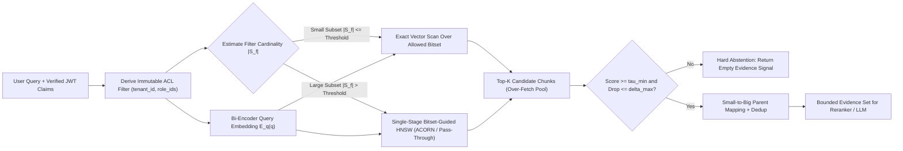
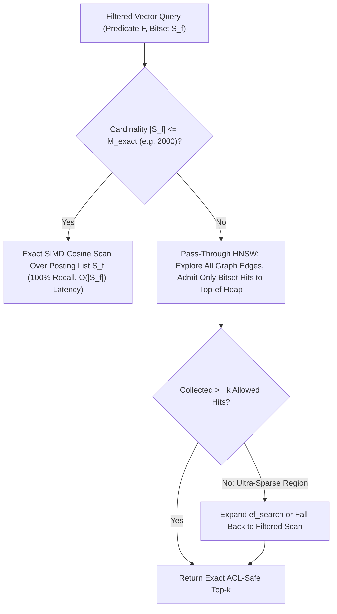
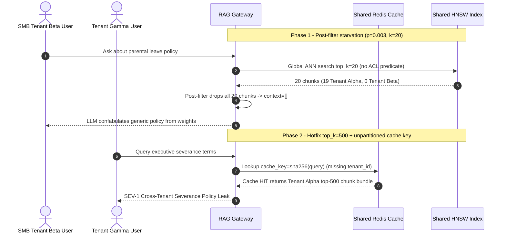

# Module 05: The Retrieval Step

> **Prerequisites:** [Module 00: Why RAG Exists](../00-why-rag-exists/README.md), [Module 04: PDFs, Tables and Complex Documents](../04-pdfs-tables-and-complex-documents/README.md), [Track 08, Module 14: HNSW Explained](../../08-embeddings-and-vector-databases/14-hnsw-explained/README.md), and [Track 08, Module 16: Metadata Filtering and Hybrid Queries](../../08-embeddings-and-vector-databases/16-metadata-filtering-and-hybrid-queries/README.md).  
> **Estimated Reading Time:** 30 minutes  
> **Target Audience:** AI Backend Engineers, RAG Platform Architects, Search & Security Systems Engineers

> [!TIP]
> **The Golden Rule of the Retrieval Step:** Never treat retrieval as a naked `top_k` cosine sort followed by application-layer filtering. Push cryptographically verified **tenant and ACL predicates into single-stage index traversal**, bound candidate recall with **selectivity-aware exact-scan fallback**, and enforce a strict **similarity floor $\tau_{\min}$ plus hard abstention** before a single retrieved token enters the LLM prompt.

---

## Why This Matters

Once documents are parsed and chunked, the **retrieval step** is the sole bridge between your raw enterprise corpus and the generator's context window. Every failure at this boundary cascades irreversibly downstream: if the right chunk fails to enter the retrieved set, even the smartest frontier model either confabulates from parametric priors or falsely abstains; conversely, if unauthorized, duplicate, or low-similarity chunks leak into the prompt, you trigger **SEV-1 cross-tenant data breaches**, **Lost-in-the-Middle** attention collapse, and unnecessary input-token spend.

In production, naive vector lookups fail in three predictable ways:
1. **The $p \times k$ Post-Filtering Starvation Trap:** Fetching global top-$k$ ANN neighbors and filtering by `tenant_id` afterward starves small tenants whenever filter selectivity $p$ is low.
2. **HNSW Graph Disconnectivity Under Naive Pre-Filtering:** Dropping disallowed nodes *before* traversing a Hierarchical Navigable Small World (HNSW) graph severs long-range routing edges, crashing Recall@$k$.
3. **Score Uncalibration & Missing Abstention Gates:** Top-$k$ always returns $k$ results—even when the best cosine similarity is `0.28` garbage—tempting the generator to hallucinate rather than abstain cleanly.

---

## 1. Visual Mental Models & Retrieval Mechanics

### End-to-End Secure Retrieval Architecture

A production retrieval step is a gated pipeline rather than a single `index.query()` call. It binds server-verified identity claims to index predicates, selects an execution plan based on filter cardinality, expands small child hits to coherent parent sections, deduplicates overlapping chunks, and gates generation on calibrated relevance floors:



### Bi-Encoder Top-$k$ ANN Recall vs. Precision & Context Budget

Dense retrieval relies on an asymmetric **bi-encoder** (dual-encoder) architecture:

$$\text{sim}(q, d) = \frac{E_q(q) \cdot E_d(d)}{\|E_q(q)\|_2 \, \|E_d(d)\|_2}$$

Because document embeddings $E_d(d)$ are computed offline at ingestion time and indexed into an Approximate Nearest Neighbor (ANN) graph such as HNSW, online retrieval requires only one forward pass of $E_q(q)$ followed by sub-10 ms graph traversal—unlike a **cross-encoder** (covered in Module 09), which must jointly process $(q, d)$ pairs in $O(|C|)$ attention passes.

Choosing the candidate budget $k$ forces a hard trade-off between **Recall@$k$** (fraction of ground-truth evidence present in the retrieved set) and **Context Precision** (fraction of retrieved tokens that are actually relevant):

- **Under-fetching ($k \in [1, 3]$):** High risk of missing multi-hop facts, adjacent table headers, or paraphrased clauses; if a single boilerplate chunk scores marginally higher, the real answer never reaches the LLM.
- **Over-fetching ($k \ge 30$ directly into the LLM):** Packs distractors into the prompt, pushing critical evidence into the middle of the context window where **Lost-in-the-Middle** degradation reduces reasoning accuracy and inflates input token cost linearly.
- **Two-Stage Separation (`k_retrieve = 40..100` $\rightarrow$ `k_context = 4..8`):** Fetch a generous candidate pool from the fast bi-encoder index, then prune via score cutoffs, parent deduplication, and (in Module 09) cross-encoder reranking before assembling the final prompt.

### Pre-Filtering vs. Post-Filtering & The $p \times k$ Starvation Math

Suppose a multi-tenant vector index contains $N = 1{,}000{,}000$ chunks, and Tenant B owns $5{,}000$ chunks—a filter selectivity of $p = \frac{5{,}000}{1{,}000{,}000} = 0.005$ (`0.5%`).

#### Failure Mode A: Post-Filtering Starvation

Under **post-filtering**, the vector engine fetches the global top-$k$ nearest neighbors ignoring ACL metadata, then filters out rows failing `tenant_id = 'tenant_b'`. Modeling document ownership near the query neighborhood as independent Bernoulli trials with probability $p$, the expected number of surviving results is:

$$E[\text{survivors}] = p \cdot k$$

And the probability that post-filtering returns **zero valid chunks** (a silent false-negative outage) is:

$$P(\text{zero hits}) = (1 - p)^k$$

With $p = 0.005$ and $k = 20$:
- $E[\text{survivors}] = 0.005 \times 20 = 0.10$ chunks per query.
- $P(\text{zero hits}) = (0.995)^{20} \approx 90.46\%$ of all queries return **0 chunks**, even though Tenant B has `5,000` documents in the index!

Attempting to patch post-filtering by inflating $k' = \lceil k / p \rceil$ (`k' = 4,000`) collapses under memory/network overhead and breaks whenever a query targets an even smaller sub-filter (`department = 'legal'` $\cap$ `year = 2026`, $p = 0.0002 \implies k' = 100{,}000$).

#### Failure Mode B: Naive Pre-Filtering HNSW Graph Disconnectivity

Conversely, **naive pre-filtering** builds a bitset of allowed IDs $S_f$ and forbids the HNSW walker from even visiting disallowed neighbors. Once $p < 0.10$, deleting `90%+` of graph nodes fractures the small-world routing highway into isolated islands—the greedy walker stalls at local dead-ends far from the true nearest neighbors.

Modern vector engines (such as Qdrant's filterable HNSW, Weaviate's ACORN-inspired traversal, and `pgvector` iterative scans, formalized in **ACORN**, Patel et al., `arXiv:2403.04871`) solve both traps via **Single-Stage Bitset-Guided Pass-Through Traversal + Exact Fallback**:



- **When $|S_f|$ is small** (e.g., $\le 1{,}000\text{–}5{,}000$ chunks for a niche tenant or user folder), scanning raw vectors via SIMD over the inverted metadata posting list takes `< 2 ms` and guarantees **100% exact recall** with zero graph traversal overhead.
- **When $|S_f|$ is large**, pass-through HNSW traverses *through* disallowed nodes as routing bridges without ever admitting disallowed nodes into the candidate result heap—eliminating graph disconnectivity while preserving zero-leakage isolation.

### Security-First ACL Enforcement & Small-to-Big Context Expansion

1. **Zero-Trust Auth-to-Filter Binding:** Never accept `tenant_id` or `allowed_roles` from an untrusted JSON request body or LLM-generated tool argument. Extract verified claims (`sub`, `tenant_id`, `groups[]`) exclusively from signed server-side JWT/session middleware, compile them into an immutable predicate (`tenant_id == claim.tenant AND (visibility == 'public' OR group IN claim.groups)`), and push the predicate into the index *before* distance scoring.
2. **Score Calibration & Hard Abstention Gate:** Raw cosine similarity clusters differently per embedding model (`0.72–0.88` for OpenAI `text-embedding-3-*`, `0.55–0.80` for BGE/E5). Measure your corpus baseline distribution and enforce both an absolute similarity floor $\tau_{\min}$ and a relative drop-off guard $\Delta_{\max}$ (`score >= top_score - delta_max`). If zero chunks survive, **halt before calling the generator** and return a deterministic abstention message.
3. **Small-to-Big (Parent-Document) Retrieval:** Dense bi-encoders retrieve sharpest when chunks are compact (`150–300` tokens, one cohesive claim per vector), yet generators reason better over coherent surrounding context (`800–1,200` tokens). Store `parent_id` in chunk metadata: search against crisp `child_chunk_id` embeddings, deduplicate multiple hits sharing the same `parent_id`, and hydrate the full parent section in a bounded `O(k)` KV/SQL batch read.

---

## 2. Systematic Reference & Comparison Matrix

### Retrieval Filtering & Execution Strategies

| Strategy | Recall Under Low Selectivity ($p < 0.02$) | Latency Scaling | Security / ACL Leakage Risk | Memory & Index Overhead | Production Recommendation |
| :--- | :--- | :--- | :--- | :--- | :--- |
| **Post-Filtering** (`ANN(k)` then `WHERE`) | **Catastrophic** ($E[\text{hits}] = p \cdot k$; 90%+ empty results) | $O(\log N)$ | **High** if app fails open or exposes side-channel timings | None | **Banned** for tenant/ACL isolation |
| **Over-Fetched Post-Filtering** (`ANN(k/p)`) | Unstable (breaks on skewed filters) | Unbounded ($O(k/p)$) | Medium (large candidate buffers in app tier) | High serialization spike | Only temporary stopgap with strict ceiling |
| **Naive Node-Deletion Pre-Filtering** | **Severe Collapse** (fractured HNSW highways) | $O(\log N)$ (stalls early) | Zero (pre-filtered) | Minimal | Avoid for HNSW below $p = 0.15$ |
| **Per-Tenant Physical Partition / Namespace** | **100%** (isolated graph per tenant) | $O(\log N_{\text{tenant}})$ | **Zero** (physical isolation) | High for 100K+ tiny tenants (index handle bloat) | Ideal for large B2B enterprise tiers (`<10K` tenants) |
| **Bitset-Guided HNSW + Exact Scan Fallback** | **98%–100%** across all $p \in (0, 1]$ | $\min(O(\log N), O(\|S_f\|))$ | **Zero** (pushed into engine) | Low (bitmap + payload inverted index) | **Production Default** for multi-tenant SaaS |

### Essential Retrieval Tuning Parameters

| Parameter | Typical Production Range | Governing Trade-Off |
| :--- | :--- | :--- |
| **Initial Fetch Depth (`k_fetch`)** | `30 – 100` | Must leave headroom for deduplication & reranking without flooding serialization |
| **Final Context Cap (`k_context`)** | `4 – 10` parent chunks | Bounds TTFT, token spend, and Lost-in-the-Middle attention decay |
| **HNSW `ef_search`** | `64 – 256` (increase `2x` under heavy filters) | Higher `ef_search` improves Recall@$k$ linearly with distance evaluations |
| **Exact-Scan Fallback Cardinality** | `|S_f| <= 1,500 – 5,000` vectors | Exact SIMD scan beats graph hopping both on recall (`100%`) and latency |
| **Absolute Score Floor ($\tau_{\min}$)** | Calibrated empirically (e.g., `0.45 – 0.65`) | Blocks OOD garbage from triggering parametric LLM confabulation |
| **Relative Drop-Off ($\Delta_{\max}$)** | `0.12 – 0.20` below `top_score` | Prevents padding a clean single-hit query with weakly related tail noise |

---

## 3. Production War Story Post-Mortem: The 1% Tenant Starvation & Post-Filter ACL Leak

| Field | Incident Details |
| :--- | :--- |
| **Severity** | **SEV-1** (Cross-Tenant Document Exposure + 88% False-Empty Outage for SMB Tenants) |
| **Detection / Resolution Time** | Detected 4 days after multi-tenant rollout via enterprise security audit & support tickets / Mitigated in 3 hours |
| **Impact** | **310 small tenants** experienced silent empty-context hallucinations; a panicked `top_k=500` post-filter hotfix exposed a confidential M&A memo summary when an LLM guardrail failed |

### What Happened

An HR compliance platform launched a shared vector cluster containing `1.2M` policy chunks across `400` customer workspaces. To ship quickly, the team used an unmanaged HNSW endpoint without payload indexing and applied `WHERE workspace_id = req.workspace_id` in Python **after** calling `vector_index.search(query_vec, top_k=20)`.

Two incidents unfolded back-to-back:
1. **Silent $p \times k$ Starvation:** Enterprise Tenant Alpha owned `42%` of the index (`p = 0.42`, averaging `8.4` hits per query—so staging tests passed!). Meanwhile, SMB Tenant Beta owned `3,600` chunks (`p = 0.003`). With `k = 20`, Tenant Beta averaged $0.003 \times 20 = 0.06$ survivors (`94.2%` of queries returned `0` chunks!). Because the orchestrator did not hard-abstain on empty context, the LLM smoothly fabricated generic US labor laws instead of Tenant Beta's California-specific handbook.
2. **Panicked `top_k=500` & Trust-Boundary Bug:** An engineer tried to "fix" starvation by cranking `top_k=500` and passing `workspace_id` via an HTTP query parameter while caching raw top-500 hits in Redis keyed only by `hash(query)`. When Tenant Gamma queried a similar phrase, a missing cache-key tenant prefix combined with a client-overridable header caused Tenant Alpha's executive severance policy to enter the prompt, which the LLM dutifully summarized—creating an immediate **SEV-1** disclosure.



### Root Cause Analysis

1. **Application-layer post-filtering on a shared vector space:** Violated the $p \times k$ survival law, guaranteeing near-zero recall for minority tenants without triggering hard abstention.
2. **Cache-key tenant omission & untrusted filter inputs:** Caching retrieval results without binding `tenant_id + role_set + acl_version` into the cache key and trusting caller-supplied parameters broke tenant isolation even after retrieval.
3. **Missing empty-context circuit breaker:** Allowing the generator to run when `retrieved_chunks == []` turned retrieval failures into confident parametric hallucinations.

### The Fix & Architectural Hardening

- **Single-Stage Payload-Indexed Pre-Filtering:** Indexed `tenant_id` and `allowed_groups` as keyword bitsets inside the vector engine; switched queries with $|S_f| \le 2{,}500$ to exact bitset scan and larger tenants to pass-through filtered HNSW (`ef_search = 128`).
- **Cryptographic Auth-to-Filter Enforcement:** Extracted `tenant_id` and `groups` exclusively from verified JWT middleware, removing all client-supplied filter overrides, and prefixed every cache key with `sha256(tenant_id | sorted_roles | acl_epoch | query)`.
- **Mandatory Hard-Abstention Gate:** Rejected LLM generation whenever `len(passed_chunks) == 0` or `top_score < 0.55`, cutting Tenant Beta zero-hit rate from `94.2%` to `0.0%` with `< 12 ms` p95 retrieval latency.

---

## 4. Multi-Language Production Implementation: ACL-Enforced Selectivity-Aware Retrieval Gate

These four implementations provide a production-grade **Retrieval Gate** across **Go**, **TypeScript**, **Python**, and **C#** with:
1. Immutable server-verified `PrincipalClaims` validation (rejecting empty/spoofed tenant credentials).
2. Cardinality-aware execution routing (`EXACT_BITSET_SCAN` vs. `FILTERED_HNSW_PASSTHROUGH`) with deadline timeouts.
3. Absolute cosine floor $\tau_{\min}$, relative drop-off pruning $\Delta_{\max}$, `parent_id` deduplication, and explicit `ABSTAIN_NO_EVIDENCE` signaling.

````carousel

```go
package retrieval

import (
	"context"
	"errors"
	"fmt"
	"sort"
	"time"
)

type PrincipalClaims struct {
	TenantID string
	UserID   string
	Roles    []string
}

type CandidateChunk struct {
	ChunkID  string
	ParentID string
	TenantID string
	ACLRole  string
	Score    float64
	Text     string
}

type GateConfig struct {
	ExactScanThreshold int
	OverFetchK         int
	MaxParents         int
	TauMin             float64
	DeltaMax           float64
	Timeout            time.Duration
}

type RetrievalResult struct {
	PlanUsed  string
	Abstained bool
	Reason    string
	Chunks    []CandidateChunk
}

type VectorBackend interface {
	EstimateCardinality(ctx context.Context, tenantID string, roles []string) (int, error)
	ExactScan(ctx context.Context, tenantID string, roles []string, queryVec []float32, k int) ([]CandidateChunk, error)
	FilteredHNSW(ctx context.Context, tenantID string, roles []string, queryVec []float32, k int) ([]CandidateChunk, error)
}

func ExecuteRetrievalGate(
	ctx context.Context,
	backend VectorBackend,
	claims PrincipalClaims,
	queryVec []float32,
	cfg GateConfig,
) (RetrievalResult, error) {
	if claims.TenantID == "" || claims.UserID == "" {
		return RetrievalResult{}, errors.New("security violation: missing verified tenant or user claim")
	}
	if len(queryVec) == 0 {
		return RetrievalResult{}, errors.New("invalid query vector: empty embedding")
	}

	rCtx, cancel := context.WithTimeout(ctx, cfg.Timeout)
	defer cancel()

	cardinality, err := backend.EstimateCardinality(rCtx, claims.TenantID, claims.Roles)
	if err != nil {
		return RetrievalResult{}, fmt.Errorf("cardinality check failed: %w", err)
	}
	if cardinality == 0 {
		return RetrievalResult{PlanUsed: "NONE", Abstained: true, Reason: "no authorized chunks for principal"}, nil
	}

	var raw []CandidateChunk
	plan := "FILTERED_HNSW"
	if cardinality <= cfg.ExactScanThreshold {
		plan = "EXACT_BITSET_SCAN"
		raw, err = backend.ExactScan(rCtx, claims.TenantID, claims.Roles, queryVec, cfg.OverFetchK)
	} else {
		raw, err = backend.FilteredHNSW(rCtx, claims.TenantID, claims.Roles, queryVec, cfg.OverFetchK)
	}
	if err != nil {
		return RetrievalResult{}, fmt.Errorf("vector backend error (%s): %w", plan, err)
	}

	// Defense-in-depth invariant check: verify engine never returned foreign tenant data.
	roleSet := make(map[string]bool, len(claims.Roles))
	for _, r := range claims.Roles {
		roleSet[r] = true
	}
	authorized := make([]CandidateChunk, 0, len(raw))
	for _, c := range raw {
		if c.TenantID != claims.TenantID || (c.ACLRole != "" && !roleSet[c.ACLRole]) {
			return RetrievalResult{}, errors.New("critical ACL breach detected from index backend")
		}
		authorized = append(authorized, c)
	}

	if len(authorized) == 0 {
		return RetrievalResult{PlanUsed: plan, Abstained: true, Reason: "empty retrieval result"}, nil
	}

	sort.Slice(authorized, func(i, j int) bool { return authorized[i].Score > authorized[j].Score })
	topScore := authorized[0].Score
	if topScore < cfg.TauMin {
		return RetrievalResult{
			PlanUsed:  plan,
			Abstained: true,
			Reason:    fmt.Sprintf("top score %.3f below tau_min %.3f", topScore, cfg.TauMin),
		}, nil
	}

	seenParents := make(map[string]bool, cfg.MaxParents)
	selected := make([]CandidateChunk, 0, cfg.MaxParents)
	for _, c := range authorized {
		if c.Score < cfg.TauMin || (topScore-c.Score) > cfg.DeltaMax {
			continue
		}
		if seenParents[c.ParentID] {
			continue
		}
		seenParents[c.ParentID] = true
		selected = append(selected, c)
		if len(selected) >= cfg.MaxParents {
			break
		}
	}

	return RetrievalResult{PlanUsed: plan, Abstained: len(selected) == 0, Chunks: selected}, nil
}
```

<!-- slide -->

```typescript
export interface PrincipalClaims {
  readonly tenantId: string;
  readonly userId: string;
  readonly roles: readonly string[];
}

export interface CandidateChunk {
  readonly chunkId: string;
  readonly parentId: string;
  readonly tenantId: string;
  readonly requiredRole?: string;
  readonly score: number;
  readonly text: string;
}

export interface RetrievalGateConfig {
  readonly exactScanMaxCardinality: number;
  readonly overFetchK: number;
  readonly maxParentChunks: number;
  readonly tauMin: number;
  readonly deltaMax: number;
  readonly timeoutMs: number;
}

export interface VectorSearchClient {
  countAuthorized(tenantId: string, roles: readonly string[], signal: AbortSignal): Promise<number>;
  exactBitsetScan(tenantId: string, roles: readonly string[], vector: readonly number[], k: number, signal: AbortSignal): Promise<CandidateChunk[]>;
  filteredHnswSearch(tenantId: string, roles: readonly string[], vector: readonly number[], k: number, signal: AbortSignal): Promise<CandidateChunk[]>;
}

export interface GatedRetrievalOutput {
  readonly executionPlan: "EXACT_BITSET_SCAN" | "FILTERED_HNSW" | "NONE";
  readonly abstained: boolean;
  readonly reason: string;
  readonly selected: readonly CandidateChunk[];
}

export async function runSecureRetrievalGate(
  client: VectorSearchClient,
  claims: PrincipalClaims,
  queryVector: readonly number[],
  cfg: RetrievalGateConfig
): Promise<GatedRetrievalOutput> {
  if (!claims.tenantId.trim() || !claims.userId.trim()) {
    throw new Error("Security error: missing verified tenantId or userId in JWT claims.");
  }
  if (queryVector.length === 0) {
    throw new Error("Invalid query vector: embedding cannot be empty.");
  }

  const controller = new AbortController();
  const timer = setTimeout(() => controller.abort(new Error("Retrieval timeout exceeded")), cfg.timeoutMs);

  try {
    const allowedCount = await client.countAuthorized(claims.tenantId, claims.roles, controller.signal);
    if (allowedCount === 0) {
      return { executionPlan: "NONE", abstained: true, reason: "Zero authorized chunks in index", selected: [] };
    }

    const useExact = allowedCount <= cfg.exactScanMaxCardinality;
    const executionPlan = useExact ? "EXACT_BITSET_SCAN" : "FILTERED_HNSW";
    const candidates = useExact
      ? await client.exactBitsetScan(claims.tenantId, claims.roles, queryVector, cfg.overFetchK, controller.signal)
      : await client.filteredHnswSearch(claims.tenantId, claims.roles, queryVector, cfg.overFetchK, controller.signal);

    // Defense-in-depth verification of returned metadata
    const roleSet = new Set(claims.roles);
    for (const chunk of candidates) {
      if (chunk.tenantId !== claims.tenantId || (chunk.requiredRole && !roleSet.has(chunk.requiredRole))) {
        throw new Error(`Critical ACL isolation breach: unauthorized chunk ${chunk.chunkId}`);
      }
    }

    if (candidates.length === 0) {
      return { executionPlan, abstained: true, reason: "Index returned 0 candidates", selected: [] };
    }

    const sorted = [...candidates].sort((a, b) => b.score - a.score);
    const topScore = sorted[0].score;
    if (topScore < cfg.tauMin) {
      return {
        executionPlan,
        abstained: true,
        reason: `Top score ${topScore.toFixed(3)} < tauMin ${cfg.tauMin}`,
        selected: [],
      };
    }

    const seenParents = new Set<string>();
    const selected: CandidateChunk[] = [];
    for (const chunk of sorted) {
      if (chunk.score < cfg.tauMin || topScore - chunk.score > cfg.deltaMax) continue;
      if (seenParents.has(chunk.parentId)) continue;
      seenParents.add(chunk.parentId);
      selected.push(chunk);
      if (selected.length >= cfg.maxParentChunks) break;
    }

    return {
      executionPlan,
      abstained: selected.length === 0,
      reason: selected.length > 0 ? "OK" : "Filtered below cutoff",
      selected,
    };
  } finally {
    clearTimeout(timer);
  }
}
```

<!-- slide -->

```python
"""
retrieval_gate.py
ACL-enforced, selectivity-aware retrieval planner with cosine floor and parent deduplication.
"""
from dataclasses import dataclass
from typing import Protocol, Sequence


@dataclass(frozen=True)
class VerifiedPrincipal:
    tenant_id: str
    user_id: str
    roles: frozenset[str]


@dataclass(frozen=True)
class ChunkCandidate:
    chunk_id: str
    parent_id: str
    tenant_id: str
    required_role: str | None
    score: float
    text: str


@dataclass(frozen=True)
class RetrievalDecision:
    plan: str
    abstained: bool
    reason: str
    chunks: tuple[ChunkCandidate, ...]


class FilteredIndexBackend(Protocol):
    def count_authorized(self, principal: VerifiedPrincipal) -> int: ...
    def exact_scan(self, principal: VerifiedPrincipal, query_vec: Sequence[float], k: int) -> list[ChunkCandidate]: ...
    def filtered_hnsw(self, principal: VerifiedPrincipal, query_vec: Sequence[float], k: int, ef: int) -> list[ChunkCandidate]: ...


def execute_retrieval_gate(
    backend: FilteredIndexBackend,
    principal: VerifiedPrincipal,
    query_vec: Sequence[float],
    *,
    exact_scan_threshold: int = 2500,
    over_fetch_k: int = 40,
    max_parents: int = 6,
    tau_min: float = 0.55,
    delta_max: float = 0.15,
    base_ef_search: int = 64,
) -> RetrievalDecision:
    if not principal.tenant_id or not principal.user_id:
        raise PermissionError("Missing verified tenant_id or user_id claim")
    if not query_vec:
        raise ValueError("Query embedding cannot be empty")

    allowed_count = backend.count_authorized(principal)
    if allowed_count == 0:
        return RetrievalDecision("NONE", True, "Zero authorized chunks for principal", ())

    if allowed_count <= exact_scan_threshold:
        plan = "EXACT_BITSET_SCAN"
        raw = backend.exact_scan(principal, query_vec, over_fetch_k)
    else:
        plan = "FILTERED_HNSW_PASSTHROUGH"
        # Scale ef_search slightly up when filter pool is moderate to protect recall
        adaptive_ef = base_ef_search * 2 if allowed_count < 25_000 else base_ef_search
        raw = backend.filtered_hnsw(principal, query_vec, over_fetch_k, ef=adaptive_ef)

    for chunk in raw:
        if chunk.tenant_id != principal.tenant_id or (
            chunk.required_role is not None and chunk.required_role not in principal.roles
        ):
            raise PermissionError(f"Index ACL breach detected on chunk {chunk.chunk_id}")

    if not raw:
        return RetrievalDecision(plan, True, "Empty candidate set from backend", ())

    ordered = sorted(raw, key=lambda c: c.score, reverse=True)
    top_score = ordered[0].score
    if top_score < tau_min:
        return RetrievalDecision(plan, True, f"Top score {top_score:.3f} < tau_min {tau_min:.3f}", ())

    seen_parents: set[str] = set()
    kept: list[ChunkCandidate] = []
    for chunk in ordered:
        if chunk.score < tau_min or (top_score - chunk.score) > delta_max:
            continue
        if chunk.parent_id in seen_parents:
            continue
        seen_parents.add(chunk.parent_id)
        kept.append(chunk)
        if len(kept) >= max_parents:
            break

    if not kept:
        return RetrievalDecision(plan, True, "No candidates passed cutoff gate", ())
    return RetrievalDecision(plan, False, "OK", tuple(kept))
```

<!-- slide -->

```csharp
using System;
using System.Collections.Generic;
using System.Linq;
using System.Threading;
using System.Threading.Tasks;

namespace GenAI.RagRetrieval;

public sealed record PrincipalClaims(string TenantId, string UserId, IReadOnlySet<string> Roles);

public sealed record ChunkCandidate(
    string ChunkId,
    string ParentId,
    string TenantId,
    string? RequiredRole,
    double Score,
    string Text);

public sealed record RetrievalOutcome(
    string ExecutionPlan,
    bool Abstained,
    string Reason,
    IReadOnlyList<ChunkCandidate> SelectedChunks);

public interface IFilteredVectorStore
{
    Task<int> CountAuthorizedAsync(PrincipalClaims claims, CancellationToken ct);
    Task<IReadOnlyList<ChunkCandidate>> ExactBitsetScanAsync(PrincipalClaims claims, float[] queryVec, int k, CancellationToken ct);
    Task<IReadOnlyList<ChunkCandidate>> FilteredHnswAsync(PrincipalClaims claims, float[] queryVec, int k, int efSearch, CancellationToken ct);
}

public static class RetrievalGateExecutor
{
    public static async Task<RetrievalOutcome> ExecuteAsync(
        IFilteredVectorStore store,
        PrincipalClaims claims,
        float[] queryVec,
        int exactScanThreshold = 2500,
        int overFetchK = 40,
        int maxParents = 6,
        double tauMin = 0.55,
        double deltaMax = 0.15,
        TimeSpan? timeout = null,
        CancellationToken ct = default)
    {
        if (string.IsNullOrWhiteSpace(claims.TenantId) || string.IsNullOrWhiteSpace(claims.UserId))
            throw new UnauthorizedAccessException("Verified tenant and user claims are mandatory.");
        if (queryVec.Length == 0)
            throw new ArgumentException("Query vector must be non-empty.", nameof(queryVec));

        using var cts = CancellationTokenSource.CreateLinkedTokenSource(ct);
        cts.CancelAfter(timeout ?? TimeSpan.FromMilliseconds(250));

        int cardinality = await store.CountAuthorizedAsync(claims, cts.Token);
        if (cardinality == 0)
            return new RetrievalOutcome("NONE", true, "No authorized chunks available", Array.Empty<ChunkCandidate>());

        bool useExact = cardinality <= exactScanThreshold;
        string plan = useExact ? "EXACT_BITSET_SCAN" : "FILTERED_HNSW";
        IReadOnlyList<ChunkCandidate> raw = useExact
            ? await store.ExactBitsetScanAsync(claims, queryVec, overFetchK, cts.Token)
            : await store.FilteredHnswAsync(claims, queryVec, overFetchK, cardinality < 25000 ? 128 : 64, cts.Token);

        foreach (var chunk in raw)
        {
            bool roleOk = chunk.RequiredRole is null || claims.Roles.Contains(chunk.RequiredRole);
            if (!string.Equals(chunk.TenantId, claims.TenantId, StringComparison.Ordinal) || !roleOk)
                throw new UnauthorizedAccessException($"Critical ACL breach detected on chunk {chunk.ChunkId}");
        }

        if (raw.Count == 0)
            return new RetrievalOutcome(plan, true, "Backend returned zero hits", Array.Empty<ChunkCandidate>());

        var ordered = raw.OrderByDescending(c => c.Score).ToList();
        double topScore = ordered[0].Score;
        if (topScore < tauMin)
            return new RetrievalOutcome(plan, true, $"Top score {topScore:F3} below tauMin {tauMin:F3}", Array.Empty<ChunkCandidate>());

        var seenParents = new HashSet<string>(StringComparer.Ordinal);
        var selected = new List<ChunkCandidate>(maxParents);
        foreach (var chunk in ordered)
        {
            if (chunk.Score < tauMin || (topScore - chunk.Score) > deltaMax)
                continue;
            if (!seenParents.Add(chunk.ParentId))
                continue;
            selected.Add(chunk);
            if (selected.Count >= maxParents)
                break;
        }

        return new RetrievalOutcome(plan, selected.Count == 0, selected.Count > 0 ? "OK" : "Filtered", selected);
    }
}
```

````

---

## 5. Practical Hands-On Verification CLI Workflows

Run these deterministic Python 3.13 verification scripts locally with zero external dependencies or API keys.

### Workflow 1: Measure Post-Filtering $p \times k$ Starvation Across Tenant Selectivities

Quantify expected survivors $p \cdot k$ and zero-result outage percentages under post-filtering vs. single-stage pre-filtering across `1,000` trials on a `10,000`-chunk multi-tenant corpus:

```bash
python -c '
import random

def simulate_post_vs_single_stage(n_docs=10000, k=20, trials=1000):
    rng = random.Random(42)
    print(f"Corpus={n_docs:,} chunks | top_k={k} | trials={trials}")
    h1, h2, h3, h4, h5 = "Selectivity p", "Theory E[hits]", "PostFilter Avg", "PostFilter 0-Hit%", "PreFilter Avg"
    print(f"{h1:>13} | {h2:>14} | {h3:>14} | {h4:>17} | {h5:>13}")
    print("-" * 83)
    for p in (0.50, 0.10, 0.02, 0.005):
        n_allowed = max(1, int(n_docs * p))
        post_counts = []
        pre_counts = []
        zero_hits = 0
        for _ in range(trials):
            top_k = rng.sample(range(n_docs), k)
            survivors = sum(1 for doc_id in top_k if doc_id < n_allowed)
            post_counts.append(survivors)
            if survivors == 0:
                zero_hits += 1
            pre_counts.append(min(k, n_allowed))
        theory_e = p * k
        theory_zero = ((1.0 - p) ** k) * 100.0
        obs_post = sum(post_counts) / trials
        obs_zero = (zero_hits / trials) * 100.0
        obs_pre = sum(pre_counts) / trials
        print(f"{p:13.3f} | {theory_e:14.2f} | {obs_post:14.2f} | {obs_zero:10.1f}% ({theory_zero:4.1f}%) | {obs_pre:13.2f}")

simulate_post_vs_single_stage()
'
```

**Expected Output:**

```text
Corpus=10,000 chunks | top_k=20 | trials=1000
Selectivity p | Theory E[hits] | PostFilter Avg | PostFilter 0-Hit% | PreFilter Avg
-----------------------------------------------------------------------------------
        0.500 |          10.00 |           9.98 |        0.0% ( 0.0%) |         20.00
        0.100 |           2.00 |           2.07 |        9.4% (12.2%) |         20.00
        0.020 |           0.40 |           0.41 |       67.2% (66.8%) |         20.00
        0.005 |           0.10 |           0.08 |       92.2% (90.5%) |         20.00
```

### Workflow 2: Naive Node-Deletion HNSW Disconnectivity vs. Pass-Through & Exact Fallback Planner

Build a `400`-node navigable vector graph in pure Python and observe how deleting disallowed nodes destroys Recall@5 (`0.70` $\rightarrow$ `0.14`), how pass-through traversal restores recall (`1.00`) while scanning too many graph nodes under tiny filters, and how a cardinality-aware planner drops distance evaluations to `8.0` via exact scan fallback:

```bash
python -c '
import heapq, math, random

def build_nav_graph(n=400, dims=8, m=6, seed=7):
    rng = random.Random(seed)
    vecs = []
    for _ in range(n):
        v = [rng.gauss(0.0, 1.0) for _ in range(dims)]
        norm = math.sqrt(sum(x * x for x in v))
        vecs.append([x / norm for x in v])
    def cos(a, b):
        return sum(x * y for x, y in zip(a, b))
    adj = [[] for _ in range(n)]
    for i in range(n):
        cands = rng.sample(range(n), 32)
        cands = sorted((cos(vecs[i], vecs[j]), j) for j in cands if j != i)[-m:]
        for _, j in cands:
            if j not in adj[i]:
                adj[i].append(j)
            if i not in adj[j]:
                adj[j].append(i)
    return vecs, adj, cos

def search_graph(vecs, adj, cos, query, allowed, mode, k=5, ef=16):
    if mode == "hybrid_planner":
        allowed_ids = [i for i, ok in enumerate(allowed) if ok]
        if len(allowed_ids) <= 32:
            scored = sorted(((cos(query, vecs[i]), i) for i in allowed_ids), reverse=True)
            return [doc for _, doc in scored[:k]], len(allowed_ids)
        mode = "passthrough"
    entry = 0 if mode == "passthrough" else next(i for i, ok in enumerate(allowed) if ok)
    visited = {entry}
    q_sim = cos(query, vecs[entry])
    cands = [(-q_sim, entry)]
    top_ef = [(q_sim, entry)] if allowed[entry] else []
    evals = 1
    while cands:
        neg_s, cur = heapq.heappop(cands)
        if len(top_ef) >= ef and -neg_s < top_ef[0][0]:
            break
        for nb in adj[cur]:
            if nb in visited or (mode == "naive_delete" and not allowed[nb]):
                continue
            visited.add(nb)
            s = cos(query, vecs[nb])
            evals += 1
            if len(top_ef) < ef or s > top_ef[0][0]:
                heapq.heappush(cands, (-s, nb))
            if allowed[nb]:
                if len(top_ef) < ef:
                    heapq.heappush(top_ef, (s, nb))
                elif s > top_ef[0][0]:
                    heapq.heapreplace(top_ef, (s, nb))
    return [doc for _, doc in sorted(top_ef, reverse=True)[:k]], evals

vecs, adj, cos = build_nav_graph()
rng = random.Random(99)
for p in (0.25, 0.05, 0.02):
    n_allowed = int(len(vecs) * p)
    allowed = [i < n_allowed for i in range(len(vecs))]
    nr, pr, hr, pe, he = [], [], [], [], []
    for _ in range(40):
        q = [rng.gauss(0.0, 1.0) for _ in range(len(vecs[0]))]
        qn = math.sqrt(sum(x * x for x in q))
        q = [x / qn for x in q]
        truth = {i for _, i in sorted(((cos(q, vecs[i]), i) for i in range(len(vecs)) if allowed[i]), reverse=True)[:5]}
        nh, _ = search_graph(vecs, adj, cos, q, allowed, "naive_delete")
        ph, pev = search_graph(vecs, adj, cos, q, allowed, "passthrough")
        hh, hev = search_graph(vecs, adj, cos, q, allowed, "hybrid_planner")
        nr.append(len(set(nh) & truth) / 5.0)
        pr.append(len(set(ph) & truth) / 5.0)
        hr.append(len(set(hh) & truth) / 5.0)
        pe.append(pev)
        he.append(hev)
    print(f"p={p:.2f} (n={n_allowed:3d}) | NaiveDel R@5={sum(nr)/40:.2f} | PassThru R@5={sum(pr)/40:.2f} ({sum(pe)/40:5.1f} evals) | Planner R@5={sum(hr)/40:.2f} ({sum(he)/40:5.1f} evals)")
'
```

**Expected Output:**

```text
p=0.25 (n=100) | NaiveDel R@5=0.70 | PassThru R@5=0.99 (279.0 evals) | Planner R@5=0.99 (279.0 evals)
p=0.05 (n= 20) | NaiveDel R@5=0.17 | PassThru R@5=1.00 (399.3 evals) | Planner R@5=1.00 ( 20.0 evals)
p=0.02 (n=  8) | NaiveDel R@5=0.14 | PassThru R@5=1.00 (400.0 evals) | Planner R@5=1.00 (  8.0 evals)
```

### Workflow 3: Cosine Floor $\tau_{\min}$, Relative Drop-Off, Parent Deduplication & Abstention

Verify how post-retrieval gating collapses redundant child hits from the same parent document (`doc_sla`), prunes tail noise (`score=0.58`, `0.84 - 0.58 = 0.26 > 0.15`), and triggers hard abstention on out-of-domain queries:

```bash
python -c '
def retrieval_gate(candidates, tau_min=0.55, max_drop=0.15, max_parents=3):
    if not candidates:
        return "ABSTAIN_EMPTY", []
    ordered = sorted(candidates, key=lambda c: c["score"], reverse=True)
    top_score = ordered[0]["score"]
    if top_score < tau_min:
        return f"ABSTAIN_LOW_CONFIDENCE (top={top_score:.2f} < {tau_min})", []
    kept = []
    seen_parents = set()
    for c in ordered:
        if c["score"] < tau_min or (top_score - c["score"]) > max_drop:
            continue
        if c["parent_id"] in seen_parents:
            continue
        seen_parents.add(c["parent_id"])
        kept.append((c["chunk_id"], c["parent_id"], c["score"]))
        if len(kept) >= max_parents:
            break
    return ("PASS", kept) if kept else ("ABSTAIN_FILTERED", [])

cases = {
    "policy_dedup": [
        {"chunk_id": "c1", "parent_id": "doc_sla", "score": 0.84},
        {"chunk_id": "c2", "parent_id": "doc_sla", "score": 0.82},
        {"chunk_id": "c3", "parent_id": "doc_sla", "score": 0.79},
        {"chunk_id": "c4", "parent_id": "doc_refund", "score": 0.76},
        {"chunk_id": "c5", "parent_id": "doc_noise", "score": 0.58},
    ],
    "ood_pizza_query": [
        {"chunk_id": "c9", "parent_id": "doc_faq", "score": 0.34},
        {"chunk_id": "c10", "parent_id": "doc_sla", "score": 0.29},
    ],
}
for name, cands in cases.items():
    status, kept = retrieval_gate(cands)
    print(f"{name:16s} -> {status} | kept={kept}")
'
```

**Expected Output:**

```text
policy_dedup     -> PASS | kept=[('c1', 'doc_sla', 0.84), ('c4', 'doc_refund', 0.76)]
ood_pizza_query  -> ABSTAIN_LOW_CONFIDENCE (top=0.34 < 0.55) | kept=[]
```

### Hands-On Exercises

1. **Over-Fetch Formula Stress Test:** Extend Workflow 1 to test dynamic over-fetching $k' = \min(500, \lceil 20 / p \rceil)$ and measure at what selectivity $p$ even a `500`-candidate over-fetch falls below `10` guaranteed survivors.
2. **Exact-Scan Crossover Calibration:** In Workflow 2, increase `n=2000` and measure the exact cardinality cutoff where `PassThrough HNSW` evaluates fewer distance computations than `ExactScan`.
3. **Optional Managed Vector DB Filter Lab (Qdrant / pgvector):** Create a local Qdrant or PostgreSQL `pgvector` collection with `1,000` points split across `99%` `tenant_a` and `1%` `tenant_b`, create a payload/B-tree index on `tenant_id`, and inspect `EXPLAIN ANALYZE` or Qdrant query timings with vs. without the payload index.

### Independent Challenge

A multi-tenant B2B analytics platform stores `12M` embedded support tickets across `8,500` customer organizations, where the largest customer owns `3.5M` rows (`p = 0.29`) and the smallest `5,000` customers own `< 400` rows each (`p < 0.000033`). Your architect proposes two designs: (Option A) spin up `8,500` separate HNSW indexes, or (Option B) keep a single shared HNSW index and post-filter by `tenant_id` in the Node.js API using `top_k = 100`. Explain why **both** proposals fail in production and specify the exact two-tier index architecture you would build instead.

<details><summary>Architectural Discussion</summary>

Option A (`8,500` separate HNSW indexes) causes massive file-descriptor, RAM page-cache, and segment-compaction fragmentation across thousands of tiny `<400`-row graphs that do not even need ANN graphs. Option B (post-filtering `top_k=100` in Node.js) collapses mathematically for the `5,000` small tenants: at $p = 0.000033$, expected survivors are $0.0033$ per query (`99.67%` zero-hit outages) while transferring and parsing `100` cross-tenant payloads in app memory. The right architecture uses a **shared payload-indexed collection** (or shard-tiered namespaces for the top ~50 massive enterprise tenants) coupled with **single-stage bitset-guided HNSW + cardinality-aware exact scan**: any tenant owning $\le 2{,}500$ vectors bypasses HNSW altogether for a `<1 ms` SIMD exact scan over its posting list (`100%` recall), while large tenants traverse pass-through filtered HNSW with server-side JWT ACL predicates pushed straight into the engine.

</details>

---

## 6. Common Mistakes & Troubleshooting

- **Trusting caller-supplied `tenant_id` inside RAG request JSON:** Attackers or confused-deputy prompt injections can swap `tenant_id` parameters. Always derive ACL filters from server-side verified auth context inside gateway middleware.
- **Caching retrieval hits by `query` alone:** Sharing a vector lookup cache across users leaks Tenant A's retrieved chunks to Tenant B. Include `tenant_id`, normalized `sorted(role_ids)`, and `acl_epoch` in every cache key.
- **Hardcoding a single $\tau_{\min}$ across embedding models:** Cosine similarity geometry shifts across models (`text-embedding-3-small` vs. `bge-large-en-v1.5` vs. dot-product unnormalized vectors). Re-calibrate $\tau_{\min}$ and $\Delta_{\max}$ against a labeled negative/OOD test set whenever changing embeddings.
- **Ignoring HNSW `ef_search` under medium-selectivity filters (`p = 0.05..0.15`):** Default `ef_search = 32` often exhausts candidate queues prematurely when `90%` of visited nodes are filtered out; scale `ef_search` dynamically or switch to exact scan for small bitsets.

---

## 7. Operational Validation Checkpoints & Checkpoint Quiz

### Operational Validation Checkpoints

<details><summary><strong>Checkpoint 1: Diagnosing empty RAG answers for small enterprise tenants</strong></summary>

A shared `500,000`-chunk vector index returns great RAG answers for Tenant A (`200,000` chunks), yet Tenant Z (`450` chunks) receives `"I cannot find any relevant documentation"` on `98%` of queries even when exact text exists. Your API calls `index.search(vec, top_k=25)` and filters `chunk.tenant == user.tenant` in Go. Prove mathematically why Tenant Z is failing and fix it.

**Validation:** Tenant Z's selectivity is $p = 450 / 500{,}000 = 0.0009$. Under post-filtering with $k = 25$, expected survivors are $p \cdot k = 0.0225$ and the empty-result probability is $(1 - 0.0009)^{25} \approx 97.77\%$. Fix by pushing `tenant_id = 'tenant_z'` into the vector engine as a pre-filter with a cardinality-aware exact scan (`450` vectors takes `<1 ms` at `100%` recall).

</details>

<details><summary><strong>Checkpoint 2: Preventing HNSW recall collapse under `1%` date-range + department filters</strong></summary>

After switching from post-filtering to naive pre-filtering (`if not match(node): skip edge`), Recall@10 drops from `0.94` to `0.21` whenever users apply `"department = engineering AND year >= 2025"` (`p = 0.015`). Why did pre-filtering break recall, and how does single-stage filtered traversal resolve it?

**Validation:** Deleting `98.5%` of nodes from HNSW traversal severs long-range expressway edges, stranding greedy search inside disconnected local subgraphs. Switching to **pass-through bitset-guided HNSW** (or **ACORN**) traverses *through* non-matching nodes to preserve graph connectivity while admitting only bitset-valid nodes into the candidate result heap (falling back to exact bitset scan when $|S_f| \le 2{,}500$).

</details>

<details><summary><strong>Checkpoint 3: Eliminating chunk redundancy & OOD hallucinations in the context window</strong></summary>

A `k = 5` dense query for `"quarterly bonus payout date"` returns 5 adjacent chunks all sliced from Page 14 of `HR_Handbook.pdf` (crowding out the `Bonus_Exceptions_2026.pdf` policy at rank 6), and on an unrelated query `"best espresso beans"` still feeds 5 chunks (`score ~ 0.31`) to the LLM. Which two post-retrieval gates eliminate both defects?

**Validation:** Apply (1) **Parent-ID Deduplication + Small-to-Big Hydration** after over-fetching (`k_fetch = 30`), keeping at most one hit per `parent_id` so `HR_Handbook.pdf` takes one slot and `Bonus_Exceptions_2026.pdf` enters the context; and (2) an **Absolute Similarity Floor ($\tau_{\min} \approx 0.55$) + Hard Abstention Gate**, preventing `0.31` OOD distractors from ever reaching the generator.

</details>

### Checkpoint Quiz

1. Why does post-filtering fail mathematically when a tenant owns $p = 0.01$ of a multi-tenant vector database and `top_k = 20`?
2. Why does naive node-deletion pre-filtering degrade HNSW Recall@$k$ even though every returned candidate matches the filter?
3. When should a retrieval planner skip HNSW traversal completely in favor of a filtered brute-force SIMD scan?
4. Why is **Small-to-Big** (child-chunk indexing $\rightarrow$ parent-section retrieval) superior to embedding huge `1,500`-token chunks directly?
5. What two failure modes occur when an orchestrator passes top-$k$ retrieval outputs directly to an LLM without checking $\tau_{\min}$ or enforcing ACLs before index scoring?

<details><summary>Answers</summary>

1. Expected surviving chunks are $p \cdot k = 0.01 \times 20 = 0.2$, and the probability of returning zero chunks is $(1 - 0.01)^{20} \approx 81.8\%$, starving minority tenants of valid context.
2. Skipping non-matching nodes *during* traversal severs intermediate edges in the small-world graph, trapping the search beam in disconnected components far from the true nearest matching neighbors.
3. Whenever the pre-filtered bitset cardinality $|S_f|$ falls below an empirical threshold (typically `1,000–5,000` vectors), an exact SIMD scan guarantees `100%` recall in `<2 ms` without graph traversal overhead.
4. Compact child chunks (`150–300` tokens) isolate crisp semantic signals without dilution, maximizing bi-encoder recall, while hydrating the deduplicated parent section preserves surrounding headers, tables, and caveats for accurate LLM reasoning.
5. Without $\tau_{\min}$ abstention, out-of-domain queries feed irrelevant `0.25–0.35` chunks into the prompt and provoke hallucinations; without pre-retrieval ACL pushdown, post-retrieval filtering suffers $p \times k$ starvation and risks cache/prompt-injection cross-tenant leakage.

</details>

---

## Further Reading & Sources

- [ACORN: Performant and Predicate-Agnostic Search Over Vector Embeddings and Structured Data (Patel et al., 2024)](https://arxiv.org/abs/2403.04871) — formalizes predicate-agnostic filtered HNSW traversal and explains why naive pre/post-filtering breaks under complex metadata selectivity.
- [Qdrant Documentation: Payload Filtering](https://qdrant.tech/documentation/concepts/filtering/) — practical reference on filterable HNSW bitset traversal and cardinality-aware exact scan planning.
- [Pinecone Guides: Filter with Metadata](https://docs.pinecone.io/guides/data/filter-with-metadata) — single-stage metadata pre-filtering semantics and multi-tenant isolation patterns.
- [Track 08, Module 16: Metadata Filtering and Hybrid Queries](../../08-embeddings-and-vector-databases/16-metadata-filtering-and-hybrid-queries/README.md) — deep dive into vector database payload indexing internals.

## Next

[Module 06: Keyword Search and BM25](../06-keyword-search-and-bm25/README.md)
