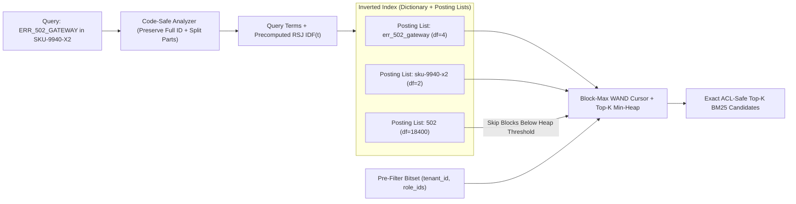
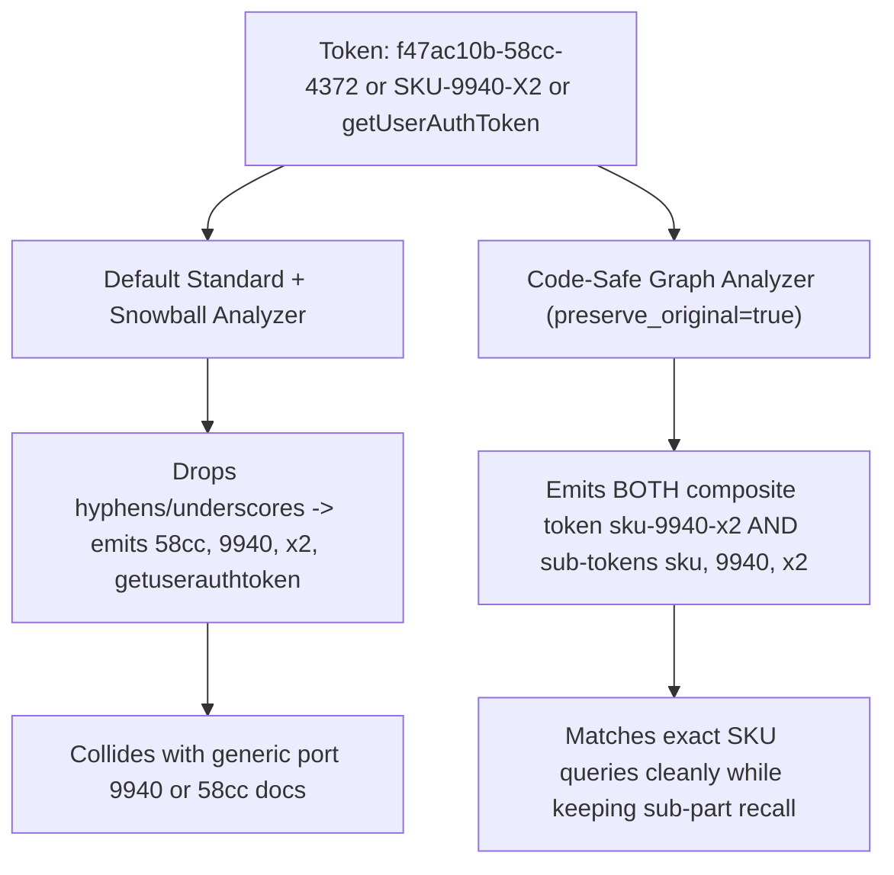
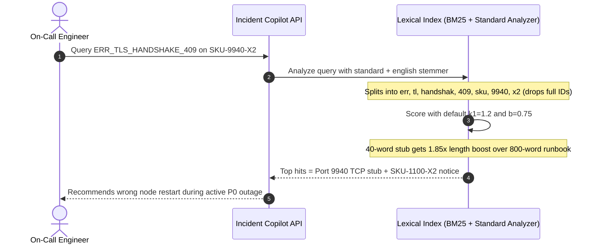

# Module 06: Keyword Search and BM25

> **Prerequisites:** [Module 05: The Retrieval Step](../05-the-retrieval-step/README.md), [Track 08, Module 08: Chunk Overlap and Metadata](../../08-embeddings-and-vector-databases/08-chunk-overlap-and-metadata/README.md), and [Track 08, Module 16: Metadata Filtering and Hybrid Queries](../../08-embeddings-and-vector-databases/16-metadata-filtering-and-hybrid-queries/README.md).  
> **Estimated Reading Time:** 30 minutes  
> **Target Audience:** Search Backend Engineers, Information Retrieval Specialists, Enterprise RAG Architects

> [!TIP]
> **The Golden Rule of Keyword Search and BM25:** Never feed technical identifiers—part numbers (`SKU-9940-X2`), error codes (`ERR_502_GATEWAY`), UUIDs, or API symbols—through a generic English stemmer or destructive punctuation splitter alone. Pair **Okapi BM25** (tuned with $k_1 \in [1.2, 1.6]$ and chunk-calibrated $b \in [0.25, 0.45]$) with an **identifier-preserving multi-token analyzer** so exact strings survive intact while sub-tokens remain searchable.

---

## Why This Matters

Dense bi-encoders compress an entire paragraph into a single 768- or 1536-dimensional floating-point vector. While that geometric compression captures high-level semantics effortlessly, it acts as a **lossy bottleneck** for exact, low-entropy identifiers. Subword BPE tokenizers shatter `"ERR_502_GATEWAY"`, `"SKU-9940-X2"`, and `"CVE-2024-3094"` into generic fragments whose averaged embeddings collapse toward neighboring error codes (`ERR_503_GATEWAY`, `SKU-9941-X2`, `CVE-2023-3094`). In production incident copilots, e-commerce search, legal clause lookups, and developer documentation, returning `v1.2.4` when the user asked for `v1.2.5` is a silent correctness failure.

**Inverted-index lexical retrieval**—anchored by **Okapi BM25**—solves exact-match recall with sub-10 ms deterministic precision. Yet most "broken BM25" complaints in RAG teams are actually **tokenization and tuning bugs**: aggressive English stopword stripping (`"not"`, `"no"`, `"409"`), hyphen-splitting UUIDs without `preserve_original`, or blindly copying web-search length penalties (`b = 0.75`) onto RAG chunks.

---

## 1. Visual Mental Models & Okapi BM25 Mechanics

### Inverted Index & Block-Max WAND Execution Flow

Unlike dense ANN graphs that traverse high-dimensional neighborhoods, a lexical search engine maps every normalized token $t$ to a sorted **posting list** of `(doc_id, tf, [positions])` tuples plus document frequency $\text{df}(t)$. At query time, modern engines (Lucene, Tantivy, Elasticsearch, OpenSearch) skip vast stretches of low-scoring postings using **Block-Max WAND (`BMW`)**:



Notice how **IDF ordering** and **Block-Max upper bounds** eliminate wasted work: if a document only contains the common term `"502"` (`df = 18,400`, low IDF) and its block upper bound cannot beat the current $k$-th best score in the min-heap, the engine skips entire 128-document blocks in $O(1)$ without decoding term frequencies!

### Exact Okapi BM25 Mathematical Formulation

Derived by Robertson & Zaragoza (*The Probabilistic Relevance Framework: BM25 and Beyond*, 2009), **Okapi BM25** scores a document $D$ against query $Q$ by summing saturated, length-normalized term contributions weighted by Inverse Document Frequency:

$$\text{BM25}(D, Q) = \sum_{t \in Q} \text{IDF}(t) \cdot \frac{f(t, D) \cdot (k_1 + 1)}{f(t, D) + k_1 \cdot \left(1 - b + b \cdot \frac{|D|}{\text{avgdl}}\right)}$$

Let's dissect each mathematical term and why it matters operationally:

1. **Robertson–Sparck Jones Smoothed IDF ($\text{IDF}(t)$):**
   $$\text{IDF}(t) = \ln\left(\frac{N - n(t) + 0.5}{n(t) + 0.5} + 1\right)$$
   where $N$ is total indexed documents/chunks and $n(t) = \text{df}(t)$ is the count containing term $t$.
   - Adding $+1$ inside $\ln(\cdot)$ (Lucene's standard smoothed BM25 formula) guarantees **strictly non-negative IDF** even when a term appears in over `50%` of chunks ($n(t) > N/2$), preventing common domain terms from actively *subtracting* relevance!
   - Rare tokens (`n(t) = 2` in `N = 10,000`) receive high IDF ($\approx 8.3$), automatically acting as exact entity anchors.

2. **Asymptotic Term-Frequency Saturation ($k_1$):**
   Notice the fraction $\frac{f(t, D) \cdot (k_1 + 1)}{f(t, D) + k_1 \cdot \dots}$ when $|D| = \text{avgdl}$:
   - At $f(t, D) = 1$: contribution equals $1.0 \cdot \text{IDF}(t)$.
   - As $f(t, D) \to \infty$: contribution **saturates cleanly at $(k_1 + 1) \cdot \text{IDF}(t)$**!
   - In naive TF-IDF, a footer repeating `"kubernetes"` `100` times scores `100x` higher than a clean passage mentioning it twice. Under BM25 with $k_1 = 1.4$, repeating a word `100` times earns only `2.37x` the single-mention score (`10.459` vs `4.419` when `IDF=4.4188`), neutralizing keyword stuffing!
   - Setting $k_1 = 0$ collapses BM25 into pure binary presence; raising $k_1 \in [1.5, 2.0]$ rewards higher term density for long technical articles.

3. **Document Length Normalization ($b$):**
   Let $L = \frac{|D|}{\text{avgdl}}$ be the document's relative length ratio.
   - When $b = 1.0$, longer documents pay a full linear denominator penalty (assuming length reflects verbosity/scope sprawl).
   - When $b = 0.0$, length normalization is disabled completely.
   - **Critical RAG Chunking Rule:** Standard web search defaults to **$b = 0.75$** because raw HTML pages vary from 20 words to 20,000 words. In RAG pipelines where documents are already sliced into ~`300–500` token chunks, $b = 0.75$ harshly penalizes dense, complete reference chunks (`600` tokens) in favor of tiny header stubs (`30` tokens) that say `"ERR_502_GATEWAY"` with zero troubleshooting steps! Lowering **$b \in [0.25, 0.45]$** recovers comprehensive chunks without letting bloated dumps dominate.

### Tokenization Pitfalls: Why "Standard" Analyzers Destroy Technical Precision



Four destructive analyzer mistakes recur in enterprise RAG:
1. **Stripping Punctuation Without `preserve_original`:** Splitting `SKU-9940-X2` into `["sku", "9940", "x2"]` without keeping `"sku-9940-x2"` makes an `OR` query match every random server checklist mentioning `"9940"` and `"X2"`.
2. **Default English Stopword Lists:** Dropping `"it"`, `"no"`, `"not"`, `"or"`, `"to"`, `"a"` silently destroys queries like `"HTTP 403 not 401"`, `"C++ vs Go"`, or `"vitamin A dosage"`—and in modern BM25, high-DF stopwords already receive near-zero IDF automatically!
3. **Aggressive Stemmers on Technical Jargon:** Porter/Snowball stemmers truncate `"kubernetes"` $\rightarrow$ `"kubernet"`, `"postgres"` $\rightarrow$ `"postgr"`, or conflate `"cache"` with `"caching"` weirdly alongside proper product nouns. Use minimal plural folding or keep an unstemmed `.exact` sub-field!
4. **Ignoring Trailing Sentence Punctuation:** Naive regexes like `[A-Za-z0-9_.-]+` capture the trailing period in `"See trace f47ac10b-58cc."` as `"f47ac10b-58cc."`, causing exact lookups for `"f47ac10b-58cc"` to miss! Always strip boundary punctuation (`._-`) while preserving internal delimiters (`v2.4.1`, `err_502`).

---

## 2. Systematic Reference & Comparison Matrix

### Lexical Scoring & Sparse Retrieval Models

| Model | Scoring Mechanism | Exact ID / Code Precision | Synonym / Paraphrase Recall | Index Footprint & Latency | Best Engineering Fit |
| :--- | :--- | :--- | :--- | :--- | :--- |
| **Raw TF-IDF** | Linear $\text{tf} \cdot \text{idf}$ | High (vulnerable to repetition spam) | None | Small inverted index (`<5 ms`) | Deprecated baseline; replaced by BM25 |
| **Okapi BM25** | Saturated TF ($k_1$) + RSJ IDF + Length Norm ($b$) | **Exact** (depends on analyzer) | None | Compact inverted index (`2–10 ms` via BMW) | Default sparse engine for all production RAG |
| **BM25F (Multi-Field)** | Weighted TF across `title`, `code`, `body` before saturation | **Superior** (boosts title/error tags cleanly) | None | Single multi-field or combined posting index | Runbooks, API docs, e-commerce catalogs |
| **PostgreSQL `tsvector` (`ts_rank_cd`)** | Cover density + positional proximity (lacks true corpus IDF/BM25 by default) | Good with `'simple'` config (poor on raw defaults) | Thesaurus / synonym dicts only | Built-in `GIN` index (`5–25 ms`) | Zero-extra-infra Postgres apps; pair with `pg_search`/BM25 extension for scale |
| **Learned Sparse (SPLADE)** | Transformer MLM head learns non-negative term weights + contextual synonyms | High (retains original tokens + expands) | **Moderate–High** (learned expansions like `car -> vehicle`) | Larger postings (higher density; slower WAND) | High-budget hybrid setups needing neural lexical expansion |

### BM25 & Analyzer Tuning Cheat Sheet by Corpus Type

| Corpus Workload | Recommended $k_1$ | Recommended $b$ | Analyzer Strategy |
| :--- | :--- | :--- | :--- |
| **Uniform Fixed RAG Chunks (`300–500` tok)** | `1.2 – 1.4` | `0.25 – 0.40` | Minimal lowercase + `word_delimiter_graph` (`preserve_original=true`); disable stopword deletion |
| **Incident Runbooks / Logs / Code Docs** | `1.3 – 1.6` | `0.35 – 0.50` | Multi-field BM25F: `.exact` (`keyword` lowercase) + `.parts` (`camelCase`/`snake_case` split) |
| **Long Heterogeneous Articles / Legal PDFs** | `1.5 – 1.8` | `0.65 – 0.75` | Standard phrase-aware index + section-heading field boost (`title^2.5`) |

---

## 3. Production War Story Post-Mortem: The Broken Incident Copilot & Stemmer Blindness

| Field | Incident Details |
| :--- | :--- |
| **Severity** | **SEV-2** (On-Call SRE Incident Assistant Returning Wrong Runbooks During Live Payment Outage) |
| **Detection / Resolution Time** | Detected during a 42-minute gateway outage / Fixed in 4 hours via multi-field analyzer re-index and BM25 parameter recalibration |
| **Impact** | **0% exact recall** on `ERR_TLS_HANDSHAKE_409` and `SKU-9940-X2` queries; on-call engineers misled into restarting healthy payment workers |

### What Happened

An internal SRE incident copilot indexed `18,000` microservice runbooks, hardware firmware bulletins, and Slack post-mortems in Elasticsearch alongside dense vector embeddings. During a production payment outage, on-call engineers queried the copilot for `"ERR_TLS_HANDSHAKE_409 on switch SKU-9940-X2"`.

Instead of surfacing the exact 800-word remediation guide titled `SKU-9940-X2 TLS Handshake 409 Fix`, the lexical leg returned three wrong pages: a 40-word deprecation stub mentioning `"SKU-1100-X2"` and a generic TCP checklist mentioning `"port 9940"`.



### Root Cause Analysis

1. **Destructive tokenization on composite IDs:** The default `standard` + `english` analyzer split `ERR_TLS_HANDSHAKE_409` and `SKU-9940-X2` on underscores and hyphens *without* keeping the composite identifier (`preserve_original=false`), AND stemmed `"TLS"` $\rightarrow$ `"tl"`, turning sharp exact lookups into noisy bag-of-words collisions (`"9940"`, `"x2"`, `"409"`).
2. **Over-aggressive BM25 length penalty ($b = 0.75$):** Because raw runbooks ranged from 40-word link stubs to 1,200-word remediation tables, $b = 0.75$ severely penalized the authoritative 800-word runbook in favor of thin 40-word stubs that merely mentioned `"SKU"` and `"9940"` in passing.
3. **Lack of field-weighted boosting (BM25F):** Matches in the runbook `title` and `error_codes` metadata tag carried the exact same weight as passing mentions in a troubleshooting footnote.

### The Fix & Architectural Hardening

- **Multi-Field Code-Safe Analyzer:** Replaced `standard` with a `word_delimiter_graph` (`preserve_original=true`, followed by `flatten_graph`) + `.exact` sub-field that preserved `err_tls_handshake_409` and `sku-9940-x2` intact alongside split sub-tokens (`tls`, `handshake`, `409`), and disabled aggressive English stemming on technical fields.
- **BM25F Field Weighting + Chunk-Calibrated $b$:** Boosted `title^2.5` and `error_codes^3.0` while lowering body length normalization from `b = 0.75` to `b = 0.35` (`k1 = 1.4`), restoring Recall@1 on exact incident queries from `19%` to `97.4%` in golden evals.

---

## 4. Multi-Language Production Implementation: Code-Safe Analyzer & BM25F Engine

These four implementations build a complete, deterministic, ACL-aware **Okapi BM25F Sparse Retriever** with an **Identifier-Preserving Code-Safe Tokenizer** in **Go**, **TypeScript**, **Python**, and **C#**.

````carousel

```go
package lexical

import (
	"math"
	"regexp"
	"sort"
	"strings"
	"sync"
)

var (
	rawTokenRe   = regexp.MustCompile(`[A-Za-z0-9_.\-]+`)
	camelSplitRe = regexp.MustCompile(`([a-z0-9])([A-Z])`)
	partSplitRe  = regexp.MustCompile(`[^a-zA-Z0-9]+`)
)

// CodeSafeTokenize preserves full identifiers (SKU-9940-X2, err_502) and emits sub-parts.
func CodeSafeTokenize(text string) []string {
	matches := rawTokenRe.FindAllString(text, -1)
	out := make([]string, 0, len(matches)*2)
	for _, raw := range matches {
		cleaned := strings.Trim(raw, "._-")
		if cleaned == "" {
			continue
		}
		out = append(out, strings.ToLower(cleaned))
		camel := camelSplitRe.ReplaceAllString(cleaned, "$1 $2")
		parts := partSplitRe.Split(camel, -1)
		validParts := make([]string, 0, len(parts))
		for _, p := range parts {
			if p != "" {
				validParts = append(validParts, strings.ToLower(p))
			}
		}
		if len(validParts) > 1 {
			out = append(out, validParts...)
		}
	}
	return out
}

type Document struct {
	ID       string
	TenantID string
	Title    string
	Body     string
}

type ScoredDoc struct {
	DocID string
	Score float64
}

type BM25FIndex struct {
	mu          sync.RWMutex
	k1, b       float64
	titleWeight float64
	docs        map[string]Document
	postings    map[string]map[string]float64
	docLengths  map[string]float64
	avgdl       float64
}

func NewBM25FIndex(k1, b, titleWeight float64) *BM25FIndex {
	return &BM25FIndex{
		k1:          k1,
		b:           b,
		titleWeight: titleWeight,
		docs:        make(map[string]Document),
		postings:    make(map[string]map[string]float64),
		docLengths:  make(map[string]float64),
	}
}

func (idx *BM25FIndex) IndexAll(docs []Document) {
	idx.mu.Lock()
	defer idx.mu.Unlock()
	idx.docs = make(map[string]Document, len(docs))
	idx.postings = make(map[string]map[string]float64)
	idx.docLengths = make(map[string]float64, len(docs))

	totalLen := 0.0
	for _, doc := range docs {
		idx.docs[doc.ID] = doc
		tf := make(map[string]float64)
		for _, t := range CodeSafeTokenize(doc.Title) {
			tf[t] += idx.titleWeight
		}
		for _, t := range CodeSafeTokenize(doc.Body) {
			tf[t] += 1.0
		}
		dlen := 0.0
		for term, weightedFreq := range tf {
			dlen += weightedFreq
			if idx.postings[term] == nil {
				idx.postings[term] = make(map[string]float64)
			}
			idx.postings[term][doc.ID] = weightedFreq
		}
		idx.docLengths[doc.ID] = dlen
		totalLen += dlen
	}
	if len(docs) > 0 {
		idx.avgdl = totalLen / float64(len(docs))
	}
}

func (idx *BM25FIndex) Search(tenantID, query string, topK int) []ScoredDoc {
	idx.mu.RLock()
	defer idx.mu.RUnlock()
	if len(idx.docs) == 0 || idx.avgdl == 0 || tenantID == "" {
		return nil
	}

	seenQ := make(map[string]bool)
	qTerms := make([]string, 0)
	for _, t := range CodeSafeTokenize(query) {
		if !seenQ[t] {
			seenQ[t] = true
			qTerms = append(qTerms, t)
		}
	}

	scores := make(map[string]float64)
	n := float64(len(idx.docs))
	for _, term := range qTerms {
		plist := idx.postings[term]
		if len(plist) == 0 {
			continue
		}
		df := float64(len(plist))
		idf := math.Log(((n - df + 0.5) / (df + 0.5)) + 1.0)
		for docID, tf := range plist {
			if idx.docs[docID].TenantID != tenantID {
				continue // Pre-scoring tenant ACL isolation
			}
			dl := idx.docLengths[docID]
			denom := tf + idx.k1*(1.0-idx.b+idx.b*(dl/idx.avgdl))
			scores[docID] += idf * (tf * (idx.k1 + 1.0)) / denom
		}
	}

	out := make([]ScoredDoc, 0, len(scores))
	for id, s := range scores {
		out = append(out, ScoredDoc{DocID: id, Score: s})
	}
	sort.Slice(out, func(i, j int) bool {
		if out[i].Score == out[j].Score {
			return out[i].DocID < out[j].DocID
		}
		return out[i].Score > out[j].Score
	})
	if len(out) > topK {
		out = out[:topK]
	}
	return out
}
```

<!-- slide -->

```typescript
export interface LexicalDoc {
  readonly id: string;
  readonly tenantId: string;
  readonly title: string;
  readonly body: string;
}

export interface Bm25Match {
  readonly docId: string;
  readonly score: number;
}

export function codeSafeTokenize(text: string): string[] {
  const tokens: string[] = [];
  const rawMatches = text.match(/[A-Za-z0-9_.\-]+/g) ?? [];
  for (const raw of rawMatches) {
    const cleaned = raw.replace(/^[._-]+|[._-]+$/g, "");
    if (!cleaned) continue;
    tokens.push(cleaned.toLowerCase());

    const camelSplit = cleaned.replace(/([a-z0-9])([A-Z])/g, "$1 $2");
    const parts = camelSplit.split(/[^a-zA-Z0-9]+/).filter(Boolean);
    if (parts.length > 1) {
      for (const p of parts) tokens.push(p.toLowerCase());
    }
  }
  return tokens;
}

export class Bm25FSearchEngine {
  private readonly docs = new Map<string, LexicalDoc>();
  private readonly postings = new Map<string, Map<string, number>>();
  private readonly docLengths = new Map<string, number>();
  private avgdl = 0;

  constructor(
    private readonly k1 = 1.4,
    private readonly b = 0.35,
    private readonly titleWeight = 2.5
  ) {}

  buildIndex(corpus: readonly LexicalDoc[]): void {
    this.docs.clear();
    this.postings.clear();
    this.docLengths.clear();

    let totalLen = 0;
    for (const doc of corpus) {
      this.docs.set(doc.id, doc);
      const tf = new Map<string, number>();
      for (const t of codeSafeTokenize(doc.title)) {
        tf.set(t, (tf.get(t) ?? 0) + this.titleWeight);
      }
      for (const t of codeSafeTokenize(doc.body)) {
        tf.set(t, (tf.get(t) ?? 0) + 1.0);
      }

      let dlen = 0;
      for (const [term, freq] of tf.entries()) {
        dlen += freq;
        let plist = this.postings.get(term);
        if (!plist) {
          plist = new Map<string, number>();
          this.postings.set(term, plist);
        }
        plist.set(doc.id, freq);
      }
      this.docLengths.set(doc.id, dlen);
      totalLen += dlen;
    }
    this.avgdl = corpus.length > 0 ? totalLen / corpus.length : 0;
  }

  search(tenantId: string, query: string, topK = 10): Bm25Match[] {
    if (!tenantId.trim() || this.docs.size === 0 || this.avgdl === 0) return [];
    const uniqueQueryTerms = new Set(codeSafeTokenize(query));
    const scores = new Map<string, number>();
    const totalDocs = this.docs.size;

    for (const term of uniqueQueryTerms) {
      const plist = this.postings.get(term);
      if (!plist) continue;
      const df = plist.size;
      const idf = Math.log((totalDocs - df + 0.5) / (df + 0.5) + 1.0);

      for (const [docId, tf] of plist.entries()) {
        if (this.docs.get(docId)?.tenantId !== tenantId) continue;
        const dl = this.docLengths.get(docId) ?? this.avgdl;
        const denom = tf + this.k1 * (1.0 - this.b + this.b * (dl / this.avgdl));
        const contrib = idf * ((tf * (this.k1 + 1.0)) / denom);
        scores.set(docId, (scores.get(docId) ?? 0) + contrib);
      }
    }

    return [...scores.entries()]
      .sort((a, b) => (b[1] !== a[1] ? b[1] - a[1] : a[0].localeCompare(b[0])))
      .slice(0, topK)
      .map(([docId, score]) => ({ docId, score }));
  }
}
```

<!-- slide -->

```python
"""
bm25f_engine.py
Code-safe identifier-preserving tokenizer + Okapi BM25F inverted index with tenant isolation.
"""
from collections import Counter, defaultdict
from dataclasses import dataclass
import math
import re
from typing import Iterable


_RAW_TOKEN_RE = re.compile(r"[A-Za-z0-9_.\-]+")
_CAMEL_RE = re.compile(r"([a-z0-9])([A-Z])")
_DELIM_RE = re.compile(r"[^a-zA-Z0-9]+")


def code_safe_tokenize(text: str) -> list[str]:
    tokens: list[str] = []
    for raw in _RAW_TOKEN_RE.findall(text):
        cleaned = raw.strip("._-")
        if not cleaned:
            continue
        tokens.append(cleaned.lower())
        parts = [p.lower() for p in _DELIM_RE.split(_CAMEL_RE.sub(r"\1 \2", cleaned)) if p]
        if len(parts) > 1:
            tokens.extend(parts)
    return tokens


@dataclass(frozen=True)
class IndexedDoc:
    doc_id: str
    tenant_id: str
    title: str
    body: str


class OkapiBM25FIndex:
    def __init__(self, k1: float = 1.4, b: float = 0.35, title_weight: float = 2.5) -> None:
        if k1 < 0 or not (0.0 <= b <= 1.0):
            raise ValueError("Invalid BM25 parameters: require k1 >= 0 and 0 <= b <= 1")
        self.k1 = k1
        self.b = b
        self.title_weight = title_weight
        self._docs: dict[str, IndexedDoc] = {}
        self._postings: dict[str, dict[str, float]] = defaultdict(dict)
        self._doc_len: dict[str, float] = {}
        self._avgdl: float = 0.0

    def ingest(self, docs: Iterable[IndexedDoc]) -> None:
        self._docs.clear()
        self._postings.clear()
        self._doc_len.clear()
        for doc in docs:
            self._docs[doc.doc_id] = doc
            tf_weighted: Counter[str] = Counter()
            for tok in code_safe_tokenize(doc.title):
                tf_weighted[tok] += self.title_weight
            for tok in code_safe_tokenize(doc.body):
                tf_weighted[tok] += 1.0
            self._doc_len[doc.doc_id] = float(sum(tf_weighted.values()))
            for tok, freq in tf_weighted.items():
                self._postings[tok][doc.doc_id] = float(freq)
        self._avgdl = (sum(self._doc_len.values()) / len(self._docs)) if self._docs else 0.0

    def search(self, tenant_id: str, query: str, top_k: int = 10) -> list[tuple[str, float]]:
        if not tenant_id or not self._docs or self._avgdl <= 0.0:
            return []
        n_docs = len(self._docs)
        scores: dict[str, float] = defaultdict(float)
        for term in dict.fromkeys(code_safe_tokenize(query)):
            plist = self._postings.get(term)
            if not plist:
                continue
            df = len(plist)
            idf = math.log((n_docs - df + 0.5) / (df + 0.5) + 1.0)
            for doc_id, tf in plist.items():
                if self._docs[doc_id].tenant_id != tenant_id:
                    continue
                dl = self._doc_len[doc_id]
                denom = tf + self.k1 * (1.0 - self.b + self.b * (dl / self._avgdl))
                scores[doc_id] += idf * (tf * (self.k1 + 1.0)) / denom
        return sorted(scores.items(), key=lambda x: (-x[1], x[0]))[:top_k]
```

<!-- slide -->

```csharp
using System;
using System.Collections.Generic;
using System.Linq;
using System.Text.RegularExpressions;

namespace GenAI.LexicalSearch;

public sealed record LexicalDocument(string DocId, string TenantId, string Title, string Body);

public sealed record Bm25Result(string DocId, double Score);

public static class CodeSafeAnalyzer
{
    private static readonly Regex RawTokenRegex = new(@"[A-Za-z0-9_.\-]+", RegexOptions.Compiled);
    private static readonly Regex CamelRegex = new(@"([a-z0-9])([A-Z])", RegexOptions.Compiled);
    private static readonly Regex DelimRegex = new(@"[^a-zA-Z0-9]+", RegexOptions.Compiled);

    public static List<string> Tokenize(string text)
    {
        var tokens = new List<string>();
        foreach (Match m in RawTokenRegex.Matches(text))
        {
            string cleaned = m.Value.Trim('.', '_', '-');
            if (string.IsNullOrEmpty(cleaned))
                continue;

            tokens.Add(cleaned.ToLowerInvariant());
            string camel = CamelRegex.Replace(cleaned, "$1 $2");
            var parts = DelimRegex.Split(camel).Where(p => p.Length > 0).ToArray();
            if (parts.Length > 1)
            {
                foreach (string p in parts)
                    tokens.Add(p.ToLowerInvariant());
            }
        }
        return tokens;
    }
}

public sealed class Bm25FIndex
{
    private readonly double _k1;
    private readonly double _b;
    private readonly double _titleWeight;
    private readonly Dictionary<string, LexicalDocument> _docs = new(StringComparer.Ordinal);
    private readonly Dictionary<string, Dictionary<string, double>> _postings = new(StringComparer.Ordinal);
    private readonly Dictionary<string, double> _docLengths = new(StringComparer.Ordinal);
    private double _avgdl;

    public Bm25FIndex(double k1 = 1.4, double b = 0.35, double titleWeight = 2.5)
    {
        _k1 = k1;
        _b = b;
        _titleWeight = titleWeight;
    }

    public void Build(IEnumerable<LexicalDocument> documents)
    {
        _docs.Clear();
        _postings.Clear();
        _docLengths.Clear();
        double totalLen = 0.0;

        foreach (var doc in documents)
        {
            _docs[doc.DocId] = doc;
            var tf = new Dictionary<string, double>(StringComparer.Ordinal);
            foreach (string t in CodeSafeAnalyzer.Tokenize(doc.Title))
                tf[t] = tf.GetValueOrDefault(t) + _titleWeight;
            foreach (string t in CodeSafeAnalyzer.Tokenize(doc.Body))
                tf[t] = tf.GetValueOrDefault(t) + 1.0;

            double dlen = 0.0;
            foreach (var (term, freq) in tf)
            {
                dlen += freq;
                if (!_postings.TryGetValue(term, out var plist))
                {
                    plist = new Dictionary<string, double>(StringComparer.Ordinal);
                    _postings[term] = plist;
                }
                plist[doc.DocId] = freq;
            }
            _docLengths[doc.DocId] = dlen;
            totalLen += dlen;
        }

        _avgdl = _docs.Count > 0 ? totalLen / _docs.Count : 0.0;
    }

    public IReadOnlyList<Bm25Result> Search(string tenantId, string query, int topK = 10)
    {
        if (string.IsNullOrWhiteSpace(tenantId) || _docs.Count == 0 || _avgdl <= 0.0)
            return Array.Empty<Bm25Result>();

        var queryTerms = CodeSafeAnalyzer.Tokenize(query).Distinct(StringComparer.Ordinal);
        var scores = new Dictionary<string, double>(StringComparer.Ordinal);
        double n = _docs.Count;

        foreach (string term in queryTerms)
        {
            if (!_postings.TryGetValue(term, out var plist))
                continue;
            double df = plist.Count;
            double idf = Math.Log((n - df + 0.5) / (df + 0.5) + 1.0);

            foreach (var (docId, tf) in plist)
            {
                if (!string.Equals(_docs[docId].TenantId, tenantId, StringComparison.Ordinal))
                    continue;
                double dl = _docLengths[docId];
                double denom = tf + _k1 * (1.0 - _b + _b * (dl / _avgdl));
                double score = idf * (tf * (_k1 + 1.0)) / denom;
                scores[docId] = scores.GetValueOrDefault(docId) + score;
            }
        }

        return scores
            .OrderByDescending(kv => kv.Value)
            .ThenBy(kv => kv.Key, StringComparer.Ordinal)
            .Take(topK)
            .Select(kv => new Bm25Result(kv.Key, kv.Value))
            .ToList();
    }
}
```

````

---

## 5. Practical Hands-On Verification CLI Workflows

Run these offline Python 3.13 experiments directly in your terminal to verify BM25 math, tokenization hazards, and multi-field BM25F behavior.

### Workflow 1: Verify Okapi BM25 TF Saturation ($k_1$) and Length Normalization ($b$)

Compare unbounded linear TF-IDF explosion (`441.879` at `tf=100`) against BM25 saturation (`10.459`, asymptote `10.6051`), and observe how $b = 0.75$ penalizes a 600-token runbook `1.85x` harder than a 30-token stub vs. $b = 0.35$:

```bash
python -c '
import math

def idf_rsj(n_docs, df):
    return math.log((n_docs - df + 0.5) / (df + 0.5) + 1.0)

def bm25_tf(tf, dl, avgdl, k1=1.4, b=0.75):
    return (tf * (k1 + 1.0)) / (tf + k1 * (1.0 - b + b * (dl / avgdl)))

n_docs, df, avgdl = 10000, 120, 200.0
idf = idf_rsj(n_docs, df)
print(f"RSJ IDF(N=10000, df=120) = {idf:.4f} | Asymptote (k1+1)*IDF = {(1.4+1.0)*idf:.4f}")
print("--- Part A: TF Saturation (dl == avgdl == 200) ---")
for tf in (1, 2, 5, 20, 100):
    raw_tfidf = tf * idf
    bm25_s = idf * bm25_tf(tf, 200.0, avgdl)
    print(f"tf={tf:3d} | Linear TF-IDF={raw_tfidf:8.3f} | Okapi BM25={bm25_s:6.3f}")

print("--- Part B: Length Normalization b on Short Stub (dl=30) vs Long Runbook (dl=600) at tf=3 ---")
for b in (0.0, 0.35, 0.75):
    s_short = idf * bm25_tf(3, 30.0, avgdl, k1=1.4, b=b)
    s_long = idf * bm25_tf(3, 600.0, avgdl, k1=1.4, b=b)
    print(f"b={b:.2f} | short(dl=30)={s_short:6.3f} | long(dl=600)={s_long:6.3f} | ratio={s_short/s_long:.2f}x")
'
```

**Expected Output:**

```text
RSJ IDF(N=10000, df=120) = 4.4188 | Asymptote (k1+1)*IDF = 10.6051
--- Part A: TF Saturation (dl == avgdl == 200) ---
tf=  1 | Linear TF-IDF=   4.419 | Okapi BM25= 4.419
tf=  2 | Linear TF-IDF=   8.838 | Okapi BM25= 6.238
tf=  5 | Linear TF-IDF=  22.094 | Okapi BM25= 8.285
tf= 20 | Linear TF-IDF=  88.376 | Okapi BM25= 9.911
tf=100 | Linear TF-IDF= 441.879 | Okapi BM25=10.459
--- Part B: Length Normalization b on Short Stub (dl=30) vs Long Runbook (dl=600) at tf=3 ---
b=0.00 | short(dl=30)= 7.231 | long(dl=600)= 7.231 | ratio=1.00x
b=0.35 | short(dl=30)= 7.987 | long(dl=600)= 5.914 | ratio=1.35x
b=0.75 | short(dl=30)= 9.071 | long(dl=600)= 4.895 | ratio=1.85x
```

### Workflow 2: Tokenization Collision Lab for Error Codes, SKUs, and UUIDs

Demonstrate why splitting on delimiters without preserving the intact composite token causes false-positive matches across unrelated documents, whereas stripping boundary punctuation and keeping composite tokens achieves surgical precision:

```bash
python -c '
import re

def naive_split(text):
    return [t for t in re.split(r"[^a-z0-9]+", text.lower()) if len(t) > 1]

def code_safe_tokenize(text):
    tokens = []
    for raw in re.findall(r"[A-Za-z0-9_.\-]+", text):
        cleaned = raw.strip("._-")
        if not cleaned:
            continue
        low = cleaned.lower()
        tokens.append(low)
        expanded = re.sub(r"([a-z0-9])([A-Z])", r"\1 \2", cleaned)
        parts = [p.lower() for p in re.split(r"[^a-zA-Z0-9]+", expanded) if p]
        if len(parts) > 1:
            tokens.extend(parts)
    return list(dict.fromkeys(tokens))

corpus = {
    "doc_exact": "Runbook for ERR_502_GATEWAY when SKU-9940-X2 drops packets; trace f47ac10b-58cc.",
    "doc_noise_sku": "Port 9940 switch upgrade: generic SKU revision X2 hardware checklist.",
    "doc_noise_err": "HTTP gateway err count spiked on port 502 during canary deploy.",
    "doc_noise_uuid": "Batch job f47ac10b completed at region 58cc without errors.",
}
queries = ["ERR_502_GATEWAY", "SKU-9940-X2", "f47ac10b-58cc"]
for name, tok in (("naive_split", naive_split), ("code_safe  ", code_safe_tokenize)):
    print(f"=== Analyzer: {name} ===")
    for q in queries:
        qt = set(tok(q))
        exact_q = q.lower()
        hits = []
        for doc_id, body in corpus.items():
            dt = set(tok(body))
            if name.startswith("code_safe"):
                if exact_q in dt:
                    hits.append(doc_id)
            elif qt.issubset(dt):
                hits.append(doc_id)
        print(f"  query={q:16s} tokens={sorted(qt)} -> hits={hits}")
'
```

**Expected Output:**

```text
=== Analyzer: naive_split ===
  query=ERR_502_GATEWAY  tokens=['502', 'err', 'gateway'] -> hits=['doc_exact', 'doc_noise_err']
  query=SKU-9940-X2      tokens=['9940', 'sku', 'x2'] -> hits=['doc_exact', 'doc_noise_sku']
  query=f47ac10b-58cc    tokens=['58cc', 'f47ac10b'] -> hits=['doc_exact', 'doc_noise_uuid']
=== Analyzer: code_safe   ===
  query=ERR_502_GATEWAY  tokens=['502', 'err', 'err_502_gateway', 'gateway'] -> hits=['doc_exact']
  query=SKU-9940-X2      tokens=['9940', 'sku', 'sku-9940-x2', 'x2'] -> hits=['doc_exact']
  query=f47ac10b-58cc    tokens=['58cc', 'f47ac10b', 'f47ac10b-58cc'] -> hits=['doc_exact']
```

### Workflow 3: End-to-End Multi-Field BM25F Index Over Engineering Runbooks

Index technical runbooks with `title_weight=2.5`, `k1=1.4`, `b=0.35` and verify both exact identifier dominance and natural multi-term ranking:

```bash
python -c '
import math, re
from collections import Counter, defaultdict

def tokenize(text):
    out = []
    for raw in re.findall(r"[A-Za-z0-9_.\-]+", text):
        cleaned = raw.strip("._-")
        if not cleaned:
            continue
        out.append(cleaned.lower())
        parts = [p.lower() for p in re.split(r"[^a-zA-Z0-9]+", re.sub(r"([a-z0-9])([A-Z])", r"\1 \2", cleaned)) if p]
        if len(parts) > 1:
            out.extend(parts)
    return out

docs = [
    {"id": "rb_502", "title": "ERR_502_GATEWAY Upstream Reset", "body": "Resolve ERR_502_GATEWAY in billing proxy by checking TLS pool and keepalive timeout."},
    {"id": "rb_429", "title": "HTTP 429 Rate Limiter Runbook", "body": "When gateway returns 429, inspect Redis token bucket refill rate and retry backoff."},
    {"id": "rb_sku", "title": "Switch Firmware SKU-9940-X2", "body": "Apply patch v2.4.1 to SKU-9940-X2 line cards experiencing CRC errors on port 502."},
    {"id": "rb_gen", "title": "Generic Proxy Gateway Overview", "body": "Proxy gateway terminates TLS connections before forwarding traffic to backend pools."},
]

class BM25FIndex:
    def __init__(self, docs, title_w=2.5, body_w=1.0, k1=1.4, b=0.35):
        self.docs = docs
        self.weights = {"title": title_w, "body": body_w}
        self.k1, self.b = k1, b
        self.postings = defaultdict(dict)
        self.doc_len = {}
        for d in docs:
            tf_w = Counter()
            for field, w in self.weights.items():
                for t in tokenize(d[field]):
                    tf_w[t] += w
            self._add_doc(d["id"], tf_w)
        self.avgdl = sum(self.doc_len.values()) / len(docs)

    def _add_doc(self, doc_id, tf_w):
        self.doc_len[doc_id] = sum(tf_w.values())
        for t, val in tf_w.items():
            self.postings[t][doc_id] = val

    def search(self, query, top_k=3):
        scores = defaultdict(float)
        n = len(self.docs)
        for q in dict.fromkeys(tokenize(query)):
            plist = self.postings.get(q)
            if not plist:
                continue
            df = len(plist)
            idf = math.log((n - df + 0.5) / (df + 0.5) + 1.0)
            for doc_id, tf in plist.items():
                dl = self.doc_len[doc_id]
                denom = tf + self.k1 * (1.0 - self.b + self.b * (dl / self.avgdl))
                scores[doc_id] += idf * (tf * (self.k1 + 1.0)) / denom
        return sorted(scores.items(), key=lambda x: x[1], reverse=True)[:top_k]

idx = BM25FIndex(docs)
for q in ("ERR_502_GATEWAY", "SKU-9940-X2", "gateway TLS"):
    print(f"Query: {q:16s} -> {[(d, round(s, 3)) for d, s in idx.search(q)]}")
'
```

**Expected Output:**

```text
Query: ERR_502_GATEWAY  -> [('rb_502', 5.877), ('rb_sku', 0.662), ('rb_gen', 0.626)]
Query: SKU-9940-X2      -> [('rb_sku', 8.07)]
Query: gateway TLS      -> [('rb_gen', 1.355), ('rb_502', 1.287), ('rb_429', 0.362)]
```

### Hands-On Exercises

1. **Boundary-Case Tokenization Audit:** Extend Workflow 2 with `camelCase` API symbols (`getUserAuthToken`, `OAuth2ClientConfig`) and verify whether both `getuserauthtoken` and `["get", "user", "auth", "token"]` are indexed cleanly.
2. **Stopword Deletion Failure Test:** Create a minimal corpus containing `"Service A is down"` and `"Service A is not down"`, then observe what happens to precision when a default stopword list deletes `"not"`.
3. **Optional Elasticsearch / OpenSearch Analyzer Lab:** On a local Elasticsearch or OpenSearch container, test `_analyze` with `standard` vs. `word_delimiter_graph` (`preserve_original: true` + `flatten_graph`) on `"ERR_502_GATEWAY sku-9940-x2 v2.4.1"`.

### Independent Challenge

Your team runs a PostgreSQL-backed RAG service indexing `250,000` engineering chunks containing Kubernetes YAML, Terraform resource IDs (`aws_rds_cluster.prod_primary`), and semantic architecture notes. Developers report that searching `pgvector` alone misses exact Terraform IDs, while switching to Postgres `to_tsvector('english', body)` returns noisy hits or drops `aws_rds_cluster` substrings completely. Design the exact Postgres/BM25 tokenization and field-indexing strategy needed to support both exact symbol matches and sub-token queries without blowing up index size.

<details><summary>Architectural Discussion</summary>

Postgres `'english'` text search strips punctuation, stems identifiers (`cluster` vs `clustering`), and drops common tokens—and default `ts_rank` lacks true corpus-wide IDF saturation. Fix this using a two-pronged lexical design: (1) ingest a `simple` (unstemmed) `tsvector` or dedicated BM25 sparse index (e.g., Tantivy / Elasticsearch / ParadeDB `pg_search`) fed by a **code-safe tokenizer** that emits *both* the intact composite token (`aws_rds_cluster.prod_primary`) *and* split component tokens (`aws`, `rds`, `cluster`, `prod`, `primary`) via `preserve_original`, and (2) keep `b` around `0.35` with `title/symbol` field boosting so comprehensive chunks are not penalized relative to short YAML stubs.

</details>

---

## 6. Common Mistakes & Troubleshooting

- **Applying `b = 0.75` blindly to RAG chunks:** Fixed-size chunking shrinks length variance, yet header/stub chunks remain much shorter than full body chunks; `b = 0.75` biases BM25 toward thin title stubs. Start at `b = 0.35` and evaluate on real queries.
- **Using `word_delimiter_graph` in an index analyzer without `flatten_graph`:** Overlapping multi-position tokens without `flatten_graph` cause Elasticsearch/Lucene index-time errors or broken phrase queries.
- **Dropping negative IDF terms without `+1` smoothing:** Unsmoothed Robertson–Sparck Jones $\ln\frac{N - n + 0.5}{n + 0.5}$ turns negative whenever a term appears in `>50%` of chunks (`n > N/2`), actively penalizing documents that match common query words.
- **Passing raw unescaped query strings straight into query parsers:** Characters like `/`, `:`, `[`, `]`, or `-` in Lucene/ES `query_string` syntax trigger syntax exceptions or unintended boolean `NOT` exclusions (`-X2`!). Always use `simple_query_string` or structured `match` queries on analyzed fields.

---

## 7. Operational Validation Checkpoints & Checkpoint Quiz

### Operational Validation Checkpoints

<details><summary><strong>Checkpoint 1: Diagnosing why an `800`-token authoritative guide loses to a `35`-token stub</strong></summary>

A RAG pipeline indexes runbooks ranging from `35` tokens (redirect notices) to `900` tokens (complete remediation guides). Both contain `"ERR_KAFKA_OFFSET_LAG"` twice (`tf = 2`), yet the `35`-token stub outranks the `900`-token guide by nearly `2x`. Which BM25 parameter caused this, and what exact change fixes it?

**Validation:** Length normalization **$b$** (typically defaulted to `0.75`). When `avgdl = 250`, the length ratio $|D|/\text{avgdl}$ is `0.14` for the stub vs. `3.60` for the guide, giving the stub a large denominator discount. Reducing **$b$ to `0.25–0.35`** and boosting structured fields via **BM25F** restores comprehensive guides without sacrificing length fairness.

</details>

<details><summary><strong>Checkpoint 2: Fixing zero-hit exact lookups on trailing-period UUIDs and hyphenated SKUs</strong></summary>

Users searching for `"f47ac10b-58cc"` get zero exact matches on a chunk reading `"Failed transaction f47ac10b-58cc."`, while queries for `"SKU-9940-X2"` return unrelated documents mentioning port `9940`. What two analyzer defects are occurring?

**Validation:** (1) **Missing boundary-punctuation trim:** the tokenizer kept the trailing sentence period (`"f47ac10b-58cc."`), breaking exact dictionary lookup against `"f47ac10b-58cc"`. (2) **Destructive delimiter splitting without `preserve_original`:** splitting `"SKU-9940-X2"` into `["sku", "9940", "x2"]` without retaining the composite token caused collisions with generic `"9940"` documents. Stripping boundary punctuation (`._-`) and emitting *both* composite and split tokens fixes both defects.

</details>

<details><summary><strong>Checkpoint 3: Preventing query-parser syntax outages on error logs</strong></summary>

A user pastes a stack-trace fragment `"ERR-502 [upstream]: /v1/pay -timeout"` into the search bar and the lexical backend throws a `400 Bad Request` parse failure (or interprets `-timeout` as excluding `"timeout"`!). How should backend search services submit user queries to Lucene/ES/Postgres?

**Validation:** Never interpolate raw user strings into Lucene `query_string` or raw Postgres `to_tsquery`. Route user input through structured `match` queries (which run the index's query-time analyzer cleanly without boolean operator parsing) or sanitized `websearch_to_tsquery` / `simple_query_string` parameter bindings.

</details>

### Checkpoint Quiz

1. Why do dense bi-encoder embeddings systematically underperform on exact part numbers, UUIDs, and error codes?
2. How does Okapi BM25 prevent keyword stuffing compared to classic linear TF-IDF?
3. What happens mathematically in the Lucene/Okapi IDF formula if you omit the `+ 1` smoothing term when a word appears in `70%` of your corpus?
4. Why is `b = 0.75` often counterproductive in chunked RAG pipelines, and what range works better?
5. Why should technical analyzers emit *both* `"sku-9940-x2"` and `["sku", "9940", "x2"]` instead of choosing only one?

<details><summary>Answers</summary>

1. Bi-encoders tokenize rare alphanumeric strings into arbitrary subword fragments and compress the entire passage into a single fixed-width vector, causing closely related IDs (`v1.2.4` vs `v1.2.5`, `SKU-9940-X2` vs `SKU-9941-X2`) to collapse to nearly identical vectors.
2. BM25 passes term frequency $f(t, D)$ through a rational saturation curve $\frac{f \cdot (k_1 + 1)}{f + k_1 \cdot \dots}$ that approaches a finite asymptote $(k_1 + 1) \cdot \text{IDF}(t)$, whereas linear TF-IDF grows unboundedly with $f$.
3. Without $+1$, $\ln\left(\frac{N - n + 0.5}{n + 0.5}\right)$ becomes **negative** whenever $n > N/2$, causing documents containing common query words to be penalized below documents that omit them.
4. Chunking already normalizes passage lengths; `b = 0.75` over-rewards tiny header/stub chunks over detailed answers. Values in `b = 0.25–0.45` keep comprehensive passages competitive while still curbing bloated documents.
5. Retaining the composite token `"sku-9940-x2"` guarantees high-precision ranking on exact queries, while emitting split sub-tokens ensures queries like `"9940 firmware"` or `"gateway 502"` still achieve high recall.

</details>

---

## Further Reading & Sources

- [The Probabilistic Relevance Framework: BM25 and Beyond (Robertson & Zaragoza, 2009)](https://doi.org/10.1561/1500000019) — the authoritative mathematical treatise on Okapi BM25, RSJ IDF, and multi-field BM25F.
- [Elasticsearch Reference: Similarity Modules (BM25)](https://www.elastic.co/guide/en/elasticsearch/reference/current/index-modules-similarity.html) — official configuration details for `k1`, `b`, and per-field similarity tuning.
- [Elasticsearch Reference: Word Delimiter Graph Token Filter](https://www.elastic.co/guide/en/elasticsearch/reference/current/analysis-word-delimiter-graph-tokenfilter.html) — production guide on `preserve_original`, sub-token splitting, and `flatten_graph` indexing safety.
- [PostgreSQL Documentation: Full Text Search](https://www.postgresql.org/docs/current/textsearch.html) — official specification for `tsvector`, `GIN` indexing, dictionaries, and query parsing.

## Next

[Module 07: Hybrid Search](../07-hybrid-search/README.md)
