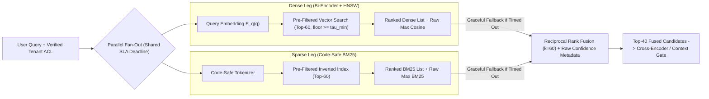
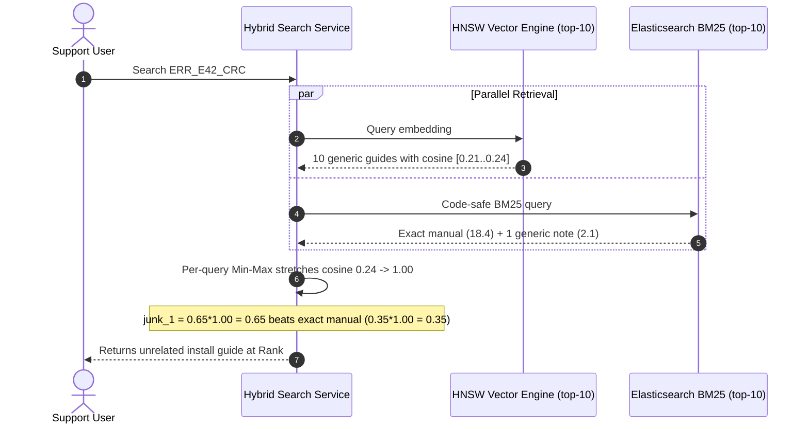

# Module 07: Hybrid Search

> **Prerequisites:** [Module 05: The Retrieval Step](../05-the-retrieval-step/README.md), [Module 06: Keyword Search and BM25](../06-keyword-search-and-bm25/README.md), [Track 08, Module 03: Cosine Similarity and Distance Metrics](../../08-embeddings-and-vector-databases/03-cosine-similarity-and-distance-metrics/README.md), and [Track 08, Module 16: Metadata Filtering and Hybrid Queries](../../08-embeddings-and-vector-databases/16-metadata-filtering-and-hybrid-queries/README.md).  
> **Estimated Reading Time:** 30 minutes  
> **Target Audience:** AI Backend Engineers, Search Platform Architects, Retrieval Quality Engineers

> [!TIP]
> **The Golden Rule of Hybrid Search:** Fuse dense semantic search and sparse BM25 using **Reciprocal Rank Fusion (RRF)** ($k=60$) over generously pre-filtered candidate pools ($K_{\text{fetch}} \ge 50$ per leg), **never** raw score addition or uncalibrated per-query Min-Max normalization. Keep raw dense/BM25 confidence signals alongside the rank-fused score so an out-of-domain query is never promoted solely because its rank happened to be `#1`.

---

## Why This Matters

Every enterprise query distribution sits on a spectrum between pure conceptual paraphrasing and surgical identifier lookup:
- A user typing `"how do I prevent containers from getting killed when memory spikes?"` needs **dense semantic search** to match `"cgroup memory limit tuning and OOMKill mitigation"` even with zero overlapping keywords.
- A user typing `"exit code 137 SKU-9940-X2 ERR_502_GATEWAY"` needs **BM25 lexical search** because bi-encoders collapse rare codes into blurry embedding neighborhoods.

Neither retriever alone maximizes Recall@$K$. **Hybrid search** runs both modalities in parallel against identical ACL pre-filters and merges their ranked lists. Yet naive score fusion causes subtle ranking regressions: adding raw cosine similarity (`[0.65, 0.92]`) to unbounded BM25 scores (`[0, 35.0+]`) lets lexical scores crush semantic winners, while naive per-query Min-Max normalization stretches weak `0.21–0.24` semantic noise straight up to `1.00`, drowning out exact error-code hits.

---

## 1. Visual Mental Models & Hybrid Fusion Mechanics

### Concurrent ACL-Scoped Dual-Leg Architecture

In production, hybrid search executes dense ANN and sparse BM25 **concurrently** with strict per-leg deadlines and identical security predicates pushed into *both* engines prior to fusion:



Notice two critical architectural invariants in this diagram:
1. **Identical Pre-Filter Pushdown in Every Leg:** Just like Qdrant's per-`Prefetch` filter model, ACL filters (`tenant_id`, `role_ids`) MUST execute inside *both* the dense and sparse legs independently—never once *after* fusion, which re-introduces $p \times k$ starvation.
2. **Graceful Single-Leg Degradation:** Wrapping each leg in an independent deadline (`timeout <= 120 ms`) allows the coordinator to degrade smoothly to single-modality retrieval (`BM25-only` or `Dense-only`) with a telemetry warning rather than failing the user's request if one backend spikes.

### Why Linear Score Fusion Breaks: Scale Mismatch vs. Noise Amplification

Consider the tempting naive formula for **Linear Combination**:

$$S_{\text{linear}}(d) = \alpha \cdot S_{\text{dense}}(d) + (1 - \alpha) \cdot S_{\text{BM25}}(d)$$

This formula breaks along two orthogonal axes:

1. **Unbounded Raw Scale Hijack:** Cosine similarity for normalized bi-encoders lives in $[-1, 1]$ (with relevant chunks tightly clustered inside `[0.72, 0.91]`, span $\approx 0.19$). Okapi BM25 has **no upper bound** (`[0, +\infty)`, routinely reaching `15.0–35.0` on multi-term rare queries). Even with $\alpha = 0.5$, a keyword-stuffed wrong document (`cosine = 0.36`, `BM25 = 18.5` $\rightarrow$ `9.43`) easily crushes the true conceptual answer (`cosine = 0.91`, `BM25 = 6.4` $\rightarrow$ `3.655`).
2. **Per-Query Min-Max Noise Amplification:** Computing $s_{\text{norm}} = \frac{s - s_{\min}}{s_{\max} - s_{\min}}$ per query prevents raw scale blowout—at a devastating cost. When an exact error-code query fails in dense space and returns garbage candidates clustered at `[0.21, 0.23, 0.24]`, Min-Max stretches `0.24` $\rightarrow$ **`1.00`**! Combined with $\alpha = 0.6$, `junk_1` scores `0.60`, beating a real `BM25 = 18.4` exact hit that only existed in sparse results (`(1 - 0.6) * 1.0 = 0.40`).

### Reciprocal Rank Fusion (Cormack et al., SIGIR 2009)

In *Reciprocal Rank Fusion outperforms Condorcet and individual Rank Learning Methods*, Cormack, Clarke, and Buettcher introduced **RRF**, a strictly rank-based fusion rule requiring zero score calibration across incompatible engines:

$$\text{RRF}(d) = \sum_{r \in R} \frac{w_r}{k + \text{rank}_r(d)}$$

where $R$ is the set of active retrieval engines (e.g., `dense`, `sparse`), $\text{rank}_r(d) \in \{1, 2, \dots, K_r\}$ is document $d$'s 1-indexed position in engine $r$'s returned list, $w_r$ is an optional modality weight ($w_r = 1.0$ in standard unweighted RRF), and **$k = 60$** is the smoothing constant. If $d$ is absent from engine $r$'s top-$K_r$ list, engine $r$ contributes `0`.

#### Why $k = 60$? Mathematical Intuition

Look at how $k$ controls the trade-off between **top-rank elitism** and **multi-engine consensus**:
- If $k = 1$: Rank 1 earns $\frac{1}{2} = 0.500$, Rank 2 earns $0.333$, and Rank 3 earns $0.250$. A consensus document sitting at `(rank 4, rank 4)` scores $\frac{2}{5} = 0.400$—*losing* to a single-modality Rank 1 outlier (`0.500`).
- With **$k = 60$**: Rank 1 earns $\frac{1}{61} \approx 0.01639$ and Rank 2 earns $\frac{1}{62} \approx 0.01613$ (`1.6%` separation). Any document appearing in **both** engines anywhere up to `(rank 61, rank 61)` ($\frac{2}{121} \approx 0.01653 > 0.01639$) beats a single-engine Rank 1 outlier, while `(rank 4, rank 4)` earns `0.03125`—nearly **`2x`** any single-modality hit!

#### Two Subtle Production RRF Gotchas

1. **Pre-RRF Noise Gating & Post-RRF Score Compression:** Because RRF discards raw score magnitudes, `junk_1` at dense rank #1 (`cosine = 0.24`) earns the exact same `1/61 = 0.01639` contribution as a `0.94` exact match! Always apply a lightweight dense floor (`cosine >= tau_min_dense`) *before* feeding dense candidates into RRF, and preserve `max_raw_dense` and `max_raw_bm25` for downstream abstention checks (never threshold raw RRF scores directly for OOD detection!).
2. **Candidate Truncation Bias (`K_fetch` Too Small):** Fetching only `top_k = 5` from each engine before RRF starves consensus candidates sitting at rank 8–15 in one leg. Fetch **$K_{\text{fetch}} \ge 40\text{–}100$** per leg prior to RRF, then slice to your downstream budget.

### When Calibrated Convex Combination Beats RRF

Bruch, Gai, and Ingber (*An Analysis of Fusion Functions for Hybrid Retrieval*, `arXiv:2210.11934`) showed that **Convex Combination (CC)** using **Distribution-Based Score Fusion (DBSF)** ($\mu \pm 3\sigma$ or theoretical min-max bounds like $\frac{s + 1}{2}$ for cosine and bounded saturation/corpus stats for BM25) can outperform RRF on Recall/NDCG **when you possess in-domain labeled eval queries to tune $\alpha$** and your raw score distributions are stable. Without labeled tuning data—or across diverse multi-tenant corpora—RRF (`k = 60`) remains the safest, tuning-free production baseline.

---

## 2. Systematic Reference & Comparison Matrix

### Hybrid Score Fusion Methods Compared

| Fusion Method | Formula / Normalization | Needs Labeled Tuning? | Resistant to Noise Amplification? | Preserves Absolute Confidence? | Production Verdict |
| :--- | :--- | :--- | :--- | :--- | :--- |
| **Raw Linear Sum** | $\alpha s_d + (1-\alpha) s_b$ | Yes | **Broken** (BM25 scale dominates cosine `20x`) | Yes | **Never use** |
| **Per-Query Min-Max** | $\frac{s - \min(s)}{\max(s) - \min(s)}$ then $\alpha$-sum | Yes | **Broken** (stretches `0.21..0.24` noise to `1.0`) | **Destroyed** (always maps top to `1.0`) | **Avoid** in zero-shot / exact-ID search |
| **DBSF ($\mu \pm 3\sigma$)** | $\text{clamp}\left(\frac{s - (\mu - 3\sigma)}{6\sigma}, 0, 1\right)$ | Moderate ($\alpha$ weight) | Moderate (better than min-max; sensitive if query pool is tiny) | Partial | Strong managed default (e.g., Qdrant DBSF) |
| **Calibrated Convex Combination (CC)** | Theoretical fixed bounds + tuned $\alpha$ | **Required** ($\alpha$ per domain) | High (bounded without stretching) | Yes | Best ceiling **if** you maintain domain eval labels |
| **Confidence-Gated RRF ($k=60$)** | Filter `s_d >= tau_floor`, sum $\frac{w_r}{60 + \text{rank}_r}$ | **No** (robust out-of-the-box) | **High** (rank-invariant + floor-gated) | Rank-only (track raw max separately) | **Default Production Standard** (esp. before reranker) |

---

## 3. Production War Story Post-Mortem: The Min-Max Noise Amplifier Outage

| Field | Incident Details |
| :--- | :--- |
| **Severity** | **SEV-2** (Exact Part-Number Search Quality Regression Across Customer Support Portal) |
| **Detection / Resolution Time** | Detected 36 hours post-migration via support-search abandonment metrics / Mitigated in 2 hours |
| **Impact** | Exact SKU and error-code lookups failed **41%** of top-3 clicks because Min-Max stretched irrelevant dense results to `1.0` |

### What Happened

A hardware support portal replaced pure Elasticsearch BM25 with a "Hybrid Search" service built in Python, combining a dense HNSW endpoint and Elasticsearch BM25 using per-query Min-Max normalization (`alpha = 0.65` dense, `0.35` BM25) over `top_k = 10` results per leg.

Immediately after rollout, customers searching for exact SKUs (`"USB-C-992-PRO"`) and diagnostic codes (`"ERR_E42_CRC"`) saw generic installation guides outranking the exact troubleshooting manual—even though BM25 scored the manual `18.4` (`rank #1` in Elasticsearch)!



### Root Cause Analysis

1. **Per-query Min-Max noise amplification:** Because the embedding model had no geometric intuition for `"ERR_E42_CRC"`, all 10 dense hits were low-confidence noise (`0.21` to `0.24`). Min-Max normalized `0.24` to `1.00`, giving `junk_1` a fused score of `0.65 * 1.00 = 0.65`, beating the true manual whose sparse contribution was capped at `0.35 * 1.00 = 0.35` because it did not appear in dense's top-10!
2. **Tiny pre-fusion fetch (`top_k = 10`):** Truncating both engines at `10` prevented weaker semantic hits at rank 15–40 from participating in consensus overlap.

### The Fix & Architectural Hardening

- **Replaced Min-Max with Confidence-Gated RRF ($k=60$):** Raised pre-fusion depth to `K_fetch = 60` per leg, dropped dense candidates below the noise floor (`cosine < 0.40`) before rank assignment, and fused via Cormack RRF (`k=60`).
- **Dual-Signal Confidence Preservation:** Preserved `max_dense` and `max_bm25` on the hybrid response metadata and routed fused top-40 candidates into a Cross-Encoder reranker (Module 09), pushing exact-code MRR@3 from `0.54` to `0.94`.

---

## 4. Multi-Language Production Implementation: Concurrent Hybrid RRF Engine with Graceful Degradation

The following four modules implement a concurrent **Hybrid Search Coordinator** in **Go**, **TypeScript**, **Python**, and **C#** featuring:
1. Parallel execution of dense and sparse engines under a shared deadline.
2. Graceful single-leg fallback (returns single-modality ranked hits + telemetry `DegradedLegs` instead of HTTP 500 on partial timeout).
3. Confidence-gated **Cormack RRF (`k = 60`)** with deterministic tie-breaking and preserved raw max confidence metrics.

````carousel

```go
package hybrid

import (
	"context"
	"sort"
	"sync"
	"time"
)

type ScoredHit struct {
	DocID string
	Score float64
}

type HybridCandidate struct {
	DocID    string
	RRFScore float64
	DenseRank int
	BM25Rank  int
}

type HybridResponse struct {
	Hits         []HybridCandidate
	DegradedLegs []string
	MaxRawDense  float64
	MaxRawBM25   float64
}

type DenseSearcher func(ctx context.Context, tenantID, query string, k int) ([]ScoredHit, error)
type SparseSearcher func(ctx context.Context, tenantID, query string, k int) ([]ScoredHit, error)

func HybridSearchRRF(
	ctx context.Context,
	tenantID, query string,
	denseFn DenseSearcher,
	sparseFn SparseSearcher,
	fetchK int,
	topK int,
	rrfK int,
	minDenseFloor float64,
	timeout time.Duration,
) (HybridResponse, error) {
	if rrfK <= 0 {
		rrfK = 60
	}
	subCtx, cancel := context.WithTimeout(ctx, timeout)
	defer cancel()

	var (
		wg         sync.WaitGroup
		denseHits  []ScoredHit
		sparseHits []ScoredHit
		denseErr   error
		sparseErr  error
	)

	wg.Add(2)
	go func() {
		defer wg.Done()
		denseHits, denseErr = denseFn(subCtx, tenantID, query, fetchK)
	}()
	go func() {
		defer wg.Done()
		sparseHits, sparseErr = sparseFn(subCtx, tenantID, query, fetchK)
	}()
	wg.Wait()

	var degraded []string
	if denseErr != nil {
		degraded = append(degraded, "dense")
		denseHits = nil
	}
	if sparseErr != nil {
		degraded = append(degraded, "sparse")
		sparseHits = nil
	}
	if denseErr != nil && sparseErr != nil {
		return HybridResponse{}, denseErr
	}

	sort.Slice(denseHits, func(i, j int) bool { return denseHits[i].Score > denseHits[j].Score })
	sort.Slice(sparseHits, func(i, j int) bool { return sparseHits[i].Score > sparseHits[j].Score })

	maxDense, maxBM25 := 0.0, 0.0
	if len(denseHits) > 0 {
		maxDense = denseHits[0].Score
	}
	if len(sparseHits) > 0 {
		maxBM25 = sparseHits[0].Score
	}

	acc := make(map[string]*HybridCandidate)
	rank := 0
	for _, h := range denseHits {
		if h.Score < minDenseFloor {
			continue
		}
		rank++
		c, ok := acc[h.DocID]
		if !ok {
			c = &HybridCandidate{DocID: h.DocID}
			acc[h.DocID] = c
		}
		c.DenseRank = rank
		c.RRFScore += 1.0 / float64(rrfK+rank)
	}
	for i, h := range sparseHits {
		r := i + 1
		c, ok := acc[h.DocID]
		if !ok {
			c = &HybridCandidate{DocID: h.DocID}
			acc[h.DocID] = c
		}
		c.BM25Rank = r
		c.RRFScore += 1.0 / float64(rrfK+r)
	}

	out := make([]HybridCandidate, 0, len(acc))
	for _, c := range acc {
		out = append(out, *c)
	}
	sort.Slice(out, func(i, j int) bool {
		if out[i].RRFScore == out[j].RRFScore {
			return out[i].DocID < out[j].DocID
		}
		return out[i].RRFScore > out[j].RRFScore
	})
	if len(out) > topK {
		out = out[:topK]
	}

	return HybridResponse{
		Hits:         out,
		DegradedLegs: degraded,
		MaxRawDense:  maxDense,
		MaxRawBM25:   maxBM25,
	}, nil
}
```

<!-- slide -->

```typescript
export interface EngineHit {
  readonly docId: string;
  readonly score: number;
}

export interface FusedCandidate {
  readonly docId: string;
  readonly rrfScore: number;
  readonly denseRank: number | null;
  readonly sparseRank: number | null;
}

export interface HybridResult {
  readonly candidates: readonly FusedCandidate[];
  readonly degradedLegs: readonly string[];
  readonly maxRawDense: number;
  readonly maxRawSparse: number;
}

export type RetrievalLeg = (tenantId: string, query: string, k: number, signal: AbortSignal) => Promise<EngineHit[]>;

async function runWithTimeout(
  name: string,
  fn: RetrievalLeg,
  tenantId: string,
  query: string,
  k: number,
  timeoutMs: number
): Promise<{ name: string; hits: EngineHit[]; failed: boolean }> {
  const controller = new AbortController();
  const timer = setTimeout(() => controller.abort(new Error(`${name} deadline exceeded`)), timeoutMs);
  try {
    const hits = await fn(tenantId, query, k, controller.signal);
    return { name, hits, failed: false };
  } catch {
    return { name, hits: [], failed: true };
  } finally {
    clearTimeout(timer);
  }
}

export async function hybridSearchRrf(
  tenantId: string,
  query: string,
  denseLeg: RetrievalLeg,
  sparseLeg: RetrievalLeg,
  options = { fetchK: 60, topK: 20, rrfK: 60, minDenseFloor: 0.4, timeoutMs: 120 }
): Promise<HybridResult> {
  const [denseRes, sparseRes] = await Promise.all([
    runWithTimeout("dense", denseLeg, tenantId, query, options.fetchK, options.timeoutMs),
    runWithTimeout("sparse", sparseLeg, tenantId, query, options.fetchK, options.timeoutMs),
  ]);

  const degradedLegs: string[] = [];
  if (denseRes.failed) degradedLegs.push("dense");
  if (sparseRes.failed) degradedLegs.push("sparse");
  if (denseRes.failed && sparseRes.failed) {
    throw new Error("Both dense and sparse retrieval backends failed or timed out.");
  }

  const denseSorted = [...denseRes.hits].sort((a, b) => b.score - a.score);
  const sparseSorted = [...sparseRes.hits].sort((a, b) => b.score - a.score);
  const maxRawDense = denseSorted[0]?.score ?? 0;
  const maxRawSparse = sparseSorted[0]?.score ?? 0;

  const map = new Map<string, { rrf: number; dRank: number | null; sRank: number | null }>();
  let dRank = 0;
  for (const hit of denseSorted) {
    if (hit.score < options.minDenseFloor) continue;
    dRank += 1;
    const prev = map.get(hit.docId) ?? { rrf: 0, dRank: null, sRank: null };
    prev.rrf += 1.0 / (options.rrfK + dRank);
    prev.dRank = dRank;
    map.set(hit.docId, prev);
  }

  sparseSorted.forEach((hit, idx) => {
    const sRank = idx + 1;
    const prev = map.get(hit.docId) ?? { rrf: 0, dRank: null, sRank: null };
    prev.rrf += 1.0 / (options.rrfK + sRank);
    prev.sRank = sRank;
    map.set(hit.docId, prev);
  });

  const candidates = [...map.entries()]
    .sort((a, b) => (b[1].rrf !== a[1].rrf ? b[1].rrf - a[1].rrf : a[0].localeCompare(b[0])))
    .slice(0, options.topK)
    .map(([docId, val]) => ({
      docId,
      rrfScore: val.rrf,
      denseRank: val.dRank,
      sparseRank: val.sRank,
    }));

  return { candidates, degradedLegs, maxRawDense, maxRawSparse };
}
```

<!-- slide -->

```python
"""
hybrid_rrf.py
Concurrent dense + sparse hybrid retriever with confidence-gated RRF and single-leg degradation.
"""
import asyncio
from dataclasses import dataclass
from typing import Awaitable, Callable


@dataclass(frozen=True)
class FusedHit:
    doc_id: str
    rrf_score: float
    dense_rank: int | None
    sparse_rank: int | None


@dataclass(frozen=True)
class HybridSearchReport:
    hits: tuple[FusedHit, ...]
    degraded_legs: tuple[str, ...]
    max_raw_dense: float
    max_raw_sparse: float


AsyncLegFn = Callable[[str, str, int], Awaitable[list[tuple[str, float]]]]


async def _exec_leg(name: str, fn: AsyncLegFn, tenant_id: str, query: str, k: int, timeout_s: float):
    try:
        res = await asyncio.wait_for(fn(tenant_id, query, k), timeout=timeout_s)
        return name, res, False
    except (asyncio.TimeoutError, Exception):
        return name, [], True


async def hybrid_search_rrf(
    tenant_id: str,
    query: str,
    dense_fn: AsyncLegFn,
    sparse_fn: AsyncLegFn,
    *,
    fetch_k: int = 60,
    top_k: int = 20,
    rrf_k: int = 60,
    min_dense_floor: float = 0.40,
    timeout_s: float = 0.12,
) -> HybridSearchReport:
    if not tenant_id:
        raise ValueError("Verified tenant_id is required for ACL-isolated hybrid search")

    (d_name, d_hits, d_fail), (s_name, s_hits, s_fail) = await asyncio.gather(
        _exec_leg("dense", dense_fn, tenant_id, query, fetch_k, timeout_s),
        _exec_leg("sparse", sparse_fn, tenant_id, query, fetch_k, timeout_s),
    )

    degraded = tuple(leg for leg, failed in ((d_name, d_fail), (s_name, s_fail)) if failed)
    if d_fail and s_fail:
        raise RuntimeError("Total retrieval outage: both dense and sparse legs failed")

    d_sorted = sorted(d_hits, key=lambda x: x[1], reverse=True)
    s_sorted = sorted(s_hits, key=lambda x: x[1], reverse=True)
    max_dense = d_sorted[0][1] if d_sorted else 0.0
    max_sparse = s_sorted[0][1] if s_sorted else 0.0

    scores: dict[str, list] = {}
    d_rank = 0
    for doc_id, score in d_sorted:
        if score < min_dense_floor:
            continue
        d_rank += 1
        entry = scores.setdefault(doc_id, [0.0, None, None])
        entry[0] += 1.0 / (rrf_k + d_rank)
        entry[1] = d_rank

    for s_rank, (doc_id, _) in enumerate(s_sorted, start=1):
        entry = scores.setdefault(doc_id, [0.0, None, None])
        entry[0] += 1.0 / (rrf_k + s_rank)
        entry[2] = s_rank

    ranked = sorted(scores.items(), key=lambda kv: (-kv[1][0], kv[0]))[:top_k]
    fused = tuple(FusedHit(doc_id, val[0], val[1], val[2]) for doc_id, val in ranked)
    return HybridSearchReport(fused, degraded, max_dense, max_sparse)
```

<!-- slide -->

```csharp
using System;
using System.Collections.Generic;
using System.Linq;
using System.Threading;
using System.Threading.Tasks;

namespace GenAI.HybridSearch;

public sealed record LegScore(string DocId, double Score);

public sealed record FusedDocument(string DocId, double RrfScore, int? DenseRank, int? SparseRank);

public sealed record HybridSearchOutput(
    IReadOnlyList<FusedDocument> Documents,
    IReadOnlyList<string> DegradedLegs,
    double MaxRawDense,
    double MaxRawSparse);

public delegate Task<IReadOnlyList<LegScore>> RetrievalLegAsync(
    string tenantId, string query, int k, CancellationToken ct);

public static class HybridRrfCoordinator
{
    public static async Task<HybridSearchOutput> SearchAsync(
        string tenantId,
        string query,
        RetrievalLegAsync denseLeg,
        RetrievalLegAsync sparseLeg,
        int fetchK = 60,
        int topK = 20,
        int rrfK = 60,
        double minDenseFloor = 0.40,
        TimeSpan? legTimeout = null,
        CancellationToken ct = default)
    {
        if (string.IsNullOrWhiteSpace(tenantId))
            throw new UnauthorizedAccessException("Verified tenantId is mandatory.");

        TimeSpan timeout = legTimeout ?? TimeSpan.FromMilliseconds(120);
        var denseTask = RunLegSafeAsync("dense", denseLeg, tenantId, query, fetchK, timeout, ct);
        var sparseTask = RunLegSafeAsync("sparse", sparseLeg, tenantId, query, fetchK, timeout, ct);
        await Task.WhenAll(denseTask, sparseTask);

        var (dHits, dFail) = denseTask.Result;
        var (sHits, sFail) = sparseTask.Result;
        var degraded = new List<string>();
        if (dFail) degraded.Add("dense");
        if (sFail) degraded.Add("sparse");
        if (dFail && sFail)
            throw new TimeoutException("Both dense and sparse retrieval backends timed out or failed.");

        var dSorted = dHits.OrderByDescending(h => h.Score).ToList();
        var sSorted = sHits.OrderByDescending(h => h.Score).ToList();
        double maxDense = dSorted.Count > 0 ? dSorted[0].Score : 0.0;
        double maxSparse = sSorted.Count > 0 ? sSorted[0].Score : 0.0;

        var table = new Dictionary<string, (double Rrf, int? DRank, int? SRank)>(StringComparer.Ordinal);
        int dRank = 0;
        foreach (var h in dSorted)
        {
            if (h.Score < minDenseFloor) continue;
            dRank++;
            table.TryGetValue(h.DocId, out var cur);
            table[h.DocId] = (cur.Rrf + 1.0 / (rrfK + dRank), dRank, cur.SRank);
        }

        for (int i = 0; i < sSorted.Count; i++)
        {
            int sRank = i + 1;
            string docId = sSorted[i].DocId;
            table.TryGetValue(docId, out var cur);
            table[docId] = (cur.Rrf + 1.0 / (rrfK + sRank), cur.DRank, sRank);
        }

        var fused = table
            .OrderByDescending(kv => kv.Value.Rrf)
            .ThenBy(kv => kv.Key, StringComparer.Ordinal)
            .Take(topK)
            .Select(kv => new FusedDocument(kv.Key, kv.Value.Rrf, kv.Value.DRank, kv.Value.SRank))
            .ToList();

        return new HybridSearchOutput(fused, degraded, maxDense, maxSparse);
    }

    private static async Task<(IReadOnlyList<LegScore> Hits, bool Failed)> RunLegSafeAsync(
        string name, RetrievalLegAsync leg, string tenantId, string query, int k, TimeSpan timeout, CancellationToken outer)
    {
        using var cts = CancellationTokenSource.CreateLinkedTokenSource(outer);
        cts.CancelAfter(timeout);
        try
        {
            return (await leg(tenantId, query, k, cts.Token), false);
        }
        catch when (!outer.IsCancellationRequested)
        {
            return (Array.Empty<LegScore>(), true);
        }
    }
}
```

````

---

## 5. Practical Hands-On Verification CLI Workflows

Run these local Python 3.13 scripts directly to observe scale mismatch, Min-Max noise amplification, RRF $k$ consensus dynamics, and async single-leg degradation.

### Workflow 1: Raw Linear Scale Hijack & Min-Max Noise Amplification vs. Confidence-Gated RRF

Verify how raw linear addition lets keyword spam (`BM25 = 18.5`) overpower a `0.91` semantic winner, how Min-Max amplifies `0.24` dense junk into rank `#1`, and how confidence-gated RRF recovers the right ranking in both scenarios:

```bash
python -c '
def raw_linear(dense, bm25, alpha=0.5):
    docs = set(dense) | set(bm25)
    return sorted(((alpha * dense.get(d, 0.0) + (1 - alpha) * bm25.get(d, 0.0), d) for d in docs), reverse=True)

def minmax_linear(dense, bm25, alpha=0.5):
    def norm(m):
        if not m:
            return {}
        lo, hi = min(m.values()), max(m.values())
        span = hi - lo
        return {k: (v - lo) / span if span > 1e-9 else 1.0 for k, v in m.items()}
    dn, bn = norm(dense), norm(bm25)
    docs = set(dense) | set(bm25)
    return sorted(((alpha * dn.get(d, 0.0) + (1 - alpha) * bn.get(d, 0.0), d) for d in docs), reverse=True)

def rrf_gated(dense, bm25, k=60, min_dense=0.40):
    clean_dense = {d: s for d, s in dense.items() if s >= min_dense}
    d_rank = {d: i + 1 for i, (d, _) in enumerate(sorted(clean_dense.items(), key=lambda x: x[1], reverse=True))}
    b_rank = {d: i + 1 for i, (d, _) in enumerate(sorted(bm25.items(), key=lambda x: x[1], reverse=True))}
    scores = {}
    for d in set(d_rank) | set(b_rank):
        scores[d] = (1.0 / (k + d_rank[d]) if d in d_rank else 0.0) + (1.0 / (k + b_rank[d]) if d in b_rank else 0.0)
    return sorted(((s, d) for d, s in scores.items()), reverse=True)

dense_a = {"doc_true_concept": 0.91, "doc_partial": 0.78, "doc_keyword_spam": 0.36}
bm25_a  = {"doc_keyword_spam": 18.5, "doc_true_concept": 6.4, "doc_partial": 5.1}
print("--- Case A: Scale Hijack (Conceptual Query) ---")
print("Raw Linear (alpha=0.5):", [(d, round(s, 3)) for s, d in raw_linear(dense_a, bm25_a)])
print("Gated RRF (k=60)      :", [(d, round(s, 5)) for s, d in rrf_gated(dense_a, bm25_a)])

dense_b = {"junk_1": 0.24, "junk_2": 0.23, "junk_3": 0.21}
bm25_b  = {"exact_err_runbook": 18.4, "generic_err": 2.1}
print("--- Case B: Min-Max Noise Amplification (Exact Error Code) ---")
print("Min-Max (alpha=0.6)   :", [(d, round(s, 3)) for s, d in minmax_linear(dense_b, bm25_b, alpha=0.6)[:3]])
print("Gated RRF (k=60)      :", [(d, round(s, 5)) for s, d in rrf_gated(dense_b, bm25_b)[:3]])
'
```

**Expected Output:**

```text
--- Case A: Scale Hijack (Conceptual Query) ---
Raw Linear (alpha=0.5): [('doc_keyword_spam', 9.43), ('doc_true_concept', 3.655), ('doc_partial', 2.94)]
Gated RRF (k=60)      : [('doc_true_concept', 0.03252), ('doc_partial', 0.032), ('doc_keyword_spam', 0.01639)]
--- Case B: Min-Max Noise Amplification (Exact Error Code) ---
Min-Max (alpha=0.6)   : [('junk_1', 0.6), ('junk_2', 0.4), ('exact_err_runbook', 0.4)]
Gated RRF (k=60)      : [('exact_err_runbook', 0.01639), ('generic_err', 0.01613)]
```

### Workflow 2: RRF Smoothing Parameter $k$ & Multi-Engine Consensus Crossover

Quantify how changing $k \in \{1, 10, 60, 120\}$ changes the exact rank boundary at which a dual-engine consensus hit `(r, r)` beats a single-modality Rank 1 hit:

```bash
python -c '
def rrf_score(ranks, k):
    return sum(1.0 / (k + r) for r in ranks if r is not None)

for k in (1, 10, 60, 120):
    single_top1 = rrf_score([1, None], k)
    crossover = None
    for r in range(1, 200):
        if rrf_score([r, r], k) <= single_top1:
            crossover = r - 1
            break
    c_rank4 = rrf_score([4, 4], k)
    print(f"k={k:3d} | Single Rank1={single_top1:.5f} | Consensus (4,4)={c_rank4:.5f} | Max dual rank beating Single-Rank1 = ({crossover},{crossover})")
'
```

**Expected Output:**

```text
k=  1 | Single Rank1=0.50000 | Consensus (4,4)=0.40000 | Max dual rank beating Single-Rank1 = (2,2)
k= 10 | Single Rank1=0.09091 | Consensus (4,4)=0.14286 | Max dual rank beating Single-Rank1 = (11,11)
k= 60 | Single Rank1=0.01639 | Consensus (4,4)=0.03125 | Max dual rank beating Single-Rank1 = (61,61)
k=120 | Single Rank1=0.00826 | Consensus (4,4)=0.01613 | Max dual rank beating Single-Rank1 = (121,121)
```

### Workflow 3: Concurrent Async Hybrid Fan-Out with Simulated Timeout Degradation

Exercise `asyncio.wait_for` concurrency across dual retrieval legs and confirm that when the dense leg exceeds its `80 ms` SLA, the hybrid engine still meets SLA and returns clean sparse results flagged `DEGRADED_PARTIAL`:

```bash
python -c '
import asyncio, time

async def dense_leg(simulate_timeout=False):
    await asyncio.sleep(0.02 if not simulate_timeout else 0.20)
    return [("d_semantic_1", 0.89), ("d_shared", 0.84), ("d_semantic_2", 0.81)]

async def sparse_leg():
    await asyncio.sleep(0.01)
    return [("d_exact_code", 15.2), ("d_shared", 11.4), ("d_lex_2", 6.1)]

async def hybrid_search(deadline_s=0.08, simulate_dense_timeout=False, k=60):
    t0 = time.perf_counter()
    tasks = {
        "dense": asyncio.create_task(asyncio.wait_for(dense_leg(simulate_dense_timeout), timeout=deadline_s)),
        "sparse": asyncio.create_task(asyncio.wait_for(sparse_leg(), timeout=deadline_s)),
    }
    lists, degraded = {}, []
    for name, task in tasks.items():
        try:
            lists[name] = await task
        except asyncio.TimeoutError:
            lists[name] = []
            degraded.append(name)
    rrf = {}
    for items in lists.values():
        for rank, (doc_id, _) in enumerate(items, start=1):
            rrf[doc_id] = rrf.get(doc_id, 0.0) + 1.0 / (k + rank)
    ranked = sorted(rrf.items(), key=lambda x: (-x[1], x[0]))
    elapsed_ms = (time.perf_counter() - t0) * 1000.0
    status = "DEGRADED_PARTIAL" if degraded else "HEALTHY_DUAL"
    return ranked[:3], degraded, status, elapsed_ms < 150.0

async def main():
    for sim_to in (False, True):
        top3, deg, status, ok = await hybrid_search(simulate_dense_timeout=sim_to)
        print(f"timeout={str(sim_to):5s} | status={status:16s} | within_sla={ok} | degraded={deg} | top3={[(d, round(s, 5)) for d, s in top3]}")

asyncio.run(main())
'
```

**Expected Output:**

```text
timeout=False | status=HEALTHY_DUAL     | within_sla=True | degraded=[] | top3=[('d_shared', 0.03226), ('d_exact_code', 0.01639), ('d_semantic_1', 0.01639)]
timeout=True  | status=DEGRADED_PARTIAL | within_sla=True | degraded=['dense'] | top3=[('d_exact_code', 0.01639), ('d_shared', 0.01613), ('d_lex_2', 0.01587)]
```

### Hands-On Exercises

1. **DBSF ($\mu \pm 3\sigma$) vs. Min-Max Comparison:** Implement a DBSF normalizer inside Workflow 1 (`norm(s) = clamp((s - (mean - 3*std)) / (6*std), 0, 1)`) and test how it behaves on Case B (`[0.21, 0.23, 0.24]`). Notice why tight low-variance clusters still inflate toward `0.5–0.7` without an explicit cosine floor!
2. **Weighted RRF Evaluation:** Add `w_dense = 0.8, w_sparse = 1.2` to Workflow 1 and compute the tie-break separation between a rare SKU exact match and a semantic paraphrase.
3. **Optional Qdrant Local Hybrid Query Lab:** Using Qdrant's `query_points` API with two `Prefetch` blocks (`using="dense"` and `using="bm25"`, both carrying the exact same `models.Filter`), compare `models.Fusion.RRF` against `models.Fusion.DBSF`.

### Independent Challenge

A legal e-discovery platform combines Qdrant dense retrieval and Elasticsearch BM25 using RRF (`k = 60`, `K_fetch = 50` per leg). During security QA, an engineer notices two regressions: (1) on completely out-of-domain queries (`"how to bake sourdough"`), the system still passes 5 documents to the LLM because `top_rrf = 0.032` looks "similar" to valid queries whose `top_rrf` is `0.033`; and (2) when someone applies an RRF threshold `rrf_score >= 0.025`, exact unique contract ID lookups (`"MSA-2026-8841"`, which match BM25 rank #1 with `0.01639` and miss dense completely) get blocked! Explain why thresholding RRF directly fails in *both* directions and propose the exact calibration architecture to fix it.

<details><summary>Architectural Discussion</summary>

Thresholding RRF directly fails because RRF encodes **rank agreement**, not **absolute semantic or lexical relevance**. An out-of-domain query can accidentally rank two bad chunks at `#1` in both dense (`0.26` cosine) and BM25 (`0.9` accidental stopword overlap), yielding `RRF = 2/61 = 0.03279`—yet both chunks are irrelevant. Conversely, a unique contract ID `"MSA-2026-8841"` rightly gets Rank `#1` in BM25 (`BM25 = 24.5`) and `0` in dense (`RRF = 1/61 = 0.01639`), so a `0.025` RRF cutoff drops valid single-modality hits! The correct fix is twofold: (1) gate *input* legs prior to RRF using modality-specific floors (`cosine >= tau_dense` or `bm25 >= tau_bm25`) and preserve raw `max_dense` / `max_bm25` to trigger abstention only when *neither* leg clears its raw validity floor; and (2) pass the top-40 RRF pool into a **Cross-Encoder Reranker** (Module 09), whose calibrated logit probability cleanly separates true matches from noise.

</details>

---

## 6. Common Mistakes & Troubleshooting

- **Applying ACL metadata filters *after* RRF instead of inside every retrieval leg:** Filtering post-RRF brings back the $p \times k$ starvation trap, wiping out minority-tenant results before fusion consensus can work.
- **Fetching `top_k = 5` or `10` per leg into RRF:** Narrow candidate pools drop multi-signal hits hovering at rank `12–30` in one modality. Fetch `50–100` IDs per leg before fusing.
- **Using per-query Min-Max normalization without a semantic similarity floor:** Stretching tight garbage clusters (`[0.21, 0.24]`) to `[0.0, 1.0]` promotes irrelevant vectors over genuine exact matches.
- **Failing the entire API call when one search engine times out:** Always run dense and sparse legs independently with `Promise.allSettled` / per-task timeouts so partial timeouts degrade gracefully to the surviving engine.

---

## 7. Operational Validation Checkpoints & Checkpoint Quiz

### Operational Validation Checkpoints

<details><summary><strong>Checkpoint 1: Debugging why exact error-code matches lose to unrelated chunks under Min-Max fusion</strong></summary>

A team uses Min-Max normalization (`alpha = 0.7` dense, `0.3` sparse) to merge top-10 dense and BM25 results. On query `"ERR_502_GATEWAY"`, the exact runbook ranks `#1` in BM25 (`score = 19.2`) and is absent from dense top-10, yet loses rank `#1` overall to a generic onboarding doc whose dense score was `0.26` (top dense score among `[0.22..0.26]`). Why did this happen, and what fixes it?

**Validation:** Per-query Min-Max stretched `0.26` (pure noise) to `1.00`, giving the onboarding doc `0.7 * 1.0 = 0.70`, while the exact BM25 runbook received at most `0.3 * 1.0 = 0.30`. Fix by applying a minimum dense confidence floor (`cosine >= 0.40`) before fusion and replacing per-query Min-Max with **Reciprocal Rank Fusion ($k = 60$)** over `K_fetch = 60` per leg.

</details>

<details><summary><strong>Checkpoint 2: Why thresholding RRF scores directly breaks abstention</strong></summary>

An engineer tries to block out-of-domain hallucinations by setting `if rrf_score < 0.025: abstain()`. Immediately, valid exact-ID queries (`"SKU-9940-X2"`) start abstaining! Why does an RRF cutoff of `0.025` break valid single-modality hits?

**Validation:** With $k = 60$, a Rank `#1` match that appears in **only one** retrieval engine (the normal case for rare exact SKUs or pure conceptual paraphrases) has maximum possible RRF score $\frac{1}{60 + 1} = 0.01639 < 0.025$! Abstention must check **raw modality floors** (`max_dense < tau_dense and max_bm25 < tau_bm25`) or a **Cross-Encoder reranker score**, never raw RRF rank sums.

</details>

<details><summary><strong>Checkpoint 3: Preventing total RAG outages when the vector DB experiences a GC pause</strong></summary>

During a `250 ms` HNSW memory-compaction spike on the vector database, the RAG service throws `504 Gateway Timeout` across all search queries—even though Elasticsearch BM25 responded in `8 ms`. What architectural change turns that outage into graceful degradation?

**Validation:** Wrap each retrieval leg in an isolated deadline (`100–120 ms`) using non-failing future wrappers (`asyncio.wait_for` + try/except, `Promise.allSettled`, or Go `sync.WaitGroup` + `context.WithTimeout`). When the dense leg times out, log `degraded_legs=["dense"]` and compute RRF over the surviving BM25 list (`100%` uptime on lexical hits until the vector cluster recovers).

</details>

### Checkpoint Quiz

1. Why does raw linear summation $\alpha \cdot \text{cosine} + (1 - \alpha) \cdot \text{BM25}$ systematically bias rankings toward BM25?
2. Under Cormack's RRF with $k = 60$, what is the RRF score of a document ranked `#1` in dense only vs. a document ranked `#4` in both dense and BM25?
3. Why does setting $k = 1$ in RRF weaken the core advantage of hybrid search?
4. When can Convex Combination (CC) outperform RRF according to Bruch et al. (`arXiv:2210.11934`), and what prerequisite does it demand?
5. Why must metadata/ACL filtering occur inside *each* retrieval leg (`Prefetch`) rather than after RRF?

<details><summary>Answers</summary>

1. Cosine similarity is bounded in `[-1, 1]` (typically `[0.65, 0.92]`), whereas BM25 is unbounded above (`0` to `35+`), causing BM25 magnitudes to overwhelm cosine changes by an order of magnitude.
2. Dense `#1` only: $\frac{1}{61} \approx 0.01639$. Consensus `(4, 4)`: $\frac{1}{64} + \frac{1}{64} = 0.03125$, nearly double the single-engine outlier.
3. At $k = 1$, Rank `#1` in a single engine earns `0.500`, outscoring dual-engine consensus `(3, 3)` (`0.25 + 0.25 = 0.500`) and `(4, 4)` (`0.400`), erasing RRF's consensus reward.
4. Tuned Convex Combination with stable theoretical score bounds outperforms RRF on in-domain NDCG/Recall **only when** you possess labeled relevance data to calibrate $\alpha$ and bound raw score ranges per domain.
5. Applying ACL filters after RRF suffers $p \times k$ candidate starvation before fusion, wasting top-$K_{\text{fetch}}$ slots on unauthorized tenants and collapsing recall for minority tenants.

</details>

---

## Further Reading & Sources

- [Reciprocal Rank Fusion outperforms Condorcet and individual Rank Learning Methods (Cormack, Clarke & Buettcher, SIGIR 2009)](https://doi.org/10.1145/1571941.1572114) — the foundational paper introducing RRF ($k=60$).
- [An Analysis of Fusion Functions for Hybrid Retrieval (Bruch, Gai & Ingber, 2022/2023)](https://arxiv.org/abs/2210.11934) — empirical comparison of RRF vs. sample-efficient Convex Combination across score normalizations.
- [Qdrant Documentation: Hybrid Queries](https://qdrant.tech/documentation/concepts/hybrid-queries/) — production API patterns for per-`Prefetch` filtering, RRF, and DBSF.
- [Pinecone Guides: Hybrid Search](https://docs.pinecone.io/guides/search/hybrid-search) — dense-sparse hybrid scoring and candidate fusion workflows.

## Next

[Module 08: Query Rewriting and Expansion](../08-query-rewriting-and-expansion/README.md)
