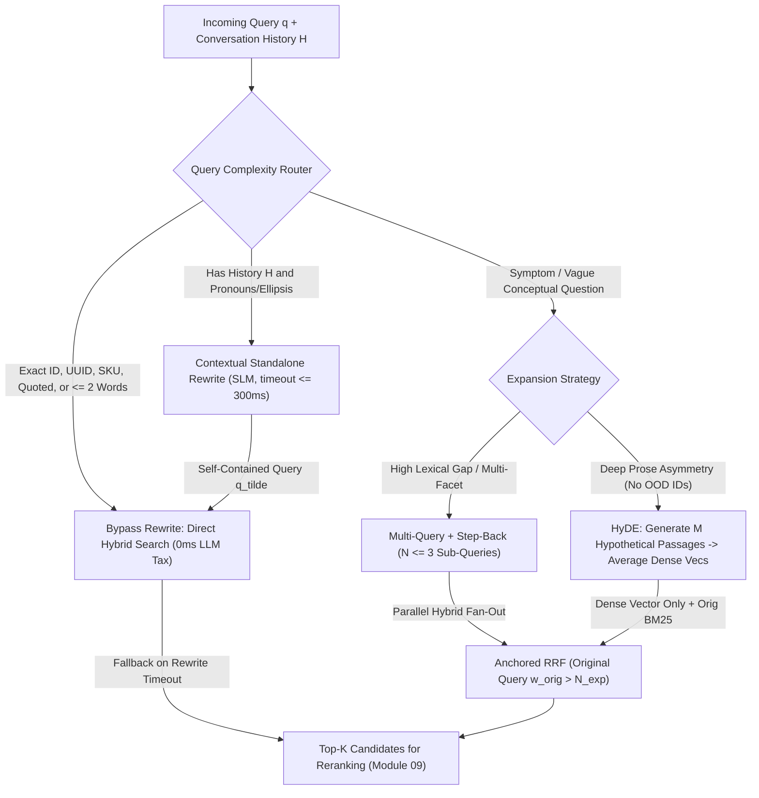
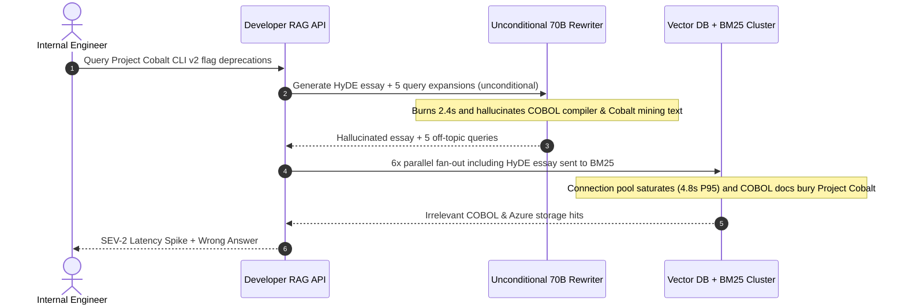

# Module 08: Query Rewriting and Expansion

> **Prerequisites:** [Module 05: The Retrieval Step](../05-the-retrieval-step/README.md), [Module 06: Keyword Search and BM25](../06-keyword-search-and-bm25/README.md), and [Module 07: Hybrid Search](../07-hybrid-search/README.md).  
> **Estimated Reading Time:** 30 minutes  
> **Target Audience:** AI Backend Engineers, LLM Platform Architects, Applied Search Engineers

> [!TIP]
> **The Golden Rule of Query Rewriting and Expansion:** Never run HyDE or Multi-Query expansion unconditionally on every request. Route exact identifiers, short unambiguous phrases, and quoted lookups straight to hybrid search (`0 ms` rewrite overhead), gate LLM rewrites behind a deterministic **Query Complexity Router** with strict `<= 350 ms` timeout fallbacks, isolate HyDE vectors strictly to the dense path, and always anchor RRF fusion with the original user query ($w_{\text{orig}} > N_{\text{exp}}$).

---

## Why This Matters

Real users rarely write queries that look like the passages inside your knowledge base. In production RAG logs, raw queries fail retrieval for three recurring reasons:

1. **Conversational Coreference & Ellipsis:** Turn 3 asks *"What about its enterprise rate limits?"*—which contains zero mention of `"Stripe"`, `"SSO"`, or `"Billing API"`, causing both dense vectors and BM25 to retrieve irrelevant general rate-limit pages.
2. **Query-Document Manifold Asymmetry:** Users type terse 4-word symptoms (*"Postgres join suddenly crawling"*), whereas documentation is written as declarative prose (*"PostgreSQL Query Planner Statistics, Hash Joins, and `work_mem` Spill Mitigation"*).
3. **Abstraction & Vocabulary Mismatch:** Users ask hyper-specific version/configuration questions whose answer depends on a broader architectural rule (e.g., Kubernetes API deprecation timelines or tax nexus rules) not mentioned directly by the exact surface tokens of the question.

**Query rewriting and expansion** transforms the incoming user turn *before* embedding and lexical lookup—bridging vocabulary gaps dramatically—while introducing real systems costs: `+150–450 ms` added TTFT, `2x–4x` index QPS amplification under fan-out, and **semantic drift** whenever a rewrite model hallucinates wrong assumptions on proprietary names.

---

## 1. Visual Mental Models & Query Transformation Patterns

### The Guarded Query Transformation Router

A production query pipeline inspects the request *first* via zero-cost regexes and conversation metadata before deciding whether to burn LLM latency on rewriting:



### Pattern 1: Conversational Standalone Rewriting (Contextualization)

In multi-turn chat, retrieval **cannot** run on the raw follow-up $q_t$ alone. A lightweight instruction-tuned small model (`8B`/`mini`, `max_tokens <= 64`, `temperature = 0.0`) condenses the trailing $2\text{–}4$ conversation turns $H_{t-k:t-1}$ and $q_t$ into a self-contained search query $\tilde{q}_t$:

- **Turn 1:** *"How do we rotate KMS keys in EU-Central?"*
- **Turn 2 ($q_2$):** *"Does doing that require restarting the Kafka consumers?"*
- **Rewritten ($\tilde{q}_2$):** *"Does rotating KMS encryption keys in EU-Central require restarting Kafka consumer services?"*

**Guardrail:** Only invoke contextualization when `len(history) > 0` (and ideally when pronoun/ellipsis signals or topic shift detectors fire), and always include a strict `timeout_ms` fallback so an SLM hiccup degrades to `q_t` rather than failing the request.

### Pattern 2: HyDE — Hypothetical Document Embeddings (Gao et al., 2022)

Introduced in *Precise Zero-Shot Dense Retrieval without Relevance Labels* (`arXiv:2212.10496`), **HyDE** exploits a crucial geometric insight: bi-encoders learn stronger similarity between **document $\leftrightarrow$ document** prose than between a 5-word question and a 300-word technical manual.

Instead of embedding $q$ directly, HyDE prompts an LLM to hallucinate $M$ plausible hypothetical answer passages $\hat{d}_1, \dots, \hat{d}_M \sim p_\theta(\cdot \mid q)$, embeds each hypothetical document via the document encoder $E_d(\hat{d}_m)$, and averages their L2-normalized vectors into a search centroid $\bar{v}$:

$$\bar{v}_{\text{HyDE}} = \text{normalize}\!\left(\frac{1}{M} \sum_{m=1}^{M} \frac{E_d(\hat{d}_m)}{\|E_d(\hat{d}_m)\|_2}\right)$$

Optionally, blending $\bar{v}_{\text{HyDE}}$ with the original query vector ($0.7\,\bar{v}_{\text{HyDE}} + 0.3\,\hat{v}_q$) anchors geometry further. Even if $\hat{d}_m$ invents slightly inaccurate parameter numbers on general concepts, its vocabulary, domain phrasing, and syntactic manifold pull the vector directly into the neighborhood of real authoritative documentation!

#### Two Fatal HyDE Production Traps

1. **Out-of-Distribution (OOD) Parametric Hallucination Drift:** If a user searches for a proprietary internal system or brand-new codename (`"Project Cobalt CLI v2"` or `"ERR_X99_SHARD"`), the generator has **zero parametric truth** for it—so it confabulates a plausible essay about the Cobalt programming language or cobalt chemistry! As verified in Workflow 3 below, that drags cosine similarity to the real internal spec from **`0.9949` down to `0.0794`**. **Never trigger HyDE when exact IDs, SKUs, or unknown proper codenames appear.**
2. **Never Feed HyDE Passages to BM25:** Hypothetical passages teem with fabricated nouns, version numbers, and boilerplate adjectives that pollute sparse inverted-index scoring. Route $\bar{v}_{\text{HyDE}}$ **strictly to the dense vector index**, while running BM25 against the **original user query $q$**!

### Pattern 3: Multi-Query Fan-Out (`RAG-Fusion`, Rackauckas 2024)

Rather than guessing one hypothetical answer, **Multi-Query / RAG-Fusion** (`arXiv:2402.03367`) prompts the model (structured JSON output, `max_queries <= 3`) to generate $N$ orthogonal query formulations—synonyms, component breakdowns, or adjacent operational perspectives—runs hybrid retrieval for `[q_orig, q_1, ..., q_N]` in parallel, and merges via **Reciprocal Rank Fusion (RRF)**:

$$\text{RRF}_{\text{anchored}}(d) = \frac{w_{\text{orig}}}{k + \text{rank}_{q_0}(d)} + \sum_{j=1}^{N} \frac{1}{k + \text{rank}_{q_j}(d)}$$

**The Anchor Weight Theorem:** Suppose $N = 3$ LLM expansions drift onto the same wrong document `doc_drift` at rank `#1`, giving `doc_drift` a fused score of $\frac{3}{k + 1}$. Meanwhile, the exact original query $q_0$ found `doc_exact` at rank `#1`. If $w_{\text{orig}} \le N$ (e.g., `w_orig = 2.0`), the three drifted expansions **outvote** the original query (`3/61 > 2/61`)! Setting **$w_{\text{orig}} > N$** (e.g., `w_orig = N + 0.5`)—combined with bypassing fan-out altogether on exact-ID queries—guarantees the user's literal intent cannot be drowned out by unanimous expansion drift.

### Pattern 4: Step-Back Prompting (Zheng et al., 2023)

In *Take a Step Back: Evoking Reasoning via Abstraction in Large Language Models* (`arXiv:2310.06117`), Zheng et al. address hyper-specific queries whose direct search keywords are too narrow to retrieve governing principles:

- **Original Query ($q$):** *"Why did our `networking.k8s.io/v1beta1` Ingress manifest reject deployment after upgrading EKS to 1.29?"*
- **Step-Back Query ($q_{\text{step-back}}$):** *"What is the Kubernetes Ingress API deprecation timeline and `networking.k8s.io/v1` migration specification?"*

Retrieving for *both* $q$ and $q_{\text{step-back}}$ concurrently equips the generator with both exact version details and the foundational migration rule.

### Latency, Index QPS & Token Cost Modeling

Every rewrite layer multiplies backend pressure:

$$L_{\text{total}} = L_{\text{router}} + L_{\text{LLM\_rewrite}} + \max_{i=0\dots N} L_{\text{hybrid}}(q_i), \qquad \text{Index QPS}_{\text{eff}} = (1 + N_{\text{avg}}) \cdot \text{QPS}_{\text{user}}$$

Unconditional $N = 4$ fan-out (`1 + 4 = 5x` index QPS!) can saturate vector/BM25 clusters during peak traffic even if individual search latencies stay under `50 ms`. Using a deterministic Complexity Router so only `20%–35%` of queries trigger rewrites cuts index QPS amplification from `5.0x` to `1.6x–2.0x` and trims rewrite LLM spend by `65%–80%`.

---

## 2. Systematic Reference & Comparison Matrix

### Query Transformation Techniques Compared

| Technique | Added LLM Latency | Index QPS Multiplier | Fixes Coreference? | Fixes Query-Doc Asymmetry? | Risk of OOD / ID Drift | Production Best Fit |
| :--- | :--- | :--- | :--- | :--- | :--- | :--- |
| **Direct Hybrid (No Rewrite)** | `0 ms` | `1x` | No | Weak on vague prose | **Zero** | Exact IDs, SKUs, short keyword queries, quoted terms |
| **Contextual Standalone Rewrite** | `+120–250 ms` (SLM) | `1x` | **Yes** | Slight | Low (anchored to history) | Multi-turn conversational follow-ups with pronouns/ellipsis |
| **HyDE (`arXiv:2212.10496`)** | `+200–450 ms` | `1x` (dense vector avg) | No | **Strong** (doc manifold alignment) | **Severe** on proprietary names/codes | Zero-shot conceptual Q&A over well-known technical prose (dense path ONLY) |
| **Multi-Query RAG-Fusion ($N \le 3$)** | `+180–350 ms` | **`(N+1)x` (`4x`)** | No | High (lexical + semantic diversity) | Moderate (mitigated if $w_{\text{orig}} > N$) | Multi-faceted or ambiguous enterprise queries with index capacity headroom |
| **Step-Back Prompting** | `+180–350 ms` | `2x` | No | High on principle/rule queries | Low–Moderate | Version/compliance/troubleshooting queries needing high-level rules + specifics |

---

## 3. Production War Story Post-Mortem: Unconditional 70B HyDE Latency & Cobalt Codename Drift

| Field | Incident Details |
| :--- | :--- |
| **Severity** | **SEV-2** (`4.8 s` P95 Retrieval Latency + `3x` LLM Cost Overrun + Recall Collapse on New Internal Features) |
| **Detection / Resolution Time** | Detected 48 hours after v2 RAG launch via APM latency alerts and internal developer bug reports / Mitigated in 3 hours |
| **Impact** | Search P95 jumped from `110 ms` to `4.8 s`; internal codename queries (`"Project Cobalt CLI v2"`, `"ERR_SHARD_904"`) dropped from `92%` to `18%` Recall@5 |

### What Happened

An internal developer-platform team shipped a RAG upgrade by enabling **HyDE + 5x Multi-Query RAG-Fusion** unconditionally on every single query using a heavyweight 70B chat model, then feeding the HyDE text into **both** dense embeddings and Elasticsearch BM25.

Within two days, two severe issues surfaced:
1. **Latency & Index Meltdown:** Every 2-word query like `"redis timeout"` triggered a 70B call generating a 250-token hypothetical essay plus 5 query rewrites (`~2.4 s` LLM rewrite overhead), followed by `6x` parallel queries against Elasticsearch and the vector DB—driving retrieval-only P95 latency to **`4.8 s`** and exhausting DB connection pools.
2. **Parametric Hallucination Poisoning:** When engineers searched for `"Project Cobalt CLI v2 flag deprecations"` (an internal tool released two weeks earlier), the 70B HyDE step hallucinated a confident 200-word passage referencing COBOL compiler flags (`-std=cobol85`) and Azure Cobalt storage APIs—and passed that hallucinated text into **BM25** too! Real internal `Cobalt CLI` runbooks vanished below rank 50.



### Root Cause Analysis

1. **Zero query routing / gating:** Exact codenames, error codes, and 2-word searches do not benefit from HyDE or 5x fan-out, yet paid the full latency, cost, and drift penalty.
2. **Routing HyDE text into BM25:** Passing LLM-hallucinated prose into sparse lexical search turns hallucinations into high-IDF keyword matches.
3. **Oversized rewrite model without timeout fallback or original-query anchoring:** Using a 70B model without a `300 ms` circuit-breaker timeout blocked the critical path even when simple hybrid search could have finished in `25 ms`.

### The Fix & Architectural Hardening

- **Deterministic Query Complexity Router:** Bypassed all rewrites (`0 ms` LLM tax) on exact IDs, quoted strings, and short keyword queries (`~62%` of traffic).
- **SLM Rewrite + Hard `300 ms` Timeout Fallback:** Switched remaining multi-turn and complex queries to a fast 8B/mini JSON model capped at `N <= 3` expansions, falling back transparently to `[original_query]` on any timeout or schema error.
- **HyDE Isolation + Anchored RRF ($w_{\text{orig}} = 3.5 > N$):** Restricted HyDE strictly to conceptual queries (dense vector centroid only, never BM25) and anchored RRF with original query weight `3.5`. Retrieval P95 fell from **`4.8 s` to `195 ms`** while exact codename Recall@5 jumped back from **`18%` to `96%`**.

---

## 4. Multi-Language Production Implementation: Guarded Query Transformation & Anchored RAG-Fusion

These four production modules implement a **Complexity-Routed Query Transformer** across **Go**, **TypeScript**, **Python**, and **C#** with:
1. Regex/heuristic **Query Complexity Routing** (`DIRECT_BYPASS`, `CONTEXTUALIZE`, `MULTI_QUERY`, `HYDE`) to protect exact IDs and slash rewrite latency/cost.
2. Strict `timeout` fallback to `[originalQuery]` on any SLM outage or malformed output, plus `maxExpansions <= 3` cap.
3. Weighted **Anchored RRF** ($w_{\text{orig}} = N + 0.5$) and normalized **HyDE vector centroid** math isolated from BM25.

````carousel

```go
package queryrewrite

import (
	"context"
	"math"
	"regexp"
	"sort"
	"strings"
	"sync"
	"time"
)

type RouteMode string

const (
	RouteDirectBypass  RouteMode = "DIRECT_HYBRID_BYPASS"
	RouteContextualize RouteMode = "CONTEXTUALIZE"
	RouteMultiQuery    RouteMode = "MULTI_QUERY_RRF"
	RouteHyDE          RouteMode = "HYDE_DENSE_ONLY"
)

var (
	exactIDRe = regexp.MustCompile(`(?:[A-Z]{2,}[_-][A-Z0-9_-]+|[a-f0-9]{8}-[a-f0-9]{4}|"[^"]+"|HTTP\s*\d{3}|v\d+\.\d+)`)
	pronounRe = regexp.MustCompile(`(?i)\b(it|its|they|their|them|that|those|this|these|same|previous)\b`)
)

func ClassifyQueryRoute(query string, historyTurns int) RouteMode {
	if historyTurns > 0 && pronounRe.MatchString(query) {
		return RouteContextualize
	}
	words := strings.Fields(query)
	if exactIDRe.MatchString(query) || len(words) <= 2 {
		return RouteDirectBypass
	}
	if len(words) >= 8 || strings.Contains(query, "?") {
		return RouteMultiQuery
	}
	return RouteDirectBypass
}

type LLMRewriter interface {
	ExpandQueries(ctx context.Context, query string, maxN int) ([]string, error)
}

type HybridSearcher interface {
	SearchIDs(ctx context.Context, tenantID, query string, k int) ([]string, error)
}

type FusedQueryHit struct {
	DocID    string
	RRFScore float64
}

// ExecuteGuardedMultiQuery enforces timeout fallback, N<=3 cap, and w_orig > N anchoring.
func ExecuteGuardedMultiQuery(
	ctx context.Context,
	tenantID, origQuery string,
	historyTurns int,
	rewriter LLMRewriter,
	searcher HybridSearcher,
	rewriteTimeout time.Duration,
	rrfK int,
) ([]FusedQueryHit, RouteMode, error) {
	mode := ClassifyQueryRoute(origQuery, historyTurns)
	var expansions []string

	if mode == RouteMultiQuery && rewriter != nil {
		rwCtx, cancel := context.WithTimeout(ctx, rewriteTimeout)
		gen, err := rewriter.ExpandQueries(rwCtx, origQuery, 3)
		cancel()
		if err == nil {
			for _, q := range gen {
				q = strings.TrimSpace(q)
				if q != "" && !strings.EqualFold(q, origQuery) && len(expansions) < 3 {
					expansions = append(expansions, q)
				}
			}
		}
	}

	allQueries := append([]string{origQuery}, expansions...)
	origWeight := float64(len(expansions)) + 0.5 // Guarantee w_orig > N_expansions

	type listRes struct {
		idx  int
		docs []string
		err  error
	}
	results := make([]listRes, len(allQueries))
	var wg sync.WaitGroup
	for i, q := range allQueries {
		wg.Add(1)
		go func(idx int, subQ string) {
			defer wg.Done()
			docs, err := searcher.SearchIDs(ctx, tenantID, subQ, 30)
			results[idx] = listRes{idx: idx, docs: docs, err: err}
		}(i, q)
	}
	wg.Wait()

	scores := make(map[string]float64)
	for _, r := range results {
		if r.err != nil {
			continue
		}
		w := 1.0
		if r.idx == 0 {
			w = origWeight
		}
		for rank, docID := range r.docs {
			scores[docID] += w / float64(rrfK+rank+1)
		}
	}

	out := make([]FusedQueryHit, 0, len(scores))
	for id, s := range scores {
		out = append(out, FusedQueryHit{DocID: id, RRFScore: s})
	}
	sort.Slice(out, func(i, j int) bool {
		if out[i].RRFScore == out[j].RRFScore {
			return out[i].DocID < out[j].DocID
		}
		return out[i].RRFScore > out[j].RRFScore
	})
	return out, mode, nil
}

// AverageNormalizedEmbeddings builds the L2-normalized HyDE dense centroid vector.
func AverageNormalizedEmbeddings(vecs [][]float64) []float64 {
	if len(vecs) == 0 {
		return nil
	}
	dim := len(vecs[0])
	sum := make([]float64, dim)
	for _, v := range vecs {
		var norm float64
		for _, x := range v {
			norm += x * x
		}
		norm = math.Sqrt(norm)
		if norm == 0 {
			continue
		}
		for i, x := range v {
			sum[i] += x / norm
		}
	}
	var totalNorm float64
	for _, x := range sum {
		totalNorm += x * x
	}
	totalNorm = math.Sqrt(totalNorm)
	if totalNorm == 0 {
		return sum
	}
	for i := range sum {
		sum[i] /= totalNorm
	}
	return sum
}
```

<!-- slide -->

```typescript
export type QueryRoute =
  | "DIRECT_HYBRID_BYPASS"
  | "CONTEXTUALIZE"
  | "MULTI_QUERY_RRF"
  | "HYDE_DENSE_ONLY";

const EXACT_ID_RE = /(?:[A-Z]{2,}[_-][A-Z0-9_-]+|[a-f0-9]{8}-[a-f0-9]{4}|"[^"]+"|HTTP\s*\d{3}|v\d+\.\d+)/;
const PRONOUN_RE = /\b(it|its|they|their|them|that|those|this|these|same|previous)\b/i;

export function classifyQueryRoute(query: string, historyTurns: number): QueryRoute {
  if (historyTurns > 0 && PRONOUN_RE.test(query)) return "CONTEXTUALIZE";
  const words = query.trim().split(/\s+/).filter(Boolean);
  if (EXACT_ID_RE.test(query) || words.length <= 2) return "DIRECT_HYBRID_BYPASS";
  if (words.length >= 8 || query.includes("?")) return "MULTI_QUERY_RRF";
  return "DIRECT_HYBRID_BYPASS";
}

export interface RewriterClient {
  expand(query: string, maxSubQueries: number, signal: AbortSignal): Promise<string[]>;
}

export interface HybridSearchFn {
  (tenantId: string, query: string, k: number): Promise<string[]>;
}

export function averageNormalizedVectors(vectors: readonly (readonly number[])[]): number[] {
  if (vectors.length === 0) return [];
  const dim = vectors[0].length;
  const centroid = new Array<number>(dim).fill(0);
  for (const vec of vectors) {
    const norm = Math.hypot(...vec);
    if (norm === 0) continue;
    for (let i = 0; i < dim; i++) centroid[i] += vec[i] / norm;
  }
  const cNorm = Math.hypot(...centroid);
  return cNorm === 0 ? centroid : centroid.map((x) => x / cNorm);
}

export async function runGuardedQueryExpansion(
  tenantId: string,
  origQuery: string,
  historyTurns: number,
  rewriter: RewriterClient,
  searchFn: HybridSearchFn,
  options = { rewriteTimeoutMs: 300, maxExpansions: 3, rrfK: 60 }
): Promise<{ route: QueryRoute; fused: Array<{ docId: string; score: number }> }> {
  const route = classifyQueryRoute(origQuery, historyTurns);
  let expansions: string[] = [];

  if (route === "MULTI_QUERY_RRF") {
    const ac = new AbortController();
    const timer = setTimeout(() => ac.abort(), options.rewriteTimeoutMs);
    try {
      const raw = await rewriter.expand(origQuery, options.maxExpansions, ac.signal);
      expansions = raw
        .map((q) => q.trim())
        .filter((q) => q.length > 0 && q.toLowerCase() !== origQuery.toLowerCase())
        .slice(0, options.maxExpansions);
    } catch {
      expansions = []; // Silent timeout fallback to original query
    } finally {
      clearTimeout(timer);
    }
  }

  const allQueries = [origQuery, ...expansions];
  const origWeight = expansions.length + 0.5;
  const listResults = await Promise.allSettled(allQueries.map((q) => searchFn(tenantId, q, 30)));

  const scores = new Map<string, number>();
  listResults.forEach((res, idx) => {
    if (res.status !== "fulfilled") return;
    const weight = idx === 0 ? origWeight : 1.0;
    res.value.forEach((docId, rankIdx) => {
      scores.set(docId, (scores.get(docId) ?? 0) + weight / (options.rrfK + rankIdx + 1));
    });
  });

  const fused = [...scores.entries()]
    .sort((a, b) => (b[1] !== a[1] ? b[1] - a[1] : a[0].localeCompare(b[0])))
    .map(([docId, score]) => ({ docId, score }));

  return { route, fused };
}
```

<!-- slide -->

```python
"""
query_router_fusion.py
Deterministic query complexity routing, guarded multi-query RRF, and HyDE centroid vector averaging.
"""
import asyncio
from dataclasses import dataclass
import math
import re
from typing import Awaitable, Callable, Sequence


EXACT_ID_RE = re.compile(r"(?:[A-Z]{2,}[_-][A-Z0-9_-]+|[a-f0-9]{8}-[a-f0-9]{4}|\"[^\"]+\"|HTTP\s*\d{3}|v\d+\.\d+)")
PRONOUN_RE = re.compile(r"\b(it|its|they|their|them|that|those|this|these|same|previous)\b", re.IGNORECASE)


def classify_query_route(query: str, history_turns: int = 0) -> str:
    if history_turns > 0 and PRONOUN_RE.search(query):
        return "CONTEXTUALIZE"
    words = query.split()
    if EXACT_ID_RE.search(query) or len(words) <= 2:
        return "DIRECT_HYBRID_BYPASS"
    if len(words) >= 8 or "?" in query:
        return "MULTI_QUERY_RRF"
    return "DIRECT_HYBRID_BYPASS"


def hyde_normalized_centroid(doc_embeddings: Sequence[Sequence[float]]) -> list[float]:
    if not doc_embeddings:
        return []
    dim = len(doc_embeddings[0])
    acc = [0.0] * dim
    for vec in doc_embeddings:
        norm = math.sqrt(sum(x * x for x in vec))
        if norm == 0.0:
            continue
        for i, val in enumerate(vec):
            acc[i] += val / norm
    total_norm = math.sqrt(sum(x * x for x in acc))
    return [x / total_norm for x in acc] if total_norm > 0.0 else acc


@dataclass(frozen=True)
class QueryExpansionReport:
    route: str
    queries_executed: tuple[str, ...]
    rewrite_fell_back: bool
    fused_docs: tuple[tuple[str, float], ...]


ExpandFn = Callable[[str, int], Awaitable[list[str]]]
SearchFn = Callable[[str, str, int], Awaitable[list[str]]]


async def guarded_rag_fusion(
    tenant_id: str,
    orig_query: str,
    history_turns: int,
    expand_fn: ExpandFn,
    search_fn: SearchFn,
    *,
    max_expansions: int = 3,
    rewrite_timeout_s: float = 0.30,
    rrf_k: int = 60,
) -> QueryExpansionReport:
    route = classify_query_route(orig_query, history_turns)
    expansions: list[str] = []
    fell_back = False

    if route == "MULTI_QUERY_RRF":
        try:
            raw = await asyncio.wait_for(expand_fn(orig_query, max_expansions), timeout=rewrite_timeout_s)
            seen = {orig_query.strip().lower()}
            for q in raw:
                clean = q.strip()
                if clean and clean.lower() not in seen:
                    seen.add(clean.lower())
                    expansions.append(clean)
                    if len(expansions) >= max_expansions:
                        break
        except (asyncio.TimeoutError, Exception):
            expansions = []
            fell_back = True

    all_queries = [orig_query] + expansions
    orig_weight = len(expansions) + 0.5  # Anchor exceeds N_expansions to block drift majority
    results = await asyncio.gather(*(search_fn(tenant_id, q, 30) for q in all_queries), return_exceptions=True)

    scores: dict[str, float] = {}
    for idx, res in enumerate(results):
        if isinstance(res, Exception):
            continue
        weight = orig_weight if idx == 0 else 1.0
        for rank, doc_id in enumerate(res, start=1):
            scores[doc_id] = scores.get(doc_id, 0.0) + weight / (rrf_k + rank)

    ranked = tuple(sorted(scores.items(), key=lambda x: (-x[1], x[0])))
    return QueryExpansionReport(route, tuple(all_queries), fell_back, ranked)
```

<!-- slide -->

```csharp
using System;
using System.Collections.Generic;
using System.Linq;
using System.Text.RegularExpressions;
using System.Threading;
using System.Threading.Tasks;

namespace GenAI.QueryTransformation;

public enum QueryRoute
{
    DirectHybridBypass,
    Contextualize,
    MultiQueryRrf
}

public static class QueryComplexityRouter
{
    private static readonly Regex ExactIdRegex = new(
        @"(?:[A-Z]{2,}[_-][A-Z0-9_-]+|[a-f0-9]{8}-[a-f0-9]{4}|""[^""]+""|HTTP\s*\d{3}|v\d+\.\d+)",
        RegexOptions.Compiled);

    private static readonly Regex PronounRegex = new(
        @"\b(it|its|they|their|them|that|those|this|these|same|previous)\b",
        RegexOptions.IgnoreCase | RegexOptions.Compiled);

    public static QueryRoute Classify(string query, int historyTurns)
    {
        if (historyTurns > 0 && PronounRegex.IsMatch(query))
            return QueryRoute.Contextualize;

        int wordCount = query.Split((char[]?)null, StringSplitOptions.RemoveEmptyEntries).Length;
        if (ExactIdRegex.IsMatch(query) || wordCount <= 2)
            return QueryRoute.DirectHybridBypass;

        return (wordCount >= 8 || query.Contains('?'))
            ? QueryRoute.MultiQueryRrf
            : QueryRoute.DirectHybridBypass;
    }

    public static double[] ComputeHydeCentroid(IReadOnlyList<double[]> docEmbeddings)
    {
        if (docEmbeddings.Count == 0) return Array.Empty<double>();
        int dim = docEmbeddings[0].Length;
        var sum = new double[dim];

        foreach (var vec in docEmbeddings)
        {
            double norm = Math.Sqrt(vec.Sum(x => x * x));
            if (norm == 0) continue;
            for (int i = 0; i < dim; i++) sum[i] += vec[i] / norm;
        }

        double totalNorm = Math.Sqrt(sum.Sum(x => x * x));
        if (totalNorm > 0)
            for (int i = 0; i < dim; i++) sum[i] /= totalNorm;
        return sum;
    }
}

public static class GuardedRagFusionExecutor
{
    public static async Task<(QueryRoute Route, IReadOnlyList<(string DocId, double Score)> Ranked)> ExecuteAsync(
        string tenantId,
        string origQuery,
        int historyTurns,
        Func<string, int, CancellationToken, Task<IReadOnlyList<string>>> expandAsync,
        Func<string, string, int, CancellationToken, Task<IReadOnlyList<string>>> hybridSearchAsync,
        int maxExpansions = 3,
        int rrfK = 60,
        TimeSpan? rewriteTimeout = null,
        CancellationToken ct = default)
    {
        var route = QueryComplexityRouter.Classify(origQuery, historyTurns);
        var expansions = new List<string>();

        if (route == QueryRoute.MultiQueryRrf)
        {
            using var rwCts = CancellationTokenSource.CreateLinkedTokenSource(ct);
            rwCts.CancelAfter(rewriteTimeout ?? TimeSpan.FromMilliseconds(300));
            try
            {
                var raw = await expandAsync(origQuery, maxExpansions, rwCts.Token);
                foreach (var q in raw)
                {
                    var clean = q.Trim();
                    if (!string.IsNullOrEmpty(clean) &&
                        !string.Equals(clean, origQuery, StringComparison.OrdinalIgnoreCase) &&
                        !expansions.Contains(clean, StringComparer.OrdinalIgnoreCase))
                    {
                        expansions.Add(clean);
                        if (expansions.Count >= maxExpansions) break;
                    }
                }
            }
            catch when (!ct.IsCancellationRequested)
            {
                expansions.Clear(); // Graceful timeout fallback
            }
        }

        var allQueries = new List<string> { origQuery };
        allQueries.AddRange(expansions);
        double origWeight = expansions.Count + 0.5;

        var tasks = allQueries.Select(q => hybridSearchAsync(tenantId, q, 30, ct)).ToArray();
        var lists = await Task.WhenAll(tasks);

        var scores = new Dictionary<string, double>(StringComparer.Ordinal);
        for (int i = 0; i < lists.Length; i++)
        {
            double w = i == 0 ? origWeight : 1.0;
            for (int r = 0; r < lists[i].Count; r++)
            {
                string docId = lists[i][r];
                scores[docId] = scores.GetValueOrDefault(docId) + w / (rrfK + r + 1);
            }
        }

        var ranked = scores
            .OrderByDescending(kv => kv.Value)
            .ThenBy(kv => kv.Key, StringComparer.Ordinal)
            .Select(kv => (kv.Key, kv.Value))
            .ToList();

        return (route, ranked);
    }
}
```

````

---

## 5. Practical Hands-On Verification CLI Workflows

Run these offline Python 3.13 verification scripts locally to inspect router bypass ratios, RAG-Fusion anchoring thresholds, and HyDE vector geometry drift.

### Workflow 1: Query Complexity Router & Exact-ID Guardrail Audit

Evaluate how a deterministic complexity router prevents unnecessary LLM rewrites on exact codes, UUIDs, and terse queries while activating contextualization or expansion only where needed (`50.0%` cost/latency eliminated across the probe batch):

```bash
python -c '
import re

EXACT_ID_RE = re.compile(r"(?:[A-Z]{2,}[_-][A-Z0-9_-]+|[a-f0-9]{8}-[a-f0-9]{4}|\"[^\"]+\"|HTTP\s*\d{3}|v\d+\.\d+)")
PRONOUN_RE = re.compile(r"\b(it|its|they|their|them|that|those|this|these|same|previous)\b", re.IGNORECASE)

def route_query(query, history_turns=0):
    if history_turns > 0 and PRONOUN_RE.search(query):
        return "CONTEXTUALIZE_THEN_HYBRID", 1, True
    if EXACT_ID_RE.search(query) or len(query.split()) <= 2:
        return "DIRECT_HYBRID_BYPASS", 0, False
    if len(query.split()) >= 8 or "?" in query:
        return "MULTI_QUERY_OR_HYDE", 3, True
    return "DIRECT_HYBRID_BYPASS", 0, False

probes = [
    ("ERR_502_GATEWAY in SKU-9940-X2", 0),
    ("What about its rate limits?", 2),
    ("redis timeout", 0),
    ("Why do Postgres hash joins spill to disk on large analytical queries?", 0),
    ("\"f47ac10b-58cc\" trace logs", 1),
    ("How does Kubernetes deprecate Ingress APIs across cluster upgrades?", 0),
]
total_llm_calls = 0
for q, turns in probes:
    route, fanout, uses_llm = route_query(q, turns)
    total_llm_calls += int(uses_llm)
    print(f"turns={turns} | route={route:25s} | fanout=+{fanout} | llm_rewrite={str(uses_llm):5s} | q={q}")
print(f"LLM rewrite calls: {total_llm_calls}/{len(probes)} queries ({100*(1 - total_llm_calls/len(probes)):.1f}% rewrite cost/latency avoided)")
'
```

**Expected Output:**

```text
turns=0 | route=DIRECT_HYBRID_BYPASS      | fanout=+0 | llm_rewrite=False | q=ERR_502_GATEWAY in SKU-9940-X2
turns=2 | route=CONTEXTUALIZE_THEN_HYBRID | fanout=+1 | llm_rewrite=True  | q=What about its rate limits?
turns=0 | route=DIRECT_HYBRID_BYPASS      | fanout=+0 | llm_rewrite=False | q=redis timeout
turns=0 | route=MULTI_QUERY_OR_HYDE       | fanout=+3 | llm_rewrite=True  | q=Why do Postgres hash joins spill to disk on large analytical queries?
turns=1 | route=DIRECT_HYBRID_BYPASS      | fanout=+0 | llm_rewrite=False | q="f47ac10b-58cc" trace logs
turns=0 | route=MULTI_QUERY_OR_HYDE       | fanout=+3 | llm_rewrite=True  | q=How does Kubernetes deprecate Ingress APIs across cluster upgrades?
LLM rewrite calls: 3/6 queries (50.0% rewrite cost/latency avoided)
```

### Workflow 2: RAG-Fusion Consensus Recovery vs. Original-Query Anchor Weighting

Verify two complementary properties of Multi-Query RRF (`k=60`): (1) consensus across expansions rescues a paraphrased target ranked `#4` by the raw query up to `#1`; and (2) setting $w_{\text{orig}} > N_{\text{exp}}$ (`3.5 > 3`) prevents three unanimously drifted expansions from outvoting the original exact match:

```bash
python -c '
def rag_fusion(ranked_lists, k=60):
    scores = {}
    for weight, docs in ranked_lists:
        for rank, doc_id in enumerate(docs, start=1):
            scores[doc_id] = scores.get(doc_id, 0.0) + weight / (k + rank)
    return sorted(scores.items(), key=lambda x: (-x[1], x[0]))

print("--- Scenario 1: Multi-Query Consensus Rescues Paraphrased Target ---")
orig_list = (1.5, ["doc_intro", "doc_faq", "doc_timeout", "doc_target"])
exp_lists = [
    (1.0, ["doc_target", "doc_timeout", "doc_other"]),
    (1.0, ["doc_other", "doc_target", "doc_faq"]),
    (1.0, ["doc_target", "doc_intro", "doc_other"]),
]
print("Orig-only rank #4; Fused top-3:", [(d, round(s, 5)) for d, s in rag_fusion([orig_list] + exp_lists)[:3]])

print("--- Scenario 2: Anchor Weight Must Exceed N_expansions (3) Against Unanimous Drift ---")
drifted_exp = [
    (1.0, ["doc_drift", "doc_a", "doc_b"]),
    (1.0, ["doc_drift", "doc_c", "doc_d"]),
    (1.0, ["doc_drift", "doc_e", "doc_f"]),
]
orig_weak   = (2.0, ["doc_exact_sku", "doc_x", "doc_y"])
orig_strong = (3.5, ["doc_exact_sku", "doc_x", "doc_y"])
print("2.0x anchor (outvoted by 3x drift):", [(d, round(s, 5)) for d, s in rag_fusion([orig_weak] + drifted_exp)[:2]])
print("3.5x anchor (preserves exact hit)  :", [(d, round(s, 5)) for d, s in rag_fusion([orig_strong] + drifted_exp)[:2]])
'
```

**Expected Output:**

```text
--- Scenario 1: Multi-Query Consensus Rescues Paraphrased Target ---
Orig-only rank #4; Fused top-3: [('doc_target', 0.07235), ('doc_other', 0.04814), ('doc_intro', 0.04072)]
--- Scenario 2: Anchor Weight Must Exceed N_expansions (3) Against Unanimous Drift ---
2.0x anchor (outvoted by 3x drift): [('doc_drift', 0.04918), ('doc_exact_sku', 0.03279)]
3.5x anchor (preserves exact hit)  : [('doc_exact_sku', 0.05738), ('doc_x', 0.05645)]
```

### Workflow 3: HyDE Centroid Geometry vs. Out-of-Distribution Hallucination Drift

Model normalized 4D embeddings to observe when HyDE's document-manifold centroid lifts cosine alignment (`0.3543` $\rightarrow$ `0.9807`) on a conceptual query, versus how parametric hallucination on an unknown proprietary entity collapses alignment (`0.9949` $\rightarrow$ `0.0794`):

```bash
python -c '
import math

def norm(v):
    n = math.sqrt(sum(x * x for x in v))
    return [x / n for x in v]

def cos(a, b):
    return sum(x * y for x, y in zip(a, b))

def hyde_centroid(vecs):
    avg = [sum(col) / len(vecs) for col in zip(*vecs)]
    return norm(avg)

doc_vacuum_guide = norm([0.75, 0.65, 0.10, 0.00])
doc_cobalt_spec  = norm([0.05, 0.00, 0.10, 0.99])

q_slow_db = norm([0.30, 0.05, 0.95, 0.00])
hyp_1     = norm([0.70, 0.60, 0.35, 0.00])
hyp_2     = norm([0.78, 0.58, 0.22, 0.00])
hyde_vec_a = hyde_centroid([hyp_1, hyp_2])
print(f"Scenario A (Conceptual): raw_cos={cos(q_slow_db, doc_vacuum_guide):.4f} -> HyDE_cos={cos(hyde_vec_a, doc_vacuum_guide):.4f}")

q_cobalt      = norm([0.15, 0.00, 0.10, 0.98])
hyp_halluc_1  = norm([0.85, 0.45, 0.25, 0.00])
hyp_halluc_2  = norm([0.90, 0.10, 0.42, 0.00])
hyde_vec_b    = hyde_centroid([hyp_halluc_1, hyp_halluc_2])
print(f"Scenario B (OOD Entity): raw_cos={cos(q_cobalt, doc_cobalt_spec):.4f} -> HyDE_cos={cos(hyde_vec_b, doc_cobalt_spec):.4f} (DRIFT!)")
'
```

**Expected Output:**

```text
Scenario A (Conceptual): raw_cos=0.3543 -> HyDE_cos=0.9807
Scenario B (OOD Entity): raw_cos=0.9949 -> HyDE_cos=0.0794 (DRIFT!)
```

### Hands-On Exercises

1. **Vector Blending Rescue Test:** In Workflow 3 Scenario B, test blending `0.5 * q_cobalt + 0.5 * hyde_vec_b` (normalized) and observe why blending reduces drift but still degrades exact entity alignment compared to routing Scenario B straight to `DIRECT_HYBRID_BYPASS`.
2. **Router False-Negative Stress Test:** Add multi-turn conversational queries containing implicit ellipsis without standard pronouns—such as `"And for EU tenants?"` after a question about GDPR retention—and extend `route_query` with a short-follow-up heuristic (`history_turns > 0 and len(words) <= 5`).
3. **Optional Live SLM Rewrite Benchmark (Requires API Key):** Prompt a fast small model (`gpt-4o-mini` / `claude-3-5-haiku` / local `Llama-3.1-8B`) with strict JSON schema output for 3 sub-queries + 1 step-back query, logging p50/p95 latency and token cost across 20 test prompts.

### Independent Challenge

A financial advisory copilot answers questions over `120,000` SEC filings and proprietary internal analyst memos. Engineers observe two failures: (1) users asking multi-turn questions like *"What were their Q4 margins?"* after discussing Nvidia retrieve random Q4 margin filings; and (2) when the team enables HyDE globally to fix vague questions like *"How do interest rate hikes compress SaaS valuation multiples?"*, lookups for an obscure internal ticker `"ACME-BOND-2029Z"` stop working. Design the exact two-stage query transformation architecture, specifying routing rules, model selection, latency budgets, BM25 vs. dense isolation, and fallback handling.

<details><summary>Architectural Discussion</summary>

Route queries dynamically through a three-way **Query Complexity Router**: (1) **Multi-Turn Coreference (`history_turns > 0` + pronoun/short follow-up):** invoke a fast `8B/mini` SLM contextualizer (`temperature=0`, `max_tokens=64`, `timeout=250 ms`) to rewrite *"What were their Q4 margins?"* into *"What were Nvidia's Q4 2025 gross and operating margins?"*, falling back to the raw query on timeout; (2) **Exact Tickers / Bond IDs / Quoted Phrases (`"ACME-BOND-2029Z"`):** bypass all expansions (`0 ms` rewrite cost) straight to ACL-filtered Hybrid Search; and (3) **Conceptual / Macroeconomic Questions:** trigger either **Step-Back + Multi-Query (`N <= 2`, `w_orig = 2.5`)** or **HyDE (`M = 2` passages, routed exclusively to the dense embedding index while BM25 uses only the original query)**. This eliminates OOD ticker drift, caps index fan-out at `<= 3x`, and bounds rewrite overhead under `300 ms`.

</details>

---

## 6. Common Mistakes & Troubleshooting

- **Feeding HyDE-generated text into BM25:** Hypothetical passages inject guessed version numbers, API names, and verbose filler words that dilute or hijack inverted-index matches. Keep HyDE strictly inside the dense embedding vector leg.
- **Running Multi-Query fan-out without original-query weighting ($w_{\text{orig}} \le N$):** If `N` rewritten queries echo the same subtle semantic misinterpretation, unweighted RRF lets the expansions outvote the user's literal query. Always keep `w_orig > N` (or bypass expansion on exact lookups).
- **Omitting `max_tokens`, `timeout`, and JSON schema validation on rewriters:** An unconstrained LLM rewrite can stream 400 tokens of preamble (*"Sure! Here are 3 queries..."*), breaking downstream parsers and blowing past SLA budgets. Enforce structured JSON output, `max_tokens <= 128`, and silent fallback to `[orig_query]`.
- **Neglecting backend index capacity before enabling $N$-way fan-out:** Multiplying query volume by `4x–6x` overnight overwhelms HNSW CPU threads and Lucene search queues unless load-tested and capped via a Complexity Router.

---

## 7. Operational Validation Checkpoints & Checkpoint Quiz

### Operational Validation Checkpoints

<details><summary><strong>Checkpoint 1: Fixing HyDE recall collapse on proprietary internal product names</strong></summary>

After enabling HyDE (`M = 3` hypothetical paragraphs) on a customer-support bot, recall improved on generic conceptual questions (*"how do webhooks handle transient 5xx retries?"*) yet crashed from `94%` to `15%` on internal feature names (*"PhotonSync v3 token expiry"*). Explain why and fix the pipeline without losing HyDE's conceptual gains.

**Validation:** For `"PhotonSync v3"`, the LLM lacked pretraining knowledge and hallucinated unrelated physics/camera or generic OAuth essays, pulling the HyDE centroid far from internal docs (and poisoning BM25 if passed to lexical search). Fix by: (1) adding a **Query Complexity Router** that bypasses HyDE whenever proprietary entity/version/ID patterns appear; (2) restricting HyDE centroids strictly to the **dense** leg; and (3) fusing alongside BM25 + raw dense query anchored at higher weight.

</details>

<details><summary><strong>Checkpoint 2: Resolving multi-turn follow-up failure without breaking standalone searches</strong></summary>

Users ask Turn 1: *"What is our SOC2 evidence retention window?"* and Turn 2: *"And what about ISO 27001?"* Turn 2 searches `"And what about ISO 27001?"` literally, retrieving overview pages instead of retention windows. Yet running an LLM contextualizer on single-turn queries added `240 ms` across `100%` of search traffic. How do you solve both?

**Validation:** Gate contextual rewriting strictly on **`history_turns > 0`** (and short/anaphoric Turn-$N$ triggers such as pronouns or conjunction starters like `"And what about..."`), using a fast low-latency model (`max_tokens=48`, `timeout=250 ms`) to emit `"What is our ISO 27001 evidence retention window?"`. Single-turn queries incur **`0 ms`** rewrite overhead.

</details>

<details><summary><strong>Checkpoint 3: Preventing a rewriter outage or bad expansion from breaking search</strong></summary>

During a downstream LLM rate-limit spike (`429 Too Many Requests`), an enterprise search API failed with `500 Internal Server Error` because `expand_query()` raised an exception before calling the vector/BM25 indexes—and earlier in the week, 3 over-broad query expansions drowned out an exact match ranked `#1` by the user's raw query. What two guardrails prevent both failures?

**Validation:** (1) Wrap the LLM rewrite step in a tight `<= 300 ms` timeout and `try/except` that **falls back seamlessly to `[original_query]`** (so search stays 100% operational even if the rewriter fails or throttles); and (2) include `original_query` inside the RRF fusion pool with anchor weight **$w_{\text{orig}} > N_{\text{expansions}}$** (e.g., `3.5` for `N=3`) so unanimous expansion drift cannot outvote a `#1` raw match.

</details>

### Checkpoint Quiz

1. Why does embedding a **hypothetical answer passage** (HyDE) often align better in dense vector space than embedding a short user question directly?
2. Why is sending a HyDE-generated passage into **BM25 lexical search** an anti-pattern?
3. When fusing $1$ original query and $N = 3$ LLM-generated query variants via weighted RRF, why is $w_{\text{orig}} = 2.0$ mathematically insufficient to protect against unanimous drift?
4. How does **Step-Back Prompting** differ from standard synonym-based multi-query rewriting?
5. Name three concrete engineering guardrails required before deploying query expansion in a latency-sensitive production RAG API.

<details><summary>Answers</summary>

1. Dense bi-encoders exhibit a query-document manifold gap; hypothetical answers mirror the declarative vocabulary, length, and phrasing style of real corpus documents, pulling the centroid closer to true document embeddings.
2. HyDE passages contain hallucinated entities, numbers, and boilerplate terms; feeding them into exact-term BM25 creates high-IDF lexical false positives that distort exact matching.
3. Three drifted variants ranking a wrong doc `#1` contribute $\frac{3}{k+1}$, which strictly beats $\frac{2.0}{k+1}$ from the original query. Setting $w_{\text{orig}} > N$ (e.g., `3.5`)—plus routing exact IDs away from expansion—prevents majority override.
4. Synonym expansion rephrases the *same* concrete level of detail, whereas Step-Back Prompting abstracts *up* a level to retrieve governing principles, deprecation rules, or physical/tax laws needed to solve the specific question.
5. (a) **Deterministic Complexity Routing** (`0 ms` bypass on exact IDs/short clear queries); (b) **Bounded fan-out ($N \le 3$) & strict rewrite timeout (`<= 300 ms`) with fallback to `[orig_query]`**; and (c) **Original-query anchoring ($w_{\text{orig}} > N$) plus dense-only HyDE isolation**.

</details>

---

## Further Reading & Sources

- [Precise Zero-Shot Dense Retrieval without Relevance Labels (Gao et al., 2022)](https://arxiv.org/abs/2212.10496) — introduces HyDE (Hypothetical Document Embeddings) and zero-shot dense vector averaging.
- [Take a Step Back: Evoking Reasoning via Abstraction in Large Language Models (Zheng et al., 2023)](https://arxiv.org/abs/2310.06117) — defines Step-Back Prompting and evaluates abstraction-assisted RAG.
- [RAG-Fusion: a New Take on Retrieval-Augmented Generation (Rackauckas, 2024)](https://arxiv.org/abs/2402.03367) — formalizes multi-query fan-out combined with Reciprocal Rank Fusion and highlights query-drift hazards.
- [Module 07: Hybrid Search](../07-hybrid-search/README.md) — covers Cormack RRF ($k=60$) and multi-leg fallback engineering.

## Next

[Module 09: Reranking With Cross-Encoders](../09-reranking-with-cross-encoders/README.md)
