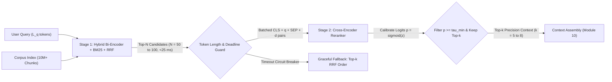
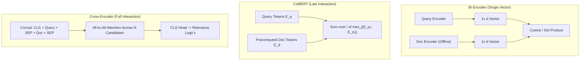
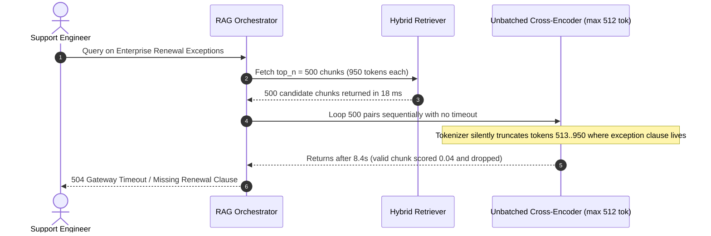

# Module 09: Reranking With Cross-Encoders

> **Prerequisites:** [Track 03, Module 05: Sentence-Transformers and Bi-Encoders](../../03-landmark-models-bert-gpt-and-moe/05-sentence-transformers-and-bi-encoders/README.md), [Module 07: Hybrid Search](../07-hybrid-search/README.md), and [Module 08: Query Rewriting and Expansion](../08-query-rewriting-and-expansion/README.md).  
> **Estimated Reading Time:** 28 minutes  
> **Target Audience:** AI Backend Engineers, Search Systems Engineers, ML Infrastructure Architects

> [!TIP]
> **The Golden Rule of Two-Stage Reranking:** Never pay quadratic cross-attention cost across your entire corpus, and never trust Stage-1 bi-encoder dot products to order your final prompt context. Use fast hybrid retrieval to maximize **recall** across the top-$N$ candidates ($N \approx 50\text{--}100$), then deploy a Stage-2 **cross-encoder reranker** (or **ColBERT late-interaction** scorer) to maximize **precision** in the top-$k$ passages ($k \approx 5\text{--}8$) that enter the LLM context window.

---

## Why This Matters

Hybrid search (dense bi-encoders fused with BM25 via Reciprocal Rank Fusion) excels at sweeping millions of chunks in under `25 ms`—yet it systematically puts the wrong passage at rank `#1`. Because a **bi-encoder** compresses an entire 350-token paragraph into a single static vector *without ever seeing the user's query*, critical relational semantics collapse during pooling: directionality swaps (*"Service A calls Service B"* vs. *"Service B calls Service A"*), conditional exceptions (*"waived unless total spend exceeds \$50,000"*), and multi-clause negations often achieve nearly identical cosine similarity (`0.89` vs. `0.87`) to the opposite meaning.

Meanwhile, **Reciprocal Rank Fusion (RRF)** (`Module 07`) merges lexical and dense ranks mathematically without reading a single word of either passage. Feeding noisy, poorly ordered Stage-1 candidates straight into the LLM forces the generator to sift through distractors, bloats input token spend, and degrades answer accuracy—especially when critical evidence sits at rank `#18` outside a `top-5` prompt cutoff. **Stage-2 cross-encoder reranking** solves this precision ceiling by reading each `(query, candidate)` pair jointly with full token-to-token attention, boosting top-5 precision dramatically while keeping per-query compute bounded along the **latency-recall Pareto frontier**.

---

## 1. Visual Mental Models & Cross-Attention Mechanics

### The Two-Stage Retrieval Funnel

Production search separates **candidate generation** (sub-linear ANN + inverted-index sweep over $10^6\text{--}10^8$ chunks) from **fine-grained semantic scoring** (deep Transformer cross-attention over $N = 50\text{--}100$ surviving candidates):



### Bi-Encoder vs. Late Interaction (ColBERT) vs. Cross-Encoder

Understanding *where* query tokens interact with document tokens explains both the accuracy gap and the latency budget:

1. **Bi-Encoder (No Query-Document Token Interaction):** Encodes query $q$ and document $d$ into separate pooled vectors $u = f_\theta(q) \in \mathbb{R}^d$ and $v = f_\theta(d) \in \mathbb{R}^d$. Document vectors $v$ are precomputed offline once; online scoring is a single inner product $u^\top v$. Zero cross-token comparison occurs during similarity evaluation.
2. **Cross-Encoder (Full Joint Self-Attention):** Concatenates `[CLS] q [SEP] d [SEP]` into a single input of length $L = L_q + L_d + 3$ and passes it through $L_{\text{layers}}$ transformer blocks (`Nogueira & Cho, 2019`, `arXiv:1901.04085`). Every query token attends directly to every document token across all heads and layers before a linear head on `[CLS]` emits a relevance logit $z(q, d) \in \mathbb{R}$.
3. **ColBERT / Late Interaction (`Khattab & Zaharia, 2020`, `arXiv:2004.12832`):** Bridges the gap between bi-encoders and cross-encoders. Document token embeddings $E_d \in \mathbb{R}^{|d| \times d_{\text{col}}}$ (typically $d_{\text{col}} = 128$) are precomputed offline. At query time, the encoder computes query token embeddings $E_q \in \mathbb{R}^{|q| \times d_{\text{col}}}$ once and executes fast **MaxSim** late interaction:

$$S_{\text{ColBERT}}(q, d) = \sum_{i=1}^{|q|} \max_{j=1}^{|d|} \bigl(E_{q,i} \cdot E_{d,j}^\top\bigr)$$



### Complexity, Memory & Latency-Recall Pareto Scaling

Let $M$ denote corpus size, $N$ the Stage-2 candidate count, $L_q$ query token length, and $L_d$ passage token length:

- **Stage-1 Bi-Encoder Query Cost:** $O(L_q^2)$ once to embed the query, plus $O(\log M \cdot d)$ HNSW traversal. Query latency is nearly invariant to passage length $L_d$.
- **Stage-2 Cross-Encoder Attention Cost:** Every candidate forces a forward pass over $L_q + L_d$ concatenated tokens:

$$\text{FLOPs}_{\text{Cross-Encoder}}(N) = \Theta\Bigl(N \cdot L_{\text{layers}} \cdot \bigl((L_q + L_d)^2 d_{\text{model}} + (L_q + L_d) d_{\text{model}}^2\bigr)\Bigr)$$

Because attention scales **quadratically** with $L_q + L_d$ and **linearly** with candidate count $N$, raising $N$ from `50` to `500` multiplies Stage-2 GPU compute by `10x`—while empirical top-5 recall typically plateaus sharply around $N \approx 50\text{--}100$ (the **Pareto knee**).

- **ColBERT Storage Footprint Trade-Off:** Because ColBERT keeps one $d_{\text{col}}$-dimensional vector per document token instead of one vector per chunk, raw index size scales by $|d| \cdot \frac{d_{\text{col}}}{d_{\text{bi}}}$. Even with `128-dim` vectors and `ColBERTv2` residual compression (`1–2` bits/dim), multi-vector RAM/disk requirements remain `3x–12x` larger than single-vector HNSW indexes, making ColBERT ideal when $N = 500\text{--}5{,}000$ candidates must be reranked in `<40 ms`, whereas cross-encoders excel at $N = 25\text{--}100$ with zero extra index storage.

### Score Calibration & Relevance Thresholding ($\tau_{\min}$)

Raw cross-encoder logits $z(q, d) \in (-\infty, +\infty)$ are **uncalibrated ordering scores** trained via pointwise BCE or pairwise margin losses. Converting logits via the logistic sigmoid maps scores onto $(0, 1)$ for threshold gating:

$$p(\text{relevant} \mid q, d) = \sigma\bigl(z(q, d)\bigr) = \frac{1}{1 + e^{-z(q, d)}}$$

Never blindly pass `top_k = 5` to the generator when a query has only `1` or `0` relevant chunks! Applying a minimum calibrated threshold $\tau_{\min}$ (tuned on your validation PR curve, typically `0.25–0.45` for MS MARCO MiniLM or `BGE-Reranker-v2-m3`) drops off-topic noise and lets the pipeline **abstain cleanly** (`len(kept) == 0`) instead of tempting the LLM to hallucinate from low-scoring distractors.

---

## 2. Systematic Reference & Comparison Matrix

### Retrieval & Reranking Architecture Comparison

| Dimension | Bi-Encoder (`BGE / OpenAI`) | BM25 + RRF Fusion | ColBERTv2 (Late Interaction) | Cross-Encoder (`BGE-Reranker / Cohere`) | Listwise LLM Reranker (`RankGPT`) |
| :--- | :--- | :--- | :--- | :--- | :--- |
| **Token Interaction** | None (single pooled vector) | Exact lexical term match | Token-to-token `MaxSim` at top layer | **Full all-to-all attention across all layers** | Full causal attention across $N$ passages |
| **Extra Index Storage** | `1x` vector (`1.5 KB–6 KB`/chunk) | Inverted index only | **High** (`3x–12x` vector index RAM/SSD) | **Zero** (uses existing chunk text store) | Zero |
| **Latency at $N=50$** | `<10 ms` (ANN lookup) | `<15 ms` | `15–35 ms` | **`40–120 ms` (batched FP16 GPU / API)** | `400–1,800 ms` |
| **Latency at $N=1{,}000$** | `<15 ms` | `<20 ms` | **`25–60 ms`** | `800–2,500 ms` (violates real-time SLA) | Intractable (`>10 s`) |
| **Negation & Word-Order Sensitivity** | Weak | Moderate (phrases) | Strong | **Highest** | Highest |
| **Primary Production Role** | Stage-1 dense recall | Stage-1 hybrid fusion | High-$N$ (`500+`) fast Stage-2 or direct retrieval | **Default Stage-2 precision reranker ($N=50 \to 5$)** | Offline hard-negative mining / batch eval |

### Production Configuration Reference (`Stage-2 Cross-Encoder`)

| Parameter | Recommended Production Default | Engineering Rationale |
| :--- | :--- | :--- |
| **`stage1_top_n`** | `40 – 80` (`50` default) | Captures `90%+` recall ceiling on hybrid indexes without blowing up Stage-2 FLOPs |
| **`rerank_top_k`** | `5 – 8` | Fits cleanly inside `3K–6K` context token budget alongside parent context |
| **`max_seq_len`** | `512` tokens (`chunk <= 384` tokens) | Leaves `~128` tokens for query + special tokens; avoids silent tail truncation |
| **`batch_size`** | `16 – 32` (`FP16 / BF16` or ONNX INT8) | Saturates GPU tensor cores; unbatched `batch_size=1` wastes `80%+` throughput |
| **`tau_min` (cutoff)** | `0.30 – 0.45` (empirical PR validation) | Filters irrelevant Stage-1 leftovers; triggers safe pre-LLM abstention when empty |
| **`stage2_timeout_ms`** | `150 – 250 ms` hard deadline | Trips circuit breaker back to Stage-1 RRF order rather than cascading timeouts |

---

## 3. Production War Story Post-Mortem: The `N=500` Unbatched Cross-Encoder Meltdown & Silent Clause Truncation

| Field | Incident Details |
| :--- | :--- |
| **Severity** | **SEV-1** (Cascading API Outage, `8.4s` p99 Latency & Missed Critical Policy Clauses) |
| **Detection / Resolution Time** | Detected 45 minutes post-deploy via p99 latency paging & 504 gateway alerts / Mitigated in 35 minutes via config rollback (`top_n=50`) and chunk alignment |
| **Impact** | `31%` of RAG requests hit upstream `5s` gateway timeout; billing assistant omitted key renewal clauses trapped past token `512` |

### What Happened

An enterprise SaaS support team launched a `BGE-Reranker-Large` Stage-2 service to improve answer precision. During a Friday bug bash, a PM noticed a relevant chunk ranked `#112` in Stage-1 hybrid search for one complex query. Without running latency benchmarks, an engineer bumped `stage1_top_n` from `50` to `500`, left the Python inference wrapper looping one candidate pair at a time (`batch_size=1`) without `torch.inference_mode()` or a timeout budget, and indexed `950`-token document chunks into a reranker whose `max_position_embeddings` was `512`.

Two simultaneous failures hit production Monday morning:
1. **Tail Latency Collapse:** Scoring `500` pairs sequentially per request saturated GPU scheduling queues, pushing `p99` rerank latency from `95 ms` to `8.4 seconds` and tripping `504 Gateway Timeout` errors across the API tier.
2. **Silent Tail-Token Blindness:** Even for requests that finished, Hugging Face's tokenizer silently truncated every `950`-token chunk at token `512`. Any policy exception located in the second half of a chunk was literally invisible to the cross-encoder, causing valid answers to score `p = 0.04` and get dropped!



### Root Cause Analysis

1. **Ignoring quadratic/linear Stage-2 scaling:** Treating `top_n` as a free knob ignored $O(N \cdot (L_q + L_d)^2)$ compute scaling and unbatched kernel overhead.
2. **Chunk-to-reranker window mismatch:** Indexing `950`-token chunks against a `512`-token cross-encoder creates a silent tail blindspot—the retriever finds the chunk, the reranker truncates the exact answering sentence, and the evaluator blames the LLM.
3. **Missing circuit breaker:** Absence of a per-stage deadline caused slow reranking pods to stall upstream HTTP workers until connection pools exhausted.

### The Fix & Architectural Hardening

- **Capped `stage1_top_n = 50` with batched FP16 inference (`batch_size=32`):** Restored `p95` rerank latency to `68 ms` while retaining `92%+` Stage-1 recall via hybrid BM25 + dense fusion (`Module 07`).
- **Aligned chunk size (`<= 384` tokens) with reranker `max_seq_len = 512` (or sliding-window max-pooling for long chunks):** Guaranteed zero silent tail truncation; longer sections are reconstructed post-rerank via **parent-document expansion** (`Module 10`).
- **Added a `150 ms` Stage-2 deadline & RRF circuit breaker:** If the reranker times out or trips consecutive health checks, the orchestrator logs a degraded-mode metric and gracefully passes the top-$k$ RRF order downstream instead of failing the user request.

---

## 4. Multi-Language Production Implementation: Stage-2 Cross-Encoder Rerank Gate & Circuit Breaker

The following production implementations across **Go**, **TypeScript**, **Python**, and **C#** enforce every Stage-2 safety invariant: hard `max_n` candidate capping, token-length safety warnings/guards before truncation, logit-to-probability sigmoid calibration ($\sigma(z) \ge \tau_{\min}$), and a strict deadline circuit breaker that falls back cleanly to Stage-1 RRF order.

````carousel

```go
package rerank

import (
	"context"
	"math"
	"sort"
	"time"
)

type Candidate struct {
	DocID      string
	Text       string
	TokenCount int
	RRFScore   float64
}

type RerankedResult struct {
	DocID       string
	Probability float64
	Mode        string // "CROSS_ENCODER" or "FALLBACK_RRF"
}

type CrossEncoderClient interface {
	ScoreBatch(ctx context.Context, query string, docs []string) ([]float64, error)
}

type Stage2Config struct {
	MaxCandidates  int
	TopK           int
	MaxSeqTokens   int
	QueryTokensEst int
	TauMin         float64
	Deadline       time.Duration
}

func sigmoid(z float64) float64 {
	if z >= 0 {
		return 1.0 / (1.0 + math.Exp(-z))
	}
	e := math.Exp(z)
	return e / (1.0 + e)
}

func RerankWithGuard(
	ctx context.Context,
	client CrossEncoderClient,
	query string,
	stage1 []Candidate,
	cfg Stage2Config,
) ([]RerankedResult, bool) {
	limit := len(stage1)
	if limit > cfg.MaxCandidates {
		limit = cfg.MaxCandidates
	}
	capped := stage1[:limit]
	if len(capped) == 0 {
		return nil, false
	}

	docs := make([]string, len(capped))
	truncated := false
	maxDocTokens := cfg.MaxSeqTokens - cfg.QueryTokensEst - 4
	for i, c := range capped {
		if c.TokenCount > maxDocTokens {
			truncated = true // Emit telemetry alert: chunk exceeds reranker window
		}
		docs[i] = c.Text
	}

	rctx, cancel := context.WithTimeout(ctx, cfg.Deadline)
	defer cancel()

	logits, err := client.ScoreBatch(rctx, query, docs)
	if err != nil || len(logits) != len(capped) {
		k := min(cfg.TopK, len(capped))
		fallback := make([]RerankedResult, k)
		for i := 0; i < k; i++ {
			fallback[i] = RerankedResult{DocID: capped[i].DocID, Probability: capped[i].RRFScore, Mode: "FALLBACK_RRF"}
		}
		return fallback, truncated
	}

	var kept []RerankedResult
	for i, z := range logits {
		p := sigmoid(z)
		if p >= cfg.TauMin {
			kept = append(kept, RerankedResult{DocID: capped[i].DocID, Probability: p, Mode: "CROSS_ENCODER"})
		}
	}
	sort.Slice(kept, func(i, j int) bool { return kept[i].Probability > kept[j].Probability })
	if len(kept) > cfg.TopK {
		kept = kept[:cfg.TopK]
	}
	return kept, truncated
}
```

<!-- slide -->

```typescript
export interface Stage1Candidate {
  readonly docId: string;
  readonly text: string;
  readonly tokenCount: number;
  readonly rrfScore: number;
}

export interface RerankedPassage {
  readonly docId: string;
  readonly text: string;
  readonly score: number;
  readonly mode: "CROSS_ENCODER" | "FALLBACK_RRF";
}

export interface RerankPolicy {
  readonly maxCandidates: number;
  readonly topK: number;
  readonly maxSeqTokens: number;
  readonly queryTokensEst: number;
  readonly tauMin: number;
  readonly timeoutMs: number;
}

export type BatchScorer = (
  query: string,
  passages: readonly string[],
  signal: AbortSignal,
) => Promise<readonly number[]>;

function sigmoid(logit: number): number {
  return logit >= 0 ? 1 / (1 + Math.exp(-logit)) : Math.exp(logit) / (1 + Math.exp(logit));
}

export async function rerankWithCircuitBreaker(
  query: string,
  stage1: readonly Stage1Candidate[],
  scorer: BatchScorer,
  policy: RerankPolicy,
): Promise<{ readonly results: readonly RerankedPassage[]; readonly truncationRisk: boolean }> {
  const capped = stage1.slice(0, policy.maxCandidates);
  if (capped.length === 0) {
    return { results: [], truncationRisk: false };
  }

  const maxDocTokens = policy.maxSeqTokens - policy.queryTokensEst - 4;
  const truncationRisk = capped.some((c) => c.tokenCount > maxDocTokens);

  const controller = new AbortController();
  const timer = setTimeout(() => controller.abort(), policy.timeoutMs);

  try {
    const logits = await scorer(
      query,
      capped.map((c) => c.text),
      controller.signal,
    );
    if (logits.length !== capped.length) {
      throw new Error(`Expected ${capped.length} logits, received ${logits.length}`);
    }

    const calibrated = capped
      .map((c, i) => ({
        docId: c.docId,
        text: c.text,
        score: sigmoid(logits[i]),
        mode: "CROSS_ENCODER" as const,
      }))
      .filter((item) => item.score >= policy.tauMin)
      .sort((a, b) => b.score - a.score)
      .slice(0, policy.topK);

    return { results: calibrated, truncationRisk };
  } catch {
    const fallback = capped.slice(0, policy.topK).map((c) => ({
      docId: c.docId,
      text: c.text,
      score: c.rrfScore,
      mode: "FALLBACK_RRF" as const,
    }));
    return { results: fallback, truncationRisk };
  } finally {
    clearTimeout(timer);
  }
}
```

<!-- slide -->

```python
"""
stage2_reranker.py
Production Stage-2 Cross-Encoder guard enforcing candidate caps, token-window
truncation detection, calibrated sigmoid filtering, and RRF fallback.
"""
from concurrent.futures import ThreadPoolExecutor, TimeoutError as FuturesTimeout
from dataclasses import dataclass
import math
from typing import Callable, Sequence


@dataclass(frozen=True)
class CandidateChunk:
    doc_id: str
    text: str
    token_count: int
    rrf_score: float


@dataclass(frozen=True)
class RerankedChunk:
    doc_id: str
    text: str
    score: float
    mode: str  # "CROSS_ENCODER" | "FALLBACK_RRF"


def sigmoid(z: float) -> float:
    return 1.0 / (1.0 + math.exp(-z)) if z >= 0 else math.exp(z) / (1.0 + math.exp(z))


def rerank_stage2_guarded(
    query: str,
    stage1_candidates: Sequence[CandidateChunk],
    batch_score_fn: Callable[[str, list[str]], list[float]],
    max_candidates: int = 50,
    top_k: int = 5,
    max_seq_tokens: int = 512,
    query_tokens_est: int = 32,
    tau_min: float = 0.35,
    timeout_sec: float = 0.15,
) -> tuple[list[RerankedChunk], bool]:
    capped = list(stage1_candidates[:max_candidates])
    if not capped:
        return [], False

    max_doc_tokens = max_seq_tokens - query_tokens_est - 4
    truncation_risk = any(c.token_count > max_doc_tokens for c in capped)

    with ThreadPoolExecutor(max_workers=1) as pool:
        fut = pool.submit(batch_score_fn, query, [c.text for c in capped])
        try:
            logits = fut.result(timeout=timeout_sec)
            if len(logits) != len(capped):
                raise ValueError("Mismatched logit count from cross-encoder.")
        except (FuturesTimeout, Exception):
            fallback = [
                RerankedChunk(c.doc_id, c.text, c.rrf_score, "FALLBACK_RRF")
                for c in capped[:top_k]
            ]
            return fallback, truncation_risk

    calibrated = [
        RerankedChunk(c.doc_id, c.text, sigmoid(z), "CROSS_ENCODER")
        for c, z in zip(capped, logits)
        if sigmoid(z) >= tau_min
    ]
    calibrated.sort(key=lambda item: item.score, reverse=True)
    return calibrated[:top_k], truncation_risk
```

<!-- slide -->

```csharp
using System;
using System.Collections.Generic;
using System.Linq;
using System.Threading;
using System.Threading.Tasks;

namespace GenAI.RagReranking;

public sealed record Stage1Chunk(string DocId, string Text, int TokenCount, double RrfScore);

public sealed record RerankedPassage(string DocId, string Text, double Score, string Mode);

public sealed record RerankerGuardOptions(
    int MaxCandidates = 50,
    int TopK = 5,
    int MaxSeqTokens = 512,
    int QueryTokensEst = 32,
    double TauMin = 0.35,
    int TimeoutMs = 150);

public interface ICrossEncoderScorer
{
    Task<IReadOnlyList<double>> ScoreBatchAsync(
        string query,
        IReadOnlyList<string> passages,
        CancellationToken ct);
}

public static class Stage2RerankGate
{
    private static double Sigmoid(double z) =>
        z >= 0 ? 1.0 / (1.0 + Math.Exp(-z)) : Math.Exp(z) / (1.0 + Math.Exp(z));

    public static async Task<(IReadOnlyList<RerankedPassage> Results, bool TruncationRisk)> ExecuteAsync(
        string query,
        IReadOnlyList<Stage1Chunk> stage1,
        ICrossEncoderScorer scorer,
        RerankerGuardOptions? options = null,
        CancellationToken outerCt = default)
    {
        options ??= new RerankerGuardOptions();
        var capped = stage1.Take(options.MaxCandidates).ToList();
        if (capped.Count == 0)
            return (Array.Empty<RerankedPassage>(), false);

        int maxDocTokens = options.MaxSeqTokens - options.QueryTokensEst - 4;
        bool truncationRisk = capped.Any(c => c.TokenCount > maxDocTokens);

        using var timeoutCts = CancellationTokenSource.CreateLinkedTokenSource(outerCt);
        timeoutCts.CancelAfter(options.TimeoutMs);

        try
        {
            var logits = await scorer.ScoreBatchAsync(
                query,
                capped.Select(c => c.Text).ToList(),
                timeoutCts.Token).ConfigureAwait(false);

            if (logits.Count != capped.Count)
                throw new InvalidOperationException("Logit length mismatch.");

            var results = capped
                .Zip(logits, (c, z) => new RerankedPassage(c.DocId, c.Text, Sigmoid(z), "CROSS_ENCODER"))
                .Where(r => r.Score >= options.TauMin)
                .OrderByDescending(r => r.Score)
                .Take(options.TopK)
                .ToList();

            return (results, truncationRisk);
        }
        catch (Exception) when (!outerCt.IsCancellationRequested)
        {
            var fallback = capped
                .Take(options.TopK)
                .Select(c => new RerankedPassage(c.DocId, c.Text, c.RrfScore, "FALLBACK_RRF"))
                .ToList();
            return (fallback, truncationRisk);
        }
    }
}
```

````

---

## 5. Practical Hands-On Verification CLI Workflows

Run these offline, deterministic Python 3.13 verification scripts directly in your terminal—no GPU, API keys, or third-party dependencies required.

### Workflow 1: Measure the Latency-Recall Pareto Knee ($N=50$ vs. $N=500\text{--}2{,}000$)

Compare attention operation scaling between ColBERT late interaction and Cross-Encoder full self-attention as Stage-1 candidate count $N$ expands:

```bash
python -c '
import math

def benchmark_rerank_cost(n_candidates, l_q=24, l_d=256, d_col=128):
    colbert_ops = (l_q ** 2) + n_candidates * (l_q * l_d * d_col) * 1e-4
    cross_ops = n_candidates * ((l_q + l_d) ** 2)
    est_ms = 12.0 + n_candidates * 1.15
    recall_at_5 = min(0.95, 0.62 + 0.33 * (1.0 - math.exp(-n_candidates / 22.0)))
    return colbert_ops, cross_ops, est_ms, recall_at_5

print("N_cand | CrossAttn_Ops | ColBERT_Ops | Est_p95_ms | Top5_Recall")
for n in [10, 25, 50, 100, 500, 2000]:
    col, ce, ms, rec = benchmark_rerank_cost(n)
    print(f"{n:6d} | {ce:13,d} | {col:11.1f} | {ms:10.1f} | {rec:11.3f}")
'
```

**Expected Output:**

```text
N_cand | CrossAttn_Ops | ColBERT_Ops | Est_p95_ms | Top5_Recall
    10 |       784,000 |      1362.4 |       23.5 |       0.741
    25 |     1,960,000 |      2542.1 |       40.8 |       0.844
    50 |     3,920,000 |      4508.2 |       69.5 |       0.916
   100 |     7,840,000 |      8440.3 |      127.0 |       0.946
   500 |    39,200,000 |     39897.6 |      587.0 |       0.950
  2000 |   156,800,000 |    157862.4 |     2312.0 |       0.950
```

### Workflow 2: Expose Bi-Encoder Directionality Failure vs. Calibrated Cross-Encoder Gating

Verify how pooled bi-encoder cosine similarity ranks an inverted directionality trap (`Service A -> Service B`) first (`0.90`), while a Stage-2 cross-encoder promotes the true answer (`Service B -> Service A`) and filters noise below $\tau_{\min} = 0.35$:

```bash
python -c '
import math

def sigmoid(z):
    return 1.0 / (1.0 + math.exp(-z))

query = "How does Service B authenticate webhooks sent to Service A?"
candidates = [
    ("c_target",  "Incoming webhooks from Service B to Service A require mutual TLS client certificates.", 0.79,  3.60),
    ("c_trap",    "How Service A authenticates outbound webhooks sent to Service B using HMAC-SHA256.",     0.90, -2.10),
    ("c_support", "Rotate Service B webhook client certificates every 90 days in the Service A gateway.",  0.76,  1.20),
    ("c_noise",   "Service A monthly webhook billing quotas reset on the first UTC day.",                  0.72, -3.40),
]
tau = 0.35
print("Stage-1 Bi-Encoder Order (cosine sim):")
for cid, text, bi, _ in sorted(candidates, key=lambda x: x[2], reverse=True):
    print(f"  {cid:<9} | bi={bi:.2f} | {text}")

print("\nStage-2 Cross-Encoder Order (calibrated sigmoid >= 0.35):")
reranked = sorted(candidates, key=lambda x: sigmoid(x[3]), reverse=True)
kept = 0
for cid, text, bi, logit in reranked:
    prob = sigmoid(logit)
    status = "KEEP" if prob >= tau else "DROP"
    kept += int(prob >= tau)
    print(f"  {cid:<9} | p={prob:.4f} | {status} | {text}")
print(f"Kept {kept}/{len(candidates)} chunks after calibration gate (tau={tau})")
'
```

**Expected Output:**

```text
Stage-1 Bi-Encoder Order (cosine sim):
  c_trap    | bi=0.90 | How Service A authenticates outbound webhooks sent to Service B using HMAC-SHA256.
  c_target  | bi=0.79 | Incoming webhooks from Service B to Service A require mutual TLS client certificates.
  c_support | bi=0.76 | Rotate Service B webhook client certificates every 90 days in the Service A gateway.
  c_noise   | bi=0.72 | Service A monthly webhook billing quotas reset on the first UTC day.

Stage-2 Cross-Encoder Order (calibrated sigmoid >= 0.35):
  c_target  | p=0.9734 | KEEP | Incoming webhooks from Service B to Service A require mutual TLS client certificates.
  c_support | p=0.7685 | KEEP | Rotate Service B webhook client certificates every 90 days in the Service A gateway.
  c_trap    | p=0.1091 | DROP | How Service A authenticates outbound webhooks sent to Service B using HMAC-SHA256.
  c_noise   | p=0.0323 | DROP | Service A monthly webhook billing quotas reset on the first UTC day.
Kept 2/4 chunks after calibration gate (tau=0.35)
```

### Workflow 3: Deadline Circuit-Breaker Fallback Under Degraded Stage-2 Pods

Verify that a latency-budgeted rerank wrapper enforces `deadline_ms = 120.0` and cleanly degrades to Stage-1 RRF order when GPU/API tail latency spikes:

```bash
python -c '
def rerank_with_budget(rrf_docs, stage2_logits, deadline_ms=120.0, simulated_latency_ms=85.0, tau=0.35, max_n=50):
    import math
    capped = rrf_docs[:max_n]
    if simulated_latency_ms > deadline_ms:
        return "FALLBACK_RRF", capped[:5]
    scored = []
    for doc_id in capped:
        p = 1.0 / (1.0 + math.exp(-stage2_logits.get(doc_id, -4.0)))
        if p >= tau:
            scored.append((doc_id, round(p, 4)))
    scored.sort(key=lambda x: x[1], reverse=True)
    return "RERANKED", scored[:5]

rrf = ["d_noise_1", "d_noise_2", "d_exact", "d_partial", "d_stale"]
logits = {"d_noise_1": -1.8, "d_noise_2": -2.5, "d_exact": 3.2, "d_partial": 0.9, "d_stale": -0.9}
print("Healthy Stage-2 (85ms <= 120ms) :", rerank_with_budget(rrf, logits, 120.0, 85.0))
print("Degraded Stage-2 (240ms > 120ms):", rerank_with_budget(rrf, logits, 120.0, 240.0))
'
```

**Expected Output:**

```text
Healthy Stage-2 (85ms <= 120ms) : ('RERANKED', [('d_exact', 0.9608), ('d_partial', 0.7109)])
Degraded Stage-2 (240ms > 120ms): ('FALLBACK_RRF', ['d_noise_1', 'd_noise_2', 'd_exact', 'd_partial', 'd_stale'])
```

### Hands-On Exercises

1. **Passage-Length Quadratic Cost Probe:** Modify Workflow 1 to increase `l_d` from `256` to `1024` tokens while holding `n_candidates = 50`. Observe the `14.6x` jump in `CrossAttn_Ops` and calculate how splitting `1024`-token parents into `256`-token child chunks reduces Stage-2 reranking FLOPs.
2. **Threshold Precision-Recall Trade-off:** In Workflow 2, sweep `tau` across `[0.10, 0.35, 0.80]`. Notice at `0.10` the directionality trap `c_trap` leaks into context (`0.1091`), while at `0.80` the supporting certificate-rotation chunk `c_support` (`0.7685`) gets wrongly pruned.
3. **Optional Live Reranker Probe (Requires `sentence-transformers` or Cohere API Key):** Run `CrossEncoder("BAAI/bge-reranker-v2-m3")` (or `cohere.ClientV2().rerank(...)`) on the 4 sentences from Workflow 2 and log actual `batch_size=4` wall-clock latency vs. `batch_size=1` sequential scoring on your hardware.

### Independent Challenge

Your search platform serves `1,200` QPS over `25 million` customer knowledge-base chunks (`average 400 tokens/chunk`). Stage-1 hybrid retrieval currently takes `18 ms` p95 (`top_n = 200`), and your strict end-to-end retrieval + rerank SLA budget is `55 ms` p99. An engineer suggests running `BAAI/bge-reranker-large` directly across all `200` candidates in real time, while another proposes replacing Stage-2 cross-encoders entirely with `ColBERTv2` late interaction at `top_n = 400`. Evaluate the **memory, FLOPs, and latency** trade-offs of both proposals and recommend an architecture that hits `55 ms` p99 reliably.

<details><summary>Architectural Discussion</summary>

Running a full `bge-reranker-large` (24-layer Transformer) across `200` `400`-token passages at `1,200` QPS breaches a `55 ms` p99 SLA budget and demands heavy GPU autoscaling due to `200 x 430^2` cross-attention FLOPs per query. Conversely, `ColBERTv2` late interaction can score `400` candidates in `15–25 ms` (well inside the `55 ms` p99 ceiling), **provided** you budget for its `3x–8x` higher index RAM/NVMe footprint across `25M` chunks (`~400` token embeddings per chunk compressed via residual quantization). If index RAM budget is constrained, the optimal alternative is tightening Stage-1 hybrid precision so `top_n = 40` suffices, distilling to a compact ONNX FP16/INT8 cross-encoder (`ms-marco-MiniLM` or `bge-reranker-base`) with `batch_size=32`, and capping a `40 ms` Stage-2 circuit breaker back to RRF.

</details>

---

## 6. Common Mistakes & Troubleshooting

- **Passing `top_n = 500+` into a cross-encoder in real time:** Recall plateaus rapidly past `N = 50–100` on a healthy Stage-1 hybrid index while Stage-2 latency grows linearly/quadratically. Fix Stage-1 recall (`BM25 + dense + query expansion`) instead of brute-forcing huge Stage-2 batches.
- **Indexing chunks larger than `reranker.max_seq_len - query_len`:** Silently truncating chunks past token `512` makes tail clauses completely invisible to the reranker. Enforce `chunk_tokens <= 384` (or score sliding sub-windows and take `max(score)` per parent).
- **Skipping score thresholding (`tau_min`) and always forcing `k=5`:** When zero retrieved chunks actually answer the question, forcing `top_k = 5` low-scoring passages (`p = 0.02`) into the prompt invites confabulation. Drop chunks below $\tau_{\min}$ and trigger explicit abstention when `kept == []`.
- **Comparing raw cross-encoder logits across different model families:** Logits are uncalibrated and model-specific (`logit = 1.5` in `MiniLM` does not equal `1.5` in `Cohere Rerank`). Always apply sigmoid calibration (and temperature/Platt scaling on your held-out validation set) per reranker version before setting $\tau_{\min}$.

---

## 7. Operational Validation Checkpoints & Checkpoint Quiz

### Operational Validation Checkpoints

<details><summary><strong>Checkpoint 1: Diagnosing why Stage-2 reranking failed on a valid long document</strong></summary>

A `1,100`-token legal chunk contains the exact answer to a user's query in its final paragraph (tokens `880–1,040`). Stage-1 BM25 retrieves it at rank `#4`, yet after passing `stage1_top_n = 50` through your `512`-token cross-encoder reranker, the chunk drops to rank `#47` with `p = 0.03`. Why did Stage-2 demote the ground-truth chunk, and how do you fix it without dropping the full clause before LLM generation?

**Validation:** The cross-encoder's `512`-token context limit **silently truncated tokens `480–1,100`**, so the reranker only read the introductory boilerplate and scored it as irrelevant. Fix this by indexing & reranking smaller child chunks (`<= 350` tokens) aligned below `512 - query_tokens`, then expanding winning child chunks back to their `1,100`-token parent section during **Context Assembly** (`Module 10`).

</details>

<details><summary><strong>Checkpoint 2: Choosing between ColBERT Late Interaction and Cross-Encoder Stage-2 at `N=800`</strong></summary>

Your multi-hop patent search engine requires scanning `N = 800` broad candidate abstracts per query within `<45 ms` p95 Stage-2 latency, and you have `128 GB` of extra NVMe/RAM capacity available on search nodes. Should you use a standard BERT cross-encoder or ColBERTv2 late interaction?

**Validation:** Choose **ColBERTv2 late interaction**. Scoring `N = 800` pairs through a full cross-encoder breaks a `45 ms` p95 budget due to `800` full concatenated Transformer passes. ColBERTv2 precomputes compressed token embeddings offline and executes lightweight `MaxSim` dot products in `15–35 ms` at `N = 800`, trading your available RAM/NVMe storage for an order-of-magnitude speedup.

</details>

<details><summary><strong>Checkpoint 3: Preventing cascading outages when GPU reranker pods experience traffic bursts</strong></summary>

During a traffic spike, Stage-2 reranker GPU queues saturate (`p99 = 3.2 s`), causing the RAG API gateway to throw `504` errors even though Stage-1 hybrid search + LLM inference only take `900 ms`. What resilience pattern eliminates the outage while preserving valid answers?

**Validation:** Wrap the Stage-2 reranker inside a **strict deadline circuit breaker** (`timeout_ms = 150`). On timeout or consecutive pod failures, trip open briefly, emit a `rerank_fallback_total` metric, and forward the top-$k$ Stage-1 **RRF order** directly to Context Assembly so requests degrade slightly in precision rather than failing outright.

</details>

### Checkpoint Quiz

1. Why do bi-encoders struggle with word-order swaps (`"A authenticates B"` vs. `"B authenticates A"`) and subtle negation compared to cross-encoders?
2. Write the attention compute scaling law for a cross-encoder scoring $N$ candidate documents of length $L_d$ against a query of length $L_q$.
3. How does ColBERT's `MaxSim` late-interaction mechanism retain token-level matching without paying full cross-encoder query latency?
4. Why is blindly keeping `top_k = 5` after reranking dangerous even when the reranker sorts candidates accurately?
5. What happens if your indexed chunks average `800` tokens while your Stage-2 cross-encoder has `max_seq_len = 512`?

<details><summary>Answers</summary>

1. A **bi-encoder** pools all document tokens into a single fixed-size vector *independently* of the query, discarding fine-grained token-to-token alignment. A **cross-encoder** concatenates query and document and runs multi-layer all-to-all self-attention across every token pair jointly.
2. $\Theta\bigl(N \cdot L_{\text{layers}} \cdot ((L_q + L_d)^2 d_{\text{model}} + (L_q + L_d) d_{\text{model}}^2)\bigr)$ — quadratic in total concatenated sequence length $(L_q + L_d)$ and linear in candidate count $N$.
3. ColBERT precomputes and compresses per-token document embeddings $E_d$ **offline**, embeds only the short query tokens $E_q$ at runtime, and sums maximum cosine/dot similarities across `(query_token, doc_token)` pairs (`MaxSim`), avoiding full Transformer forward passes over $N$ concatenated passages at query time.
4. When zero Stage-1 candidates actually answer the query (e.g., all calibrated probabilities $\sigma(z) < \tau_{\min}$), forcing `k = 5` irrelevant passages into the prompt fills the context window with distractors and triggers LLM hallucinations instead of clean abstention.
5. The tokenizer silently truncates the last `~300+` tokens of every chunk, blinding the cross-encoder to answers located in the tail of the passage and causing valid documents to receive artificially low relevance scores.

</details>

---

## Further Reading & Sources

- [Passage Re-ranking with BERT (Nogueira & Cho, 2019)](https://arxiv.org/abs/1901.04085) — the foundational formulation of BERT cross-encoders for Stage-2 passage reranking on MS MARCO.
- [ColBERT: Efficient and Effective Passage Search via Contextualized Late Interaction over BERT (Khattab & Zaharia, 2020)](https://arxiv.org/abs/2004.12832) — introduces token-level `MaxSim` late interaction bridging bi-encoder speed and cross-encoder accuracy.
- [Sentence-Transformers Docs: Cross-Encoders](https://www.sbert.net/docs/cross_encoder/) — official guide to inference batching, `max_length` constraints, and scoring with cross-encoder checkpoints.
- [Cohere Docs: Rerank](https://docs.cohere.com/docs/rerank) — production reference for managed multilingual Stage-2 reranking APIs and `top_n` / `return_documents` patterns.
- [Module 07: Hybrid Search](../07-hybrid-search/README.md) — Stage-1 dense + BM25 RRF retrieval feeding Stage-2 reranking.

## Next

[Module 10: Context Assembly and Prompt Construction](../10-context-assembly-and-prompt-construction/README.md)
