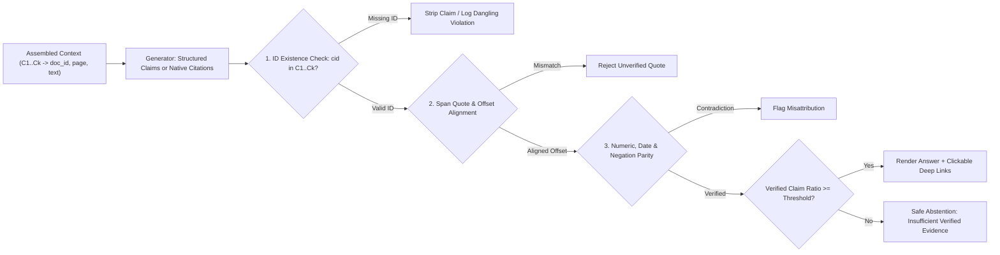
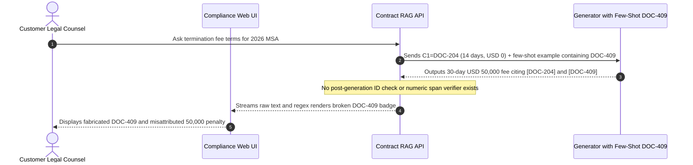

# Module 11: Citations and Source Attribution

> **Prerequisites:** [Module 10: Context Assembly and Prompt Construction](../10-context-assembly-and-prompt-construction/README.md), [Track 06, Module 07: Structured Outputs and JSON Schema](../../06-openai-and-the-model-landscape/07-structured-outputs-and-json-schema/README.md), and [Track 15, Module 09: Grounding and Citation Verification](../../15-evaluation-observability-and-safety/09-grounding-and-citation-verification/README.md).  
> **Estimated Reading Time:** 28 minutes  
> **Target Audience:** AI Backend Engineers, Compliance & LegalTech Architects, Search Systems Engineers

> [!TIP]
> **The Golden Rule of Citations & Attribution:** Inline `[1]` markers emitted by an LLM are **unverified hypotheses**, never proof. Never let raw generator text reach users as "sourced truth"—give the generator short opaque keys (`C1`, `C2`, ...) mapped server-side to immutable `(doc_id, chunk_id, page, char_start, char_end)` spans, extract structured claim-quote pairs, and enforce a **post-generation citation verifier** (checking ID existence, span alignment, numeric parity, and safe abstention) before rendering deep links.

---

## Why This Matters

In legal, medical, financial, and enterprise DevOps assistants, a wrong citation is worse than no citation at all. Users rely on `[1]` badges as cryptographic proof that a human can click through and verify an answer. Yet simply adding *"Cite your sources using `[doc_id]`"* to a system prompt routinely fails in three dangerous ways:

1. **Dangling / Fabricated Citations:** The LLM invents `[DOC-409]` or `[7]` when only `[C1]..[C4]` were supplied—often parroting an ID it saw in a few-shot prompt example or pretraining corpus.
2. **Citation Misattribution (Right Badge, Wrong Fact):** The generator cites a real retrieved chunk `[C1]`, but writes *"Refunds take up to 30 days `[C1]`"* when `[C1]` explicitly states *"14 calendar days"*, or attaches `[C1]` to a parametric guess from model weights (`Module 00`).
3. **Chunk-Level Ambiguity:** Pointing a user to a `1,500`-word PDF section without character offsets or an exact supporting quote forces users to hunt through pages manually—eroding trust whenever they cannot spot the referenced sentence quickly.

Production RAG systems solve this by treating attribution as a **two-phase protocol**: constrained claim-to-span generation followed by deterministic **post-generation verification and abstention gating**.

---

## 1. Visual Mental Models & Claim-to-Span Verification

### Opaque Keys, Span Resolution, and Post-Generation Verification

Never pass raw UUIDs (`doc_994f1a28...`) or production document codes into the prompt—LLMs mangle long hex strings and hallucinate familiar prefixes. Instead, assign sequential short opaque keys (`C1`, `C2`, ..., `Ck`) during context assembly (`Module 10`), enforce structured or native span output, and verify every claim server-side:



### Quote-Then-Claim vs. Native Provider Citations vs. Post-Hoc RARR

Three architectural mechanisms dominate modern grounded attribution:

1. **Structured Claim-Quote Schema (`JSON Schema` / `Track 06, Module 07`):** Require the model to output an array of atomic claims: `[{ "statement": "...", "cited_ids": ["C1"], "exact_quote": "..." }]`. Forcing `exact_quote` *before* or *alongside* `statement` acts as extractive grounding—a deterministic server check verifies `normalize(exact_quote) in normalize(C1.text)` and recovers exact `(char_start, char_end)` highlight offsets.
2. **Native Provider Span Citations (e.g., Anthropic Citations API):** Supply source documents as structured content blocks (`document` or `search_result` blocks) with `citations.enabled = true`. The model emits text blocks accompanied by verified character/page location metadata (`cited_text`, `start_char_index`, `end_char_index`, `start_page_number`), removing custom prompt-parsing fragility while keeping source blocks prefix-cacheable (`Module 10`).
3. **Post-Hoc Attribution & Revision (`RARR`, Gao et al., `arXiv:2210.08726`):** For legacy models or unconstrained drafts, decompose the response into atomic claims (`FActScore`-style), retrieve supporting spans per claim post-hoc, and edit/prune unsupported assertions before returning the final response.

### Formal Citation Evaluation Metrics (`ALCE`, Gao et al., `arXiv:2305.14627`)

Evaluating citation systems requires separating **evidence coverage** from **citation cleanliness**:

- **Citation Recall (Claim Groundedness):** What fraction of emitted claims $S_{\text{claims}}$ are genuinely entailed by their cited source subset $C_s$?

$$\text{Citation Recall} = \frac{1}{|S_{\text{claims}}|} \sum_{s \in S_{\text{claims}}} \mathbb{I}\bigl[\text{Entails}(C_s, s)\bigr]$$

- **Citation Precision (No Irrelevant Over-Citation):** What fraction of individual `(claim, citation)` links $(s, c)$ actually contribute necessary evidence rather than padding `[C1][C2][C3][C4]` blindly on every sentence?

$$\text{Citation Precision} = \frac{\sum_{s \in S_{\text{claims}}} |\{c \in C_s : \text{Supports}(c, s)\}|}{\sum_{s \in S_{\text{claims}}} |C_s|}$$

- **Dangling Citation Rate & Abstention Compliance:** Track the fraction of citations pointing to non-existent keys (`c not in R_k`), alongside **Abstention Accuracy** when no retrieved chunk entails the answer (`C_s = \emptyset`).

---

## 2. Systematic Reference & Comparison Matrix

### Attribution Architecture Comparison

| Dimension | Unconstrained Inline `[1]` | Structured JSON (`statement + exact_quote + cited_ids`) | Native Provider Citations (e.g., Claude Citations) | Post-Hoc Attribution (`RARR`) |
| :--- | :--- | :--- | :--- | :--- |
| **Dangling-ID Resistance** | Low (hallucinates `[7]` or example IDs) | **High** (verified against `C1..Ck` dictionary) | **Highest** (API enforces valid document index) | High (retrieval-backed post-hoc) |
| **Sub-Chunk Span Precision** | None (`chunk_id` only) | **Exact** (substring match yields `char_start..char_end`) | **Exact** (`char_index` / `page_number` native) | Passage-level or sentence-level |
| **Misattribution Detection** | None without external verifier | **Strong** (quote extraction + numeric/NLI check) | **Strong** (grounded direct spans) | Strong (research + revision pass) |
| **Added Generation Latency** | Zero | Low–Moderate (`+15–30%` output tokens for quotes) | Minimal (single pass) | **High** (`+1–3s` extra retrieval/edit passes) |
| **Streaming Token UX** | Immediate (risk of invalid `[#]` flashed to UI) | Requires incremental JSON buffer or claim-by-claim stream | **Native incremental citation deltas** | Poor (must buffer draft before revision) |
| **Provider Lock-In** | None | **None** (portable across OpenAI/Anthropic/vLLM) | Provider-specific SDK schema | None |

### Mandatory Citation Record Schema (Server-Side Resolution)

| Field | Example Value | Verification Purpose |
| :--- | :--- | :--- |
| **`opaque_key`** | `"C1"` | Short prompt token; prevents LLM from corrupting long UUIDs |
| **`doc_id` / `revision`** | `"POL-2026-FIN@v4"` | Immutable audit link; distinguishes active vs. superseded policies |
| **`page` / `section`** | `4` / `"Section 3.2"` | Enables deep-link PDF anchor (`#page=4`) in frontend UI |
| **`char_start` / `char_end`** | `34` / `73` | Deterministic text highlight inside the source viewer |
| **`verification_status`** | `"VERIFIED"` / `"STRIPPED"` / `"ABSTAINED"` | Emitted by post-generation verifier for compliance audit logs |

---

## 3. Production War Story Post-Mortem: The Fabricated `[DOC-409]` Citation & Misattributed Penalty Clause

| Field | Incident Details |
| :--- | :--- |
| **Severity** | **SEV-1** (Fabricated Contractual Citation & Misattributed Financial Penalty Displayed to Enterprise Counsel) |
| **Detection / Resolution Time** | Detected 3 days post-launch during customer legal review / Mitigated in 4 hours (removed static few-shot IDs + deployed post-gen verifier) |
| **Impact** | Compliance portal rendered a non-existent `[DOC-409]` reference and cited an active 2026 MSA while quoting a repealed 2023 `USD 50,000` penalty |

### What Happened

A legal-operations engineering team rolled out a contract Q&A assistant using a standard prompt instruction: *"Cite sources inline using `[DOC-XXX]` IDs."* To illustrate the output format, the prompt author included a static few-shot example in the system prompt referencing `[DOC-409]`. Furthermore, the orchestrator forwarded raw generator text directly to the React frontend, turning any regex match matching `\[DOC-\d+\]` into a clickable hyperlink badge.

Within 72 hours, two compliance bugs hit an enterprise renewal review:
1. **Few-Shot ID Contamination:** On a contract clause where no retrieved chunk matched clearly, the LLM hallucinated `[DOC-409]` verbatim from the system prompt's few-shot example—and the React frontend rendered a clickable badge leading to a `404` document lookup.
2. **Numeric Misattribution:** On a termination-fee query, the model blended an expired 2023 draft (`"30-day notice and \$50,000 fee"`) into an answer while attaching `[DOC-204]` (the active 2026 MSA, which had `"14-day notice and \$0 fee"`).



### Root Cause Analysis

1. **Exposing real/example domain IDs inside few-shot prompts:** LLMs treat few-shot IDs as high-probability output priors when retrieved context is weak.
2. **Zero post-generation verification:** The API trusted generator-emitted bracket tags and numbers blindly without checking ID membership in the retrieved set $R_k$, substring span alignment, or numeric parity.

### The Fix & Architectural Hardening

- **Replaced domain IDs with dynamic opaque keys (`C1`, `C2`, ...):** Stripped all hardcoded `DOC-XXX` IDs from prompt instructions and mapped `C1..Ck` back to `(doc_id, revision, page, char_start, char_end)` exclusively server-side.
- **Deployed a mandatory 3-stage post-generation verifier:** Every claim must pass (1) valid key in retrieved map, (2) normalized quote containment in the cited chunk, and (3) numeric/currency token parity (`30` or `50000` missing from `C1` immediately rejects the claim). Any response falling below `100%` verified high-stakes claims triggers clean abstention (`"Insufficient verified evidence in active contracts"`).

---

## 4. Multi-Language Production Implementation: Post-Generation Citation & Span Verifier

The following deterministic verifiers across **Go**, **TypeScript**, **Python**, and **C#** resolve opaque keys (`C1..Ck`) back to immutable document spans, verify normalized quote offsets `(char_start, char_end)`, validate numeric/percentage parity against cited chunks, strip unverified claims, and trigger automatic abstention when support falls below threshold.

````carousel

```go
package citations

import (
	"regexp"
	"strings"
)

type SourceChunk struct {
	OpaqueKey string
	DocID     string
	Page      int
	Text      string
}

type GeneratedClaim struct {
	Statement  string
	CitedKeys  []string
	ExactQuote string
}

type VerifiedSpan struct {
	DocID     string
	Page      int
	CharStart int
	CharEnd   int
}

type ClaimVerification struct {
	Statement string
	Verified  bool
	Reason    string
	Spans     []VerifiedSpan
}

var numRegex = regexp.MustCompile(`\b\d+(?:\.\d+)?%?\b`)
var spaceRegex = regexp.MustCompile(`\s+`)

func normalize(s string) string {
	return strings.TrimSpace(spaceRegex.ReplaceAllString(strings.ToLower(s), " "))
}

func extractNumbers(s string) map[string]bool {
	out := make(map[string]bool)
	for _, m := range numRegex.FindAllString(s, -1) {
		out[m] = true
	}
	return out
}

func VerifyClaims(claims []GeneratedClaim, chunks map[string]SourceChunk, minVerifiedRatio float64) ([]ClaimVerification, bool) {
	results := make([]ClaimVerification, 0, len(claims))
	verifiedCount := 0

	for _, c := range claims {
		if len(c.CitedKeys) == 0 {
			results = append(results, ClaimVerification{Statement: c.Statement, Verified: false, Reason: "NO_CITATIONS"})
			continue
		}

		normQuote := normalize(c.ExactQuote)
		var spans []VerifiedSpan
		corpusNums := make(map[string]bool)
		dangling := false

		for _, key := range c.CitedKeys {
			src, ok := chunks[key]
			if !ok {
				dangling = true
				break
			}
			for n := range extractNumbers(src.Text) {
				corpusNums[n] = true
			}
			normText := normalize(src.Text)
			if pos := strings.Index(normText, normQuote); pos >= 0 && normQuote != "" {
				spans = append(spans, VerifiedSpan{
					DocID:     src.DocID,
					Page:      src.Page,
					CharStart: pos,
					CharEnd:   pos + len(normQuote),
				})
			}
		}

		if dangling {
			results = append(results, ClaimVerification{Statement: c.Statement, Verified: false, Reason: "DANGLING_ID"})
			continue
		}
		if len(spans) == 0 {
			results = append(results, ClaimVerification{Statement: c.Statement, Verified: false, Reason: "QUOTE_MISMATCH"})
			continue
		}

		numMismatch := false
		for n := range extractNumbers(c.Statement) {
			if !corpusNums[n] {
				numMismatch = true
				break
			}
		}
		if numMismatch {
			results = append(results, ClaimVerification{Statement: c.Statement, Verified: false, Reason: "NUMERIC_MISATTRIBUTION"})
			continue
		}

		verifiedCount++
		results = append(results, ClaimVerification{Statement: c.Statement, Verified: true, Reason: "OK", Spans: spans})
	}

	shouldAbstain := len(claims) == 0 || (float64(verifiedCount)/float64(len(claims))) < minVerifiedRatio
	return results, shouldAbstain
}
```

<!-- slide -->

```typescript
export interface SourceChunk {
  readonly opaqueKey: string;
  readonly docId: string;
  readonly page: number;
  readonly text: string;
}

export interface GeneratedClaim {
  readonly statement: string;
  readonly citedKeys: readonly string[];
  readonly exactQuote: string;
}

export interface ResolvedSpan {
  readonly docId: string;
  readonly page: number;
  readonly charStart: number;
  readonly charEnd: number;
}

export interface VerifiedClaimReport {
  readonly statement: string;
  readonly verified: boolean;
  readonly reason: string;
  readonly spans: readonly ResolvedSpan[];
}

const NUM_RE = /\b\d+(?:\.\d+)?%?\b/g;

function normalize(s: string): string {
  return s.trim().toLowerCase().replace(/\s+/g, " ");
}

function extractNumbers(s: string): Set<string> {
  return new Set(s.match(NUM_RE) ?? []);
}

export function verifyCitations(
  claims: readonly GeneratedClaim[],
  chunkMap: ReadonlyMap<string, SourceChunk>,
  minVerifiedRatio = 1.0,
): { readonly reports: readonly VerifiedClaimReport[]; readonly shouldAbstain: boolean } {
  const reports: VerifiedClaimReport[] = [];
  let verifiedCount = 0;

  for (const claim of claims) {
    if (claim.citedKeys.length === 0) {
      reports.push({ statement: claim.statement, verified: false, reason: "NO_CITATIONS", spans: [] });
      continue;
    }

    const normQuote = normalize(claim.exactQuote);
    const spans: ResolvedSpan[] = [];
    const citedNums = new Set<string>();
    let dangling = false;

    for (const key of claim.citedKeys) {
      const src = chunkMap.get(key);
      if (!src) {
        dangling = true;
        break;
      }
      for (const n of extractNumbers(src.text)) citedNums.add(n);
      const pos = normalize(src.text).indexOf(normQuote);
      if (normQuote.length > 0 && pos !== -1) {
        spans.push({ docId: src.docId, page: src.page, charStart: pos, charEnd: pos + normQuote.length });
      }
    }

    if (dangling) {
      reports.push({ statement: claim.statement, verified: false, reason: "DANGLING_ID", spans: [] });
      continue;
    }
    if (spans.length === 0) {
      reports.push({ statement: claim.statement, verified: false, reason: "QUOTE_MISMATCH", spans: [] });
      continue;
    }

    const claimNums = extractNumbers(claim.statement);
    const ungrounded = [...claimNums].filter((n) => !citedNums.has(n));
    if (ungrounded.length > 0) {
      reports.push({
        statement: claim.statement,
        verified: false,
        reason: `NUMERIC_MISATTRIBUTION:${ungrounded.join(",")}`,
        spans: [],
      });
      continue;
    }

    verifiedCount++;
    reports.push({ statement: claim.statement, verified: true, reason: "OK", spans });
  }

  const shouldAbstain = claims.length === 0 || verifiedCount / claims.length < minVerifiedRatio;
  return { reports, shouldAbstain };
}
```

<!-- slide -->

```python
"""
citation_verifier.py
Deterministic post-generation verifier resolving opaque keys (C1..Ck) to exact
document spans and rejecting dangling IDs, quote mismatches, and numeric misattributions.
"""
from dataclasses import dataclass
import re
from typing import Sequence

NUM_RE = re.compile(r"\b\d+(?:\.\d+)?%?\b")


@dataclass(frozen=True)
class SourceChunk:
    opaque_key: str
    doc_id: str
    page: int
    text: str


@dataclass(frozen=True)
class GeneratedClaim:
    statement: str
    cited_keys: tuple[str, ...]
    exact_quote: str


@dataclass(frozen=True)
class VerifiedSpan:
    doc_id: str
    page: int
    char_start: int
    char_end: int


@dataclass(frozen=True)
class VerificationResult:
    statement: str
    verified: bool
    reason: str
    spans: tuple[VerifiedSpan, ...]


def _norm(s: str) -> str:
    return re.sub(r"\s+", " ", s.strip().lower())


def verify_citations(
    claims: Sequence[GeneratedClaim],
    chunks: dict[str, SourceChunk],
    min_verified_ratio: float = 1.0,
) -> tuple[list[VerificationResult], bool]:
    results: list[VerificationResult] = []
    verified_count = 0

    for claim in claims:
        if not claim.cited_keys:
            results.append(VerificationResult(claim.statement, False, "NO_CITATIONS", ()))
            continue

        norm_quote = _norm(claim.exact_quote)
        spans: list[VerifiedSpan] = []
        source_nums: set[str] = set()
        dangling = False

        for key in claim.cited_keys:
            src = chunks.get(key)
            if src is None:
                dangling = True
                break
            source_nums.update(NUM_RE.findall(src.text))
            pos = _norm(src.text).find(norm_quote)
            if norm_quote and pos != -1:
                spans.append(VerifiedSpan(src.doc_id, src.page, pos, pos + len(norm_quote)))

        if dangling:
            results.append(VerificationResult(claim.statement, False, "DANGLING_ID", ()))
            continue
        if not spans:
            results.append(VerificationResult(claim.statement, False, "QUOTE_MISMATCH", ()))
            continue

        ungrounded_nums = set(NUM_RE.findall(claim.statement)) - source_nums
        if ungrounded_nums:
            reason = f"NUMERIC_MISATTRIBUTION:{','.join(sorted(ungrounded_nums))}"
            results.append(VerificationResult(claim.statement, False, reason, ()))
            continue

        verified_count += 1
        results.append(VerificationResult(claim.statement, True, "OK", tuple(spans)))

    should_abstain = not claims or (verified_count / len(claims)) < min_verified_ratio
    return results, should_abstain
```

<!-- slide -->

```csharp
using System;
using System.Collections.Generic;
using System.Linq;
using System.Text.RegularExpressions;

namespace GenAI.Citations;

public sealed record SourceChunk(string OpaqueKey, string DocId, int Page, string Text);

public sealed record GeneratedClaim(string Statement, IReadOnlyList<string> CitedKeys, string ExactQuote);

public sealed record VerifiedSpan(string DocId, int Page, int CharStart, int CharEnd);

public sealed record ClaimCheckResult(string Statement, bool Verified, string Reason, IReadOnlyList<VerifiedSpan> Spans);

public static partial class CitationVerifier
{
    [GeneratedRegex(@"\b\d+(?:\.\d+)?%?\b")]
    private static partial Regex NumberRegex();

    [GeneratedRegex(@"\s+")]
    private static partial Regex WhitespaceRegex();

    private static string Normalize(string s) =>
        WhitespaceRegex().Replace(s.Trim().ToLowerInvariant(), " ");

    private static HashSet<string> ExtractNumbers(string s) =>
        NumberRegex().Matches(s).Select(m => m.Value).ToHashSet(StringComparer.Ordinal);

    public static (IReadOnlyList<ClaimCheckResult> Results, bool ShouldAbstain) Verify(
        IReadOnlyList<GeneratedClaim> claims,
        IReadOnlyDictionary<string, SourceChunk> chunks,
        double minVerifiedRatio = 1.0)
    {
        var results = new List<ClaimCheckResult>(claims.Count);
        int verifiedCount = 0;

        foreach (var claim in claims)
        {
            if (claim.CitedKeys.Count == 0)
            {
                results.Add(new ClaimCheckResult(claim.Statement, false, "NO_CITATIONS", Array.Empty<VerifiedSpan>()));
                continue;
            }

            string normQuote = Normalize(claim.ExactQuote);
            var spans = new List<VerifiedSpan>();
            var corpusNums = new HashSet<string>(StringComparer.Ordinal);
            bool dangling = false;

            foreach (var key in claim.CitedKeys)
            {
                if (!chunks.TryGetValue(key, out var src))
                {
                    dangling = true;
                    break;
                }
                foreach (var n in ExtractNumbers(src.Text))
                    corpusNums.Add(n);

                int pos = Normalize(src.Text).IndexOf(normQuote, StringComparison.Ordinal);
                if (normQuote.Length > 0 && pos >= 0)
                {
                    spans.Add(new VerifiedSpan(src.DocId, src.Page, pos, pos + normQuote.Length));
                }
            }

            if (dangling)
            {
                results.Add(new ClaimCheckResult(claim.Statement, false, "DANGLING_ID", Array.Empty<VerifiedSpan>()));
                continue;
            }
            if (spans.Count == 0)
            {
                results.Add(new ClaimCheckResult(claim.Statement, false, "QUOTE_MISMATCH", Array.Empty<VerifiedSpan>()));
                continue;
            }

            var ungrounded = ExtractNumbers(claim.Statement).Where(n => !corpusNums.Contains(n)).ToList();
            if (ungrounded.Count > 0)
            {
                results.Add(new ClaimCheckResult(
                    claim.Statement,
                    false,
                    $"NUMERIC_MISATTRIBUTION:{string.Join(",", ungrounded)}",
                    Array.Empty<VerifiedSpan>()));
                continue;
            }

            verifiedCount++;
            results.Add(new ClaimCheckResult(claim.Statement, true, "OK", spans));
        }

        bool shouldAbstain = claims.Count == 0 || ((double)verifiedCount / claims.Count) < minVerifiedRatio;
        return (results, shouldAbstain);
    }
}
```

````

---

## 5. Practical Hands-On Verification CLI Workflows

Run these offline, deterministic Python 3.13 verification scripts directly in your terminal—no API keys or external libraries required.

### Workflow 1: Claim-to-Span Alignment & Dangling-ID Detection

Verify opaque key resolution (`C1` -> `('POL-2026-FIN', 4, 34, 73)`), catching both a fabricated `[C9]` key and a fabricated quote mismatch:

```bash
python -c '
import re

chunks = {
    "C1": {"doc_id": "POL-2026-FIN", "page": 4, "text": "Refund requests must be submitted within 14 calendar days of invoice date."},
    "C2": {"doc_id": "POL-2026-SEC", "page": 9, "text": "Audit logs are retained for 365 days in immutable WORM storage."},
}

claims = [
    {"statement": "Refunds are accepted within 14 calendar days [C1].", "cited_ids": ["C1"], "quote": "within 14 calendar days of invoice date"},
    {"statement": "Enterprise SSO requires hardware keys [C9].", "cited_ids": ["C9"], "quote": "requires hardware keys"},
    {"statement": "Audit logs remain in cold storage for 7 years [C2].", "cited_ids": ["C2"], "quote": "retained for 7 years"},
]

def normalize(s):
    return re.sub(r"\s+", " ", s.strip().lower())

for idx, c in enumerate(claims, 1):
    valid_spans = []
    errors = []
    for cid in c["cited_ids"]:
        if cid not in chunks:
            errors.append(f"dangling_id={cid}")
            continue
        src = chunks[cid]
        pos = normalize(src["text"]).find(normalize(c["quote"]))
        if pos == -1:
            errors.append(f"quote_mismatch={cid}")
        else:
            valid_spans.append((src["doc_id"], src["page"], pos, pos + len(c["quote"])))
    status = "VERIFIED" if valid_spans and not errors else f"REJECTED({','.join(errors)})"
    print(f"Claim {idx}: {status} | spans={valid_spans}")
'
```

**Expected Output:**

```text
Claim 1: VERIFIED | spans=[('POL-2026-FIN', 4, 34, 73)]
Claim 2: REJECTED(dangling_id=C9) | spans=[]
Claim 3: REJECTED(quote_mismatch=C2) | spans=[]
```

### Workflow 2: Numeric Misattribution Check & Auto-Redaction Policy

Catch a subtle numeric hallucination (`30%` instead of `10%`) attached to a real citation `[C1]` and strip the ungrounded sentence before user delivery:

```bash
python -c '
import re

NUM_RE = re.compile(r"\b\d+(?:\.\d+)?%?\b")

def verify_claim_numbers(claim_text, cited_chunks):
    claim_nums = set(NUM_RE.findall(claim_text))
    corpus_nums = set()
    for ch in cited_chunks:
        corpus_nums.update(NUM_RE.findall(ch))
    ungrounded = claim_nums - corpus_nums
    return len(ungrounded) == 0, sorted(ungrounded)

sources = {
    "C1": "Standard SLA credits are 10% for uptime below 99.9%.",
    "C2": "Enterprise SLA credits reach 25% for uptime below 99.95%.",
}
tests = [
    ("Standard tier grants 10% credit below 99.9% uptime.", ["C1"]),
    ("Standard tier grants 30% credit below 99.9% uptime.", ["C1"]),
    ("Enterprise tier grants 25% credit below 99.95% uptime.", ["C2"]),
]
verified = []
for stmt, cids in tests:
    ok, bad = verify_claim_numbers(stmt, [sources[k] for k in cids])
    print(f"ok={str(ok):5s} | ungrounded={bad} | {stmt}")
    if ok:
        verified.append(stmt)
if len(verified) < len(tests):
    print(f"Policy action: stripped {len(tests) - len(verified)} ungrounded claim(s); {len(verified)}/{len(tests)} verified.")
'
```

**Expected Output:**

```text
ok=True  | ungrounded=[] | Standard tier grants 10% credit below 99.9% uptime.
ok=False | ungrounded=['30'] | Standard tier grants 30% credit below 99.9% uptime.
ok=True  | ungrounded=[] | Enterprise tier grants 25% credit below 99.95% uptime.
Policy action: stripped 1 ungrounded claim(s); 2/3 verified.
```

### Workflow 3: Measure ALCE Citation Recall, Precision & Dangling Rate

Quantify citation quality over an evaluation trace containing over-citation (`["C1", "C3"]` where only `C1` supports the claim), misattribution, and a dangling key:

```bash
python -c '
# Evaluate ALCE-style Citation Recall, Citation Precision, and Dangling Rate
# Each sample: (claim_supported_by_cited_set: bool, cited_ids: list, supporting_ids: set, valid_ids: set)
eval_claims = [
    (True,  ["C1"],       {"C1"},       {"C1", "C2", "C3"}),
    (True,  ["C1", "C3"], {"C1"},       {"C1", "C2", "C3"}),  # C3 is irrelevant over-citation
    (False, ["C2"],       set(),        {"C1", "C2", "C3"}),  # misattribution
    (False, ["C9"],       set(),        {"C1", "C2", "C3"}),  # dangling fabricated ID
    (True,  ["C2", "C3"], {"C2", "C3"}, {"C1", "C2", "C3"}),
]

cit_recall = sum(1 for sup, _, _, _ in eval_claims if sup) / len(eval_claims)
total_cited = sum(len(cids) for _, cids, _, _ in eval_claims)
necessary_cited = sum(len(set(cids) & supp) for _, cids, supp, _ in eval_claims)
dangling_cited = sum(1 for _, cids, _, valid in eval_claims for cid in cids if cid not in valid)

print(f"Citation Recall   : {cit_recall:.4f} ({sum(1 for x in eval_claims if x[0])}/{len(eval_claims)} claims supported)")
print(f"Citation Precision: {necessary_cited / total_cited:.4f} ({necessary_cited}/{total_cited} citations necessary)")
print(f"Dangling ID Rate  : {dangling_cited / total_cited:.4f} ({dangling_cited}/{total_cited} non-existent IDs)")
'
```

**Expected Output:**

```text
Citation Recall   : 0.6000 (3/5 claims supported)
Citation Precision: 0.5714 (4/7 citations necessary)
Dangling ID Rate  : 0.1429 (1/7 non-existent IDs)
```

### Hands-On Exercises

1. **Paraphrased Number Trap:** Extend Workflow 2 to catch spelled-out numeric inversions or negation mismatches (`"does NOT cover"` vs. `"covers"`), verifying why numeric regex parity alone must be paired with quote matching or NLI entailment.
2. **Abstention Gate Threshold:** Modify Workflow 1 to add an `abstain_if_ratio_below(verified_count, total_count, threshold=0.80)` check and observe the full response transitioning to `"ABSTAIN"` when `1/3` claims verify.
3. **Optional Live Native Citations Probe (Requires Anthropic API Key):** Send the 2 source chunks from Workflow 1 as Anthropic `document` blocks with `citations={"enabled": True}` and inspect the returned `char_location` citations (`start_char_index`, `end_char_index`, `cited_text`).

### Independent Challenge

A medical clinical-trials RAG team ships an inline `[PMID-XXXX]` prompting pipeline that extracts trial sample sizes and adverse event rates. To speed up UI latency, the frontend streams raw tokens directly to physicians as the LLM generates them, rendering `[PMID-...]` badges immediately upon seeing closing brackets `]`. Meanwhile, the backend logs citations asynchronously *after* the stream finishes. Identify **two severe patient-safety & engineering flaws** in this streaming citation design and architect a safe streaming alternative.

<details><summary>Architectural Discussion</summary>

1. **Unverified claims and fabricated `[PMID-...]` badges reach clinicians in real time:** Streaming raw tokens straight to the screen means fabricated IDs, misattributed numbers (`"12% mortality"` instead of `"1.2%"`), or ungrounded claims are displayed before any post-generation verifier runs—creating dangerous visual authority even if an async log flags the error seconds later.
2. **Domain IDs leak prompt priors:** Exposing real `[PMID-...]` numbers inside prompts invites the LLM to emit memorized pretraining PMIDs unrelated to the retrieved chunks.

**Safe Architecture:** Assign opaque `C1..Ck` keys per request, stream **claim-by-claim structured blocks** (or native provider verified citation deltas) buffered by sentence/claim boundary—taking `~150–300 ms` per sentence—and run the deterministic ID + span + numeric verifier **on each claim buffer before emitting it over SSE** to the client UI, immediately converting failed claims to abstention notices instead of rendered medical advice.

</details>

---

## 6. Common Mistakes & Troubleshooting

- **Embedding raw `UUID`s or `URL`s in prompts and asking the LLM to echo them back:** LLMs frequently drop or alter 1–2 characters of long IDs, breaking foreign-key resolution. Always use short sequential keys (`C1..Ck`) and resolve real IDs/URLs server-side.
- **Rewarding Citation Recall without tracking Citation Precision:** A lazy generator that appends `[C1][C2][C3][C4][C5]` to every sentence inflates Citation Recall (`1.0`) while destroying Citation Precision (`0.2`) and forcing users to audit 5 chunks per sentence.
- **Equating "valid ID present" with "claim supported":** Checking only that `[C1]` exists in the retrieved list misses **misattribution** (where `[C1]` is valid, yet contradicts the claim's numbers, dates, or polarity). Always pair ID existence with span quote containment and numeric/NLI verification.
- **Streaming unverified raw citations in high-stakes UIs:** Once a user sees `"25% penalty [C1]"` rendered with a green citation pill, post-hoc background logging cannot undo human reliance. Buffer at sentence/claim granularity and verify prior to SSE emission.

---

## 7. Operational Validation Checkpoints & Checkpoint Quiz

### Operational Validation Checkpoints

<details><summary><strong>Checkpoint 1: Stopping few-shot ID leakage and dangling `[DOC-XXX]` badges</strong></summary>

Your RAG logs show `4%` of generated citations reference `[DOC-101]` even though `DOC-101` was never retrieved in those requests. Looking at the system prompt, you spot `"Example output: Refunds are 14 days [DOC-101]."`. How do you eliminate dangling citations structurally?

**Validation:** Remove all concrete `DOC-XXX` IDs from prompt examples and replace prompt chunk headers with dynamic sequential opaque keys (`C1`, `C2`, ...). Additionally, enforce a **post-generation ID existence check** rejecting any cited key not present in the current request's retrieved `C1..Ck` map before rendering UI badges.

</details>

<details><summary><strong>Checkpoint 2: Implementing clickable PDF deep-links from chunk citations</strong></summary>

Users complain that clicking `[C2]` opens a 40-page PDF at page `1`, forcing them to scroll manually to find the cited sentence. What metadata and generation contract turn `[C2]` into a deep-link highlight?

**Validation:** Persist `(doc_id, page_number, chunk_char_offset)` on every chunk during ingestion (`Module 02` / `Module 04`), require the generator to emit an `exact_quote` field (or use native provider `char_location` citations), verify normalized substring containment inside `C2.text` to recover `(char_start, char_end)`, and return `{doc_id, page_number, highlight_start, highlight_end}` to the frontend PDF viewer.

</details>

<details><summary><strong>Checkpoint 3: Handling partial verification in a multi-claim compliance answer</strong></summary>

A compliance RAG response contains `3` claims: Claims `1` and `2` match cited quotes and numbers verbatim, while Claim `3` states `"Late fees are waived for 60 days [C1]"` even though `C1` says `"15 days"`. Under a `strict` (`min_verified_ratio = 1.0`) compliance policy, what should the verifier return?

**Validation:** The numeric parity verifier detects ungrounded token `60` missing from `C1` (`NUMERIC_MISATTRIBUTION:60`) and rejects Claim `3`. Because `2/3 = 0.67 < 1.0`, the strict compliance policy strips the risky partial output and triggers **safe abstention** (or, under a relaxed informational policy, strips Claim `3` explicitly with a caveat while surfacing Claims `1` and `2`).

</details>

### Checkpoint Quiz

1. Why is an inline `[1]` token generated by an LLM considered an **unverified hypothesis** rather than proof?
2. Define **Citation Recall** and **Citation Precision** from the ALCE framework (`arXiv:2305.14627`), and explain how a model can score `1.0` on Recall while scoring poorly on Precision.
3. Why do opaque sequential keys (`C1`, `C2`, ...) outperform raw database UUIDs or real document slugs inside RAG prompts?
4. What three checks belong in a deterministic **post-generation citation verifier**?
5. Why does requiring `exact_quote` before/alongside a claim reduce confabulation compared to bare `[C1]` markers?

<details><summary>Answers</summary>

1. Autoregressive decoders emit `[1]` because it is statistically plausible token syntax—they have no hard runtime constraint forcing semantic entailment, valid ID membership, or numeric consistency with passage `1`.
2. **Citation Recall** is the fraction of claims fully supported by their cited passages; **Citation Precision** is the fraction of emitted `(claim, passage)` citations that are genuinely necessary. Attaching all retrieved passages `[C1][C2][C3][C4]` to every sentence achieves `1.0` Recall whenever the answer appears anywhere in context, but drives Precision down (`~0.25`) by citing irrelevant chunks.
3. Short sequential keys consume minimal tokens, never collide with pretraining or few-shot domain priors, cannot suffer single-character UUID typos, and decouple prompt syntax from immutable server-side `(doc_id, revision, page, offsets)` lookups.
4. (1) **ID Existence Check** (`key in retrieved_map`), (2) **Quote / Span Alignment** (verified offset inside `chunks[key].text`), and (3) **Numeric / Entity / Entailment Parity** (ensuring dates, numbers, percentages, and negations in the claim match the cited text).
5. Extracting a verbatim `exact_quote` anchors attention onto concrete source tokens inside the prompt and enables deterministic server-side substring/offset validation before the paraphrased statement is accepted.

</details>

---

## Further Reading & Sources

- [Enabling Large Language Models to Generate Text with Citations (ALCE, Gao et al., 2023)](https://arxiv.org/abs/2305.14627) — introduces automated Citation Recall and Citation Precision benchmarks across knowledge-intensive tasks.
- [RARR: Researching and Revising What Language Models Say, Using Language Models (Gao et al., 2022)](https://arxiv.org/abs/2210.08726) — post-hoc attribution research and unsupported-claim revision pipeline.
- [Anthropic Docs: Citations](https://docs.anthropic.com/en/docs/build-with-claude/citations) — official API specification for native `document` / `search_result` character- and page-indexed citations.
- [OpenAI Docs: Structured Outputs](https://platform.openai.com/docs/guides/structured-outputs) — enforcing strict JSON Schemas for `{statement, cited_keys, exact_quote}` attribution contracts.
- [Track 15, Module 09: Grounding and Citation Verification](../../15-evaluation-observability-and-safety/09-grounding-and-citation-verification/README.md) — deeper safety verification patterns across production LLM pipelines.

## Next

[Module 12: Evaluating Retrieval Quality](../12-evaluating-retrieval-quality/README.md)
