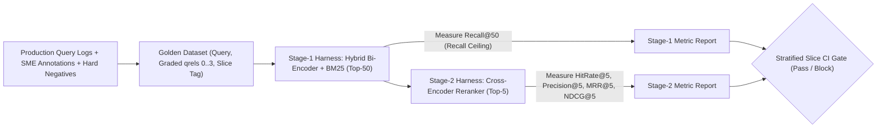
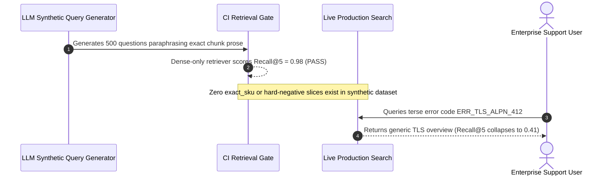

# Module 12: Evaluating Retrieval Quality

> **Prerequisites:** [Module 05: The Retrieval Step](../05-the-retrieval-step/README.md), [Module 07: Hybrid Search](../07-hybrid-search/README.md), and [Module 09: Reranking With Cross-Encoders](../09-reranking-with-cross-encoders/README.md).  
> **Estimated Reading Time:** 28 minutes  
> **Target Audience:** AI Backend Engineers, Search Quality Engineers, ML Evaluation Architects

> [!TIP]
> **The Golden Rule of Retrieval Evaluation:** Never evaluate your retriever by staring at final LLM answers. An eloquent generator masks a broken retriever (`25%` recall) using parametric guesswork—while a well-grounded generator gets falsely blamed for "hallucinating" or "refusing" when Stage-1 retrieval never fetched the evidence. Benchmark retrieval **in isolation** over a stratified, graded **golden query dataset** using rank-aware metrics (`Recall@k`, `Precision@k`, `MRR`, `NDCG@k`) before tuning a single prompt word.

---

## Why This Matters

Every production RAG pipeline has two decoupled error modes: **retrieval failure** (the right document never reached the prompt) and **generation failure** (the right document reached the prompt, yet the LLM ignored or distorted it). Teams that only inspect end-to-end chatbot responses routinely burn weeks tweaking system prompts while their chunker, BM25 analyzer, or embedding model misses `40%` of relevant passages.

At the same time, naive retrieval evaluation creates equally dangerous blind spots. Testing an index on 30 LLM-synthesized questions lifted straight out of chunk wording inflates `Recall@5` to `0.98` in staging—only to collapse in production when real customers type terse SKUs, negated clauses, or multi-hop queries. Rigorous **offline Information Retrieval (IR) evaluation** builds an automated regression harness around **graded `qrels`**, **hard negatives**, **Stage-1 vs. Stage-2 metric separation**, and **slice-level CI gates**.

---

## 1. Visual Mental Models & Offline IR Evaluation Pipeline

### Decoupled Stage-1 vs. Stage-2 Evaluation Architecture

Evaluate Stage-1 candidate generation (`N = 50`) and Stage-2 reranking (`k = 5`) on the same frozen corpus snapshot so every regression isolates cleanly to either indexing/retrieval or reranking:



### Formal Retrieval Evaluation Metrics

Let $Q$ be the set of evaluation queries, $R_k(q) = [d_1, \dots, d_k]$ the ordered top-$k$ retrieved document/chunk IDs for query $q$, $G_q = \{d : \text{rel}(q, d) > 0\}$ the ground-truth relevant set, and $\text{rel}_i \in \{0, 1, 2, 3\}$ the graded relevance of the document at rank $i$:

1. **HitRate@k (Success@k):** Binary indicator of whether *at least one* relevant item appears anywhere in the top $k$:

$$\text{HitRate}@k = \frac{1}{|Q|} \sum_{q \in Q} \mathbb{I}\bigl[|R_k(q) \cap G_q| \ge 1\bigr]$$

2. **Recall@k:** Fraction of *all* ground-truth relevant documents captured within the top-$k$ cutoff (essential for Stage-1 `Recall@50` ceiling diagnostics and multi-hop queries where $|G_q| > 1$):

$$\text{Recall}@k = \frac{1}{|Q|} \sum_{q \in Q} \frac{|R_k(q) \cap G_q|}{|G_q|}$$

3. **Precision@k:** Signal-to-noise density of the retrieved window (how many slots in the LLM prompt actually carry relevant evidence?):

$$\text{Precision}@k = \frac{1}{|Q|} \sum_{q \in Q} \frac{|R_k(q) \cap G_q|}{k}$$

4. **Mean Reciprocal Rank ($\text{MRR}@k$):** Rank-sensitive metric tracking how high the *first* relevant result appears ($\text{rank}_q \in \{1, \dots, k\}$, or $0$ reciprocal if absent):

$$\text{MRR}@k = \frac{1}{|Q|} \sum_{q \in Q} \frac{1}{\text{rank}_q}$$

5. **Normalized Discounted Cumulative Gain ($\text{NDCG}@k$, `Järvelin & Kekäläinen, 2002`):** Gold-standard graded ranking metric. Exponential gain $2^{\text{rel}_i} - 1$ rewards putting exact-answer documents (`grade=3`) at rank `1` above merely tangential context (`grade=1`), discounted logarithmically down the list and normalized by the ideal ranking $\text{IDCG}@k$:

$$\text{DCG}@k = \sum_{i=1}^{k} \frac{2^{\text{rel}_i} - 1}{\log_2(i + 1)}, \qquad \text{NDCG}@k = \frac{\text{DCG}@k}{\text{IDCG}@k}$$

### Golden Query Dataset Curation & Hard Negatives

A trustworthy retrieval benchmark requires three engineering disciplines that generic synthetic LLM prompts omit:

- **Stratified Production Sampling:** Draw queries across real traffic intent slices (`exact_sku`, `paraphrased_how_to`, `negated_policy`, `multi_hop`, `unanswerable`) rather than testing only clean single-sentence factoids.
- **Graded Relevance Labels (`0–3` `qrels`):** Label `0` (irrelevant/trap), `1` (mentions entity, does not answer), `2` (partial/supporting context), `3` (definitive primary source). Binary-only labels blind `NDCG@k` to ranking a tangential FAQ above the authoritative policy table.
- **Mining Adversarial Hard Negatives:** Evaluating against `1,000` random unrelated chunks makes any toy cosine model look heroic. Include near-miss traps—superseded 2024 policies sharing `90%` vocabulary with 2026 rules, inverted service directions (`Module 09`), or identical SKUs across different product lines (`BEIR`, `arXiv:2104.08663`).
- **Zero Circular Leakage:** Never ask an LLM to read chunk $C$ and generate a question using chunk $C$'s exact wording—that measures trivial lexical memorization, not real user search generalization.

---

## 2. Systematic Reference & Comparison Matrix

### Retrieval Evaluation Metric Comparison

| Metric | Relevance Scale | Position Sensitive? | Multi-Doc Sensitive? | Typical Target $k$ | Primary Diagnostic Role | Key Blind Spot |
| :--- | :--- | :--- | :--- | :--- | :--- | :--- |
| **`HitRate@k`** | Binary | No (rank 1 == rank $k$) | No | `5, 10` | Minimum viable single-fact check | Ignores rank order and missing 2nd/3rd hop docs |
| **`Recall@k`** | Binary | No | **Yes** | **`50, 100` (Stage 1)** | Measures Stage-1 recall ceiling before reranking | Ignores noise ratio and position order |
| **`Precision@k`** | Binary | No | Yes | `3, 5, 8` | Measures context-window signal density | Penalizes queries that only have `1` true doc when $k=5$ (`max P@5 = 0.20`) |
| **`MRR@k`** | Binary | **Yes ($1/\text{rank}$)** | No (stops at 1st hit) | `5, 10` | Single-fact navigation & top-1 ranking speed | Completely ignores multi-document recall past hit #1 |
| **`MAP@k`** | Binary | Yes | **Yes** | `10, 20` | Full precision-recall area across multiple hits | Assumes binary relevance; cannot reward `grade=3` over `grade=1` |
| **`NDCG@k`** | **Graded (`0..3`)** | **Yes ($1/\log_2(i+1)$)** | **Yes** | **`5, 10` (Stage 2)** | Primary end-to-end retrieval & rerank KPI | Requires graded `qrels` annotations; sensitive to missing ideal candidates |

### Stage-1 vs. Stage-2 Diagnostic Matrix

| Observed Pattern | Diagnosis | Concrete Engineering Remedy |
| :--- | :--- | :--- |
| **`Recall@50` Low (`<0.75`)** | **Stage-1 Retrieval Failure** | Add BM25 hybrid fusion (`Module 07`), fix chunk boundaries, or enable query expansion (`Module 08`) |
| **`Recall@50` High (`>0.90`), `NDCG@5` Low (`<0.65`)** | **Stage-2 Reranking Failure** | Add or upgrade Cross-Encoder (`Module 09`), check chunk truncation (`<= 384` tokens), tune $\lambda$ in MMR |
| **Aggregate `NDCG@5` Up, Critical Slice Down** | **Simpson's Paradox / Regression** | Enforce per-slice CI blocking gates (`exact_sku`, `negation`, `multi_hop`) |
| **`Recall@5` High (`>0.92`), Answer Quality Poor** | **Context Assembly or Generation Failure** | Inspect bookend ordering (`Module 10`), citation verifier (`Module 11`), and faithfulness eval (`Module 13`) |

---

## 3. Production War Story Post-Mortem: The `0.98` Synthetic Eval Mirage That Tanked Real Recall to `0.41`

| Field | Incident Details |
| :--- | :--- |
| **Severity** | **SEV-2** (Silent Search Quality Regression Shipped to Production After Passing `98%` Synthetic CI Gate) |
| **Detection / Resolution Time** | Detected 6 days post-deploy via customer churn & support escalations / Mitigated in 5 hours (hybrid rollback + production log golden set) |
| **Impact** | Real-world `Recall@5` on SKU/error-code queries fell from `0.89` to `0.41` despite green CI dashboards |

### What Happened

An engineering team migrated from a `BM25 + dense` hybrid retriever to a lighter dense-only embedding model to cut infrastructure costs. Before deploying, they evaluated the new dense-only pipeline against a `500`-query benchmark generated overnight by feeding random document chunks into GPT-4 (`"Write a natural question answered by this passage"`).

On that synthetic dataset, the dense-only retriever scored `Recall@5 = 0.98` and `NDCG@5 = 0.94`, easily clearing the CI release bar. Six days after shipping to production, enterprise support engineers flooded Slack reporting that looking up exact error codes (`ERR_TLS_ALPN_412`) and model SKUs (`XR-900-PRO`) returned generic troubleshooting guides instead of the actual spec sheets. Offline replay on `200` real anonymized production search logs showed actual `Recall@5` had collapsed to **`0.41`**.



### Root Cause Analysis

1. **Circular synthetic benchmark leakage:** Generating questions directly from isolated chunks copies rare domain phrasing straight into the query, handing dense embeddings an artificially easy semantic match while hiding real-world lexical gaps (`BEIR`, `arXiv:2104.08663`).
2. **Unstratified aggregate reporting:** Because `paraphrased` prose queries dominated the test set, there was no `exact_sku` slice check and no hard negatives from adjacent product tiers.

### The Fix & Architectural Hardening

- **Replaced synthetic-only evals with a stratified `450`-query Golden Set** built from real anonymized production logs, SME graded labels (`0–3`), and mined hard negatives across `paraphrased`, `exact_sku`, `negation`, and `multi_hop` slices.
- **Restored Hybrid BM25 + Dense Retrieval (`Module 07`):** Immediately recovered `exact_sku` `Recall@5` from `0.41` to `0.94`.
- **Enforced Per-Slice CI Regression Gates:** Any candidate index or embedding change now fails CI if **any** critical slice drops by `> 0.03` in `NDCG@5` or `Recall@50`, regardless of aggregate mean gains.

---

## 4. Multi-Language Production Implementation: Graded IR Metric Suite & Stratified CI Slice Gate

The following production modules across **Go**, **TypeScript**, **Python**, and **C#** compute exact `HitRate@k`, `Recall@k`, `Precision@k`, `MRR@k`, and graded `NDCG@k` ($2^{\text{rel}} - 1$ exponential gain), then enforce a **slice-aware CI regression gate** preventing Simpson's paradox deployments.

````carousel

```go
package irEval

import (
	"math"
	"sort"
)

type EvalQuery struct {
	ID     string
	Slice  string
	Qrels  map[string]int // doc_id -> graded relevance in {1, 2, 3}
	Ranked []string
}

type IRMetrics struct {
	HitRate   float64
	Recall    float64
	Precision float64
	MRR       float64
	NDCG      float64
}

func EvaluateQueries(queries []EvalQuery, k int) IRMetrics {
	if len(queries) == 0 || k <= 0 {
		return IRMetrics{}
	}
	var sumHit, sumRec, sumPrec, sumMRR, sumNDCG float64

	for _, q := range queries {
		limit := k
		if len(q.Ranked) < limit {
			limit = len(q.Ranked)
		}
		topK := q.Ranked[:limit]

		relCount := 0
		for _, g := range q.Qrels {
			if g > 0 {
				relCount++
			}
		}

		tp := 0
		firstRR := 0.0
		dcg := 0.0
		for idx, docID := range topK {
			grade := q.Qrels[docID]
			if grade > 0 {
				tp++
				if firstRR == 0 {
					firstRR = 1.0 / float64(idx+1)
				}
			}
			gain := math.Pow(2.0, float64(grade)) - 1.0
			dcg += gain / math.Log2(float64(idx+2))
		}

		if tp > 0 {
			sumHit += 1.0
		}
		if relCount > 0 {
			sumRec += float64(tp) / float64(relCount)
		}
		sumPrec += float64(tp) / float64(k)
		sumMRR += firstRR

		grades := make([]int, 0, len(q.Qrels))
		for _, g := range q.Qrels {
			if g > 0 {
				grades = append(grades, g)
			}
		}
		sort.Sort(sort.Reverse(sort.IntSlice(grades)))
		idcg := 0.0
		for idx := 0; idx < len(grades) && idx < k; idx++ {
			idcg += (math.Pow(2.0, float64(grades[idx])) - 1.0) / math.Log2(float64(idx+2))
		}
		if idcg > 0 {
			sumNDCG += dcg / idcg
		}
	}

	n := float64(len(queries))
	return IRMetrics{
		HitRate:   sumHit / n,
		Recall:    sumRec / n,
		Precision: sumPrec / n,
		MRR:       sumMRR / n,
		NDCG:      sumNDCG / n,
	}
}

func CheckSliceRegression(baseline, candidate []EvalQuery, k int, maxDrop float64) (bool, []string) {
	bySlice := func(items []EvalQuery) map[string][]EvalQuery {
		out := make(map[string][]EvalQuery)
		for _, q := range items {
			out[q.Slice] = append(out[q.Slice], q)
		}
		return out
	}
	bMap, cMap := bySlice(baseline), bySlice(candidate)
	var failed []string
	for sl, bQueries := range bMap {
		bScore := EvaluateQueries(bQueries, k).NDCG
		cScore := EvaluateQueries(cMap[sl], k).NDCG
		if cScore-bScore < -maxDrop {
			failed = append(failed, sl)
		}
	}
	return len(failed) == 0, failed
}
```

<!-- slide -->

```typescript
export interface RetrievalEvalSample {
  readonly id: string;
  readonly slice: string;
  readonly qrels: Readonly<Record<string, number>>; // docId -> grade 1..3
  readonly ranked: readonly string[];
}

export interface IRMetricReport {
  readonly hitRate: number;
  readonly recall: number;
  readonly precision: number;
  readonly mrr: number;
  readonly ndcg: number;
}

export function evaluateRetrieval(samples: readonly RetrievalEvalSample[], k: number): IRMetricReport {
  if (samples.length === 0 || k <= 0) {
    return { hitRate: 0, recall: 0, precision: 0, mrr: 0, ndcg: 0 };
  }

  let hitSum = 0;
  let recSum = 0;
  let precSum = 0;
  let mrrSum = 0;
  let ndcgSum = 0;

  for (const s of samples) {
    const topK = s.ranked.slice(0, k);
    const totalRel = Object.values(s.qrels).filter((g) => g > 0).length;
    let tp = 0;
    let rr = 0;
    let dcg = 0;

    topK.forEach((docId, idx) => {
      const grade = s.qrels[docId] ?? 0;
      if (grade > 0) {
        tp++;
        if (rr === 0) rr = 1 / (idx + 1);
      }
      dcg += (Math.pow(2, grade) - 1) / Math.log2(idx + 2);
    });

    const ideal = Object.values(s.qrels)
      .filter((g) => g > 0)
      .sort((a, b) => b - a)
      .slice(0, k);
    const idcg = ideal.reduce((acc, g, idx) => acc + (Math.pow(2, g) - 1) / Math.log2(idx + 2), 0);

    if (tp > 0) hitSum += 1;
    if (totalRel > 0) recSum += tp / totalRel;
    precSum += tp / k;
    mrrSum += rr;
    if (idcg > 0) ndcgSum += dcg / idcg;
  }

  const n = samples.length;
  return {
    hitRate: hitSum / n,
    recall: recSum / n,
    precision: precSum / n,
    mrr: mrrSum / n,
    ndcg: ndcgSum / n,
  };
}

export function runSliceGate(
  baseline: readonly RetrievalEvalSample[],
  candidate: readonly RetrievalEvalSample[],
  k: number,
  maxAllowedDrop = 0.03,
): { readonly approved: boolean; readonly failedSlices: readonly string[] } {
  const slices = [...new Set(baseline.map((s) => s.slice))];
  const failedSlices: string[] = [];

  for (const sl of slices) {
    const bNdcg = evaluateRetrieval(baseline.filter((x) => x.slice === sl), k).ndcg;
    const cNdcg = evaluateRetrieval(candidate.filter((x) => x.slice === sl), k).ndcg;
    if (cNdcg - bNdcg < -maxAllowedDrop) {
      failedSlices.push(sl);
    }
  }
  return { approved: failedSlices.length === 0, failedSlices };
}
```

<!-- slide -->

```python
"""
retrieval_eval.py
Computes HitRate@k, Recall@k, Precision@k, MRR@k, and graded NDCG@k
with stratified slice regression gating to prevent Simpson's paradox releases.
"""
from dataclasses import dataclass
import math
from typing import Sequence


@dataclass(frozen=True)
class EvalQuery:
    query_id: str
    slice_tag: str
    qrels: dict[str, int]  # doc_id -> graded relevance in {1, 2, 3}
    ranked_ids: tuple[str, ...]


def evaluate_ir_metrics(queries: Sequence[EvalQuery], k: int = 5) -> dict[str, float]:
    if not queries or k <= 0:
        return {"hit_rate": 0.0, "recall": 0.0, "precision": 0.0, "mrr": 0.0, "ndcg": 0.0}

    hits = recalls = precs = mrrs = ndcgs = 0.0
    for q in queries:
        top_k = q.ranked_ids[:k]
        rel_docs = {d for d, g in q.qrels.items() if g > 0}
        tp = sum(1 for d in top_k if d in rel_docs)
        hits += 1.0 if tp > 0 else 0.0
        recalls += (tp / len(rel_docs)) if rel_docs else 0.0
        precs += tp / k
        mrrs += next((1.0 / (idx + 1) for idx, d in enumerate(top_k) if d in rel_docs), 0.0)

        dcg = sum((2 ** q.qrels.get(d, 0) - 1) / math.log2(idx + 2) for idx, d in enumerate(top_k))
        ideal = sorted((g for g in q.qrels.values() if g > 0), reverse=True)[:k]
        idcg = sum((2 ** g - 1) / math.log2(idx + 2) for idx, g in enumerate(ideal))
        ndcgs += (dcg / idcg) if idcg > 0 else 0.0

    n = len(queries)
    return {
        "hit_rate": round(hits / n, 4),
        "recall": round(recalls / n, 4),
        "precision": round(precs / n, 4),
        "mrr": round(mrrs / n, 4),
        "ndcg": round(ndcgs / n, 4),
    }


def verify_slice_ci_gate(
    baseline: Sequence[EvalQuery],
    candidate: Sequence[EvalQuery],
    k: int = 5,
    max_ndcg_drop: float = 0.03,
) -> tuple[bool, list[str]]:
    slices = sorted({q.slice_tag for q in baseline})
    regressed: list[str] = []
    for sl in slices:
        b_ndcg = evaluate_ir_metrics([q for q in baseline if q.slice_tag == sl], k)["ndcg"]
        c_ndcg = evaluate_ir_metrics([q for q in candidate if q.slice_tag == sl], k)["ndcg"]
        if (c_ndcg - b_ndcg) < -max_ndcg_drop:
            regressed.append(sl)
    return len(regressed) == 0, regressed
```

<!-- slide -->

```csharp
using System;
using System.Collections.Generic;
using System.Linq;

namespace GenAI.RetrievalEval;

public sealed record EvalQuery(
    string QueryId,
    string SliceTag,
    IReadOnlyDictionary<string, int> Qrels,
    IReadOnlyList<string> RankedIds);

public sealed record IrMetrics(double HitRate, double Recall, double Precision, double Mrr, double Ndcg);

public static class RetrievalEvaluator
{
    public static IrMetrics Evaluate(IReadOnlyList<EvalQuery> queries, int k = 5)
    {
        if (queries.Count == 0 || k <= 0)
            return new IrMetrics(0, 0, 0, 0, 0);

        double hitSum = 0, recSum = 0, precSum = 0, mrrSum = 0, ndcgSum = 0;

        foreach (var q in queries)
        {
            var topK = q.RankedIds.Take(k).ToList();
            int totalRel = q.Qrels.Values.Count(g => g > 0);
            int tp = 0;
            double rr = 0;
            double dcg = 0;

            for (int i = 0; i < topK.Count; i++)
            {
                int grade = q.Qrels.TryGetValue(topK[i], out var g) ? g : 0;
                if (grade > 0)
                {
                    tp++;
                    if (rr == 0) rr = 1.0 / (i + 1);
                }
                dcg += (Math.Pow(2.0, grade) - 1.0) / Math.Log2(i + 2);
            }

            var ideal = q.Qrels.Values.Where(g => g > 0).OrderByDescending(g => g).Take(k).ToList();
            double idcg = 0;
            for (int i = 0; i < ideal.Count; i++)
                idcg += (Math.Pow(2.0, ideal[i]) - 1.0) / Math.Log2(i + 2);

            if (tp > 0) hitSum += 1.0;
            if (totalRel > 0) recSum += (double)tp / totalRel;
            precSum += (double)tp / k;
            mrrSum += rr;
            if (idcg > 0) ndcgSum += dcg / idcg;
        }

        double n = queries.Count;
        return new IrMetrics(hitSum / n, recSum / n, precSum / n, mrrSum / n, ndcgSum / n);
    }

    public static (bool Approved, IReadOnlyList<string> RegressedSlices) VerifySliceGate(
        IReadOnlyList<EvalQuery> baseline,
        IReadOnlyList<EvalQuery> candidate,
        int k = 5,
        double maxDrop = 0.03)
    {
        var slices = baseline.Select(q => q.SliceTag).Distinct().OrderBy(s => s).ToList();
        var regressed = new List<string>();

        foreach (var sl in slices)
        {
            double bNdcg = Evaluate(baseline.Where(q => q.SliceTag == sl).ToList(), k).Ndcg;
            double cNdcg = Evaluate(candidate.Where(q => q.SliceTag == sl).ToList(), k).Ndcg;
            if (cNdcg - bNdcg < -maxDrop)
                regressed.Add(sl);
        }

        return (regressed.Count == 0, regressed);
    }
}
```

````

---

## 5. Practical Hands-On Verification CLI Workflows

Run these offline, deterministic Python 3.13 verification scripts directly in your terminal—no API keys or vector database required.

### Workflow 1: Compute Graded IR Metrics (`HitRate@3`, `Recall@3`, `Precision@3`, `MRR@3`, `NDCG@3`)

Compare Stage-1 Bi-Encoder vs. Stage-2 Cross-Encoder rankings over graded `qrels`:

```bash
python -c '
import math

def eval_retrieval(queries, k=3):
    hits, recalls, precs, mrrs, ndcgs = [], [], [], [], []
    for q in queries:
        ranked = q["ranked"][:k]
        qrels = q["qrels"]  # doc_id -> grade in {1, 2, 3}
        rel_docs = {d for d, g in qrels.items() if g > 0}
        hits.append(1.0 if any(d in rel_docs for d in ranked) else 0.0)
        tp = sum(1 for d in ranked if d in rel_docs)
        recalls.append(tp / len(rel_docs))
        precs.append(tp / k)
        rr = next((1.0 / (idx + 1) for idx, d in enumerate(ranked) if d in rel_docs), 0.0)
        mrrs.append(rr)
        dcg = sum((2 ** qrels.get(d, 0) - 1) / math.log2(idx + 2) for idx, d in enumerate(ranked))
        ideal_grades = sorted(qrels.values(), reverse=True)[:k]
        idcg = sum((2 ** g - 1) / math.log2(idx + 2) for idx, g in enumerate(ideal_grades))
        ndcgs.append(dcg / idcg if idcg > 0 else 0.0)
    n = len(queries)
    return {
        f"HitRate@{k}": sum(hits) / n,
        f"Recall@{k}": sum(recalls) / n,
        f"Precision@{k}": sum(precs) / n,
        f"MRR@{k}": sum(mrrs) / n,
        f"NDCG@{k}": sum(ndcgs) / n,
    }

qrels_set = [
    {"qrels": {"d1": 3, "d2": 1}, "bi": ["d9", "d2", "d1"], "ce": ["d1", "d2", "d9"]},
    {"qrels": {"d4": 3, "d5": 2}, "bi": ["d8", "d7", "d4"], "ce": ["d4", "d5", "d8"]},
    {"qrels": {"d6": 2},          "bi": ["d6", "d3", "d9"], "ce": ["d6", "d3", "d9"]},
    {"qrels": {"d10": 3},         "bi": ["d11", "d12", "d13"], "ce": ["d10", "d11", "d12"]},
]
bi_res = eval_retrieval([{"qrels": x["qrels"], "ranked": x["bi"]} for x in qrels_set], k=3)
ce_res = eval_retrieval([{"qrels": x["qrels"], "ranked": x["ce"]} for x in qrels_set], k=3)
print("Stage-1 Bi-Encoder :", {k: round(v, 4) for k, v in bi_res.items()})
print("Stage-2 Cross-Enc  :", {k: round(v, 4) for k, v in ce_res.items()})
'
```

**Expected Output:**

```text
Stage-1 Bi-Encoder : {'HitRate@3': 0.75, 'Recall@3': 0.625, 'Precision@3': 0.3333, 'MRR@3': 0.4583, 'NDCG@3': 0.4837}
Stage-2 Cross-Enc  : {'HitRate@3': 1.0, 'Recall@3': 1.0, 'Precision@3': 0.5, 'MRR@3': 1.0, 'NDCG@3': 1.0}
```

### Workflow 2: Isolate Stage-1 Recall Ceiling vs. Stage-2 Reranking Drop

Verify the diagnostic rule separating Stage-1 index/BM25 failures (`Recall@50 = 0.00`) from Stage-2 cross-encoder failures (`Recall@50 = 1.00`, `Recall@5 = 0.00`):

```bash
python -c '
def diagnose_stage(stage1_top50, stage2_top5, ground_truth):
    s1_rec50 = sum(1 for d in ground_truth if d in stage1_top50) / len(ground_truth)
    s2_rec5 = sum(1 for d in ground_truth if d in stage2_top5) / len(ground_truth)
    if s1_rec50 < 0.75:
        diagnosis = "STAGE1_FAILURE: fix chunking, BM25/hybrid, or query expansion"
    elif s2_rec5 < s1_rec50 - 0.15:
        diagnosis = "STAGE2_FAILURE: fix cross-encoder reranker or domain fine-tuning"
    else:
        diagnosis = "HEALTHY: hand off to context assembly / generation eval"
    return s1_rec50, s2_rec5, diagnosis

cases = [
    ("Query_A_LexicalMiss", ["d2", "d3", "d9"], ["d2", "d3"], {"d1", "d4"}),
    ("Query_B_RerankMiss",  ["d1", "d4", "d8", "d9"], ["d8", "d9"], {"d1", "d4"}),
    ("Query_C_Healthy",     ["d1", "d4", "d8"], ["d1", "d4"], {"d1", "d4"}),
]
for name, s1, s2, gt in cases:
    r50, r5, diag = diagnose_stage(s1, s2, gt)
    print(f"{name:20s} | Recall@50={r50:.2f} | Recall@5={r5:.2f} | {diag}")
'
```

**Expected Output:**

```text
Query_A_LexicalMiss  | Recall@50=0.00 | Recall@5=0.00 | STAGE1_FAILURE: fix chunking, BM25/hybrid, or query expansion
Query_B_RerankMiss   | Recall@50=1.00 | Recall@5=0.00 | STAGE2_FAILURE: fix cross-encoder reranker or domain fine-tuning
Query_C_Healthy      | Recall@50=1.00 | Recall@5=1.00 | HEALTHY: hand off to context assembly / generation eval
```

### Workflow 3: Catch Simpson's Paradox via Stratified Slice CI Gating

Observe how aggregate `NDCG@5` improves (`0.7785 -> 0.7955`, `+0.0170`) while the critical `exact_sku` slice crashes by `-0.3975`, triggering `BLOCK_DEPLOY`:

```bash
python -c '
baseline = {
    "paraphrased": [0.76] * 12,
    "exact_sku":   [0.92, 0.90, 0.88, 0.94],
    "multi_hop":   [0.70, 0.72, 0.68, 0.71],
}
candidate = {
    "paraphrased": [0.91] * 12,
    "exact_sku":   [0.52, 0.48, 0.55, 0.50],  # dense-only embedding dropped SKU precision
    "multi_hop":   [0.73, 0.74, 0.72, 0.75],
}

def mean(vals):
    return sum(vals) / len(vals)

agg_base = mean([v for vals in baseline.values() for v in vals])
agg_cand = mean([v for vals in candidate.values() for v in vals])
print(f"Aggregate NDCG@5: baseline={agg_base:.4f} -> candidate={agg_cand:.4f} (delta={agg_cand - agg_base:+.4f})")

failed_slices = []
for sl in baseline:
    b, c = mean(baseline[sl]), mean(candidate[sl])
    delta = c - b
    status = "REGRESSION" if delta < -0.05 else "PASS"
    if status == "REGRESSION":
        failed_slices.append(sl)
    print(f"  Slice {sl:12s}: {b:.4f} -> {c:.4f} (delta={delta:+.4f}) [{status}]")
print("CI Gate:", "BLOCK_DEPLOY" if failed_slices else "APPROVE_DEPLOY")
'
```

**Expected Output:**

```text
Aggregate NDCG@5: baseline=0.7785 -> candidate=0.7955 (delta=+0.0170)
  Slice paraphrased : 0.7600 -> 0.9100 (delta=+0.1500) [PASS]
  Slice exact_sku   : 0.9100 -> 0.5125 (delta=-0.3975) [REGRESSION]
  Slice multi_hop   : 0.7025 -> 0.7350 (delta=+0.0325) [PASS]
CI Gate: BLOCK_DEPLOY
```

### Hands-On Exercises

1. **Graded vs. Binary Blindspot:** In Workflow 1, swap `["d1", "d2", "d9"]` with `["d2", "d1", "d9"]` for query 1 (placing the tangential `grade=1` document `d2` ahead of the authoritative `grade=3` document `d1`). Observe that `HitRate@3`, `Recall@3`, `Precision@3`, and `MRR@3` remain unchanged (`1.0`), whereas **`NDCG@3` drops sharply**—proving why graded `NDCG` is irreplaceable.
2. **Duplicate Chunk Inflation Check:** Calculate what happens to `Precision@5` if an evaluation script counts duplicate sibling chunks from the same parent document as distinct true positives instead of deduplicating by `doc_id` (or `parent_id`).
3. **Optional Live Vector-Index Eval Script (Requires Local Index / Qdrant / Chroma):** Run your Stage-1 hybrid index over 50 held-out queries before and after tuning BM25/RRF `k` (`Module 07`) and verify `Recall@50` alongside `NDCG@5`.

### Independent Challenge

A healthcare RAG engineering team has `100` manually annotated golden queries (`20` single-fact billing questions, `30` clinical protocol multi-hop questions needing `3` documents each, and `50` drug-code lookup queries). They currently track only `HitRate@5 = 0.88` as their sole retrieval KPI before deploying chunking and embedding changes. Explain **three critical blind spots** in tracking only `HitRate@5` on this workload and specify the exact multi-metric + slice dashboard they should adopt instead.

<details><summary>Architectural Discussion</summary>

1. **Multi-hop starvation hidden by `HitRate@5`:** On the `30` clinical protocol queries requiring `3` distinct documents, retrieving `1` out of `3` relevant chunks yields `HitRate@5 = 1.0`, completely hiding the missing `2` documents (`Recall@5 = 0.33`).
2. **Rank order & quality-grade blindness:** Placing the primary clinical guideline (`grade=3`) at rank `#5` below `4` irrelevant chunks scores the exact same `HitRate@5 = 1.0` as placing it at rank `#1`, ignoring Lost-in-the-Middle decay and prompt noise (`Precision@5`).
3. **Slice masking (Simpson's paradox):** A chunking or embedding tweak could raise `HitRate@5` on billing/prose queries while destroying exact drug-code lookups (`exact_sku` slice).

**Recommended Dashboard:** Track **Stage-1 `Recall@50`** (ceiling check), **Stage-2 `NDCG@5`** (graded ranking quality), **Multi-Hop `Recall@8`**, and **`MRR@5`**, all enforced across **per-slice CI gates** (`billing`, `clinical_multi_hop`, `drug_code`).

</details>

---

## 6. Common Mistakes & Troubleshooting

- **Evaluating retrieval exclusively with LLM-generated synthetic questions from isolated chunks:** Circular chunk-to-question generation avoids real user vocabulary mismatches, acronyms, and multi-hop dependencies, creating inflated `0.95+` scores that fail live traffic. Always ground golden sets in production search logs + SME annotations + hard negatives.
- **Mixing Stage-1 and Stage-2 diagnostics into one number (`Recall@5` only):** If `Recall@5 = 0.52`, you still don't know whether your vector/BM25 retriever failed to surface the document (`Recall@50 = 0.55`) or your reranker demoted it (`Recall@50 = 0.94`, `Recall@5 = 0.52`). Always log both Stage-1 and Stage-2 metrics.
- **Evaluating chunk IDs without parent/document deduplication:** If 3 overlapping child chunks from one irrelevant/partial section match `G_q`, naive `Precision@k` over-credits redundancy (`Module 10`). Map retrieved chunks back to unique `doc_id` or non-overlapping `span_id` before scoring.
- **Using `Precision@5` as a standalone target when most queries only have `1` relevant document:** When $|G_q| = 1$, the mathematical maximum `Precision@5` is `0.20` even for a perfect ranker! Normalize against `min(k, |G_q|)` or rely on **`NDCG@k`** and **`MRR@k`** for ranking quality.

---

## 7. Operational Validation Checkpoints & Checkpoint Quiz

### Operational Validation Checkpoints

<details><summary><strong>Checkpoint 1: Isolating a chunking/BM25 problem vs. a cross-encoder problem</strong></summary>

After deploying a new product FAQ index, end-to-end answer accuracy drops `18%`. You run your offline retrieval harness and see `Stage-1 Recall@50 = 0.94`, while `Stage-2 NDCG@5 = 0.51` (down from `0.86`) and `Stage-2 MRR@5 = 0.42`. Should the team tune HNSW `ef_search` and BM25 weights, or inspect Stage-2 cross-encoder reranking?

**Validation:** Inspect **Stage-2 cross-encoder reranking**. `Stage-1 Recall@50 = 0.94` proves the retriever already surfaced the right documents in the top-50 candidate pool. The sharp collapse in `NDCG@5` and `MRR@5` points directly to Stage-2 reranking (e.g., new chunks exceeding `512` tokens and suffering silent truncation, or an out-of-domain reranker model).

</details>

<details><summary><strong>Checkpoint 2: Why `HitRate@5 = 0.95` failed multi-hop RAG queries</strong></summary>

Your retrieval CI shows `HitRate@5 = 0.95`, yet multi-hop synthesis queries (*"Compare policy A and policy B"*) fail `60%` of the time in generation because one of the two required documents is missing. Why didn't `HitRate@5` catch this?

**Validation:** `HitRate@5` equals `1.0` as soon as **any single** relevant document appears in top-5—even if `3` redundant chunks from Policy A fill ranks `1–3` and Policy B never appears at all. Track **`Recall@k`** (which divides by $|G_q| = 2$) and **`NDCG@k`** alongside MMR/per-doc caps (`Module 10`).

</details>

<details><summary><strong>Checkpoint 3: Detecting Simpson's paradox in an embedding model upgrade</strong></summary>

Switching from hybrid search to a larger dense-only embedding model increases overall `NDCG@5` across your `200`-query test set from `0.81` to `0.83`. However, `35` of those `200` queries are exact internal part-number lookups. What risk exists before approving the deploy?

**Validation:** **Simpson's paradox across query slices.** Gains on the `165` paraphrased natural-language queries can easily mask a catastrophic `30–50%` collapse on the `35` exact part-number queries (where dense pooling loses rare alphanumeric tokens that BM25 matched effortlessly). Gate CI on **per-slice `NDCG@5` and `Recall@50`** so zero critical slices regress.

</details>

### Checkpoint Quiz

1. Why must retrieval quality be evaluated independently from final LLM generation outputs?
2. Given `qrels = {"d1": 3, "d2": 1}` and retrieved `top-3 = ["d2", "d9", "d1"]`, why does `NDCG@3` penalize this ordering even though `HitRate@3 = 1.0` and `Recall@3 = 1.0`?
3. What is the difference between **`MRR@k`** and **`NDCG@k`** when a query has three relevant documents of varying usefulness?
4. Why does generating synthetic evaluation questions by pasting single chunks into an LLM systematically overestimate production retrieval recall?
5. What distinguishes **Stage-1 `Recall@50`** from **Stage-2 `Precision@5` / `NDCG@5`** in a two-stage RAG pipeline?

<details><summary>Answers</summary>

1. Because LLM generators mask poor retrieval using parametric pretraining priors (`Module 00`) or get blamed for hallucinations/refusals caused by missing context. Decoupling pinpoints whether failures stem from indexing/retrieval or prompting/generation.
2. `NDCG@3` applies exponential relevance gain ($2^3 - 1 = 7$ vs. $2^1 - 1 = 1$) and logarithmic rank discounting ($1/\log_2(i+1)$); placing the `grade=1` document at rank `1` and the authoritative `grade=3` document at rank `3` produces a sub-optimal DCG relative to IDCG (`["d1", "d2", ...]`), whereas `HitRate` and `Recall` ignore rank position and relevance grade.
3. **`MRR@k`** evaluates binary relevance and stops as soon as the *first* relevant hit appears, ignoring documents `2` and `3` and ignoring graded quality differences. **`NDCG@k`** scores *all* ranks `1..k` using graded relevance (`0..3`).
4. Chunk-prompted questions echo exact vocabulary, rare identifiers, and sentence structure from the source chunk, eliminating real-world lexical mismatch, synonyms, and multi-hop queries—whereas production users search with ambiguous wording, acronyms, and terse codes.
5. **Stage-1 `Recall@50`** measures the upper-bound coverage of candidate generation (`did the retriever find the right chunks at all?`); **Stage-2 `Precision@5` / `NDCG@5`** measures whether the reranker promoted the highest-grade evidence into the tight top-5 prompt window.

</details>

---

## Further Reading & Sources

- [BEIR: A Heterogeneous Benchmark for Zero-shot Evaluation of Information Retrieval Models (Thakur et al., 2021)](https://arxiv.org/abs/2104.08663) — demonstrates why single-domain benchmarks mislead and establishes `NDCG@10` zero-shot retrieval baselines.
- [MTEB: Massive Text Embedding Benchmark (Muennighoff et al., 2022)](https://arxiv.org/abs/2210.07316) — standardized multi-task evaluation suite comparing embedding models across retrieval and reranking.
- [Cumulated Gain-Based Evaluation of IR Techniques (Järvelin & Kekäläinen, 2002)](https://arxiv.org/abs/cs/0003003) — foundational formulation of DCG and graded `NDCG@k` evaluation in information retrieval.
- [Module 05: The Retrieval Step](../05-the-retrieval-step/README.md) — core Stage-1 retrieval mechanics evaluated by `Recall@k`.
- [Module 09: Reranking With Cross-Encoders](../09-reranking-with-cross-encoders/README.md) — Stage-2 precision reranking evaluated by `NDCG@5` and `MRR@5`.

## Next

[Module 13: Evaluating Generation Quality](../13-evaluating-generation-quality/README.md)
