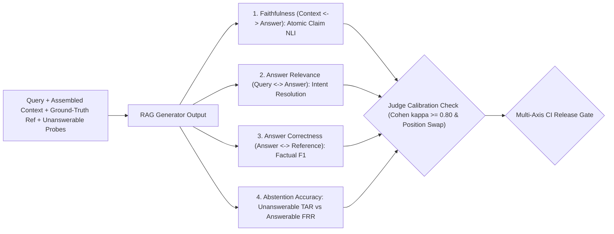
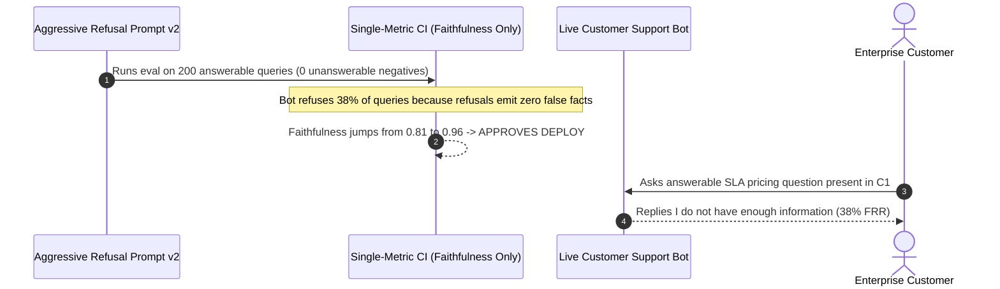

# Module 13: Evaluating Generation Quality

> **Prerequisites:** [Module 11: Citations and Source Attribution](../11-citations-and-source-attribution/README.md), [Module 12: Evaluating Retrieval Quality](../12-evaluating-retrieval-quality/README.md), and [Track 15, Module 03: LLM-as-Judge](../../15-evaluation-observability-and-safety/03-llm-as-judge/README.md).  
> **Estimated Reading Time:** 28 minutes  
> **Target Audience:** AI Backend Engineers, Evaluation Platform Architects, Applied ML Engineers

> [!TIP]
> **The Golden Rule of Generation Evaluation:** Never collapse RAG generation quality into a single blended "pass score" or rely on lexical n-gram overlap (`BLEU`/`ROUGE`). Decompose every generated answer along four orthogonal axes—**Faithfulness** (grounded strictly in retrieved context), **Answer Relevance** (directly resolves the user's intent), **Answer Correctness** (atomic factual $F_1$ against SME reference truth), and **Abstention Accuracy** (refusing unanswerable negatives without blocking answerable queries)—and calibrate your LLM-as-a-Judge against human SME annotations ($\kappa \ge 0.80$) before gating deployments.

---

## Why This Matters

Once retrieval delivers the right chunks (`Module 12`), three distinct failure modes still derail production RAG responses:

1. **Parametric Confabulation (Low Faithfulness):** The generator ignores retrieved context—or blends it with stale pretraining weights (`Module 00`)—producing fluent prose containing unsupported numbers, policies, or entities.
2. **Evasive or Silent Refusals (Low Answer Relevance / High False Refusal Rate):** Overly aggressive grounding prompts make the assistant answer *"I don't know"* on answerable queries or dodge the actual question with generic boilerplate. Because a refusal emits zero false claims, naive faithfulness evaluators reward it with `100%` groundedness!
3. **Confident Guessing on Unanswerable Negatives (Low Abstention Accuracy):** When a user asks about a feature absent from the retrieved index, uncalibrated models invent plausible answers instead of abstaining.

Classic surface metrics (`ROUGE-L`, `BLEU`, token `F1`) are blind to all three failure modes: flipping *"is eligible"* to *"is NOT eligible"* preserves `95%` token overlap while reversing the legal meaning entirely. Production RAG evaluation replaces surface heuristics with **atomic claim decomposition** and **multi-axis calibrated gating**.

---

## 1. Visual Mental Models & Multi-Axis Generation Decomposition

### The Four Orthogonal Generation Quality Axes

Evaluate generation by decoupling the **RAG Triad** alongside an explicit **Reference & Negative Probe Suite**:



### Exact Quantitative Definitions

1. **Faithfulness / Groundedness (`FActScore`-style Atomic Decomposition, `Min et al., 2023`, `arXiv:2305.14251`):** Break the generated answer into discrete atomic claims $C_{\text{ans}} = \{c_1, \dots, c_m\}$. An NLI verifier or groundedness judge evaluates each claim strictly against the **retrieved context alone** (forbidding outside world knowledge):

$$\text{Faithfulness} = \frac{|\{c \in C_{\text{ans}} : \text{Supported}(c, \text{Context})\}|}{|C_{\text{ans}}|}$$

2. **Answer Relevance:** Measures whether the answer directly addresses the user's question without evading, hallucinating extra scope, or returning an unwarranted refusal. Typically scored via structured rubric (`G-Eval`, `arXiv:2303.16634`) or by generating synthetic reverse-questions $q'_i$ from the answer and averaging cosine similarity $\frac{1}{n}\sum \cos(E(q), E(q'_i))$.
3. **Answer Correctness (Factual $F_1$ + Semantic Parity):** When a curated SME ground-truth reference answer exists, decompose both generated claims $C_{\text{ans}}$ and reference claims $C_{\text{ref}}$ into **True Positives ($\text{TP}$)**, **False Positives ($\text{FP}$)**, and **False Negatives ($\text{FN}$)**:

$$\text{Factual } F_1 = \frac{2 \cdot \text{TP}}{2 \cdot \text{TP} + \text{FP} + \text{FN}}$$

4. **Abstention Accuracy on Answerable vs. Unanswerable Slices:** Every evaluation suite must include `15–25%` **unanswerable negative probes** (queries whose answer does not exist in the corpus or was filtered out by ACLs). Measure both:

$$\text{TAR (True Abstention Rate)} = \frac{\text{Refused Unanswerables}}{\text{Total Unanswerables}}, \qquad \text{FRR (False Refusal Rate)} = \frac{\text{Refused Answerables}}{\text{Total Answerables}}$$

### Calibrating LLM-as-a-Judge & Controlling Judge Biases

Automated judges (`arXiv:2306.05685`) introduce systematic biases unless explicitly calibrated:
- **Position Bias:** In pairwise A/B comparisons, judges frequently favor whichever candidate appears first. Run every pairwise eval in both `(A, B)` and `(B, A)` orders and treat inconsistent flips as ties or audit triggers.
- **Verbosity Bias:** Holistic `1–5` judges award higher scores to longer, padded answers. Decomposing outputs into binary atomic claim verdicts eliminates length gaming.
- **Self-Enhancement Bias:** A model family tends to score its own prose style higher than competitors. Audit high-stakes evals with a cross-family judge (`Track 15, Module 03`).
- **Human-Judge Agreement (`Cohen's Kappa`):** Before trusting an automated judge in CI, score `50–100` stratified examples with human SMEs and require $\kappa \ge 0.80$:

$$\kappa = \frac{p_o - p_e}{1 - p_e}$$

where $p_o$ is observed agreement and $p_e$ is chance agreement derived from marginal label rates.

---

## 2. Systematic Reference & Comparison Matrix

### Generation Quality Metric Comparison

| Metric / Method | Inputs Required | Detects Parametric Hallucinations? | Detects Silent Refusals? | Invariant to Paraphrasing? | Cost / Latency per Sample | Primary Role |
| :--- | :--- | :--- | :--- | :--- | :--- | :--- |
| **`BLEU` / `ROUGE-L` / Token `F1`** | `Answer`, `Reference` | No (misses polarity flips) | Partial | **No** (punishes valid rephrasing) | `<1 ms` (\$0) | Legacy baseline only—never ship as RAG gate |
| **Atomic Faithfulness (`NLI / Judge`)** | `Context`, `Answer` | **Yes (primary defense)** | **No** (refusals score `1.0`!) | **Yes** | `1` judge call or local NLI pass | Reference-free online & CI groundedness check |
| **Answer Relevance** | `Query`, `Answer` | No (relevant lies score high) | **Yes** | **Yes** | `1` judge + embedding call | Prevents evasive filler and silent refusals |
| **Answer Correctness (`Factual F1`)** | `Answer`, `Reference` | Yes | **Yes** | **Yes** | `1–2` claim-extraction calls | High-trust offline golden regression gate |
| **Abstention Matrix (`TAR` & `FRR`)** | `Query Slice`, `Abstention Flag` | Catches guessing on missing docs | **Yes** (`FRR` catches over-refusal) | N/A (binary decision) | `<1 ms` (deterministic check) | Safety & usability balance gate |
| **Pairwise `G-Eval` (Swapped A/B)** | `Query`, `Ans_A`, `Ans_B` | Partial (if rubric enforces) | Yes | **Yes** | `2` judge calls (A/B + B/A) | Prompt & model candidate ranking |

### Recommended Production CI Release Thresholds

| Axis | Recommended CI Gate | Why This Boundary Matters |
| :--- | :--- | :--- |
| **Atomic Faithfulness** | $\ge 0.92$ (regulated: $\ge 0.98$) | Blocks unsupported numeric or policy fabrication |
| **Answer Relevance** | $\ge 0.85$ | Ensures answers stay concise and directly resolve user intent |
| **False Refusal Rate (`FRR`)** | $\le 0.05$ on answerable queries | Blocks "safe" bots that refuse valid customer questions |
| **True Abstention Rate (`TAR`)** | $\ge 0.90$ on unanswerable negatives | Prevents confabulation when corpus lacks evidence |
| **Judge Calibration ($\kappa$)** | $\kappa \ge 0.80$ vs. SME labels | Guarantees automated CI gate reflects human truth |

---

## 3. Production War Story Post-Mortem: The `96%` Faithfulness Metric That Shipped a Silent Refusal Bot

| Field | Incident Details |
| :--- | :--- |
| **Severity** | **SEV-2** (Severe Customer UX Degradation & Hidden Confabulation on Out-of-Scope Queries) |
| **Detection / Resolution Time** | Detected 48 hours post-release via customer ticket surge (`"Bot refuses every pricing question"`) / Mitigated in 3 hours |
| **Impact** | False Refusal Rate surged from `4%` to `38%` on answerable questions despite a green `96%` Faithfulness dashboard |

### What Happened

To drive down hallucinations before an enterprise launch, an engineering team updated their system prompt with an aggressive instruction: *"If there is ANY ambiguity, nuance, or incomplete detail, immediately refuse and reply: I do not have enough information."* They gated the deployment solely on **Faithfulness** computed by an LLM judge checking whether statements in the answer contradicted the context.

Because *"I do not have enough information"* contains zero unsupported factual assertions, **Faithfulness jumped from `0.81` to `0.96`**—turning CI green. Within 48 hours of rollout, `38%` of answerable enterprise support queries were met with blanket refusals! Worse, the evaluation set contained **zero unanswerable negative probes**, so when another prompt hotfix loosened wording a week later, the model resumed guessing confidently on out-of-scope compliance questions without tripping any CI alarm.



### Root Cause Analysis

1. **Single-axis Goodhart's Law:** Optimizing Faithfulness in isolation trivially rewards empty or overly conservative refusals unless bounded simultaneously by **Answer Relevance** and **False Refusal Rate (`FRR`)**.
2. **Absence of negative abstention probes:** Without explicit unanswerable test queries in the golden dataset, **True Abstention Rate (`TAR`)** was completely unmeasured.

### The Fix & Architectural Hardening

- **Adopted a 4-axis blocking CI gate:** Required `Faithfulness >= 0.92`, `Answer Relevance >= 0.85`, `FRR <= 0.05`, and `TAR >= 0.90` simultaneously before any prompt or model change could ship.
- **Added `60` unanswerable negative queries** (missing features, cross-tenant withheld records, outdated deprecated tools) to the golden evaluation suite alongside `200` answerable queries.
- **Calibrated the LLM judge on `50` human-annotated examples:** Tuned the rubric until Cohen's $\kappa$ rose from `0.48` to `0.86`.

---

## 4. Multi-Language Production Implementation: Multi-Axis Generation Gate & Judge Calibration Validator

The following production modules across **Go**, **TypeScript**, **Python**, and **C#** compute **Atomic Faithfulness**, **Answer Correctness Factual $F_1$**, **False Refusal Rate (`FRR`)**, **True Abstention Rate (`TAR`)**, and **Cohen's $\kappa$** judge-vs-human agreement to enforce multi-axis CI release gating.

````carousel

```go
package geneval

type SampleEval struct {
	IsAnswerable    bool
	Abstained       bool
	AnswerRelevance float64
	SupportedClaims int
	TotalClaims     int
	TP              int
	FP              int
	FN              int
}

type GenerationReport struct {
	Faithfulness  float64
	Relevance     float64
	FactualF1     float64
	FalseRefusal  float64
	TrueAbstain   float64
	ReleasePassed bool
}

func CohensKappa(human, judge []int) float64 {
	if len(human) == 0 || len(human) != len(judge) {
		return 0
	}
	n := float64(len(human))
	agree, h1, j1 := 0.0, 0.0, 0.0
	for i := range human {
		if human[i] == judge[i] {
			agree += 1.0
		}
		if human[i] == 1 {
			h1 += 1.0
		}
		if judge[i] == 1 {
			j1 += 1.0
		}
	}
	po := agree / n
	pe := (h1/n)*(j1/n) + (1.0-h1/n)*(1.0-j1/n)
	if pe >= 1.0 {
		return 1.0
	}
	return (po - pe) / (1.0 - pe)
}

func EvaluateGenerationSuite(samples []SampleEval) GenerationReport {
	var faithSum, relSum float64
	var ansCount, unansCount, falseRefusals, trueAbstains int
	var sumTP, sumFP, sumFN int

	for _, s := range samples {
		if s.TotalClaims > 0 {
			faithSum += float64(s.SupportedClaims) / float64(s.TotalClaims)
		} else if s.Abstained {
			faithSum += 1.0
		}
		sumTP += s.TP
		sumFP += s.FP
		sumFN += s.FN

		if s.IsAnswerable {
			ansCount++
			relSum += s.AnswerRelevance
			if s.Abstained {
				falseRefusals++
			}
		} else {
			unansCount++
			if s.Abstained {
				trueAbstains++
			}
		}
	}

	faith := faithSum / float64(max(1, len(samples)))
	rel := relSum / float64(max(1, ansCount))
	frr := float64(falseRefusals) / float64(max(1, ansCount))
	tar := float64(trueAbstains) / float64(max(1, unansCount))

	denom := float64(2*sumTP + sumFP + sumFN)
	f1 := 0.0
	if denom > 0 {
		f1 = float64(2*sumTP) / denom
	}

	passed := faith >= 0.92 && rel >= 0.85 && f1 >= 0.85 && frr <= 0.05 && tar >= 0.90
	return GenerationReport{
		Faithfulness:  faith,
		Relevance:     rel,
		FactualF1:     f1,
		FalseRefusal:  frr,
		TrueAbstain:   tar,
		ReleasePassed: passed,
	}
}
```

<!-- slide -->

```typescript
export interface GenerationSample {
  readonly isAnswerable: boolean;
  readonly abstained: boolean;
  readonly answerRelevance: number;
  readonly supportedClaims: number;
  readonly totalClaims: number;
  readonly tp: number;
  readonly fp: number;
  readonly fn: number;
}

export interface GenerationGateReport {
  readonly faithfulness: number;
  readonly answerRelevance: number;
  readonly factualF1: number;
  readonly falseRefusalRate: number;
  readonly trueAbstentionRate: number;
  readonly approved: boolean;
}

export function cohensKappa(human: readonly number[], judge: readonly number[]): number {
  if (human.length === 0 || human.length !== judge.length) return 0;
  const n = human.length;
  let agree = 0;
  let hPos = 0;
  let jPos = 0;

  for (let i = 0; i < n; i++) {
    if (human[i] === judge[i]) agree++;
    if (human[i] === 1) hPos++;
    if (judge[i] === 1) jPos++;
  }

  const po = agree / n;
  const pe = (hPos / n) * (jPos / n) + (1 - hPos / n) * (1 - jPos / n);
  return pe >= 1 ? 1 : (po - pe) / (1 - pe);
}

export function evaluateGenerationQuality(samples: readonly GenerationSample[]): GenerationGateReport {
  let faithSum = 0;
  let relSum = 0;
  let ansCount = 0;
  let unansCount = 0;
  let falseRefusals = 0;
  let trueAbstentions = 0;
  let tp = 0;
  let fp = 0;
  let fn = 0;

  for (const s of samples) {
    faithSum += s.totalClaims > 0 ? s.supportedClaims / s.totalClaims : s.abstained ? 1.0 : 0.0;
    tp += s.tp;
    fp += s.fp;
    fn += s.fn;

    if (s.isAnswerable) {
      ansCount++;
      relSum += s.answerRelevance;
      if (s.abstained) falseRefusals++;
    } else {
      unansCount++;
      if (s.abstained) trueAbstentions++;
    }
  }

  const faithfulness = faithSum / Math.max(1, samples.length);
  const answerRelevance = relSum / Math.max(1, ansCount);
  const falseRefusalRate = falseRefusals / Math.max(1, ansCount);
  const trueAbstentionRate = trueAbstentions / Math.max(1, unansCount);
  const denom = 2 * tp + fp + fn;
  const factualF1 = denom > 0 ? (2 * tp) / denom : 0;

  const approved =
    faithfulness >= 0.92 &&
    answerRelevance >= 0.85 &&
    factualF1 >= 0.85 &&
    falseRefusalRate <= 0.05 &&
    trueAbstentionRate >= 0.9;

  return {
    faithfulness,
    answerRelevance,
    factualF1,
    falseRefusalRate,
    trueAbstentionRate,
    approved,
  };
}
```

<!-- slide -->

```python
"""
generation_eval.py
Multi-axis RAG generation evaluation suite computing Atomic Faithfulness,
Factual F1, Answer Relevance, FRR/TAR abstention rates, and Judge Cohen's kappa.
"""
from dataclasses import dataclass
from typing import Sequence


@dataclass(frozen=True)
class GenerationSample:
    is_answerable: bool
    abstained: bool
    answer_relevance: float
    supported_claims: int
    total_claims: int
    tp: int
    fp: int
    fn: int


def cohens_kappa(human_labels: Sequence[int], judge_labels: Sequence[int]) -> float:
    if not human_labels or len(human_labels) != len(judge_labels):
        return 0.0
    n = len(human_labels)
    po = sum(1 for h, j in zip(human_labels, judge_labels) if h == j) / n
    p_h1 = sum(human_labels) / n
    p_j1 = sum(judge_labels) / n
    pe = p_h1 * p_j1 + (1.0 - p_h1) * (1.0 - p_j1)
    return (po - pe) / (1.0 - pe) if pe < 1.0 else 1.0


def evaluate_generation_gate(samples: Sequence[GenerationSample]) -> dict[str, float | bool]:
    ans = [s for s in samples if s.is_answerable]
    unans = [s for s in samples if not s.is_answerable]

    faithfulness = sum(
        (s.supported_claims / s.total_claims) if s.total_claims > 0 else (1.0 if s.abstained else 0.0)
        for s in samples
    ) / max(1, len(samples))
    relevance = sum(s.answer_relevance for s in ans) / max(1, len(ans))
    frr = sum(1 for s in ans if s.abstained) / max(1, len(ans))
    tar = sum(1 for s in unans if s.abstained) / max(1, len(unans))

    tp = sum(s.tp for s in samples)
    fp = sum(s.fp for s in samples)
    fn = sum(s.fn for s in samples)
    denom = 2 * tp + fp + fn
    factual_f1 = (2 * tp / denom) if denom > 0 else 0.0

    approved = (
        faithfulness >= 0.92
        and relevance >= 0.85
        and factual_f1 >= 0.85
        and frr <= 0.05
        and tar >= 0.90
    )
    return {
        "faithfulness": round(faithfulness, 4),
        "answer_relevance": round(relevance, 4),
        "factual_f1": round(factual_f1, 4),
        "false_refusal_rate": round(frr, 4),
        "true_abstention_rate": round(tar, 4),
        "approved": approved,
    }
```

<!-- slide -->

```csharp
using System;
using System.Collections.Generic;
using System.Linq;

namespace GenAI.GenerationEval;

public sealed record GenerationSample(
    bool IsAnswerable,
    bool Abstained,
    double AnswerRelevance,
    int SupportedClaims,
    int TotalClaims,
    int Tp,
    int Fp,
    int Fn);

public sealed record GenerationGateReport(
    double Faithfulness,
    double AnswerRelevance,
    double FactualF1,
    double FalseRefusalRate,
    double TrueAbstentionRate,
    bool Approved);

public static class GenerationEvaluator
{
    public static double CohensKappa(IReadOnlyList<int> human, IReadOnlyList<int> judge)
    {
        if (human.Count == 0 || human.Count != judge.Count) return 0.0;
        double n = human.Count;
        double po = human.Zip(judge, (h, j) => h == j ? 1.0 : 0.0).Sum() / n;
        double ph = human.Count(x => x == 1) / n;
        double pj = judge.Count(x => x == 1) / n;
        double pe = ph * pj + (1.0 - ph) * (1.0 - pj);
        return pe >= 1.0 ? 1.0 : (po - pe) / (1.0 - pe);
    }

    public static GenerationGateReport Evaluate(IReadOnlyList<GenerationSample> samples)
    {
        var answerable = samples.Where(s => s.IsAnswerable).ToList();
        var unanswerable = samples.Where(s => !s.IsAnswerable).ToList();

        double faith = samples.Average(s =>
            s.TotalClaims > 0 ? (double)s.SupportedClaims / s.TotalClaims : (s.Abstained ? 1.0 : 0.0));
        double rel = answerable.Count > 0 ? answerable.Average(s => s.AnswerRelevance) : 0.0;
        double frr = answerable.Count > 0 ? (double)answerable.Count(s => s.Abstained) / answerable.Count : 0.0;
        double tar = unanswerable.Count > 0 ? (double)unanswerable.Count(s => s.Abstained) / unanswerable.Count : 0.0;

        int tp = samples.Sum(s => s.Tp);
        int fp = samples.Sum(s => s.Fp);
        int fn = samples.Sum(s => s.Fn);
        int denom = 2 * tp + fp + fn;
        double factualF1 = denom > 0 ? (2.0 * tp) / denom : 0.0;

        bool approved = faith >= 0.92 && rel >= 0.85 && factualF1 >= 0.85 && frr <= 0.05 && tar >= 0.90;
        return new GenerationGateReport(faith, rel, factualF1, frr, tar, approved);
    }
}
```

````

---

## 5. Practical Hands-On Verification CLI Workflows

Run these offline, deterministic Python 3.13 verification scripts directly in your terminal—no API keys or external packages required.

### Workflow 1: Expose Token-Overlap Blindness vs. Atomic Faithfulness & Factual $F_1$

Verify how a single semantic polarity inversion (`"includes"` -> `"excludes"`) achieves `0.9474` naive token overlap while Atomic Faithfulness and Answer Correctness $F_1$ catch the `0.5000` error:

```bash
python -c '
def token_f1(pred, ref):
    p_toks, r_toks = set(pred.lower().split()), set(ref.lower().split())
    inter = len(p_toks & r_toks)
    if not inter:
        return 0.0
    p, r = inter / len(p_toks), inter / len(r_toks)
    return 2 * p * r / (p + r)

def factual_metrics(pred_claims, supported_flags, ref_claims):
    faithfulness = sum(supported_flags) / len(pred_claims) if pred_claims else 0.0
    tp = len(set(pred_claims) & set(ref_claims))
    fp = len(set(pred_claims) - set(ref_claims))
    fn = len(set(ref_claims) - set(pred_claims))
    prec = tp / (tp + fp) if (tp + fp) else 0.0
    rec = tp / (tp + fn) if (tp + fn) else 0.0
    f1 = (2 * prec * rec / (prec + rec)) if (prec + rec) else 0.0
    return faithfulness, prec, rec, f1

ref_text = "Standard SLA includes 99.9% uptime and 14-day refund eligibility."
bad_text = "Standard SLA includes 99.9% uptime and excludes 14-day refund eligibility."
ref_claims = ["uptime_is_99_9", "refund_eligible_14_days"]
bad_claims = ["uptime_is_99_9", "refund_NOT_eligible_14_days"]
bad_supported = [True, False]  # second atomic claim contradicts retrieved context

faith, fp, fr, ff1 = factual_metrics(bad_claims, bad_supported, ref_claims)
print(f"Naive Token Overlap F1 : {token_f1(bad_text, ref_text):.4f} (blind to semantic inversion)")
print(f"Atomic Faithfulness    : {faith:.4f} (1/2 claims entailed by context)")
print(f"Answer Correctness F1  : {ff1:.4f} (Precision={fp:.2f}, Recall={fr:.2f})")
'
```

**Expected Output:**

```text
Naive Token Overlap F1 : 0.9474 (blind to semantic inversion)
Atomic Faithfulness    : 0.5000 (1/2 claims entailed by context)
Answer Correctness F1  : 0.5000 (Precision=0.50, Recall=0.50)
```

### Workflow 2: Defeat the Silent-Refusal & Confabulation Traps with Multi-Axis Gating

Observe why a `SilentRefuser` scores `Faith=1.00` yet fails on `Rel=0.30` and `FRR=0.67`, why a `Confabulator` passes answerable relevance (`0.92`) yet fails unanswerable `TAR=0.00`, and why only `Calibrated` clears the CI gate:

```bash
python -c '
def eval_bot_axes(samples):
    # Each sample: (is_answerable, abstained, faithfulness, relevance)
    ans = [s for s in samples if s[0]]
    unans = [s for s in samples if not s[0]]
    avg_faith = sum(s[2] for s in samples) / len(samples)
    avg_rel = sum(s[3] for s in ans) / len(ans)
    frr = sum(1 for s in ans if s[1]) / len(ans)            # False Refusal Rate
    tar = sum(1 for s in unans if s[1]) / len(unans)        # True Abstention Rate
    gate = (avg_faith >= 0.90 and avg_rel >= 0.85 and frr <= 0.10 and tar >= 0.90)
    return avg_faith, avg_rel, frr, tar, gate

silent_refuser = [
    (True, True,  1.0, 0.0), (True, True,  1.0, 0.0), (True, False, 1.0, 0.9),
    (False, True, 1.0, 1.0), (False, True, 1.0, 1.0),
]
confabulator = [
    (True, False, 0.95, 0.92), (True, False, 0.92, 0.90), (True, False, 0.96, 0.94),
    (False, False, 0.20, 0.10), (False, False, 0.15, 0.10),
]
calibrated = [
    (True, False, 0.95, 0.92), (True, False, 0.94, 0.91), (True, False, 0.96, 0.95),
    (False, True, 1.00, 1.00), (False, True, 1.00, 1.00),
]

for name, data in [("SilentRefuser", silent_refuser), ("Confabulator", confabulator), ("Calibrated", calibrated)]:
    f, r, frr, tar, ok = eval_bot_axes(data)
    print(f"{name:14s} | Faith={f:.2f} | Rel={r:.2f} | FRR={frr:.2f} | TAR={tar:.2f} | Gate={'PASS' if ok else 'BLOCK'}")
'
```

**Expected Output:**

```text
SilentRefuser  | Faith=1.00 | Rel=0.30 | FRR=0.67 | TAR=1.00 | Gate=BLOCK
Confabulator   | Faith=0.64 | Rel=0.92 | FRR=0.00 | TAR=0.00 | Gate=BLOCK
Calibrated     | Faith=0.97 | Rel=0.93 | FRR=0.00 | TAR=1.00 | Gate=PASS
```

### Workflow 3: Calibrate Judge Alignment (`Cohen's kappa`) and Position-Swap Consistency

Measure human-judge agreement before and after tightening an evaluation rubric, alongside pairwise `(A, B)` vs. `(B, A)` swap invariance:

```bash
python -c '
def cohens_kappa(y_human, y_judge):
    n = len(y_human)
    po = sum(1 for h, j in zip(y_human, y_judge) if h == j) / n
    p_h1 = sum(y_human) / n
    p_j1 = sum(y_judge) / n
    pe = p_h1 * p_j1 + (1.0 - p_h1) * (1.0 - p_j1)
    return (po - pe) / (1.0 - pe) if pe < 1.0 else 1.0

# Binary groundedness labels on 12 stratified calibration samples
human = [1, 1, 1, 1, 1, 0, 0, 0, 0, 1, 0, 1]
judge_v1 = [1, 1, 1, 0, 1, 1, 0, 1, 0, 1, 1, 1]  # noisy uncalibrated prompt
judge_v2 = [1, 1, 1, 1, 1, 0, 0, 0, 0, 1, 1, 1]  # rubric + atomic decomposition

# Pairwise position-swap test: (winner_when_AB, winner_when_BA_mapped_back)
swaps = [("A", "A"), ("B", "B"), ("A", "B"), ("A", "A"), ("B", "A")]
consistent = sum(1 for w1, w2 in swaps if w1 == w2) / len(swaps)

print(f"Judge v1 Cohen'\''s kappa: {cohens_kappa(human, judge_v1):.4f} (target >= 0.80 -> RECALIBRATE)")
print(f"Judge v2 Cohen'\''s kappa: {cohens_kappa(human, judge_v2):.4f} (target >= 0.80 -> APPROVED)")
print(f"Pairwise Swap Consistency: {consistent:.2f} ({int(consistent*len(swaps))}/{len(swaps)} invariant)")
'
```

**Expected Output:**

```text
Judge v1 Cohen's kappa: 0.2727 (target >= 0.80 -> RECALIBRATE)
Judge v2 Cohen's kappa: 0.8235 (target >= 0.80 -> APPROVED)
Pairwise Swap Consistency: 0.60 (3/5 invariant)
```

*(Note: On Windows PowerShell, place the snippet in a `.py` file or pipe via `@' ... '@ | python -` to avoid single-quote escaping.)*

### Hands-On Exercises

1. **Precision vs. Recall Decomposition:** Modify Workflow 1 so `bad_claims` contains `["uptime_is_99_9", "refund_eligible_14_days", "free_24_7_phone_support"]` where the 3rd claim is an ungrounded bonus fact from parametric weights. Watch Recall reach `1.00` while Faithfulness drops to `0.67` and Factual Precision drops to `0.67`.
2. **Class-Imbalance Illusion in Raw Judge Agreement:** In Workflow 3, test a trivial judge that always outputs `1` when `human` has `11` ones and `1` zero. Notice raw accuracy `p_o = 0.917` looks high while **Cohen's $\kappa = 0.0000$**, proving why $\kappa$ beats raw accuracy on imbalanced eval slices.
3. **Optional Live Judge Calibration Run (Requires OpenAI/Anthropic Key):** Run an atomic-claim decomposition prompt over 15 RAG outputs + SME labels, swapping pairwise comparison order `(A, B)` and `(B, A)`, and compute your own $\kappa$ and swap consistency rate.

### Independent Challenge

A fintech compliance team evaluates their RAG generator using a single `1–5` LLM-as-a-Judge score (`"Rate answer quality from 1 to 5"`), running the exact same LLM family (`Model X`) as both generator and judge. After moving from `Prompt A` to `Prompt B`, the average score jumps from `3.9` to `4.6`. However, production audits discover longer, more verbose answers containing subtle ungrounded policy extrapolations alongside `22%` confabulation on queries missing from the vector database. Diagnose **three evaluation flaws** responsible for this mismatch and design an automated evaluation pipeline that catches them prior to deploy.

<details><summary>Architectural Discussion</summary>

1. **Holistic `1–5` scoring invites verbosity bias & masks ungrounded facts:** Holistic judges reward confident, thorough-sounding prose (`verbosity bias`) even when 1 out of 5 sentences invents an ungrounded claim (`Faithfulness = 0.80`).
2. **Self-enhancement bias from identical generator/judge model family:** Using `Model X` to grade `Model X` systematically favors its own phrasing style over actual factual adherence (`arXiv:2306.05685`).
3. **Missing unanswerable negative slice & abstention metric:** Without explicit unanswerable probes measuring `TAR` (and answerable queries measuring `FRR`), confabulation when context is missing goes completely undetected.

**Remediation:** Decompose answers into atomic claims verified strictly against retrieved context (**Faithfulness**), measure **Answer Relevance** and **Factual $F_1$**, add a `20%` unanswerable negative slice tracking **Abstention Accuracy (`TAR >= 0.95`, `FRR <= 0.05`)**, and calibrate a **cross-family judge** against human SME labels until **Cohen's $\kappa \ge 0.80$**.

</details>

---

## 6. Common Mistakes & Troubleshooting

- **Gating releases solely on Faithfulness:** Optimizing Faithfulness alone incentivizes the bot to abstain on ambiguous or complex answerable questions (`FRR` explosion). Always pair **Faithfulness** with **Answer Relevance** and **`FRR`**.
- **Measuring Judge accuracy with raw percentage agreement (`p_o`) instead of Cohen's $\kappa$:** If `92%` of staging answers happen to be faithful, a broken rubber-stamp judge that always outputs `"PASS"` scores `92%` raw agreement—while yielding $\kappa = 0.0$. Always calibrate with $\kappa$.
- **Allowing the Faithfulness Judge to use its own pretraining knowledge:** If the prompt asks *"Is this answer true?"* instead of *"Is every atomic claim explicitly supported by ONLY the provided context?"*, the judge will pass parametric hallucinations about famous companies or common policies.
- **Omitting unanswerable / negative queries from generation eval:** Testing only queries that *do* have answers in top-5 gives `0` visibility into whether your generator safely abstains when retrieval returns partial or empty matches.

---

## 7. Operational Validation Checkpoints & Checkpoint Quiz

### Operational Validation Checkpoints

<details><summary><strong>Checkpoint 1: Diagnosing why a silent-refusal prompt passed CI</strong></summary>

After tightening your RAG system prompt to minimize hallucinations, **Faithfulness** climbed from `0.84` to `0.97`, yet live product engagement dropped sharply and users complained the assistant refuses normal documented questions. How could Faithfulness increase while user utility collapsed?

**Validation:** Refusals (*"I cannot find that information"*) contain zero factual claims that contradict context, so Faithfulness judges assign them `1.00`. The CI suite lacked **Answer Relevance** and **False Refusal Rate (`FRR`)** gates on answerable queries, allowing over-refusal to masquerade as high groundedness.

</details>

<details><summary><strong>Checkpoint 2: Auditing an uncalibrated LLM-as-a-Judge before trusting CI blocks</strong></summary>

Your team writes a new LLM-as-a-Judge prompt and gets `88%` agreement against `50` human SME labels (`44` ground-truth passes, `6` failures). Should you deploy this judge immediately as an automated CI gate?

**Validation:** Compute **Cohen's $\kappa$** first rather than trusting raw `88%` agreement. Because `44/50 = 88%` of examples are positives, a trivial judge that rubber-stamps `100%` of outputs as `"PASS"` achieves `88%` raw agreement with **$\kappa = 0.0$**, missing every single hallucination! Require balanced calibration positives/negatives and $\kappa \ge 0.80$.

</details>

<details><summary><strong>Checkpoint 3: Detecting polarity inversions that pass `ROUGE-L` regression tests</strong></summary>

During a model migration, a `ROUGE-L` regression check scores `0.91` against reference answers, yet QA discovers the new model occasionally flips `"not eligible for refund"` to `"eligible for refund"`. What evaluation upgrade eliminates this blindspot?

**Validation:** Replace `ROUGE-L` / n-gram overlap with **Atomic Claim Faithfulness** (NLI / grounded claim decomposition against retrieved context) and **Factual $F_1$** (`Answer Correctness`) against SME reference claims. Polarity inversion drops Factual $F_1$ and Faithfulness immediately (`0.50` or `0.00`) instead of rewarding word overlap.

</details>

### Checkpoint Quiz

1. Name the four orthogonal generation evaluation axes and explain why **Faithfulness** alone is insufficient for a production deployment gate.
2. Why do `BLEU`, `ROUGE-L`, and token `F1` fail as primary RAG generation metrics?
3. Explain the difference between **False Refusal Rate (`FRR`)** and **True Abstention Rate (`TAR`)**, and why both must be tracked together.
4. How does **atomic claim decomposition** (`FActScore`, `arXiv:2305.14251`) mitigate verbosity bias in LLM-as-a-Judge evaluations?
5. Why is **Cohen's $\kappa$** preferred over raw percentage agreement when validating an LLM judge against human SME annotations?

<details><summary>Answers</summary>

1. The four axes are **Faithfulness**, **Answer Relevance**, **Answer Correctness (`Factual F1`)**, and **Abstention Accuracy (`TAR` / `FRR`)**. Faithfulness alone cannot catch silent over-refusals (empty refusals contain no unsupported facts, scoring `1.0`) or off-topic responses that faithfully summarize the wrong paragraph.
2. Lexical overlap metrics penalize valid semantic paraphrases while rewarding dangerous factual inversions (`"is covered"` vs. `"is NOT covered"`) or swapped numbers with high surface token overlap.
3. **`FRR`** tracks how often the generator mistakenly refuses *answerable* queries whose evidence sits in context; **`TAR`** tracks how often it properly refuses *unanswerable* queries where evidence is missing. Tracking both prevents tuning the system into either a silent refuser or a reckless confabulator.
4. Splitting an answer into individual verifiable facts (`TP`, `FP`) ensures padding a response with extra fluff cannot boost its score—every unverified claim lowers `supported_claims / total_claims` directly.
5. Raw agreement is distorted by class imbalance (e.g., if `90%` of answers pass, a useless always-pass judge gets `90%` raw accuracy). **Cohen's $\kappa$** normalizes observed agreement against expected chance agreement $(p_o - p_e)/(1 - p_e)$, exposing rubber-stamp judges immediately.

</details>

---

## Further Reading & Sources

- [FActScore: Fine-grained Atomic Evaluation of Factual Precision in Long Form Text Generation (Min et al., 2023)](https://arxiv.org/abs/2305.14251) — formalizes atomic claim decomposition for factual precision scoring.
- [G-Eval: NLG Evaluation using GPT-4 with Better Human Alignment (Liu et al., 2023)](https://arxiv.org/abs/2303.16634) — structured CoT rubric scoring and alignment analysis against human judgments.
- [Judging LLM-as-a-Judge with MT-Bench and Chatbot Arena (Zheng et al., 2023)](https://arxiv.org/abs/2306.05685) — empirically documents position bias, verbosity bias, and self-enhancement bias alongside Cohen's $\kappa$ human alignment.
- [Ragas: Automated Evaluation of Retrieval Augmented Generation (Es et al., 2023)](https://arxiv.org/abs/2309.15217) — reference-free Faithfulness and Answer Relevance formulations explored deeply in Module 14.
- [Track 15, Module 03: LLM-as-Judge](../../15-evaluation-observability-and-safety/03-llm-as-judge/README.md) — judge rubric design, pairwise swap invariance, and calibration pipelines.

## Next

[Module 14: RAGAS and Evaluation Frameworks](../14-ragas-and-evaluation-frameworks/README.md)
