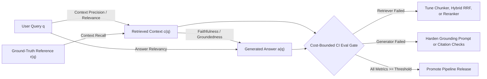
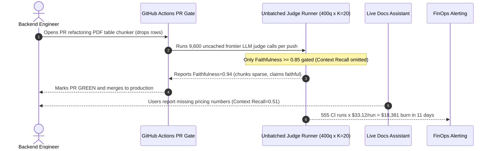

# Module 14: RAGAS and Evaluation Frameworks

> **Prerequisites:** [Module 11: Citations and Source Attribution](../11-citations-and-source-attribution/README.md), [Module 12: Evaluating Retrieval Quality](../12-evaluating-retrieval-quality/README.md), [Module 13: Evaluating Generation Quality](../13-evaluating-generation-quality/README.md), and [Track 07, Module 15: Prompt Evaluation and Iteration](../../07-prompt-engineering/15-prompt-evaluation-and-iteration/README.md)  
> **Estimated Reading Time:** 32 minutes  
> **Target Audience:** AI Backend Engineers, LLMOps / MLOps Engineers, Search & Retrieval Leads

> [!TIP]
> **The Golden Rule of RAG Evaluation Frameworks:** Never collapse retrieval quality and generation quality into a single opaque pass/fail average. Decompose every RAG trace along the **RAG Triad** (`Context Precision/Relevance`, `Faithfulness/Groundedness`, `Answer Relevancy`) plus `Context Recall`, calibrate automated LLM judges against human SME labels ($\kappa \ge 0.75$), and enforce **cost-bounded CI gates** (deterministic Tier-1 attribution + verdict caching + stratified sampling) before shipping any chunker, embedding, or prompt change.

---

## Why This Matters

A production RAG pipeline has at least four independent failure surfaces: document chunking, dense/sparse retrieval, cross-encoder reranking, and grounded generation. When a user receives a wrong answer, an end-to-end string similarity check (`ROUGE-L` or `BLEU`) or a single holistic `"Is this good?"` judge verdict cannot tell your backend team *which stage broke*:

1. **Silent Retrieval Blindness Hidden by Faithfulness:** If your retriever drops a critical warranty exception chunk (`Context Recall` collapses from `0.90` to `0.50`), a strictly grounded generator still scores `0.95+` on `Faithfulness` because every word it *did* emit came accurately from the partial chunks it saw.
2. **Ranking Decay Buried Under Fixed Top-$K$:** Moving the gold passage from rank `1` to rank `9` preserves `Recall@10 = 1.0`, yet induces **Lost-in-the-Middle** degradation unless `Context Precision@K` penalizes low-rank ordering.
3. **Runaway CI Evaluation Spend:** Naive evaluation frameworks spawn $O(N \cdot K)$ unbatched LLM-as-a-Judge calls per pull request (`N` test queries $\times$ `K` retrieved chunks + claim decomposition + NLI verification), quietly turning routine GitHub Actions runs into multi-thousand-dollar monthly LLM bills.

Automated evaluation frameworks—pioneered by **RAGAS** (`arXiv:2309.15217`), **TruLens** (the RAG Triad), and **DeepEval** (`pytest`-native LLM assertions)—standardize component-level telemetry so CI gates block regressions *and* pinpoint the exact subsystem to fix.

---

## 1. Visual Mental Models & Mathematical Foundations

### Component-Wise Decomposition: The RAG Triad & Reference Recall

Every RAG evaluation tuple consists of up to four signals: the user query $q$, retrieved context passages $c(q) = [c_1, \dots, c_K]$, generated response $a(q)$, and an optional ground-truth reference answer $r(q)$.



### Formal RAGAS Metric Mathematics (`arXiv:2309.15217`)

#### 1. Faithfulness ($F$) — Generator Grounding

Measures whether the generated answer $a(q)$ introduces unsupported parametric hallucinations beyond $c(q)$. An extraction step decomposes $a(q)$ into atomic factual statements $S(a(q))$, and an NLI/verification step tests each statement $s \in S(a(q))$ against $c(q)$ to produce the verified subset $V \subseteq S(a(q))$:

$$F = \frac{|V|}{|S(a(q))|}$$

- **Score `1.0`:** Every atomic claim in $a(q)$ is logically inferable from $c(q)$.
- **Score `< 0.8`:** Generator is extrapolating from pretraining weights or contradicting retrieved chunks.
- **Crucial Limitation:** Faithfulness does **not** verify whether $a(q)$ actually answered $q$ or whether $c(q)$ contained all necessary facts!

#### 2. Answer Relevancy ($AR$) — Query Alignment & Completeness

Evaluates how directly $a(q)$ addresses the original query $q$ without requiring ground-truth labels. Rather than grading prose directly with a biased rubric, RAGAS prompts an LLM to reverse-engineer $n$ synthetic questions $\{q_1, \dots, q_n\}$ solely from $a(q)$, embeds both $q$ and each $q_i$ with embedding model $E(\cdot)$, and computes mean cosine similarity:

$$AR = \frac{1}{n} \sum_{i=1}^{n} \frac{E(q) \cdot E(q_i)}{\|E(q)\| \, \|E(q_i)\|}$$

- **Why reverse question generation works:** An evasive answer (*"Contact support for policy details"*) generates vague synthetic questions whose embeddings sit far from a specific query (*"What is the EU enterprise SLA refund window?"*), dragging $AR$ down even when Faithfulness is `1.0`. Similarly, an incomplete answer omits key query clauses, lowering similarity.

#### 3. Context Precision@$K$ ($CP@K$) — Retriever Ranking Signal-to-Noise

In the original RAGAS paper (`arXiv:2309.15217`), Context Relevance measured the ratio of extracted relevant sentences to total sentences in $c(q)$. Modern production RAGAS (`docs.ragas.io`) pairs this with **Context Precision@$K$**, which scores *rank ordering* across the top-$K$ retrieved chunks using binary relevance indicators $v_k \in \{0, 1\}$ (whether chunk $k$ is relevant to the reference/query):

$$\text{Precision}@k = \frac{1}{k} \sum_{i=1}^{k} v_i, \qquad \text{Context Precision}@K = \frac{\sum_{k=1}^{K} \left(\text{Precision}@k \times v_k\right)}{\sum_{k=1}^{K} v_k + \epsilon}$$

Notice the rank-sensitivity: placing 2 relevant chunks at ranks `[1, 2]` yields $CP@4 = 1.000$, whereas burying the exact same 2 chunks behind 2 distractors at ranks `[3, 4]` drops $CP@4$ to $(1/3 + 2/4)/2 = 0.417$.

#### 4. Context Recall ($CR$) — Retriever Coverage Against Ground Truth

Unlike reference-free triad metrics, Context Recall requires a ground-truth reference answer $r(q)$ (or reference context). An evaluator decomposes $r(q)$ into atomic claims $S_{\text{ref}}$ and measures what fraction can be attributed to the retrieved passages $c(q)$:

$$CR = \frac{|\{s \in S_{\text{ref}} \mid s \text{ is attributable to } c(q)\}|}{|S_{\text{ref}}|}$$

#### 5. Harmonic RAGAS Aggregation vs. Independent Gates

RAGAS originally aggregated component metrics via the **harmonic mean**:

$$\text{RAGAS}_{\text{harm}} = \frac{m}{\sum_{j=1}^{m} \frac{1}{M_j}}$$

Because the harmonic mean is dominated by its smallest term, a catastrophic collapse in any single dimension pulls the composite score downward. In CI/CD, however, **never gate on a single composite number alone**—enforce independent per-metric thresholds (`Faithfulness >= 0.90`, `ContextRecall >= 0.85`, `ContextPrecision >= 0.75`, `AnswerRelevancy >= 0.80`) plus per-slice minimums (`Track 07, Module 15`) so regressions remain immediately attributable.

### CI Judge Cost Model & Bounded Evaluation Design

Running LLM-as-a-Judge metrics across every commit scales super-linearly with dataset size $N$ and chunk count $K$ when implemented naively:

$$C_{\text{eval}} = N \cdot \left( \frac{c_{\text{in}}\,(T_{\text{ctx}} + T_{\text{rubric}}) + c_{\text{out}}\,T_{\text{verdict}}}{10^6} \cdot M_{\text{calls}}(K) + \frac{c_{\text{emb}}\,T_{\text{synth}}}{10^6} \right) \cdot (1 - \gamma_{\text{cache}})$$

where $M_{\text{calls}}(K)$ is the number of judge completions per query (e.g., `2` for Faithfulness claim extraction + NLI, `1` for Answer Relevancy generation, `1` for Context Recall, and up to `K` unbatched calls for Context Precision), and $\gamma_{\text{cache}} \in [0, 1]$ is the **content-addressed verdict cache hit rate** keyed on `SHA-256(metric_name, rubric_version, query, normalized_context, answer)`.

To prevent runaway CI bills without sacrificing regression detection, organize evaluation into three tiers:

1. **Tier 1 (Every Commit — `<1s`, \$0):** Deterministic retrieval (`Recall@K`, `MRR@K` on gold chunk IDs), JSON schema validity, and regex citation provenance (`[doc_id:chunk_id]` subset of retrieved IDs).
2. **Tier 2 (PR Smoke Gate — Stratified `N=50–80`, Cached Mini-Judge):** Run RAGAS/DeepEval on a fixed stratified PR subset with a cheap calibrated judge (`temperature=0`, `seed` pinned) and content-addressed verdict cache ($\gamma_{\text{cache}} \approx 0.70+$ when only prompt vs. retriever changes).
3. **Tier 3 (Nightly / Release Gate — Full Golden Suite + Paired McNemar):** Run full `N >= 200` stratified suite, position-swapped or human-calibrated ($\kappa \ge 0.75$) judge audits, and slice-level regression checks (`max_drop <= 2%`).

---

## 2. Systematic Reference & Comparison Matrix

| Dimension | RAGAS (`ragas`) | TruLens (`trulens`) | DeepEval (`deepeval`) | Custom Tier-1 + Calibrated Judge |
| :--- | :--- | :--- | :--- | :--- |
| **Core Paradigm** | Component-wise reference-free + reference metrics (`arXiv:2309.15217`) | **RAG Triad** feedback functions + OpenTelemetry trace spans | `pytest`-native unit/CI assertions with G-Eval & RAG metrics | Deterministic ID/citation checks first + custom pinned judge |
| **Requires Ground-Truth Reference?** | No for Faithfulness / Answer Relevancy; **Yes** for Context Recall & ID-free Context Precision | **No** for core RAG Triad (`Context Relevance`, `Groundedness`, `Answer Relevance`) | Optional (`Faithfulness` & `AnswerRelevancy` reference-free; `ContextualRecall` needs `expected_output`) | Optional (gold `chunk_ids` enable \$0 deterministic `Recall@K` / `MRR`) |
| **LLM Judge Call Profile** | Moderate-to-High (`4 + K` calls if Context Precision unbatched) | Moderate (`3+` feedback calls per trace; supports span-level sampling) | Moderate (`2–5` calls per metric; supports async batching) | **Minimal** (`0` calls on Tier-1 failures; cached mini-judge) |
| **Debugging & Explainability** | Outputs statement-level NLI verdicts & numeric scores | Trace tree linking query $\to$ chunks $\to$ claim groundedness | Explicit natural-language `reason` string explaining every score | Exact failing `chunk_id`, missing claim, and SHA-256 prompt/index version |
| **CI/CD Native Ergonomics** | Python evaluation scripts / CI wrappers | Observability dashboards + trace feedback thresholds | Native `pytest` (`assert_test`) + GitHub Actions integration | Native across Go, TypeScript, Python, and C# services |
| **Primary Risk in Production** | Unbatched `K`-chunk judging burns CI budget; uncalibrated default judge prompts | Sampling rate mismatch hides tail regressions if only logged async | Over-relying on default thresholds without domain human $\kappa$ calibration | Engineering effort to maintain rubric calibration and trace storage |

---

## 3. Production War Story Post-Mortem: The \$18,400 CI Judge Burn & Faithfulness Mirage

| Field | Incident Details |
| :--- | :--- |
| **Severity** | **SEV-2** (Runaway CI Billing Spike & Undetected Retrieval Coverage Collapse) |
| **Detection / Resolution Time** | Detected 11 days post-CI rollout via cloud billing anomaly & customer escalation / Mitigated in 3 hours |
| **Impact** | **\$18,381** spent on CI evaluation calls (`555` PR/push runs); `Context Recall` dropped from `0.88` to `0.51` while `Faithfulness` stayed `0.94` |

### What Happened

An internal developer-docs assistant team wired `ragas.evaluate()` directly into their GitHub Actions PR workflow across `400` test queries with `top_k = 20` retrieved chunks using an unbatched frontier model (\$2.50/1M input, \$10.00/1M output). Worse, the CI check blocked merges **only** if `Faithfulness < 0.85` or `RAGAS_Harmonic_Mean` wasn't checked separately—actually, they had disabled `Context Recall` in PRs to "save labeling effort" and gated only on `Faithfulness >= 0.85`.

During a chunker refactor that accidentally dropped markdown table rows during PDF parsing, `Context Recall` plunged from `0.88` to `0.51`. Because the remaining prose chunks contained accurate general statements, the generator stayed completely truthful to the *sparse* chunks it received—posting `Faithfulness = 0.94`! The PR passed CI cleanly, shipped to production, and caused customer complaints on table-heavy billing questions. Meanwhile, `555` automated CI runs over `11` days executed `9,600` unbatched LLM judge calls per run (`5.33M` total judge completions), burning **\$18,381** before finance flagged the invoice.



### Root Cause Analysis

1. **Single-Metric Faithfulness Blind Spot:** Faithfulness measures *precision of generation relative to retrieved context*, not *whether retrieval recovered the required answer*. Without `Context Recall` (or gold `chunk_id` `Recall@K`), missing retrieval looks indistinguishable from healthy grounding.
2. **Unbounded Frontier Judging on Every Push:** Running `400` queries $\times$ `20` chunks with `0%` verdict caching on a flagship frontier judge turned deterministic retrieval tests into expensive NLI loops.

### The Fix & Architectural Hardening

- **Added Tier-1 \$0 Deterministic Retrieval Gates:** Annotated gold `doc_id`/`chunk_id` mappings on the `400`-query benchmark, enforcing `Recall@5 >= 0.85` and `MRR@10 >= 0.72` in `<250 ms` at \$0 before calling *any* LLM judge.
- **Mandated Multi-Metric Independent Gates:** Blocked CI whenever *any* individual gate fails (`ContextRecall < 0.85`, `ContextPrecision < 0.75`, `Faithfulness < 0.90`, `AnswerRelevancy < 0.80`).
- **Introduced Content-Addressed Judge Caching + Stratified PR Smoke Split:** Reduced PR runs to an `80`-query stratified smoke set with `K = 5` post-rerank chunks, a calibrated mini-judge (`kappa = 0.81` vs SME labels), and Redis/S3 caching keyed on `SHA-256(metric, rubric_ver, q, ctx, a)`—cutting CI cost per commit from **\$33.12** to **\$0.04** (`>740x` reduction) while reserving full `400`-query runs for nightly main-branch builds.

---

## 4. Multi-Language Production Implementation: Cost-Bounded RAGAS Metric Engine & CI Gate

The four modules below implement a deterministic, **production-ready RAG Evaluation Gate** in **Go**, **TypeScript**, **Python**, and **C#** supporting:
1. Exact **Context Precision@$K$**, **Faithfulness**, **Context Recall**, and **Harmonic RAGAS Score** computation.
2. **Automated Failure Triage** separating `RETRIEVAL_COVERAGE_FAILURE`, `RETRIEVAL_RANKING_FAILURE`, `GENERATOR_HALLUCINATION`, and `EVASIVE_ANSWER`.
3. **CI Judge Spend & Call-Budget Enforcement** via content-addressed caching and per-commit USD ceilings.

````carousel

```go
package rageval

import (
	"crypto/sha256"
	"encoding/hex"
	"fmt"
	"strings"
)

type RagTrace struct {
	Query             string
	ChunkRelevances   []int // binary 1/0 per retrieved rank 1..K
	VerifiedClaims    int
	TotalAnswerClaims int
	CoveredRefClaims  int
	TotalRefClaims    int
	AnswerRelevancy   float64
}

type EvalVerdict struct {
	Faithfulness     float64
	ContextPrecision float64
	ContextRecall    float64
	AnswerRelevancy  float64
	HarmonicScore    float64
	Diagnosis        string
	GatePassed       bool
}

func ContextPrecisionAtK(relevances []int) float64 {
	hits, totalRel := 0, 0
	weighted := 0.0
	for idx, rel := range relevances {
		if rel > 0 {
			hits++
			totalRel++
			weighted += float64(hits) / float64(idx+1)
		}
	}
	if totalRel == 0 {
		return 0.0
	}
	return weighted / float64(totalRel)
}

func JudgeCacheKey(metric, rubricVer, query, contextBlob, answer string) string {
	payload := strings.Join([]string{metric, rubricVer, query, contextBlob, answer}, "\x1f")
	sum := sha256.Sum256([]byte(payload))
	return hex.EncodeToString(sum[:])[:16]
}

func EvaluateTrace(t RagTrace, minThresh float64) EvalVerdict {
	faith := 1.0
	if t.TotalAnswerClaims > 0 {
		faith = float64(t.VerifiedClaims) / float64(t.TotalAnswerClaims)
	}
	ctxRec := 0.0
	if t.TotalRefClaims > 0 {
		ctxRec = float64(t.CoveredRefClaims) / float64(t.TotalRefClaims)
	}
	ctxPrec := ContextPrecisionAtK(t.ChunkRelevances)

	diag := "PASS_ALL_GATES"
	switch {
	case ctxRec < minThresh:
		diag = "RETRIEVAL_COVERAGE_FAILURE"
	case ctxPrec < minThresh:
		diag = "RETRIEVAL_RANKING_FAILURE"
	case faith < minThresh:
		diag = "GENERATOR_HALLUCINATION"
	case t.AnswerRelevancy < minThresh:
		diag = "EVASIVE_OR_OFF_TOPIC_ANSWER"
	}

	harm := 0.0
	if faith > 0 && ctxPrec > 0 && ctxRec > 0 && t.AnswerRelevancy > 0 {
		harm = 4.0 / (1.0/faith + 1.0/ctxPrec + 1.0/ctxRec + 1.0/t.AnswerRelevancy)
	}

	return EvalVerdict{
		Faithfulness:     faith,
		ContextPrecision: ctxPrec,
		ContextRecall:    ctxRec,
		AnswerRelevancy:  t.AnswerRelevancy,
		HarmonicScore:    harm,
		Diagnosis:        diag,
		GatePassed:       diag == "PASS_ALL_GATES",
	}
}

func EnforceJudgeBudget(nQueries, kChunks int, cacheHitRate, maxUsd float64) error {
	calls := float64(nQueries*(4+kChunks)) * (1.0 - cacheHitRate)
	estUsd := calls * ((900.0/1e6)*0.15 + (120.0/1e6)*0.60)
	if estUsd > maxUsd {
		return fmt.Errorf("ci judge budget exceeded: est $%.2f > cap $%.2f", estUsd, maxUsd)
	}
	return nil
}
```

<!-- slide -->

```typescript
import { createHash } from "node:crypto";

export interface RagTrace {
  readonly query: string;
  readonly chunkRelevances: readonly (0 | 1)[];
  readonly verifiedClaims: number;
  readonly totalAnswerClaims: number;
  readonly coveredRefClaims: number;
  readonly totalRefClaims: number;
  readonly answerRelevancy: number;
}

export interface EvalVerdict {
  readonly faithfulness: number;
  readonly contextPrecision: number;
  readonly contextRecall: number;
  readonly answerRelevancy: number;
  readonly harmonicScore: number;
  readonly diagnosis: string;
  readonly gatePassed: boolean;
}

export function contextPrecisionAtK(relevances: readonly (0 | 1)[]): number {
  let hits = 0;
  let weighted = 0;
  for (let i = 0; i < relevances.length; i++) {
    if (relevances[i] === 1) {
      hits += 1;
      weighted += hits / (i + 1);
    }
  }
  return hits === 0 ? 0 : weighted / hits;
}

export function judgeCacheKey(
  metric: string,
  rubricVer: string,
  query: string,
  contextBlob: string,
  answer: string
): string {
  const raw = [metric, rubricVer, query, contextBlob, answer].join("\u001f");
  return createHash("sha256").update(raw).digest("hex").slice(0, 16);
}

export function evaluateTrace(t: RagTrace, minThreshold = 0.75): EvalVerdict {
  const faithfulness =
    t.totalAnswerClaims > 0 ? t.verifiedClaims / t.totalAnswerClaims : 1.0;
  const contextRecall =
    t.totalRefClaims > 0 ? t.coveredRefClaims / t.totalRefClaims : 0.0;
  const contextPrecision = contextPrecisionAtK(t.chunkRelevances);

  let diagnosis = "PASS_ALL_GATES";
  if (contextRecall < minThreshold) {
    diagnosis = "RETRIEVAL_COVERAGE_FAILURE";
  } else if (contextPrecision < minThreshold) {
    diagnosis = "RETRIEVAL_RANKING_FAILURE";
  } else if (faithfulness < minThreshold) {
    diagnosis = "GENERATOR_HALLUCINATION";
  } else if (t.answerRelevancy < minThreshold) {
    diagnosis = "EVASIVE_OR_OFF_TOPIC_ANSWER";
  }

  const metrics = [faithfulness, contextPrecision, contextRecall, t.answerRelevancy];
  const harmonicScore = metrics.every((m) => m > 0)
    ? metrics.length / metrics.reduce((acc, m) => acc + 1 / m, 0)
    : 0;

  return {
    faithfulness,
    contextPrecision,
    contextRecall,
    answerRelevancy: t.answerRelevancy,
    harmonicScore,
    diagnosis,
    gatePassed: diagnosis === "PASS_ALL_GATES",
  };
}
```

<!-- slide -->

```python
"""Cost-bounded RAGAS component evaluator, verdict cache key, and CI release gate."""

import hashlib
from dataclasses import dataclass


@dataclass(frozen=True)
class RagTrace:
    query: str
    chunk_relevances: list[int]  # 1/0 per retrieved chunk rank 1..K
    verified_claims: int
    total_answer_claims: int
    covered_ref_claims: int
    total_ref_claims: int
    answer_relevancy: float


@dataclass(frozen=True)
class EvalVerdict:
    faithfulness: float
    context_precision: float
    context_recall: float
    answer_relevancy: float
    harmonic_score: float
    diagnosis: str
    gate_passed: bool


def context_precision_at_k(relevances: list[int]) -> float:
    rel_count = sum(1 for r in relevances if r > 0)
    if rel_count == 0:
        return 0.0
    hits = 0
    weighted_prec = 0.0
    for rank, rel in enumerate(relevances, start=1):
        if rel > 0:
            hits += 1
            weighted_prec += hits / rank
    return weighted_prec / rel_count


def judge_cache_key(metric: str, rubric_ver: str, query: str, ctx: str, ans: str) -> str:
    payload = "\x1f".join([metric, rubric_ver, query, ctx, ans])
    return hashlib.sha256(payload.encode("utf-8")).hexdigest()[:16]


def evaluate_trace(trace: RagTrace, min_thresh: float = 0.75) -> EvalVerdict:
    faith = (
        trace.verified_claims / trace.total_answer_claims
        if trace.total_answer_claims > 0
        else 1.0
    )
    ctx_rec = (
        trace.covered_ref_claims / trace.total_ref_claims
        if trace.total_ref_claims > 0
        else 0.0
    )
    ctx_prec = context_precision_at_k(trace.chunk_relevances)

    if ctx_rec < min_thresh:
        diag = "RETRIEVAL_COVERAGE_FAILURE"
    elif ctx_prec < min_thresh:
        diag = "RETRIEVAL_RANKING_FAILURE"
    elif faith < min_thresh:
        diag = "GENERATOR_HALLUCINATION"
    elif trace.answer_relevancy < min_thresh:
        diag = "EVASIVE_OR_OFF_TOPIC_ANSWER"
    else:
        diag = "PASS_ALL_GATES"

    dims = [faith, ctx_prec, ctx_rec, trace.answer_relevancy]
    harmonic = len(dims) / sum(1.0 / d for d in dims) if all(d > 0 for d in dims) else 0.0

    return EvalVerdict(
        faithfulness=faith,
        context_precision=ctx_prec,
        context_recall=ctx_rec,
        answer_relevancy=trace.answer_relevancy,
        harmonic_score=harmonic,
        diagnosis=diag,
        gate_passed=(diag == "PASS_ALL_GATES"),
    )


def enforce_ci_budget(
    n_queries: int, k_chunks: int, cache_hit_rate: float, max_usd: float = 2.00
) -> float:
    calls = n_queries * (4 + k_chunks) * (1.0 - cache_hit_rate)
    est_usd = calls * ((900 / 1e6) * 0.15 + (120 / 1e6) * 0.60)
    if est_usd > max_usd:
        raise RuntimeError(f"CI judge budget exceeded: ${est_usd:.2f} > ${max_usd:.2f}")
    return round(est_usd, 4)
```

<!-- slide -->

```csharp
using System;
using System.Collections.Generic;
using System.Linq;
using System.Security.Cryptography;
using System.Text;

namespace GenAI.RagEvaluation;

public sealed record RagTrace(
    string Query,
    IReadOnlyList<int> ChunkRelevances,
    int VerifiedClaims,
    int TotalAnswerClaims,
    int CoveredRefClaims,
    int TotalRefClaims,
    double AnswerRelevancy);

public sealed record EvalVerdict(
    double Faithfulness,
    double ContextPrecision,
    double ContextRecall,
    double AnswerRelevancy,
    double HarmonicScore,
    string Diagnosis,
    bool GatePassed);

public static class RagasEvaluator
{
    public static double ContextPrecisionAtK(IReadOnlyList<int> relevances)
    {
        int hits = 0;
        double weighted = 0.0;
        for (int i = 0; i < relevances.Count; i++)
        {
            if (relevances[i] > 0)
            {
                hits++;
                weighted += (double)hits / (i + 1);
            }
        }
        return hits == 0 ? 0.0 : weighted / hits;
    }

    public static string JudgeCacheKey(string metric, string rubricVer, string query, string ctx, string ans)
    {
        string raw = string.Join("\u001f", metric, rubricVer, query, ctx, ans);
        byte[] digest = SHA256.HashData(Encoding.UTF8.GetBytes(raw));
        return Convert.ToHexString(digest)[..16].ToLowerInvariant();
    }

    public static EvalVerdict EvaluateTrace(RagTrace t, double minThreshold = 0.75)
    {
        double faith = t.TotalAnswerClaims > 0 ? (double)t.VerifiedClaims / t.TotalAnswerClaims : 1.0;
        double ctxRec = t.TotalRefClaims > 0 ? (double)t.CoveredRefClaims / t.TotalRefClaims : 0.0;
        double ctxPrec = ContextPrecisionAtK(t.ChunkRelevances);

        string diag = "PASS_ALL_GATES";
        if (ctxRec < minThreshold) diag = "RETRIEVAL_COVERAGE_FAILURE";
        else if (ctxPrec < minThreshold) diag = "RETRIEVAL_RANKING_FAILURE";
        else if (faith < minThreshold) diag = "GENERATOR_HALLUCINATION";
        else if (t.AnswerRelevancy < minThreshold) diag = "EVASIVE_OR_OFF_TOPIC_ANSWER";

        double[] dims = { faith, ctxPrec, ctxRec, t.AnswerRelevancy };
        double harmonic = dims.All(d => d > 0)
            ? dims.Length / dims.Sum(d => 1.0 / d)
            : 0.0;

        return new EvalVerdict(faith, ctxPrec, ctxRec, t.AnswerRelevancy, harmonic, diag, diag == "PASS_ALL_GATES");
    }
}
```

````

---

## 5. Practical Hands-On CLI Verification Workflows

All three workflows below run offline in standard Python 3.13 with zero third-party packages or API keys.

### Workflow 1: Compute RAGAS Metrics & Observe Rank Sensitivity in `Context Precision@K`

Verify how `Faithfulness`, `Context Recall`, `Answer Relevancy`, and `Context Precision@K` behave mathematically—and confirm that burying relevant chunks at ranks `[3, 4]` slashes `Context Precision` from `1.000` to `0.417` even when `Context Recall` stays `1.000`:

```bash
python -c '
import math

def context_precision_at_k(relevances):
    rel_sum = sum(relevances)
    if rel_sum == 0:
        return 0.0
    hits = 0
    weighted = 0.0
    for rank, rel in enumerate(relevances, start=1):
        if rel:
            hits += 1
            weighted += (hits / rank)
    return weighted / rel_sum

def cosine(a, b):
    dot = sum(x * y for x, y in zip(a, b))
    na = math.sqrt(sum(x * x for x in a))
    nb = math.sqrt(sum(x * x for x in b))
    return dot / (na * nb) if na and nb else 0.0

faithfulness = 3 / 4
ctx_recall = 2 / 2
good_rank = context_precision_at_k([1, 1, 0, 0])
buried_rank = context_precision_at_k([0, 0, 1, 1])

q_vec = [0.85, 0.50, 0.15]
regen_vecs = [[0.82, 0.54, 0.18], [0.80, 0.55, 0.24], [0.88, 0.45, 0.14]]
ans_rel = sum(cosine(q_vec, v) for v in regen_vecs) / len(regen_vecs)

harmonic = 4.0 / (1/faithfulness + 1/ctx_recall + 1/good_rank + 1/ans_rel)
print(f"Faithfulness       : {faithfulness:.3f} (3/4 claims verified)")
print(f"Context Recall     : {ctx_recall:.3f} (2/2 ground-truth claims covered)")
print(f"Context Precision  : top-ranked={good_rank:.3f} vs buried={buried_rank:.3f}")
print(f"Answer Relevancy   : {ans_rel:.3f}")
print(f"RAGAS Harmonic Mean: {harmonic:.3f}")
'
```

**Expected Output:**

```text
Faithfulness       : 0.750 (3/4 claims verified)
Context Recall     : 1.000 (2/2 ground-truth claims covered)
Context Precision  : top-ranked=1.000 vs buried=0.417
Answer Relevancy   : 0.997
RAGAS Harmonic Mean: 0.922
```

### Workflow 2: Model CI Judge Call Explosion vs. Tiered Cached PR Gate

Reproduce the war story's CI billing mechanics: contrast an unbatched `400`-query frontier judge (`k=20`) against a stratified `80`-query `k=5` PR smoke gate using a calibrated mini-model and a `70%` SHA-256 verdict cache hit rate:

```bash
python -c '
def estimate_ci_cost(n_queries, k_chunks, cache_hit_rate=0.0, in_per_m=2.50, out_per_m=10.00):
    calls_per_query = 2 + k_chunks + 1 + 1
    in_toks = 900
    out_toks = 120
    cost_per_call = (in_toks / 1e6) * in_per_m + (out_toks / 1e6) * out_per_m
    total_calls = n_queries * calls_per_query * (1.0 - cache_hit_rate)
    return int(round(total_calls)), total_calls * cost_per_call

calls_naive, usd_naive = estimate_ci_cost(400, 20, cache_hit_rate=0.0)
calls_pr, usd_pr = estimate_ci_cost(80, 5, cache_hit_rate=0.70, in_per_m=0.15, out_per_m=0.60)
print(f"Unbatched PR Judge (400q, k=20, frontier): {calls_naive:,} calls | ${usd_naive:.2f}/commit")
print(f"Tiered Cached PR Gate (80q, k=5, mini)   : {calls_pr:,} calls | ${usd_pr:.2f}/commit")
print(f"Cost Reduction Factor                    : {usd_naive / max(0.001, usd_pr):.1f}x cheaper")
'
```

**Expected Output:**

```text
Unbatched PR Judge (400q, k=20, frontier): 9,600 calls | $33.12/commit
Tiered Cached PR Gate (80q, k=5, mini)   : 216 calls | $0.04/commit
Cost Reduction Factor                    : 740.7x cheaper
```

### Workflow 3: Automated Root-Cause Attribution Across the RAG Triad

Verify how enforcing independent component gates catches retrieval coverage and ranking failures that `Faithfulness`-only monitoring misses:

```bash
python -c '
def diagnose_trace(faith, ctx_prec, ctx_rec, ans_rel, min_thresh=0.75):
    if ctx_rec < min_thresh:
        return "RETRIEVAL_COVERAGE_FAILURE (Missing evidence in top-K)"
    if ctx_prec < min_thresh:
        return "RETRIEVAL_RANKING_FAILURE (Evidence buried behind noise)"
    if faith < min_thresh:
        return "GENERATOR_HALLUCINATION (Unsupported claims emitted)"
    if ans_rel < min_thresh:
        return "EVASIVE_OR_OFF_TOPIC_ANSWER (Faithful but misses intent)"
    return "PASS_ALL_GATES"

cases = [
    ("Case A (High Faith, Low Recall)", 0.94, 0.85, 0.50, 0.88),
    ("Case B (Buried Gold Chunk)     ", 0.88, 0.45, 1.00, 0.90),
    ("Case C (Parametric Drift)      ", 0.50, 0.90, 0.95, 0.86),
    ("Case D (Healthy Pipeline)      ", 0.95, 0.92, 0.95, 0.93),
]
for name, f, cp, cr, ar in cases:
    print(f"{name} -> {diagnose_trace(f, cp, cr, ar)}")
'
```

**Expected Output:**

```text
Case A (High Faith, Low Recall) -> RETRIEVAL_COVERAGE_FAILURE (Missing evidence in top-K)
Case B (Buried Gold Chunk)      -> RETRIEVAL_RANKING_FAILURE (Evidence buried behind noise)
Case C (Parametric Drift)       -> GENERATOR_HALLUCINATION (Unsupported claims emitted)
Case D (Healthy Pipeline)       -> PASS_ALL_GATES
```

### Hands-On Exercises

1. **Verdict Cache Hit-Rate Simulator:** Extend `evaluate_trace` in Python to simulate a `100`-query golden dataset where an engineer modifies **only** the system prompt (`chunk_relevances` and retrieved text stay identical). Verify that `judge_cache_key` keeps `ContextPrecision` and `ContextRecall` cache hits at `100%` (\$0 retriever re-judging), executing LLM judge calls exclusively for `Faithfulness` and `AnswerRelevancy`.
2. **Harmonic vs. Arithmetic Mean Masking Check:** Compare `harmonic_mean([0.96, 0.95, 0.94, 0.25])` against `arithmetic_mean([0.96, 0.95, 0.94, 0.25])` (`0.602` vs `0.775`) and write a unit test proving that arithmetic averaging passes a `0.75` aggregate threshold even when one dimension collapses by `75%`.
3. **Optional Live Framework Probe (Requires `ragas` or `deepeval` + API Key):** Run `ragas.evaluate()` or `deepeval.assert_test()` on `5` real traces from your local RAG prototype with `Faithfulness` + `ContextPrecision` + `ContextRecall`, log total judge token usage from callback metadata, and compare the measured per-query judge cost against Workflow 2's formula.

### Independent Challenge

Your engineering VP proposes replacing your team's evaluation pipeline with a single **reference-free TruLens RAG Triad check** running on a `10%` sample of live production traffic, eliminating your labeled `150`-query golden benchmark and pre-merge CI gate altogether to *"save annotation and CI time."*

Critique this proposal in 3–4 sentences: identify **what blind spot** reference-free live sampling leaves open, explain **why** pre-merge CI regression gates remain mandatory, and design a hybrid architecture combining both cleanly.

<details><summary>Architectural Discussion</summary>

1. **Missing `Context Recall` Blind Spot:** Purely reference-free triad checks cannot detect omitted multi-part facts—if a chunker bug drops paragraph 3 of a contract, the generator can still answer smoothly from paragraph 1 with high `Context Relevance`, `Groundedness`, and `Answer Relevance`, silently failing completeness.
2. **Post-Incident vs. Pre-Merge Detection:** Sampling `10%` of live traffic catches bugs *after* customers suffer degraded answers and mixes query-distribution drift with code regressions, making A/B causality ambiguous.
3. **Recommended Hybrid Architecture:** Keep a **versioned, labeled golden dataset** (`dev` + frozen `held_out` with gold `chunk_ids` and references) running cheap Tier-1 retrieval + cached mini-judge RAGAS gates on PRs/nightlies **prior to deployment**, and pair it with reference-free RAG Triad sampling on live production spans to catch real-world corpus staleness and emerging query drift.

</details>

---

## 6. Common Mistakes & Troubleshooting

- **Gating CI on `Faithfulness` alone:** A faithful generator paired with a broken retriever accurately summarizes incomplete chunks (`Faithfulness > 0.90`, `Context Recall = 0.45`). Always evaluate retrieval (`Context Recall` & `Context Precision@K`) independently from generation (`Faithfulness` & `Answer Relevancy`).
- **Running unbatched LLM judges on every chunk in `top-20` on every commit:** Judging 20 chunks per query across hundreds of queries with a frontier judge burns \$30–\$100+ per PR push. Pre-filter with Tier-1 deterministic `Recall@K` (\$0), rerank down to `K=5`, batch chunk relevance checks where supported, cache judge verdicts by content hash, and calibrate a mini-judge ($\kappa \ge 0.75$) for PR gates.
- **Trusting default framework thresholds without human calibration:** A default `threshold=0.7` in RAGAS or DeepEval may disagree heavily with domain experts on legal, medical, or code queries. Always audit at least `30–50` samples against SME labels (`Cohen's kappa >= 0.75`, `Track 07, Module 15`) before enforcing blocking CI gates.
- **Letting synthetic RAGAS testsets leak into prompt tuning:** If you generate synthetic QA pairs from your corpus and tune prompts/chunkers directly on them, keep a frozen, human-verified `held_out` subset disjoint from synthetic dev cases so evaluation reflects real user queries.

---

## 7. Operational Validation Checkpoints & Checkpoint Quiz

### Operational Validation Checkpoints

<details><summary><strong>Checkpoint 1: Diagnosing why high Faithfulness masked a retrieval regression</strong></summary>

After deploying a new embedding model, `Faithfulness` rises slightly from `0.91` to `0.94`, `Answer Relevancy` stays `0.87`, yet `Context Recall` drops from `0.89` to `0.58`. Customers complain answers feel *"incomplete and missing key caveats."* What happened, and which component needs tuning?

**Validation:** **The retriever—specifically coverage (`Context Recall`)—regressed.** `Faithfulness` remained high only because the generator did not hallucinate beyond the sparse chunks it received. The new embedding model failed to surface caveat-bearing chunks inside `top-K`, so the fix belongs in retrieval (restore hybrid BM25 + dense scoring, widen candidate pool before cross-encoder reranking, or revert the embedding model)—not in prompt wording.

</details>

<details><summary><strong>Checkpoint 2: Catching buried evidence via `Context Precision@K`</strong></summary>

Two retriever configurations both return the exact 2 relevant chunks out of `K = 4` (`Context Recall = 1.0`). Config A ranks them at positions `[1, 2]`, while Config B ranks them at positions `[3, 4]` behind two off-topic chunks. Calculate `Context Precision@4` for both and explain the impact on the generator.

**Validation:** Config A achieves $\frac{1/1 + 2/2}{2} = 1.000$. Config B achieves $\frac{1/3 + 2/4}{2} = 0.417$. Even though set recall is identical, Config B pushes relevant facts behind noise—triggering **Lost-in-the-Middle** extraction drops and risking `FP3` truncation if token budgets trim chunks `3` and `4`.

</details>

<details><summary><strong>Checkpoint 3: Controlling CI evaluation costs without dropping quality coverage</strong></summary>

Your CI pipeline evaluates `500` golden RAG cases (`K = 15` chunks) with an uncached frontier judge at every PR push (`~10,500` LLM calls per commit), costing \$36/commit and timing out after 18 minutes. Design a three-step remediation that preserves release safety while cutting PR judge spend by `>90%`.

**Validation:** (1) Run **Tier-1 deterministic checks first** (`Recall@5`, `MRR@10` on gold chunk IDs, JSON schema, citation provenance) at \$0 in `<1s`, aborting broken PRs before calling any judge; (2) enforce a **two-tier cadence**—a stratified `80`-query `K=5` PR smoke gate using a calibrated mini-judge ($\kappa \ge 0.75$), saving the full `500`-query sweep for nightly builds; and (3) add a **content-addressed SHA-256 verdict cache** keyed on `(metric, rubric_version, query, context, answer)` so unchanged retrieval/generation spans never pay for redundant judge completions.

</details>

### Checkpoint Quiz

1. How does **RAGAS Faithfulness** decompose and verify an LLM response against retrieved context?
2. Why does **RAGAS Answer Relevancy** generate synthetic questions from the generated answer instead of directly comparing the answer to a reference string?
3. What is the difference between **Context Precision@$K$** and **Context Recall**, and why can't Context Recall run purely reference-free?
4. How does the **TruLens RAG Triad** map onto the three core failure edges of a RAG pipeline?
5. Why is **content-addressed verdict caching** especially effective for RAG CI pipelines?

<details><summary>Answers</summary>

1. It decomposes the generated answer $a(q)$ into atomic factual statements $S(a(q))$ and runs NLI/verification on each statement against retrieved context $c(q)$, computing $F = |V| / |S(a(q))|$.
2. Reverse-generating synthetic questions $\{q_1, \dots, q_n\}$ solely from $a(q)$ and measuring cosine similarity against the original query $q$ catches evasive refusals and partial answers without needing human-written reference text.
3. **Context Precision@$K$** measures ranking quality (whether relevant chunks sit near rank `1` rather than buried behind distractors), whereas **Context Recall** measures coverage (what fraction of reference claims exist in the retrieved context). Context Recall requires a ground-truth reference answer/claims to know which facts *should* have been retrieved.
4. `Context Relevance` evaluates the Query $\to$ Context edge (retrieval signal-to-noise), `Groundedness` evaluates the Context $\to$ Response edge (hallucination check), and `Answer Relevance` evaluates the Query $\to$ Response edge (direct utility).
5. Many PRs modify only the prompt (leaving retrieved chunks identical) or modify only a subset of documents; hashing `(metric, rubric_ver, query, context, answer)` reuses prior deterministic judge verdicts on unchanged tuples, cutting CI judge spend and latency dramatically.

</details>

---

## Further Reading & Sources

- [RAGAS: Automated Evaluation of Retrieval Augmented Generation (Es et al., 2023)](https://arxiv.org/abs/2309.15217) — original paper defining reference-free Faithfulness, Answer Relevance, and Context Relevance.
- [RAGAS Official Docs: Available Metrics](https://docs.ragas.io/en/stable/concepts/metrics/available_metrics/) — canonical specifications for Context Precision, Context Recall, Faithfulness, and Response Relevancy.
- [TruLens Official Documentation: The RAG Triad](https://www.trulens.org/) — feedback functions, OpenTelemetry span instrumentation, and reference-free evaluation.
- [DeepEval Official Documentation](https://deepeval.com/) — `pytest`-native RAG evaluation assertions, G-Eval rubrics, and CI integration patterns.
- [Track 07, Module 15: Prompt Evaluation and Iteration](../../07-prompt-engineering/15-prompt-evaluation-and-iteration/README.md) — paired McNemar testing, Cohen's $\kappa$ judge calibration, and slice regression gates.

## Next

[Module 15: Advanced RAG: GraphRAG and Agentic RAG](../15-advanced-rag-graphrag-and-agentic-rag/README.md)
