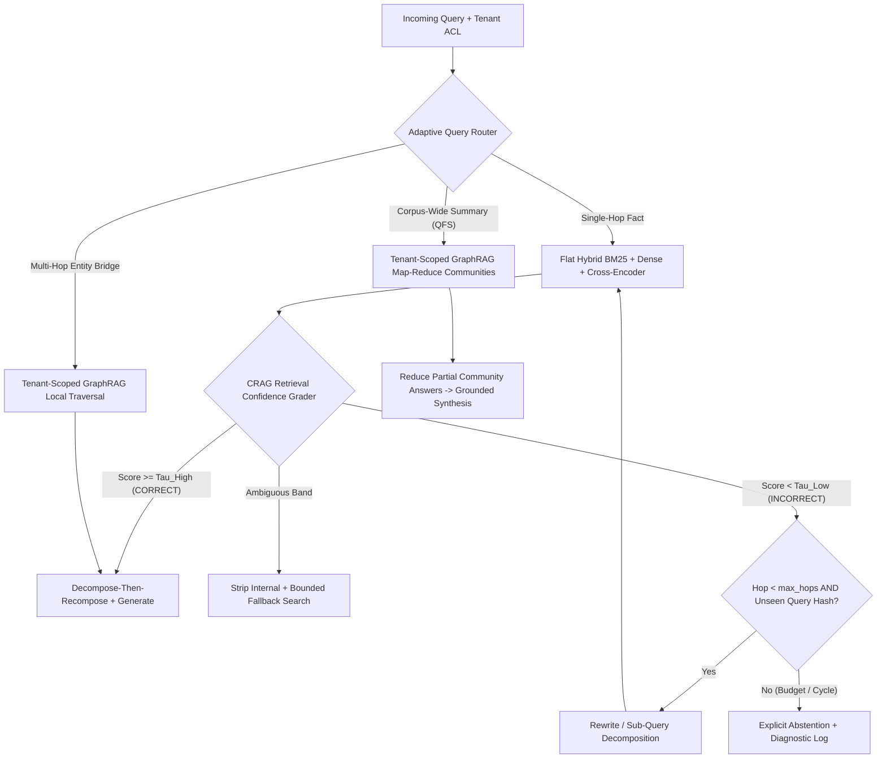
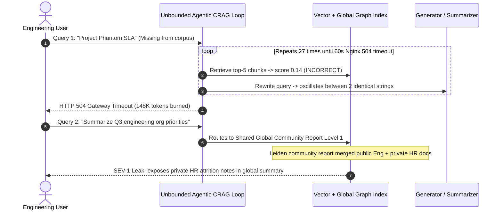

# Module 15: Advanced RAG: GraphRAG and Agentic RAG

> **Prerequisites:** [Module 07: Hybrid Search](../07-hybrid-search/README.md), [Module 08: Query Rewriting and Expansion](../08-query-rewriting-and-expansion/README.md), [Module 09: Reranking With Cross-Encoders](../09-reranking-with-cross-encoders/README.md), and [Module 14: RAGAS and Evaluation Frameworks](../14-ragas-and-evaluation-frameworks/README.md)  
> **Estimated Reading Time:** 35 minutes  
> **Target Audience:** AI Backend Engineers, Search & Knowledge Graph Architects, Agentic Systems Engineers

> [!TIP]
> **The Golden Rule of Advanced RAG:** Treat **Hybrid Search + Cross-Encoder Reranking** as your production default—it wins on cost, p95 latency, freshness, and tenant ACL isolation for 80%+ of enterprise Q&A. Escalate to **GraphRAG** strictly for corpus-wide thematic sensemaking or multi-hop relational bridges, and enforce hard **hop caps (`max_hops <= 3`), retrieval-confidence graders (CRAG), and cycle detection** before deploying **Agentic RAG** loops in production.

---

## Why This Matters

Single-pass hybrid vector search (`top_k = 5–10` chunks $\to$ cross-encoder $\to$ LLM) handles localized factual lookup remarkably well. Yet two classes of production queries break flat chunk retrieval systematically:

1. **Corpus-Wide Global Sensemaking (*"What are the top systemic outage causes across 12,000 post-mortems this year?"*):** No 10 chunks can summarize 12,000 documents; top-$k$ cosine similarity arbitrarily picks whichever 10 reports match the word `"outage"` best, yielding skewed, incomplete summaries.
2. **Multi-Hop Relational Bridges & Low-Confidence Retrieval:** Answering *"Which Tier-1 vendors supplying Chip X ship through ports impacted by Q4 storms?"* requires bridging disconnected documents (`Vendor -> Chip` in Document 1, `Vendor -> Port` in Document 3, `Port -> Storm` in Document 4) that share zero surface keywords with the end question. Meanwhile, blind single-pass generation feeds weak or noisy chunks straight into the LLM instead of correcting retrieval.

However, jumping blindly to **GraphRAG** or **unbounded Agentic RAG** introduces brutal operational penalties: LLM-driven graph indexing costs `100x–500x` more than flat embeddings, pre-computed cross-document community summaries shatter tenant ACL boundaries unless partitioned, and unconstrained agent loops burn tokens until gateway timeouts hit. Senior AI engineers know **both** how these architectures work internally and **when NOT to use them**.

---

## 1. Visual Mental Models & Core Architectures

### Adaptive Query Routing Across Flat, Graph, and Corrective Loops

Rather than forcing every query through the heaviest pipeline, route queries by complexity and enforce deterministic exit bounds:



### 1. Microsoft GraphRAG (`arXiv:2404.16130`, Edge et al., 2024)

Microsoft Research introduced **GraphRAG** (*From Local to Global: A Graph RAG Approach to Query-Focused Summarization*) specifically to solve global sensemaking across private corpora where vector RAG fails:

- **Graph Indexing Pipeline:**
  1. Split documents into `TextUnits` (chunks).
  2. Prompt an LLM to extract typed **Entities**, **Relationships**, and **Claims** into an entity knowledge graph $G = (V, E)$.
  3. Partition $G$ hierarchically using the **Leiden community detection algorithm** into nested modular communities $\{C_0, C_1, \dots, C_L\}$ (coarse high-level themes at level `0`, granular sub-clusters at deeper levels).
  4. Generate **bottom-up LLM Community Summaries** (reports) for every node cluster prior to any user query.
- **Query Modes:**
  - **Global Search (Map-Reduce QFS):** Shuffles community summaries at level $l$, executes parallel `Map` LLM calls scoring relevance and extracting partial points per community batch, and runs a `Reduce` LLM call synthesizing top-scored points into a comprehensive global answer.
  - **Local Search:** Anchors on entities named/linked in the user query, expands `1–2`-hop graph neighborhoods (neighbors, relationships, community context), and attaches source `TextUnits` for grounded entity-specific answers.
  - **DRIFT Search:** Combines an initial global community-report hypothesis with local entity traversal for balanced multi-aspect reasoning.

#### GraphRAG Indexing Cost Reality

Unlike flat indexing (one cheap embedding pass), building a GraphRAG index requires extraction completions per chunk *plus* summary completions per community:

$$T_{\text{graph-index}} \approx N_{\text{chunks}} \cdot \bigl(T_{\text{prompt}} + T_{\text{chunk}} + T_{\text{extract-out}}\bigr) + \sum_{l=0}^{L} |C_l| \cdot \bigl(T_{\text{comm-in}} + T_{\text{comm-out}}\bigr)$$

At `5,000` chunks (`3M` tokens), flat dense embedding at \$0.02/1M tokens costs **\$0.06**; full LLM entity extraction + Leiden community summarization at \$2.50/1M input and \$10.00/1M output costs roughly **\$32.95**—over **500x higher** indexing spend! And if documents mutate every 10 minutes, regenerating global Leiden communities creates severe **corpus churn bottlenecks**.

### 2. Self-RAG (`arXiv:2310.11511`, Asai et al., 2023)

Traditional RAG blindly fetches $K$ chunks on every prompt—even *"Write a Python quicksort function"*—and trusts retrieved passages uncritically. **Self-RAG** trains (or simulates via structured critique steps) an LLM emitting special **reflection tokens** interleaved with generation:

- `[Retrieve]` (`Yes` / `No` / `Continue`): Adaptive on-demand decision whether external retrieval is needed at all.
- `[IsREL]` (`Relevant` / `Irrelevant`): Evaluates each retrieved passage independently before conditioning generation.
- `[IsSUP]` (`Fully supported` / `Partially supported` / `No support`): Audits the generated segment against the passage for hallucination.
- `[IsUSE]` (`1..5`): Scores overall utility relative to the user's question.

In production backend stacks where teams use frontier APIs (rather than fine-tuned 7B/13B reflection-token models), Self-RAG is implemented as an explicit **state-machine critique pipeline** (e.g., via LangGraph nodes) that runs retrieval only when routed and validates `[IsREL]` + `[IsSUP]` prior to returning the answer.

### 3. Corrective RAG — CRAG (`arXiv:2401.15884`, Yan et al., 2024)

**CRAG** focuses specifically on catching **bad retrieval before it poisons generation**. A lightweight retrieval evaluator scores the confidence of retrieved documents $[d_1, \dots, d_K]$ against query $q$ and branches into three deterministic regimes:

1. **Confidence `CORRECT` ($s \ge \tau_{\text{high}}$):** Keep internal documents, apply **decompose-then-recompose** (split documents into sentence strips, filter out irrelevant strips with the lightweight grader, and pack only clean strips) so distractors cannot confuse generation.
2. **Confidence `AMBIGUOUS` ($\tau_{\text{low}} \le s < \tau_{\text{high}}$):** Strip valid internal fragments and augment them with **bounded query rewriting** or sanctioned external/secondary index lookup.
3. **Confidence `INCORRECT` ($s < \tau_{\text{low}}$):** Discard noisy internal passages entirely (preventing hallucination anchors!) and escalate to a rewritten query, web/fallback connector, or calibrated abstention.

### 4. Agentic RAG & When Flat Hybrid + Cross-Encoder Beats Everything

**Agentic RAG** equips an LLM with retrieval tools (`vector_search`, `bm25_exact`, `sql_lookup`, `graph_neighbors`) inside a multi-step reasoning loop (ReAct / state graph). To stay production-safe, an agentic loop MUST enforce:
- **Hard Hop Cap (`max_hops <= 3`):** No unbounded `while True:` tool loops.
- **Canonical Query-Hash Deduplication:** Hash normalized rewritten queries (`SHA-256(lower(strip(q)))`); if the agent emits a previously tried query, break immediately instead of spinning.
- **Latency & Cumulative Token Budget:** Abort with an explicit partial-evidence abstention if remaining wall-clock budget drops below `500 ms` or cumulative tokens exceed the ceiling.

#### When Flat Hybrid + Cross-Encoder Rerank Beats GraphRAG & Agentic RAG

Do **not** deploy GraphRAG or multi-hop Agentic RAG if any of the following hold:
1. **Strict `<300 ms`–`500 ms` p95 Latency SLO:** Single-pass BM25 + Dense + Cross-Encoder finishes in `80–220 ms` retrieval + streaming TTFT; Agentic multi-hop loops and GraphRAG map-reduce routinely take `2s–15s`.
2. **High Document Churn (Minutes–Hourly Writes):** Flat vector + BM25 supports $O(1)$ incremental chunk upserts and tombstones (`Module 00`). Re-extracting entities and recomputing Leiden communities continuously explodes GPU/API cost.
3. **Granular Row-Level Tenant ACLs:** Pre-computed GraphRAG community summaries aggregate facts across multiple documents—meaning a single community report built over mixed-permission docs creates a **cross-tenant privacy leak** unless separate graphs and summaries are maintained per tenant/ACL group.

---

## 2. Systematic Reference & Comparison Matrix

| Architecture | Best Query Pattern | Indexing Cost & Churn Tolerance | Query p95 Latency | Tenant ACL Isolation | Primary Failure Risk |
| :--- | :--- | :--- | :--- | :--- | :--- |
| **Flat Hybrid + Cross-Encoder** | Single-hop facts, policy/code lookup, exact IDs | **Lowest (\$0.02/1M)**; $O(1)$ real-time upsert/delete | **Fast (`80–250 ms` retrieval)** | **Trivial** (pre-filtered metadata ACL) | Fails on multi-hop cross-doc bridges & corpus-wide QFS |
| **GraphRAG — Local Search** | Multi-hop entity relationships (`2–3` hops) | **High (`100x–500x`)**; slow incremental re-extraction | Moderate (`400 ms–1.5s`) | Moderate (requires subgraph ACL filtering on nodes/edges) | Entity resolution duplicates (`"Acme Inc"` vs `"Acme"`) break paths |
| **GraphRAG — Global Map-Reduce** | Corpus-wide themes (*"Summarize all Q3 risks"*) | **Highest** (Leiden clustering + community LLM reports) | **Slow (`3s–15s+` map-reduce)** | **Hard** (shared community summaries leak across tenants!) | Stale community summaries; high map-phase token cost |
| **CRAG (Corrective RAG)** | Messy queries needing fallback or distractor stripping | Same as flat index (+ tiny evaluator model) | Moderate (`300–800 ms`) | Preserved if fallback respects ACLs | Wrong $\tau_{\text{low}}/\tau_{\text{high}}$ thresholds trigger unnecessary rewrites |
| **Bounded Agentic / Self-RAG** | Complex multi-tool decomposition (`SQL + Docs`) | Same as underlying indexes | **Variable (`1.5s–8s+`)** | Must propagate user ACL context into every tool call | Infinite rewrite loops on unanswerable queries without hop/hash caps |

---

## 3. Production War Story Post-Mortem: The Infinite CRAG Rewrite Loop & Shared Community Leak

| Field | Incident Details |
| :--- | :--- |
| **Severity** | **SEV-1** (Gateway `504` Exhaustion & Cross-Tenant Graph Summary Exposure) |
| **Detection / Resolution Time** | Detected 4 hours post-beta launch via p99 latency paging & security QA / Mitigated in 45 minutes |
| **Impact** | `148K` tokens burned per missing-fact query (`27` agent loops before `60s` timeout); confidential HR attrition notes surfaced via global GraphRAG community report |

### What Happened

A platform team replaced their fast hybrid RAG system with an experimental "Next-Gen Graph + Agentic RAG" backend without bounds or tenant graph partitioning:

1. **Unbounded Agentic Rewrite Spin:** Whenever retrieval confidence scored `< 0.50`, an agentic CRAG node prompted an LLM to *"rewrite the query and try again"* with no `max_hops` cap or query-hash deduplication. When a user asked about an unindexed internal codename (`"Project Phantom SLA"`), the LLM alternated endlessly between `"Project Phantom SLA"` and `"Phantom SLA policy"` across **27 iterations**, consuming `148,000` tokens before Nginx terminated the request at `60s` with HTTP `504`.
2. **Cross-Tenant Leiden Community Leak:** The team built one unified enterprise GraphRAG index across Confluence, Jira, and HR SharePoint folders, relying on chunk-level ACL checks *only* on final `TextUnits`. Because **Global Search** synthesized pre-computed Leiden community summaries rather than raw `TextUnits`, an executive community report summarizing *"Q3 Organization Restructuring"* aggregated HR attrition notes alongside public engineering roadmaps—exposing confidential layoff projections to non-HR engineers.



### Root Cause Analysis

1. **Missing Graph & Loop Termination Invariants:** No `max_hops`, no normalized `SHA-256` query deduplication set, and no cumulative token/deadline budget.
2. **ACL Ignorance on Derived Graph Artifacts:** Enforcing ACLs only on leaf `TextUnits` fails completely when derived artifacts (community summaries, merged entity descriptions) aggregate facts across different permission domains.

### The Fix & Architectural Hardening

- **Restored Flat Hybrid + Rerank as Primary Path:** Kept `85%` of queries on `150 ms` flat hybrid retrieval with mandatory `tenant_id` pre-filtering.
- **Hard-Capped Agentic Loops:** Set `max_hops = 3`, canonical query-hash cycle breaking, and a `4s` retrieval deadline returning explicit `ABSTAIN_NOT_FOUND` on low confidence.
- **Tenant-Partitioned Graph Indexes:** Restricted GraphRAG builds strictly to single-tenant / single-ACL-boundary workspaces (`graph_namespace = acl_group_id`), forbidding cross-ACL community summarization outright.

---

## 4. Multi-Language Production Implementation: Adaptive Query Router & Bounded CRAG State Machine

The four production implementations below provide an **Adaptive RAG Strategy Router + Bounded CRAG Executor** in **Go**, **TypeScript**, **Python**, and **C#** with:
1. Intent routing (`FACTUAL_LOCAL` $\to$ `HYBRID_RERANK`, `MULTI_HOP` $\to$ `LOCAL_GRAPH`, `GLOBAL_QFS` $\to$ `TENANT_SCOPED_GLOBAL_GRAPH`).
2. Strict `ACLScope` verification before running any Global GraphRAG map-reduce synthesis.
3. Hard `maxHops` cap, normalized SHA-256 query cycle breaking, and three-band CRAG confidence grading (`CORRECT`, `AMBIGUOUS`, `INCORRECT`).

````carousel

```go
package advrag

import (
	"crypto/sha256"
	"encoding/hex"
	"errors"
	"strings"
)

type Strategy string

const (
	StrategyHybridRerank Strategy = "HYBRID_RERANK"
	StrategyLocalGraph   Strategy = "TENANT_LOCAL_GRAPH"
	StrategyGlobalGraph  Strategy = "TENANT_GLOBAL_GRAPH"
)

type CragDecision struct {
	Status       string
	HopsUsed     int
	FinalQuery   string
	TopScore     float64
	ActionTaken  string
}

// RouteQuery selects the cheapest architecture capable of answering safely within ACLs.
func RouteQuery(query string, tenantGraphPartitioned bool) (Strategy, error) {
	q := strings.ToLower(query)
	if strings.Contains(q, "overall themes") || strings.Contains(q, "across all") || strings.Contains(q, "summarize entire") {
		if !tenantGraphPartitioned {
			return "", errors.New("global graphrag blocked: tenant-isolated community index required")
		}
		return StrategyGlobalGraph, nil
	}
	if strings.Contains(q, "shared supplier") || strings.Contains(q, "connected to") || strings.Contains(q, "downstream of") {
		return StrategyLocalGraph, nil
	}
	return StrategyHybridRerank, nil
}

// RunBoundedCRAG enforces maxHops and normalized SHA-256 cycle detection over retrieval grades.
func RunBoundedCRAG(
	initialQuery string,
	maxHops int,
	tauLow, tauHigh float64,
	retrieveScore func(q string) float64,
	rewriteQuery func(q string, hop int) string,
) CragDecision {
	seen := make(map[string]bool, maxHops)
	curr := initialQuery

	for hop := 1; hop <= maxHops; hop++ {
		norm := strings.ToLower(strings.TrimSpace(curr))
		sum := sha256.Sum256([]byte(norm))
		key := hex.EncodeToString(sum[:])[:12]
		if seen[key] {
			return CragDecision{Status: "ABSTAIN_CYCLE", HopsUsed: hop, FinalQuery: curr, ActionTaken: "cycle_broken"}
		}
		seen[key] = true

		score := retrieveScore(curr)
		if score >= tauHigh {
			return CragDecision{Status: "CORRECT", HopsUsed: hop, FinalQuery: curr, TopScore: score, ActionTaken: "decompose_and_generate"}
		}
		if score >= tauLow {
			return CragDecision{Status: "AMBIGUOUS", HopsUsed: hop, FinalQuery: curr, TopScore: score, ActionTaken: "strip_plus_fallback"}
		}
		curr = rewriteQuery(curr, hop)
	}
	return CragDecision{Status: "ABSTAIN_BUDGET", HopsUsed: maxHops, FinalQuery: curr, ActionTaken: "hop_limit_abstain"}
}
```

<!-- slide -->

```typescript
import { createHash } from "node:crypto";

export type RagStrategy = "HYBRID_RERANK" | "TENANT_LOCAL_GRAPH" | "TENANT_GLOBAL_GRAPH";

export interface CragDecision {
  readonly status: "CORRECT" | "AMBIGUOUS" | "ABSTAIN_CYCLE" | "ABSTAIN_BUDGET";
  readonly hopsUsed: number;
  readonly finalQuery: string;
  readonly topScore: number;
}

export function routeAdaptiveRag(query: string, isTenantGraphIsolated: boolean): RagStrategy {
  const q = query.toLowerCase();
  if (q.includes("overall themes") || q.includes("across all") || q.includes("summarize entire")) {
    if (!isTenantGraphIsolated) {
      throw new Error("Blocked: Global GraphRAG requires strictly tenant-partitioned communities.");
    }
    return "TENANT_GLOBAL_GRAPH";
  }
  if (q.includes("shared supplier") || q.includes("connected to") || q.includes("downstream of")) {
    return "TENANT_LOCAL_GRAPH";
  }
  return "HYBRID_RERANK";
}

export function runBoundedCrag(
  initialQuery: string,
  maxHops: number,
  tauLow: number,
  tauHigh: number,
  retrieveScore: (q: string) => number,
  rewriteQuery: (q: string, hop: number) => string
): CragDecision {
  const seenHashes = new Set<string>();
  let curr = initialQuery;

  for (let hop = 1; hop <= maxHops; hop++) {
    const normalized = curr.trim().toLowerCase();
    const qHash = createHash("sha256").update(normalized).digest("hex").slice(0, 12);
    if (seenHashes.has(qHash)) {
      return { status: "ABSTAIN_CYCLE", hopsUsed: hop, finalQuery: curr, topScore: 0 };
    }
    seenHashes.add(qHash);

    const score = retrieveScore(curr);
    if (score >= tauHigh) {
      return { status: "CORRECT", hopsUsed: hop, finalQuery: curr, topScore: score };
    }
    if (score >= tauLow) {
      return { status: "AMBIGUOUS", hopsUsed: hop, finalQuery: curr, topScore: score };
    }
    curr = rewriteQuery(curr, hop);
  }
  return { status: "ABSTAIN_BUDGET", hopsUsed: maxHops, finalQuery: curr, topScore: 0 };
}
```

<!-- slide -->

```python
"""Adaptive RAG strategy router & bounded CRAG loop with SHA-256 cycle detection."""

import hashlib
from dataclasses import dataclass
from typing import Callable


@dataclass(frozen=True)
class CragDecision:
    status: str
    hops_used: int
    final_query: str
    top_score: float


def route_query(query: str, tenant_graph_isolated: bool) -> str:
    q = query.lower()
    if any(k in q for k in ("overall themes", "across all", "summarize entire")):
        if not tenant_graph_isolated:
            raise PermissionError(
                "Global GraphRAG blocked: community reports require tenant-isolated graphs."
            )
        return "TENANT_GLOBAL_GRAPH"
    if any(k in q for k in ("shared supplier", "connected to", "downstream of")):
        return "TENANT_LOCAL_GRAPH"
    return "HYBRID_RERANK"


def run_bounded_crag(
    initial_query: str,
    retrieve_score: Callable[[str], float],
    rewrite_query: Callable[[str, int], str],
    max_hops: int = 3,
    tau_low: float = 0.45,
    tau_high: float = 0.75,
) -> CragDecision:
    seen_hashes: set[str] = set()
    curr = initial_query

    for hop in range(1, max_hops + 1):
        norm = curr.strip().lower()
        q_hash = hashlib.sha256(norm.encode("utf-8")).hexdigest()[:12]
        if q_hash in seen_hashes:
            return CragDecision("ABSTAIN_CYCLE", hop, curr, 0.0)
        seen_hashes.add(q_hash)

        score = retrieve_score(curr)
        if score >= tau_high:
            return CragDecision("CORRECT", hop, curr, score)
        if score >= tau_low:
            return CragDecision("AMBIGUOUS", hop, curr, score)
        curr = rewrite_query(curr, hop)

    return CragDecision("ABSTAIN_BUDGET", max_hops, curr, 0.0)
```

<!-- slide -->

```csharp
using System;
using System.Collections.Generic;
using System.Security.Cryptography;
using System.Text;

namespace GenAI.AdvancedRag;

public enum RagStrategy
{
    HybridRerank,
    TenantLocalGraph,
    TenantGlobalGraph
}

public sealed record CragDecision(string Status, int HopsUsed, string FinalQuery, double TopScore);

public static class AdaptiveRagController
{
    public static RagStrategy RouteQuery(string query, bool isTenantGraphIsolated)
    {
        string q = query.ToLowerInvariant();
        if (q.Contains("overall themes") || q.Contains("across all") || q.Contains("summarize entire"))
        {
            if (!isTenantGraphIsolated)
                throw new UnauthorizedAccessException("Global GraphRAG requires tenant-partitioned communities.");
            return RagStrategy.TenantGlobalGraph;
        }
        if (q.Contains("shared supplier") || q.Contains("connected to") || q.Contains("downstream of"))
            return RagStrategy.TenantLocalGraph;

        return RagStrategy.HybridRerank;
    }

    public static CragDecision RunBoundedCrag(
        string initialQuery,
        Func<string, double> retrieveScore,
        Func<string, int, string> rewriteQuery,
        int maxHops = 3,
        double tauLow = 0.45,
        double tauHigh = 0.75)
    {
        var seen = new HashSet<string>(StringComparer.Ordinal);
        string curr = initialQuery;

        for (int hop = 1; hop <= maxHops; hop++)
        {
            string norm = curr.Trim().ToLowerInvariant();
            byte[] hash = SHA256.HashData(Encoding.UTF8.GetBytes(norm));
            string key = Convert.ToHexString(hash)[..12];
            if (!seen.Add(key))
                return new CragDecision("ABSTAIN_CYCLE", hop, curr, 0.0);

            double score = retrieveScore(curr);
            if (score >= tauHigh)
                return new CragDecision("CORRECT", hop, curr, score);
            if (score >= tauLow)
                return new CragDecision("AMBIGUOUS", hop, curr, score);

            curr = rewriteQuery(curr, hop);
        }
        return new CragDecision("ABSTAIN_BUDGET", maxHops, curr, 0.0);
    }
}
```

````

---

## 5. Practical Hands-On CLI Verification Workflows

All three workflows below execute offline in standard Python 3.13 with zero third-party packages or API keys.

### Workflow 1: Quantify GraphRAG Indexing Economics vs. Flat Hybrid Index

Measure the exact token and dollar disparity between indexing `5,000` chunks (`3M` tokens) into a flat embedding index versus running LLM entity extraction + Leiden community summarization (`420` communities):

```bash
python -c '
def graphrag_vs_flat_index_cost(
    num_chunks=5_000,
    tokens_per_chunk=600,
    extract_out_tokens=350,
    communities=420,
    summary_in_tokens=2_200,
    summary_out_tokens=450,
    embed_per_m=0.02,
    llm_in_per_m=2.50,
    llm_out_per_m=10.00,
):
    flat_tokens = num_chunks * tokens_per_chunk
    flat_usd = (flat_tokens / 1e6) * embed_per_m

    extract_in = num_chunks * (tokens_per_chunk + 300)
    extract_out = num_chunks * extract_out_tokens
    comm_in = communities * summary_in_tokens
    comm_out = communities * summary_out_tokens

    graph_usd = (
        ((extract_in + comm_in) / 1e6) * llm_in_per_m
        + ((extract_out + comm_out) / 1e6) * llm_out_per_m
    )
    print(f"Flat Hybrid Index (5k chunks): {flat_tokens:,} embed tokens | ${flat_usd:.4f}")
    print(f"GraphRAG Build (entities+Leiden): {extract_in+comm_in:,} in / {extract_out+comm_out:,} out tokens | ${graph_usd:.2f}")
    print(f"Indexing Cost Multiplier        : {graph_usd / flat_usd:,.1f}x")

graphrag_vs_flat_index_cost()
'
```

**Expected Output:**

```text
Flat Hybrid Index (5k chunks): 3,000,000 embed tokens | $0.0600
GraphRAG Build (entities+Leiden): 5,424,000 in / 1,939,000 out tokens | $32.95
Indexing Cost Multiplier        : 549.2x
```

### Workflow 2: Local 2-Hop Graph Traversal vs. Flat Top-1 Vector Blindness

See why a flat similarity search on `"Gateway_Pro Storm_Alert_Q4"` returns `doc_2` (`0` hits on the `doc_3`/`doc_4` supplier bridge), whereas a `2`-hop entity neighborhood traversal recovers the complete causal chain across `4` disconnected documents:

```bash
python -c '
from collections import deque

edges = {
    "doc_1": [("Vendor_Alpha", "supplies", "Chip_X")],
    "doc_2": [("Chip_X", "used_in", "Gateway_Pro")],
    "doc_3": [("Vendor_Alpha", "ships_via", "Port_Rotterdam")],
    "doc_4": [("Port_Rotterdam", "impacted_by", "Storm_Alert_Q4")],
}

adj = {}
for doc_id, triples in edges.items():
    for s, r, o in triples:
        adj.setdefault(s, []).append((r, o, doc_id))

def local_graph_hop(start_entity, max_hops=2):
    visited = {start_entity}
    q = deque([(start_entity, 0, [])])
    paths = []
    while q:
        node, depth, trail = q.popleft()
        if depth >= max_hops:
            continue
        for rel, nxt, doc_id in adj.get(node, []):
            new_trail = trail + [(node, rel, nxt, doc_id)]
            paths.append(new_trail)
            if nxt not in visited:
                visited.add(nxt)
                q.append((nxt, depth + 1, new_trail))
    return paths

flat_top1_docs = {"doc_2"}
bridge_docs = {"doc_3", "doc_4"}
found_paths = local_graph_hop("Vendor_Alpha", max_hops=2)
print(f"Flat top-1 bridge hits: {len(flat_top1_docs & bridge_docs)}")
for p in found_paths:
    chain = " -> ".join(f"{a} -[{r}:{d}]-> {b}" for a, r, b, d in p)
    print("Graph 2-Hop Path:", chain)
'
```

**Expected Output:**

```text
Flat top-1 bridge hits: 0
Graph 2-Hop Path: Vendor_Alpha -[supplies:doc_1]-> Chip_X
Graph 2-Hop Path: Vendor_Alpha -[ships_via:doc_3]-> Port_Rotterdam
Graph 2-Hop Path: Vendor_Alpha -[supplies:doc_1]-> Chip_X -> Chip_X -[used_in:doc_2]-> Gateway_Pro
Graph 2-Hop Path: Vendor_Alpha -[ships_via:doc_3]-> Port_Rotterdam -> Port_Rotterdam -[impacted_by:doc_4]-> Storm_Alert_Q4
```

### Workflow 3: Bounded CRAG State Machine & Cycle-Breaker Drill

Verify that a recoverable low-confidence retrieval rewrites cleanly at `hop=2` (`CORRECT`), while an unanswerable query whose rewrite collapses to an identical hash terminates deterministically via cycle detection (`ABSTAIN_CYCLE`) instead of burning tokens:

```bash
python -c '
import hashlib

def run_bounded_crag(query, corpus_scores, max_hops=3):
    seen_hashes = set()
    curr_query = query
    trace = []
    for hop in range(1, max_hops + 1):
        q_hash = hashlib.sha256(curr_query.strip().lower().encode()).hexdigest()[:12]
        if q_hash in seen_hashes:
            trace.append(f"hop={hop} CYCLE_DETECTED({q_hash}) -> ABSTAIN")
            return "ABSTAIN_CYCLE", trace
        seen_hashes.add(q_hash)

        top_score = corpus_scores.get(curr_query, 0.15)
        if top_score >= 0.75:
            trace.append(f"hop={hop} CRAG=CORRECT(score={top_score:.2f}) -> GENERATE")
            return "ANSWER_GROUNDED", trace
        if top_score >= 0.45:
            trace.append(f"hop={hop} CRAG=AMBIGUOUS(score={top_score:.2f}) -> STRIP+FALLBACK")
            return "ANSWER_WITH_FALLBACK", trace

        trace.append(f"hop={hop} CRAG=INCORRECT(score={top_score:.2f}) -> REWRITE")
        curr_query = f"{query} refined_v{hop}" if "missing" not in query else query
    trace.append(f"hop_budget_exhausted(max_hops={max_hops}) -> ABSTAIN")
    return "ABSTAIN_BUDGET", trace

for q in ["auth rate limit policy", "missing project phantom sla"]:
    status, logs = run_bounded_crag(q, {"auth rate limit policy refined_v1": 0.84})
    print(f"Query: {q!r} => {status}")
    for line in logs:
        print("  ", line)
'
```

**Expected Output:**

```text
Query: 'auth rate limit policy' => ANSWER_GROUNDED
   hop=1 CRAG=INCORRECT(score=0.15) -> REWRITE
   hop=2 CRAG=CORRECT(score=0.84) -> GENERATE
Query: 'missing project phantom sla' => ABSTAIN_CYCLE
   hop=1 CRAG=INCORRECT(score=0.15) -> REWRITE
   hop=2 CYCLE_DETECTED(bc9da96e7d55) -> ABSTAIN
```

### Hands-On Exercises

1. **Incremental Churn Cost Sweep:** Modify Workflow 1 to simulate a `5,000`-chunk corpus where `5%` of documents change daily across `30` days (`150` batches/month). Calculate the monthly cost of full GraphRAG community rebuilds vs. $O(1)$ flat hybrid re-embedding.
2. **CRAG Decompose-Then-Recompose Strip Filter:** Extend Workflow 3 with a sentence-level relevance filter (`keep sentence iff cosine(q, sent) >= 0.65`) and measure how many noisy distractor tokens are stripped before final prompt assembly.
3. **Optional Live Graph / LangGraph Prototype (Requires API Key + `langgraph`):** Implement a 4-node LangGraph workflow (`route` $\to$ `retrieve` $\to$ `grade_docs` $\to$ `rewrite` / `generate`) with `recursion_limit=6` and inspect span latency on a single-hop vs. multi-hop query.

### Independent Challenge

A fast-growing SaaS support platform serves `200` enterprise tenants (`1.5M` help-center articles + `400K` private tenant runbooks updated every 15 minutes, strict `<400 ms` p95 retrieval latency). An architect proposes replacing their hybrid search + cross-encoder reranker with a single unified Microsoft **GraphRAG** deployment using Global Map-Reduce across all `1.9M` documents.

Identify **three distinct architectural flaws** with this plan and propose the right production topology.

<details><summary>Architectural Discussion</summary>

1. **Cross-Tenant ACL Violation in Global Summaries:** Pre-computing Leiden community reports across shared graphs aggregates private tenant runbooks into multi-document summaries, creating severe cross-tenant data leakage even if leaf chunks carry ACL tags.
2. **Latency & Unit Economics Mismatch:** GraphRAG Map-Reduce takes seconds per query (`3s–15s`), violating the `<400 ms` latency budget, and entity extraction over `1.9M` documents updated every 15 minutes creates prohibitive continuous re-indexing cost.
3. **Wrong Default Pattern:** Help-center and runbook troubleshooting queries are predominantly localized factual lookups where **Flat Hybrid Search (BM25 + Dense RRF) + Cross-Encoder Reranking** with strict `tenant_id` pre-filters delivers `<200 ms` latency, $O(1)$ 15-minute upserts, and zero cross-tenant bleed. Reserve GraphRAG strictly for isolated, single-tenant, offline/async batch executive analytics.

</details>

---

## 6. Common Mistakes & Troubleshooting

- **Deploying GraphRAG for simple factual Q&A:** Paying `500x` indexing cost and multi-second map-reduce latency for queries like *"What is the API rate limit for tier Pro?"* slows down your product and worsens precision compared to hybrid BM25 + cross-encoder reranking.
- **Sharing one knowledge graph across multiple ACL roles or tenants:** Derived community summaries erase per-document metadata boundaries unless the entire graph and Leiden hierarchy are partitioned strictly by tenant/ACL scope.
- **Letting Agentic RAG rewrite queries without hop limits or hash deduplication:** When a fact genuinely does not exist in the corpus, unguarded agents loop endlessly rewriting synonymous queries until hitting token limits or gateway `504` timeouts.
- **Skipping Self-RAG / CRAG grading on noisy retrievals:** Passing `score < 0.3` off-topic chunks straight into generation tricks the LLM into grounding hallucinations on irrelevant passages instead of abstaining or rewriting once.

---

## 7. Operational Validation Checkpoints & Checkpoint Quiz

### Operational Validation Checkpoints

<details><summary><strong>Checkpoint 1: Selecting GraphRAG vs. Flat Hybrid + Rerank</strong></summary>

You are building two features over the same `50,000` engineering incident reports: (A) a real-time Slack bot answering *"Which config flag fixed Incident INC-4821?"* (`<300 ms` SLO), and (B) a weekly executive brief answering *"What systemic reliability themes emerged across all Q3 incidents?"*. Which retrieval architecture fits each feature?

**Validation:** Feature (A) belongs on **Flat Hybrid Search (BM25 + Dense RRF) + Cross-Encoder Reranking**—exact ticket IDs (`INC-4821`) require BM25 lexical precision and sub-300 ms single-pass lookup. Feature (B) is the textbook fit for **GraphRAG Global Map-Reduce**, because summarizing thematic patterns across `50,000` reports is a Query-Focused Summarization (QFS) task that top-$k$ vector lookup cannot cover without arbitrary selection bias.

</details>

<details><summary><strong>Checkpoint 2: Explaining Self-RAG vs. CRAG mechanisms</strong></summary>

How do **Self-RAG** (`arXiv:2310.11511`) and **CRAG** (`arXiv:2401.15884`) differ in *what* they evaluate and *how* they react when retrieval is poor?

**Validation:** **Self-RAG** governs the end-to-end decision loop using reflection signals: whether to retrieve at all (`[Retrieve]`), whether chunks are relevant (`[IsREL]`), and whether the *generated answer* is supported (`[IsSUP]`) and useful (`[IsUSE]`). **CRAG** acts as a dedicated pre-generation retrieval quality gate: a lightweight evaluator classifies retrieved docs into `CORRECT`, `AMBIGUOUS`, or `INCORRECT`, applying sentence-level *decompose-then-recompose* to strip noise and discarding bad chunks in favor of query rewriting or external fallback search.

</details>

<details><summary><strong>Checkpoint 3: Preventing infinite agentic loops and cross-tenant leaks</strong></summary>

An Agentic GraphRAG service experiences `60s` timeouts on missing-topic queries and leaks private Project X details during Global Search queries. Name the two exact invariants missing from the system.

**Validation:** (1) **Bounded Loop Termination:** enforce `max_hops <= 3`, canonical `SHA-256` query-hash cycle breaking, and a hard wall-clock/token deadline triggering explicit abstention; and (2) **Tenant-Scoped Graph & Summary Isolation:** partition entity graphs and Leiden community reports strictly per tenant/ACL scope rather than summarizing mixed-permission documents into shared community nodes.

</details>

### Checkpoint Quiz

1. Why does naive top-$k$ vector RAG fail on **Global Query-Focused Summarization (QFS)** tasks like *"What are the main themes across 10,000 customer interviews?"*
2. What role does the **Leiden algorithm** play inside Microsoft's **GraphRAG** indexing pipeline?
3. What are the three retrieval confidence classifications in **CRAG**, and what action corresponds to `INCORRECT`?
4. When does **Flat Hybrid Search + Cross-Encoder Reranking** decisively outperform GraphRAG?
5. Name three mandatory guardrails required in any production **Agentic RAG** loop.

<details><summary>Answers</summary>

1. Top-$k$ similarity fetches only a handful of locally similar snippets (`5–15` chunks), missing the remaining `99.9%` of the corpus and failing to synthesize corpus-wide themes.
2. Leiden partitions the extracted entity-relationship graph into hierarchical, densely connected communities so an LLM can pre-generate bottom-up community summaries used during Global Map-Reduce queries.
3. `CORRECT`, `AMBIGUOUS`, and `INCORRECT`. On `INCORRECT`, CRAG discards the low-confidence internal chunks (avoiding distractor poisoning) and triggers bounded query rewriting, external fallback search, or abstention.
4. When queries are localized/single-hop, p95 latency must stay under `<300–500 ms`, documents update continuously (high churn), or granular row-level tenant ACLs preclude shared pre-computed community reports.
5. (a) Hard `max_hops` cap (`2–3`), (b) normalized query-hash deduplication/cycle detection, and (c) cumulative token + wall-clock deadline budgets with explicit abstention fallback.

</details>

---

## Further Reading & Sources

- [From Local to Global: A Graph RAG Approach to Query-Focused Summarization (Edge et al., 2024)](https://arxiv.org/abs/2404.16130) — Microsoft GraphRAG architecture, Leiden communities, Local vs. Global Map-Reduce, and QFS evaluation.
- [Microsoft GraphRAG Official Documentation](https://microsoft.github.io/graphrag/) — indexing pipelines, Local/Global/DRIFT search configuration, and prompt tuning.
- [Self-RAG: Learning to Retrieve, Generate, and Critique through Self-Reflection (Asai et al., 2023)](https://arxiv.org/abs/2310.11511) — adaptive retrieval and `[IsREL]` / `[IsSUP]` / `[IsUSE]` reflection tokens.
- [Corrective Retrieval Augmented Generation (Yan et al., 2024)](https://arxiv.org/abs/2401.15884) — retrieval confidence grading, decompose-then-recompose filtering, and external fallback routing.
- [LangChain Official Documentation](https://docs.langchain.com/) — stateful cyclic graph orchestration patterns for Adaptive RAG, CRAG, and Self-RAG.

## Next

[Module 16: RAG Failure Modes](../16-rag-failure-modes/README.md)
