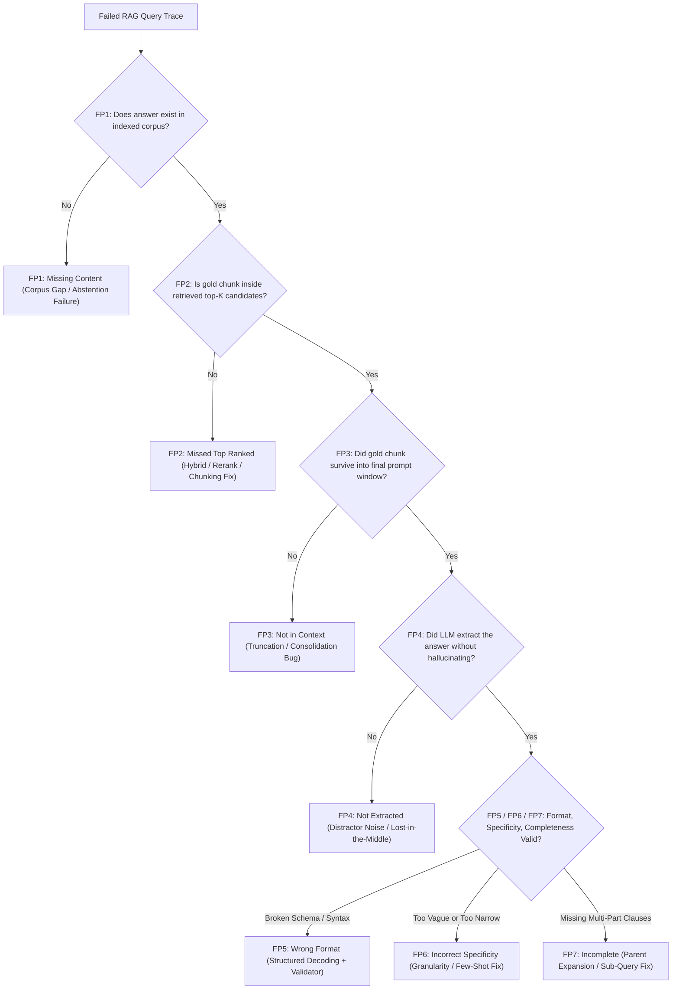
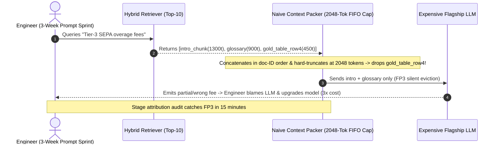

# Module 16: RAG Failure Modes

> **Prerequisites:** [Module 04: PDFs, Tables and Complex Documents](../04-pdfs-tables-and-complex-documents/README.md), [Module 09: Reranking With Cross-Encoders](../09-reranking-with-cross-encoders/README.md), [Module 10: Context Assembly and Prompt Construction](../10-context-assembly-and-prompt-construction/README.md), and [Module 14: RAGAS and Evaluation Frameworks](../14-ragas-and-evaluation-frameworks/README.md)  
> **Estimated Reading Time:** 32 minutes  
> **Target Audience:** AI Backend Engineers, Search Reliability Engineers, LLMOps Incident Responders

> [!TIP]
> **The Golden Rule of RAG Failure Diagnostics:** Never tweak the system prompt blindly when a RAG response is wrong. Trace every failing query sequentially through **Barnett et al.'s 7 Failure Points** (`FP1`–`FP7`, `arXiv:2401.05856`)—from corpus presence $\to$ top-$K$ rank $\to$ context assembly $\to$ extraction $\to$ formatting/completeness—so you repair the exact failing pipeline stage rather than wasting weeks prompting around broken retrieval or silent token truncation.

---

## Why This Matters

When an enterprise RAG assistant returns an inaccurate, incomplete, or hallucinated answer, the most common engineering instinct is to rewrite the prompt (*"You MUST read every passage carefully and answer completely!"*). Yet in real production systems—as documented empirically across research, education, and biomedical deployments by Barnett et al. (*Seven Failure Points When Engineering a Retrieval Augmented Generation System*, `arXiv:2401.05856`, CAIN 2024)—most user-visible failures originate **upstream of the LLM generator** or inside the consolidation glue between retriever and prompt.

If a chunk was dropped during token-budget truncation (`FP3`), or buried at rank 38 outside `top_k = 10` (`FP2`), or absent from the index altogether (`FP1`), prompting harder cannot conjure missing evidence—and often increases hallucination pressure. Conversely, diagnosing *which* failure point dominates your error logs turns debugging from guesswork into an ordered **Pareto engineering runbook** backed by deterministic stage telemetry.

---

## 1. Visual Mental Models & The 7 Failure Points Taxonomy

### Stage-by-Stage Failure Attribution Waterfall (`arXiv:2401.05856`)

To avoid double-counting or misattributing downstream errors to the LLM, evaluate every failed trace strictly left-to-right across four pipeline checkpoints (`Corpus` $\to$ `Retriever Top-K` $\to$ `Assembled Context` $\to$ `Generator Output`). The first violated invariant assigns the **primary root-cause code**:



### Detailed Failure Mechanics & Engineering Signals

1. **FP1 — Missing Content:** The ground-truth answer does not exist in the corpus (or failed ingestion/OCR silently dropped the PDF table). Without a calibrated **abstention gate** ($\tau_{\min}$ similarity/cross-encoder logit floor), the LLM fills the vacuum from parametric priors.
2. **FP2 — Missed Top Ranked:** The required chunk exists in the corpus (e.g., ranked `#29` out of `100` by dense cosine), but `top_k = 5` discards it before generation. Classic causes include exact product/error codes ignored by dense embeddings (`Module 06–07`) or oversized chunks diluting vector focus.
3. **FP3 — Not in Context (Consolidation Strategy Failure):** The gold chunk *was* retrieved inside `top_k` candidates, yet silently vanished during token-budget packing, sliding-window deduplication, or naive FIFO truncation before hitting the LLM API! This is the most insidious bug because retrieval unit tests (`Recall@20`) look green while the model never sees the evidence.
4. **FP4 — Not Extracted (Noisy Context & Lost-in-the-Middle):** The required chunk **is verbatim inside `final_prompt`**, yet the LLM ignores or contradicts it. Driven by low signal-to-noise ratio (excessive distractor chunks) and U-shaped transformer attention decay (`arXiv:2307.03172`) when gold facts sit in the middle of long contexts.
5. **FP5 — Wrong Format:** Extracted content is accurate, but violates structural output contracts (broken JSON, malformed Markdown tables, missing `[doc_id:chunk_id]` tags), typically worsening as context length swells and crowds out formatting instructions.
6. **FP6 — Incorrect Specificity:** Answer is factually grounded yet operationally useless—either overly broad (*"Follow security policy"*) when a specific port/timeout is needed, or overly narrow (quoting one regional exception instead of the global rule).
7. **FP7 — Incomplete:** Answer captures a subset of required clauses (e.g., citing `2` of `4` SLA conditions) because multi-part facts reside across separated chunks or generation stopped early.

### Quantitative Diagnostics: Pareto Engineering ROI & Signal-to-Noise Ratio

When triaging $N_{\text{fail}}$ failed traces, compute each failure point's share and prioritize fixes by expected error reduction per engineering day:

$$\text{Share}(FP_i) = \frac{|\{t \in \text{Failures} \mid \text{Primary}(t) = FP_i\}|}{N_{\text{fail}}}, \qquad \text{Context SNR} = \frac{\sum_{c \in \text{Gold}} \text{tokens}(c)}{\sum_{c \in \text{Prompt}} \text{tokens}(c)}$$

And for **FP1 Abstention Calibration**, sweep cross-encoder score cutoff $\tau$ across answerable ($A$) and unanswerable ($U$) queries to balance **Unanswerable Hallucination Rate** vs. **False-Refusal Rate**:

$$\text{Halluc}_{\text{unans}}(\tau) = \frac{|\{u \in U \mid s_{\max}(u) \ge \tau\}|}{|U|}, \qquad \text{FalseRefusal}(\tau) = \frac{|\{a \in A \mid s_{\max}(a) < \tau\}|}{|A|}$$

---

## 2. Systematic Reference & Comparison Matrix: Barnett et al. 7 Failure Points

| Failure Point | Pipeline Stage | Deterministic Telemetry Signature | RAGAS / Retrieval Signal | Common Misdiagnosis Trap | Verified Production Remediation |
| :--- | :--- | :--- | :--- | :--- | :--- |
| **FP1: Missing Content** | Knowledge Base / Ingestion | `gold_in_corpus == false` | `ContextRecall == 0`; low max rerank logit | Blaming retriever embeddings or prompt wording | Corpus gap backlog + calibrated $\tau_{\min}$ abstention gate |
| **FP2: Missed Top Ranked** | Retriever / Reranker | `recall@100 == 1` AND `recall@K == 0` | Low `ContextRecall` & low `Recall@K` | Rewriting system prompt instead of fixing search | Hybrid BM25 + dense RRF, larger candidate pool (`N=50`) + cross-encoder |
| **FP3: Not in Context** | Consolidation / Prompt Builder | `in_retrieved_k == true` AND `in_final_prompt == false` | Retrieval logs pass `Recall@K`, live prompt missing chunk | Assuming `Recall@K` equals prompt inclusion | Sort by rerank score *before* token-budget slicing; parent-doc compression |
| **FP4: Not Extracted** | Generator Attention / Noise | `in_final_prompt == true` AND `fact_extracted == false` | High `ContextRecall`, low `ContextPrecision` / `Faithfulness` | Upgrading LLM size before pruning distractor chunks | Drop chunks below rerank cutoff; place top chunks at start/end edges |
| **FP5: Wrong Format** | Structured Decoding / Egress | `fact_extracted == true` AND `schema_valid == false` | Tier-1 JSON/regex contract failure | Adding "PLEASE ONLY OUTPUT JSON" prose | Strict `json_schema` constrained decoding + bounded oracle validator |
| **FP6: Incorrect Specificity** | Query Intent / Chunk Granularity | Grounded claim fails audience granularity rubric | High `Faithfulness`, degraded `AnswerRelevancy` | Increasing `top_k` (adds further contradictory detail) | Hierarchical parent-child chunking + few-shot specificity exemplars |
| **FP7: Incomplete** | Multi-Chunk Synthesis | Subset of gold clauses present; missing sub-answers | Partial `ContextRecall` (`0.3–0.6`) or truncated output | Assuming single-chunk retrieval covers multi-hop rules | Query decomposition, parent-section window expansion, higher `max_tokens` |

---

## 3. Production War Story Post-Mortem: Three Weeks of Prompt Tuning on a Hidden FP3 Truncation Bug

| Field | Incident Details |
| :--- | :--- |
| **Severity** | **SEV-2** (Systematic Omission of Multi-Table Pricing Clauses) |
| **Detection / Resolution Time** | Misdiagnosed for 21 days during prompt sprints / Fixed in 2 hours after running stage-by-stage attribution |
| **Impact** | `44%` failure rate on enterprise pricing-table queries; `3x` higher API spend from unnecessary upgrade to flagship LLM |

### What Happened

A fintech assistant scored `91%` accuracy on prose policy questions yet failed `44%` of multi-table SLA queries (*"What are the Tier-3 overage fees for EU SEPA payouts?"*). Observing `Faithfulness = 0.91` on generated fragments, the team assumed the smaller LLM was *"struggling to read complex markdown tables."* Over three weeks, engineers rewrote the system prompt six times, added verbose chain-of-thought instructions, and upgraded to a `3x` more expensive flagship model—yielding only a `+2%` bump.

When a staff engineer finally instrumented a stage-by-stage `FP1`–`FP7` trace audit across `50` failing queries, the truth emerged immediately:

1. **FP2 (Chunking Split Headers):** Fixed `512`-token chunking severed table headers from row `18–30`, causing dense search to miss row chunks.
2. **FP3 (Silent FIFO Budget Eviction):** Even when the right table chunk ranked `#3` or `#4` in BM25+Dense `top-10`, the context packer concatenated retrieved candidates in **document-ID order** rather than **rerank-score order** and sliced strictly at `2,048` tokens—silently dropping chunks `#3` and `#4` whenever two long introductory chunks appeared first!



### Root Cause Analysis

1. **Zero `in_final_prompt` Telemetry:** The eval harness checked `Recall@10` on retriever output instead of logging *which chunk IDs actually survived token-budget assembly* into the final prompt string.
2. **Unsorted Budget Truncation + Structure-Blind Chunking:** Packing chunks before sorting by cross-encoder score allowed low-signal early documents to evict high-signal passages.

### The Fix & Architectural Hardening

- **Structure-Aware Table Chunking (`Module 04`):** Preserved complete markdown tables alongside repeated column headers inside atomic chunks.
- **Rerank-First Packing + Budget Alerting:** Sorted candidates strictly by cross-encoder logit, placed highest-scoring chunks at prompt start/end edges (`Module 10`), raised context budget to `4,096` tokens, and logged `dropped_candidate_ids` telemetry whenever `FP3` truncation occurred. Multi-table accuracy jumped from `56%` to `94%` on the *original* cheaper model.

---

## 4. Multi-Language Production Implementation: Deterministic `FP1`–`FP7` Failure Attribution Engine

The four modules below implement a deterministic **Barnett et al. `FP1`–`FP7` Stage Attribution Engine** in **Go**, **TypeScript**, **Python**, and **C#** that inspects each failed RAG trace sequentially and returns an unambiguous root-cause code plus aggregated Pareto diagnostics.

````carousel

```go
package ragdiag

import "sort"

type RagStageTrace struct {
	CorpusHasGold     bool
	GoldChunkID       string
	RetrievedTopK     []string
	AssembledContext  []string
	FactExtracted     bool
	FormatValid       bool
	SpecificityValid  bool
	Complete          bool
}

type FailureCount struct {
	Code  string
	Count int
}

func contains(items []string, target string) bool {
	for _, item := range items {
		if item == target {
			return true
		}
	}
	return false
}

// AttributeFailure assigns the earliest violated stage across Barnett et al. FP1..FP7.
func AttributeFailure(t RagStageTrace) string {
	if !t.CorpusHasGold {
		return "FP1_MISSING_CONTENT"
	}
	if !contains(t.RetrievedTopK, t.GoldChunkID) {
		return "FP2_MISSED_TOP_RANK"
	}
	if !contains(t.AssembledContext, t.GoldChunkID) {
		return "FP3_NOT_IN_CONTEXT"
	}
	if !t.FactExtracted {
		return "FP4_NOT_EXTRACTED"
	}
	if !t.FormatValid {
		return "FP5_WRONG_FORMAT"
	}
	if !t.SpecificityValid {
		return "FP6_INCORRECT_SPECIFICITY"
	}
	if !t.Complete {
		return "FP7_INCOMPLETE"
	}
	return "PASS"
}

func SummarizePareto(traces []RagStageTrace) []FailureCount {
	counts := make(map[string]int)
	for _, t := range traces {
		code := AttributeFailure(t)
		counts[code]++
	}
	out := make([]FailureCount, 0, len(counts))
	for k, v := range counts {
		out = append(out, FailureCount{Code: k, Count: v})
	}
	sort.Slice(out, func(i, j int) bool {
		if out[i].Count == out[j].Count {
			return out[i].Code < out[j].Code
		}
		return out[i].Count > out[j].Count
	})
	return out
}
```

<!-- slide -->

```typescript
export interface RagStageTrace {
  readonly corpusHasGold: boolean;
  readonly goldChunkId: string;
  readonly retrievedTopK: readonly string[];
  readonly assembledContext: readonly string[];
  readonly factExtracted: boolean;
  readonly formatValid: boolean;
  readonly specificityValid: boolean;
  readonly complete: boolean;
}

export type FailureCode =
  | "FP1_MISSING_CONTENT"
  | "FP2_MISSED_TOP_RANK"
  | "FP3_NOT_IN_CONTEXT"
  | "FP4_NOT_EXTRACTED"
  | "FP5_WRONG_FORMAT"
  | "FP6_INCORRECT_SPECIFICITY"
  | "FP7_INCOMPLETE"
  | "PASS";

export function attributeFailure(t: RagStageTrace): FailureCode {
  if (!t.corpusHasGold) return "FP1_MISSING_CONTENT";
  if (!t.retrievedTopK.includes(t.goldChunkId)) return "FP2_MISSED_TOP_RANK";
  if (!t.assembledContext.includes(t.goldChunkId)) return "FP3_NOT_IN_CONTEXT";
  if (!t.factExtracted) return "FP4_NOT_EXTRACTED";
  if (!t.formatValid) return "FP5_WRONG_FORMAT";
  if (!t.specificityValid) return "FP6_INCORRECT_SPECIFICITY";
  if (!t.complete) return "FP7_INCOMPLETE";
  return "PASS";
}

export function paretoReport(traces: readonly RagStageTrace[]): Array<{ code: FailureCode; count: number }> {
  const tally = new Map<FailureCode, number>();
  for (const t of traces) {
    const code = attributeFailure(t);
    tally.set(code, (tally.get(code) ?? 0) + 1);
  }
  return [...tally.entries()]
    .map(([code, count]) => ({ code, count }))
    .sort((a, b) => b.count - a.count || a.code.localeCompare(b.code));
}
```

<!-- slide -->

```python
"""Deterministic Barnett et al. FP1-FP7 attribution engine & context-packing guard."""

from collections import Counter
from dataclasses import dataclass


@dataclass(frozen=True)
class RagStageTrace:
    corpus_has_gold: bool
    gold_chunk_id: str
    retrieved_top_k: list[str]
    assembled_context: list[str]
    fact_extracted: bool
    format_valid: bool
    specificity_valid: bool
    complete: bool


def attribute_failure(trace: RagStageTrace) -> str:
    if not trace.corpus_has_gold:
        return "FP1_MISSING_CONTENT"
    if trace.gold_chunk_id not in trace.retrieved_top_k:
        return "FP2_MISSED_TOP_RANK"
    if trace.gold_chunk_id not in trace.assembled_context:
        return "FP3_NOT_IN_CONTEXT"
    if not trace.fact_extracted:
        return "FP4_NOT_EXTRACTED"
    if not trace.format_valid:
        return "FP5_WRONG_FORMAT"
    if not trace.specificity_valid:
        return "FP6_INCORRECT_SPECIFICITY"
    if not trace.complete:
        return "FP7_INCOMPLETE"
    return "PASS"


def summarize_pareto(traces: list[RagStageTrace]) -> list[tuple[str, int, float]]:
    if not traces:
        return []
    counts = Counter(attribute_failure(t) for t in traces)
    total = len(traces)
    return [(code, n, round(n / total, 4)) for code, n in counts.most_common()]
```

<!-- slide -->

```csharp
using System;
using System.Collections.Generic;
using System.Linq;

namespace GenAI.RagDiagnostics;

public sealed record RagStageTrace(
    bool CorpusHasGold,
    string GoldChunkId,
    IReadOnlyList<string> RetrievedTopK,
    IReadOnlyList<string> AssembledContext,
    bool FactExtracted,
    bool FormatValid,
    bool SpecificityValid,
    bool Complete);

public static class FailureClassifier
{
    public static string Attribute(RagStageTrace t)
    {
        if (!t.CorpusHasGold) return "FP1_MISSING_CONTENT";
        if (!t.RetrievedTopK.Contains(t.GoldChunkId, StringComparer.Ordinal)) return "FP2_MISSED_TOP_RANK";
        if (!t.AssembledContext.Contains(t.GoldChunkId, StringComparer.Ordinal)) return "FP3_NOT_IN_CONTEXT";
        if (!t.FactExtracted) return "FP4_NOT_EXTRACTED";
        if (!t.FormatValid) return "FP5_WRONG_FORMAT";
        if (!t.SpecificityValid) return "FP6_INCORRECT_SPECIFICITY";
        if (!t.Complete) return "FP7_INCOMPLETE";
        return "PASS";
    }

    public static IReadOnlyList<(string Code, int Count)> SummarizePareto(IEnumerable<RagStageTrace> traces) =>
        traces
            .GroupBy(Attribute)
            .Select(g => (Code: g.Key, Count: g.Count()))
            .OrderByDescending(x => x.Count)
            .ThenBy(x => x.Code, StringComparer.Ordinal)
            .ToList();
}
```

````

---

## 5. Practical Hands-On CLI Verification Workflows

All three workflows execute offline in standard Python 3.13 with zero API keys or external dependencies.

### Workflow 1: Run `FP1`–`FP7` Attribution & Pareto Triage Across Incident Traces

Classify a sample trace batch across all seven Barnett et al. failure points to isolate the dominant upstream bottleneck:

```bash
python -c '
from collections import Counter

def attribute_failure(t):
    if not t["corpus_has_gold"]:
        return "FP1_MISSING_CONTENT"
    if t["gold_id"] not in t["retrieved_top_k"]:
        return "FP2_MISSED_TOP_RANK"
    if t["gold_id"] not in t["context_assembled"]:
        return "FP3_NOT_IN_CONTEXT"
    if not t["fact_extracted"]:
        return "FP4_NOT_EXTRACTED"
    if not t["format_valid"]:
        return "FP5_WRONG_FORMAT"
    if not t["specificity_ok"]:
        return "FP6_INCORRECT_SPECIFICITY"
    if not t["complete"]:
        return "FP7_INCOMPLETE"
    return "PASS"

traces = [
    {"corpus_has_gold": False, "gold_id": "d1", "retrieved_top_k": [], "context_assembled": [], "fact_extracted": False, "format_valid": True, "specificity_ok": True, "complete": True},
    {"corpus_has_gold": True, "gold_id": "d2", "retrieved_top_k": ["d9", "d8"], "context_assembled": ["d9", "d8"], "fact_extracted": False, "format_valid": True, "specificity_ok": True, "complete": True},
    {"corpus_has_gold": True, "gold_id": "d3", "retrieved_top_k": ["d1", "d3"], "context_assembled": ["d1"], "fact_extracted": False, "format_valid": True, "specificity_ok": True, "complete": True},
    {"corpus_has_gold": True, "gold_id": "d4", "retrieved_top_k": ["d4", "d7"], "context_assembled": ["d4"], "fact_extracted": False, "format_valid": True, "specificity_ok": True, "complete": True},
    {"corpus_has_gold": True, "gold_id": "d5", "retrieved_top_k": ["d5"], "context_assembled": ["d5"], "fact_extracted": True, "format_valid": False, "specificity_ok": True, "complete": True},
    {"corpus_has_gold": True, "gold_id": "d6", "retrieved_top_k": ["d6"], "context_assembled": ["d6"], "fact_extracted": True, "format_valid": True, "specificity_ok": False, "complete": True},
    {"corpus_has_gold": True, "gold_id": "d7", "retrieved_top_k": ["d7"], "context_assembled": ["d7"], "fact_extracted": True, "format_valid": True, "specificity_ok": True, "complete": False},
    {"corpus_has_gold": True, "gold_id": "d8", "retrieved_top_k": ["d1", "d8"], "context_assembled": ["d1"], "fact_extracted": False, "format_valid": True, "specificity_ok": True, "complete": True},
    {"corpus_has_gold": True, "gold_id": "d9", "retrieved_top_k": ["d9"], "context_assembled": ["d9"], "fact_extracted": True, "format_valid": True, "specificity_ok": True, "complete": True},
]

counts = Counter(attribute_failure(t) for t in traces)
for k, v in counts.most_common():
    print(f"{k:26s}: {v} ({v/len(traces):.1%})")
'
```

**Expected Output:**

```text
FP3_NOT_IN_CONTEXT        : 2 (22.2%)
FP1_MISSING_CONTENT       : 1 (11.1%)
FP2_MISSED_TOP_RANK       : 1 (11.1%)
FP4_NOT_EXTRACTED         : 1 (11.1%)
FP5_WRONG_FORMAT          : 1 (11.1%)
FP6_INCORRECT_SPECIFICITY : 1 (11.1%)
FP7_INCOMPLETE            : 1 (11.1%)
PASS                      : 1 (11.1%)
```

### Workflow 2: Reproduce & Eliminate `FP3` Budget Eviction and `FP4` Distractor Noise

Observe how naive FIFO budget packing keeps noisy chunks and evicts both gold chunks (`0/2` gold retained, `0.0%` SNR), while rerank-first sorting + a score cutoff (`0.40`) retains `2/2` gold chunks at `100.0%` SNR:

```bash
python -c '
candidates = [
    {"id": "c_noise1", "tokens": 900, "rerank": 0.12, "is_gold": False},
    {"id": "c_noise2", "tokens": 850, "rerank": 0.19, "is_gold": False},
    {"id": "c_noise3", "tokens": 600, "rerank": 0.28, "is_gold": False},
    {"id": "c_gold1",  "tokens": 550, "rerank": 0.91, "is_gold": True},
    {"id": "c_gold2",  "tokens": 450, "rerank": 0.84, "is_gold": True},
]
budget = 2000

def pack(chunks, sort_by_score=False, min_score=0.0):
    ordered = sorted(chunks, key=lambda c: c["rerank"], reverse=True) if sort_by_score else chunks
    kept, used = [], 0
    for c in ordered:
        if c["rerank"] < min_score:
            continue
        if used + c["tokens"] <= budget:
            kept.append(c)
            used += c["tokens"]
    gold_kept = sum(1 for c in kept if c["is_gold"])
    gold_toks = sum(c["tokens"] for c in kept if c["is_gold"])
    snr = gold_toks / max(1, used)
    return [c["id"] for c in kept], gold_kept, used, snr

naive_ids, g1, u1, snr1 = pack(candidates, sort_by_score=False, min_score=0.0)
hard_ids,  g2, u2, snr2 = pack(candidates, sort_by_score=True,  min_score=0.40)
print(f"Naive FIFO Packing (budget={budget}): kept={naive_ids} | gold={g1}/2 | tokens={u1} | SNR={snr1:.1%}")
print(f"Reranked + Denoised Packing        : kept={hard_ids} | gold={g2}/2 | tokens={u2} | SNR={snr2:.1%}")
'
```

**Expected Output:**

```text
Naive FIFO Packing (budget=2000): kept=['c_noise1', 'c_noise2'] | gold=0/2 | tokens=1750 | SNR=0.0%
Reranked + Denoised Packing        : kept=['c_gold1', 'c_gold2'] | gold=2/2 | tokens=1000 | SNR=100.0%
```

### Workflow 3: Calibrate `FP1` Abstention Threshold ($\tau$) Trade-Off

Sweep cross-encoder score thresholds $\tau$ across answerable and unanswerable queries to measure **Unanswerable Hallucination** vs. **False Refusal**:

```bash
python -c '
answerable_scores   = [1.8, 1.4, 0.9, 0.4, 0.1, -0.2, 1.2, 0.7]
unanswerable_scores = [-1.9, -1.2, -0.8, -0.4, 0.2, -1.5, -0.9, -0.3]

for tau in [-1.0, -0.5, 0.0, 0.5]:
    fp1_halluc = sum(1 for s in unanswerable_scores if s >= tau) / len(unanswerable_scores)
    false_refusal = sum(1 for s in answerable_scores if s < tau) / len(answerable_scores)
    print(f"Threshold tau={tau:+.1f} | Unanswerable Hallucination={fp1_halluc:5.1%} | False Refusal={false_refusal:5.1%}")
'
```

**Expected Output:**

```text
Threshold tau=-1.0 | Unanswerable Hallucination=62.5% | False Refusal= 0.0%
Threshold tau=-0.5 | Unanswerable Hallucination=37.5% | False Refusal= 0.0%
Threshold tau=+0.0 | Unanswerable Hallucination=12.5% | False Refusal=12.5%
Threshold tau=+0.5 | Unanswerable Hallucination= 0.0% | False Refusal=37.5%
```

### Hands-On Exercises

1. **Multi-Gold `FP7` Incomplete Detection:** Extend `RagStageTrace` to accept `required_gold_ids: list[str]` instead of a single string, returning `FP2_MISSED_TOP_RANK` if *zero* required chunks are retrieved, `FP3_NOT_IN_CONTEXT` if retrieved chunks are dropped in assembly, and `FP7_INCOMPLETE` if `1 <= len(covered) < len(required_gold_ids)`.
2. **U-Shaped Edge Placement Check:** Modify `pack()` in Workflow 2 so that surviving chunks are arranged in **Lost-in-the-Middle-resistant order** (highest-scoring chunk first, second-highest last, lower-scoring chunks in the middle) and write an assertion verifying `ordered_ids[0] == "c_gold1"` and `ordered_ids[-1] == "c_gold2"`.
3. **Optional Live Failure Replay (Requires Local Vector DB or API Key):** Intentionally ingest a PDF containing a 20-row financial table with `chunk_size=250` and `overlap=0`, run 5 queries asking for totals from rows 15–20, and classify each failure using `attribute_failure()` before switching to table-aware chunking (`Module 04`).

### Independent Challenge

Your customer-facing DevOps copilot processes `10,000` queries/week with a `32%` failure rate (`3,200` bad answers/week). Logging `FP1`–`FP7` telemetry on `200` sampled failures yields: `FP1: 8%`, `FP2: 41%`, `FP3: 24%`, `FP4: 18%`, `FP5: 5%`, `FP6: 2%`, `FP7: 2%`. A product manager insists on immediately fine-tuning Llama-3-70B on `10,000` QA pairs to *"teach the model DevOps troubleshooting."*

Explain quantitatively why fine-tuning fails this Pareto distribution and draft a **three-sprint engineering plan** ranked by failure reduction impact.

<details><summary>Architectural Discussion</summary>

1. **Why Fine-Tuning Fails Here:** `73%` of all failures (`FP1 + FP2 + FP3 = 8% + 41% + 24%`) occur **before a single relevant token reaches the generator**. Fine-tuning model weights cannot fix unindexed runbooks (`FP1`), weak retrieval ranking (`FP2`), or silent context truncation (`FP3`)—and risks baking volatile cluster configs into parametric weights (`Module 00`).
2. **Sprint 1 (Quick Win — Fixes `FP3: 24%` + `FP4: 18%` = `42%` of errors):** Sort retrieved candidates strictly by cross-encoder score *before* token-budget truncation, drop low-confidence distractors below $\tau_{\text{noise}}$, place top-2 chunks at prompt edges, and log `dropped_chunk_ids`.
3. **Sprint 2 (Fixes `FP2: 41%`):** Add BM25 + dense RRF hybrid retrieval (recovering exact CLI flags, exit codes, and error hashes), expand candidate pool (`N=50` $\to$ cross-encoder `K=6`), and preserve code-block/table integrity in chunking.
4. **Sprint 3 (Fixes `FP1: 8%` + `FP5: 5%`):** Enforce calibrated $\tau_{\min}$ abstention on unanswerable queries, route `FP1` gaps into doc-authoring tickets, and enable strict `json_schema` decoding for structured runs.

</details>

---

## 6. Common Mistakes & Troubleshooting

- **Measuring only retriever `Recall@K` without logging `assembled_context_ids`:** If you never inspect the exact final prompt string sent to the LLM, `FP3` truncation and deduplication bugs stay invisible for months.
- **Fixing `FP2`/`FP3` upstream bugs with generator prompt engineering:** Adding *"Look closer at the context"* when the gold chunk was evicted or never retrieved increases model pressure to confabulate from weights.
- **Using raw `top_k = 20` without a reranker or score floor (`FP4` trap):** Stuffing `15` weakly related chunks around `2` gold chunks lowers `Context SNR` from `80%` to `12%`, causing `FP4` extraction misses and `FP5` format drift.
- **Treating `FP1` Missing Content as a zero-score metric to ignore:** Unanswerable queries without a calibrated abstention gate (`tau_min`) drive the majority of embarrassing production hallucinations.

---

## 7. Operational Validation Checkpoints & Checkpoint Quiz

### Operational Validation Checkpoints

<details><summary><strong>Checkpoint 1: Distinguishing `FP2`, `FP3`, and `FP4` from stage traces</strong></summary>

A trace shows: the answer exists in `doc_88:chunk_04`, `Recall@20 = 1.0` (`doc_88:chunk_04` ranked `#7`), the final prompt included chunks `#1–#4` (`3,950` tokens out of a `4,000`-token budget), and the LLM replied `"Not mentioned in the provided context."` Which Barnett et al. failure point occurred?

**Validation:** **`FP3_NOT_IN_CONTEXT` (Consolidation/Truncation Bug).** Because `doc_88:chunk_04` existed in the corpus (not `FP1`) and appeared inside `retrieved_top_20` (not `FP2`), yet was dropped during `4,000`-token context assembly before generation, the LLM truthfully reported its absence (`FP3`, not `FP4`). The fix is improving reranking (`#7` $\to$ `#1–#2`) and/or parent compression/budget sizing.

</details>

<details><summary><strong>Checkpoint 2: Diagnosing `FP4` when evidence is present verbatim</strong></summary>

You audit a failing query and verify that `doc_19:chunk_02` containing the exact rate `"2.45%"` *is inside the prompt text* at chunk position `#6` out of `12` (`9,200` total tokens), yet the LLM outputs `"3.10%"` from chunk `#1` (a legacy 2022 appendix). Which failure point is this, and how do you eliminate it?

**Validation:** **`FP4_NOT_EXTRACTED` (Noisy Context + Lost-in-the-Middle).** The gold fact reached the context window, but excessive distractors (`11` noisy chunks) and middle placement (`#6/12`) caused the generator to miss it. Fix via metadata date boosting/filtering, dropping low-score distractors below rerank threshold, and placing highest-scored chunks at the top/bottom edges of the prompt.

</details>

<details><summary><strong>Checkpoint 3: Balancing `FP1` hallucination against false refusals</strong></summary>

In Workflow 3, setting $\tau = -1.0$ eliminates false refusals (`0.0%`) but lets `62.5%` of unanswerable queries pass through to the LLM (`FP1` hallucinations). Setting $\tau = +0.5$ yields `0.0%` unanswerable hallucination but breaks `37.5%` of valid queries. How should a backend engineer choose $\tau$ in production?

**Validation:** Choose $\tau$ dynamically by **domain risk asymmetry** and **two-stage fallback**: for high-stakes compliance/medical QA, set a strict $\tau$ (`+0.0` to `+0.3`) paired with an explicit `ABSTAIN_NOT_FOUND` response; for borderline scores ($\tau_{\text{low}} \le s < \tau_{\text{high}}$), trigger one bounded CRAG query-rewrite retry (`Module 15`) rather than immediately failing valid queries or blindly generating on weak evidence.

</details>

### Checkpoint Quiz

1. Why must `FP1`–`FP7` failure attribution evaluate stages **sequentially left-to-right** instead of blaming the LLM first?
2. What is the exact operational difference between **`FP2` (Missed Top Ranked)** and **`FP3` (Not in Context)**?
3. What two architectural fixes specifically eliminate **`FP4` (Not Extracted)**?
4. Why does **`FP5` (Wrong Format)** frequently spike when teams increase `top_k` from `5` to `25`?
5. If `65%` of production RAG failures stem from `FP1` and `FP2`, why will fine-tuning the generator LLM fail to resolve the incident?

<details><summary>Answers</summary>

1. Downstream generation cannot succeed if retrieval or context assembly never delivered the gold passage; sequential attribution isolates the earliest broken invariant (`Corpus` $\to$ `Top-K` $\to$ `Final Prompt` $\to$ `Extraction/Format`) so engineering effort targets the real bottleneck.
2. In `FP2`, the gold chunk exists in the corpus but never ranks inside the retriever's `top_k` candidate set; in `FP3`, the retriever *found* the gold chunk inside `top_k`, but context consolidation/token-budget truncation silently dropped it before LLM invocation.
3. (a) **Signal-to-noise pruning:** filter out distracting low-relevance chunks via cross-encoder cutoff thresholds; and (b) **U-shaped edge ordering:** place top-evidence chunks at the very beginning and end of the prompt to counteract Lost-in-the-Middle attention decay.
4. Diluting the prompt with `20+` noisy chunks pushes system schema rules far from generation tokens and increases attention distraction, causing format regressions unless enforced via constrained `json_schema` decoding and Tier-1 validation.
5. `FP1` (missing documents) and `FP2` (retrieval ranking failures) occur completely outside model weights; fine-tuning cannot invent absent enterprise documents or repair BM25/vector search indexing.

</details>

---

## Further Reading & Sources

- [Seven Failure Points When Engineering a Retrieval Augmented Generation System (Barnett et al., 2024)](https://arxiv.org/abs/2401.05856) — CAIN 2024 empirical experience report cataloging `FP1`–`FP7` across production RAG systems.
- [Lost in the Middle: How Language Models Use Long Contexts (Liu et al., 2023)](https://arxiv.org/abs/2307.03172) — empirical U-shaped attention degradation explaining `FP4` extraction failures.
- [RAGAS: Automated Evaluation of Retrieval Augmented Generation (Es et al., 2023)](https://arxiv.org/abs/2309.15217) — component-wise metrics connecting retrieval failures (`Context Precision`/`Recall`) to generation (`Faithfulness`).
- [Module 04: PDFs, Tables and Complex Documents](../04-pdfs-tables-and-complex-documents/README.md) — preventing `FP1`/`FP2` table shredding during ingestion.
- [Module 10: Context Assembly and Prompt Construction](../10-context-assembly-and-prompt-construction/README.md) — preventing `FP3` budget truncation and `FP4` middle placement decay.

## Next

[Module 17: Capstone Project](../17-capstone-project/README.md)
