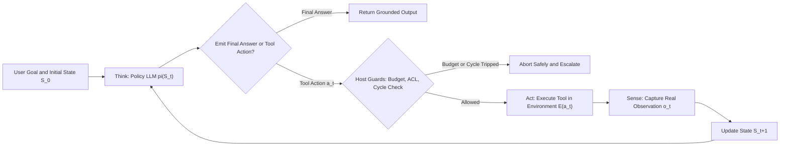
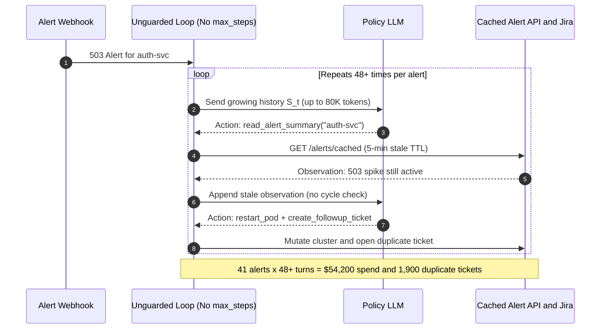

# Module 00: What Makes Something an Agent

> **Prerequisites:** [Track 06, Module 06: Function Calling Basics](../../06-openai-and-the-model-landscape/06-function-calling-basics/README.md), [Track 07, Module 10: Prompt Chaining](../../07-prompt-engineering/10-prompt-chaining/README.md), and [Track 09, Module 01: Naive RAG End to End](../../09-retrieval-augmented-generation/01-naive-rag-end-to-end/README.md).  
> **Estimated Reading Time:** 32 minutes  
> **Target Audience:** AI Backend Engineers, Systems Architects, Platform Developers Building Agent Runtimes

> [!TIP]
> **The Golden Rule of Agent Architecture:**  
> An LLM endpoint (`messages -> completion`) is never an agent by itself—it is a stateless probabilistic policy. What makes software an **agent** is the deterministic **host runtime loop** wrapping that model with persistent state $S_t$, real environmental observations $O_t$, host-enforced tool execution $A_t$, and hard termination guards ($K_{\max}$, token caps, and cycle detection).

---

## Why This Matters

Every week, engineering teams ship a single-shot prompt template or a hardcoded three-step cron script, label it an "AI Agent" in product docs, and discover two diametrically opposed production failures:

1. **Open-Loop Blindness:** Calling an LLM once with a complex operational prompt (`"Diagnose why checkout-svc is returning 502 and fix it"`) forces the model to guess the hidden state of the world without inspecting logs, database locks, or upstream certificates. Without a closed feedback loop, the model hallucinates plausible root causes and triggers the wrong remediation.
2. **Unbounded Loop Meltdowns:** Wrapping `while True:` around `llm.generate()` and `eval_tool()` without state tracking, idempotency, or cycle guards turns transient `404`/`503` tool responses into multi-minute loops that burn tens of thousands of dollars in quadratic context prefill tokens while repeating the exact same broken action.

Before writing your first ReAct dispatcher or picking an orchestration framework in Track 11, you need an exact engineering definition of **agency**—built from control theory, systems programming, and quantitative cost/reliability math.

---

## 1. Control-Theory Foundations: The Sense-Think-Act Loop

In classical AI (Russell & Norvig's **PEAS** model: *Performance measure, Environment, Actuators, Sensors*) and modern LLM engineering (Anthropic's *"Building Effective Agents"* taxonomy), the progression starts with an **Augmented LLM**: a base language model enhanced with retrieval, tools, and memory.

An **Augmented LLM** becomes an **Agent** only when control shifts from a single linear request/response or a developer-hardcoded graph to a **closed-loop feedback controller** where the LLM dynamically chooses its own next action based on live environmental observations until a termination criterion holds:

$$\text{Think: } (\hat{r}_t, a_t) = \pi_\theta(S_t) \quad \longrightarrow \quad \text{Act: } o_t = \mathcal{E}(a_t) \quad \longrightarrow \quad \text{Sense: } S_{t+1} = \text{Update}(S_t, \hat{r}_t, a_t, o_t)$$



Notice the strict architectural division of labor:

- **The LLM (`Think`) only proposes:** It inspects accumulated state $S_t$ and emits either a candidate action $a_t$ (tool name + arguments) or a terminal response. It never directly mutates a database, executes shell commands, or fabricates an observation.
- **The Host Runtime (`Act`, `Sense`, `Guard`) actually executes:** It validates permissions and schemas, checks step/token budgets and cycle hashes, executes the deterministic side effect against environment $\mathcal{E}$, captures the real output $o_t$ (including errors and HTTP codes), updates $S_{t+1}$, and feeds $S_{t+1}$ back to the policy.

### The 5 Structural Pillars of a True Software Agent

| Pillar | Definition | What Happens When Missing |
| :--- | :--- | :--- |
| **1. Goal-Directed State ($S_t$)** | Explicit scratchpad/message trajectory evolving across turns $t = 0, 1, \dots, k$ | Stateless chatbot forgets prior probes and restarts from scratch every call |
| **2. Grounded Sensing ($O_t$)** | Real external observations returned by deterministic code (API status, SQL rows, exit codes) | Model hallucinates tool outputs from parametric priors ("phantom success") |
| **3. Bounded Action Surface ($A_t$)** | Scoped, schema-validated tool registry enforced by the host runtime | Prompt injection triggers arbitrary mutations or cascading system damage |
| **4. Dynamic Control Policy ($\pi_\theta$)** | Model selects *which* tool to invoke next and *when* to stop based on $O_t$ | Fixed script fails whenever unexpected branch or redirect appears |
| **5. Hard Operational Guardrails** | Host-enforced ceilings: `max_steps`, `max_tokens`, `wall_timeout`, `cycle_detector` | Unbounded `while True` loops rack up \$10K+ weekend bills on transient errors |

### Quantitative Mechanics: Quadratic Context Growth & Compounding Failure

Every iteration of a closed-loop agent incurs two non-negotiable mathematical costs that never appear in single-turn LLM calls:

1. **Quadratic Input Token Growth:** Because transformer APIs are stateless across HTTP requests, each turn $t$ re-prefills the entire prior history (base system/tools prompt $P_0$ plus $t$ accumulated reasoning/action/observation deltas $\Delta_{\text{step}}$):

$$\text{Tokens}_{\text{in}}(k) = \sum_{t=0}^{k-1} \left(P_0 + t \cdot \Delta_{\text{step}}\right) = k P_0 + \frac{k(k-1)}{2}\Delta_{\text{step}}$$

At $P_0 = 1{,}200$ tokens and $\Delta_{\text{step}} = 450$ tokens, a `1`-step lookup consumes `1,200` input tokens, whereas a `20`-step agent loop consumes `109,500` input tokens—over `91x` the input token spend for a single user request!

2. **Compounding Step Reliability:** If each autonomous decision-and-execution step succeeds independently with probability $p_{\text{succ}}$, end-to-end reliability across a $k$-step trajectory decays exponentially:

$$P_{\text{end-to-end}}(k) = p_{\text{succ}}^k$$

Even at `95%` per-step accuracy ($p_{\text{succ}} = 0.95$), a `10`-step agent succeeds only `59.9%` of the time ($0.95^{10} = 0.599$), and a `20`-step agent drops to `35.8%`. This is the single biggest reason production teams minimize step count $k$ and verify every step deterministically.

3. **Cumulative End-to-End Latency:**

$$L_{\text{agent}}(k) = \sum_{t=1}^{k} \left(L_{\text{TTFT}}(P_0 + t\Delta_{\text{step}}) + L_{\text{decode}}(R_t + A_t) + L_{\text{env}}(a_t)\right)$$

Because $k$ serial LLM round-trips run sequentially, interactive agents with `k > 6` rapidly blow past `3–5s` interactive UX budgets unless steps are pruned, parallelized, or moved to asynchronous background queues.

---

## 2. Systematic Comparison Matrix: What Counts as an Agent?

| Architecture | Who Owns Control Flow? | Environmental Feedback Loop? | State Persistence | Cost Scaling Across $k$ | Compounding Error Risk | Best Production Fit |
| :--- | :--- | :--- | :--- | :--- | :--- | :--- |
| **Stateless Completion** | Single API call (`1` step) | None (parametric only) | None | $O(P_0)$ constant | $p^1$ (high hallucination if external facts needed) | Summarization, translation, classification |
| **Augmented LLM (Single-Turn)** | Host code runs fixed RAG/1-shot tool | Static pre-fetch only | Single request | $O(P_0 + C_{\text{ctx}})$ | $p^1$ + retrieval recall | Q&A over internal docs, structured extraction |
| **Deterministic Workflow DAG** | Developer Python/Go graph | Optional per-node checks | Explicit typed structs | $O(m \cdot \bar{P})$ linear in $m$ stages | $\prod_i (1 - (1-p_i)^{r+1})$ (retryable!) | Invoice ETL, support routing, fixed pipelines |
| **True Closed-Loop Agent** | **LLM dynamically picks next $a_t$ and Stop** | **Multi-turn Sense-Think-Act** | Mutable trajectory $S_t$ | **$O(k^2 \Delta_{\text{step}})$ uncompacted** | **$p_{\text{succ}}^k$ exponential decay** | Open-ended debugging, multi-hop research, triage |

---

## 3. Production War Story Post-Mortem: The \$54,200 Blind-Loop Remediation Bot

| Field | Incident Details |
| :--- | :--- |
| **Severity** | **SEV-1** (Runaway Cloud API Spend & `1,900` Duplicate Incident Mutations) |
| **Detection / Resolution Time** | Detected `38` hours post-deploy via Monday morning billing anomaly alert / Mitigated in `25` minutes by killing worker deployment |
| **Impact** | **\$54,200** burned in weekend frontier LLM input tokens; `1,900` duplicate Jira/PagerDuty remediation tickets created |

### What Happened

An internal platform team built an "Autonomous Incident Triage Agent" triggered by `503` webhook alerts. They wrapped an LLM inside a `while True` loop with three tools: `read_alert_summary()`, `restart_pod(service)`, and `create_followup_ticket(service, notes)`.

Two structural flaws existed in the runtime:

1. **Broken `Sense` Step:** `read_alert_summary()` queried a cached Prometheus summary that refreshed every `5` minutes, rather than polling live pod readiness. Even after `restart_pod` succeeded, the next `read_alert_summary()` call still returned the stale `"503 spike detected"` string.
2. **Missing Runtime Guardrails:** The host loop had no `max_steps` limit, no `max_token_budget`, and no repeated-action cycle detector.

Over Saturday night, a transient `2`-minute DNS blip triggered `41` concurrent alert webhooks. Every worker entered an unguarded loop calling `read_alert_summary()` -> `restart_pod()` -> `create_followup_ticket()`, growing each context window past `80K` tokens before API rate limits throttled the pods on Monday morning.



### Root Cause Analysis

- **Lack of Grounded Freshness in `Sense`:** Feeding cached telemetry back as `Observation` convinced the policy its action failed, causing infinite retries.
- **Unbounded Loop & Zero Cycle Detection:** The runtime never hashed `(tool_name, canonical_args)` to break identical consecutive cycles, nor capped `max_steps` or `max_input_tokens`.
- **Non-Idempotent Side Effects:** `create_followup_ticket` lacked deduplication keys, turning every loop spin into real database writes.

### Architectural Hardening & Verified Fix

1. **Mandatory Loop Ceilings:** Enforced `max_steps = 8`, `max_input_tokens = 24_000`, and `wall_timeout_s = 30` at the host runtime layer before any LLM call.
2. **Action Signature Cycle Detector:** Hashed every `(tool, args)` call; repeating the exact same action more than `2` times aborts the loop immediately with `ABORT_CYCLE_DETECTED`.
3. **Live Verification Sensors:** Updated `restart_pod` to return live Kubernetes readiness probe status directly instead of querying a `5`-minute stale alert cache.

---

## 4. Multi-Language Production Implementation: Minimal Closed-Loop Agent Runtime

Below is a minimal, zero-framework **Closed-Loop Sense-Think-Act Controller** across **Go**, **TypeScript**, **Python**, and **C#**. Notice how the host runtime—not the LLM—owns `MaxSteps`, `TokenBudget`, `MaxRepeats`, observation capture, and deterministic termination.

````carousel

```go
package agentruntime

import (
	"crypto/sha256"
	"encoding/hex"
	"encoding/json"
	"errors"
	"fmt"
)

type AgentConfig struct {
	MaxSteps       int
	MaxInputTokens int
	MaxRepeats     int
}

type Observation struct {
	ToolName string
	Output   string
	Ok       bool
}

type Decision struct {
	Thought     string
	ToolName    string
	Args        map[string]any
	FinalAnswer *string
	InputTokens int
}

type Policy interface {
	Decide(goal string, history []Observation) (Decision, error)
}

type Environment interface {
	Execute(toolName string, args map[string]any) Observation
}

type AgentResult struct {
	Status      string
	Answer      string
	StepsUsed   int
	TokensSpent int
}

func actionSignature(tool string, args map[string]any) string {
	raw, _ := json.Marshal(struct {
		Tool string         `json:"tool"`
		Args map[string]any `json:"args"`
	}{Tool: tool, Args: args})
	sum := sha256.Sum256(raw)
	return hex.EncodeToString(sum[:6])
}

func RunAgent(goal string, cfg AgentConfig, policy Policy, env Environment) (AgentResult, error) {
	if cfg.MaxSteps <= 0 || cfg.MaxRepeats <= 0 {
		return AgentResult{}, errors.New("invalid agent budget configuration")
	}
	var history []Observation
	seen := make(map[string]int)
	totalTokens := 0

	for step := 1; step <= cfg.MaxSteps; step++ {
		dec, err := policy.Decide(goal, history)
		if err != nil {
			return AgentResult{Status: "ERROR_POLICY", StepsUsed: step - 1, TokensSpent: totalTokens}, err
		}
		totalTokens += dec.InputTokens
		if totalTokens > cfg.MaxInputTokens {
			return AgentResult{Status: "ABORT_TOKEN_BUDGET", StepsUsed: step, TokensSpent: totalTokens}, nil
		}
		if dec.FinalAnswer != nil {
			return AgentResult{Status: "COMPLETED", Answer: *dec.FinalAnswer, StepsUsed: step, TokensSpent: totalTokens}, nil
		}
		sig := actionSignature(dec.ToolName, dec.Args)
		seen[sig]++
		if seen[sig] > cfg.MaxRepeats {
			return AgentResult{
				Status:      fmt.Sprintf("ABORT_CYCLE:%s", dec.ToolName),
				StepsUsed:   step,
				TokensSpent: totalTokens,
			}, nil
		}
		obs := env.Execute(dec.ToolName, dec.Args)
		history = append(history, obs)
	}
	return AgentResult{Status: "ABORT_MAX_STEPS", StepsUsed: cfg.MaxSteps, TokensSpent: totalTokens}, nil
}
```

<!-- slide -->

```typescript
import { createHash } from "node:crypto";

export interface AgentConfig {
  readonly maxSteps: number;
  readonly maxInputTokens: number;
  readonly maxRepeats: number;
}

export interface Observation {
  readonly toolName: string;
  readonly output: string;
  readonly ok: boolean;
}

export interface PolicyDecision {
  readonly thought: string;
  readonly toolName?: string;
  readonly args?: Record<string, unknown>;
  readonly finalAnswer?: string;
  readonly inputTokens: number;
}

export interface Policy {
  decide(goal: string, history: readonly Observation[]): Promise<PolicyDecision>;
}

export interface Environment {
  execute(toolName: string, args: Record<string, unknown>): Promise<Observation>;
}

export interface AgentOutcome {
  readonly status: "COMPLETED" | "ABORT_MAX_STEPS" | "ABORT_TOKEN_BUDGET" | "ABORT_CYCLE";
  readonly answer?: string;
  readonly stepsUsed: number;
  readonly tokensSpent: number;
}

function actionSignature(toolName: string, args: Record<string, unknown>): string {
  const sortedArgs = Object.keys(args)
    .sort()
    .reduce<Record<string, unknown>>((acc, k) => {
      acc[k] = args[k];
      return acc;
    }, {});
  return createHash("sha256")
    .update(JSON.stringify({ toolName, args: sortedArgs }))
    .digest("hex")
    .slice(0, 12);
}

export async function runClosedLoopAgent(
  goal: string,
  config: AgentConfig,
  policy: Policy,
  env: Environment,
): Promise<AgentOutcome> {
  const history: Observation[] = [];
  const repeatCounts = new Map<string, number>();
  let tokensSpent = 0;

  for (let step = 1; step <= config.maxSteps; step += 1) {
    const decision = await policy.decide(goal, history);
    tokensSpent += decision.inputTokens;

    if (tokensSpent > config.maxInputTokens) {
      return { status: "ABORT_TOKEN_BUDGET", stepsUsed: step, tokensSpent };
    }
    if (decision.finalAnswer !== undefined) {
      return { status: "COMPLETED", answer: decision.finalAnswer, stepsUsed: step, tokensSpent };
    }
    if (!decision.toolName) {
      throw new Error("Policy emitted neither finalAnswer nor toolName");
    }

    const args = decision.args ?? {};
    const sig = actionSignature(decision.toolName, args);
    const count = (repeatCounts.get(sig) ?? 0) + 1;
    repeatCounts.set(sig, count);

    if (count > config.maxRepeats) {
      return { status: "ABORT_CYCLE", stepsUsed: step, tokensSpent };
    }

    const obs = await env.execute(decision.toolName, args);
    history.push(obs);
  }

  return { status: "ABORT_MAX_STEPS", stepsUsed: config.maxSteps, tokensSpent };
}
```

<!-- slide -->

```python
"""
closed_loop_agent.py
Minimal deterministic host runtime wrapping a probabilistic LLM policy.
"""
from dataclasses import dataclass
import hashlib
import json
from typing import Any, Protocol


@dataclass(frozen=True)
class AgentConfig:
    max_steps: int = 8
    max_input_tokens: int = 24_000
    max_repeats: int = 2


@dataclass(frozen=True)
class Observation:
    tool_name: str
    output: str
    ok: bool


@dataclass(frozen=True)
class PolicyDecision:
    thought: str
    input_tokens: int
    tool_name: str | None = None
    args: dict[str, Any] | None = None
    final_answer: str | None = None


@dataclass(frozen=True)
class AgentOutcome:
    status: str
    answer: str | None
    steps_used: int
    tokens_spent: int


class Policy(Protocol):
    def decide(self, goal: str, history: tuple[Observation, ...]) -> PolicyDecision: ...


class Environment(Protocol):
    def execute(self, tool_name: str, args: dict[str, Any]) -> Observation: ...


def _action_signature(tool_name: str, args: dict[str, Any]) -> str:
    canonical = json.dumps({"tool": tool_name, "args": args}, sort_keys=True)
    return hashlib.sha256(canonical.encode("utf-8")).hexdigest()[:12]


def run_closed_loop_agent(
    goal: str,
    config: AgentConfig,
    policy: Policy,
    env: Environment,
) -> AgentOutcome:
    history: list[Observation] = []
    repeat_counts: dict[str, int] = {}
    tokens_spent = 0

    for step in range(1, config.max_steps + 1):
        decision = policy.decide(goal, tuple(history))
        tokens_spent += decision.input_tokens

        if tokens_spent > config.max_input_tokens:
            return AgentOutcome("ABORT_TOKEN_BUDGET", None, step, tokens_spent)

        if decision.final_answer is not None:
            return AgentOutcome("COMPLETED", decision.final_answer, step, tokens_spent)

        if not decision.tool_name:
            raise ValueError("Policy emitted neither final_answer nor tool_name")

        args = decision.args or {}
        sig = _action_signature(decision.tool_name, args)
        repeat_counts[sig] = repeat_counts.get(sig, 0) + 1
        if repeat_counts[sig] > config.max_repeats:
            return AgentOutcome(f"ABORT_CYCLE:{decision.tool_name}", None, step, tokens_spent)

        obs = env.execute(decision.tool_name, args)
        history.append(obs)

    return AgentOutcome("ABORT_MAX_STEPS", None, config.max_steps, tokens_spent)
```

<!-- slide -->

```csharp
using System;
using System.Collections.Generic;
using System.Security.Cryptography;
using System.Text;
using System.Text.Json;
using System.Threading.Tasks;

namespace GenAI.Agents.Runtime;

public sealed record AgentConfig(int MaxSteps = 8, int MaxInputTokens = 24000, int MaxRepeats = 2);

public sealed record Observation(string ToolName, string Output, bool Ok);

public sealed record PolicyDecision(
    string Thought,
    int InputTokens,
    string? ToolName = null,
    IReadOnlyDictionary<string, object?>? Args = null,
    string? FinalAnswer = null);

public sealed record AgentOutcome(string Status, string? Answer, int StepsUsed, int TokensSpent);

public interface IAgentPolicy
{
    Task<PolicyDecision> DecideAsync(string goal, IReadOnlyList<Observation> history);
}

public interface IAgentEnvironment
{
    Task<Observation> ExecuteAsync(string toolName, IReadOnlyDictionary<string, object?> args);
}

public static class ClosedLoopRunner
{
    private static string ActionSignature(string toolName, IReadOnlyDictionary<string, object?> args)
    {
        var sorted = new SortedDictionary<string, object?>(args, StringComparer.Ordinal);
        var json = JsonSerializer.Serialize(new { tool = toolName, args = sorted });
        var hash = SHA256.HashData(Encoding.UTF8.GetBytes(json));
        return Convert.ToHexString(hash)[..12];
    }

    public static async Task<AgentOutcome> RunAsync(
        string goal,
        AgentConfig config,
        IAgentPolicy policy,
        IAgentEnvironment env)
    {
        var history = new List<Observation>();
        var repeatCounts = new Dictionary<string, int>(StringComparer.Ordinal);
        int tokensSpent = 0;

        for (int step = 1; step <= config.MaxSteps; step++)
        {
            var decision = await policy.DecideAsync(goal, history);
            tokensSpent += decision.InputTokens;

            if (tokensSpent > config.MaxInputTokens)
                return new AgentOutcome("ABORT_TOKEN_BUDGET", null, step, tokensSpent);

            if (decision.FinalAnswer is not null)
                return new AgentOutcome("COMPLETED", decision.FinalAnswer, step, tokensSpent);

            if (string.IsNullOrWhiteSpace(decision.ToolName))
                throw new InvalidOperationException("Policy must emit either FinalAnswer or ToolName.");

            var args = decision.Args ?? new Dictionary<string, object?>();
            var sig = ActionSignature(decision.ToolName, args);
            repeatCounts[sig] = repeatCounts.GetValueOrDefault(sig, 0) + 1;

            if (repeatCounts[sig] > config.MaxRepeats)
                return new AgentOutcome($"ABORT_CYCLE:{decision.ToolName}", null, step, tokensSpent);

            var obs = await env.ExecuteAsync(decision.ToolName, args);
            history.Add(obs);
        }

        return new AgentOutcome("ABORT_MAX_STEPS", null, config.MaxSteps, tokensSpent);
    }
}
```

````

---

## 5. Practical Hands-On Verification CLI Workflows

Run these deterministic Python 3.13 verification scripts offline—zero third-party packages or API keys required.

### Workflow 1: Open-Loop Predictor vs. Closed-Loop Sense-Think-Act Agent

Simulate a hidden production failure (`auth-svc` expired TLS certificate behind a `502` gateway) and verify why an open-loop single-pass guess fails while a closed-loop Sense-Think-Act controller inspects real observations, remediates the root cause, and verifies `200 OK` before terminating:

```bash
python -c '
import json

env_state = {
    "gateway": {"status": 502, "detail": "upstream_tls_error: auth-svc"},
    "auth-svc": {"status": 503, "detail": "tls_cert_expired_2026_11_10"},
    "db-primary": {"status": 200, "detail": "healthy"},
    "cert_rotated": False,
}

def execute_tool(name, arg):
    if name == "probe":
        return dict(env_state.get(arg, {"status": 404, "detail": "unknown"}))
    if name == "rotate_cert" and arg == "auth-svc":
        env_state["cert_rotated"] = True
        env_state["auth-svc"] = {"status": 200, "detail": "tls_valid"}
        env_state["gateway"] = {"status": 200, "detail": "healthy"}
        return {"ok": True, "detail": "auth-svc cert rotated"}
    return {"ok": False, "detail": "no-op or invalid target"}

print("=== Open-Loop Single-Pass LLM (Guesses Without Sensing) ===")
guess_action = ("rotate_cert", "db-primary")
res = execute_tool(*guess_action)
gw_status = env_state["gateway"]["status"]
print(f"Step 1 Guess: {guess_action} -> {res} | Gateway status={gw_status}")

print("\n=== Closed-Loop Sense-Think-Act Agent (max_steps=6) ===")
obs = {}
for step in range(1, 7):
    if step == 1:
        action = ("probe", "gateway")
    elif "upstream_tls_error: auth-svc" in obs.get("detail", ""):
        action = ("probe", "auth-svc")
    elif "tls_cert_expired" in obs.get("detail", ""):
        action = ("rotate_cert", "auth-svc")
    elif obs.get("ok") is True:
        action = ("probe", "gateway")
    else:
        gw_final = obs.get("status")
        print(f"Step {step}: TERMINATE -> Verified gateway healthy (status={gw_final})")
        break
    obs = execute_tool(*action)
    print(f"Step {step}: Action={action} -> Observation={json.dumps(obs)}")
'
```

**Expected Output:**

```text
=== Open-Loop Single-Pass LLM (Guesses Without Sensing) ===
Step 1 Guess: ('rotate_cert', 'db-primary') -> {'ok': False, 'detail': 'no-op or invalid target'} | Gateway status=502

=== Closed-Loop Sense-Think-Act Agent (max_steps=6) ===
Step 1: Action=('probe', 'gateway') -> Observation={"status": 502, "detail": "upstream_tls_error: auth-svc"}
Step 2: Action=('probe', 'auth-svc') -> Observation={"status": 503, "detail": "tls_cert_expired_2026_11_10"}
Step 3: Action=('rotate_cert', 'auth-svc') -> Observation={"ok": true, "detail": "auth-svc cert rotated"}
Step 4: Action=('probe', 'gateway') -> Observation={"status": 200, "detail": "healthy"}
Step 5: TERMINATE -> Verified gateway healthy (status=200)
```

### Workflow 2: Quadratic Token Cost & Compounding Reliability Sweep

Quantify how input token spend scales quadratically and end-to-end reliability $p_{\text{succ}}^k$ decays as step count $k$ climbs from `1` to `20` ($P_0 = 1200$, $\Delta_{\text{step}} = 450$, \$2.50 / 1M input tokens):

```bash
python -c '
p0, delta = 1200, 450
price_per_1m_in = 2.50

print("k  | input_tokens | rel(p=0.95) | rel(p=0.98) | in_cost_usd")
print("---+--------------+-------------+-------------+------------")
for k in (1, 3, 5, 10, 15, 20):
    tokens_in = k * p0 + (k * (k - 1) // 2) * delta
    rel_95 = 0.95 ** k
    rel_98 = 0.98 ** k
    cost = (tokens_in / 1_000_000) * price_per_1m_in
    print(f"{k:<2} | {tokens_in:>12,} | {rel_95:>10.1%} | {rel_98:>10.1%} | ${cost:.5f}")
'
```

**Expected Output:**

```text
k  | input_tokens | rel(p=0.95) | rel(p=0.98) | in_cost_usd
---+--------------+-------------+-------------+------------
1  |        1,200 |      95.0% |      98.0% | $0.00300
3  |        4,950 |      85.7% |      94.1% | $0.01238
5  |       10,500 |      77.4% |      90.4% | $0.02625
10 |       32,250 |      59.9% |      81.7% | $0.08063
15 |       65,250 |      46.3% |      73.9% | $0.16313
20 |      109,500 |      35.8% |      66.8% | $0.27375
```

### Workflow 3: Runtime Cycle & Stall Guard Verification

Verify that hashing `(tool, canonical_args)` catches infinite identical retry loops at step `3` instead of burning through the full step budget:

```bash
python -c '
import hashlib, json

def action_sig(tool, args):
    canon = json.dumps({"tool": tool, "args": args}, sort_keys=True)
    return hashlib.sha256(canon.encode()).hexdigest()[:12]

def run_guarded_loop(actions, max_steps=8, max_repeats=2):
    counts = {}
    for step, (tool, args) in enumerate(actions, 1):
        if step > max_steps:
            return f"ABORT_MAX_STEPS at step {step}"
        sig = action_sig(tool, args)
        counts[sig] = counts.get(sig, 0) + 1
        print(f"Step {step}: {tool}({args}) sig={sig} repeat_count={counts[sig]}")
        if counts[sig] > max_repeats:
            return f"ABORT_CYCLE_DETECTED at step {step} (sig={sig} repeated {counts[sig]}x)"
    return "COMPLETED"

looping_policy = [("lookup_ticket", {"id": "T-404"})] * 20
print(run_guarded_loop(looping_policy, max_steps=8, max_repeats=2))
'
```

**Expected Output:**

```text
Step 1: lookup_ticket({'id': 'T-404'}) sig=9fe556cde3e0 repeat_count=1
Step 2: lookup_ticket({'id': 'T-404'}) sig=9fe556cde3e0 repeat_count=2
Step 3: lookup_ticket({'id': 'T-404'}) sig=9fe556cde3e0 repeat_count=3
ABORT_CYCLE_DETECTED at step 3 (sig=9fe556cde3e0 repeated 3x)
```

### Hands-On Exercises

1. **No-Progress Detector Extension:** Extend Workflow 3 to also hash consecutive `Observation` payloads. If `2` consecutive distinct tool calls yield the exact same unchanged environment state hash, emit `ABORT_NO_PROGRESS`.
2. **Compaction Impact Calculation:** Modify Workflow 2 so observations are compacted after `3` turns (capping history growth beyond step `3`), and print the resulting percentage savings at `k = 20`.
3. **Optional Live API Probe (Requires API Key):** Wrap a local read-only function `get_utc_time()` inside the Python `run_closed_loop_agent` implementation backed by OpenAI or Anthropic tool calling, and print `steps_used` and `tokens_spent` when asked *"What hour is it in Tokyo right now?"*

### Independent Challenge

A product manager proposes launching a customer-facing "Tax Filing Agent" that takes a user's annual PDF bank statements, extracts transactions, computes deductions, fills out government tax JSON, and submits the return to the tax authority API in an unconstrained `20`-step loop (`p_succ = 0.96` per step). Using the **5 Structural Pillars** and compounding math $p_{\text{succ}}^k$, identify three critical engineering defects in making this a fully autonomous open-loop agent and specify what must remain deterministic host code.

<details><summary>Architectural Discussion</summary>

First, **compounding error math breaks tax accuracy**: at $p_{\text{succ}} = 0.96$ over `20` dynamic steps, end-to-end reliability is $0.96^{20} = 44.2\%$, meaning more than half of all tax runs experience at least one error. Second, **arithmetic and schema mapping should never be dynamic agent steps**: transaction parsing, deduction arithmetic, and schema validation must run as deterministic host functions inside a fixed workflow DAG (not LLM guesses). Third, **irreversible external mutations** (`submit_tax_return`) violate bounded-action safety without a dry-run validation preview, idempotency key, and explicit **Human-in-the-Loop approval gate** prior to final submission.

</details>

---

## 6. Common Mistakes & Troubleshooting

- **Confusing "LLM + `tools=[]`" with an agent:** Passing a `tools` array in a single HTTP request is only *function calling*; without a host loop feeding real tool outputs back into state $S_{t+1}$ until completion, there is zero closed-loop adaptation.
- **Letting the LLM decide `max_steps` in its system prompt:** Writing `"Never take more than 5 steps"` in prose is advisory, not enforcement. When stuck, models routinely ignore prompt step counts; enforce `max_steps` and `max_input_tokens` strictly in deterministic host code.
- **Treating `action_signature` equality without canonical key sorting:** Hashing raw JSON strings misses loops when the model flips key order (`{"a": 1, "b": 2}` vs `{"b": 2, "a": 1}`); always serialize with `sort_keys=True`.
- **Returning stale cached views inside `Sense`:** If a mutating tool returns `"accepted"` while read tools hit a `5`-minute read replica or cache, the policy thinks its action had zero effect and triggers duplicate mutations.

---

## 7. Operational Validation Checkpoints & Checkpoint Quiz

### Operational Validation Checkpoints

<details><summary><strong>Checkpoint 1: Distinguishing an Augmented LLM from a true Agent</strong></summary>

A backend service embeds a user query, retrieves `5` chunks from pgvector, calls an LLM once with a `get_weather` tool schema, executes `get_weather` once if requested, and returns the final answer. Is this system an **Agent** or an **Augmented LLM / Fixed Workflow**?

**Validation:** It is an **Augmented LLM (single-turn tool/RAG pattern)**, not an autonomous agent. Control flow is predetermined by host code (`retrieve -> 1 model call -> optional 1 tool -> final response`). The LLM never iterates over multi-step environmental observations to dynamically select its next branch or decide when to stop.

</details>

<details><summary><strong>Checkpoint 2: Diagnosing quadratic input token spikes</strong></summary>

An engineer deploys a `15`-step troubleshooting agent whose initial prompt is `1,500` tokens (`P_0`) and whose per-step action + observation averages `600` tokens (`Delta`). Why does a single `15`-step run cost `3.4x` more input tokens than `15` independent single-turn API calls of `1,500` tokens?

**Validation:** Because stateless LLM APIs re-prefill the entire growing history on each turn: $\text{Tokens}_{\text{in}}(15) = 15(1{,}500) + \frac{15 \times 14}{2}(600) = 22{,}500 + 63{,}000 = 85{,}500$ input tokens, compared to $15 \times 1{,}500 = 22{,}500$ tokens (`3.8x` higher). Controlling $\Delta_{\text{step}}$ (observation truncation/compaction) and minimizing $k$ is mandatory for agent economics.

</details>

<details><summary><strong>Checkpoint 3: Preventing infinite retries on a 404 observation</strong></summary>

During testing, an agent calls `fetch_customer(email="missing@example.com")`, receives `{"error": "NOT_FOUND"}`, and immediately loops `fetch_customer(email="missing@example.com")` endlessly until the worker hits an HTTP timeout. Which runtime guardrail prevents this?

**Validation:** A **host-level Action Signature Cycle Detector** hashing `(tool_name, canonical_sorted_args)` across turns. Once identical signature repeats exceed `max_repeats = 2`, the host runtime immediately breaks the loop (`ABORT_CYCLE`), strips tool definitions on a final fallback call or escalates cleanly, and caps blast radius at `3` steps instead of timing out.

</details>

### Checkpoint Quiz

1. In control-theory terms, what are the three phases of a closed-loop agent, and which component (LLM vs. host runtime) owns each phase?
2. Why does end-to-end reliability decay as $p_{\text{succ}}^k$ across an autonomous $k$-step trajectory?
3. What is the closed-form formula for cumulative input tokens across $k$ uncompacted turns given initial prompt $P_0$ and constant per-step delta $\Delta_{\text{step}}$?
4. Why must `max_steps`, `max_input_tokens`, and cycle detection live in host runtime code rather than the system prompt?
5. Name one production failure caused by a `Sense` tool returning stale cached data immediately after a mutating `Act` tool.

<details><summary>Answers</summary>

1. **Think** (LLM policy $\pi_\theta$ selects action or terminal answer from state $S_t$), **Act** (host runtime validates permissions/budgets and executes $a_t$ in environment $\mathcal{E}$), and **Sense** (host runtime captures grounded observation $o_t$ and updates state $S_{t+1}$).
2. Because each subsequent step depends on the trajectory produced by earlier steps; for independent step success probability $p_{\text{succ}} < 1$, requiring all $k$ steps to succeed compounds multiplicatively to $p_{\text{succ}}^k$ (e.g., $0.95^{10} = 59.9\%$).
3. $\text{Tokens}_{\text{in}}(k) = k P_0 + \frac{k(k-1)}{2}\Delta_{\text{step}}$.
4. Prompt instructions are soft probabilistic biases that models ignore under confusion or prompt injection; only host runtime conditionals guarantee deterministic termination and cost bounding.
5. **Duplicate mutation loops ("blind-loop storm"):** seeing stale alert/status data tricks the policy into believing its prior action had no effect, triggering repeated restarts, refunds, or tickets.

</details>

---

## Further Reading & Sources

- [Anthropic Engineering: Building Effective Agents](https://www.anthropic.com/engineering/building-effective-agents) — authoritative distinction between Augmented LLMs, deterministic workflows, and autonomous agents.
- [Anthropic Docs: Tool Use Overview](https://docs.anthropic.com/en/docs/agents-and-tools/tool-use) — client-executed tool lifecycle and bounded loop patterns.
- [OpenAI Function Calling Guide](https://platform.openai.com/docs/guides/function-calling) — official specification for model-proposed tool invocations vs. host execution.
- [ReAct: Synergizing Reasoning and Acting in Language Models (Yao et al., 2022)](https://arxiv.org/abs/2210.03629) — foundational formulation of interleaved reasoning traces and grounded environment observations.
- [Track 06, Module 06: Function Calling Basics](../../06-openai-and-the-model-landscape/06-function-calling-basics/README.md) — wire protocol mechanics for tool call payloads.

## Next

[Module 01: Agents vs. Chatbots vs. Workflows](../01-agents-vs-chatbots-vs-workflows/README.md)
