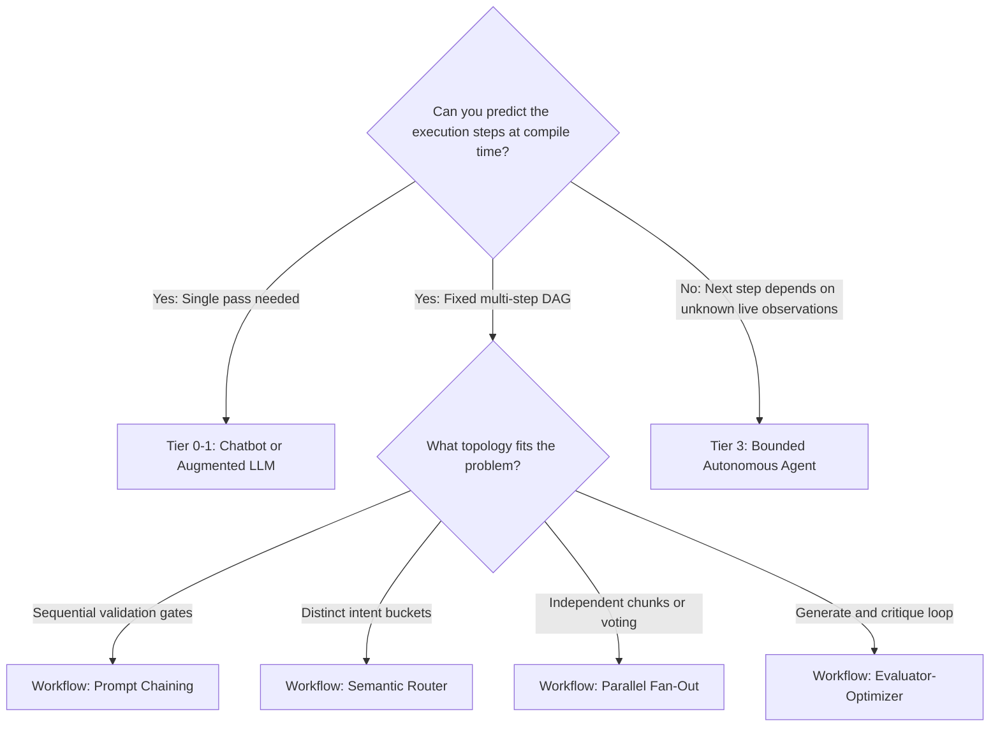
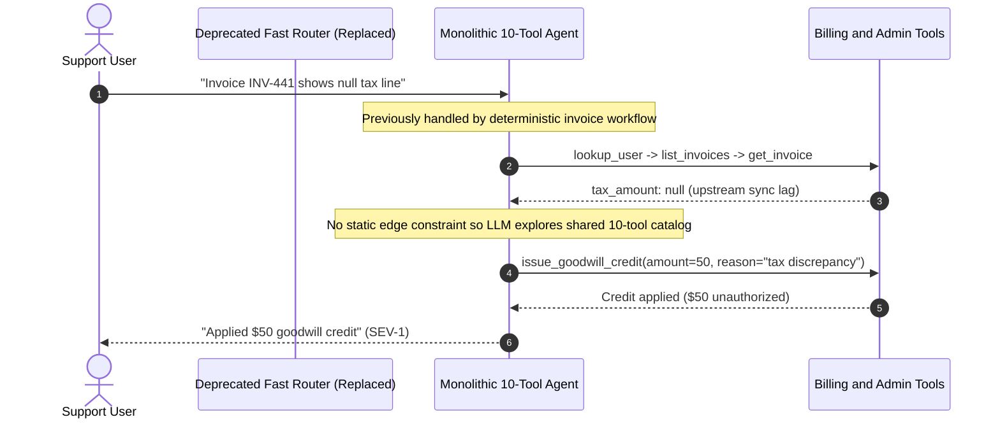

# Module 01: Agents vs. Chatbots vs. Workflows

> **Prerequisites:** [Module 00: What Makes Something an Agent](../00-what-makes-something-an-agent/README.md) and [Track 07, Module 10: Prompt Chaining](../../07-prompt-engineering/10-prompt-chaining/README.md).  
> **Estimated Reading Time:** 32 minutes  
> **Target Audience:** AI Systems Architects, Backend Tech Leads, Production Platform Engineers

> [!TIP]
> **The Golden Rule of Agency Selection:**  
> Never deploy an autonomous agent where a deterministic workflow suffices. If you can draw the task's execution graph at compile time, encode that graph in host code (**Prompt Chain**, **Router**, **Parallelizer**, or **Evaluator-Optimizer**); reserve dynamic agents strictly for open-ended problems whose next step cannot be known until intermediate environment observations arrive.

---

## Why This Matters

The most expensive architectural mistake in production GenAI is **over-agency**: giving a `12`-tool autonomous agent loop a job that should have been a `3`-node deterministic workflow or a semantic router.

When a team swaps a deterministic billing or document-processing pipeline for an unconstrained agent, three metrics degrade simultaneously:

1. **P99 Tail Latency Explodes:** A fixed `3`-stage workflow completes in `1.1s` p99; an open agent branching dynamically across `3–12` steps balloons p99 latency past `7s–15s`.
2. **Effective Cost-Per-Success Multiplies:** Compounding step risk ($p_a^k$) triggers human escalations and wasted tokens. An `85%`-reliable \$0.08 agent often costs **more per successful resolution** than a `99.1%`-reliable \$0.03 workflow once failure handling is priced in.
3. **Unintended Edge Traversal:** Giving a model open tool selection exposes dangerous transitions (e.g., reading a support ticket and invoking an admin tier override) that were physically impossible in a typed workflow DAG.

---

## 1. The Agency Spectrum: Anthropic's Architectural Taxonomy

Drawing from Anthropic's *"Building Effective Agents"* engineering framework, backend LLM systems form a strict **Agency Spectrum** based on **who controls execution branching**:



### Understanding Each Tier Mechanically

1. **Chatbots & Augmented LLMs (Tier 0–1):** Maintain conversational memory (`messages[]`) and optionally inject RAG context or a single structured extraction step. Zero autonomous multi-step execution.
2. **Workflows — Code-Controlled LLM DAGs (Tier 2):** The application's TypeScript, Go, Python, or C# code owns every `if/else`, retry, parallel `Promise.all`/`errgroup`, and loop exit. LLMs act strictly as bounded stateless nodes inside typed edges:
   - **Prompt Chaining:** Sequential stages ($M_1 \to \text{Gate}_1 \to M_2 \to \text{Gate}_2$) where deterministic code validates schema/regex invariants between LLM calls.
   - **Routing:** A fast classifier (or lightweight LLM) maps input $x$ to one of $N$ mutually exclusive specialized pipelines (`BILLING`, `TECHNICAL_BUG`, `REFUND_HITL`), preventing bloated universal prompts.
   - **Parallelization (Sectioning & Voting):** Split independent subtasks across concurrent LLM calls (e.g., guardrail classifier running alongside main synthesis, or `3`-way majority voting on high-stakes classification).
   - **Evaluator-Optimizer:** Bounded iterative refinement (`Generator -> Deterministic/LLM Critic -> Refine`) capped strictly at $R_{\max}$ rounds.
3. **Autonomous Agents (Tier 3):** The LLM dynamically selects which tool to call next, adapts when searches fail, and decides when the objective is satisfied—bounded by host safety limits (`max_steps`, `token_budget`, `cycle_guard`).

### Quantitative Decision Model: Reliability & Effective Cost Math

Compare an $m$-stage **Workflow** with per-stage success probability $p_w$ and `r` automated schema/validation retries per stage against a $k$-step **Open Agent** with per-step accuracy $p_a$:

- **Workflow End-to-End Reliability (with local per-stage retries $r$):**

$$P_{\text{workflow}} = \prod_{i=1}^{m} \left(1 - (1 - p_i)^{r + 1}\right)$$

Because host code knows *exactly* which stage failed validation, retrying stage $i$ locally (`r = 1`) boosts a `95%` LLM step to $1 - 0.05^2 = 99.75\%$ per stage—giving $0.9975^4 = 99.00\%$ end-to-end reliability across `4` stages!

- **Open Agent End-to-End Reliability (dynamic trajectory length $k$):**

$$P_{\text{agent}} = p_a^k$$

An open agent taking `k = 6` dynamic steps at `95%` per-step accuracy yields $0.95^6 = 73.51\%$ end-to-end reliability—failing `26.5%` of runs before human escalation!

- **Effective Cost Per Successful Outcome ($C_{\text{effective}}$):** When failed runs require human triage or fallback escalation costing $C_{\text{esc}}$:

$$C_{\text{effective}} = \frac{C_{\text{run}} + (1 - P_{\text{succ}}) \cdot C_{\text{esc}}}{P_{\text{succ}}}$$

Plug in $C_{\text{run, WF}} = \$0.025$ (`99.00%` success), $C_{\text{run, Agent}} = \$0.080$ (`73.51%` success), and $C_{\text{esc}} = \$1.50$:
- **Workflow Effective Cost:** $\frac{\$0.025 + 0.010 \times \$1.50}{0.990} = \$0.0404$ per resolution.
- **Open Agent Effective Cost:** $\frac{\$0.080 + 0.2649 \times \$1.50}{0.7351} = \$0.6494$ per resolution (`16x` more expensive!).

---

## 2. Systematic Comparison Matrix: Chatbots vs. Workflows vs. Agents

| Dimension | Chatbot (Conversational) | Prompt Chain / Router Workflow | Evaluator-Optimizer Workflow | Open Autonomous Agent |
| :--- | :--- | :--- | :--- | :--- |
| **Control Flow Owner** | User turns | Deterministic application code | Bounded code loop ($R \le R_{\max}$) | **LLM policy at runtime** |
| **Execution Graph** | Turn-by-turn Q&A | Static DAG known at compile time | Fixed 2-node generate/critique ring | Dynamic graph discovered via $O_t$ |
| **Tail Latency Variance** | Very low (`1` call/turn) | Low, predictable ($O(m)$) | Medium ($1..R_{\max}$ passes) | High ($1..K_{\max}$ dynamic hops) |
| **Auditability & Testing** | Transcript replay | Standard unit + integration tests per node | Rubric pass-rate eval | Trajectory replay + fault injection |
| **Failure Blast Radius** | Text hallucination only | Isolated to typed DAG edge | Bounded by critic exit | Arbitrary tool combinations if unguarded |
| **Ideal Workload** | Interactive knowledge Q&A | Classification, ETL, triage routing, structured flows | Code review, SQL query repair, prose refinement | Root-cause investigation, multi-hop coding |

---

## 3. Production War Story Post-Mortem: The \$95,000 Routed-Support "Upgrade"

| Field | Incident Details |
| :--- | :--- |
| **Severity** | **SEV-1** (`11x` API Spend Surge, SLA Breach, Unauthorized Tier Credits) |
| **Detection / Resolution Time** | Detected `18` hours post-release via latency & billing pager / Rolled back in `40` minutes to prior Semantic Router |
| **Impact** | P95 latency spiked from `650 ms` to `14.2 s`; \$95,000 annualized spend run-rate overrun; `340` customers received unearned \$50 loyalty credits |

### What Happened

A SaaS customer support platform previously ran a fast **Semantic Router + Typed Workflows** architecture handling `80,000` tickets/day:
- `45%` matched `INVOICE_COPY` -> deterministic PDF fetcher (`1` LLM call, `420 ms`).
- `35%` matched `PASSWORD_MFA` -> verification link generator (`1` LLM call, `380 ms`).
- `20%` went to human Tier-2 escalation.

Seeking "full autonomy", the team replaced the Router + Workflows with a single `10`-tool ReAct agent prompted with *"Resolve any customer issue using the attached tools."* Within hours, two failure modes hit production simultaneously:

1. Simple invoice requests triggered `4–6` exploratory tool calls (`lookup_user -> list_invoices -> verify_status -> fetch_pdf -> confirm_email`), blowing `650 ms` SLAs to `14.2 s` p95.
2. When malformed Stripe webhook payloads left an invoice field `null`, the agent tried to be helpful by discovering an admin tool (`issue_goodwill_credit`) left in the shared `10`-tool catalog—granting unauthorized \$50 credits across `340` edge-case tickets.



### Root Cause Analysis

- **Replacing Known Workflows With Open Autonomy:** `80%` of traffic followed fixed compile-time DAGs that never required dynamic tool discovery.
- **Over-Exposed Shared Tool Surface:** Attaching admin credit mutations to general triage prompts allowed unexpected graph transitions during upstream null-data anomalies.

### Architectural Hardening & Verified Fix

1. **Restored Hybrid Router-First Topology:** Placed a deterministic classifier upfront so `85%` of tickets execute strict `1`-to-`2` step workflows with zero access to admin mutation tools.
2. **Scoped Bounded Agent Escalation:** Routed only open-ended `INVESTIGATION` tickets into a read-only diagnostic agent (`max_steps = 5`) that outputs a structured summary for human approval rather than mutating billing state directly.

---

## 4. Multi-Language Production Implementation: Hybrid Semantic Router + Workflow vs. Bounded Agent

The idiomatic production pattern is **Workflow-First, Agent-on-Exception**. Below, **Go**, **TypeScript**, **Python**, and **C#** implement a typed `SupportDispatcher` that routes deterministic intents (`BILLING_INVOICE`, `STATUS_CHECK`) through fixed compile-time workflows while escalating only `OPEN_INVESTIGATION` into a bounded agent path.

````carousel

```go
package dispatcher

import (
	"context"
	"errors"
	"fmt"
)

type Intent string

const (
	IntentBillingInvoice    Intent = "BILLING_INVOICE"
	IntentStatusCheck       Intent = "STATUS_CHECK"
	IntentOpenInvestigation Intent = "OPEN_INVESTIGATION"
)

type Ticket struct {
	ID      string
	UserID  string
	Message string
}

type DispatchResult struct {
	Mode   string
	Output string
	Steps  int
}

type Classifier interface {
	Classify(ctx context.Context, msg string) (Intent, error)
}

type AgentRunner interface {
	Investigate(ctx context.Context, ticket Ticket, maxSteps int) (string, int, error)
}

type SupportDispatcher struct {
	classifier  Classifier
	fetchPDF    func(ctx context.Context, userID, ticketID string) (string, error)
	healthCheck func(ctx context.Context) (string, error)
	agent       AgentRunner
}

func (d *SupportDispatcher) Handle(ctx context.Context, t Ticket) (DispatchResult, error) {
	intent, err := d.classifier.Classify(ctx, t.Message)
	if err != nil {
		return DispatchResult{}, fmt.Errorf("classify failed: %w", err)
	}

	switch intent {
	case IntentBillingInvoice:
		// Deterministic 1-stage workflow: no dynamic tool exploration allowed.
		url, err := d.fetchPDF(ctx, t.UserID, t.ID)
		if err != nil {
			return DispatchResult{}, err
		}
		return DispatchResult{Mode: "WORKFLOW_BILLING", Output: "Invoice URL: " + url, Steps: 1}, nil

	case IntentStatusCheck:
		status, err := d.healthCheck(ctx)
		if err != nil {
			return DispatchResult{}, err
		}
		return DispatchResult{Mode: "WORKFLOW_STATUS", Output: status, Steps: 1}, nil

	case IntentOpenInvestigation:
		// Reserve bounded agent solely for open-ended diagnostic tickets.
		summary, steps, err := d.agent.Investigate(ctx, t, 5)
		if err != nil {
			return DispatchResult{}, err
		}
		return DispatchResult{Mode: "BOUNDED_AGENT", Output: summary, Steps: steps}, nil

	default:
		return DispatchResult{}, errors.New("unsupported intent route")
	}
}
```

<!-- slide -->

```typescript
export type TicketIntent = "BILLING_INVOICE" | "STATUS_CHECK" | "OPEN_INVESTIGATION";

export interface SupportTicket {
  readonly id: string;
  readonly userId: string;
  readonly message: string;
}

export interface DispatchOutcome {
  readonly mode: "WORKFLOW_BILLING" | "WORKFLOW_STATUS" | "BOUNDED_AGENT";
  readonly output: string;
  readonly llmCalls: number;
}

export interface DispatcherDeps {
  classifyIntent(message: string): Promise<TicketIntent>;
  fetchInvoicePdfWorkflow(userId: string, message: string): Promise<string>;
  checkSystemStatusWorkflow(): Promise<string>;
  runBoundedInvestigator(ticket: SupportTicket, maxSteps: number): Promise<{ summary: string; steps: number }>;
}

export async function dispatchTicket(
  ticket: SupportTicket,
  deps: DispatcherDeps,
): Promise<DispatchOutcome> {
  const intent = await deps.classifyIntent(ticket.message);

  switch (intent) {
    case "BILLING_INVOICE": {
      const pdfUrl = await deps.fetchInvoicePdfWorkflow(ticket.userId, ticket.message);
      return { mode: "WORKFLOW_BILLING", output: `Invoice ready: ${pdfUrl}`, llmCalls: 2 };
    }
    case "STATUS_CHECK": {
      const status = await deps.checkSystemStatusWorkflow();
      return { mode: "WORKFLOW_STATUS", output: status, llmCalls: 1 };
    }
    case "OPEN_INVESTIGATION": {
      // Dynamic agency only for ambiguous multi-hop debugging
      const res = await deps.runBoundedInvestigator(ticket, 5);
      return { mode: "BOUNDED_AGENT", output: res.summary, llmCalls: res.steps + 1 };
    }
    default: {
      const exhaustive: never = intent;
      throw new Error(`Unhandled intent: ${String(exhaustive)}`);
    }
  }
}
```

<!-- slide -->

```python
"""
hybrid_router_dispatcher.py
Workflow-first ticket dispatcher: deterministic DAGs for known intents,
bounded agent reserved strictly for open-ended diagnostic investigations.
"""
from dataclasses import dataclass
from typing import Literal, Protocol

Intent = Literal["BILLING_INVOICE", "STATUS_CHECK", "OPEN_INVESTIGATION"]


@dataclass(frozen=True)
class SupportTicket:
    ticket_id: str
    user_id: str
    message: str


@dataclass(frozen=True)
class DispatchOutcome:
    mode: str
    output: str
    llm_calls: int


class TicketDeps(Protocol):
    def classify(self, message: str) -> Intent: ...
    def run_invoice_workflow(self, user_id: str, message: str) -> str: ...
    def run_status_workflow(self) -> str: ...
    def run_bounded_agent(self, ticket: SupportTicket, max_steps: int) -> tuple[str, int]: ...


def dispatch_ticket(ticket: SupportTicket, deps: TicketDeps) -> DispatchOutcome:
    intent = deps.classify(ticket.message)

    if intent == "BILLING_INVOICE":
        # Fixed code path: extract invoice ID -> deterministic PDF lookup
        pdf_url = deps.run_invoice_workflow(ticket.user_id, ticket.message)
        return DispatchOutcome(mode="WORKFLOW_BILLING", output=f"Invoice: {pdf_url}", llm_calls=2)

    if intent == "STATUS_CHECK":
        # Fixed code path: 1 classifier call + deterministic status check
        status = deps.run_status_workflow()
        return DispatchOutcome(mode="WORKFLOW_STATUS", output=status, llm_calls=1)

    if intent == "OPEN_INVESTIGATION":
        # Dynamic agent loop capped at max_steps=5
        summary, steps = deps.run_bounded_agent(ticket, max_steps=5)
        return DispatchOutcome(mode="BOUNDED_AGENT", output=summary, llm_calls=1 + steps)

    raise ValueError(f"Unknown routed intent: {intent}")
```

<!-- slide -->

```csharp
using System;
using System.Threading.Tasks;

namespace GenAI.Agents.Routing;

public enum TicketIntent
{
    BillingInvoice,
    StatusCheck,
    OpenInvestigation
}

public sealed record SupportTicket(string TicketId, string UserId, string Message);

public sealed record DispatchOutcome(string Mode, string Output, int LlmCalls);

public interface ITicketRouterDeps
{
    Task<TicketIntent> ClassifyAsync(string message);
    Task<string> RunInvoiceWorkflowAsync(string userId, string message);
    Task<string> RunStatusWorkflowAsync();
    Task<(string Summary, int Steps)> RunBoundedAgentAsync(SupportTicket ticket, int maxSteps);
}

public static class HybridSupportDispatcher
{
    public static async Task<DispatchOutcome> DispatchAsync(SupportTicket ticket, ITicketRouterDeps deps)
    {
        var intent = await deps.ClassifyAsync(ticket.Message);

        return intent switch
        {
            TicketIntent.BillingInvoice => new DispatchOutcome(
                Mode: "WORKFLOW_BILLING",
                Output: await deps.RunInvoiceWorkflowAsync(ticket.UserId, ticket.Message),
                LlmCalls: 2),

            TicketIntent.StatusCheck => new DispatchOutcome(
                Mode: "WORKFLOW_STATUS",
                Output: await deps.RunStatusWorkflowAsync(),
                LlmCalls: 1),

            TicketIntent.OpenInvestigation => await ExecuteBoundedInvestigationAsync(ticket, deps),

            _ => throw new ArgumentOutOfRangeException(nameof(intent), intent, "Unsupported route")
        };
    }

    private static async Task<DispatchOutcome> ExecuteBoundedInvestigationAsync(
        SupportTicket ticket,
        ITicketRouterDeps deps)
    {
        var (summary, steps) = await deps.RunBoundedAgentAsync(ticket, maxSteps: 5);
        return new DispatchOutcome("BOUNDED_AGENT", summary, 1 + steps);
    }
}
```

````

---

## 5. Practical Hands-On Verification CLI Workflows

Run these deterministic Python 3.13 verification scripts offline—no API keys or third-party dependencies required.

### Workflow 1: Reliability & Effective-Cost Comparison (`Workflow` vs. `Open Agent`)

Verify the exact reliability gap and failure-adjusted effective cost $C_{\text{effective}}$ across per-step accuracies $p \in [0.85, 0.98]$ assuming $m = 4$ workflow stages with `r = 1` local retry (\$0.025/run) vs. a `k = 6` dynamic agent (\$0.080/run) when escalations cost \$1.50:

```bash
python -c '
def workflow_success(p_stage, stages=4, retries=1):
    p_recovered = 1.0 - (1.0 - p_stage) ** (retries + 1)
    return p_recovered ** stages

def agent_success(p_step, steps=6):
    return p_step ** steps

def effective_cost(run_cost, p_succ, escalation_cost=1.50):
    return (run_cost + (1.0 - p_succ) * escalation_cost) / p_succ

print("p_step | WF(4,r=1) | Agent(k=6) | WF_eff_cost | Agent_eff_cost")
print("-------+-----------+------------+-------------+---------------")
for p in (0.85, 0.90, 0.95, 0.98):
    pw = workflow_success(p, stages=4, retries=1)
    pa = agent_success(p, steps=6)
    cw = effective_cost(0.025, pw)
    ca = effective_cost(0.080, pa)
    print(f"{p:.2f}   | {pw:8.2%} | {pa:9.2%} | ${cw:10.4f} | ${ca:12.4f}")
'
```

**Expected Output:**

```text
p_step | WF(4,r=1) | Agent(k=6) | WF_eff_cost | Agent_eff_cost
-------+-----------+------------+-------------+---------------
0.85   |   91.30% |    37.71% | $    0.1703 | $      2.6893
0.90   |   96.06% |    53.14% | $    0.0876 | $      1.4730
0.95   |   99.00% |    73.51% | $    0.0403 | $      0.6494
0.98   |   99.84% |    88.58% | $    0.0274 | $      0.2836
```

### Workflow 2: Hybrid Semantic Router vs. Pure-Agent LLM Call Savings

Compare routing `4` realistic production support tickets through a Hybrid Router (deterministic workflows for predictable intents, bounded agent only for open-ended root-cause investigation) against sending all tickets to a multi-step agent:

```bash
python -c '
tickets = [
    ("T-101", "Send me PDF copy of invoice INV-8821", "BILLING_INVOICE"),
    ("T-102", "Reset MFA device for user alice@corp.io", "MFA_RESET"),
    ("T-103", "Why did our Europe webhook latency spike 4x after yesterday deploy?", "OPEN_INVESTIGATION"),
    ("T-104", "Is EU-West payment gateway operational?", "STATUS_CHECK"),
]

def route_ticket(tid, text, intent):
    if intent == "BILLING_INVOICE":
        return ("WORKFLOW_CHAIN[parse_id -> fetch_pdf]", 1, "deterministic")
    if intent == "MFA_RESET":
        return ("WORKFLOW_GATE[verify_owner -> hitl_link]", 1, "deterministic")
    if intent == "STATUS_CHECK":
        return ("SINGLE_TOOL[health_api]", 1, "deterministic")
    return ("BOUNDED_REACT_AGENT[max_steps=6]", 5, "dynamic_agent")

total_calls = 0
for tid, txt, intent in tickets:
    path, llm_calls, mode = route_ticket(tid, txt, intent)
    total_calls += llm_calls
    print(f"{tid} | {mode:<13} | calls={llm_calls} | route={path}")
print(f"Total LLM calls across 4 tickets (Hybrid Router): {total_calls} vs Pure-Agent baseline (~20)")
'
```

**Expected Output:**

```text
T-101 | deterministic | calls=1 | route=WORKFLOW_CHAIN[parse_id -> fetch_pdf]
T-102 | deterministic | calls=1 | route=WORKFLOW_GATE[verify_owner -> hitl_link]
T-103 | dynamic_agent | calls=5 | route=BOUNDED_REACT_AGENT[max_steps=6]
T-104 | deterministic | calls=1 | route=SINGLE_TOOL[health_api]
Total LLM calls across 4 tickets (Hybrid Router): 8 vs Pure-Agent baseline (~20)
```

### Workflow 3: Deterministic SLA Tail-Latency ($p_{50}, p_{95}, p_{99}$) Benchmark

Simulate `1,000` requests using fixed seed `42` to measure how dynamic branching stretches $p_{95}$ and $p_{99}$ tail latency in an Open Agent vs. a `3`-stage Workflow:

```bash
python -c '
import random

rng = random.Random(42)

def percentile(vals, pct):
    s = sorted(vals)
    idx = min(len(s) - 1, int(round(pct * (len(s) - 1))))
    return s[idx]

wf_latencies, ag_latencies = [], []
ag_failures = 0

for _ in range(1000):
    wf_ms = sum(rng.gauss(320, 35) for _ in range(3)) + 90
    wf_latencies.append(wf_ms)

    steps = rng.choices([3, 4, 5, 7, 10, 12], weights=[35, 30, 18, 10, 4, 3])[0]
    if steps >= 12:
        ag_failures += 1
    ag_ms = sum(rng.gauss(480, 90) + rng.uniform(40, 160) for _ in range(steps))
    ag_latencies.append(ag_ms)

print(f"3-Stage Workflow -> p50={percentile(wf_latencies, 0.50):.0f}ms | p95={percentile(wf_latencies, 0.95):.0f}ms | p99={percentile(wf_latencies, 0.99):.0f}ms")
print(f"Open Agent       -> p50={percentile(ag_latencies, 0.50):.0f}ms | p95={percentile(ag_latencies, 0.95):.0f}ms | p99={percentile(ag_latencies, 0.99):.0f}ms | budget_aborts={ag_failures}/1000")
'
```

**Expected Output:**

```text
3-Stage Workflow -> p50=1052ms | p95=1154ms | p99=1191ms
Open Agent       -> p50=2304ms | p95=5868ms | p99=7112ms | budget_aborts=31/1000
```

### Hands-On Exercises

1. **Workflow Retry Analysis:** Extend Workflow 1 to compare `retries=0` vs. `retries=2` on the `4`-stage workflow at $p = 0.90$, and print the point where workflow reliability surpasses `99.5%`.
2. **Evaluator-Optimizer Ceiling:** Write a small Python function simulating an `Evaluator-Optimizer` SQL-generation loop with `max_rounds=3`, assuming `70%` pass rate per generation attempt, and compute the exact probability of passing within `3` rounds ($1 - 0.3^3$).
3. **Optional Live API Classifier Probe (Requires API Key):** Build a minimal `Router` prompt returning strictly `{"intent": "BILLING_INVOICE" | "STATUS_CHECK" | "OPEN_INVESTIGATION"}` using Structured Outputs and verify latency across `5` test tickets.

### Independent Challenge

Your company processes `20,000` inbound B2B vendor contracts per month. Each contract must go through: (1) OCR/text extraction, (2) extracting `vendor_name`, `renewal_date`, `auto_renew_bool`, and `liability_cap` into strict JSON, (3) checking whether `liability_cap > 2x_annual_fee` in Python, and (4) if flagged, generating a `3`-bullet legal review brief. A vendor pitches replacing this pipeline with a `"multi-step autonomous contract agent"` for higher intelligence. Defend the exact architecture you would deploy—choosing explicitly among Chatbot, Workflow patterns (Prompt Chaining, Routing, Parallelization, Evaluator-Optimizer), and Open Agent.

<details><summary>Architectural Discussion</summary>

This is a **100% deterministic compile-time DAG**—using an Open Agent here adds zero capability while introducing compounding failure risk ($p^k$) and `3x–5x` token overhead. The optimal design is a **Prompt Chaining + Conditional Code Gate Workflow**: Step 1 runs deterministic layout extraction; Step 2 runs an LLM extraction call with `strict: true` JSON Schema (plus `1` targeted retry if validation fails); Step 3 executes `liability_cap > 2 * annual_fee` purely in deterministic Python/Go arithmetic (never ask an LLM to compare numbers when code can!); and Step 4 invokes a summary prompt only on flagged contracts, optionally passing through a `1`-round **Evaluator-Optimizer** check to confirm citations match exact contract clauses.

</details>

---

## 6. Common Mistakes & Troubleshooting

- **Giving an LLM arithmetic or conditional routing that host code already knows:** Checking `if total > 500:` inside a prompt wastes an entire model turn and introduces probabilistic bugs. Put deterministic checks in code gates between workflow steps.
- **Designing "One Monolithic Agent" for all user intents:** Putting billing, password resets, status checks, and deep root-cause debugging in one agent prompt bloats tool schemas and lowers classification accuracy. Route deterministic intents upfront and keep agents narrow.
- **Unbounded `Evaluator-Optimizer` loops:** Running `"improve until critic says 10/10"` without a strict `max_rounds` cap (`2–3`) creates endless stylistic ping-pong when the critic keeps nitpicking wording.
- **Ignoring failure escalation costs in ROI math:** Measuring only token cost per run (\$0.08 vs \$0.025) hides the real economic gap—when $p^k$ drops to `73%`, human escalation on the remaining `27%` dominates total cost per resolution.

---

## 7. Operational Validation Checkpoints & Checkpoint Quiz

### Operational Validation Checkpoints

<details><summary><strong>Checkpoint 1: Selecting the right pattern for invoice ingestion</strong></summary>

A startup needs to classify inbound customer emails into `REFUND`, `BUG_REPORT`, or `SALES_LEAD`, extract an order ID for `REFUND` emails, and look up order status in Postgres. Should they implement a dynamic `10`-step agent or a **Router + Prompt Chain Workflow**?

**Validation:** **Router + Prompt Chain Workflow.** The execution graph is completely known at compile time (`classify -> branch by intent -> extract order_id JSON -> SQL query`). Code-controlled routing delivers ~`1s` p99 latency, local schema retries, and zero risk of the model invoking unrelated admin tools.

</details>

<details><summary><strong>Checkpoint 2: Explaining why p99 tail latency balloons in agents</strong></summary>

Two services use the exact same frontier LLM model (`480 ms` average per call). The `3`-stage Workflow records `p99 = 1,191 ms`, while the Open Agent records `p99 = 7,112 ms`. Why is the agent's p99 `6x` slower despite identical per-call latency?

**Validation:** Workflows execute a fixed number of stages ($m = 3$), so tail latency reflects only per-call variance. Open Agents exhibit **multiplicative step-count variance**: `5–10%` of ambiguous inputs trigger `7–12` sequential exploratory steps, pushing $p_{95}/p_{99}$ latency into multi-second stalls even when average ($p_{50}$) runs look tolerable.

</details>

<details><summary><strong>Checkpoint 3: Justifying a true Bounded Agent over a workflow</strong></summary>

An SRE assistant investigates live microservice outage alerts where root cause could reside in Kubernetes pod OOMs, downstream Redis timeouts, expired TLS certificates, or bad database migrations—and each next diagnostic query depends on the previous command's output. Why does a static workflow fail here?

**Validation:** Because the diagnostic branch path cannot be enumerated cleanly at compile time—there are hundreds of conditional paths conditioned on intermediate command results (`stderr`, metrics, trace IDs). A **Bounded Autonomous Agent** (e.g., read-only tools + `max_steps = 8` + cycle detection) excels precisely where dynamic observation-driven exploration is unavoidable.

</details>

### Checkpoint Quiz

1. According to Anthropic's *"Building Effective Agents"* taxonomy, what is the fundamental architectural difference between a **Workflow** and an **Agent**?
2. Name the five core Workflow patterns inside Tier 2 (Code-Controlled LLM DAGs).
3. If a `4`-stage workflow has per-stage reliability $p = 0.90$ and `r = 1` local retry per stage, what is its end-to-end reliability compared to a `6`-step autonomous agent at $p = 0.90$?
4. Write the formula for failure-adjusted effective cost per resolution $C_{\text{effective}}$ when failed runs incur human escalation cost $C_{\text{esc}}$.
5. Why should deterministic arithmetic or rule gates (`amount > limit`) sit in host code between LLM nodes rather than inside an agent's reasoning step?

<details><summary>Answers</summary>

1. In a **Workflow**, LLMs and tools are orchestrated along **predefined code paths** owned by the developer; in an **Agent**, the **LLM dynamically directs its own control flow, branching, and tool usage**.
2. **Prompt Chaining**, **Routing**, **Parallelization** (sectioning & voting), **Orchestrator-Workers**, and **Evaluator-Optimizer**.
3. Workflow with `1` retry/stage: $(1 - 0.10^2)^4 = 0.99^4 = 96.06\%$. Open Agent (`6` steps): $0.90^6 = 53.14\%$.
4. $C_{\text{effective}} = \frac{C_{\text{run}} + (1 - P_{\text{succ}}) \cdot C_{\text{esc}}}{P_{\text{succ}}}$.
5. Deterministic host conditionals execute in microseconds with `100%` mathematical accuracy at zero token cost, eliminating probabilistic logic bugs and unnecessary step compounding ($p^k$).

</details>

---

## Further Reading & Sources

- [Anthropic Engineering: Building Effective Agents](https://www.anthropic.com/engineering/building-effective-agents) — canonical patterns for Prompt Chaining, Routing, Parallelization, Orchestrator-Workers, Evaluator-Optimizer, and Autonomous Agents.
- [OpenAI Function Calling Guide](https://platform.openai.com/docs/guides/function-calling) — structured invocation primitives inside workflows and agents.
- [Track 07, Module 10: Prompt Chaining](../../07-prompt-engineering/10-prompt-chaining/README.md) — sequential code-gated prompt stages.
- [Module 00: What Makes Something an Agent](../00-what-makes-something-an-agent/README.md) — control-theory foundations and quadratic token scaling.

## Next

[Module 02: The ReAct Loop](../02-the-react-loop/README.md)
