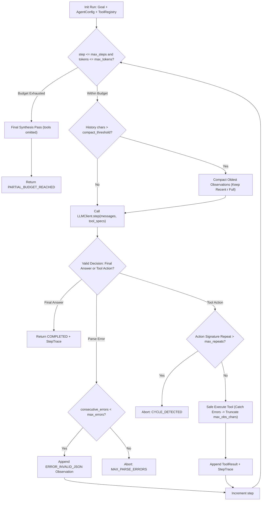
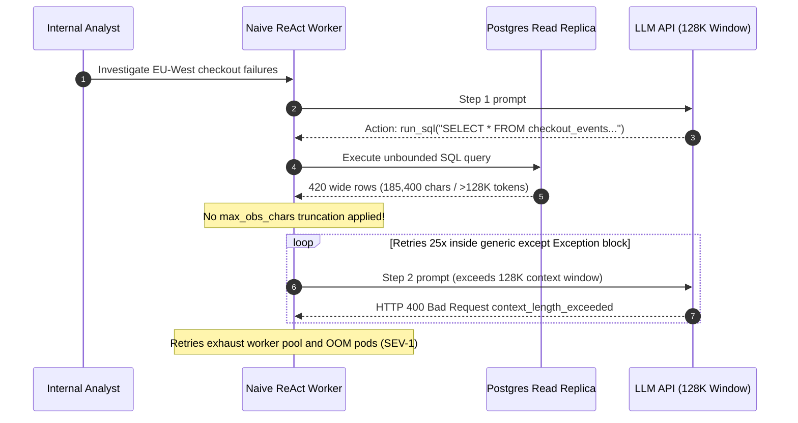

# Module 03: Building a ReAct Agent From Scratch

> **Prerequisites:** [Module 02: The ReAct Loop](../02-the-react-loop/README.md) and [Track 06, Module 06: Function Calling Basics](../../06-openai-and-the-model-landscape/06-function-calling-basics/README.md).  
> **Estimated Reading Time:** 38 minutes  
> **Target Audience:** Backend Software Engineers, Systems Engineers, AI Infrastructure Builders

> [!TIP]
> **The Golden Rule of Hand-Built Agents:**  
> Before touching any agent framework in Track 11, write your own pure-code ReAct dispatcher first. A production ReAct engine is roughly `120` lines of deterministic state machine: `ToolRegistry` dispatch that catches exceptions into structured observations, strict `max_obs_chars` truncation, action-cycle hashing, budget-triggered forced synthesis (`tools=None`), and a pluggable `LLMClient` interface testable offline with zero API calls.

---

## Why This Matters

When teams jump straight into high-level agent frameworks without building one by hand, every production incident becomes a black box: *Why did the agent hang for `45` seconds? Why did context blow up on step 3? Why did a single bad JSON argument crash the worker pod instead of letting the LLM self-correct?*

In reality, a framework-free ReAct runtime is nothing more than a deterministic `for step in 1..max_steps` loop managing six concrete invariants:

1. **Non-Throwing Tool Dispatch:** Database timeouts, `KeyError`s, and schema validation errors must be caught and serialized back as structured `Observation` strings—allowing the policy to recover on the next turn instead of throwing HTTP `500`.
2. **Observation Size Bounds & Compaction:** One un-truncated `185KB` SQL dump or webpage scrape blows past `128K` context windows instantaneously.
3. **Malformed Output Recovery:** If the model emits invalid JSON arguments, send back an explicit `ERROR_INVALID_JSON` observation (bounded by `max_consecutive_errors`) so it fixes syntax on the retry.
4. **Cycle Detection:** Hash `(tool, canonical_args)` to break identical loops early.
5. **Budget Exhaustion Forced Synthesis:** When `max_steps` or `max_input_tokens` trips, strip `tools` and make one final synthesis call so the user gets a grounded partial report instead of a cold abort.
6. **Offline Deterministic Testability:** Decoupling `LLMClient` lets CI test edge cases (`bad_json`, `unknown_tool`, `huge_obs`, `cycle_loop`) in `2 ms` with a local scripted policy.

---

## 1. Architecture of a Zero-Framework Production ReAct Engine



### The 6 Core Modules of the Hand-Built Runtime

1. **Immutable `AgentConfig`:** Pins `max_steps = 8`, `max_input_tokens = 32_000`, `max_obs_chars = 2_000`, `max_consecutive_errors = 3`, and `max_repeats = 2`.
2. **`ToolRegistry` & Non-Throwing Envelope:** Maps `tool_name -> ToolEntry(handler, schema, timeout_ms)`. Unlisted tool names return `ERROR_UNKNOWN_TOOL` listing permitted names so the LLM immediately self-corrects.
3. **Observation Truncation & Sliding Compaction:**
   - **Per-Observation Truncation:** Any observation exceeding `max_obs_chars` keeps `head + tail` around an explicit `...[TRUNCATED N CHARS]...` marker so critical opening keys and final error lines survive.
   - **History Compaction:** Once cumulative scratchpad size exceeds `0.75 * W_cap`, older observations beyond the most recent `r = 2` turns are compressed into short `1`-line digests (`"[Step 1 search_catalog -> 120.0 USD]"`), bounding worst-case prompt growth.
4. **Worst-Case Spend Bound:** Under capped observation size $O_{\max}$ and sliding context cap $W_{\text{cap}}$, total run cost is strictly upper-bounded:

$$C_{\max} \le K_{\max} \cdot \left(\min\left(P_0 + \frac{K_{\max}-1}{2}\Delta_{\max},\; W_{\text{cap}}\right) \cdot c_{\text{in}} + D_{\max} \cdot c_{\text{out}}\right)$$

5. **Decoupled `LLMClient` Interface:** Both production OpenAI/Anthropic HTTP adapters and deterministic in-memory scripted policies implement the exact same `step(messages, tools) -> AgentTurn` signature.
6. **`StepTrace` Telemetry Ledger:** Every iteration appends an immutable `StepTrace(step, thought, tool_name, args_hash, duration_ms, ok, truncated)` record for post-mortem replay and regression evals.

---

## 2. Systematic Comparison Matrix: Naive Loop vs. Hand-Built Engine vs. Framework

| Capability | Naive Tutorial `while True` | Hand-Built Production Engine (This Module) | Heavyweight Agent Framework (Track 11) |
| :--- | :--- | :--- | :--- |
| **Dependencies** | HTTP SDK only | **Zero extra runtime deps (~120–180 LOC)** | Large dependency graph + abstraction layers |
| **Tool Error Handling** | Unhandled exception crashes app | Structured `Observation` error envelope | Built-in wrappers (often hide raw payloads) |
| **Observation Size Safety** | Unbounded -> context `400` crash | Hard `head + tail` truncation + compaction | Configurable middleware / state reducers |
| **Loop & Cycle Guard** | None (infinite retry risk) | Action signature hash + `max_steps` + `max_tokens` | Graph recursion limit (`recursion_limit`) |
| **Unit Testing / Replay** | Requires live LLM API calls | **100% deterministic mock `LLMClient` in ms** | Mock LLMs + snapshot checkpointers |
| **Debugging Transparency** | `print()` statements | Exact line-by-line control over `messages[]` | Callbacks / tracing hooks required |

---

## 3. Production War Story Post-Mortem: The 185-KB SQL Dump Context-Overflow Crash Loop

| Field | Incident Details |
| :--- | :--- |
| **Severity** | **SEV-1** (Worker Pod OOMs & `1,400` Dropped Analytics Queue Jobs) |
| **Detection / Resolution Time** | Detected `11` minutes post-deploy via Kubernetes `OOMKilled` pager / Fixed in `45` minutes with hard observation truncation |
| **Impact** | `1,400` pending internal BI queries dropped; `25` failed retries per poisoned query exhausted worker pool concurrency |

### What Happened

An internal analytics team wrote a `45`-line ReAct Python script giving an LLM read-only access to Postgres via `run_sql(query)`. An analyst asked: *"Why did enterprise checkout failures jump in EU-West yesterday?"*

The model generated a reasonable exploratory query—without adding `LIMIT`: `SELECT * FROM checkout_events WHERE region='EU-WEST' AND status='FAILED'`. Postgres returned `420` wide JSON rows totaling `185,400` characters (`~52,000` tokens on a single observation—or `~140K` tokens combined with long stack-trace blobs!).

On step `2`, the dispatcher blindly concatenated that raw `185KB` string into `messages` and called the LLM API (`128K` context limit). The API returned `HTTP 400 Bad Request: context_length_exceeded`. Worse, the worker wrapped the API call in a generic `except Exception: continue` retry loop without decrementing a valid retry budget or inspecting error classes—retrying the exact oversized `185KB` payload `25` times across pods until memory spikes and queue backpressure crashed the service.



### Root Cause Analysis

- **Unbounded Observation Serialization:** Passing un-truncated SQL/HTTP outputs straight into `messages` violates context window ceilings.
- **Blind Exception Retrying:** Retrying `400 Bad Request` (non-transient payload error) as if it were a `429` rate limit caused deterministic crash amplification.

### Architectural Hardening & Verified Fix

1. **Mandatory Host Observation Truncation:** Enforced `max_obs_chars = 2_000` inside the tool dispatcher, slicing oversized payloads cleanly (`head + ...[TRUNCATED N CHARS]... + tail`) and advising the model to narrow queries with `LIMIT 20` or `COUNT(*)`.
2. **Non-Retryable HTTP 4xx Classification:** Separated transient `429`/`5xx` transport retries from terminal `400` payload errors, triggering immediate observation compaction on context pressure instead of blind retry.

---

## 4. Multi-Language Production Implementation: Complete Zero-Framework ReAct Dispatcher

Below is a full, self-contained **Hand-Built ReAct Dispatcher** in **Go**, **TypeScript**, **Python**, and **C#** featuring `AgentConfig`, `ToolRegistry`, exception-to-observation capture, `head + tail` truncation, action-signature cycle guards, `StepTrace` logging, and pluggable `LLMClient`.

````carousel

```go
package reactengine

import (
	"crypto/sha256"
	"encoding/hex"
	"encoding/json"
	"fmt"
	"sort"
	"strings"
)

type AgentConfig struct {
	MaxSteps             int
	MaxObsChars          int
	MaxRepeats           int
	MaxConsecutiveErrors int
}

type Message struct {
	Role    string `json:"role"`
	Content string `json:"content"`
}

type ToolCall struct {
	Name string         `json:"name"`
	Args map[string]any `json:"args"`
}

type ModelTurn struct {
	Thought     string    `json:"thought"`
	Action      *ToolCall `json:"action,omitempty"`
	FinalAnswer *string   `json:"final_answer,omitempty"`
	ParseError  string    `json:"-"`
}

type LLMClient interface {
	Step(messages []Message, toolNames []string) (ModelTurn, error)
}

type ToolFunc func(args map[string]any) (string, error)

type StepTrace struct {
	Step      int
	Thought   string
	ToolName  string
	Ok        bool
	Truncated bool
}

type AgentResult struct {
	Status string
	Answer string
	Traces []StepTrace
}

func TruncateObservation(raw string, maxChars int) (string, bool) {
	if len(raw) <= maxChars || maxChars < 60 {
		return raw, false
	}
	half := maxChars/2 - 18
	omitted := len(raw) - 2*half
	return fmt.Sprintf("%s...[TRUNCATED %d CHARS]...%s", raw[:half], omitted, raw[len(raw)-half:]), true
}

func actionHash(tc ToolCall) string {
	b, _ := json.Marshal(tc)
	sum := sha256.Sum256(b)
	return hex.EncodeToString(sum[:5])
}

func RunReactAgent(goal string, cfg AgentConfig, llm LLMClient, tools map[string]ToolFunc) AgentResult {
	messages := []Message{{Role: "user", Content: goal}}
	toolNames := make([]string, 0, len(tools))
	for k := range tools {
		toolNames = append(toolNames, k)
	}
	sort.Strings(toolNames)

	seen := make(map[string]int)
	var traces []StepTrace
	errStreak := 0

	for step := 1; step <= cfg.MaxSteps; step++ {
		turn, err := llm.Step(messages, toolNames)
		if err != nil || turn.ParseError != "" {
			errStreak++
			if errStreak >= cfg.MaxConsecutiveErrors {
				return AgentResult{Status: "ABORT_PARSE_ERRORS", Traces: traces}
			}
			messages = append(messages, Message{Role: "tool", Content: "ERROR_INVALID_OUTPUT: emit valid Thought + Action/FinalAnswer"})
			continue
		}
		if turn.FinalAnswer != nil {
			traces = append(traces, StepTrace{Step: step, Thought: turn.Thought, Ok: true})
			return AgentResult{Status: "COMPLETED", Answer: *turn.FinalAnswer, Traces: traces}
		}
		if turn.Action == nil {
			errStreak++
			continue
		}

		sig := actionHash(*turn.Action)
		seen[sig]++
		if seen[sig] > cfg.MaxRepeats {
			return AgentResult{Status: "ABORT_CYCLE_DETECTED", Traces: traces}
		}

		fn, exists := tools[turn.Action.Name]
		var obs string
		ok := true
		if !exists {
			ok = false
			obs = fmt.Sprintf("ERROR_UNKNOWN_TOOL: %s. Available: %s", turn.Action.Name, strings.Join(toolNames, ", "))
		} else {
			res, execErr := fn(turn.Action.Args)
			if execErr != nil {
				ok = false
				obs = "ERROR_TOOL_EXEC: " + execErr.Error()
			} else {
				obs = res
			}
		}

		if ok {
			errStreak = 0
		} else {
			errStreak++
		}
		clipped, truncated := TruncateObservation(obs, cfg.MaxObsChars)
		traces = append(traces, StepTrace{Step: step, Thought: turn.Thought, ToolName: turn.Action.Name, Ok: ok, Truncated: truncated})
		rawTurn, _ := json.Marshal(turn)
		messages = append(messages, Message{Role: "assistant", Content: string(rawTurn)}, Message{Role: "tool", Content: clipped})
		if errStreak >= cfg.MaxConsecutiveErrors {
			return AgentResult{Status: "ABORT_TOOL_ERRORS", Traces: traces}
		}
	}
	return AgentResult{Status: "ABORT_MAX_STEPS", Traces: traces}
}
```

<!-- slide -->

```typescript
import { createHash } from "node:crypto";

export interface AgentConfig {
  readonly maxSteps: number;
  readonly maxObsChars: number;
  readonly maxRepeats: number;
  readonly maxConsecutiveErrors: number;
}

export interface ChatMessage {
  readonly role: "user" | "assistant" | "tool";
  readonly content: string;
}

export interface ToolAction {
  readonly tool: string;
  readonly args: Record<string, unknown>;
}

export interface ModelTurn {
  readonly thought: string;
  readonly action?: ToolAction;
  readonly finalAnswer?: string;
}

export interface StepTrace {
  readonly step: number;
  readonly thought: string;
  readonly toolName?: string;
  readonly ok: boolean;
  readonly truncated: boolean;
}

export type ToolHandler = (args: Record<string, unknown>) => Promise<string> | string;

export interface LLMClient {
  step(messages: readonly ChatMessage[], availableTools: readonly string[]): Promise<ModelTurn>;
}

export function truncateObservation(raw: string, maxChars: number): { text: string; truncated: boolean } {
  if (raw.length <= maxChars || maxChars < 60) {
    return { text: raw, truncated: false };
  }
  const half = Math.floor(maxChars / 2) - 18;
  const omitted = raw.length - 2 * half;
  return {
    text: `${raw.slice(0, half)}...[TRUNCATED ${omitted} CHARS]...${raw.slice(-half)}`,
    truncated: true,
  };
}

function actionHash(action: ToolAction): string {
  const sortedArgs = Object.keys(action.args)
    .sort()
    .reduce<Record<string, unknown>>((acc, k) => {
      acc[k] = action.args[k];
      return acc;
    }, {});
  return createHash("sha256").update(JSON.stringify({ tool: action.tool, args: sortedArgs })).digest("hex").slice(0, 10);
}

export async function runReactAgent(
  goal: string,
  config: AgentConfig,
  llm: LLMClient,
  registry: Readonly<Record<string, ToolHandler>>,
): Promise<{ status: string; answer?: string; traces: StepTrace[] }> {
  const messages: ChatMessage[] = [{ role: "user", content: goal }];
  const toolNames = Object.keys(registry).sort();
  const seen = new Map<string, number>();
  const traces: StepTrace[] = [];
  let errorStreak = 0;

  for (let step = 1; step <= config.maxSteps; step += 1) {
    let turn: ModelTurn;
    try {
      turn = await llm.step(messages, toolNames);
    } catch (err) {
      errorStreak += 1;
      if (errorStreak >= config.maxConsecutiveErrors) {
        return { status: "ABORT_PARSE_ERRORS", traces };
      }
      messages.push({ role: "tool", content: `ERROR_INVALID_OUTPUT: ${(err as Error).message}` });
      continue;
    }

    if (turn.finalAnswer !== undefined) {
      traces.push({ step, thought: turn.thought, ok: true, truncated: false });
      return { status: "COMPLETED", answer: turn.finalAnswer, traces };
    }
    if (!turn.action) {
      errorStreak += 1;
      continue;
    }

    const sig = actionHash(turn.action);
    const repeatCount = (seen.get(sig) ?? 0) + 1;
    seen.set(sig, repeatCount);
    if (repeatCount > config.maxRepeats) {
      return { status: "ABORT_CYCLE_DETECTED", traces };
    }

    let ok = true;
    let rawObs: string;
    const handler = registry[turn.action.tool];
    if (!handler) {
      ok = false;
      rawObs = `ERROR_UNKNOWN_TOOL: ${turn.action.tool}. Available: [${toolNames.join(", ")}]`;
    } else {
      try {
        rawObs = await handler(turn.action.args);
      } catch (err) {
        ok = false;
        rawObs = `ERROR_TOOL_EXEC: ${(err as Error).message}`;
      }
    }

    errorStreak = ok ? 0 : errorStreak + 1;
    const clipped = truncateObservation(rawObs, config.maxObsChars);
    traces.push({ step, thought: turn.thought, toolName: turn.action.tool, ok, truncated: clipped.truncated });

    messages.push(
      { role: "assistant", content: JSON.stringify(turn) },
      { role: "tool", content: clipped.text },
    );

    if (errorStreak >= config.maxConsecutiveErrors) {
      return { status: "ABORT_TOOL_ERRORS", traces };
    }
  }
  return { status: "ABORT_MAX_STEPS", traces };
}
```

<!-- slide -->

```python
"""
react_engine_scratch.py
Complete framework-free ReAct dispatcher with tool error isolation,
head+tail truncation, action cycle guard, and structured trace telemetry.
"""
from dataclasses import dataclass
import hashlib
import json
from typing import Any, Callable, Protocol


@dataclass(frozen=True)
class AgentConfig:
    max_steps: int = 8
    max_obs_chars: int = 2_000
    max_repeats: int = 2
    max_consecutive_errors: int = 3


@dataclass(frozen=True)
class ModelTurn:
    thought: str
    tool_name: str | None = None
    args: dict[str, Any] | None = None
    final_answer: str | None = None


@dataclass(frozen=True)
class StepTrace:
    step: int
    thought: str
    tool_name: str | None
    ok: bool
    truncated: bool


@dataclass(frozen=True)
class AgentOutcome:
    status: str
    answer: str | None
    traces: tuple[StepTrace, ...]


class LLMClient(Protocol):
    def step(self, messages: list[dict[str, str]], tool_names: list[str]) -> ModelTurn: ...


ToolFn = Callable[[dict[str, Any]], str]


def truncate_observation(raw: str, max_chars: int) -> tuple[str, bool]:
    if len(raw) <= max_chars or max_chars < 60:
        return raw, False
    half = max_chars // 2 - 18
    omitted = len(raw) - 2 * half
    return f"{raw[:half]}...[TRUNCATED {omitted} CHARS]...{raw[-half:]}", True


def _action_hash(tool_name: str, args: dict[str, Any]) -> str:
    canonical = json.dumps({"tool": tool_name, "args": args}, sort_keys=True)
    return hashlib.sha256(canonical.encode("utf-8")).hexdigest()[:10]


def run_react_agent(
    goal: str,
    config: AgentConfig,
    llm: LLMClient,
    registry: dict[str, ToolFn],
) -> AgentOutcome:
    messages: list[dict[str, str]] = [{"role": "user", "content": goal}]
    tool_names = sorted(registry.keys())
    seen: dict[str, int] = {}
    traces: list[StepTrace] = []
    err_streak = 0

    for step in range(1, config.max_steps + 1):
        try:
            turn = llm.step(messages, tool_names)
        except Exception as exc:
            err_streak += 1
            if err_streak >= config.max_consecutive_errors:
                return AgentOutcome("ABORT_PARSE_ERRORS", None, tuple(traces))
            messages.append({"role": "tool", "content": f"ERROR_INVALID_OUTPUT: {exc}"})
            continue

        if turn.final_answer is not None:
            traces.append(StepTrace(step, turn.thought, None, True, False))
            return AgentOutcome("COMPLETED", turn.final_answer, tuple(traces))

        if not turn.tool_name:
            err_streak += 1
            continue

        args = turn.args or {}
        sig = _action_hash(turn.tool_name, args)
        seen[sig] = seen.get(sig, 0) + 1
        if seen[sig] > config.max_repeats:
            return AgentOutcome("ABORT_CYCLE_DETECTED", None, tuple(traces))

        ok = True
        if turn.tool_name not in registry:
            ok = False
            raw_obs = f"ERROR_UNKNOWN_TOOL: {turn.tool_name}. Available: {tool_names}"
        else:
            try:
                raw_obs = registry[turn.tool_name](args)
            except Exception as exc:
                ok = False
                raw_obs = f"ERROR_TOOL_EXEC: {exc}"

        err_streak = 0 if ok else err_streak + 1
        clipped, was_truncated = truncate_observation(raw_obs, config.max_obs_chars)
        traces.append(StepTrace(step, turn.thought, turn.tool_name, ok, was_truncated))

        messages.append({
            "role": "assistant",
            "content": json.dumps({"thought": turn.thought, "tool": turn.tool_name, "args": args}),
        })
        messages.append({"role": "tool", "content": clipped})

        if err_streak >= config.max_consecutive_errors:
            return AgentOutcome("ABORT_TOOL_ERRORS", None, tuple(traces))

    return AgentOutcome("ABORT_MAX_STEPS", None, tuple(traces))
```

<!-- slide -->

```csharp
using System;
using System.Collections.Generic;
using System.Linq;
using System.Security.Cryptography;
using System.Text;
using System.Text.Json;
using System.Threading.Tasks;

namespace GenAI.Agents.ReActEngine;

public sealed record AgentConfig(
    int MaxSteps = 8,
    int MaxObsChars = 2000,
    int MaxRepeats = 2,
    int MaxConsecutiveErrors = 3);

public sealed record ChatMessage(string Role, string Content);

public sealed record ModelTurn(
    string Thought,
    string? ToolName = null,
    IReadOnlyDictionary<string, object?>? Args = null,
    string? FinalAnswer = null);

public sealed record StepTrace(int Step, string Thought, string? ToolName, bool Ok, bool Truncated);

public sealed record AgentOutcome(string Status, string? Answer, IReadOnlyList<StepTrace> Traces);

public interface ILlmClient
{
    Task<ModelTurn> StepAsync(IReadOnlyList<ChatMessage> messages, IReadOnlyList<string> toolNames);
}

public static class ReactDispatcher
{
    public static (string Text, bool Truncated) TruncateObservation(string raw, int maxChars)
    {
        if (raw.Length <= maxChars || maxChars < 60)
            return (raw, false);
        int half = maxChars / 2 - 18;
        int omitted = raw.Length - 2 * half;
        return ($"{raw[..half]}...[TRUNCATED {omitted} CHARS]...{raw[^half..]}", true);
    }

    private static string ActionHash(string toolName, IReadOnlyDictionary<string, object?> args)
    {
        var sorted = new SortedDictionary<string, object?>(args, StringComparer.Ordinal);
        var json = JsonSerializer.Serialize(new { tool = toolName, args = sorted });
        var hash = SHA256.HashData(Encoding.UTF8.GetBytes(json));
        return Convert.ToHexString(hash)[..10];
    }

    public static async Task<AgentOutcome> RunAsync(
        string goal,
        AgentConfig config,
        ILlmClient llm,
        IReadOnlyDictionary<string, Func<IReadOnlyDictionary<string, object?>, Task<string>>> registry)
    {
        var messages = new List<ChatMessage> { new("user", goal) };
        var toolNames = registry.Keys.OrderBy(k => k, StringComparer.Ordinal).ToArray();
        var seen = new Dictionary<string, int>(StringComparer.Ordinal);
        var traces = new List<StepTrace>();
        int errStreak = 0;

        for (int step = 1; step <= config.MaxSteps; step++)
        {
            ModelTurn turn;
            try
            {
                turn = await llm.StepAsync(messages, toolNames);
            }
            catch (Exception ex)
            {
                errStreak++;
                if (errStreak >= config.MaxConsecutiveErrors)
                    return new AgentOutcome("ABORT_PARSE_ERRORS", null, traces);
                messages.Add(new ChatMessage("tool", $"ERROR_INVALID_OUTPUT: {ex.Message}"));
                continue;
            }

            if (turn.FinalAnswer is not null)
            {
                traces.Add(new StepTrace(step, turn.Thought, null, true, false));
                return new AgentOutcome("COMPLETED", turn.FinalAnswer, traces);
            }
            if (string.IsNullOrWhiteSpace(turn.ToolName))
            {
                errStreak++;
                continue;
            }

            var args = turn.Args ?? new Dictionary<string, object?>();
            var sig = ActionHash(turn.ToolName, args);
            seen[sig] = seen.GetValueOrDefault(sig, 0) + 1;
            if (seen[sig] > config.MaxRepeats)
                return new AgentOutcome("ABORT_CYCLE_DETECTED", null, traces);

            bool ok = true;
            string rawObs;
            if (!registry.TryGetValue(turn.ToolName, out var handler))
            {
                ok = false;
                rawObs = $"ERROR_UNKNOWN_TOOL: {turn.ToolName}. Available: {string.Join(", ", toolNames)}";
            }
            else
            {
                try
                {
                    rawObs = await handler(args);
                }
                catch (Exception ex)
                {
                    ok = false;
                    rawObs = $"ERROR_TOOL_EXEC: {ex.Message}";
                }
            }

            errStreak = ok ? 0 : errStreak + 1;
            var (clipped, truncated) = TruncateObservation(rawObs, config.MaxObsChars);
            traces.Add(new StepTrace(step, turn.Thought, turn.ToolName, ok, truncated));

            messages.Add(new ChatMessage("assistant", JsonSerializer.Serialize(turn)));
            messages.Add(new ChatMessage("tool", clipped));

            if (errStreak >= config.MaxConsecutiveErrors)
                return new AgentOutcome("ABORT_TOOL_ERRORS", null, traces);
        }
        return new AgentOutcome("ABORT_MAX_STEPS", null, traces);
    }
}
```

````

---

## 5. Practical Hands-On Verification CLI Workflows

Run these deterministic Python 3.13 verification scripts offline—no external SDKs or API keys needed.

### Workflow 1: Run a Complete Zero-Framework ReAct Agent End to End

Execute a pure-Python ReAct loop with a local deterministic mock policy dispatching `search_catalog`, `get_inventory`, and `calc_quote` across `4` turns:

```bash
python -c '
import json, hashlib

CATALOG = {"SKU-PRO-X": {"unit_price": 120.0, "tier": "enterprise"}}
INVENTORY = {"SKU-PRO-X": 65}

def search_catalog(sku):
    return CATALOG.get(sku, {"error": "SKU_NOT_FOUND"})

def get_inventory(sku):
    return {"sku": sku, "available": INVENTORY.get(sku, 0)}

def calc_quote(unit_price, qty):
    disc = 0.15 if qty >= 25 else 0.0
    total = round(unit_price * qty * (1.0 - disc), 2)
    return {"qty": qty, "discount": disc, "total_usd": total}

TOOLS = {"search_catalog": search_catalog, "get_inventory": get_inventory, "calc_quote": calc_quote}

def mock_llm(messages):
    step = sum(1 for m in messages if m["role"] == "assistant")
    if step == 0:
        return {"thought": "Look up SKU-PRO-X unit price first.", "action": {"tool": "search_catalog", "args": {"sku": "SKU-PRO-X"}}}
    if step == 1:
        return {"thought": "Check warehouse stock for 40 units.", "action": {"tool": "get_inventory", "args": {"sku": "SKU-PRO-X"}}}
    if step == 2:
        obs_price = json.loads(messages[2]["content"])["unit_price"]
        return {"thought": "Stock is 65 >= 40; compute bulk quote.", "action": {"tool": "calc_quote", "args": {"unit_price": obs_price, "qty": 40}}}
    obs_quote = json.loads(messages[-1]["content"])
    total_usd = obs_quote["total_usd"]
    return {"thought": "All verified; emit final quote.", "final_answer": f"40x SKU-PRO-X in stock (65 avail). Total with 15% discount: ${total_usd:.2f}"}

messages = [{"role": "user", "content": "Quote 40 units of SKU-PRO-X with bulk discount if in stock"}]
seen = {}
for step in range(1, 7):
    decision = mock_llm(messages)
    thought = decision["thought"]
    print(f"Step {step} Thought: {thought}")
    if "final_answer" in decision:
        print("Final Answer:", decision["final_answer"])
        break
    act = decision["action"]
    tool_name, args = act["tool"], act["args"]
    sig = hashlib.sha256(json.dumps(act, sort_keys=True).encode()).hexdigest()[:8]
    seen[sig] = seen.get(sig, 0) + 1
    if seen[sig] > 2:
        print("ABORT_CYCLE")
        break
    res = TOOLS[tool_name](**args) if tool_name in TOOLS else {"error": f"unknown tool {tool_name}"}
    obs_str = json.dumps(res)
    print(f"Step {step} Action: {tool_name}({json.dumps(args)}) -> Obs: {obs_str}")
    messages.append({"role": "assistant", "content": json.dumps(decision)})
    messages.append({"role": "tool", "content": obs_str})
'
```

**Expected Output:**

```text
Step 1 Thought: Look up SKU-PRO-X unit price first.
Step 1 Action: search_catalog({"sku": "SKU-PRO-X"}) -> Obs: {"unit_price": 120.0, "tier": "enterprise"}
Step 2 Thought: Check warehouse stock for 40 units.
Step 2 Action: get_inventory({"sku": "SKU-PRO-X"}) -> Obs: {"sku": "SKU-PRO-X", "available": 65}
Step 3 Thought: Stock is 65 >= 40; compute bulk quote.
Step 3 Action: calc_quote({"unit_price": 120.0, "qty": 40}) -> Obs: {"qty": 40, "discount": 0.15, "total_usd": 4080.0}
Step 4 Thought: All verified; emit final quote.
Final Answer: 40x SKU-PRO-X in stock (65 avail). Total with 15% discount: $4080.00
```

### Workflow 2: Fault-Injection Verification Suite (Bad JSON, Unknown Tool, 20KB Dump, Cycle)

Verify all four defensive invariants locally without hitting any external LLM API:

```bash
python -c '
import json, hashlib

def truncate_obs(text, max_chars=120):
    if len(text) <= max_chars:
        return text
    half = max_chars // 2 - 12
    omitted = len(text) - 2 * half
    return text[:half] + f"...[TRUNCATED {omitted} CHARS]..." + text[-half:]

def dispatch_safe(raw_call, registry, seen, max_repeats=2):
    try:
        call = json.loads(raw_call)
    except json.JSONDecodeError as exc:
        return {"ok": False, "obs": f"ERROR_INVALID_JSON: {exc.msg}. Re-emit valid JSON object."}
    tool = call.get("tool")
    args = call.get("args", {})
    if tool not in registry:
        avail = sorted(registry.keys())
        return {"ok": False, "obs": f"ERROR_UNKNOWN_TOOL: {tool}. Available: {avail}"}
    sig = hashlib.sha256(json.dumps({"t": tool, "a": args}, sort_keys=True).encode()).hexdigest()[:10]
    seen[sig] = seen.get(sig, 0) + 1
    if seen[sig] > max_repeats:
        return {"ok": False, "abort": True, "obs": f"ABORT_CYCLE: {tool} repeated {seen[sig]}x"}
    raw_out = registry[tool](**args)
    return {"ok": True, "obs": truncate_obs(raw_out, max_chars=120)}

reg = {"dump_logs": lambda q: "LOG_START " + ("x" * 19980) + " LOG_END"}
seen = {}

print("Case 1 (Bad JSON):", dispatch_safe("{bad json", reg, seen))
print("Case 2 (Unknown Tool):", dispatch_safe("{\"tool\": \"drop_table\", \"args\": {}}", reg, seen))
print("Case 3 (Oversized 20KB Obs):", dispatch_safe("{\"tool\": \"dump_logs\", \"args\": {\"q\": \"err\"}}", reg, seen))
print("Case 4a (Repeat #2):", dispatch_safe("{\"tool\": \"dump_logs\", \"args\": {\"q\": \"err\"}}", reg, seen)["ok"])
print("Case 4b (Repeat #3 Cycle Abort):", dispatch_safe("{\"tool\": \"dump_logs\", \"args\": {\"q\": \"err\"}}", reg, seen))
'
```

**Expected Output:**

```text
Case 1 (Bad JSON): {'ok': False, 'obs': 'ERROR_INVALID_JSON: Expecting property name enclosed in double quotes. Re-emit valid JSON object.'}
Case 2 (Unknown Tool): {'ok': False, 'obs': "ERROR_UNKNOWN_TOOL: drop_table. Available: ['dump_logs']"}
Case 3 (Oversized 20KB Obs): {'ok': True, 'obs': 'LOG_START xxxxxxxxxxxxxxxxxxxxxxxxxxxxxxxxxxxxxx...[TRUNCATED 19902 CHARS]...xxxxxxxxxxxxxxxxxxxxxxxxxxxxxxxxxxxxxxxx LOG_END'}
Case 4a (Repeat #2): True
Case 4b (Repeat #3 Cycle Abort): {'ok': False, 'abort': True, 'obs': 'ABORT_CYCLE: dump_logs repeated 3x'}
```

### Workflow 3: Scratchpad Compaction Stress Test (`10` Steps)

Verify how compressing historical observations beyond the `2` most recent steps caps memory across long trajectories:

```bash
python -c '
def simulate_memory(steps=10, obs_chars=800, keep_recent=2, compact_cap=120):
    raw_hist = []
    compacted_hist = []
    for s in range(1, steps + 1):
        entry = f"Step {s}: " + ("D" * obs_chars)
        raw_hist.append(entry)
        compacted_hist.append(entry)
        if len(compacted_hist) > keep_recent:
            for i in range(len(compacted_hist) - keep_recent):
                if len(compacted_hist[i]) > compact_cap:
                    compacted_hist[i] = compacted_hist[i][:45] + "...[COMPACTED_STEP_SUMMARY]"
    raw_total = sum(len(x) for x in raw_hist)
    comp_total = sum(len(x) for x in compacted_hist)
    print(f"After {steps} steps -> Unbounded scratchpad: {raw_total:,} chars | Compacted scratchpad: {comp_total:,} chars ({raw_total/comp_total:.2f}x smaller)")

simulate_memory()
'
```

**Expected Output:**

```text
After 10 steps -> Unbounded scratchpad: 8,081 chars | Compacted scratchpad: 2,193 chars (3.68x smaller)
```

### Hands-On Exercises

1. **Forced Synthesis on `max_steps`:** Update Workflow 1 to inject a `tools_enabled=False` final pass when `step == max_steps` so the agent produces a grounded partial answer from gathered observations instead of returning `None`.
2. **Real-Time Cost Accounting:** Add an explicit `max_cost_usd=0.05` ceiling inside the loop in the Python slide using estimated token pricing, aborting before calling `llm.step` whenever projected prefill exceeds budget.
3. **Optional Live OpenAI/Anthropic Adapter (Requires API Key):** Implement the `LLMClient` protocol in `react_engine_scratch.py` using `OpenAI().chat.completions.create` and run Workflow 1's 3-tool scenario against a real model.

### Independent Challenge

A junior engineer submits a PR for a pure-Python ReAct agent with three issues: (1) inside `execute_tool`, database exceptions bubble up directly and crash the FastAPI request handler with HTTP `500`, (2) `run_sql` serializes full `DataFrame.to_json()` into `messages` with zero truncation, and (3) on `max_steps` timeout, the endpoint returns `"Error: Max steps exceeded"` discarding `4` useful tool observations gathered so far. Rewrite the failure behavior for each of those three paths without importing any external framework.

<details><summary>Architectural Discussion</summary>

First, wrap every tool execution in `try/except Exception as exc` and return a structured observation (`"ERROR_TOOL_EXEC: Database timeout; consider narrowing filters or adding LIMIT 20"`) so the LLM adapts instead of crashing the worker. Second, enforce `truncate_observation(raw, max_chars=2000)` on every tool return *before* appending to `messages`, preserving opening schema keys and final rows. Third, when `step == max_steps`, perform one final synthesis call with `tools=[]` / `tool_choice="none"` and prompt *"Budget exhausted: summarize verified findings from observations collected above and state any open gaps."*

</details>

---

## 6. Common Mistakes & Troubleshooting

- **Catching `HTTP 400 context_length_exceeded` in a generic retry loop:** Retrying an oversized payload without compacting observations or truncating history never succeeds and wastes worker threads.
- **Returning raw Python tracebacks to users on tool bugs:** Serialize concise error messages (`ERROR_TOOL_EXEC: ...`) to the model, log stack traces internally with `trace_id`, and let the agent retry with corrected arguments.
- **Tightening `max_obs_chars` by slicing only the prefix (`raw[:max_chars]`):** Prefix-only slicing hides trailing error lines, totals, or closing summary tags; always preserve both `head` and `tail` (`...[TRUNCATED]...`).
- **Hardcoding live API calls in unit tests:** Without an `LLMClient` interface supporting local deterministic scripted mocks, CI pipelines either skip testing edge cases (`bad_json`, `cycle`, `timeout`) or break flakily on model nondeterminism.

---

## 7. Operational Validation Checkpoints & Checkpoint Quiz

### Operational Validation Checkpoints

<details><summary><strong>Checkpoint 1: Diagnosing why a malformed JSON argument crashed an agent</strong></summary>

During a multi-step run, the LLM emits slightly invalid JSON (`{"sku": "SKU-9",}`) for `search_catalog`. The worker calls `json.loads()` uncaught and kills the entire session. What is the correct zero-framework fix?

**Validation:** Catch `JSONDecodeError` inside the dispatcher, increment `consecutive_errors`, and append `"ERROR_INVALID_JSON: ... Re-emit valid JSON object"` as a `tool`/feedback observation so the LLM corrects its syntax on the next step (aborting only if `consecutive_errors >= max_consecutive_errors`).

</details>

<details><summary><strong>Checkpoint 2: Preventing 100KB+ tool responses from triggering HTTP 400</strong></summary>

A `fetch_logs` tool returns `180,000` characters of verbose JSON stack traces, blowing past the model's context limit on turn `2`. Why does `head + tail` truncation outperform prefix-only truncation?

**Validation:** Enforcing `truncate_observation(raw, max_obs_chars=2000)` guarantees worst-case per-step observation size never threatens the context ceiling. Keeping both `head` and `tail` preserves initial metadata/headers *and* the concluding error/summary lines that frequently sit at the bottom of logs.

</details>

<details><summary><strong>Checkpoint 3: Testing cycle detection deterministically in CI</strong></summary>

How can an engineering team prove in `<10 ms` inside CI/CD (with zero network access or API keys) that their ReAct dispatcher breaks infinite tool retry loops?

**Validation:** Inject a deterministic fake `LLMClient` returning the identical `(tool_name, args)` turn repeatedly into `run_react_agent`, and assert `outcome.status == "ABORT_CYCLE_DETECTED"` with `len(outcome.traces) == config.max_repeats`.

</details>

### Checkpoint Quiz

1. Why should local tool execution errors (`TimeoutError`, `KeyError`, invalid args) be caught and returned to the model as observations instead of raising unhandled exceptions?
2. What are the two inputs to the action-signature cycle hash, and why must dictionary keys be canonically sorted?
3. When `max_steps` is reached without a `Final Answer`, why is a final `tools=None` synthesis pass preferable to returning a raw error string?
4. How does `head + tail` truncation differ from prefix-only truncation when inspecting long logs or query outputs?
5. Why is decoupling `LLMClient` behind a small interface/Protocol essential for production agent reliability?

<details><summary>Answers</summary>

1. Returning structured error messages inside `Observation` allows the LLM's next `Thought` to diagnose the failure, fix arguments, or switch tools rather than crashing the request with HTTP `500`.
2. `(tool_name, canonical_sorted_args)`. Sorting keys ensures `{"a": 1, "b": 2}` and `{"b": 2, "a": 1}` hash identically so key reordering cannot evade cycle detection.
3. Stripping `tools` prevents further tool calls while allowing the LLM to synthesize all grounded observations gathered so far into a helpful partial report for the caller.
4. `head + tail` retains both opening headers/schema fields and trailing totals/stack-trace endings, whereas prefix-only slicing blindly drops the conclusion.
5. It enables fast, deterministic, zero-cost unit testing and fault-injection suites (bad JSON, unknown tools, huge observations, loops) in CI without API flakiness.

</details>

---

## Further Reading & Sources

- [Anthropic Docs: Implement Tool Use](https://docs.anthropic.com/en/docs/agents-and-tools/tool-use) — tool-loop lifecycle, client execution, and error reporting (`is_error` tool results).
- [OpenAI Function Calling Guide](https://platform.openai.com/docs/guides/function-calling) — wire protocol for `tool_calls` and matching `tool_call_id` responses.
- [ReAct: Synergizing Reasoning and Acting in Language Models (Yao et al., 2022)](https://arxiv.org/abs/2210.03629) — algorithmic formulation behind the hand-built dispatcher.
- [Module 02: The ReAct Loop](../02-the-react-loop/README.md) — role boundaries and simulated-observation defenses.

## Next

[Module 04: Tools: Definition and Schemas](../04-tools-definition-and-schemas/README.md)
